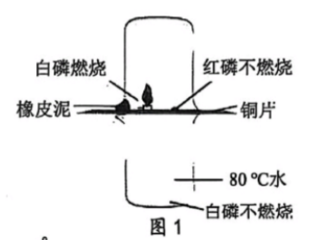
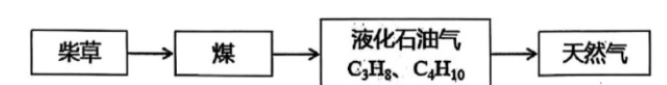
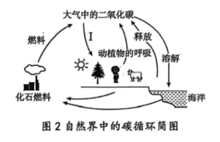
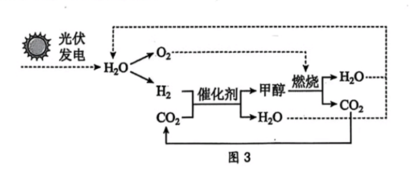
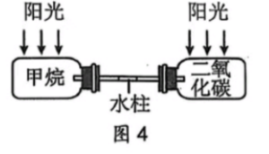
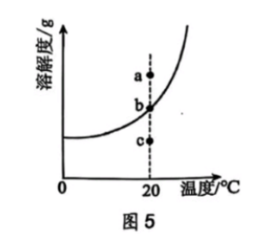
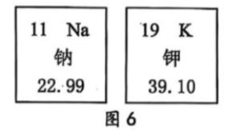
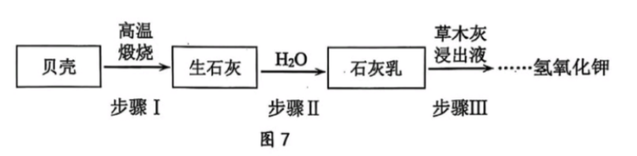

# 化模26-奉贤 · 2026 奉贤一模精讲 · 燃烧 / 碳中和 / 点水成冰 / 古法制氢氧化钾

> 奉贤卷为综合练习的**化学部分**（全卷 135 分、120 分钟，化学 50 分），按"情境题块"命题，题号全卷连续（1~21），含**不定项**（第 3(2)、14、20 题）。相对原子质量：H-1、C-12、O-16。**卷末附参考答案页，已与独立推演逐项核对，全部一致**。卷面插图（燃烧条件实验、燃料变迁流程、碳循环、甲醇循环、温室效应装置、溶解度曲线、周期表信息、古法制氢氧化钾流程共 8 幅）已按 150dpi 页图原样裁切嵌入题干。

## 题块一 · 燃料与燃烧（13 分 · 第 1~4 题）

家用燃料变迁是能源利用史缩影，其核心是燃烧技术的革新，反映科技进步与社会发展。

**1.** 认识燃烧（已知：白磷着火点 30℃，红磷着火点 260℃；五氧化二磷有毒。）

（1）图 1 中铜片上的白磷燃烧，红磷不燃烧，得出燃烧条件之一是＿＿＿＿＿＿＿＿；

（2）能说明燃烧需要"可燃物与氧气接触"的证据是＿＿＿＿＿＿＿＿；

（3）白磷燃烧产物 P₂O₅ 中磷元素的化合价是＿＿＿＿＿＿＿＿。
- （A）−5
- （B）−2
- （C）+2
- （D）+5

（4）铜片上倒扣一个烧杯且烧杯槽口塞上橡皮泥，推测其作用＿＿＿＿＿＿＿＿。

> [!tip]- 💡 思路导航
> 图 1 藏着两组对照：铜片上白磷 vs 红磷（同温、着火点不同），铜片上白磷 vs 热水中白磷（同温、隔氧与否）——对照组之间**唯一的变量**就是结论；（3）按化合价代数和为零算；（4）紧扣题干括号里的已知条件想"为什么非要扣烧杯"。

> [!success]- ✅ 详解 · 评分点 · 易错 · 关联
> **详解**：（1）**温度需达到可燃物的着火点**（白磷 30℃＜80℃ 已达，红磷 260℃ 未达）。
> （2）**铜片上的白磷燃烧，而 80℃ 热水中的白磷不燃烧**——温度相同、都是白磷，唯一差别是能否接触氧气。
> （3）选 **D**：O 共 −10，2 个 P 共 +10，P＝+5。
> （4）**防止燃烧产生的五氧化二磷（白烟）逸散污染空气**（P₂O₅ 有毒，题干已知即提示）。
>
> **评分点**：（2）要写**完整对照**："铜片上的白磷"与"水中的白磷"，只答"水中的白磷不燃烧"没有参照对象不给满分。
>
> **关联**：[[05-化学/知识点/专题3-空气氧气与二氧化碳]]（燃烧条件探究）。

**2.** 调控燃烧：当天然气灶的火焰呈现黄橙色时，可以＿＿＿＿＿＿＿＿（填"调大"或"调小"）灶具的进风口，从而促进燃料充分燃烧；炒菜时如果油锅着火，可以用锅盖盖住锅口灭火。以上都是通过调控＿＿＿＿＿＿＿＿来实现的。

> [!tip]- 💡 思路导航
> 黄橙色火焰＝氧气不足、燃烧不充分，进风口往"多进氧气"的方向调；再想锅盖灭火断掉了燃烧三要素中的哪一项——两空的共同落点都是"氧气浓度"。

> [!success]- ✅ 详解 · 评分点 · 易错 · 关联
> **详解**：填**调大**；**助燃物（氧气）的浓度**——调大进风口是增大氧气浓度促进燃烧，锅盖灭火是隔绝氧气（降低助燃物浓度）。
>
> **易错**：第 2 空与第 4 题呼应：灶具调风是"增大助燃物浓度"，井下鼓风是"降低可燃物浓度"，两条原理方向相反，别套混。
>
> **关联**：[[05-化学/知识点/专题3-空气氧气与二氧化碳]]（充分燃烧、灭火原理）。

**3.** 家用燃料的变迁。

（1）图中所列家用燃料不属于化石燃料的是＿＿＿＿＿＿＿＿。
- （A）柴草
- （B）煤
- （C）液化石油气
- （D）天然气

（2）（不定项）煤主要含碳元素，还含有少量氮、硫等元素。直接燃烧煤可能会产生的空气污染物是＿＿＿＿＿＿＿＿。
- （A）CO
- （B）CO₂
- （C）SO₂
- （D）PM₁₀

（3）液化石油气主要成分 C₃H₈ 燃烧的化学方程式为：C₃H₈+5O₂ --点燃--> 3CO₂+4X，其中 X 的化学式是＿＿＿＿＿＿＿＿。

（4）关于家用燃料变迁理由的表述中，不合理的是＿＿＿＿＿＿＿＿。
- （A）使用更便捷
- （B）不易发生爆炸
- （C）燃烧更充分
- （D）减少大气污染

> [!tip]- 💡 思路导航
> （1）化石燃料三大样"煤、石油、天然气"，流程图里谁不在其中？（2）抓"氮、硫"两种元素想燃烧产物，再想 CO₂ 的身份——它是污染物吗？（3）反应前后原子个数相等，清点 H、O 分给 4X；（4）"变迁"是为了更安全还是就不爆炸了？用生活常识逐项掂量。

> [!success]- ✅ 详解 · 评分点 · 易错 · 关联
> **详解**：（1）选 **A**：柴草是生物质能，不是化石燃料。
> （2）选 **ACD**：煤中氮、硫燃烧生成氮氧化物、SO₂，不完全燃烧生成 CO，烟尘即 PM₁₀；CO₂ 是温室气体，**不属于**空气质量报告中的空气污染物。
> （3）**H₂O**：反应前 8 个 H、10 个 O，3CO₂ 用去 6 个 O，余 2H、4O 分给 4X → 每个 X 含 2H、1O。
> （4）选 **B**：变迁后使用环节的爆炸风险并未消失，"不易发生爆炸"不是变迁理由；更便捷、燃烧更充分、污染更少才是公认优点。
>
> **易错**：（2）CO₂ 是最大的迷惑项：它造成温室效应，但**不是**空气质量标准里的污染物，不定项里排它。
>
> **关联**：[[05-化学/知识点/专题3-空气氧气与二氧化碳]]（化石燃料、空气污染）、[[05-化学/知识点/专题6-化学变化及其表示]]（原子守恒定化学式）。

**4.** 煤矿井下的空气通常含有甲烷，不断鼓入新鲜空气是防止发生燃烧或爆炸的举措之一，其原理是通过＿＿＿＿＿＿＿＿使甲烷燃烧无法达到所需的条件。

> [!tip]- 💡 思路导航
> 爆炸的条件是"可燃物浓度达到爆炸极限"——鼓入新鲜空气对甲烷浓度做了什么？

> [!success]- ✅ 详解 · 评分点 · 易错 · 关联
> **详解**：填**降低可燃物（甲烷）的浓度**——鼓入新鲜空气使甲烷浓度低于爆炸极限，燃烧（爆炸）无法发生。
>
> **易错**：与第 2 题方向相反：灶具调风是"增大助燃物浓度"，井下鼓风是"降低可燃物浓度"。
>
> **关联**：[[05-化学/知识点/专题3-空气氧气与二氧化碳]]（爆炸极限与安全）。

## 题块二 · 碳中和（14 分 · 第 5~9 题）

党的二十大报告提出，要"积极稳妥推进碳达峰碳中和"。

**5.** 识"碳"：碳达峰碳中和中的"碳"是指＿＿＿＿＿＿＿＿。
- （A）碳元素
- （B）碳原子
- （C）碳单质
- （D）二氧化碳

> [!tip]- 💡 思路导航
> "碳达峰、碳中和"针对的是哪一种具体物质的排放与吸收？结合"排放清单"想。

> [!success]- ✅ 详解 · 评分点 · 易错 · 关联
> **详解**：选 **D**。碳达峰/碳中和针对的是**二氧化碳**的排放与吸收。
>
> **关联**：[[05-化学/知识点/专题9-10-反应调控与化学社会]]（碳中和）。

**6.** 寻"碳"：写出一条大气中二氧化碳的主要来源＿＿＿＿＿＿＿＿。

> [!tip]- 💡 思路导航
> 从"什么过程向大气排 CO₂"想：工业与生活的大头是什么？生物活动呢？任答一条即可。

> [!success]- ✅ 详解 · 评分点 · 易错 · 关联
> **详解**：答**化石燃料（煤、石油、天然气）的燃烧**（或动植物的呼吸作用，合理即可）。

**7.** 固"碳"。

（1）自然界中有多种途径捕集 CO₂，图 2 中的 I 是利用植物＿＿＿＿＿＿＿＿进行捕集；

（2）有研究表明每年约 20 亿吨的二氧化碳被海洋吸收，二氧化碳除了溶于水，还能与水反应，写出该反应的化学方程式＿＿＿＿＿＿＿＿。

> [!tip]- 💡 思路导航
> 图 2 里 I 是碳循环中唯一的"大气→生物"箭头——植物靠什么生理过程吸收 CO₂？（2）"与水反应"的产物是生活中很常见的一种弱酸。

> [!success]- ✅ 详解 · 评分点 · 易错 · 关联
> **详解**：（1）**光合作用**（绿色植物吸收 CO₂ 和水制造有机物、释放氧气）。
> （2）$CO_2+H_2O=H_2CO_3$（"多变一"，化合反应）。
>
> **关联**：[[05-化学/知识点/专题3-空气氧气与二氧化碳]]（碳循环、CO₂ 与水反应）。

**8.** 用"碳"：2023 年杭州亚运会主火炬燃料为"零碳"甲醇（CH₃OH），它是 CO₂ 资源化利用的有效途径，利用废气中的 CO₂ 热催化加氢合成，反应的基本原理为：CO₂+3H₂ --催化剂、Δ--> CH₃OH+H₂O。其制备和燃烧的循环过程如图 3 所示。

（1）甲醇（CH₃OH）中碳元素的质量分数为＿＿＿＿＿＿＿＿；

（2）图 3 中光伏发电是将太阳能转化为＿＿＿＿＿＿＿＿能；

（3）根据图 3 中信息，写出甲醇燃烧的化学方程式＿＿＿＿＿＿＿＿；

（4）若消耗 12 t 氢气，理论上能捕集的 CO₂ 质量是多少？（根据化学方程式列式计算）

（5）"零碳"甲醇被称为"零碳"的原因是＿＿＿＿＿＿＿＿。

> [!tip]- 💡 思路导航
> （1）质量分数＝12/(12+1×4+16)；（2）光伏=太阳能变什么能，一句话；（3）从图 3 找燃烧产物只有 CO₂ 和 H₂O，配平＋条件"点燃"；（4）按 3H₂~CO₂ 的质量比列式；（5）抓"循环"二字：排放的碳去了哪里？

> [!success]- ✅ 详解 · 评分点 · 易错 · 关联
> **详解**：（1）w(C)＝12/(12+1×4+16)×100%＝12/32×100%＝**37.5%**。
> （2）**电**能。
> （3）$2CH_3OH+3O_2\xrightarrow{\text{点燃}}2CO_2+4H_2O$（C 2=2，H 8=8，O 2+6=4+4 ✓）。
> （4）解：设理论上能捕集二氧化碳的质量为 x。$CO_2+3H_2\xrightarrow{\text{催化剂},\ \Delta}CH_3OH+H_2O$，44 : (3×2)＝x : 12 t，即 6/44＝12 t/x，x＝**88 t**。答：理论上能捕集二氧化碳 88 t。
> （5）三段式：**判断**——甲醇燃烧虽排放 CO₂，但全程"零净增"。**依据**——燃烧生成的 CO₂ 可被回收，重新作为合成甲醇的原料循环利用。**回扣**——排放的碳全部来自废气中的 CO₂ 且可再被捕集，没有向大气净增加碳排放，故称"零碳"。
>
> **评分点**：（3）甲醇燃烧方程式必须**配平＋标"点燃"**，用图 3 的信息"燃烧生成 CO₂ 和 H₂O"锁定产物，别写成一氧化碳；（4）质量比是 **6:44**（3×2 对 44），用 2:44 或 3:44 都错；单位 t 要全程统一。
>
> **关联**：[[05-化学/知识点/专题6-化学变化及其表示]]（方程式计算）、[[05-化学/知识点/专题9-10-反应调控与化学社会]]（碳中和）。

**9.** 甲烷和二氧化碳都是温室气体。下表为两种气体的温室效应指数及对地球温室效应的贡献百分比。

| 温室效应气体 | 温室效应指数 | 对温室效应贡献百分比 |
| ---- | ---- | ---- |
| 二氧化碳 | 1 | 55% |
| 甲烷 | 21 | 15% |

备注：温室效应指数是指以二氧化碳为基准，测定一定大气压每单位体积的气体所吸收的热量。

（1）用图 4 装置探究甲烷和二氧化碳两种气体的温室效应，相同体积的气体在相同的光照下照射一段时间后，水柱的变化情况是＿＿＿＿＿＿＿＿。
- （A）向左移动
- （B）向右移动
- （C）保持不变

（2）二氧化碳的温室效应指数虽低于甲烷，但对地球温室效应的贡献却大于甲烷，主要原因在于＿＿＿＿＿＿＿＿。

> [!tip]- 💡 思路导航
> （1）查表比谁的"单位吸热本领"强——吸热多的一侧升温快、压强大，水柱被推向对方；（2）贡献＝单位效应×总量，指数低的一方靠什么反超？

> [!success]- ✅ 详解 · 评分点 · 易错 · 关联
> **详解**：（1）选 **B**：甲烷温室效应指数（21）远大于二氧化碳（1），同体积同光照下甲烷瓶吸热多、升温快、压强大，水柱被压向二氧化碳一侧，即**向右移动**。
> （2）三段式：**判断**——贡献大小取决于排放总量。**依据**——大气中**二氧化碳的排放总量远大于甲烷**。**回扣**——贡献＝单位吸收热量×总量，CO₂ 指数虽低但量大，总贡献（55%）反超甲烷（15%）。
>
> **易错**：（1）方向判断要落在"吸热多→压强大→推向对方"，别只背"水柱移动"不交代方向依据。
>
> **关联**：[[05-化学/知识点/专题9-10-反应调控与化学社会]]（温室效应）。

## 题块三 · "点水成冰"（9 分 · 第 10~17 题）

王亚平老师在"天宫课堂"上，用沾了结晶核的毛根（不与溶液发生反应）轻触悬浮于空气中的液体球，液体球迅速结晶成了"冰球"。这里的液体球是醋酸钠（CH₃COONa）过饱和溶液。过饱和溶液，是指在特定温度与压力条件下，溶液中溶质的浓度超过了该温度和压力下饱和溶液的溶质浓度，但溶质尚未析出的溶液。

**10.** CH₃COONa 由＿＿＿＿＿＿＿＿种元素组成。

> [!tip]- 💡 思路导航
> 数元素种类时把化学式完整拆一遍，金属元素别漏。

> [!success]- ✅ 详解 · 评分点 · 易错 · 关联
> **详解**：填 **4**（Na、C、H、O 四种元素；CH₃COONa 中的"3、2"都是原子个数，别漏数金属钠）。
>
> **易错**："有机物只含 C、H、O"是惯性错误，醋酸钠含钠。

**11.** 下列生活中常见的物质与水混合充分搅拌，能形成溶液的是＿＿＿＿＿＿＿＿。
- （A）冰块
- （B）面粉
- （C）花生油
- （D）氯化钠

> [!tip]- 💡 思路导航
> 溶液=均一、稳定的混合物。逐项想：冰块与水是同一种物质吗？面粉、油与水形成的是悬浊液/乳浊液还是溶液？

> [!success]- ✅ 详解 · 评分点 · 易错 · 关联
> **详解**：选 **D**。冰块与水是同种物质（纯净物），不构成溶液；面粉、花生油与水形成悬浊液/乳浊液；氯化钠溶于水形成均一、稳定的氯化钠溶液。
>
> **关联**：[[05-化学/知识点/专题7-溶液]]（溶液概念）。

**12.** "冰球"摸上去是温热的，说明该过程＿＿＿＿＿＿＿＿（填"放热"或"吸热"）。

> [!tip]- 💡 思路导航
> "摸上去温热"= 球向你手里传了热——这个过程对外放热还是吸热？

> [!success]- ✅ 详解 · 评分点 · 易错 · 关联
> **详解**：填**放热**（摸上去温热＝结晶过程向外界放热）。

**13.** 液体球结晶过程属于＿＿＿＿＿＿＿＿（填"物理"或"化学"）变化。

> [!tip]- 💡 思路导航
> 结晶只是溶质从溶液里"搬出来"，有没有生成新物质？

> [!success]- ✅ 详解 · 评分点 · 易错 · 关联
> **详解**：填**物理**：结晶只是溶质从溶液中析出，无新物质生成。
>
> **关联**：[[05-化学/知识点/专题1-物质的变化与性质]]（物理变化与化学变化）。

**14.**（不定项）结晶过程中，下列判断正确的是＿＿＿＿＿＿＿＿。
- （A）溶液中溶质的质量一定减少
- （B）溶液中溶剂的质量一定减少
- （C）溶液中溶质的质量分数一定减小
- （D）溶解度一定减小

> [!tip]- 💡 思路导航
> 结晶只"搬走"溶质，**溶剂一动不动**；溶解度只由温度决定——温度变了才变。两条排除依据想清楚再选。

> [!success]- ✅ 详解 · 评分点 · 易错 · 关联
> **详解**：选 **AC**。溶质析出，溶液中溶质质量一定减少（A 对）、浓度降低（C 对）；溶剂不蒸发就不减少（B 错）；结晶过程中温度不变，溶解度不变（D 错）。
>
> **易错**：B/D 的排除依据要写全："结晶不动溶剂""温度不变溶解度不变"，两条都是概念直接应用。
>
> **关联**：[[05-化学/知识点/专题7-溶液]]（结晶、溶解度影响因素）。

**15.** 醋酸钠的部分溶解度如下表所示，将醋酸钠过饱和溶液转化为饱和溶液的方法是＿＿＿＿＿＿＿＿。

| 温度/℃ | 0 | 20 | 40 | 60 | 80 |
| ---- | ---- | ---- | ---- | ---- | ---- |
| 溶解度/g | 33 | 46.5 | 65.5 | 139 | 153 |

> [!tip]- 💡 思路导航
> 过饱和→饱和，本质是让"浓度＝溶解度"：一条路把溶解度**升上去**（看表想升温方向），一条路把浓度**降下来**（加什么？）。

> [!success]- ✅ 详解 · 评分点 · 易错 · 关联
> **详解**：填**升温（或加水）**：升温使醋酸钠溶解度增大，当溶解度恰好升到等于原过饱和溶液的浓度时，即成为该温度下的饱和溶液；加水稀释使浓度降到等于该温度下的溶解度，同样得到饱和溶液。
>
> **关联**：[[05-化学/知识点/专题7-溶液]]（饱和与不饱和的转化）。

**16.** 取 80℃ 时 253 g 饱和溶液降温到 20℃，理论上最多析出＿＿＿＿＿＿＿＿g 醋酸钠。

> [!tip]- 💡 思路导航
> 先把 253 g 化成"100 g 水＋153 g 溶质"（80℃ 恰好饱和），再算 20℃ 时 100 g 水最多溶多少，作差即析出量。

> [!success]- ✅ 详解 · 评分点 · 易错 · 关联
> **详解**：253 g（80℃ 饱和）＝100 g 水＋153 g 醋酸钠；降到 20℃，100 g 水最多溶 46.5 g。析出＝153−46.5＝**106.5 g**。
>
> **易错**：先验"253＝100+153"再作差，结果**带单位 g**；与崇明卷析晶题为同型题（先化到 100 g 水）。
>
> **关联**：[[05-化学/知识点/专题7-溶液]]（降温析晶计算）、[[化-23-溶质质量分数与计算]]。

**17.** 图 5 是醋酸钠的溶解度曲线，20℃ 时醋酸钠过饱和溶液的组成对应图中的＿＿＿＿＿＿＿＿（填"a""b"或"c"）点。

> [!tip]- 💡 思路导航
> 曲线上的点=饱和，曲线上方=浓度更高。过饱和溶液的浓度与同温度的饱和浓度比，谁高谁低？

> [!success]- ✅ 详解 · 评分点 · 易错 · 关联
> **详解**：填 **a**：过饱和溶液的浓度大于该温度（20℃）下饱和溶液的浓度，组成点位于溶解度曲线**上方**，即 a 点。
>
> **关联**：[[05-化学/知识点/专题7-溶液]]（溶解度曲线读图）。

## 题块四 · 古法制氢氧化钾（14 分 · 第 18~21 题）

制肥皂的主要原理是油脂与碱发生化学反应。工业生产中，常用氢氧化钠制造硬皂（如皂块），用氢氧化钾制造软皂（如液体皂）。

**18.** 图 6 为元素周期表中的钠元素和钾元素。下列说法错误的是＿＿＿＿＿＿＿＿。

- （A）两种元素都属于金属元素
- （B）钠原子的质量比钾原子的质量大
- （C）钾元素的相对原子质量为 39.10
- （D）两种元素的本质区别是质子数不同

> [!tip]- 💡 思路导航
> 周期表小格里最下面的数才是相对原子质量；"原子质量大小"看它比就行；元素种类的本质区别回到"质子数"。

> [!success]- ✅ 详解 · 评分点 · 易错 · 关联
> **详解**：选 **B**：相对原子质量 22.99＜39.10，钠原子质量比钾**小**；A、C、D 均正确。
>
> **关联**：[[05-化学/知识点/专题5-物质的微观构成]]（元素周期表信息）。

**19.** 氢氧化钾和氢氧化钠化学性质相似，原因是水溶液中均可离解出＿＿＿＿＿＿＿＿（填写名称）。

> [!tip]- 💡 思路导航
> 碱类通性的"功臣"是哪种共同离子？答名称，别答符号。

> [!success]- ✅ 详解 · 评分点 · 易错 · 关联
> **详解**：填**氢氧根离子**（OH⁻——碱类通性的共同离子）。
>
> **关联**：[[05-化学/知识点/专题8-酸碱盐]]（碱的通性）。

**20.**（不定项）推测氢氧化钾的化学性质，其中合理的是＿＿＿＿＿＿＿＿。
- （A）水溶液能使紫色石蕊试液变红
- （B）能与铁反应
- （C）能与硫酸铜溶液反应
- （D）能与硫酸反应

> [!tip]- 💡 思路导航
> 搬氢氧化钠的通性过来用：碱遇石蕊变什么色？碱与不活泼金属铁呢？碱＋盐、碱＋酸两组反应逐项过。

> [!success]- ✅ 详解 · 评分点 · 易错 · 关联
> **详解**：选 **CD**。碱溶液应使石蕊变**蓝**（A 错）；KOH 不与铁反应（B 错）；KOH＋CuSO₄ 生成蓝色 Cu(OH)₂ 沉淀（C 对）；KOH 与硫酸发生中和反应（D 对）。
>
> **易错**：A 的"红/蓝"方向、B 的"碱不与金属反应"是碱的通性题双陷阱；不定项漏选不得满分。
>
> **关联**：[[05-化学/知识点/专题8-酸碱盐]]（碱的化学性质）。

**21.** 古法制备氢氧化钾，通常以贝壳（主要成分：碳酸钙）、草木灰（主要成分：碳酸钾）和水为原料。主要步骤如图 7。

（1）草木灰是古代农业中应用广泛的＿＿＿＿＿＿＿＿。
- （A）氮肥
- （B）磷肥
- （C）钾肥

（2）高温煅烧前需将贝壳粉碎成小块，其目的是＿＿＿＿＿＿＿＿；

（3）步骤 II 中发生反应的基本类型是＿＿＿＿＿＿＿＿。
- （A）化合反应
- （B）分解反应
- （C）置换反应
- （D）复分解反应

（4）得到的石灰乳属于＿＿＿＿＿＿＿＿。
- （A）溶液
- （B）悬浊液
- （C）乳浊液

（5）步骤 III 中主要发生的是复分解反应，写出该反应的化学方程式＿＿＿＿＿＿＿＿；

（6）流程中可以循环利用的物质是＿＿＿＿＿＿＿＿（填化学式）；

（7）利用上述方法制备的氢氧化钾中通常含有杂质。某化学小组设计了如下方案进行探究：

| 实验目的 | 实验方案 | 实验现象 | 结论 |
| ---- | ---- | ---- | ---- |
| 探究氢氧化钾样品中杂质成分 | 取少量样品溶于水，滴加碳酸钠溶液。 | 无明显现象 | 氢氧化钾样品中不含＿＿＿＿＿＿＿＿（①）。 |
|  | 取少量样品溶于水，＿＿＿＿＿＿＿＿（②）。 | 有气泡产生 | 氢氧化钾样品中含有碳酸钾。 |

反思：小组同学认为样品中的碳酸钾有可能是因存放不当产生的，请分析原因＿＿＿＿＿＿＿＿（③）。

> [!tip]- 💡 思路导航
> 流程题沿"每一步变了什么"走：粉碎是物理手段为反应服务；步骤 II 是 CaO＋水；石灰乳看溶解性归类；步骤 III 抓"石灰乳＋碳酸钾→交换成分"；循环物质找"既是原料又是产物"的那个；（7）的检验从"加碳酸钠无现象"反推不含谁，产气验证碳酸钾走"加酸冒泡"，反思抓"碱＋CO₂→碳酸盐"。

> [!success]- ✅ 详解 · 评分点 · 易错 · 关联
> **详解**：（1）选 **C**（草木灰主要成分 K₂CO₃，含钾元素，属钾肥）。
> （2）**增大反应物接触面积，使煅烧更充分、反应更快**。
> （3）选 **A**：CaO+H₂O＝Ca(OH)₂，"多变一"为化合反应（放出大量热）。
> （4）选 **B**：Ca(OH)₂ 微溶于水，石灰乳是固体小颗粒悬浮于水形成的**悬浊液**。
> （5）$Ca(OH)_2+K_2CO_3=CaCO_3\downarrow+2KOH$（Ca 1=1，O 2+3=3+2，H 2=2，K 2=2，C 1=1 ✓；"↓"是得分点）。
> （6）**CaCO₃**——贝壳的主要成分是 CaCO₃，步骤 III 生成的 CaCO₃ 沉淀可再煅烧制生石灰，循环利用。
> （7）① **Ca(OH)₂**：滴加 Na₂CO₃ 无沉淀，说明不含氢氧化钙（若有会生成白色 CaCO₃ 沉淀）。② **滴加足量稀盐酸**：有气泡产生 → 含 K₂CO₃（K₂CO₃+2HCl＝2KCl+H₂O+CO₂↑）。③ 三段式：**判断**——存放时吸收空气中 CO₂ 变质。**依据**——KOH 是碱，能与 CO₂ 反应。**回扣**——$2KOH+CO_2=K_2CO_3+H_2O$，生成的正是检出的碳酸钾，故"含碳酸钾"可能是变质所致而非原有杂质。
>
> **评分点**：（5）复分解产物别配错：Ca²⁺ 配 CO₃²⁻ 出沉淀，K⁺ 配 OH⁻ 留在溶液，系数 2 落在 KOH 前；（7）③反思题只答"吸收二氧化碳"不够，必须**写出变质方程式** 2KOH+CO₂＝K₂CO₃+H₂O 才闭环。
>
> **关联**：[[05-化学/知识点/专题8-酸碱盐]]（复分解反应、碱的变质与检验）、[[05-化学/知识点/专题7-溶液]]（悬浊液）。

## ✅ 答案速查

| 题 | 答案 |
| ---- | ---- |
| 1~2 | 温度达到着火点；铜片上白磷燃烧、水中白磷不燃烧；D；防 P₂O₅ 逸散污染空气；调大；助燃物浓度 |
| 3~4 | A；ACD；H₂O；B；降低可燃物浓度 |
| 5~7 | D；化石燃料燃烧（或动植物呼吸）；光合作用；CO₂+H₂O＝H₂CO₃ |
| 8 | 37.5%；电；2CH₃OH+3O₂ --点燃--> 2CO₂+4H₂O；88 t；CO₂ 可回收循环再合成甲醇 |
| 9 | B；CO₂ 排放总量远大于甲烷 |
| 10~14 | 4；D；放热；物理；AC |
| 15~17 | 升温（或加水）；106.5 g；a |
| 18~21 | B；氢氧根离子；CD；C；增大接触面积煅烧充分；A；B；Ca(OH)₂+K₂CO₃＝CaCO₃↓+2KOH；CaCO₃；Ca(OH)₂；滴加足量稀盐酸；2KOH+CO₂＝K₂CO₃+H₂O |

## 🔗 关联

- [[05-化学/知识点/专题3-空气氧气与二氧化碳]]（燃烧条件、碳循环）· [[05-化学/知识点/专题7-溶液]]（过饱和、结晶计算）· [[05-化学/知识点/专题8-酸碱盐]]（碱的通性、变质与检验、复分解流程）
- [[05-化学/知识点/专题9-10-反应调控与化学社会]]（燃烧调控、碳中和）· [[05-化学/知识点/专题5-物质的微观构成]]（周期表信息）· [[化-07-燃烧与碳]] · [[化-16-实验探究与评价]] · [[化-17-说理题专练]]（三段式）
- 同系列：[[化模26-崇明-上]]（古法制硝同型）· [[化模26-嘉定]]
