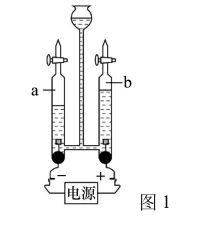
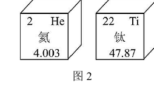
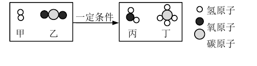
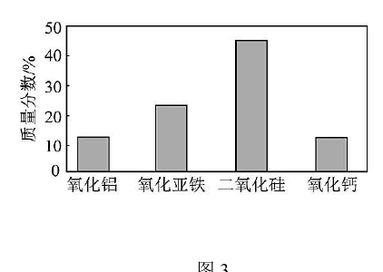
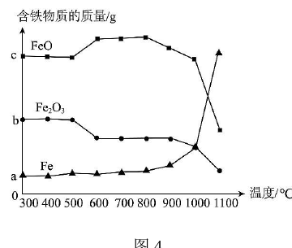
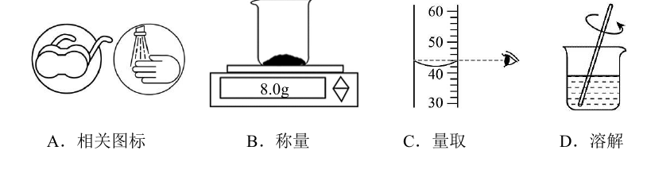
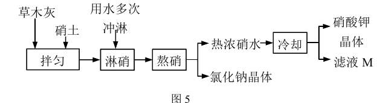
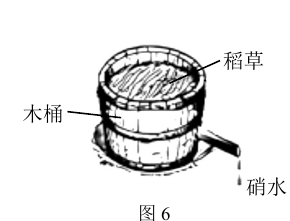

# 化模26-崇明-上 · 2026 崇明一模精讲（上）· 水 / 古法制硝

> 2026 一模按"情境题块"命题，并出现**不定项/多选**选择题（本讲：第 4、9 题）。本卷相对原子质量：H-1、C-12、O-16、Na-23、Cl-35.5、Ca-40。卷面答案已与独立推演互证，全部一致。卷面插图（电解水装置、氦钛周期表信息、微观示意图、月壤成分柱状图、含铁物质-温度曲线、制硝流程、木桶装置、溶液配制四图标共 8 幅）已按 150dpi 页图原样裁切嵌入题干。

## 题块一 · 水（10 分 · 第 1~7 题）

水是生命之源。一滴水，从江河出发，经处理可变为自来水、直饮水；当它随航天员进入太空，便在循环系统中获得新生。我国科研团队从月球上带回来的样品有氦和钛铁矿石，钛铁矿石储存了氢，加热至高温后，氢与矿石中含铁元素的物质发生反应生成水，当温度升高至 1000℃ 以上时，月壤熔化，生成的水以水蒸气的方式释放出来。

**1.** 下列"水"属于纯净物的是＿＿＿＿＿＿＿＿。
- （A）江河水
- （B）蒸馏水
- （C）直饮水
- （D）自来水

> [!tip]- 💡 思路导航
> 纯净物看"物质种类是否唯一"：四种"水"里谁经过了彻底的提纯？

> [!success]- ✅ 详解 · 评分点 · 易错 · 关联
> **详解**：选 **B**。江河水、直饮水、自来水均溶有可溶性杂质等，属混合物；蒸馏水是纯净物。
>
> **关联**：[[05-化学/知识点/专题4-水的性质与组成]]（纯净物与混合物）。

**2.** 对学校附近的天然水进行水质检测，你认为不需要检测的是水样的＿＿＿＿＿＿＿＿。
- （A）浑浊度
- （B）色度
- （C）溶解氧含量
- （D）密度

> [!tip]- 💡 思路导航
> 水质指标都是"能反映水干净不干净、适合不适合生物生存"的量——密度与水质优劣有关吗？

> [!success]- ✅ 详解 · 评分点 · 易错 · 关联
> **详解**：选 **D**。浑浊度、色度、溶解氧含量都是水质指标；密度与水质优劣无关，无需检测。
>
> **关联**：[[05-化学/知识点/专题4-水的性质与组成]]（水质检测）。

**3.** 水以水蒸气的方式释放出来，发生变化的是＿＿＿＿＿＿＿＿。
- （A）水分子的质量
- （B）水分子的种类
- （C）水分子的大小
- （D）水分子的间隙

> [!tip]- 💡 思路导航
> 液态→气态是物理变化：分子本身一概不变，变的是什么？

> [!success]- ✅ 详解 · 评分点 · 易错 · 关联
> **详解**：选 **D**。液态水→水蒸气是物理变化，水分子的质量、种类、大小都不变，改变的是**分子间隙**。
>
> **关联**：[[05-化学/知识点/专题5-物质的微观构成]]（三态变化的微观本质）。

**4.**（不定项）如图 1，用电解水实验探究水的组成，有关说法错误的是＿＿＿＿＿＿＿＿。

- （A）电解水的变化过程中发生了能量转化
- （B）负极产生的气体能使带火星的木条复燃
- （C）电解时，正极产生气泡的速率比负极产生气泡的速率快
- （D）该实验证明水由氢元素和氧元素组成

> [!tip]- 💡 思路导航
> 电解水铁律"正氧负氢、体积 1:2"先摆出来：负极是什么气体、正负两极谁产气多，两个选项直接由它裁决；再想电解水消耗了什么能、生成了什么——能量转化跑不掉；本题为不定项**选错误**。

> [!success]- ✅ 详解 · 评分点 · 易错 · 关联
> **详解**：选 **BC**（2 分）。A 对：电解水消耗电能生成新物质，电能转化为化学能；B 错：负极产生**氢气**，不能使带火星木条复燃（正极氧气才可以）；C 错：正极氧气少，气泡速率比负极**慢**；D 对。
>
> **易错**：不定项**漏选不得满分、错选倒扣**：先逐项判对错再落笔。
>
> **关联**：[[05-化学/知识点/专题4-水的性质与组成]]（电解水实验）。

**5.** 如图 2，有关氦、钛元素（或原子）的说法，错误的是＿＿＿＿＿＿＿＿。

- （A）氦元素的原子序数为 2
- （B）氦原子可以直接构成物质
- （C）氦元素和钛元素本质区别是相对原子质量不同
- （D）氦、钛两种原子的实际质量之比等于它们的相对原子质量之比

> [!tip]- 💡 思路导航
> 元素的本质区别回到"质子数"这条定义上；（D）是相对原子质量定义的正向应用——实际质量比＝相对原子质量比，别误判成错。

> [!success]- ✅ 详解 · 评分点 · 易错 · 关联
> **详解**：选 **C**。元素的本质区别是**质子数（核电荷数）**不同；A、B、D 均为正确说法。
>
> **关联**：[[05-化学/知识点/专题5-物质的微观构成]]（元素的定义、相对原子质量）。

**6.** 太空站，电解水产生的氢气与宇航员呼出的二氧化碳反应又生成水的微观示意图如下图所示。

保持水化学性质的最小微观粒子的是＿＿＿＿＿＿＿＿（用微观粒子的名称表示）；参与反应的氢气与二氧化碳的分子数目比为＿＿＿＿＿＿＿＿。

> [!tip]- 💡 思路导航
> 先按图示写出反应：CO₂＋H₂→CH₄＋H₂O，用原子守恒配平再读分子数目比；"保持水的化学性质"直接对号"由分子构成的物质，分子保持化学性质"。

> [!success]- ✅ 详解 · 评分点 · 易错 · 关联
> **详解**：保持水化学性质的最小粒子是**水分子**；反应为 $CO_2+4H_2\xrightarrow{\text{一定条件}}CH_4+2H_2O$（C 1=1，O 2=2，H 4=4 ✓），参加反应的 H₂ 与 CO₂ 分子数目比为 **4:1**。
>
> **易错**：数目比先配平再读，直接数图中"画了几个分子"会掉进未配平的陷阱。
>
> **关联**：[[05-化学/知识点/专题5-物质的微观构成]]（分子与原子）、[[05-化学/知识点/专题6-化学变化及其表示]]（质量守恒定律）。

**7.** 获得月壤主要成分的质量分数如图 3 所示。月壤中含铁元素的物质的质量随温度的变化情况如图 4 所示。

（1）如图 3，有关月壤主要成分的说法错误的是＿＿＿＿＿＿＿＿。

- （A）四种成分均属于氧化物
- （B）质量分数最高的成分是二氧化硅
- （C）氧化铝的化学式为 AlO
- （D）氧化钙久置于空气中会发生变质

（2）如图 4，加热月壤至 500~600℃ 时，铁单质的质量保持不变，该条件下，含铁元素的物质与氢（以 H₂ 表示）反应的化学方程式为＿＿＿＿＿＿＿＿。

> [!tip]- 💡 思路导航
> （1）拿"两种元素且其一为氧"和化合价规则逐项过，Al 是 +3 价；（2）从图 4 找 500~600℃ 段"谁在减、谁不变"：铁单质不变说明 H₂ 不与铁反应，被还原的是 Fe₂O₃——还原到哪条曲线为止？看曲线的落点。

> [!success]- ✅ 详解 · 评分点 · 易错 · 关联
> **详解**：（1）选 **C**。氧化铝中 Al 为 +3、O 为 −2，化学式为 **Al₂O₃**，"AlO"错误；其余说法正确。
> （2）铁单质质量不变 → 该温度下 H₂ 不与铁单质反应，反应物是 Fe₂O₃（被还原为 FeO）：
> $Fe_2O_3+H_2\xrightarrow{500\sim600^\circ C}2FeO+H_2O$
> （验算：Fe 2=2，O 3=2+1，H 2=2 ✓；条件"500~600℃"系按卷内答案重构，原卷 OCR 缺失）
>
> **易错**：（2）漏写"500~600℃"条件或误写"点燃/高温"均不给全分；"还原到 FeO 为止"由图 4 信息决定，勿惯性写成 Fe。
>
> **关联**：[[05-化学/知识点/专题5-化学用语与化合价]]（化学式与化合价）、[[05-化学/知识点/专题3-空气氧气与二氧化碳]]（氢气还原金属氧化物）。

## 题块二 · 古法制硝（14 分 · 第 8~14 题）

黑火药是我国古代四大发明之一，其成分含 KNO₃，古代以硝土和草木灰为原料生产 KNO₃。

**8.** KNO₃ 中氮元素的化合价为＿＿＿＿＿＿＿＿。
- （A）+1
- （B）+2
- （C）+5
- （D）−1

> [!tip]- 💡 思路导航
> K 恒 +1、O 恒 −2，化合价代数和为零解出 N。

> [!success]- ✅ 详解 · 评分点 · 易错 · 关联
> **详解**：选 **C**。K 为 +1、O 共 −6，化合价代数和为零 → N 为 **+5**。
>
> **关联**：[[05-化学/知识点/专题5-化学用语与化合价]]（化合价计算）。

**9.**（多选）黑火药爆炸时反应原理是 $2KNO_3+S+3C\xrightarrow{\text{点燃}}K_2S+N_2\uparrow+3CO_2\uparrow$。对于反应中的物质，下列说法正确的是＿＿＿＿＿＿＿＿。
- （A）KNO₃ 可作复合肥料
- （B）若碳过量，产物中可能还存在 CO
- （C）按体积计算，N₂ 在空气中大约含有 78%
- （D）CO₂ 是引起酸雨的主要物质

> [!tip]- 💡 思路导航
> 复合肥看"营养元素种类"——KNO₃ 里含哪两种？酸雨的元凶是 SO₂ 和氮氧化物，CO₂ 的"罪行"另案处理；碳过量时高温下 CO₂ 会被碳"再加工"成什么？

> [!success]- ✅ 详解 · 评分点 · 易错 · 关联
> **详解**：选 **ABC**（3 分）。KNO₃ 含 K、N 两种营养元素，是复合肥；高温下过量碳可把 CO₂ 转化为 CO，故产物可能含 CO；C 是空气体积组成常识。D 错：酸雨主要由 SO₂ 和氮氧化物引起，CO₂ 主要导致温室效应。
>
> **易错**：D 是经典陷阱：CO₂→温室效应，SO₂/NOₓ→酸雨，两组因果不能互换。
>
> **关联**：[[05-化学/知识点/专题3-空气氧气与二氧化碳]]（空气成分、酸雨与温室效应）、[[05-化学/知识点/专题8-酸碱盐]]（化肥分类）。

**10.** 古人通过"尝之有凉涩感"来初步判断硝土，推测 KNO₃ 溶于水时＿＿＿＿＿＿＿＿（填"吸收"或"放出"）热量。

> [!tip]- 💡 思路导航
> "凉"= 温度降低 = 溶液从嘴里"拿走"了热——溶质溶解时吸热还是放热？

> [!success]- ✅ 详解 · 评分点 · 易错 · 关联
> **详解**：填**吸收**。溶解吸热使溶液温度降低，故尝之有凉感。
>
> **关联**：[[05-化学/知识点/专题7-溶液]]（溶解时的吸放热现象）。

**11.** 实验室配制 50g 溶质质量分数为 16% 的氯化钠溶液时，相关内容错误的是＿＿＿＿＿＿＿＿。

- （A）相关图标
- （B）称量
- （C）量取
- （D）溶解

> [!tip]- 💡 思路导航
> 逐图找茬：A 是"腐蚀品/防水"类图标对不对路？B 天平读数 8.0 g（8 g 恰是 50 g×16%）对不对？C 量筒读数时视线是俯视、仰视还是平视凹液面最低处？D 玻璃棒搅拌对不对？

> [!success]- ✅ 详解 · 评分点 · 易错 · 关联
> **详解**：选 **C**（⚠️ 本题为图示题，卷面答案为 C）：量取读数时视线应与凹液面最低处保持水平，图中视线高于液面属**俯视**，读数偏大、实际量取的水偏少，操作错误；称量 8.0 g（50 g×16%＝8 g）、溶解搅拌操作图均正确。
>
> **易错**：俯视读数"读大实小"、仰视"读小实大"——先定眼睛位置高还是低，再推实际体积偏多还是偏少。
>
> **关联**：[[05-化学/知识点/专题7-溶液]]（溶液配制）、[[05-化学/专题/实验操作考点-化学]]（量筒读数）。

**12.** 木桶内铺上木板和稻草，将硝土和草木灰混合后拌匀置于其上，用水冲淋，于木桶下方导出"硝水"。稻草相当于实验室过滤操作的＿＿＿＿＿＿＿＿（填实验用品）；硝土中 Ca(NO₃)₂ 与草木灰中 K₂CO₃ 发生了复分解反应，化学方程式为＿＿＿＿＿＿＿＿。

> [!tip]- 💡 思路导航
> 过滤里"挡固体、过液体"的那层东西对应哪件用品？复分解方程式按"交换成分、沉淀封尾"写：Ca²⁺ 配 CO₃²⁻，K⁺ 配 NO₃⁻，配平＋"↓"。

> [!success]- ✅ 详解 · 评分点 · 易错 · 关联
> **详解**：填**滤纸**；$Ca(NO_3)_2+K_2CO_3=2KNO_3+CaCO_3\downarrow$（验算：Ca 1=1，K 2=2，N 2=2，C 1=1，O 6+3=6+3 ✓）。
>
> **评分点**：沉淀符号"↓"与配平（KNO₃ 前系数 2）各占得分点，漏一处扣一处。
>
> **关联**：[[05-化学/知识点/专题8-酸碱盐]]（复分解反应）、[[05-化学/知识点/专题4-水的性质与组成]]（过滤操作）。

古代以硝土【富含 KNO₃、Ca(NO₃)₂ 和 NaCl】和草木灰（主要成分 K₂CO₃）为原料生产 KNO₃ 的部分流程如图 5 所示，淋硝过程如图 6。

**13.** 淋硝所得的溶液称为硝水，熬硝主要是将淋硝过程中得到的硝水浓缩成浓硝水，冷却"热浓硝水"析出 KNO₃ 晶体。

（1）"硝水"中一定含有的溶质是＿＿＿＿＿＿＿＿；

（2）下表为 KNO₃、NaCl 的溶解度数据。

| 温度/℃ | 20 | 40 | 60 | 80 |
| ---- | ---- | ---- | ---- | ---- |
| KNO₃ | 31.6 | 61.3 | 106 | 167 |
| NaCl | 35.9 | 36.4 | 37.1 | 38.0 |

冷却"热浓硝水"主要获得 KNO₃ 晶体的原因是＿＿＿＿＿＿＿＿；若将 206g 硝酸钾饱和溶液从 60℃ 降低 20℃，析出硝酸钾晶体的质量为＿＿＿＿＿＿＿＿g。

> [!tip]- 💡 思路导航
> （1）"一定含有"= 两种原料反应必然生成＋原料中必然溶进的；（2）先比两条溶解度曲线"谁怕降温"；析出量先把 206 g 化成"100 g 水＋106 g KNO₃"（60℃ 恰饱和），再减 20℃ 的 31.6 g。

> [!success]- ✅ 详解 · 评分点 · 易错 · 关联
> **详解**：（1）**KNO₃ 和 NaCl**（2 分）：二者含量高且易溶于水，冲淋时一定进入硝水；K₂CO₃、Ca(NO₃)₂ 是否剩余取决于配比，不属"一定"。
> （2）原因（2 分）：**KNO₃ 的溶解度随温度降低明显减小，而 NaCl 的溶解度受温度影响很小**，冷却时 KNO₃ 大量结晶析出、NaCl 留在溶液中。
> 析出量：206 g 饱和溶液（60℃）＝100 g 水＋106 g KNO₃；降到 20℃，100 g 水最多溶 31.6 g。106−31.6＝**74.4 g**。
>
> **易错**：先"化到 100 g 水"再作差：206 g 恰是 60℃ 的 (100+106) g，水的质量不变、溶质 106→31.6；结果**漏写单位 g** 会失分。与奉贤卷 106.5 g 析晶题为同型题。
>
> **关联**：[[05-化学/知识点/专题7-溶液]]（溶解度表、降温析晶计算）、[[化-23-溶质质量分数与计算]]。

**14.** 滤液 M 可以循环使用，原因是＿＿＿＿＿＿＿＿。

> [!tip]- 💡 思路导航
> 母液里还剩什么没拿走？循环回去是为了"物尽其用"——落到"利用率"三个字上。

> [!success]- ✅ 详解 · 评分点 · 易错 · 关联
> **详解**：三段式：**判断**——滤液 M 中仍含未析出的 KNO₃。**依据**——20℃ 时 KNO₃ 溶解度仍有 31.6 g，母液中溶质远未除尽。**回扣**——循环使用可把残余 KNO₃ 带回结晶工序，**提高原料中硝酸钾的利用率，减少资源浪费**。
>
> **关联**：[[05-化学/知识点/专题7-溶液]]（结晶与母液循环）、[[05-化学/知识点/专题9-10-反应调控与化学社会]]（绿色化学）。

## ✅ 答案速查

| 题 | 答案 |
| ---- | ---- |
| 1~5 | B；D；D；BC；C |
| 6 | 水分子；4:1 |
| 7 | （1）C　（2）Fe₂O₃+H₂ --500~600℃--> 2FeO+H₂O |
| 8~11 | C；ABC；吸收；C |
| 12 | 滤纸；Ca(NO₃)₂+K₂CO₃＝2KNO₃+CaCO₃↓ |
| 13 | （1）KNO₃、NaCl　（2）KNO₃ 溶解度随温度降低明显减小而 NaCl 变化小；74.4 g |
| 14 | 滤液仍含 KNO₃，循环使用提高利用率、减少浪费 |

## 🔗 关联

- [[05-化学/知识点/专题4-水的性质与组成]]（电解水、水的净化）· [[05-化学/知识点/专题5-物质的微观构成]]（分子间隔、元素区别）
- [[05-化学/知识点/专题7-溶液]]（溶解度与结晶）· [[05-化学/知识点/专题8-酸碱盐]]（复分解反应）
- [[化-06-溶液与溶解度]] · [[化-14-化合价与推断]] · 后续：[[化模26-崇明-下]]
