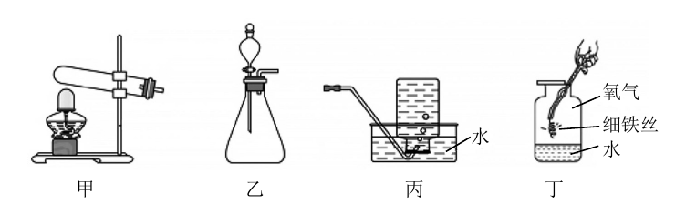
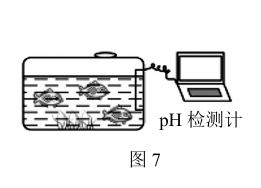
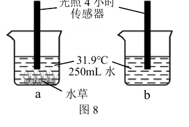
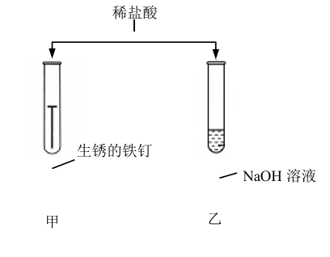
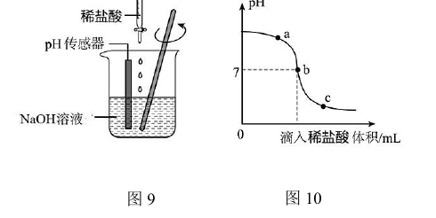
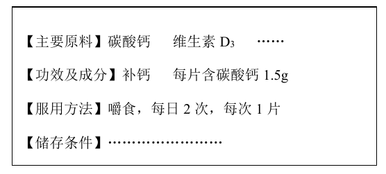

# 化模26-崇明-下 · 2026 崇明一模精讲（下）· 碳氧循环 / 酸碱盐 / 补钙剂

> 本讲承接 [[化模26-崇明-上]]（选择与概念题块），集中处理三个"实验＋说理＋计算"题块。相对原子质量：H-1、C-12、O-16、Na-23、Cl-35.5、Ca-40。卷面答案已与独立推演互证，全部一致。卷面插图（甲乙丙丁装置、鱼缸与对照烧杯、稀盐酸性质实验、pH 装置与曲线、钙片标签共 6 幅）已按 150dpi 页图原样裁切嵌入题干。

## 题块三 · 碳氧循环（11 分 · 第 15~19 题）

碳元素在自然界中分布极广，它既以单质存在，也以化合物形式存在；自然界中的碳氧循环是人类生存的基础；在实际生活中，人们会根据氧气和二氧化碳需求的不同选择不同的制备方法。

**15.** 物质的性质和用途对应关系错误的是＿＿＿＿＿＿＿＿。
- （A）活性炭有吸附性——可作防护口罩
- （B）金刚石质地坚硬——可用于裁玻璃
- （C）碳酸钠是白色粉末——可去除油污
- （D）干冰升华吸热——可用作制冷剂

> [!tip]- 💡 思路导航
> 用途必须由**给定性质**直接决定：除油污靠的是碳酸钠溶液的什么化学性质，跟"白色粉末"这个外观有因果关系吗？

> [!success]- ✅ 详解 · 评分点 · 易错 · 关联
> **详解**：选 **C**。碳酸钠除油污是因为其水溶液**显碱性**，与"白色粉末"这一物理性质没有因果关系；A、B、D 对应均正确。
>
> **关联**：[[05-化学/知识点/专题1-物质的变化与性质]]（性质决定用途）、[[05-化学/知识点/专题8-酸碱盐]]（碳酸钠的性质）。

**16.** 下图是制取氧气和探究氧气性质的部分装置。

（1）用高锰酸钾制取氧气，选择的发生装置是＿＿＿＿＿＿＿＿（填"甲"或"乙"）；能用装置丙收集 O₂ 的原因是＿＿＿＿＿＿＿＿。

（2）（选错误）装置丁中，有关铁丝在氧气中燃烧反应的叙述错误的是＿＿＿＿＿＿＿＿。
- （A）燃烧时观察到火星四射
- （B）反应的化学方程式为 3Fe+2O₂ --点燃--> Fe₃O₄
- （C）反应前后固体质量相等
- （D）预先在集气瓶底放水的目的是防止集气瓶炸裂

> [!tip]- 💡 思路导航
> （1）反应物状态＋反应条件定发生装置；排水法收集要看气体的"溶解性与水性"；（2）抓"有气体参加反应"这条守恒线索——固体质量还能相等吗？再核对方程式配平与"点燃"条件。

> [!success]- ✅ 详解 · 评分点 · 易错 · 关联
> **详解**：（1）**甲**：高锰酸钾是固体，反应需加热，选固体加热型发生装置；丙为排水法收集——**氧气不易溶于水，且不与水发生化学反应**。
> （2）选 **C**。B 正确（Fe 3=3，O 4=4）；C 错：O₂ 参加反应，**固体质量增大**（Fe₃O₄ 质量大于参加反应的铁的质量）；A、D 正确。
>
> **易错**：（2）C 是"有气体参加则固体增重"的守恒推论，答"相等"即失分；同时检查 B 的配平与"点燃"条件。
>
> **关联**：[[05-化学/知识点/专题3-空气氧气与二氧化碳]]（制气装置选择、铁丝燃烧）。

**17.** 下列反应均能生成 CO₂。①木炭燃烧；②碳酸钠粉末与稀硫酸反应；③石灰石高温分解；④碳与氧化铜在高温下反应。其中最适合于实验室制取 CO₂ 的是＿＿＿＿＿＿＿＿（填序号），理由是＿＿＿＿＿＿＿＿。

> [!tip]- 💡 思路导航
> 实验室制气"比优"抓三条：常温（省能耗）、纯净（好收集）、操作方便——四条路线逐条对号，缺哪条补哪条。

> [!success]- ✅ 详解 · 评分点 · 易错 · 关联
> **详解**：填**②**；理由（2 分）：**常温进行、操作方便，制得的 CO₂ 较纯净**。逐项排除：①木炭燃烧不易收集纯净 CO₂ 且难以控制；③④均需高温，耗能多、操作不便。
>
> **易错**：没有"石灰石＋稀盐酸"这个标准答案可选时，要在给定四项中**比优**，"较纯净""常温""操作方便"是三个得分点，漏一点扣一点。
>
> **关联**：[[05-化学/知识点/专题3-空气氧气与二氧化碳]]（实验室制取 CO₂ 的原理选择）、[[化-08-二氧化碳制取]]。

**18.** 某同学利用图 7、图 8 探究鱼缸中的碳氧循环。

（1）如图 7，鱼缸中水的 pH 在白天和夜晚有轻微波动。该同学分析主要是因为水中溶解的气体含量发生了周期性变化。该气体是＿＿＿＿＿＿＿＿。
- （A）氧气
- （B）二氧化碳
- （C）氮气
- （D）水蒸气

（2）如图 8，实验中测得 4 小时后 a 中含氧量为 8.32g/L，b 中含氧量为 6.23g/L。从氧循环的角度分析，氧含量不同的原因是＿＿＿＿＿＿＿＿。

（3）若要维持该鱼缸正常氧循环，除了补充光照外，还有的做法有＿＿＿＿＿＿＿＿（写一种）。

> [!tip]- 💡 思路导航
> （1）昼夜波动的幕后推手是水草的"白天光合、晚上呼吸"，受它影响最直接的溶解气体是谁？（2）图 8 里 a、b 两个烧杯差一个变量——a 里有什么（看图）？多出来的氧气从哪来？（3）"维持氧循环"= 保住产氧与耗氧的平衡，往"增氧、减耗"两个方向想。

> [!success]- ✅ 详解 · 评分点 · 易错 · 关联
> **详解**：（1）选 **B**。白天水草光合作用吸收 CO₂、夜晚呼吸作用释放 CO₂，水中 CO₂ 含量周期性变化，故 pH 波动。
> （2）三段式：**判断**——a 瓶含氧量高于 b。**依据**——a 瓶中的水草在 4 小时光照下持续进行光合作用，把二氧化碳和水转化为有机物并**释放氧气**。**回扣**——故光照 4 小时后 a 中含氧量（8.32 g/L）明显高于 b（6.23 g/L）。
> （3）**定期更换鱼缸中的水**（或适当增加水草、减少养鱼数量等，合理即可）。
>
> **关联**：[[05-化学/知识点/专题3-空气氧气与二氧化碳]]（光合作用与呼吸作用、碳氧循环）、[[化-17-说理题专练]]（三段式）。

**19.** 一种面罩式呼吸自救器中的制氧药剂主要含 NaClO₃、MnO₂ 和铝粉。NaClO₃ 制氧原理为 2NaClO₃ --MnO₂、210~260℃--> 2NaCl+3O₂↑。若 213g NaClO₃ 完全分解，理论上生成 O₂ 的质量为＿＿＿＿＿＿＿＿g。

> [!tip]- 💡 思路导航
> "设—列—算—答"四步走：M(NaClO₃)＝106.5 g/mol，213 g 恰好是 2 份；按方程式 2:3 的关系求 O₂。

> [!success]- ✅ 详解 · 评分点 · 易错 · 关联
> **详解**：解：设生成氧气的质量为 x。M(NaClO₃)＝23+35.5+16×3＝106.5，213 g 恰为 2 mol NaClO₃。
> $2NaClO_3\xrightarrow[\text{MnO}_2]{210\sim260^\circ C}2NaCl+3O_2\uparrow$
> 列式：213 g（106.5×2）对 96 g（32×3），即 213/96＝213/x，x＝96 g。答：理论上生成 O₂ **96 g**。
>
> **易错**：213 g 与 2×106.5 相等是命题巧合，仍须按方程式列比例求解；设的量带单位、答句完整，四步缺一不可。
>
> **关联**：[[05-化学/知识点/专题6-化学变化及其表示]]（化学方程式计算）、[[化-13-化学计算进阶]]。

## 题块四 · 酸碱盐应用（9 分 · 第 20~22 题）

酸、碱、盐在生活、工业上都有重要的作用，如盐酸常用于除铁锈；Ca(OH)₂ 能杀灭牙根感染的细菌，其制剂常用于牙髓病的治疗。

**20.** 有关 NaOH、Ca(OH)₂ 的说法错误的是＿＿＿＿＿＿＿＿。
- （A）NaOH 固体俗称烧碱
- （B）NaOH 在水溶液中能离解出 OH⁻
- （C）Ca(OH)₂ 具有杀菌消毒功效
- （D）石灰水变浑浊一定发生了化学变化

> [!tip]- 💡 思路导航
> "一定"类选项找反例最快：除了 CO₂ 能让石灰水变浑浊，还有什么物理办法让氢氧化钙"析出"来？

> [!success]- ✅ 详解 · 评分点 · 易错 · 关联
> **详解**：选 **D**。"一定"错：饱和石灰水**升温**时 Ca(OH)₂ 溶解度随温度升高而减小，析出固体也会"变浑浊"，属**物理变化**；只有 CO₂ 使石灰水变浑浊才是化学变化。A、B、C 正确。
>
> **关联**：[[05-化学/知识点/专题8-酸碱盐]]（碱的性质与溶解度）。

**21.** 有关"碳酸盐"的说法正确的是＿＿＿＿＿＿＿＿。
- （A）均能溶于水
- （B）均含有金属元素
- （C）均能与稀盐酸反应
- （D）均不含氢、氧元素

> [!tip]- 💡 思路导航
> "均"字句逐项配反例：CaCO₃ 溶不溶？(NH₄)₂CO₃ 含不含金属？NaHCO₃ 含不含 H、O？筛到最后剩哪条通性？

> [!success]- ✅ 详解 · 评分点 · 易错 · 关联
> **详解**：选 **C**。A 反例：CaCO₃ 难溶于水；B 反例：(NH₄)₂CO₃ 不含金属元素；D 反例：NaHCO₃、Cu₂(OH)₂CO₃ 都含 H、O；碳酸盐遇稀盐酸放出 CO₂ 是通性。
>
> **易错**：写反例时给出具体化学式（如 CaCO₃、(NH₄)₂CO₃）才有说服力。
>
> **关联**：[[05-化学/知识点/专题8-酸碱盐]]（碳酸盐的通性）。

**22.** 为探究稀盐酸的化学性质进行了如下图实验。

（1）甲中观察到的现象有＿＿＿＿＿＿＿＿；若稀盐酸过量，铁会被稀盐酸腐蚀，原理是＿＿＿＿＿＿＿＿（用化学方程式表示）。

（2）乙中无明显现象，为验证乙中 NaOH 溶液和稀盐酸能够发生反应，用图 9 所示装置进行了实验，烧杯内溶液的 pH 随滴入稀盐酸体积变化的曲线如图 10 所示。有关烧杯内溶液的说法错误的是＿＿＿＿＿＿＿＿（不定项）。

- （A）a 点时溶液中溶质为 NaCl 和 NaOH
- （B）b 点时溶液中 HCl 和 NaOH 等质量反应
- （C）c 点时溶液能使紫色石蕊试液变红
- （D）溶液中 NaCl 的质量随着 pH 的减小逐渐增大

（3）乙中，向氢氧化钠溶液滴加稀盐酸后，再加入硫酸铜溶液，若观察到无明显现象，能否证明稀盐酸与氢氧化钠溶液发生反应并说明理由。

> [!tip]- 💡 思路导航
> （1）铁锈的主要成分与酸反应、铁单质与酸反应各给一个现象一条方程式；（2）pH 曲线从左往右读三点：a（碱剩余）→b（恰好中和）→c（酸过量），再想 NaOH:HCl 的质量比是 40:36.5 不是 1:1，NaCl 质量到 b 点后就"封顶"；（3）"无现象证明反应发生"的母题：CuSO₄ 是来"查 OH⁻ 户口"的，户口没了说明什么？

> [!success]- ✅ 详解 · 评分点 · 易错 · 关联
> **详解**：（1）铁锈逐渐溶解（减少/消失），溶液变为黄色；$Fe+2HCl=FeCl_2+H_2\uparrow$。
> （2）选 **BD**（2 分）。A 对：a 点盐酸不足，溶质为生成的 NaCl 和剩余的 NaOH；B 错：b 点（pH＝7）恰好完全反应，但 NaOH 与 HCl 按 **40:36.5** 的质量比反应，不是"等质量"；C 对：c 点盐酸过量、pH＜7，能使石蕊变红；D 错：到 b 点 NaOH 已耗尽，此后继续滴盐酸，NaCl 质量**不再增大**。
> （3）三段式：**判断**——能证明。**依据**——若盐酸未与 NaOH 反应，乙中仍含 NaOH，加入 CuSO₄ 溶液必生成蓝色 Cu(OH)₂ 沉淀；现加硫酸铜**无明显现象**，说明 NaOH（OH⁻）已被消耗。**回扣**——能消耗 OH⁻ 的只有盐酸，故二者确实发生了反应。
>
> **易错**：（2）B 的病根在中和反应**质量比≠1:1**（40:36.5）；D 的病根在"反应停止后生成物质量不变"，两条都要说清"到了哪一点开始错"；（3）只答"能"不答依据只得一半分，落点必须是"CuSO₄ 检出 OH⁻ 已被消耗"。
>
> **关联**：[[05-化学/知识点/专题8-酸碱盐]]（酸的化学性质、中和反应及验证）、[[化-16-实验探究与评价]]（无现象反应的证明）。

## 题块五 · 补钙剂（6 分 · 第 23~26 题）

以碳酸钙为主要成分的钙片，能预防和治疗骨折疏松症，短期还能缓解胃酸（主要成分为盐酸）过多，但需注意合理使用。某品牌钙片标签上部分内容如下图所示（除碳酸钙外，其他成分不含钙元素），维生素 D₃（化学式 C₂₇H₄₄O）可以促进人体对钙的吸收，光照下易发生氧化分解。

**23.** 若按标签服用，每日可为人体补充钙元素的质量为＿＿＿＿＿＿＿＿g。

> [!tip]- 💡 思路导航
> 两步走：先算每日吃进多少碳酸钙（片数×每片含量），再乘钙在碳酸钙中的质量分数 40/100。

> [!success]- ✅ 详解 · 评分点 · 易错 · 关联
> **详解**：每日 2 片×1.5 g/片＝3.0 g CaCO₃；w(Ca)＝40/(40+12+16×3)＝40%。钙元素质量＝3.0 g×40%＝**1.2 g**。
>
> **易错**：要写清"3.0 g×40%"两步，直接写 1.2 无过程易被扣过程分。
>
> **关联**：[[05-化学/知识点/专题5-化学用语与化合价]]（元素质量分数计算）、[[化-13-化学计算进阶]]。

**24.** 碳酸钙与胃酸反应后才能被人体吸收，发生反应的化学方程式为＿＿＿＿＿＿＿＿。

> [!tip]- 💡 思路导航
> 胃酸=盐酸：碳酸盐＋酸→盐＋水＋二氧化碳，"↑"封尾别忘了配平。

> [!success]- ✅ 详解 · 评分点 · 易错 · 关联
> **详解**：$CaCO_3+2HCl=CaCl_2+H_2O+CO_2\uparrow$（验算：Ca 1=1，C 1=1，Cl 2=2，H 2=2，O 3=3 ✓）。
>
> **关联**：[[05-化学/知识点/专题8-酸碱盐]]（碳酸盐与酸的反应）。

**25.** 咀嚼服用可增大钙片与胃酸的接触面积，从而加快反应速率，请设计实验证明。

实验试剂：钙片（若干片）、3%的稀盐酸、6%的稀盐酸

| 实验方案 | 实验现象 | 实验结论 |
| ---- | ---- | ---- |
| ＿＿＿＿＿＿＿＿ | ＿＿＿＿＿＿＿＿ | 钙片与稀盐酸的接触面积越大，反应速率越快 |

> [!tip]- 💡 思路导航
> 控制变量是命门：唯一变量是**接触面积**（整片 vs 研碎），盐酸浓度、体积、温度、钙片用量必须全部相同——两组能一个用 3%、一个用 6% 吗？

> [!success]- ✅ 详解 · 评分点 · 易错 · 关联
> **详解**：实验方案（2 分）：室温下取 2 片相同钙片，将其中一片研碎，分别放入两支试管，再分别加入**等体积、同浓度**（都用 3% 或都用 6%）的稀盐酸，观察产生气泡的快慢。实验现象：**研碎的钙片产生气泡更快**。结论：钙片与稀盐酸的接触面积越大，反应速率越快（题给）。
>
> **易错**：一组用 3%、一组用 6% 就把"浓度"与"接触面积"两个变量混在一起，方案直接判错。
>
> **关联**：[[05-化学/知识点/专题9-10-反应调控与化学社会]]（反应速率的影响因素、控制变量法）、[[化-16-实验探究与评价]]。

**26.** 该品牌钙片标签上的储存条件是＿＿＿＿＿＿＿＿。

> [!tip]- 💡 思路导航
> 回读标签找依据："维生素 D₃ 光照下易发生氧化分解"提示要防什么？钙片受潮会怎样？

> [!success]- ✅ 详解 · 评分点 · 易错 · 关联
> **详解**：**密封、避光（阴凉干燥处）保存**——依据标签"维生素 D₃ 光照下易发生氧化分解"。
>
> **易错**：只答"密封"只得一半，必须落到"避光/阴凉"并点到"维生素 D₃ 见光易分解"的依据。
>
> **关联**：[[05-化学/知识点/专题9-10-反应调控与化学社会]]（药品储存与氧化）。

## ✅ 答案速查

| 题 | 答案 |
| ---- | ---- |
| 15~16 | C；（1）甲；氧气不易溶于水且不与水反应　（2）C |
| 17 | ②；常温进行、操作方便、制得 CO₂ 较纯净 |
| 18 | （1）B　（2）a 中水草光合作用释放氧气　（3）定期换水（合理即可） |
| 19 | 96 g |
| 20~21 | D；C |
| 22 | （1）铁锈溶解、溶液变黄；Fe+2HCl＝FeCl₂+H₂↑　（2）BD　（3）能（OH⁻ 被 CuSO₄ 检出已耗尽） |
| 23~26 | 1.2 g；CaCO₃+2HCl＝CaCl₂+H₂O+CO₂↑；见详解（同浓度同体积、研碎对比）；密封避光保存 |

## 🔗 关联

- [[05-化学/知识点/专题3-空气氧气与二氧化碳]]（制气装置与性质实验）· [[05-化学/知识点/专题8-酸碱盐]]（中和反应、碳酸盐）
- [[05-化学/知识点/专题9-10-反应调控与化学社会]]（反应速率的影响因素）
- [[化-08-二氧化碳制取]] · [[化-16-实验探究与评价]] · [[05-化学/专题/说理题方法]]（18(2)、22(3) 三段式母版）
- 前讲：[[化模26-崇明-上]]
