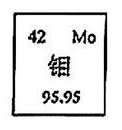
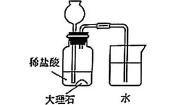
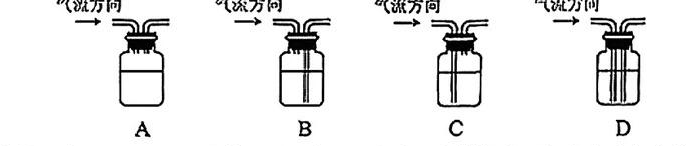
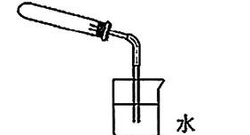
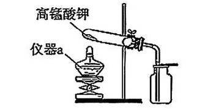
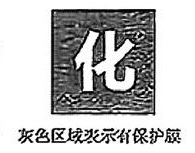
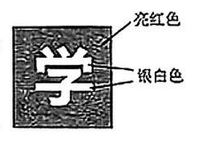
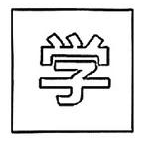
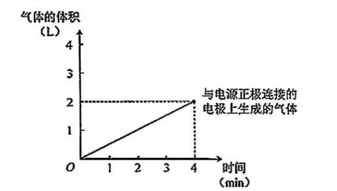
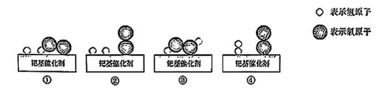

# 化模26-徐汇-上 · 2026 徐汇一模精讲（上）· 化肥 / 碳酸泉 / 制氧 / 蚀刻 / 过氧化氢

> 2026 徐汇卷为独立化学卷（90 分钟、满分 100 分），按"情境题块"命题，**题号在各题块内独立编排**，并出现**多选/不定项**（一 1（2）、五 4（1））。相对原子质量：H-1、C-12、N-14、O-16、S-32、Ca-40、Fe-56。**卷末附参考答案，已与独立推演逐项核对，全部一致**；模糊处以"重构"标注。本讲覆盖题块一~五，卷面插图（钼周期表格、碳酸泉模拟装置、洗气装置、气密性与制氧装置、"化/学"字图、电解水坐标、催化微观示意等 10 幅）已按 150dpi 页图原样裁切嵌入题干。题块六~九见 [[化模26-徐汇-下]]。

## 题块一 · 化肥（8 分）

氯化钾是常用化肥；钼是植物必需的微量营养元素，为此科学家设计了钼肥。

**1.**（1）氯化钾属于（　）
- （A）氮肥
- （B）磷肥
- （C）钾肥
- （D）复合肥

（2）（多选）氯化钾在土壤中会释放出钾离子（K⁺），关于钾原子和钾离子说法正确的是（　）
- （A）钾原子的质子数等于核外电子数
- （B）钾离子属于负离子
- （C）钾离子和钾原子的核外电子数相同
- （D）钾离子和钾原子的质子数相同

> [!tip]- 💡 思路导航
> 化肥分类看**营养元素种类**；原子与离子辨析抓"质子数定元素、电子数定带电"——K⁺ 是钾原子失电子还是得电子形成的？

> [!success]- ✅ 详解 · 评分点 · 易错 · 关联
> **详解**：（1）选 **C**：KCl 只含 K 一种营养元素，属钾肥。（2）选 **AD**：原子中质子数＝核外电子数（A 对）；K⁺ 带 1 个单位正电荷，是**阳**离子（B 错）；钾原子失电子成 K⁺，核外电子数**减少**（C 错）；质子数在变化中不变（D 对）。
>
> **易错**："复合肥"必须含 N、P、K 中**两种及以上**营养元素，KCl 只有钾一种，别被"氯化钾"名字带偏；原子→阳离子：质子数不变、电子数变少，两条结论别写反。
>
> **关联**：[[05-化学/知识点/专题5-物质的微观构成]]（原子与离子）、[[化-14-化合价与推断]]。

**2.** 元素周期表提供的钼元素的信息如右图所示。

（1）钼的元素符号为＿＿＿＿＿＿＿＿；
（2）钼的相对原子质量为＿＿＿＿＿＿＿＿，钼原子中的质子数为＿＿＿＿＿＿＿＿。

> [!tip]- 💡 思路导航
> 周期表一格四个数各司其职：左上角原子序数、字母符号、元素名称、最下方相对原子质量——先想清"质子数"对应哪一个数。

> [!success]- ✅ 详解 · 评分点 · 易错 · 关联
> **详解**：（1）**Mo**。（2）相对原子质量 **95.95**；质子数＝左上角原子序数 **42**。
>
> **易错**：相对原子质量取**最下方**数值（别取成 42）；"原子序数＝质子数＝核电荷数＝核外电子数"这条等式链是查格题的万能钥匙。
>
> **关联**：[[05-化学/知识点/专题2-构成物质的微观粒子]]（元素周期表信息）。

**3.**（1）土壤酸性过大，可使用（　）调节。
- （A）氢氧化钠
- （B）氢氧化钙
- （C）氯化钠
- （D）稀硫酸

（2）合理使用化肥要测算用量，若要提供氮元素 28 g，需要 NH₄HCO₃＿＿＿＿＿＿＿＿ g。

> [!tip]- 💡 思路导航
> 改良酸性土壤选"碱性适中又廉价"的碱；第（2）问抓"元素质量守恒"：所需氮元素质量÷NH₄HCO₃ 中氮的质量分数。

> [!success]- ✅ 详解 · 评分点 · 易错 · 关联
> **详解**：（1）选 **B**：改良酸性土壤用**熟石灰**（廉价、碱性适中）；NaOH 碱性过强具强腐蚀性，NaCl、稀硫酸不能中和酸。（2）M(NH₄HCO₃)＝14+1×4+1+12+16×3＝79，w(N)＝14/79，m＝28 g÷(14/79)＝**158 g**。答：需要 158 g。
>
> **评分点**：（2）须保留"28×79÷14"的列式过程，直接写 158 会被扣过程分。
>
> **易错**：改良酸性土壤不用 NaOH——腐蚀性强、价格高；元素质量＝化合物质量×元素质量分数，别把分母写成碳酸氢根。
>
> **关联**：[[05-化学/知识点/专题8-酸碱盐]]（中和反应的应用）、[[化-13-化学计算进阶]]（元素质量分数计算）。

## 题块二 · "碳酸泉"的形成（13 分）

"碳酸泉"由地壳中的二氧化碳溶于水形成；用下图所示的装置（锥形瓶中稀盐酸＋大理石，产生的气体经导管通入烧杯中的水），在实验室中模拟"碳酸泉"的形成。

**1.**（不定项）二氧化碳属于（　）
- （A）单质
- （B）化合物
- （C）酸
- （D）氧化物

> [!tip]- 💡 思路导航
> 氧化物＝两种元素组成且其一为氧的化合物；"CO₂ 是酸"是经典误区——想清"酸"指什么再下手。

> [!success]- ✅ 详解 · 评分点 · 易错 · 关联
> **详解**：选 **BD**：CO₂ 含两种元素且其一为氧，既是化合物又是氧化物；它不是酸——使石蕊变红的是与水反应生成的碳酸。
>
> **易错**：不定项**漏选不得满分**；"CO₂ 是酸"是最经典的误区，酸指 H₂CO₃ 这类电离出 H⁺ 的物质。
>
> **关联**：[[05-化学/知识点/专题3-空气氧气与二氧化碳]]（CO₂ 的类别）、[[化-12-概念辨析与分类]]。

**2.** 二氧化碳与水反应生成碳酸，该反应属于（　）
- （A）分解反应
- （B）化合反应
- （C）置换反应
- （D）复分解反应

> [!tip]- 💡 思路导航
> 写出反应物与生成物，数一数"多变一还是一变多"，再对号四大基本反应类型。

> [!success]- ✅ 详解 · 评分点 · 易错 · 关联
> **详解**：选 **B**：CO₂+H₂O＝H₂CO₃，"多变一"，属化合反应。
>
> **关联**：[[05-化学/知识点/专题6-化学变化及其表示]]（基本反应类型）。

**3.** "碳酸泉"的溶剂是（　）
- （A）二氧化碳
- （B）碳酸
- （C）碳酸钠
- （D）水

> [!tip]- 💡 思路导航
> 溶液的构成：溶质＋溶剂——碳酸泉是 CO₂ 溶于水得到的，问的是**溶剂**。

> [!success]- ✅ 详解 · 评分点 · 易错 · 关联
> **详解**：选 **D**：溶液中**水是溶剂**，CO₂ 是溶质。
>
> **易错**：第 3 题问**溶剂**不是溶质，答案唯一是水。
>
> **关联**：[[05-化学/知识点/专题7-溶液]]（溶液的组成）。

**4.** 写出大理石与稀盐酸反应的化学方程式＿＿＿＿＿＿＿＿。

> [!tip]- 💡 思路导航
> 实验室制 CO₂ 的"招牌反应"：碳酸钙＋盐酸→氯化钙＋水＋二氧化碳，配平后别忘了气体符号。

> [!success]- ✅ 详解 · 评分点 · 易错 · 关联
> **详解**：$CaCO_3+2HCl=CaCl_2+H_2O+CO_2\uparrow$（各元素逐一守恒 ✓）。
>
> **易错**：气体符号"↑"与配平系数 2 都是得分点，漏写即扣分。
>
> **关联**：[[05-化学/知识点/专题3-空气氧气与二氧化碳]]（CO₂ 的实验室制法）、[[化-08-二氧化碳制取]]。

**5.** 将二氧化碳通入水一段时间后，取少量烧杯中的液体滴加紫色石蕊试液，观察到的实验现象为＿＿＿＿＿＿＿＿。

> [!tip]- 💡 思路导航
> 通入的 CO₂ 与水反应生成了什么？酸性溶液遇紫色石蕊显什么色？

> [!success]- ✅ 详解 · 评分点 · 易错 · 关联
> **详解**：**溶液变红**（紫色石蕊变红，因生成碳酸显酸性）。
>
> **易错**：答"变蓝"即概念反了；变红的是**溶液**，表述要完整。
>
> **关联**：[[05-化学/知识点/专题8-酸碱盐]]（酸碱指示剂）。

**6.** 上述实验现象可能是盐酸挥发导致的，挥发性属于（　）
- （A）物理性质
- （B）化学性质

> [!tip]- 💡 思路导航
> 判断物理/化学性质的标尺：需不需要通过化学变化就表现出来？

> [!success]- ✅ 详解 · 评分点 · 易错 · 关联
> **详解**：选 **A**：挥发性不需通过化学变化就表现出来，属物理性质。
>
> **关联**：[[05-化学/知识点/专题1-2-化学之门与实验探究]]（物理性质与化学性质）。

**7.** 用饱和碳酸氢钠溶液可以除去二氧化碳中混有的氯化氢。
（1）碳酸氢钠的俗称是（　）
- （A）纯碱
- （B）苏打
- （C）小苏打
- （D）生石灰

（2）碳酸氢钠与盐酸反应生成氯化钠、水和二氧化碳，写出化学方程式＿＿＿＿＿＿＿＿；
（3）下图四个装置均盛饱和碳酸氢钠溶液（气流均从左向右，导管长短不同），能除去氯化氢的是（　）

> [!tip]- 💡 思路导航
> 俗称对应背牢："小苏打"是谁？（2）按信息写方程式、标气体符号；（3）洗气瓶除杂要让气体**充分通过液体**——进气管、出气管的长短怎么定？

> [!success]- ✅ 详解 · 评分点 · 易错 · 关联
> **详解**：（1）选 **C**（小苏打）。（2）$NaHCO_3+HCl=NaCl+H_2O+CO_2\uparrow$（守恒 ✓）。（3）选 **C**：除杂洗气瓶须**进气管长（伸入液面下）、出气管短（在液面上）**，使气体充分通过溶液；其余接管方式气体接触不到液体或会把液体压出。
>
> **易错**：第（3）题判断口诀"**长进短出**"，与"多功能瓶排水收集的短进长出"区分开。
>
> **关联**：[[05-化学/知识点/专题8-酸碱盐]]（盐的俗称、除杂）、[[化-02-实验操作与提纯]]（洗气装置）。

**8.** 自然界中的"碳酸泉"温度一般较低；在模拟装置的烧杯中加入热水，也不易形成"碳酸泉"，原因是＿＿＿＿＿＿＿＿。

> [!tip]- 💡 思路导航
> 回扣气体的溶解规律：温度升高，气体的溶解度怎么变？热水对 CO₂ 的溶解意味着什么？

> [!success]- ✅ 详解 · 评分点 · 易错 · 关联
> **详解**：三段式。**判断**——热水不利于 CO₂ 溶解。**依据**——气体的溶解度随温度升高而**减小**。**回扣**——热水温度较高，CO₂ 溶解度较小，难以形成较高浓度的碳酸，故不易形成"碳酸泉"。
>
> **评分点**：必须点到"气体溶解度随温度升高减小"这一依据，只答"热水不利溶解"不给满分。
>
> **关联**：[[05-化学/知识点/专题7-溶液]]（气体溶解度）、[[化-06-溶液与溶解度]]。

## 题块三 · 氧气的制备（11 分）

实验室中常用高锰酸钾制备氧气。

**1.** KMnO₄ 中锰元素的化合价为（　）
- （A）+1
- （B）+3
- （C）+6
- （D）+7

> [!tip]- 💡 思路导航
> 化合价代数和为零：K 为 +1、O 为 −2，一个 KMnO₄ 里 4 个氧，立式解 Mn。

> [!success]- ✅ 详解 · 评分点 · 易错 · 关联
> **详解**：选 **D**：(+1)+Mn+(−2)×4＝0 → Mn＝**+7**。
>
> **关联**：[[05-化学/知识点/专题5-物质的微观构成]]（化合价规则）。

**2.** 写出加热高锰酸钾制备氧气的化学方程式＿＿＿＿＿＿＿＿。

> [!tip]- 💡 思路导航
> 产物是锰酸钾、二氧化锰和氧气三样，"加热"条件与气体符号一个都不能少。

> [!success]- ✅ 详解 · 评分点 · 易错 · 关联
> **详解**：$2KMnO_4\xrightarrow{\Delta}K_2MnO_4+MnO_2+O_2\uparrow$（K 2=2，Mn 1=1+1，O 8=4+2+2 ✓；条件"加热"，O₂ 标 ↑）。
>
> **易错**：产物是 K₂MnO₄（锰酸钾）不是 KMnO₄，化学式、↑ 与"Δ"条件各占得分点。
>
> **关联**：[[05-化学/知识点/专题3-空气氧气与二氧化碳]]（高锰酸钾制氧）、[[化-03-空气与氧气]]。

**3.** 简述下图所示（试管口塞塞子、导管伸入盛水烧杯）检验装置气密性的方法：＿＿＿＿＿＿＿＿。

> [!tip]- 💡 思路导航
> 气密性检验靠"热胀冷缩造压差"：手握试管→气泡→松手→水柱，动作与现象要成串表述。

> [!success]- ✅ 详解 · 评分点 · 易错 · 关联
> **详解**：将导管一端浸入水中，用手紧握试管外壁，若导管口有气泡冒出，松开手后导管内形成一段稳定的水柱，则说明装置气密性良好。
>
> **评分点**：缺"形成一段稳定的水柱"这一收尾会被扣分；"手握试管"前后动作要完整。
>
> **关联**：[[05-化学/知识点/专题1-2-化学之门与实验探究]]（气密性检验）。

**4.** 用下图所示的装置制取氧气（试管口略向下倾斜，仪器 a 为加热仪器）：

（1）仪器 a 的名称是＿＿＿＿＿＿＿＿；
（2）玻璃棉由玻璃细丝构成。该实验中试管口放一团玻璃棉而不是棉花，原因是（　）
- （A）棉花是可燃物，而玻璃棉不是
- （B）棉花能透汽，而玻璃棉不能
- （C）玻璃棉能阻隔固体小颗粒，而棉花不能
- （D）玻璃棉能吸水，而棉花不能

（3）检验氧气集满的方法是＿＿＿＿＿＿＿＿。

> [!tip]- 💡 思路导航
> 认仪器看图（加热工具是谁？）；玻璃棉的双重身份——既挡粉末又不可燃；验满的位置在**瓶口**不在瓶内。

> [!success]- ✅ 详解 · 评分点 · 易错 · 关联
> **详解**：（1）**酒精灯**。（2）选 **A**：加热时 KMnO₄ 粉末易随气流进入导管，玻璃棉能阻挡；棉花虽也能阻挡，但它是**可燃物**，靠近加热部位有安全风险，故不选。（3）将带火星的木条置于集气瓶口，若木条复燃，则已收集满。
>
> **易错**：（2）C 是"玻璃棉的作用"不是"不选棉花的理由"，审题落点在"而不是棉花"；验满木条放瓶内就成了"检验"。
>
> **关联**：[[05-化学/知识点/专题3-空气氧气与二氧化碳]]（O₂ 的验满）、[[化-03-空气与氧气]]。

**5.** 根据下表中物质的溶解性，设计从加热高锰酸钾后剩余的固体中回收二氧化锰的实验方案。

| 物质 | KMnO₄ | K₂MnO₄ | MnO₂ |
| ---- | ---- | ---- | ---- |
| 溶解性 | 可溶 | 易溶 | 难溶 |

> [!tip]- 💡 思路导航
> 分离混合物的钥匙是**溶解性差异**：一个难溶、两个易溶——"溶解→过滤→洗涤→干燥"四步各写动作。

> [!success]- ✅ 详解 · 评分点 · 易错 · 关联
> **详解**：向反应后剩余固体中加入**足量水**，搅拌使 KMnO₄、K₂MnO₄ 完全溶解，**过滤**（MnO₂ 留在滤纸上），**洗涤滤渣**除去表面残留溶液，**干燥**后得到二氧化锰。
>
> **评分点**：只答"过滤"只得一半分：足量水溶解、洗涤、干燥都是得分点。
>
> **易错**：依据要落在"MnO₂ 难溶于水"上，凭空"过滤"没有化学依据。
>
> **关联**：[[化-02-实验操作与提纯]]（溶解、过滤、洗涤、干燥）、[[05-化学/知识点/专题7-溶液]]（溶解性与分离）。

## 题块四 · 金属的蚀刻（9 分）

化学社团用两片生锈的薄铁片制作金属蚀刻工艺品。

**1.** 铁锈的主要成分是氧化铁，其化学式是（　）
- （A）FeO
- （B）Fe₂O₃
- （C）Fe₃O₄
- （D）Fe(OH)₃

> [!tip]- 💡 思路导航
> 铁锈=+3 价铁的氧化物，用化合价代数和为零校验四个选项。

> [!success]- ✅ 详解 · 评分点 · 易错 · 关联
> **详解**：选 **B**：铁锈主要成分 Fe₂O₃（Fe 为 +3 价）。
>
> **易错**：Fe₃O₄ 是铁燃烧的产物、FeO 是 +2 价铁的氧化物，三者别混。
>
> **关联**：[[05-化学/知识点/专题8-酸碱盐]]（金属氧化物）、[[化-28-金属与金属活动性]]。

**2.** 洗去铁片上的铁锈，可使用的试剂是（　）
- （A）氢氧化钠溶液
- （B）稀盐酸
- （C）氯化钠溶液
- （D）澄清石灰水

> [!tip]- 💡 思路导航
> 金属氧化物＋酸→盐＋水：找能"吃掉"氧化铁又不伤铁基体的试剂。

> [!success]- ✅ 详解 · 评分点 · 易错 · 关联
> **详解**：选 **B**：铁锈与稀盐酸反应生成可溶的氯化铁被洗去；NaOH 不与 Fe₂O₃ 反应，NaCl、石灰水无效。
>
> **关联**：[[05-化学/知识点/专题8-酸碱盐]]（酸的化学性质）、[[化-25-酸的性质研究]]。

**3.** 第一副工艺品在薄铁片上镂空出"化"字：步骤 I——覆上化学性质稳定的保护膜，仅"化"字笔画处正反面无保护膜，如右图所示；步骤 II——浸泡在稀硫酸中，待笔画处铁完全溶解后取出、清洗并除去保护膜。

（1）步骤 II 中也可用稀盐酸代替稀硫酸，两种溶液都具有酸性，其原因是都含有大量（　）
- （A）氢离子
- （B）氢氧根离子
- （C）氢分子（原卷扫描字形近"氢离子"，按干扰项惯例重构）
- （D）硫酸根离子

（2）若步骤 II 中有 2.8 g 铁被溶解，根据化学方程式列式计算消耗硫酸的质量。

> [!tip]- 💡 思路导航
> 酸类通性的本质在"共同离子"；第（2）问按"设列算答"走：Fe→H₂SO₄ 质量比 56:98，注意求的是硫酸不是氢气。

> [!success]- ✅ 详解 · 评分点 · 易错 · 关联
> **详解**：（1）选 **A**：酸具有共性是因为溶液中都含有大量**氢离子（H⁺）**。（2）解：设消耗硫酸的质量为 x。$Fe+H_2SO_4=FeSO_4+H_2\uparrow$，56 : 98＝2.8 g : x，x＝2.8 g×98/56＝**4.9 g**。答：消耗硫酸 4.9 g。
>
> **评分点**：（2）必须写"解：设……"和"答"，比例式与代入过程齐全。
>
> **易错**：比例式 56:98 别与 56:2 混淆（求的是硫酸不是氢气）。
>
> **关联**：[[05-化学/知识点/专题8-酸碱盐]]（酸的通性）、[[化-13-化学计算进阶]]（方程式计算"设列算答"）。

**4.** 第二副工艺品要在薄铁片上呈现"红底白字"的效果，如右图所示。

（1）第二片薄铁片覆上保护膜后，应浸泡在（　）
- （A）硝酸银溶液
- （B）氯化锌溶液
- （C）硫酸亚铁溶液
- （D）硫酸铜溶液

（2）写出该反应的化学方程式＿＿＿＿＿＿＿＿；
（3）在下图中设计该铁片上的保护膜（将有保护膜的区域用铅笔涂黑）。

> [!tip]- 💡 思路导航
> "红底"的红色只能来自哪种金属？先定浸泡液，再想清"无膜处反应、有膜处保护"的对应关系，最后定涂黑区域——方向反了整题不得分。

> [!success]- ✅ 详解 · 评分点 · 易错 · 关联
> **详解**：（1）选 **D**：Fe+CuSO₄ 析出**红色**的铜，覆盖无保护膜处形成"红底"；A 析出银白色银、B 与 C 不与铁反应。（2）$Fe+CuSO_4=FeSO_4+Cu$（守恒 ✓）。（3）将"**学**"字的笔画区域涂黑（笔画处覆盖保护膜）：无膜的背景处铁溶出并镀上红色铜呈红底，笔画处铁被保护呈银白色"学"字。
>
> **易错**：第（1）题审"红底**白**字"：红色只能来自铜，选 A 得到银白色银、方向全反；第（3）题是逆向设计——先定色再定膜，哪里要保持铁色（白字），膜就涂在哪里。
>
> **关联**：[[05-化学/知识点/专题8-酸碱盐]]（金属活动性置换）、[[化-28-金属与金属活动性]]（Fe＞Cu 及其应用）。

## 题块五 · 过氧化氢的制备与应用（12 分）

电解水生成氢气和氧气，再用氢气和氧气制备过氧化氢。

**1.** 水电解前需要净化，吸附水中的色素，可以使用（　）
- （A）明矾
- （B）活性炭
- （C）氯化铁
- （D）金刚石

> [!tip]- 💡 思路导航
> 净水各司其职：谁负责"吸附色素异味"？谁负责"沉降悬浮杂质"？

> [!success]- ✅ 详解 · 评分点 · 易错 · 关联
> **详解**：选 **B**：活性炭疏松多孔有**吸附性**；明矾用于沉降悬浮杂质，金刚石无吸附性。
>
> **关联**：[[05-化学/知识点/专题4-水的性质与组成]]（水的净化）、[[化-05-水与净化]]。

**2.** 若要除去水中的氯化钠，需要进行的操作是（　）
- （A）过滤
- （B）结晶
- （C）蒸发
- （D）蒸馏

> [!tip]- 💡 思路导航
> NaCl 溶于水形成均一稳定溶液——过滤拦不住溶质，要得到"几乎纯净的水"得让水先变气体再回来。

> [!success]- ✅ 详解 · 评分点 · 易错 · 关联
> **详解**：选 **D**：NaCl 溶于水，过滤、结晶除不净，**蒸馏**可把 NaCl 留在液相残液中得到几乎纯净的水。
>
> **易错**：蒸馏与蒸发的区别：蒸馏收集的是"纯净的水"，蒸发留下的是盐。
>
> **关联**：[[05-化学/知识点/专题4-水的性质与组成]]（蒸馏净化）、[[化-05-水与净化]]。

**3.** 电解水生成氢气和氧气，在下图中画出与电源**负极**连接的电极上生成气体体积和反应时间的关系（图中已画出与电源正极连接的电极上生成气体的曲线）。

> [!tip]- 💡 思路导航
> 电解水口诀"正氧负氢、氢二氧一"说的是**体积**比——负极气体体积随时间怎么走、终点是正极的几倍？

> [!success]- ✅ 详解 · 评分点 · 易错 · 关联
> **详解**：负极生成 H₂，同时间体积为正极（O₂）的 2 倍：画一条过原点的直线，**4 min 时纵坐标约 4 L**（两倍于正极直线的斜率）。
>
> **易错**：常见错解是画成与正极重合或 1:1——"负氢正氧、体积 1:2"是电解水图像题的命根；画完标注终点体积更稳。
>
> **关联**：[[05-化学/知识点/专题4-水的性质与组成]]（电解水）、[[化-05-水与净化]]。

**4.** 氢气和氧气在钯基催化剂表面可反应生成过氧化氢，微观示意图①~④代表该反应的某段历程：

（1）（多选）关于钯基催化剂说法正确的是（　）
- （A）反应前后质量不变
- （B）反应前后化学性质不变
- （C）在该反应中使用钯基催化剂能加快过氧化氢生成
- （D）消耗等量的反应物，钯基催化剂能增加生成过氧化氢的量

（2）上述微观过程的正确排序为＿＿＿＿＿＿＿＿，该方法制取过氧化氢的化学方程式为＿＿＿＿＿＿＿＿；
（3）用该方法制备过氧化氢时必须严禁明火，原因是＿＿＿＿＿＿＿＿。

> [!tip]- 💡 思路导航
> 催化剂"一变两不变"逐项过；微观排序按"靠近→吸附→成键→脱附"的历程看图对号；H₂ 的"可燃性"决定为什么怕明火。

> [!success]- ✅ 详解 · 评分点 · 易错 · 关联
> **详解**：（1）选 **ABC**：A、B 是催化剂"两不变"，C 是"一变"（加快），D 错——催化剂**不能提高生成物的理论产量**。（2）**④②①③**：反应物分子靠近催化剂表面（④）→ 被吸附（②）→ 表面上原子重新组合成键（①）→ 生成的 H₂O₂ 分子离开表面（③）。方程式：$H_2+O_2\xrightarrow{\text{钯基催化剂}}H_2O_2$（H 2=2，O 2=2 ✓）。（3）氢气具有**可燃性**，与氧气混合遇明火可能发生爆炸，故严禁明火。
>
> **易错**：（1）D 是催化剂概念的经典陷阱：**只改速率、不改产量**。
>
> **关联**：[[05-化学/知识点/专题9-10-反应调控与化学社会]]（催化剂）、[[化-07-燃烧与碳]]（可燃性气体与防爆）。

**5.** 过氧化氢溶液可用于废水处理。取等量废水，加入等体积一定质量分数的过氧化氢溶液和硫酸铁，按下表分组实验（去除率＝去除质量÷总质量×100%）：

| 实验组别 | 过氧化氢的质量分数（%） | 加入硫酸铁的质量（g） | 温度（℃） | 某污染物的去除率（%） |
| ---- | ---- | ---- | ---- | ---- |
| ① | 0.001 | X | 25 | 32.5 |
| ② | 0.020 | 1.42 | 25 | 65.2 |
| ③ | 0.020 | 3.58 | 10 | 45.2 |
| ④ | 0.020 | 3.58 | 30 | 85.0 |
| ⑤ | 0.020 | 7.10 | 25 | 86.0 |

（1）表格中 X＝＿＿＿＿＿＿＿＿，则能说明过氧化氢的浓度对该污染物的去除率有影响；
（2）对比实验＿＿＿＿＿＿＿＿（填编号），可说明升温有利于废水中该污染物的除去；
（3）对比实验②、⑤，可得出的结论为＿＿＿＿＿＿＿＿。

> [!tip]- 💡 思路导航
> 数据题先锁"控制变量"：只允许**一个**条件不同的两组才能比——找浓度不同的组、温度不同的组，再归因到变量上。

> [!success]- ✅ 详解 · 评分点 · 易错 · 关联
> **详解**：（1）**1.42（或 7.10）**：与②相比仅 H₂O₂ 浓度不同（0.001→0.020，去除率 32.5→65.2），可说明浓度有影响；取 7.10 则与⑤比，同理成立。（2）**③、④**：仅温度不同（10℃→30℃），去除率 45.2→85.0，说明升温有利。（3）其他条件相同时，**增加硫酸铁的质量有利于废水中该污染物的除去**（1.42 g→7.10 g，去除率 65.2%→86.0%）。
>
> **评分点**：写 X 值时务必点出"与②（或⑤）对比"，否则控制变量的逻辑链断裂。
>
> **易错**：对比组只允许一个条件不同——X 若取 3.58 则与②有浓度、硫酸铁两个变量不同，无效对比。
>
> **关联**：[[05-化学/知识点/专题1-2-化学之门与实验探究]]（控制变量法）、[[化-16-实验探究与评价]]（数据分析型）。

## ✅ 答案速查

| 题块 | 答案 |
| ---- | ---- |
| 一 | （1） C （2） AD；Mo；95.95；42；B；158 g |
| 二 | BD；B；D；CaCO₃+2HCl＝CaCl₂+H₂O+CO₂↑；溶液变红；A；C；NaHCO₃+HCl＝NaCl+H₂O+CO₂↑；C；热水温度高、CO₂ 溶解度小 |
| 三 | D；2KMnO₄ --Δ--> K₂MnO₄+MnO₂+O₂↑；握壁观泡看水柱；酒精灯；A；带火星木条放瓶口复燃则满；加水溶解→过滤→洗涤→干燥 |
| 四 | B；B；A；4.9 g；D；Fe+CuSO₄＝FeSO₄+Cu；涂黑"学"字笔画 |
| 五 | B；D；负极直线终点 4 L；ABC；④②①③；H₂+O₂ --钯基催化剂--> H₂O₂；H₂ 与 O₂ 混合遇明火可能爆炸；1.42 或 7.10；③④；增加硫酸铁质量有利于除去 |

## 🔗 关联
- [[05-化学/知识点/专题1-2-化学之门与实验探究]]（气密性检验、装置选择、控制变量）· [[05-化学/知识点/专题4-水的性质与组成]]（电解水、净水方法）· [[05-化学/知识点/专题3-空气氧气与二氧化碳]]（高锰酸钾制氧、CO₂ 与碳酸）
- [[05-化学/知识点/专题8-酸碱盐]]（酸的通性、除杂）· [[化-03-空气与氧气]] · [[化-08-二氧化碳制取]] · [[化-13-化学计算进阶]]（3（2） 设列算答）
- 后续：[[化模26-徐汇-下]] · 同系列：[[化模26-崇明-上]]
