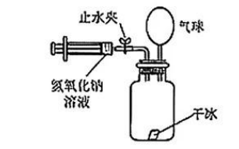
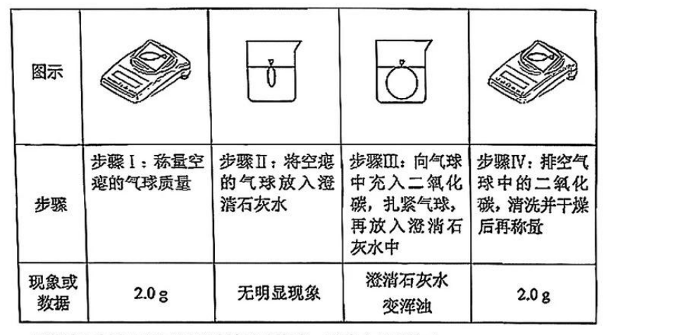
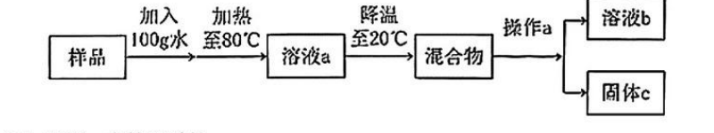
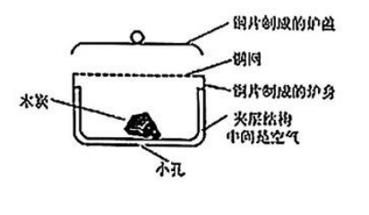
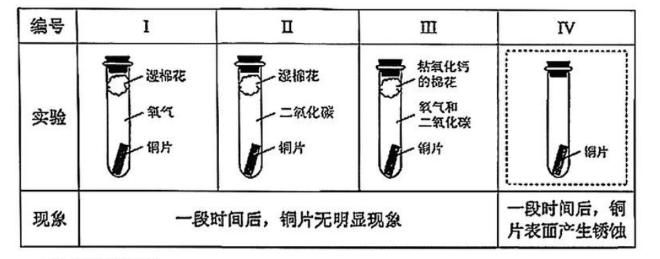
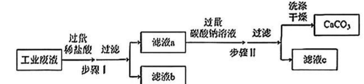

# 化模26-徐汇-下 · 2026 徐汇一模精讲（下）· 气球 / 甘露醇 / 铜炉防锈 / 制碳酸钙

> 本讲承接 [[化模26-徐汇-上]]（题块一~五），处理四个"实验＋说理＋计算"题块。相对原子质量：H-1、C-12、N-14、O-16、S-32、Ca-40、Fe-56。**卷末附参考答案，已与独立推演逐项核对，全部一致**。卷面插图（干冰气球装置、气球实验表、提纯流程、暖手炉结构、铜生锈四组实验表、制 CaCO₃ 流程等 6 幅）已按 150dpi 页图原样裁切嵌入题干。

## 题块六 · 有趣的气球实验（11 分）

用生活中常见的气球可以设计不少有趣的实验。

**1.** 若要使气球能够升空，可以在其中充入的气体是（　）
- （A）氧气
- （B）二氧化碳
- （C）空气
- （D）氢气

> [!tip]- 💡 思路导航
> 气球升空靠浮力：充入气体的密度要与空气比一比大小。

> [!success]- ✅ 详解 · 评分点 · 易错 · 关联
> **详解**：选 **D**：气球升空需气体密度**明显小于空气**，氢气符合（CO₂ 比空气重，氧气、空气不行）。
>
> **关联**：[[05-化学/知识点/专题3-空气氧气与二氧化碳]]（常见气体的密度）。

**2.** 用下图装置做二氧化碳的性质实验：锥形瓶内放干冰，配有止水夹的注射器（内盛氢氧化钠溶液）与瓶上方的气球相连。

（1）（不定项）将一小块干冰放入装置、塞紧橡皮塞，观察到气球体积变大。从微观角度分析，该过程中发生变化的是（　）
- （A）二氧化碳分子的间隔
- （B）二氧化碳分子的质量
- （C）二氧化碳分子的运动速度
- （D）二氧化碳分子的个数

（2）打开止水夹，将氢氧化钠溶液注入装置，关闭止水夹，轻轻振荡，观察到气球的体积（　）
- （A）不变
- （B）增大
- （C）减小

（3）写出上述过程中发生反应的化学方程式＿＿＿＿＿＿＿＿。

> [!tip]- 💡 思路导航
> 升华是物理变化——"分子本身不变"逐项过：什么变、什么不变？注入 NaOH 后瓶内气体被谁"吃掉"了，压强往哪边走？

> [!success]- ✅ 详解 · 评分点 · 易错 · 关联
> **详解**：（1）选 **AC**（不定项）：升华是物理变化，CO₂ 分子本身不变——质量（B）、种类、总个数（D）都不变；变化的是**分子间隔**（显著变大）和**运动状态**（由固态表面振动变为气态自由运动，速度加快）。（2）选 **C**：NaOH 溶液吸收 CO₂，瓶内气体减少、压强减小，气球缩小。（3）$CO_2+2NaOH=Na_2CO_3+H_2O$（Na 2=2，C 1=1，O 3=3，H 2=2 ✓）
>
> **易错**：（1）按"分子本身不变"逐项过：升华只改**间隔与运动状态**，分子的**质量、种类、个数**都不变——别把"气球变大"误当成"分子变多变大"。
>
> **关联**：[[05-化学/知识点/专题5-物质的微观构成]]（分子性质）、[[05-化学/知识点/专题8-酸碱盐]]（CO₂ 与碱反应）。

**3.** 扎紧的气球一段时间后体积会变小，为探究其原因设计如下表所示的实验：

| 步骤 | Ⅰ：称量空气球 | Ⅱ：空气球放入澄清石灰水 | Ⅲ：气球充入 CO₂ 扎紧后放入石灰水 | Ⅳ：排空气球中的 CO₂，清洗干燥后再称量 |
| ---- | ---- | ---- | ---- | ---- |
| 现象/数据 | 2.0 g | 无明显现象 | 澄清石灰水变浑浊 | 2.0 g |

【资料】实验中所用气球的材质是橡胶，橡胶由分子构成。
（1）上述实验中橡胶与澄清石灰水＿＿＿＿＿＿＿＿化学反应。（　）
- （A）发生
- （B）没有发生

（2）上述实验中橡胶与二氧化碳＿＿＿＿＿＿＿＿化学反应。（　）
- （A）发生
- （B）没有发生
（3）写出步骤 III 中发生反应的化学方程式＿＿＿＿＿＿＿＿；
（4）根据上述实验，从微观角度分析，扎紧的二氧化碳气球一段时间后体积会变小的原因是＿＿＿＿＿＿＿＿。

> [!tip]- 💡 思路导航
> 四个步骤层层排他：Ⅰ、Ⅳ 两次称量相等、Ⅱ 无现象先排掉谁？剩下的证据（Ⅲ 变浑浊）指向"气体分子自己逃逸"——从分子运动的角度收尾。

> [!success]- ✅ 详解 · 评分点 · 易错 · 关联
> **详解**：（1）选 **B**；（2）选 **B**：空气球在石灰水中无明显现象、称量前后质量不变（2.0 g→2.0 g），说明橡胶既不与石灰水、也不与 CO₂ 反应。（3）$CO_2+Ca(OH)_2=CaCO_3\downarrow+H_2O$（"↓"是得分点）。（4）三段式。**判断**——气球缩小不是发生反应，而是 CO₂ 逸出。**依据**——步骤 Ⅲ 中石灰水变浑浊，说明有 CO₂ 从气球内运动到了石灰水中；且橡胶与两者都不反应。**回扣**——CO₂ 分子不断运动，能穿过橡胶分子间的间隙逸出，气球内气体分子减少，体积变小。
>
> **评分点**：（4）只答"气体漏了"不给满分：必须点出"**分子在运动、穿过橡胶分子间隙**"，并用步骤 Ⅲ 的浑浊现象作证据。
>
> **易错**：步骤 Ⅰ、Ⅳ 两次称量（2.0 g）是证明橡胶没损耗、没反应的证据链一环，分析时要引用。
>
> **关联**：[[05-化学/知识点/专题5-物质的微观构成]]（分子运动）、[[05-化学/知识点/专题3-空气氧气与二氧化碳]]（CO₂ 与石灰水）、[[化-16-实验探究与评价]]（证据链推理）。

## 题块七 · 甘露醇的提纯与应用（13 分）

甘露醇是一种白色针状晶体，从海带中提取的甘露醇含少量氯化钠，根据下表所示的溶解度数据进行提纯。

| 温度（℃） | 20 | 40 | 60 | 80 |
| ---- | ---- | ---- | ---- | ---- |
| 甘露醇的溶解度（g） | 18.5 | 35 | 64 | 115 |
| 氯化钠的溶解度（g） | 35.9 | 36.6 | 37.3 | 38.4 |

**1.** 甘露醇的化学式为 C₆H₁₄O₆，它由＿＿＿＿＿＿＿＿种元素组成。

> [!tip]- 💡 思路导航
> 化学式里每种元素符号各代表一种元素，直接数。

> [!success]- ✅ 详解 · 评分点 · 易错 · 关联
> **详解**：**3**（C、H、O 三种元素）。
>
> **关联**：[[05-化学/知识点/专题5-物质的微观构成]]（化学式的意义）。

**2.** 在 20~80℃ 范围内，溶解度随温度变化更明显的是（　）
- （A）氯化钠
- （B）甘露醇

> [!tip]- 💡 思路导航
> 比较两行数据从 20℃ 到 80℃ 的"跨度"，谁的变幅悬殊谁明显。

> [!success]- ✅ 详解 · 评分点 · 易错 · 关联
> **详解**：选 **B**：甘露醇 18.5→115 g 变化悬殊，NaCl 仅 35.9→38.4 g。
>
> **关联**：[[05-化学/知识点/专题7-溶液]]（溶解度曲线的陡缓）。

**3.** 40℃ 时，甘露醇的溶解度为＿＿＿＿＿＿＿＿ g。

> [!tip]- 💡 思路导航
> 查表时行、列各对准：40℃ 列 × 甘露醇行。

> [!success]- ✅ 详解 · 评分点 · 易错 · 关联
> **详解**：**35**（查表）。
>
> **关联**：[[05-化学/知识点/专题7-溶液]]（溶解度数据表）。

**4.** 有一份含 110 g 甘露醇和 15 g 氯化钠的样品，按下图所示的流程进行提纯。

（1）溶液 a 中的溶质是＿＿＿＿＿＿＿＿；
（2）操作 a 的名称是＿＿＿＿＿＿＿＿；
（3）20℃ 下，溶液 b 是氯化钠的＿＿＿＿＿＿＿＿溶液（选填"饱和"或"不饱和"）；
（4）固体 c 是甘露醇，其表面有少量氯化钠溶液，可通过洗涤除去，洗涤时应使用＿＿＿＿＿＿＿＿（选填"冷水"或"热水"），理由是＿＿＿＿＿＿＿＿。

> [!tip]- 💡 思路导航
> 全题枢纽一个数：110 g 甘露醇＋100 g 水在 80℃ 能不能全溶（溶解度 115 g）？降温到 20℃ 谁析出、谁留在母液？洗涤晶体选"溶解度小"的水温。

> [!success]- ✅ 详解 · 评分点 · 易错 · 关联
> **详解**：（1）**甘露醇和氯化钠**（80℃ 时 110 g＜115 g，两者全部溶解）。（2）**过滤**（分离晶体与母液）。（3）**不饱和**：母液中 NaCl 仅 15 g＜35.9 g。（4）**冷水**；低温时甘露醇溶解度小（20℃ 仅 18.5 g），用冷水洗涤可**减少甘露醇的溶解损失**，同时洗去表面氯化钠溶液。
>
> **易错**：必须**分步核数**："80℃ 恰好全溶"是全题枢纽，漏看会误判溶液 a 有固体剩余。
>
> **关联**：[[05-化学/知识点/专题7-溶液]]（结晶、混合物分离）、[[化-21-饱和溶液与转化]]。

**5.** 配制 250 g 20% 的甘露醇水溶液，需要甘露醇＿＿＿＿＿＿＿＿ g，水＿＿＿＿＿＿＿＿ mL。

> [!tip]- 💡 思路导航
> 溶质＝溶液质量×质量分数；水的体积要先算质量再换算（密度按 1 g/mL）。

> [!success]- ✅ 详解 · 评分点 · 易错 · 关联
> **详解**：甘露醇＝250 g×20%＝**50 g**；水＝250−50＝200 g，密度按 1 g/mL 计为 **200 mL**。
>
> **易错**："水 200 mL"必须先算 200 g 再换算体积，只写"200"不带单位或不换算都会被扣。
>
> **关联**：[[化-23-溶质质量分数与计算]]（溶液配制计算）。

**6.** 有一袋密封的甘露醇注射液存放在 20℃ 的环境中，一段时间后析出白色针状晶体。此时袋内甘露醇溶液的溶质质量分数＿＿＿＿＿＿＿＿20%（选填"大于""小于"或"等于"）。请解释该条件下溶液析出晶体的原因＿＿＿＿＿＿＿＿。

> [!tip]- 💡 思路导航
> 析出晶体后的溶液是什么状态？算出 20℃ 饱和溶液的质量分数上限，再与 20% 比大小，原因自然浮出。

> [!success]- ✅ 详解 · 评分点 · 易错 · 关联
> **详解**：三段式。**判断**——小于 20%。**依据**——20℃ 时甘露醇溶解度 18.5 g，该温度下饱和溶液的溶质质量分数＝18.5/(100+18.5)≈**15.6%**。**回扣**——原注射液为 20%，超过该温度下饱和状态所能溶解的最大浓度（20%＞15.6%），存放中溶质逐渐结晶析出，剩余溶液变为 20℃ 的饱和溶液，质量分数约 15.6%，故小于 20%。
>
> **评分点**：论证必须有"15.6%"这个饱和上限数据，"析出原因"要落到"20% 超过了该温度饱和状态的最大浓度"。
>
> **关联**：[[化-22-溶解度与曲线]]（饱和溶液质量分数上限）、[[05-化学/知识点/专题7-溶液]]。

## 题块八 · 铜暖手炉的使用与防锈（13 分）

我国古代工匠用铜制作暖手炉，其中一款的结构如下图所示（炉身内放木炭，上方有铜网隔断，炉盖为铜片，炉身底部有小孔，木炭间留有空气）。

**1.** 点燃木炭，观察到的现象是（　）
- （A）发出耀眼白光
- （B）发出红色的光
- （C）生成无色液滴
- （D）生成白色的烟

> [!tip]- 💡 思路导航
> 木炭在空气中燃烧的现象与镁条、蜡烛都不同——"白光"是谁的专属？

> [!success]- ✅ 详解 · 评分点 · 易错 · 关联
> **详解**：选 **B**：木炭在空气中燃烧持续红热、**发出红光**；A 是镁条燃烧，C、D 现象不存在。
>
> **易错**：木炭在**氧气**中才发白光，在空气中只是红热发红光，条件别偷换。
>
> **关联**：[[05-化学/知识点/专题3-空气氧气与二氧化碳]]（碳的燃烧现象）、[[化-07-燃烧与碳]]。

**2.** 打开炉盖和铜网，将燃烧的木炭放入炉身内，盖上铜网。木炭在炉中完全燃烧的化学方程式为＿＿＿＿＿＿＿＿；若木炭不完全燃烧，则会生成＿＿＿＿＿＿＿＿（填物质名称）。

> [!tip]- 💡 思路导航
> 完全燃烧产物是二氧化碳；氧气不足时碳的"另一种氧化物"是谁？

> [!success]- ✅ 详解 · 评分点 · 易错 · 关联
> **详解**：$C+O_2\xrightarrow{\text{点燃}}CO_2$；不完全燃烧生成**一氧化碳**（有毒）。
>
> **关联**：[[05-化学/知识点/专题9-10-反应调控与化学社会]]（燃烧与不完全燃烧）、[[化-04-质量守恒与方程式]]。

**3.** 若炉身底部没有小孔，使用时炉身会变形，原因是＿＿＿＿＿＿＿＿。

> [!tip]- 💡 思路导航
> 小孔的使命是"通风"：没有它，炉内燃烧走哪条路、气体分子数怎么变、压强往哪边走？

> [!success]- ✅ 详解 · 评分点 · 易错 · 关联
> **详解**：三段式。**判断**——炉内气压异常升高。**依据**——无小孔时空气流通受阻，木炭**不完全燃烧**生成 CO 气体。**回扣**——气体分子数增多使炉内压强增大，挤压炉身导致变形（卷面答案口径）。
>
> **易错**：容易凭"热胀冷缩"作答——卷面答案口径是"CO 使炉内压强增大"，答题跟着证据走。
>
> **关联**：[[05-化学/知识点/专题9-10-反应调控与化学社会]]（促进燃料充分燃烧的方法）、[[化-17-说理题专练]]（三段式）。

**4.** 盖上炉盖一段时间后，燃烧的木炭会熄灭，原因是＿＿＿＿＿＿＿＿。

> [!tip]- 💡 思路导航
> 密闭空间里的燃烧是"限量资源"游戏——哪种支持燃烧的物质在消耗？

> [!success]- ✅ 详解 · 评分点 · 易错 · 关联
> **详解**：炉内密闭，**氧气被逐渐消耗**，浓度减小到不能支持燃烧，木炭熄灭。
>
> **关联**：[[05-化学/知识点/专题9-10-反应调控与化学社会]]（灭火原理）、[[化-17-说理题专练]]。

**5.** 铜器保存不当会生锈，铜锈主要成分为碱式碳酸铜【Cu₂(OH)₂CO₃】。为探究其生成的条件，设计如下四组实验：

一段时间后，Ⅰ~Ⅲ 铜片无明显现象，Ⅳ 铜片表面产生锈蚀。
（1）铜生锈属于（　）
- （A）化学变化
- （B）物理变化

（2）有同学认为实验 Ⅰ 可省略，理由是＿＿＿＿＿＿＿＿；
（3）实验 Ⅲ 中氧化钙的作用是＿＿＿＿＿＿＿＿；
（4）在虚框中完善实验 Ⅳ 的设计＿＿＿＿＿＿＿＿；
（5）根据上述实验的结论，为铜暖手炉防锈提出一条建议＿＿＿＿＿＿＿＿。

> [!tip]- 💡 思路导航
> 铜锈含 Cu、C、H、O 四种元素——由质量守恒反推参加反应的"必备三件套"；Ⅰ、Ⅱ、Ⅲ 各缺一样都无锈，缺者即为必需；防锈建议从结论反推"隔绝任一条件"。

> [!success]- ✅ 详解 · 评分点 · 易错 · 关联
> **详解**：（1）选 **A**（生成了新物质 Cu₂(OH)₂CO₃）。（2）三段式。**判断**——可省略。**依据**——碱式碳酸铜中含**碳元素**，而实验 Ⅰ 只提供氧气和水（无碳来源），根据**质量守恒定律**化学反应前后元素种类不变，不可能生成铜锈。**回扣**——该实验注定无现象，故可省略。（3）**吸收水蒸气、保持试管内干燥**，使铜片处于"有 O₂、有 CO₂、无水"的环境。（4）向试管中**增加湿棉花、氧气和二氧化碳**（与铜片共存），即"铜＋水＋O₂＋CO₂"齐备。（5）铜生锈需要水、氧气和二氧化碳同时存在：**把暖手炉洗净后置于干燥处保存**（或密封保存、隔绝潮湿空气等，合理即可）。
>
> **评分点**：（2）落点必须是"**元素守恒：无碳元素来源**"，只答"不会有现象"不得满分。
>
> **易错**：（3）（4）两问互为镜像：Ⅲ 排除"只缺水"的情形，Ⅳ 是阳性对照；先列齐四要素（Cu、H₂O、O₂、CO₂）再作答。
>
> **关联**：[[05-化学/知识点/专题9-10-反应调控与化学社会]]（金属防锈）、[[化-16-实验探究与评价]]（控制变量探究）、[[化-17-说理题专练]]。

## 题块九 · 制备碳酸钙（10 分）

以工业废渣（含 CaCO₃、CaO 和 SiO₂）为原料，按下图所示的方案制备 CaCO₃。

【资料】SiO₂ 难溶于水，且不与稀盐酸发生反应。

**1.** 该工业废渣是（　）
- （A）混合物
- （B）纯净物

> [!tip]- 💡 思路导航
> 数一数废渣由几种物质组成，纯净物的定义即可判定。

> [!success]- ✅ 详解 · 评分点 · 易错 · 关联
> **详解**：选 **A**：含 CaCO₃、CaO、SiO₂ 多种物质，是混合物。
>
> **关联**：[[05-化学/知识点/专题1-2-化学之门与实验探究]]（物质分类）、[[化-12-概念辨析与分类]]。

**2.** 氧化钙与稀盐酸的反应为 CaO+2HCl＝CaCl₂+X，其中物质 X 的化学式为＿＿＿＿＿＿＿＿。

> [!tip]- 💡 思路导航
> 质量守恒＝原子守恒：反应前后每种原子个数相减，差额就是 X 的组成。

> [!success]- ✅ 详解 · 评分点 · 易错 · 关联
> **详解**：**H₂O**（由质量守恒：H 2=2、O 1=1、Cl 2=2 ✓）。
>
> **关联**：[[05-化学/知识点/专题6-化学变化及其表示]]（质量守恒定律）、[[化-04-质量守恒与方程式]]。

**3.** 若省略步骤 Ⅰ 中的过滤操作，产生的影响是＿＿＿＿＿＿＿＿。

> [!tip]- 💡 思路导航
> 追踪 SiO₂ 的去向：本该在哪一步被挡下？省掉这一步它跟谁混在一起走到最后？

> [!success]- ✅ 详解 · 评分点 · 易错 · 关联
> **详解**：SiO₂ 难溶且不与盐酸反应，本应留在滤渣 b 中被除去；省略过滤则 SiO₂ 随混合液进入步骤 Ⅱ，最终**混入产品，制得的 CaCO₃ 中含 SiO₂ 杂质**（不纯）。
>
> **评分点**：必须答"**产品不纯（含 SiO₂）**"这一后果，只答"没有除杂"不给满分。
>
> **关联**：[[化-02-实验操作与提纯]]（过滤的作用）、[[化-30-物质的检验与提纯]]（除杂原则）。

**4.** 滤液 a 中的氯化钙与加入的碳酸钠会发生复分解反应，写出该反应的化学方程式＿＿＿＿＿＿＿＿。

> [!tip]- 💡 思路导航
> 复分解交换成分：Ca²⁺ 与 CO₃²⁻ 结合成什么？记得标沉淀符号。

> [!success]- ✅ 详解 · 评分点 · 易错 · 关联
> **详解**：$CaCl_2+Na_2CO_3=CaCO_3\downarrow+2NaCl$（Ca 1=1，Cl 2=2，Na 2=2，C 1=1，O 3=3 ✓）。
>
> **易错**："↓"是得分点；Na₂CO₃ 与 CaCl₂ 交换成分时 Na 配 Cl、Ca 配 CO₃，别配错对。
>
> **关联**：[[05-化学/知识点/专题8-酸碱盐]]（复分解反应）、[[化-11-化合价与方程式书写]]。

**5.** 测出滤液 c 的 pH 为 9，它显（　）
- （A）酸性
- （B）中性
- （C）碱性

> [!tip]- 💡 思路导航
> pH 与 7 的大小关系定酸碱性；再想滤液 c 里多出来的溶质是谁（步骤 Ⅱ 加了"过量"碳酸钠）。

> [!success]- ✅ 详解 · 评分点 · 易错 · 关联
> **详解**：选 **C**：pH＞7 显碱性——步骤 Ⅱ 加入的是**过量**碳酸钠溶液，滤液 c 中含 Na₂CO₃ 和生成的 NaCl。
>
> **易错**：要能从"过量"推出滤液成分：pH＝9 不是凭空给的，是 Na₂CO₃ 过量的信号。
>
> **关联**：[[化-24-溶液的酸碱性与pH]]（pH 与酸碱性）、[[05-化学/知识点/专题8-酸碱盐]]。

**6.** 若向滤液 c 中滴加澄清石灰水，观察到的现象为＿＿＿＿＿＿＿＿。

> [!tip]- 💡 思路导航
> 滤液 c 里的 Na₂CO₃ 遇 Ca(OH)₂ 生成什么？现象看沉淀。

> [!success]- ✅ 详解 · 评分点 · 易错 · 关联
> **详解**：**有白色沉淀生成**（Na₂CO₃+Ca(OH)₂＝CaCO₃↓+2NaOH）。
>
> **关联**：[[05-化学/知识点/专题8-酸碱盐]]（碳酸盐与碱的反应）、[[化-26-碱的性质与中和反应]]。

**7.** 工业废渣的质量为 m₁，制得 CaCO₃ 的质量为 m₂，忽略上述方案中物质的损耗，能否确定 m₁ 和 m₂ 的大小关系？若能，写出两者的大小关系；若不能，写出理由。

> [!tip]- 💡 思路导航
> 别急着算"总和"下结论：CaO→CaCO₃ 是"吃进"外界物质还是"吐出"？SiO₂ 是被留下还是被除走？两个变化量谁大谁小定得了吗？

> [!success]- ✅ 详解 · 评分点 · 易错 · 关联
> **详解**：三段式。**判断**——不能确定。**依据**——废渣中 CaO 转化为 CaCO₃ 时结合了外界含碳、氧的物质，质量**增大**；SiO₂ 在步骤 Ⅰ 被除去，质量**减小**；两者的质量都无法确认，CaO 增加的质量与 SiO₂ 质量的大小关系未知。**回扣**——一增一减、增减量未知，故 m₁ 与 m₂ 的大小无法确定。
>
> **评分点**：只答"不能"零分，必须点出"**CaO 转化增重、SiO₂ 除杂减重、两者量未知**"三要素。
>
> **易错**：这是全卷压轴说理，"增重"来源要落到"结合了外界的碳、氧元素"上。
>
> **关联**：[[05-化学/知识点/专题6-化学变化及其表示]]（质量守恒的应用）、[[化-17-说理题专练]]（三段式压轴）。

## ✅ 答案速查

| 题块 | 答案 |
| ---- | ---- |
| 六 | D；AC；C；CO₂+2NaOH＝Na₂CO₃+H₂O；B；B；CO₂+Ca(OH)₂＝CaCO₃↓+H₂O；CO₂ 分子运动穿过橡胶间隙逸出 |
| 七 | 3；B；35；甘露醇和氯化钠；过滤；不饱和；冷水（溶解度小、减少损失）；50 g；200 mL；小于（饱和上限约 15.6%） |
| 八 | B；C+O₂ --点燃--> CO₂；一氧化碳；CO 致炉内压强增大（见详解）；氧气耗尽浓度不足；A；元素守恒无碳源；保持干燥；增加湿棉花、氧气和二氧化碳；干燥保存 |
| 九 | A；H₂O；产品混入 SiO₂ 不纯；CaCl₂+Na₂CO₃＝CaCO₃↓+2NaCl；C；有白色沉淀生成；不能确定（增减量未知） |

## 🔗 关联
- [[05-化学/知识点/专题7-溶液]]（溶解度、结晶、饱和质量分数）· [[05-化学/知识点/专题3-空气氧气与二氧化碳]]（碳的燃烧、CO₂ 的吸收）· [[05-化学/知识点/专题8-酸碱盐]]（碱的变质、复分解流程）
- [[05-化学/知识点/专题9-10-反应调控与化学社会]]（燃烧与灭火）· [[化-06-溶液与溶解度]] · [[化-16-实验探究与评价]] · [[05-化学/专题/说理题方法]]（八 5（2）、九 7 三段式）
- 前讲：[[化模26-徐汇-上]] · 同系列：[[化模26-崇明-下]]
