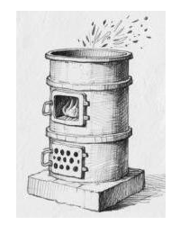

# 化模26-普陀-上 · 2026 普陀一模精讲（上）· 水培绿萝 / 打铁花 / 土壤改良

> 普陀卷是典型"情境题块"卷——第一大题即"一、水培绿萝（12 分）"，含**不定项**选择题（第 2（4）、10、13（1） 题，卷面评分"选对 1 个得 1 分，选错 1 个扣 1 分"）。本卷相对原子质量只给 H-1、C-12、O-16、Fe-56。卷面答案已与独立推演互证，全部一致。卷面插图（图 1 立式炉照片）已按 150dpi 页图原样裁切嵌入题干。题块四、五（第 14~22 题）见 [[化模26-普陀-下]]。

## 题块一 · 水培绿萝（12 分 · 第 1~4 题）

绿萝喜 pH 5.5~6.5 的酸性环境，水培需每隔 10 天添加营养液肥。

**1.**（1）中量元素钙、镁、硫中，"镁"的元素符号是＿＿＿＿＿＿＿＿；
（2）植物吸收的是 Fe²⁺、Zn²⁺、Cu²⁺，这些离子属于＿＿＿＿＿＿＿＿（填"正离子"或"负离子"）。

> [!tip]- 💡 思路导航
> 元素符号"一大二小"；离子带电看"是失电子还是得电子来的"。

> [!success]- ✅ 详解 · 评分点 · 易错 · 关联
> **详解**：（1）**Mg**。（2）Fe²⁺、Zn²⁺、Cu²⁺ 都带正电荷，属于**正离子**（阳离子）。
>
> **易错**：Mg 写成"mg"或"MG"不规范，字母大小写是书写规范得分点。
>
> **关联**：[[05-化学/知识点/专题5-物质的微观构成]]（元素符号、离子）。

**2.** 某营养液成分：KNO₃、KH₂PO₄、NH₄NO₃、Ca(NO₃)₂、MgSO₄、FeSO₄、CuSO₄、ZnSO₄、H₃BO₃。
（1）可做氮肥的有＿＿＿＿＿＿＿＿种；FeSO₄ 的名称是＿＿＿＿＿＿＿＿。
（2）H₃BO₃ 中 B 元素的化合价为＿＿＿＿＿＿＿＿；从物质种类分析，硼酸属于（　）
- （A）酸
- （B）碱
- （C）盐
- （D）氧化物

（3）营养液中浓度最大的物质是（　）
- （A）MgSO₄
- （B）FeSO₄
- （C）CuSO₄
- （D）ZnSO₄

（4）（不定项）关于营养液中的硫酸盐，正确的是（　）
- （A）都能溶于水
- （B）水溶液都有颜色
- （C）都由金属离子与酸根离子构成
- （D）都可以由金属单质与稀硫酸直接反应得到

> [!tip]- 💡 思路导航
> 氮肥认**氮元素**不认名称；化合价代数和为零；第（3）问别按化学式量比——情境信息"植物需求量"决定浓度；第（4）问拿 MgSO₄、CuSO₄ 逐条检验颜色与"氢前金属"规则。

> [!success]- ✅ 详解 · 评分点 · 易错 · 关联
> **详解**：（1）**三**种：KNO₃、NH₄NO₃、Ca(NO₃)₂（KH₂PO₄ 只含 P、K，不作氮肥）；FeSO₄ 读作**硫酸亚铁**（铁为 +2 价读"亚铁"）。（2）设 B 化合价为 x：(+1)×3+x+(−2)×3＝0 → **x＝+3**；H₃BO₃ 电离时阳离子全部为 H⁺，属 **A 酸**。（3）选 **A**：绿萝对 Mg（中量元素）的需求量大于 Fe、Cu、Zn（微量元素），营养液中对应硫酸盐浓度最大的是 MgSO₄。（4）选 **AC**：B 错——MgSO₄、ZnSO₄ 溶液**无色**（有色的是 FeSO₄ 浅绿色、CuSO₄ 蓝色）；D 错——Cu 排在金属活动性顺序氢之后，不能与稀硫酸反应。
>
> **易错**：（1）按"是否含氮元素"数氮肥，别把 KH₂PO₄（磷钾复合肥）误计入；"亚铁"是命名规范得分点。（3）浓度大小不看化学式量、看**植物需求量**——情境信息决定答案，这是新题式与旧套路的分水岭。（4）D 又考一次"H 后金属不与稀硫酸反应"；不定项错选倒扣，没把握的选项不凑数。
>
> **关联**：[[05-化学/知识点/专题5-物质的微观构成]]（化合价）、[[05-化学/知识点/专题8-酸碱盐]]（化肥、硫酸盐）、[[化-28-金属与金属活动性]]（H 后金属与酸）。

**3.** 水培绿萝容器的材质可以是（　）
- （A）铁
- （B）铝
- （C）玻璃
- （D）大理石

> [!tip]- 💡 思路导航
> 容器要与营养液"和平共处"：哪种材质化学性质稳定、不与盐溶液反应？

> [!success]- ✅ 详解 · 评分点 · 易错 · 关联
> **详解**：选 **C**：玻璃化学性质稳定、不与营养液反应；铁、铝制容器易与盐溶液作用而锈蚀或被腐蚀，大理石主要成分 CaCO₃ 性脆且可能参与反应。
>
> **关联**：[[05-化学/知识点/专题8-酸碱盐]]（金属与盐溶液的反应）。

**4.** 某小组用实验室的铜粉、稀硫酸制备硫酸铜溶液，制备的实验方法是＿＿＿＿＿＿＿＿。

> [!tip]- 💡 思路导航
> 铜在氢后、不与稀硫酸直接反应——想一条"先把铜变个身份再溶"的两步路线。

> [!success]- ✅ 详解 · 评分点 · 易错 · 关联
> **详解**：三段式。**判断**——铜不能直接与稀硫酸反应，需"先氧化、后溶解"。**依据**——铜在金属活动性顺序中排在氢之后；但铜在空气中加热可生成氧化铜，氧化铜是金属氧化物，能与酸反应。**回扣**——方法：将铜粉在空气中充分加热（$2Cu+O_2\xrightarrow{\Delta}2CuO$），再加入稀硫酸溶解（$CuO+H_2SO_4=CuSO_4+H_2O$）。
>
> **评分点**：卷面答案"将铜粉在空气中充分加热反应生成氧化铜，再与稀硫酸反应"，用化学方程式表达亦可。
>
> **关联**：[[05-化学/知识点/专题8-酸碱盐]]（金属氧化物与酸）、[[化-28-金属与金属活动性]]（H 后金属的转化路线）。

## 题块二 · 探寻"打铁花"（9 分 · 第 5~9 题）

中国古代就已经大规模使用铁、铜金属，甚至沿用到民间艺术表演中。"打铁花"是流传于豫晋地区的国家级非物质文化遗产，以 1600℃ 铁水迸溅成星雨的震撼场景，被誉为"民间焰火之最"。熔化铁通常使用小型立式炉：由耐火材料（如耐火砖、黏土）砌成，炉体呈圆柱形，底部设有通风口，如图 1 所示。

**5.** 底部通风口接鼓风机，若鼓入的空气过多，后果是＿＿＿＿＿＿＿＿。

> [!tip]- 💡 思路导航
> 想清"鼓风"的两面性：氧气足了助燃，但过量的冷气流还会带走什么？

> [!success]- ✅ 详解 · 评分点 · 易错 · 关联
> **详解**：空气过多会**带走大量热量，使炉内温度降低**，铁水难以维持在 1600℃。
>
> **易错**：答"氧气充足燃烧更旺"就偏了：题问的是"空气**过多**"的后果，落点是**降温**。
>
> **关联**：[[05-化学/知识点/专题9-10-反应调控与化学社会]]（促进燃烧与温度控制）、[[化-07-燃烧与碳]]。

**6.** 使用"花棒"盛放铁水，花棒一端挖有凹槽，用于盛放铁水。花棒一般用新鲜柳木而不用干柳木制作，采用新鲜柳木的原因是＿＿＿＿＿＿＿＿。

> [!tip]- 💡 思路导航
> 新鲜柳木与干柳木的差别是"含水多"——水对可燃物的"着火点"意味着什么？

> [!success]- ✅ 详解 · 评分点 · 易错 · 关联
> **详解**：新鲜柳木**含水较多，不易达到着火点、不易燃烧**，保证花棒盛放铁水时不被烧毁。
>
> **关联**：[[05-化学/知识点/专题9-10-反应调控与化学社会]]（燃烧条件）、[[化-07-燃烧与碳]]。

**7.** 关于"迸溅形成星雨"正确的说法是（　）
- （A）形成小颗粒，充分反应
- （B）铁不是可燃物，星雨只是铁水小颗粒
- （C）在空气中形成氧化铁红色物质
- （D）加热到 1600℃ 是为了达到了铁的着火点

> [!tip]- 💡 思路导航
> 表面积与反应速率的关系定 A；铁的燃烧产物颜色是 B、C 的判据；1600℃ 首先要干什么？

> [!success]- ✅ 详解 · 评分点 · 易错 · 关联
> **详解**：选 **A**：铁水迸溅成小颗粒后与氧气接触面积剧增，得以充分反应（燃烧）。B 错：铁是可燃物（能在氧气中燃烧）；C 错：铁燃烧生成**黑色**的 Fe₃O₄，红色氧化铁是缓慢氧化的产物；D 错：1600℃ 首先是为了**熔化铁水**便于迸溅成小颗粒，并非仅为"达到着火点"。
>
> **易错**：C 的坑在颜色与产物：燃烧产物是 Fe₃O₄（黑色），Fe₂O₃（红棕色）来自缓慢氧化。
>
> **关联**：[[05-化学/知识点/专题9-10-反应调控与化学社会]]（反应速率与接触面积）、[[化-07-燃烧与碳]]（铁的燃烧产物）。

**8.** 打铁花表演需注意安全，写出一条安全注意事项＿＿＿＿＿＿＿＿。

> [!tip]- 💡 思路导航
> 从"高温铁水＋火花四溅"出发想防护：隔、离、护三个方向任答一条。

> [!success]- ✅ 详解 · 评分点 · 易错 · 关联
> **详解**：清理表演区周围可燃物、观众保持安全距离、表演者穿戴防火隔热服等（写一条合理即可）。
>
> **关联**：[[05-化学/知识点/专题9-10-反应调控与化学社会]]（消防安全）。

**9.** 中国古代进行了大规模的铁、铜的冶炼。
（1）中国古代"湿法炼铜"是将铁投入硫酸铜溶液中，即可得到铜，写出该反应的化学方程式是＿＿＿＿＿＿＿＿；该反应说明了铁的活动性＿＿＿＿＿＿＿＿（填"强于"或"弱于"）铜。
（2）实验室模拟利用赤铁矿（主要成分 Fe₂O₃）进行炼铁实验，反应为：3CO+Fe₂O₃ --高温--> 2Fe+3CO₂。若要得到铁 112 g，需要氧化铁多少 g（根据化学方程式列式计算）；若使用含氧化铁 80% 的赤铁矿进行实验，需赤铁矿＿＿＿＿＿＿＿＿ g。

> [!tip]- 💡 思路导航
> 湿法炼铜是"铁换铜"的置换；第（2）问按"设列算答"走：Fe₂O₃→2Fe 质量比 160:112，最后别忘纯度换算的方向。

> [!success]- ✅ 详解 · 评分点 · 易错 · 关联
> **详解**：（1）$Fe+CuSO_4=FeSO_4+Cu$；**强于**（铁能把铜从其盐溶液中置换出来）。（2）解：设需要氧化铁的质量为 x。
> $$3CO+Fe_2O_3\xrightarrow{\text{高温}}2Fe+3CO_2$$
> 列式：160:112＝x:112 g，x＝160 g。需赤铁矿＝160 g÷80%＝**200 g**。答：需要氧化铁 160 g；需含 Fe₂O₃ 80% 的赤铁矿 200 g。
>
> **评分点**：（2）"设、方程式、比例式、求解、答"五步齐全；卷面按比例式 160/112＝112/x 给分。
>
> **易错**："纯度换算漏除"是高频失分：160 g 是纯净 Fe₂O₃，赤铁矿＝160÷80%＝200 g，别乘 80%。
>
> **关联**：[[05-化学/知识点/专题8-酸碱盐]]（金属活动性）、[[05-化学/知识点/专题9-10-反应调控与化学社会]]（铁的冶炼）、[[化-09-制气与还原实验]]（CO 还原氧化铁）、[[化-13-化学计算进阶]]（含杂质计算）。

## 题块三 · 柑橘园的土壤改良（10 分 · 第 10~13 题）

上海长兴岛是上海重要的柑橘种植地，当地种有"红美人"等常见柑橘品种。科学研究发现，柑橘适合在 pH 为 5.5~6.5 的弱酸性土壤中生长。

**10.**（不定项）土壤取样需要考虑多点取样，取样土壤的深度也有标准，果树取样一般在 30 cm 深。该操作主要考虑的原因是（　）
- （A）挖掘过深，取样困难
- （B）种植面积较小时，无需多点取样
- （C）该深度是果树的根系分布层
- （D）多点取样是通过增加样本数量、覆盖更多区域

> [!tip]- 💡 思路导航
> 找"科学依据"而不是"操作感受"：30 cm 由什么决定？多点取样为了什么？

> [!success]- ✅ 详解 · 评分点 · 易错 · 关联
> **详解**：选 **CD**：C——30 cm 恰是果树**根系分布层**，取样深度由它确定；D——多点取样增加样本数量与覆盖区域，使样品更具代表性。A 是困难而非依据；B 说法本身错误。
>
> **易错**：不定项 A 有迷惑性："取样困难"是操作麻烦，不是确定 30 cm 的**化学/生物学依据**；错选倒扣，没把握不凑数。
>
> **关联**：[[05-化学/知识点/专题1-2-化学之门与实验探究]]（取样规范）、[[化-16-实验探究与评价]]。

**11.** 土壤酸碱性的测定：将长兴岛柑橘园土壤样品与蒸馏水，按照国家标准"土样与水质量比为 1:2.5"，混合振荡 30 分钟后，静置 30 分钟。取上层清液滴入酚酞试液，呈红色，说明土壤呈＿＿＿＿＿＿＿＿；"振荡 30 分钟"的意义是＿＿＿＿＿＿＿＿。

> [!tip]- 💡 思路导航
> 酚酞的变色规律定酸碱；振荡是为了让土里的"待测成分"充分进入水溶液。

> [!success]- ✅ 详解 · 评分点 · 易错 · 关联
> **详解**：**碱性**（酚酞遇碱性溶液变红）；振荡 30 分钟使土样中的可溶性物质**充分溶解**（土水充分接触，卷面答案口径为"充分溶解土壤中的酸性物质"），保证测得的酸碱性真实可靠。
>
> **易错**：卷面答案将"待测成分"表述为"酸性物质"，作答时按"充分溶解土样中的可溶性成分、使测定真实可靠"展开即可，落点是**充分溶解**。
>
> **关联**：[[化-24-溶液的酸碱性与pH]]（pH 测定与指示剂）、[[05-化学/知识点/专题8-酸碱盐]]。

**12.** 土壤酸碱性的调整：有小组同学认为，可以加入酸与土壤中的碱反应，碱与酸发生的化学反应的类型属于＿＿＿＿＿＿＿＿；该小组还提出使用洒水来降低土壤碱性，以达到柑橘可以生长的 pH 范围，请对该方案的可行性作出判断并阐述理由。

> [!tip]- 💡 思路导航
> 酸＋碱→盐＋水对号基本类型；"洒水"只能稀释——pH 能被水从中性拉到酸性区吗？

> [!success]- ✅ 详解 · 评分点 · 易错 · 关联
> **详解**：**中和反应**（属于复分解反应，卷面答案亦认可"放热反应"）。三段式：**判断**——洒水方案不可行。**依据**——水呈中性，洒水只能**稀释**土壤碱性、使 pH 向 7 靠近，不可能把 pH 降到柑橘适宜的 5.5~6.5 弱酸区间。**回扣**——要真正调酸必须施加酸性物质（如硫磺粉缓释出的硫酸）。
>
> **评分点**："洒水"要答全两个落点：只能稀释（碱性降低）＋不能变酸（到不了 5.5~6.5），只答一半扣一半（卷面 2 分）。
>
> **关联**：[[05-化学/知识点/专题8-酸碱盐]]（中和反应）、[[化-17-说理题专练]]（可行性评价三段式）。

**13.** 方案改良：小组继续查阅资料，发现农技人员使用加入硫磺粉（S 单质）悬浊液、生石灰的方法来改良土壤酸碱性。硫磺粉悬浊液露置在空气中可以不断缓慢转变成硫酸。
（1）（不定项）硫磺转化为硫酸的过程中，参加反应的物质还有（　）
- （A）O₂
- （B）N₂
- （C）CO₂
- （D）H₂O

（2）使用硫磺粉悬浊液，而不是直接使用稀硫酸的原因可能是＿＿＿＿＿＿＿＿（写出一条你认为合理的原因即可）。

> [!tip]- 💡 思路导航
> 用原子账反推反应物：硫酸含 H、S、O 三种元素——S 已由硫磺提供，H、O 从空气中来；"悬浊液"比"稀硫酸"多了"缓"字。

> [!success]- ✅ 详解 · 评分点 · 易错 · 关联
> **详解**：（1）选 **AD**。原子账：H₂SO₄ 中的 S 来自硫磺，H 只能来自水，O 由 O₂ 和水共同提供；$2S+3O_2+2H_2O=2H_2SO_4$（验算：S 2=2，H 4=4，O 6+2=8 ✓）。（2）三段式：**判断**——硫磺粉可"缓释"酸性。**依据**——硫磺在空气中**缓慢氧化、持续**生成硫酸，作用时间长。**回扣**——避免一次性加酸过量使土壤酸性过强而灼伤柑橘根系（合理即可）。
>
> **易错**：（1）别漏 D：不少同学只想到 O₂，忘了硫酸里的氢必须来自水——用原子账而非直觉；不定项错选倒扣。
>
> **关联**：[[05-化学/知识点/专题6-化学变化及其表示]]（质量守恒推反应物）、[[化-04-质量守恒与方程式]]、[[化-17-说理题专练]]。

## ✅ 答案速查

| 题 | 答案 |
| ---- | ---- |
| 1 | （1） Mg　（2） 正离子 |
| 2 | （1） 三；硫酸亚铁　（2） +3；A　（3） A　（4） AC |
| 3~4 | C；先加热氧化为 CuO，再加稀硫酸溶解（2Cu+O₂→2CuO；CuO+H₂SO₄→CuSO₄+H₂O） |
| 5~8 | 带走热量炉温降低；新鲜柳木含水多不易达着火点；A；清理周围可燃物（合理即可） |
| 9 | （1） Fe+CuSO₄＝FeSO₄+Cu；强于　（2） 氧化铁 160 g；赤铁矿 200 g |
| 10~11 | CD；碱性；使可溶性物质充分溶解、测定真实可靠 |
| 12~13 | 中和反应（复分解）；洒水不可行（只能稀释不能变酸）；AD；见详解 |

## 🔗 关联
- [[05-化学/知识点/专题5-物质的微观构成]]（元素符号、化合价）· [[05-化学/知识点/专题8-酸碱盐]]（化肥、中和反应）
- [[05-化学/知识点/专题9-10-反应调控与化学社会]]（燃烧条件、金属冶炼与生活应用）
- [[化-03-空气与氧气]] · [[化-09-制气与还原实验]]（CO 还原氧化铁）· [[05-化学/专题/说理题方法]]
- 后续：[[化模26-普陀-下]]
