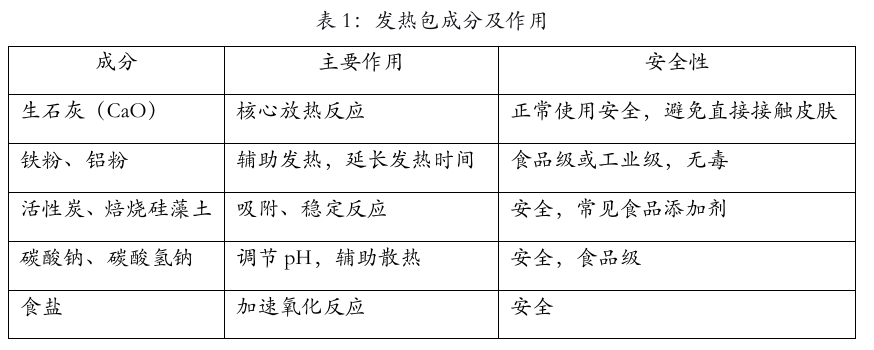
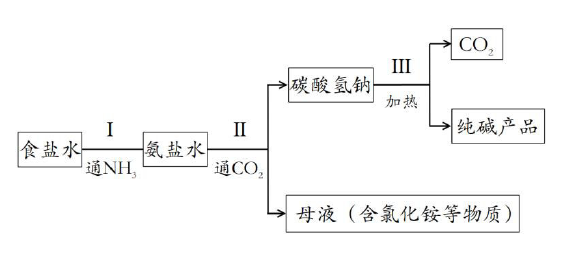
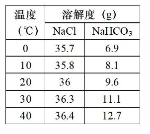

# 化模26-普陀-下 · 2026 普陀一模精讲（下）· 发热包探究 / 纯碱的制备

> 本讲承接 [[化模26-普陀-上]]（题块一~三），处理两个"探究＋评价"题块。相对原子质量只给 H-1、C-12、O-16、Fe-56。卷面答案已与独立推演互证，全部一致。卷面插图（表 1 发热包成分、图 2 侯氏制碱流程、表 2 溶解度表）已按 150dpi 页图原样裁切嵌入题干；此前 OCR 缺失的表 2、图 2 已依原卷核验补齐。第 21 题答案口径与"析出即饱和"的直觉存在张力，见该题详解中的 ⚠️ 标注。

## 题块四 · 自热火锅发热包作用探究（9 分 · 第 14~18 题）

自热火锅的自热材料（发热包）主要由以下成分构成，见表 1。这些成分通过与水发生化学反应释放热量，实现食材加热。硅藻土是一种生物成因的硅质沉积岩，一般为白色不溶于水的固体。

**14.** 放热主要由生石灰与水反应产生，写出该反应的化学方程式＿＿＿＿＿＿＿＿。

> [!tip]- 💡 思路导航
> 生石灰是 CaO——它与水"化合"成谁？放热反应别忘了写全。

> [!success]- ✅ 详解 · 评分点 · 易错 · 关联
> **详解**：$$CaO+H_2O=Ca(OH)_2$$（放热反应，属化合反应）。
>
> **易错**：Ca(OH)₂ 的下标 ₂ 别漏；产物是"熟石灰/消石灰"，与"生石灰"名称区分开。
>
> **关联**：[[05-化学/知识点/专题8-酸碱盐]]（生石灰的性质）、[[化-26-碱的性质与中和反应]]。

**15.** "成分"一栏中硅藻土属于＿＿＿＿＿＿＿＿（填"纯净物"或"混合物"）。

> [!tip]- 💡 思路导航
> "生物成因的硅质沉积岩"——岩石一般由几种物质组成？

> [!success]- ✅ 详解 · 评分点 · 易错 · 关联
> **详解**：**混合物**。"生物成因的硅质沉积岩"表明它由多种物质组成（主要成分 SiO₂，并含杂质）。
>
> **关联**：[[05-化学/知识点/专题1-2-化学之门与实验探究]]（物质分类）、[[化-12-概念辨析与分类]]。

**16.** 发热包加入冷水后随即产生热量。加入水量要有控制，请分析原因。

> [!tip]- 💡 思路导航
> "要有控制"类说理答**两头**：水太少会怎样？水太多又会怎样？

> [!success]- ✅ 详解 · 评分点 · 易错 · 关联
> **详解**：两点式：**水太少**——发热包成分不能充分反应，放出的热量不足，加热效果差；**水太多**——多余的水会吸收（稀释）反应放出的热量，使温度达不到加热要求（还受容器容积限定）。
>
> **评分点**：卷面 2 分，"一定要有两个方面，体现少、多的原因"——只答一头丢一半分。
>
> **关联**：[[化-17-说理题专练]]（两点式说理）、[[05-化学/知识点/专题9-10-反应调控与化学社会]]（放热反应的应用）。

**17.** 发热包反应过程中有气体产生。取发热包部分固体加水反应后收集气体，点燃气体发现该气体能燃烧，确定该气体是＿＿＿＿＿＿＿＿（用化学式表示）。

> [!tip]- 💡 思路导航
> 拿成分表当"嫌疑名单"：谁遇水（及碱性溶液）能放出可燃气体？初中可燃气体三选一。

> [!success]- ✅ 详解 · 评分点 · 易错 · 关联
> **详解**：**H₂**。发热包成分中能与水（及生成的碱性溶液）作用产生可燃气体的只有活泼金属**铝粉**，点燃能燃烧的气体是氢气（化学式 H₂）。
>
> **易错**：答名称"氢气"不给分，题目明确要求**化学式**；锁定气体要用"成分表＋可燃"双条件，不答依据只写 H₂ 缺推理。
>
> **关联**：[[05-化学/知识点/专题8-酸碱盐]]（金属与碱溶液的反应）、[[化-07-燃烧与碳]]（可燃性气体）。

**18.** 发热包反应后，发现液体下面有白色固体存在。白色固体除含有硅藻土外，对其他成分进行探究。
（1）有同学根据成分表推测"白色固体"中含有不溶于水的碳酸钙。设计实验方案验证。
（2）有同学补充说，白色固体除硅藻土、碳酸钙外，还含有其他物质，请指出该物质并阐述判断理由。

> [!tip]- 💡 思路导航
> （1）碳酸盐检验"三步走"：加盐酸→通石灰水→看浑浊；（2）沿"生石灰大量→氢氧化钙生成多→溶解性有限"的链条推理，注意 Ca(OH)₂ 的溶解性等级。

> [!success]- ✅ 详解 · 评分点 · 易错 · 关联
> **详解**：（1）取白色固体样品少许于试管中，滴加稀盐酸，将产生的气体通入澄清石灰水中；若**石灰水变浑浊**，则白色固体中含碳酸钙。（2）三段式：**判断**——白色固体中还含氢氧化钙。**依据**——发热包中生石灰大量存在，与水反应生成的 Ca(OH)₂ 是**微溶**于水的物质，水量有限时不能全部溶解。**回扣**——未溶解的 Ca(OH)₂ 与硅藻土、碳酸钙一起沉在液体下方，构成白色固体。
>
> **易错**：（2）最容易漏"微溶"二字：把 Ca(OH)₂ 当作"全溶"就推不出白色固体；微溶与不溶（CaCO₃、硅藻土）必须分清。
>
> **关联**：[[05-化学/知识点/专题8-酸碱盐]]（碳酸盐检验、碱的溶解性）、[[化-30-物质的检验与提纯]]、[[化-29-盐与废液成分探究]]。

## 题块五 · 纯碱的制备（10 分 · 第 19~22 题）

侯德榜是中国化工先驱之一，创立的侯氏制碱法促进了世界制碱工业的发展。纯碱（Na₂CO₃）广泛用于玻璃工业、纺织工业等。侯氏制碱法的部分工艺流程如图 2 所示，反应原理为：NaCl+NH₃+H₂O+CO₂＝NaHCO₃↓+NH₄Cl。

下表为氯化钠、碳酸氢钠的溶解度（表 2）：

**19.** 构成氯化钠物质的微粒是＿＿＿＿＿＿＿＿（选填"原子"或"离子"）；20℃ 时，1000 g 水中能溶解＿＿＿＿＿＿＿＿ g 氯化钠形成饱和溶液。

> [!tip]- 💡 思路导航
> 金属离子＋酸根离子构成的盐由离子组成；第二空先把溶解度"归一到 100 g 水"再看给了多少水。

> [!success]- ✅ 详解 · 评分点 · 易错 · 关联
> **详解**：**离子**（Na⁺ 与 Cl⁻）；20℃ 时 NaCl 溶解度为 36 g → 1000 g 水中最多溶解 36×10＝**360 g** 恰好饱和。
>
> **易错**：第二空先"归一到 100 g 水"再放大 10 倍，直接把 36 写上去（忘了 1000 g 水）是最常见错误。
>
> **关联**：[[05-化学/知识点/专题7-溶液]]（溶解度概念、物质的构成）。

**20.** 为了从母液中提取氯化铵，采用的是降温结晶的方法，原因是氯化铵的溶解度随温度升高而＿＿＿＿＿＿＿＿（选填"升高"或"降低"）；提取氯化铵后的母液可以循环利用，图 2 中还可以循环利用的物质为＿＿＿＿＿＿＿＿。

> [!tip]- 💡 思路导航
> 降温结晶适用于"溶解度随温度升高显著增大"的物质；在图 2 里找"前端消耗、后端又产出"的那一种气体。

> [!success]- ✅ 详解 · 评分点 · 易错 · 关联
> **详解**：**升高**（溶解度随温度升高而增大，降温即大量结晶析出）；**二氧化碳**——图 2 中步骤 Ⅲ 加热碳酸氢钠产出 CO₂，可回收后再次通入步骤 Ⅱ 的氨盐水中（与母液循环同理，提高原料利用率）。
>
> **关联**：[[化-22-溶解度与曲线]]（结晶方法选型）、[[05-化学/知识点/专题7-溶液]]。

**21.** 步骤 Ⅱ 在 20℃ 时进行，得到的母液中 NaHCO₃ 溶质质量分数为＿＿＿＿＿＿＿＿（选填编号）：
- （A）$\dfrac{9.6}{100}$
- （B）$>\dfrac{9.6}{109.6}$
- （C）$=\dfrac{9.6}{109.6}$
- （D）$<\dfrac{9.6}{109.6}$

> [!tip]- 💡 思路导航
> 先把"20℃ NaHCO₃ 溶解度 9.6 g"翻译成饱和质量分数 9.6/109.6（分母是 100＋9.6，不是 100），再判断母液对 NaHCO₃ 是否饱和。

> [!success]- ✅ 详解 · 评分点 · 易错 · 关联
> **详解**：选 **D（卷内答案）**。分析：若母液是"20℃ 下与固体 NaHCO₃ 共存（或刚析出 NaHCO₃）的饱和母液"，应选 C；卷内答案给 D，说明按图 2 流程，母液在降温提取 NH₄Cl 等后续操作后，其中 NaHCO₃ 已**未饱和**，故 w＜9.6/109.6。
>
> **评分点**：先把 9.6 g 翻译成 9.6/109.6（分母是 100＋9.6，不是 100），再判断母液是否饱和——死背"饱和＝9.6/109.6"会掉进 C 项。
>
> **易错**：⚠️ 本题按图 2 所示流程（碳酸氢钠与母液同为步骤 Ⅱ 产物，母液含氯化铵等物质）推"析出即饱和"应得 C，卷面答案为 D，两者的差异取决于流程中母液后续处理细节，教学中以原卷图与答案口径为准，默认规律"析出晶体后的母液对析出物饱和"要先会写。
>
> **关联**：[[化-23-溶质质量分数与计算]]（饱和溶液质量分数）、[[05-化学/知识点/专题7-溶液]]。

**22.** 纯碱的性质探究。
（1）碳酸钠、碳酸钙性质相似，原因是＿＿＿＿＿＿＿＿。
（2）将稀盐酸滴入碳酸钠固体中，有气体产生，写出该反应的化学方程式是＿＿＿＿＿＿＿＿；
（3）将碳酸钠投入到澄清石灰水中，写出该反应的化学方程式是＿＿＿＿＿＿＿＿；将碳酸钠投入到氢氧化钠溶液，未见明显现象，有同学认为，只要证明溶液中还有碳酸钠，即可说明反应没有发生，请你评价该说法是否正确并阐明理由。

> [!tip]- 💡 思路导航
> （1）"性质相似找共同离子"；（3）"还有碳酸钠"其实有两种解释——反应没发生，还是反应了但有剩余？要证明"发生了"得抓什么？

> [!success]- ✅ 详解 · 评分点 · 易错 · 关联
> **详解**：（1）它们的组成中都含有**碳酸根离子（CO₃²⁻）**——组成与结构相似，化学性质相似。（2）$$Na_2CO_3+2HCl=2NaCl+H_2O+CO_2\uparrow$$（3）$$Ca(OH)_2+Na_2CO_3=CaCO_3\downarrow+2NaOH$$
> 评价三段式：**判断**——不正确。**依据**——"溶液中还有碳酸钠"存在两种可能：碳酸钠完全没有反应，或**反应发生了但碳酸钠过量、有剩余**；只检验出碳酸钠无法区分这两种情况。**回扣**——要证明反应发生，应检验**生成物**（如证明溶液中生成了 NaOH：取样滴加酚酞并与碳酸钠溶液对照，或验证 OH⁻ 的存在），才能得出可靠结论。
>
> **易错**：（3）"证明反应发生"必须落到**新物质生成**或**反应物被消耗**；"还有碳酸钠"两种解释并存即证据不足——与 [[化-17-说理题专练]] 的"结论可靠性类"同型。
>
> **关联**：[[05-化学/知识点/专题8-酸碱盐]]（碳酸盐的通性）、[[化-16-实验探究与评价]]（结论可靠性评价）、[[化-17-说理题专练]]。

## ✅ 答案速查

| 题 | 答案 |
| ---- | ---- |
| 14~15 | CaO+H₂O＝Ca(OH)₂；混合物 |
| 16 | 水太少反应不充分放热不足；水太多吸收热量温度不够（两点齐全） |
| 17 | H₂ |
| 18 | （1） 加稀盐酸→气体通澄清石灰水变浑浊　（2） 氢氧化钙（微溶未尽溶） |
| 19 | 离子；360 |
| 20 | 升高；二氧化碳 |
| 21 | D（＜9.6/109.6，母液未饱和；依卷内答案，与"析出即饱和"直觉的张力见详解 ⚠️） |
| 22 | （1） 都含 CO₃²⁻　（2） Na₂CO₃+2HCl＝2NaCl+H₂O+CO₂↑　（3） Ca(OH)₂+Na₂CO₃＝CaCO₃↓+2NaOH；不正确（碳酸钠过量未反应完也会剩余） |

## 🔗 关联
- [[05-化学/知识点/专题7-溶液]]（溶解度、结晶、饱和质量分数）· [[05-化学/知识点/专题8-酸碱盐]]（碳酸盐、侯氏制碱）
- [[05-化学/知识点/专题9-10-反应调控与化学社会]]（放热反应的应用）
- [[化-06-溶液与溶解度]] · [[化-17-说理题专练]]（结论可靠性三段式）· 前讲：[[化模26-普陀-上]]
