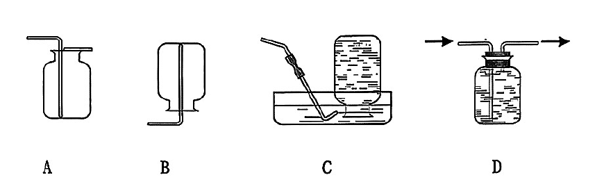
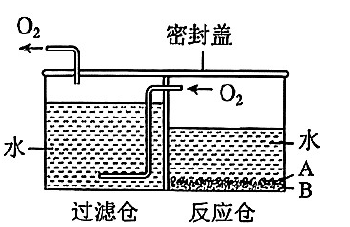
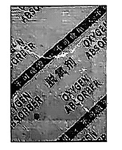
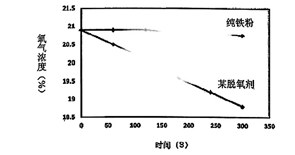
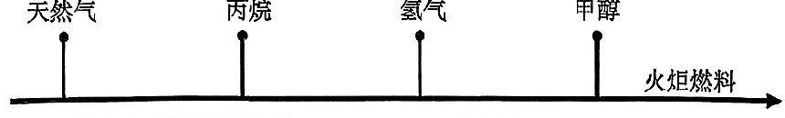
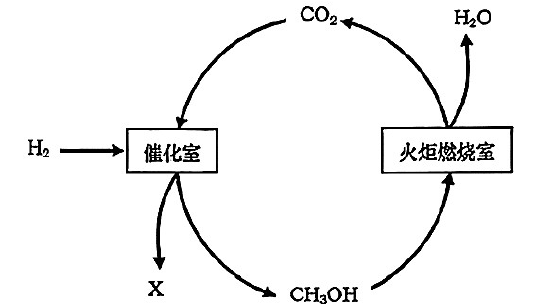

# 化模26-松江-上 · 2026 松江一模精讲（上）· 制取氧气 / 除氧保鲜 / 火炬燃烧

> 本卷以"辩证认识氧气""探秘火炬燃烧"等大情境分块命题，第 2（2）、9（3） 为不定项。相对原子质量：H-1、C-12、O-16、Na-23。**卷末附参考答案（第 7~8 页），本讲已逐题与独立推演互证，全部一致**；一处规范提醒见第 3（1） 题详解。卷面插图（收集装置、家用制氧机、脱氧剂包、氧气浓度-时间曲线、火炬燃料变迁图、甲醇流程图等 6 幅）已按 150dpi 页图原样裁切嵌入题干。题块四、五（第 10~19 题）见 [[化模26-松江-下]]。

## 辩证认识氧气 · 题块一 · 制取氧气（第 1~4 题）

在日常生活中，氧气既能维持人体呼吸、为生命活动提供支持，也会导致饼干失去酥脆、糕点氧化变质等。因此，辩证分析和评价物质，具有重要的意义。

**1.** 工业上通过物理变化制取氧气的原料是＿＿＿＿＿＿＿＿。
- （A）空气
- （B）水
- （C）二氧化碳
- （D）氧化汞

> [!tip]- 💡 思路导航
> "物理变化"意味着没有新物质生成——想想工业上大规模制氧分离的是什么。

> [!success]- ✅ 详解 · 评分点 · 易错 · 关联
> **详解**：选 **A**。工业制氧分离液态空气，利用液氮、液氧沸点不同，**原料是空气**，无新物质生成（物理变化）。
>
> **关联**：[[05-化学/知识点/专题3-空气氧气与二氧化碳]]（氧气的工业制法）、[[化-03-空气与氧气]]。

**2.** 实验室用高锰酸钾受热分解制取氧气。
（1）化学方程式书写正确的是＿＿＿＿＿＿＿＿。
- （A）$KMnO_4\xrightarrow{\Delta}K_2MnO_4+MnO_2+O_2\uparrow$
- （B）$2KMnO_4\xrightarrow{\Delta}K_2MnO_4+MnO_2+O_2$
- （C）$4KMnO_4\xrightarrow{\Delta}2K_2MnO_4+2MnO+3O_2\uparrow$
- （D）$2KMnO_4\xrightarrow{\Delta}K_2MnO_4+MnO_2+O_2\uparrow$

（2）（不定项）实验室收集氧气，可采用下图中的收集方法是＿＿＿＿＿＿＿＿。
- （A）向上排空气法
- （B）向下排空气法
- （C）排水法
- （D）瓶内装满水、气体"长进短出"的多功能瓶

> [!tip]- 💡 思路导航
> 方程式正误"三查"——查配平、查条件、查↑↓；收集方法看**密度与溶解性**，D 项装满水时进气口的长短方向要想清楚。

> [!success]- ✅ 详解 · 评分点 · 易错 · 关联
> **详解**：（1）选 **D**。A 未配平（KMnO₄ 前缺系数 2）；B 漏标"↑"；C 产物错误（应为 K₂MnO₄ 与 MnO₂，且系数乱配）；D 配平、条件、↑齐全。（2）选 **AC**。氧气密度比空气大 → 向上排空气法；氧气不易溶于水 → 排水法。B 方向反了；D"长进短出"排的是瓶口处的气体，装满水时应"**短进长出**"（气体短管进、水被从长管压出），故 D 不能收集。
>
> **易错**：（1）C 型"凑数式配平"最具迷惑性：先验产物对不对，再验原子账，产物中 MnO 与 MnO₂ 一字之差。（2）D 别凭"装满水"就选——**进出管长短与方向**才是多功能瓶收集气体的判断依据（对照图中装置辨认）。
>
> **关联**：[[05-化学/知识点/专题3-空气氧气与二氧化碳]]（收集方法选择）、[[化-03-空气与氧气]]。

**3.** 某"家用制氧机"如右图所示，图中反应仓内的 A 剂为过碳酸钠固体，B 剂为二氧化锰。

（1）反应仓内发生的反应，第一步是过碳酸钠分解生成碳酸钠和过氧化氢，第二步是过氧化氢分解，第二步反应的化学方程式为＿＿＿＿＿＿＿＿。
（2）反应仓内的 A 剂过碳酸钠固体能否用高锰酸钾固体替代，请分析说明＿＿＿＿＿＿＿＿。

> [!tip]- 💡 思路导航
> 第一步的产物里就有 H₂O₂，第二步是它的"招牌分解"；替换可行性抓住"反应条件"对比——家用装置能加热吗？

> [!success]- ✅ 详解 · 评分点 · 易错 · 关联
> **详解**：（1）$2H_2O_2\xrightarrow{MnO_2}2H_2O+O_2\uparrow$（验算：H 4=4，O 4=2+2 ✓）。⚠️ **规范提醒**：卷面答案未标注条件，规范书写应标"MnO₂ 作催化剂"（B 剂二氧化锰即为此设）。（2）三段式：**判断**——不能替代。**依据**——高锰酸钾分解制氧气需要**加热**条件，而家用制氧机是常温装置、无法加热。**回扣**——过碳酸钠遇水分解出过氧化氢，再被 MnO₂ 常温催化分解放氧，符合"家用、常温、安全"的设计要求。
>
> **易错**：（1）方程式漏标 MnO₂ 条件是规范失分点（本卷答案页即漏，照抄不加分）。
>
> **关联**：[[05-化学/知识点/专题3-空气氧气与二氧化碳]]（催化剂与反应条件）、[[化-03-空气与氧气]]。

**4.** 实验室常用过氧化氢溶液制取氧气。现有一瓶久置的 100 克 3% 过氧化氢溶液，用不同方法可判断其是否失效。
（1）方法一：倒出瓶中部分液体于试管中，＿＿＿＿＿＿＿＿（补全实验试剂、操作和现象），可说明该溶液中已不含过氧化氢。
（2）方法二：倒出瓶中部分液体，运用现代化仪器——元素分析仪，测定出液体中氢元素的质量为 5 克，氧元素的质量为 X 克。通过数据分析，可得出该瓶溶液中已不含过氧化氢。请写出 X 的数值，并解释说明＿＿＿＿＿＿＿＿。

> [!tip]- 💡 思路导航
> 方法一借催化剂"验货"：有 H₂O₂ 会冒泡；方法二用水中氢氧元素**质量比恒为 1:8** 这一定量依据反推 X，再想"若含 H₂O₂ 结果会怎样"。

> [!success]- ✅ 详解 · 评分点 · 易错 · 关联
> **详解**：（1）**加入少量二氧化锰（MnO₂）并振荡，无气泡产生**——试剂、操作、现象三要素齐全；若溶液中仍有 H₂O₂，加 MnO₂ 会迅速冒气泡。（2）**X＝40**。解释：若溶液中已不含过氧化氢，则液体为**纯水**；纯水中氢、氧元素质量比恒为 1:8，现测得氢元素 5 g，则氧元素质量 X＝5 g×8＝**40 g**（与测定一致，说明是纯水）；若含 H₂O₂（H:O=2:32=1:16），氧的占比会更高，X 将大于 40。
>
> **评分点**：（2）解释必须点出"纯水中氢氧质量比 1:8"这一定量依据；只答"是水"不算完成论证。
>
> **易错**：（1）补全缺一不可：只写"加二氧化锰"没有操作与现象不得满分。
>
> **关联**：[[05-化学/知识点/专题3-空气氧气与二氧化碳]]（H₂O₂ 检验）、[[化-10-微观意义与计算]]（元素质量比）。

## 题块二 · 除氧保鲜（第 5~6 题）

**5.** 薯片包装袋中通常充入＿＿＿＿＿＿＿＿来防腐。
- （A）空气
- （B）氮气
- （C）水蒸气
- （D）氢气

> [!tip]- 💡 思路导航
> 充气防腐选"化学性质稳定且无毒"的气体——逐项想"它会不会惹麻烦"。

> [!success]- ✅ 详解 · 评分点 · 易错 · 关联
> **详解**：选 **B**。氮气化学性质稳定、无毒、廉价，充入可隔绝氧气防氧化受潮；空气含氧反而促氧化，水蒸气使薯片受潮，氢气易燃易爆不安全。
>
> **关联**：[[05-化学/知识点/专题3-空气氧气与二氧化碳]]（氮气的性质与用途）。

**6.** 食品包装袋中还可以加入脱氧剂包来防腐。
（1）某包脱氧剂（右图）的主要成分有铁粉、活性炭、氯化钠等，其中黑色固体是＿＿＿＿＿＿＿＿。

（2）为判断"纯铁粉"能否替代"某脱氧剂"，利用氧气传感器分别测定等质量"纯铁粉"和"某脱氧剂"放在密闭容器中氧气浓度的变化，结果如下图所示。

分析得出：纯铁粉＿＿＿＿＿＿＿＿（选填"能"或"不能"）替代脱氧剂；随时间的推移，"某脱氧剂"包的质量会＿＿＿＿＿＿＿＿（选填"增大""减少"或"不变"）。
（3）上述实验后，拆开密闭容器中的"某脱氧剂"包，在固体上滴加足量稀硫酸，现象是＿＿＿＿＿＿＿＿，说明还有铁粉剩余；写出该反应的化学方程式＿＿＿＿＿＿＿＿。

> [!tip]- 💡 思路导航
> 读图抓两条线的"降不降"：浓度不降说明没除氧；包的质量变化从"铁锈蚀结合了氧气和水"守恒着想；验余铁用酸看气泡。

> [!success]- ✅ 详解 · 评分点 · 易错 · 关联
> **详解**：（1）**铁粉和活性炭**（两者均为黑色固体；氯化钠为白色晶体）。（2）三段式：**判断**——**不能**替代；包的质量会**增大**。**依据**——等时间内纯铁粉容器中氧气浓度几乎不降（曲线水平），说明纯铁粉**常温下除氧极慢**；脱氧剂曲线明显下降，说明其有效吸氧。**回扣**——脱氧剂吸氧（铁→含氧化合物）且吸收了水蒸气，固体总量增加，故质量增大；活性炭、氯化钠正是帮助铁粉快速锈蚀的"助剂"。（3）**有气泡产生**；$Fe+H_2SO_4=FeSO_4+H_2\uparrow$（验算：Fe 1=1，H 2=2，S 1=1，O 4=4 ✓）。滴加足量稀硫酸后仍有气泡，说明固体中还含有能与酸反应的铁单质。
>
> **易错**：（1）只答"铁粉"漏"活性炭"不得全分——活性炭也是黑色。（2）不能答"不变"：脱氧过程是**结合**氧气与水分，是化合不是分解，质量增大是守恒的体现。（3）现象写"产生气泡"即可，写"放出氢气"是结论不是现象；方程式漏"↑"扣分。
>
> **关联**：[[05-化学/知识点/专题9-10-反应调控与化学社会]]（缓慢氧化、铁生锈条件）、[[化-28-金属与金属活动性]]（铁与酸）、[[化-03-空气与氧气]]。

## 题块三 · 探秘火炬燃烧（第 7~9 题）

火炬燃料随着时代发展不断变迁，下图为部分大型运动会火炬燃料的变迁图。

**7.**（不定项）有关"天然气"描述正确的是＿＿＿＿＿＿＿＿。
- （A）属于化合物
- （B）属于不可再生能源
- （C）有刺激性气味
- （D）燃烧后只生成二氧化碳

> [!tip]- 💡 思路导航
> "主要成分是甲烷"≠"是甲烷"——天然气到底是什么类别？气味、产物两项再用常识与元素守恒核对。

> [!success]- ✅ 详解 · 评分点 · 易错 · 关联
> **详解**：选 **B**。天然气主要成分是甲烷，还含其他气体，属**混合物**（A 错）；化石燃料不可再生（B 对）；甲烷无色无味，民用天然气加臭剂才有气味（C 错）；燃烧生成 CO₂ **和水**（D 错）。
>
> **易错**：A"天然气属于化合物"是"主要成分"偷换：天然气≈混合物，甲烷才是化合物。
>
> **关联**：[[05-化学/知识点/专题9-10-反应调控与化学社会]]（化石燃料）、[[化-07-燃烧与碳]]。

**8.** 不同燃料的信息如下表：

| 燃料 | 沸点（℃） | 热量（kJ/g） |
| ---- | ---- | ---- |
| 甲烷 | −161.5 | 55.6 |
| 丙烷 | −42.1 | 50.5 |
| 氢气 | −252.9 | 143.0 |
| 甲醇 | 64.7 | 22.7 |

（1）相同质量的上述燃料分别完全燃烧时，放出热量最多的是＿＿＿＿＿＿＿＿。
- （A）甲烷
- （B）丙烷
- （C）氢气
- （D）甲醇

（2）火炬内部空间狭小，为能在有限的火炬燃料罐内装载更多的燃料，最好选择＿＿＿＿＿＿＿＿燃料（选填"液态"或"气态"）；火炬燃料用丙烷替代天然气，主要利用丙烷＿＿＿＿＿＿＿＿性质。

> [!tip]- 💡 思路导航
> （1）直接比"热量"栏；（2）装载量与"易不易液化"挂钩——看沸点栏谁高，"易液化"属于物理性质还是化学性质？

> [!success]- ✅ 详解 · 评分点 · 易错 · 关联
> **详解**：（1）选 **C**。比较热量栏：143.0 kJ/g 最大，氢气单位质量放热最多。（2）**液态**；**沸点较高（−42.1℃），常温下加压易液化**——丙烷沸点远高于甲烷的 −161.5℃，更易液化储存，同体积燃料罐装载更多；"易液化"属**物理**性质。
>
> **易错**：（2）逻辑链：沸点高→易液化→液态装载多，三环缺一环理由就不完整；"沸点较高"要与甲烷的 −161.5℃ 对比着写。
>
> **关联**：[[05-化学/知识点/专题9-10-反应调控与化学社会]]（燃料的选择）、[[化-07-燃烧与碳]]。

**9.** 利用太阳能、风能等能源制取的绿氢与工业捕集的 CO₂ 反应，可生产碳排放为零的甲醇（化学式 CH₃OH），右图是甲醇制备及燃烧流程图。

（1）根据质量守恒定律，推理催化室制备甲醇的反应中，X 是＿＿＿＿＿＿＿＿。
- （A）CH₄
- （B）C
- （C）CO
- （D）H₂O

（2）在燃烧室中需对甲醇进行雾化处理，目的是＿＿＿＿＿＿＿＿。
（3）（不定项）分析上述流程，说法正确的是＿＿＿＿＿＿＿＿。
- （A）该流程过程中，CO₂ 可重复利用
- （B）该流程过程中，"碳排放"与"碳吸收"相等
- （C）二氧化碳中碳元素质量分数等于甲醇中碳元素质量分数
- （D）燃烧室的甲醇中氧元素质量等于生成二氧化碳和水中的氧元素质量总和

> [!tip]- 💡 思路导航
> （1）用原子账：反应前后每种原子"收支相减"；（2）雾化=增大接触面积；（3）逐项算碳、氧元素的"账"再判对错，守恒说的是"全体"。

> [!success]- ✅ 详解 · 评分点 · 易错 · 关联
> **详解**：（1）选 **D**。原子账：反应前 C 1、O 2、H 6（CO₂＋3H₂），CH₃OH 占 C 1、O 1、H 4，差额 H 2、O 1 → **X＝H₂O**。（2）增大甲醇（反应物）与氧气的**接触面积**，使燃烧更充分、放热集中。（3）选 **AB**。A 对：燃烧室产出的 CO₂ 回流催化室循环利用；B 对：流程内碳"吸收（捕集）"与"排放（燃烧）"相抵，净排放为零；C 错——CO₂ 中 w(C)=12/44≈27.3%，CH₃OH 中 w(C)=12/32=37.5%，不相等；D 错——生成物中的氧来自**甲醇和参加反应的氧气**两部分，甲醇中的氧只是其中一部分，二者不相等。
>
> **易错**：（3）D 是质量守恒的"偏账"陷阱：守恒说的是**全体**反应物与全体生成物，不能只取甲醇一项对全体生成物。
>
> **关联**：[[05-化学/知识点/专题6-化学变化及其表示]]（质量守恒定律）、[[05-化学/知识点/专题5-物质的微观构成]]（原子账推产物）、[[化-04-质量守恒与方程式]]。

## ✅ 答案速查（题块一、二、三）

| 题 | 答案 |
| ---- | ---- |
| 1 | A（空气） |
| 2 | （1） D （2） AC |
| 3 | （1） 2H₂O₂ =MnO₂= 2H₂O+O₂↑（卷面答案漏标条件）（2） 不能，高锰酸钾制氧需加热，家用制氧机无法加热 |
| 4 | （1） 加少量 MnO₂ 振荡，无气泡产生 （2） X=40；纯水中氢氧质量比 1:8 |
| 5 | B（氮气） |
| 6 | （1） 铁粉、活性炭 （2） 不能；增大 （3） 有气泡产生；Fe+H₂SO₄=FeSO₄+H₂↑ |
| 7 | B |
| 8 | （1） C （2） 液态；沸点较高（易液化，装载更多） |
| 9 | （1） D（H₂O）（2） 增大接触面积使燃烧更充分 （3） AB |

## 🔗 关联
- [[05-化学/知识点/专题3-空气氧气与二氧化碳]]（制氧气、收集、缓慢氧化）· [[05-化学/知识点/专题9-10-反应调控与化学社会]]（催化剂、燃料与能源）
- [[05-化学/知识点/专题6-化学变化及其表示]]（方程式正误、质量守恒）· [[05-化学/知识点/专题5-物质的微观构成]]（原子账推产物）
- [[化-03-空气与氧气]] · [[化-09-制气与还原实验]] · [[化-04-质量守恒与方程式]] · [[化-07-燃烧与碳]]
- 后续：[[化模26-松江-下]] · 同系列：[[化模26-宝山-下]]
