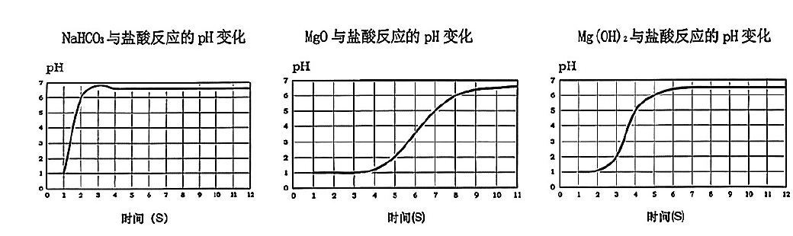
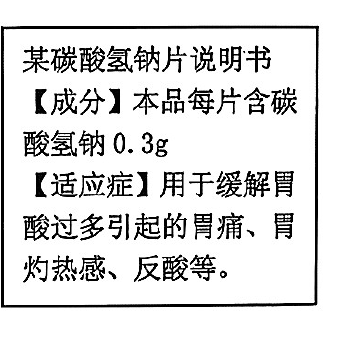
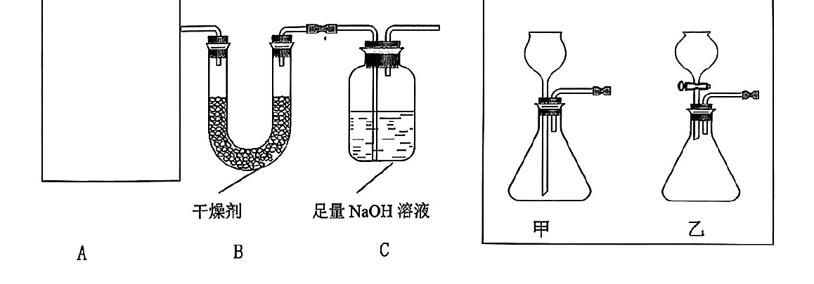

# 化模26-松江-下 · 2026 松江一模精讲（下）· 腌渍咸鸭蛋 / 胃病治疗

> 本讲承接 [[化模26-松江-上]]（题块一~三），处理"腌渍咸鸭蛋""探究化学视角下的胃病治疗"两个题块。相对原子质量：H-1、C-12、O-16、Na-23。**卷末附参考答案（第 7~8 页），本讲已逐题与独立推演互证，全部一致**；卷面胃液正常范围核验为 **pH 3~5**。第 18 题为"装置组合＋质量差测气体"定量实验，第 19（2） 为混合物成分证明实验设计——两题是本卷区分度所在。卷面插图（pH 传感器三联曲线、碳酸氢钠片说明书、A/B/C 与甲/乙装置图共 3 幅）已按 150dpi 页图原样裁切嵌入题干。

## 题块四 · 腌渍咸鸭蛋（第 10~13 题）

日常腌渍咸鸭蛋时，常选用不同溶质质量分数的氯化钠溶液。为探究不同溶质质量分数对腌渍后鸭蛋出油效果的影响，某同学在 T℃ 时配制了 10%、15.2%、20% 和 26.4% 四种溶质质量分数的氯化钠溶液进行对比实验。

**10.**（多选）T℃ 时，一定属于氯化钠不饱和溶液的是＿＿＿＿＿＿＿＿。
- （A）10% 氯化钠溶液
- （B）15.2% 氯化钠溶液
- （C）20% 氯化钠溶液
- （D）26.4% 氯化钠溶液

> [!tip]- 💡 思路导航
> "一定不饱和"要找**饱和质量分数的下限**：氯化钠饱和溶液的质量分数大约能低到多少？26.4% 落不落在危险区？

> [!success]- ✅ 详解 · 评分点 · 易错 · 关联
> **详解**：选 **ABC**。氯化钠饱和溶液的溶质质量分数＝S/(100+S)：0℃ 时 S=35.7 g，对应约 26.3%，这是常压下常见的最低饱和线——26.4% 在其附近，T℃ 时**可能**恰好饱和（D 不能"一定不饱和"）；10%、15.2%、20% 均远低于任何温度下的饱和线，**一定不饱和**。
>
> **易错**：易错选 D 或漏选："26.4%"与最低饱和线 26.3% 贴得极近，正是命题人的"临界陷阱"——"可能饱和"就不能选入"一定不饱和"。
>
> **关联**：[[化-21-饱和溶液与转化]]（饱和质量分数的界限）、[[05-化学/知识点/专题7-溶液]]。

**11.** 配制 10% 的氯化钠溶液。
（1）10% 氯化钠溶液的含义是＿＿＿＿＿＿＿＿；
（2）配制过程需要有＿＿＿＿＿＿＿＿；还需要电子天平、药匙、＿＿＿＿＿＿＿＿、胶头滴管、烧杯和玻璃棒。

> [!tip]- 💡 思路导航
> 质量分数的"分母"是谁？配制流程按"计算—称量—量取—溶解"回忆器材，量水的工具别漏。

> [!success]- ✅ 详解 · 评分点 · 易错 · 关联
> **详解**：（1）**每 100 g 氯化钠溶液中含有 10 g 氯化钠**（分母是溶液不是水）。（2）**氯化钠固体、蒸馏水**；**量筒**（量取水的体积；计算＋称量＋量取＋溶解的完整流程）。
>
> **易错**：（1）答"100 g 水中含 10 g 氯化钠"即错：质量分数的分母是**溶液**。
>
> **关联**：[[化-23-溶质质量分数与计算]]（溶液配制）、[[化-20-溶液的形成与溶解性]]。

**12.** 实验结果发现：氯化钠溶液的溶质质量分数越高，鸭蛋的出油情况越好，口感越好。若要配制溶质质量分数最高的氯化钠溶液，还需要的信息是＿＿＿＿＿＿＿＿。

> [!tip]- 💡 思路导航
> "最高浓度"的天花板是什么溶液？算它需要哪个数据？——题目问的是**数据/条件**，不是器材。

> [!success]- ✅ 详解 · 评分点 · 易错 · 关联
> **详解**：三段式：**判断**——还缺"T℃ 时氯化钠的溶解度"。**依据**——T℃ 下能配出的最高质量分数即**饱和溶液**的质量分数＝S/(100+S)。**回扣**——查得 S 才能算出上限并按饱和配制的操作完成实验。
>
> **易错**：若答"需要电子天平"等仪器类信息不得分——题目问的是**数据/条件**（溶解度），不是器材。
>
> **关联**：[[化-22-溶解度与曲线]]（溶解度决策）、[[05-化学/知识点/专题7-溶液]]。

**13.** 人体摄入过多钠元素会增加心脑血管等慢性疾病的发病风险，可采用氯化钾、碳酸钾、氯化钙、氯化镁等盐对传统钠盐进行部分替代，从而实现健康低钠的目标。
（1）上述盐中，属于钙盐的是＿＿＿＿＿＿＿＿（写化学式）。
（2）为避免低温下溶液析出晶体，更适合选择＿＿＿＿＿＿＿＿（选填"碳酸钾"或"氯化钾"）替代部分 NaCl；理由是＿＿＿＿＿＿＿＿。

| 不同温度下，物质的溶解度 | 0℃ | 20℃ | 40℃ |
| ---- | ---- | ---- | ---- |
| 氯化钾 | 28.1 g | 34.0 g | 40.0 g |
| 碳酸钾 | 105 g | 112 g | 127 g |

> [!tip]- 💡 思路导航
> （1）"钙盐"看阳离子；（2）"低温不析晶"反查溶解度表：两种盐在 0℃ 的溶解度差了将近四倍，选"大"的那个。

> [!success]- ✅ 详解 · 评分点 · 易错 · 关联
> **详解**：（1）**CaCl₂**。（2）三段式：**判断**——选**碳酸钾**。**依据**——对比溶解度表：低温下碳酸钾溶解度（0℃ 105 g、20℃ 112 g）远大于氯化钾（0℃ 28.1 g、20℃ 34.0 g）。**回扣**——相同温度、等量水中碳酸钾能溶解得更多，降温时远未达到饱和，**不易析出晶体**，腌渍液浓度稳定。
>
> **评分点**：（2）理由必须落在"低温下溶解度大→不饱和→不析晶"的链条上，只答"溶解度大"不完整。
>
> **关联**：[[化-22-溶解度与曲线]]（溶解度表决策）、[[05-化学/知识点/专题7-溶液]]。

## 题块五 · 探究化学视角下的胃病治疗（第 14~19 题）

胃酸可以助消化，但过量会引发灼烧、反酸。抗酸药能消耗过量胃酸，使胃液 pH 达到正常范围（pH 为 3~5），从而缓解胃部不适。

**14.** 胃酸的主要成分是盐酸，盐酸中含有氢离子，表示氢离子的符号是＿＿＿＿＿＿＿＿。
- （A）H⁻
- （B）H⁺
- （C）H
- （D）H₂

> [!tip]- 💡 思路导航
> 离子符号：电荷数与电性标在元素符号**右上角**，"先数后号"。

> [!success]- ✅ 详解 · 评分点 · 易错 · 关联
> **详解**：选 **B**。氢离子带 1 个单位正电荷，符号 **H⁺**。
>
> **关联**：[[05-化学/知识点/专题5-物质的微观构成]]（离子符号）。

**15.** 不同抗酸药的有效成分各不相同，分别包括 MgO、Mg(OH)₂、CaCO₃ 和 NaHCO₃ 等物质。其中属于氧化物的是＿＿＿＿＿＿＿＿。
- （A）MgO
- （B）Mg(OH)₂
- （C）CaCO₃
- （D）NaHCO₃

> [!tip]- 💡 思路导航
> 氧化物＝**两种**元素组成、其一为氧的化合物——逐个数元素种类。

> [!success]- ✅ 详解 · 评分点 · 易错 · 关联
> **详解**：选 **A**。MgO 由 Mg、O 两种元素组成且其一为氧，属**氧化物**；Mg(OH)₂ 是碱，CaCO₃、NaHCO₃ 是盐（含碳、氧但组成超出"两种元素"）。
>
> **易错**："含氧"不等于"氧化物"——必须是**两种元素**组成的化合物。
>
> **关联**：[[05-化学/知识点/专题8-酸碱盐]]（物质分类）、[[化-12-概念辨析与分类]]。

**16.** 写出氢氧化镁和盐酸反应的化学方程式＿＿＿＿＿＿＿＿；该反应的反应类型是＿＿＿＿＿＿＿＿。

> [!tip]- 💡 思路导航
> 酸碱中和交换成分：Mg 配 Cl、H 配 OH，配平后对号基本反应类型。

> [!success]- ✅ 详解 · 评分点 · 易错 · 关联
> **详解**：$Mg(OH)_2+2HCl=MgCl_2+2H_2O$（验算：Mg 1=1，Cl 2=2，H 2+2=2+2，O 2=2 ✓）；**复分解反应**（两种化合物交换成分）。
>
> **易错**：Mg(OH)₂ 的配平系数 2 与水的系数 2 成对出现，别只配一边。
>
> **关联**：[[05-化学/知识点/专题8-酸碱盐]]（中和反应）、[[化-26-碱的性质与中和反应]]。

**17.** 为探究不同抗酸药的起效速率，分别在等体积、等质量分数的盐酸（模拟胃酸）中加入 NaHCO₃、MgO、Mg(OH)₂ 各 1.0 g，利用 pH 传感器进行数据采集。对比下图数据可知，三种物质中抗酸"起效最快"的是＿＿＿＿＿＿＿＿（选填"NaHCO₃""MgO"或"Mg(OH)₂"）。

> [!tip]- 💡 思路导航
> "起效快慢"看 pH 曲线**陡升的时刻**：谁的曲线最早拉起来？

> [!success]- ✅ 详解 · 评分点 · 易错 · 关联
> **详解**：**NaHCO₃**。三份等质量药品中，NaHCO₃ 曲线约 2 s 内就把 pH 从 1 拉升至 7 附近，陡升最早、速率最大——起效最快。
>
> **易错**：别答 Mg(OH)₂：溶解度小、溶出慢，曲线陡升并不最早；"起效快"是曲线**左移、变陡**的读图结论。
>
> **关联**：[[化-24-溶液的酸碱性与pH]]（pH 传感器读图）、[[化-16-实验探究与评价]]（数据采集分析）。

**18.** 某品牌"碳酸氢钠片"说明书如右图所示，为探究药品中 NaHCO₃ 的含量是否属实，某化学兴趣小组进行如下实验：取 1 片该药片，研磨后加入足量稀盐酸，完全反应后收集到 0.11 g 二氧化碳（药片其他成分不与盐酸反应）。

（1）稀盐酸和碳酸氢钠反应会生成氯化钠、水和二氧化碳，通过化学方程式进行计算，判断该药品中 NaHCO₃ 的含量是否与说明书相符。（写出计算过程）
（2）可利用 A 装置、B 装置和 C 装置组合进行上述实验（B 为 U 形管装干燥剂，C 为足量 NaOH 溶液吸收瓶），你认为比较合适的 A 装置是＿＿＿＿＿＿＿＿（选填"甲"或"乙"）。

（3）氯化钙是常用干燥剂，B 装置中干燥剂能否用氧化钙，请分析说明＿＿＿＿＿＿＿＿。
（4）为得到 CO₂ 的质量，需要测得的实验数据是＿＿＿＿＿＿＿＿（忽略 A 装置中残留的 CO₂ 及空气中 CO₂ 的影响）。

> [!tip]- 💡 思路导航
> （1）按 84:44 由 CO₂ 反推 NaHCO₃，再与说明书标注量比较；（2）比较长颈漏斗与分液漏斗"控速率、防逸气"的本领；（3）CaO 吸水后变成谁？它会不会"顺手"把 CO₂ 也吃掉？（4）C 装置增重的含义。

> [!success]- ✅ 详解 · 评分点 · 易错 · 关联
> **详解**：（1）解：设该药片中 NaHCO₃ 的质量为 x。
> $$NaHCO_3+HCl=NaCl+H_2O+CO_2\uparrow\qquad 84:44=x:0.11\,\text{g}$$
> 解得 x＝0.11 g×84/44＝**0.21 g**。0.21 g＜0.3 g，与说明书"每片含碳酸氢钠 0.3 g"**不相符**（实测偏低）。（2）选 **乙**。乙用**分液漏斗**：可控制加酸速率、随时关停反应，且漏斗有旋塞密封，生成的 CO₂ 不会从漏斗口逸出；甲的长颈漏斗须液封，研磨后的药片粉末易堵塞，气体易从漏斗口跑失，称量误差大。（3）三段式：**判断**——不能用氧化钙。**依据**——氧化钙能与水反应生成氢氧化钙（做干燥剂正基于此），而氢氧化钙会**与 CO₂ 反应**（生成 CaCO₃ 与水）。**回扣**——被测气体恰是 CO₂（带水蒸气），干燥剂会把部分 CO₂ 消耗掉，使测得的 CO₂ 质量偏小，影响实验结果。（4）**反应前后 C 装置的质量差**（C 中 NaOH 吸收 CO₂，增重即 CO₂ 质量；忽略残留与空气 CO₂ 的前提下成立）。
>
> **评分点**：（1）规范分点：设、方程式（含 ↑）、比例式 84:44、求解 0.21 g、结论"不相符"缺一不可。
>
> **易错**：（1）用 0.3 g 反算 CO₂ 是方向性错误。（4）答"反应前后装置总质量差"不给分——必须是 **C 装置**的增重；B、A 的质量差含别种因素。
>
> **关联**：[[化-13-化学计算进阶]]（方程式计算）、[[化-31-气体制备与实验探究]]（装置选择与定量测量）。

**19.** 实验完成后，对装置 C 中溶液成分进行探究。
（1）取少量装置 C 中溶液于试管中，滴入酚酞，溶液呈＿＿＿＿＿＿＿＿色。
（2）设计实验证明装置 C 中溶液含 NaOH 和 Na₂CO₃＿＿＿＿＿＿＿＿。
【资料库】（1）下表中的盐除碳酸钾溶液、碳酸钠溶液呈碱性外，其他盐溶液均呈中性。（2）部分碱、盐的溶解性如下表（20℃）：

| 正离子＼负离子 | OH⁻ | NO₃⁻ | Cl⁻ | CO₃²⁻ |
| ---- | ---- | ---- | ---- | ---- |
| K⁺ | 溶 | 溶 | 溶 | 溶 |
| Na⁺ | 溶 | 溶 | 溶 | 溶 |
| Ba²⁺ | 溶 | 溶 | 溶 | 不 |
| Ca²⁺ | 微 | 溶 | 溶 | 不 |

> [!tip]- 💡 思路导航
> "碱＋碳酸盐"共存检验的经典顺序：先加足量钙盐/钡盐沉掉碳酸根、再取上层清液验碱——顺序倒了碳酸盐自身的碱性就会"冒充"NaOH。

> [!success]- ✅ 详解 · 评分点 · 易错 · 关联
> **详解**：（1）**红**。C 中溶质为 NaOH 与 Na₂CO₃，均显碱性，遇酚酞变红。（2）取样于试管中，**滴加足量氯化钙溶液（或氯化钡溶液）**，产生**白色沉淀**，证明含 Na₂CO₃；**静置（或过滤），取上层清液滴加酚酞试液**，溶液**变红**，证明含 NaOH。（CaCl₂、BaCl₂ 溶液呈中性且其碳酸盐不溶——"先沉碳酸根、再验碱"顺序不能颠倒，否则 Na₂CO₃ 自身的碱性干扰检验。）
>
> **易错**：最常见错答"直接滴酚酞变红证明含 NaOH"——Na₂CO₃ 溶液也使酚酞变红，必须先**足量**除尽碳酸根；"足量"二字漏写不得满分。
>
> **关联**：[[化-29-盐与废液成分探究]]（混合物成分检验）、[[化-16-实验探究与评价]]、[[05-化学/知识点/专题8-酸碱盐]]（溶解性表的应用）。

## ✅ 答案速查（题块四、五）

| 题 | 答案 |
| ---- | ---- |
| 10~11 | ABC；每 100 g 溶液含 10 g NaCl；氯化钠固体、蒸馏水；量筒 |
| 12~13 | T℃ 时氯化钠的溶解度；CaCl₂；碳酸钾，同温下溶解度远大于氯化钾、低温不析晶 |
| 14~16 | B；A；Mg(OH)₂+2HCl=MgCl₂+2H₂O；复分解反应 |
| 17 | NaHCO₃ |
| 18 | （1） 0.21 g＜0.3 g，不相符 （2） 乙 （3） 不能，CaO 吸水生成 Ca(OH)₂ 会再吸收 CO₂ （4） 反应前后 C 装置的质量差 |
| 19 | （1） 红 （2） 加足量 CaCl₂/BaCl₂ 溶液生白色沉淀证 Na₂CO₃，上层清液加酚酞变红证 NaOH |

## 🔗 关联
- [[05-化学/知识点/专题7-溶液]]（饱和与质量分数、溶解度表决策）· [[05-化学/知识点/专题8-酸碱盐]]（氧化物、复分解、碳酸盐检验）
- [[05-化学/知识点/专题1-2-化学之门与实验探究]]（控制变量、成分证明设计）· [[05-化学/知识点/专题6-化学变化及其表示]]（计算规范）
- [[化-06-溶液与溶解度]] · [[化-16-实验探究与评价]]（第 18、19 题母题）· [[化-13-化学计算进阶]] · [[05-化学/专题/说理题方法]]
- 前接：[[化模26-松江-上]] · 同系列：[[化模26-黄浦静金闵青-上]]
