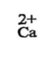
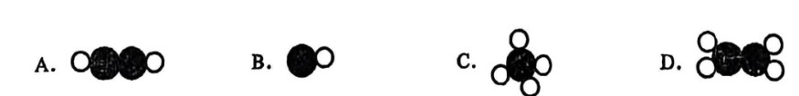
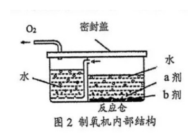
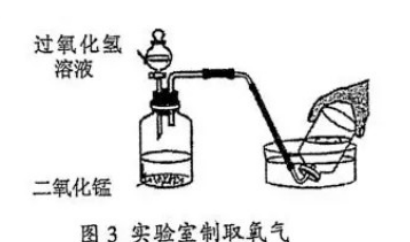
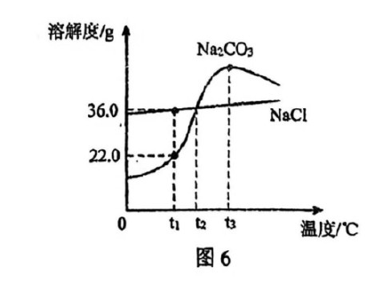
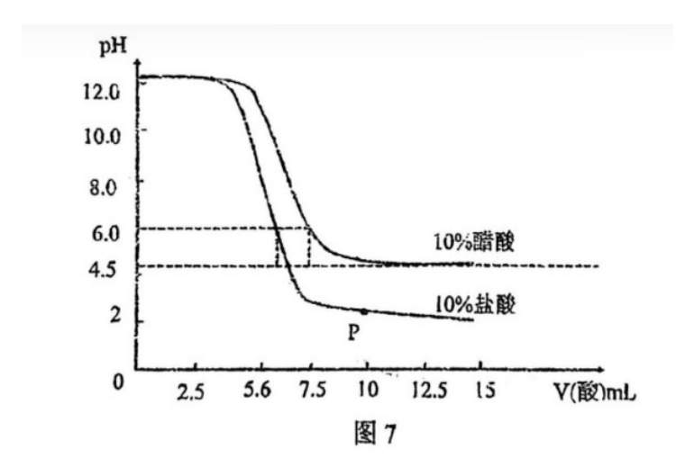
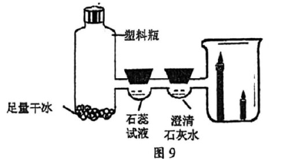
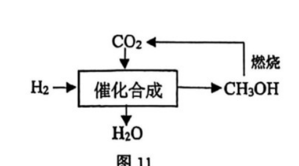
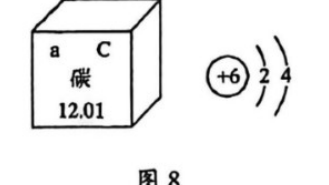
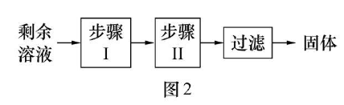

# 化模26-浦东虹口 · 2026 双区一模精选精讲

> **使用说明**：两区各选 8 组最代表"2026 新题式"的题目精讲（微观示意、不定项、图像与数据探究为重灾区）。浦东卷附参考答案，已与独立推演互证一致；**虹口卷原卷答案页为扫描图无文字，本讲详解全部为独立推演**，使用前请对照原卷核对。卷面插图（微观示意图选项、制氧机与制氧装置、溶解度曲线、pH 曲线、干冰实验、固碳与提纯流程等 10 幅）已按 150dpi 页图原样裁切嵌入题干；浦东卷为 docx 转制件，个别图形与选项字母的对应关系存疑处已在题内 ⚠️ 标注。

## 2026 四区新题式速览

| 卷 | 题块设置 | 不定项/多选分布 | 计算题 | 卷首相对原子质量 |
| ---- | ---- | ---- | ---- | ---- |
| 浦东 | 乙炔焊接 / 供氧探究 / 水与溶液 / 酸碱密码 / 碳捕捉（三~七） | 四-4（1）、五-5（2）、七-1 | H₂O₂ 制氧 | H、O、C、Ca |
| 虹口 | 不同的"水" / 海水资源 / 煤炭利用 / 染色（一~四） | 一-3、一-4、三-14（2）、三-15 | NaOH 中和 | H、C、O、Na、Cl |
| 崇明 | 水 / 古法制硝 / 碳氧循环 / 酸碱盐 / 补钙剂 | 一-4、四-22（2）；二-9 为多选 | NaClO₃ 制氧 | H、C、O、Na、Cl、Ca |
| 普陀 | 水培绿萝 / 打铁花 / 土壤改良 / 发热包 / 纯碱（一~五） | 一-2（4）、三-10、三-13（1）| 炼铁（含杂质换算） | H、C、O、Fe |

> 规律：每卷一个"贯穿情境"串 3~5 个题块；计算只设 1 题（设列算答规范分很重）；不定项普遍"选错倒扣"，宁缺勿滥。

# 第一部分 · 浦东卷

相对原子质量：H-1、O-16、C-12、Ca-40。

## 题块三 · 乙炔与焊接（6 分）

乙炔在氧气中燃烧产生的高温用于气割和焊接金属。乙炔由电石（主要成分为碳化钙 CaC₂）与水反应制得。

**1.** 下列化学用语表示正确的是＿＿＿＿＿＿＿＿。
- （A）正二价的钙元素：
- （B）2 个氧分子：O₂
- （C）氢氧根：OH⁺
- （D）2 个碳原子：2C

> [!tip]- 💡 思路导航
> 化学用语正误判断只看两处：**数字写在哪、正负号在前还是在后**。逐项核对——化合价标在元素符号正上方且"正负号在前、数字在后"；分子个数用前置系数；原子个数也用前置系数；氢氧根整团的电荷数别忘了看。

> [!success]- ✅ 详解 · 评分点 · 易错 · 关联
> **详解**：选 **D**。A：图中在 Ca 正上方标"2+"，化合价的标注应**正负号在前、数字在后**（$\overset{+2}{\text{Ca}}$），"2+"是离子电荷的写法，故 A 错；B："O₂"只表示 1 个氧分子，2 个氧分子应为 **2O₂**，错；C：氢氧根带 1 个单位**负**电荷，应为 OH⁻，错；D：2 个碳原子记作 **2C**，对。
>
> **易错**：化学式**前置**数字表"个数"、**右下角**数字表"每个分子含几个原子"，位置一换意义全变；化合价（正上方，先正负后数字）与离子电荷（右上角，先数字后正负）两套写法不能混。
>
> **关联**：[[05-化学/知识点/专题6-化学变化及其表示]]（化学用语）、[[化-10-微观意义与计算]]。

**2.** 电石与水反应生成乙炔的化学方程式为 CaC₂+2H₂O＝X↑+Ca(OH)₂，则 X 的微观示意图是＿＿＿＿＿＿＿＿（●碳原子　○氢原子），推测的理论依据是＿＿＿＿＿＿＿＿。

> [!tip]- 💡 思路导航
> 推 X 不靠猜：把反应号两边的原子按种类**清点"原子账"**，Ca(OH)₂ 认领后剩下的差额就是 X 的组成；"推测依据"指向那条"反应前后原子不变"的定律。

> [!success]- ✅ 详解 · 评分点 · 易错 · 关联
> **详解**：原子账——反应前 Ca 1、C 2、H 4、O 2；Ca(OH)₂ 占 Ca 1、O 2、H 2，差额 C 2、H 2 归 X，即 **X＝C₂H₂（乙炔）**；理论依据：**质量守恒定律**（反应前后原子的种类与数目不变）。卷面参考答案为 **D**。
> ⚠️ **转制件存疑**：浦东卷为 docx 转制 PDF，四个分子模型为浮动图片，转制后与 A/B/C/D 字母的对应关系可能整体错位（如按原子账，C₂H₂ 模型出现在 A 的位置而卷面答案为 D；B 处"1 碳 1 氢"亦属非常规选项）。作答时以"2 个碳原子＋2 个氢原子"的原子账为准，考场以原卷图形为准。
>
> **易错**：理论依据要答"质量守恒定律"全称，只写"守恒"不完整；数原子时别漏方程式中配平的水的系数 2。
>
> **关联**：[[05-化学/知识点/专题6-化学变化及其表示]]（质量守恒定律）、[[化-04-质量守恒与方程式]]。

## 题块四 · 从空气检测到供氧探究（10 分）

某化学小组组装了一套简易家用空气检测仪：滤网过滤可吸入颗粒物、氯化钙吸收水蒸气、碱石灰吸收二氧化碳（药品均足量）；随后对氧气制取进行研究——图 2 是以过碳酸钠（a 剂）和二氧化锰（b 剂）为原料的家庭制氧机，图 3 是实验室制取氧气的装置。

**3.** 下列说法正确的是＿＿＿＿＿＿＿＿。（不定项）

- （A）反应仓中 a 剂可替换为高锰酸钾
- （B）反应仓相当于实验室制取氧气的发生装置
- （C）二氧化锰反应前后质量和性质不变
- （D）排水法收集氧气是由于氧气不易溶于水

> [!tip]- 💡 思路导航
> 四个选项各考一个固定考点：替代 a 剂先想该药品制氧需要什么条件；"反应仓"对照实验室装置的哪一部分；催化剂表述里"性质"两个字前面还有没有限定词；排水法收集看气体的溶解性。

> [!success]- ✅ 详解 · 评分点 · 易错 · 关联
> **详解**：选 **BD**。A 错：高锰酸钾制氧气需要**持续加热**，家用装置无法提供加热条件，不能替换；B 对：反应仓中 a 剂与 b 剂接触产生氧气，相当于实验室制取氧气的**发生装置**；C 错：催化剂反应前后**质量和化学性质**不变，物理性质可能改变，"性质不变"表述错误；D 对：氧气**不易溶于水**且不与水反应，可用排水法收集。
> **附**：同题块四-1（空气及其成分，单选）选 **B** 稀有气体可制多种用途电光源——A 错在 21% 是**体积**分数非质量分数，C 错在化学性质稳定的是**氮气**（题干"氨气"是偷换），D 错在空气是混合物。
>
> **易错**："质量和性质不变"缺"化学"两个字就是错误表述——四-3 是每年必设的选项；"发生装置"别与"收集装置"混淆。
>
> **关联**：[[05-化学/知识点/专题3-空气氧气与二氧化碳]]（催化剂、制氧装置与收集）、[[化-03-空气与氧气]]。

**4.** 用 100 g 6.8% 的过氧化氢溶液与二氧化锰混合，可制取多少克氧气？（根据化学方程式列式计算）

> [!tip]- 💡 思路导航
> 方程式计算的第一步永远是**把溶液量换算成溶质量**——参加反应的是过氧化氢这种纯物质；随后按"设、写、列、算、答"五步走，比例式两端必须是纯净物质量。

> [!success]- ✅ 详解 · 评分点 · 易错 · 关联
> **详解**：解：设可制取氧气的质量为 x。过氧化氢质量＝100 g×6.8%＝6.8 g。
> $$2H_2O_2\xrightarrow{MnO_2}2H_2O+O_2\uparrow$$
> 列式：68:32＝6.8 g:x，解得 x＝**3.2 g**。答：可制取氧气 3.2 g。
>
> **评分点**："设、化学方程式、比例式、求解、答"五步各占分；先算 6.8 g 纯过氧化氢再代入。
>
> **易错**：直接用 100 g 溶液质量代入比例式，整题皆错。
>
> **关联**：[[化-13-化学计算进阶]]（设列算答规范）、[[05-化学/知识点/专题3-空气氧气与二氧化碳]]。

**5.** 为研究使带火星木条复燃的最低氧气体积分数，需收集多种体积分数的氧气。现用排水法收集一瓶氧气体积分数约为 60% 的气体，该如何操作？

> [!tip]- 💡 思路导航
> 关键想清楚：排水法收集时，瓶内的氧气来自**两个来源**——通入的纯氧气，以及瓶里残留的那部分空气（空气本身含氧）。先设计"瓶中留什么、占多少"，再算总氧含量是否达到目标。

> [!success]- ✅ 详解 · 评分点 · 易错 · 关联
> **详解**：向集气瓶中注入约占容积 **50%** 的水，盖玻璃片倒置于水槽中，再用排水法通入氧气至水恰好排尽；瓶内氧气体积分数＝50%＋50%×21%＝60.5%≈**60%**。
>
> **评分点**：必须写出"50%＋50%×21%"的算式依据，只答"装一半水"不得满分。
>
> **易错**：漏算残留空气中的氧气（以为装 60% 的水就行）是本题最常见错答。
>
> **关联**：[[05-化学/知识点/专题3-空气氧气与二氧化碳]]（空气成分、排水法收集）、[[化-03-空气与氧气]]。

## 题块五 · 水与溶液（13 分）

**6.** 盐碱湖地区有"夏天晒盐，冬天捞碱"的说法，这里的"盐"指 NaCl，"碱"指 Na₂CO₃。请根据溶解度曲线（图 6，t₁＜t₂＜t₃，两曲线在 t₂ 相交）回答下列问题。

（1）t₃℃ 时，NaCl 的溶解度＿＿＿＿＿＿＿＿（选填"＜""＝"或"＞"）Na₂CO₃ 的溶解度；

（2）有关说法正确的是＿＿＿＿＿＿＿＿。（不定项）
- （A）t₁℃ 时，碳酸钠饱和溶液的溶质质量分数为 22%
- （B）t₃℃ 时，配制两种物质的饱和溶液，所需碳酸钠质量大于氯化钠质量
- （C）将 t₃℃ 时两种物质的饱和溶液降温至 t₂℃，所得溶液的溶质质量分数相同
- （D）将 t₃℃ 时含少量氯化钠的碳酸钠溶液中分离出碳酸钠，可采用降温结晶的方法

（3）t₁℃ 时，将 11.0 g 碳酸钠固体加入 50.0 g 水中，充分溶解后所得溶液的质量为＿＿＿＿＿＿＿＿ g；为了进一步提高该溶液的溶质质量分数，可进行的操作为＿＿＿＿＿＿＿＿。

> [!tip]- 💡 思路导航
> 曲线题三步：**定点**（在指定温度处读溶解度）→**看交点**（t₂ 处两曲线意味着什么）→**查前提**（比较"所需溶质多少"必须先规定溶剂或溶液质量相等）；饱和溶液的质量分数与溶解度换算别拿溶解度数值直接当百分数。

> [!success]- ✅ 详解 · 评分点 · 易错 · 关联
> **详解**：（1）**＜**（t₃℃ 时 Na₂CO₃ 曲线在 NaCl 上方）。（2）**CD**。A 错：t₁℃ Na₂CO₃ 溶解度 22 g，饱和质量分数＝22/122≈18%，拿溶解度数值当百分数是陷阱；B 错：未规定溶剂或饱和溶液质量相等，无法比较所需溶质多少；C 对：t₂℃ 两曲线相交、溶解度相等，降温后两溶液仍饱和且质量分数相同；D 对：Na₂CO₃ 溶解度受温度影响大，降温结晶可从含少量 NaCl 的溶液中提纯。（3）t₁℃ 时 50.0 g 水恰好溶解 11.0 g Na₂CO₃（22 g/100 g 水的一半），**溶液质量＝61.0 g**（恰好饱和）；Na₂CO₃ 溶解度随温度升高而增大，故进一步提高溶质质量分数可**升温并继续加入碳酸钠固体（至饱和）**。
>
> **评分点**：（2）判断 A 用饱和质量分数＝S/(100+S)，B 必须"等质量（水/溶液）"前提才能比大小。
>
> **易错**：把 22% 当成 t₁℃ 的饱和质量分数（应为 22/122≈18%）；（3）忘了"恰好饱和"判据直接把 11.0＋50.0 之外的量写进溶液质量。
>
> **关联**：[[05-化学/知识点/专题7-溶液]]（溶解度曲线、结晶方法）、[[化-06-溶液与溶解度]]、[[化-22-溶解度与曲线]]。

## 题块六 · 绣球花色的"酸碱密码"（9 分）

土壤的酸碱性对植物生长有重要的影响。同一品种的绣球花在土壤呈酸性时花色为蓝色，土壤呈碱性时花色为红色。某兴趣小组想在校园花圃中培植蓝色绣球花：查阅资料，绣球花在酸性土壤（pH 4.5~6.0）开蓝花。研究小组在实验室模拟土壤酸碱性改良过程，向两份等体积等浓度的氢氧化钠溶液中分别滴入一定量的 10%盐酸和 10%醋酸，利用 pH 传感器得到 pH 变化曲线如图 7。

**7.** 结合上图回答下列问题：
（1）写出氢氧化钠溶液和盐酸反应的化学方程式＿＿＿＿＿＿＿＿，反应的基本类型是＿＿＿＿＿＿＿＿；

（2）图中 P 点对应溶液中的溶质为＿＿＿＿＿＿＿＿（用化学式表示）；

（3）请结合图像和相关信息说明选用 10%醋酸更有利于把土壤 pH 调到绣球开蓝花的 4.5~6.0 区间的理由。

> [!tip]- 💡 思路导航
> （1）中和反应方程式配平后顺手标"反应类型"；（2）先读 P 点在曲线的哪一侧（pH 大于还是小于 7），再按"剩余＋生成"点全溶质；（3）把两条曲线在目标 pH 区间内的"陡与缓"翻译成"好不好控制"。

> [!success]- ✅ 详解 · 评分点 · 易错 · 关联
> **详解**：（1）$NaOH+HCl=NaCl+H_2O$；**复分解反应**（酸碱中和）。（2）**NaCl、HCl**（P 点在盐酸曲线上、pH＜7，盐酸已过量：生成物 NaCl 与剩余的 HCl 共存）。（3）三段式：**判断**——选用 10%醋酸更易把 pH 控制在 4.5~6.0。**依据**——对比图 7 两条曲线：醋酸是弱酸，中和过程中 pH **变化平缓**；盐酸是强酸，恰好中和附近 **pH 突跃**（曲线陡降）。**回扣**——平缓的曲线便于把 pH 停留在 4.5~6.0 的目标区间，防止加酸过量使土壤酸性过强。
>
> **易错**：（2）只答 NaCl 漏了过量的 HCl；（3）只说"醋酸好"不比较两条曲线的陡缓，说理不完整。
>
> **关联**：[[05-化学/知识点/专题8-酸碱盐]]（中和反应、pH）、[[化-24-溶液的酸碱性与pH]]、[[05-化学/专题/说理题方法]]（三段式）。

## 题块七 · 捕捉"碳"的足迹（12 分）

碳元素对生命及人类生产生活意义重大，但二氧化碳过多会造成温室效应。近日，全球首艘装碳捕捉封存设备的海上浮式生产储油船在上海长兴岛建成投用，助力"零碳排放"。

**8.** （1）如图 9 进行实验：足量干冰装于塑料瓶，瓶口经石蕊试液、澄清石灰水与烧杯连通，观察到烧杯中蜡烛由下而上依次熄灭。二氧化碳能从塑料瓶大量进入烧杯的原因是＿＿＿＿＿＿＿＿；

（2）"液态太阳能燃料"流程如图 11：利用氢气将二氧化碳转化为甲醇（CH₃OH，可作燃料），甲醇燃烧又生成二氧化碳和水。请说明该流程可实现"零碳排放"的理由。

> [!tip]- 💡 思路导航
> （1）干冰是固态 CO₂——想它进入烧杯的"推动力"从哪来（瓶内压强怎么变的）；（2）抓"碳的闭环回路"：碳从哪来、到哪去、能不能再被收回来。

> [!success]- ✅ 详解 · 评分点 · 易错 · 关联
> **详解**：（1）三段式：**判断**——瓶内压强增大把 CO₂"压"入烧杯。**依据**——干冰**升华**，固态 CO₂ 急速变为气态，瓶内气体量骤增。**回扣**——瓶内气压大于外界大气压，CO₂ 大量排出进入烧杯；它密度比空气大、不燃烧不助燃，故蜡烛由下而上熄灭。（2）三段式：**判断**——碳在系统内闭环，无净排放。**依据**——CO₂ 与 H₂ 合成甲醇，甲醇燃烧又生成 CO₂ 和 H₂O。**回扣**——生成的 CO₂ 可再次回收用于合成甲醇，碳循环利用、不向环境新增 CO₂，故"零碳排放"。
> **附**：同题块七-1（碳元素信息图，不定项）选 **ABC**——碳属非金属元素、a 表示原子序数（6）、相对原子质量 12.01 均对；D 错在核电荷数应为 6 不是 4。
> 
>
> **易错**：（1）只答"干冰升华"不落到"瓶内气压大于外界大气压"，因果链断裂；（2）"零碳"答成"不产生二氧化碳"（燃烧明明产生），要点是"新增为零"而非"不产生"。
>
> **关联**：[[05-化学/知识点/专题3-空气氧气与二氧化碳]]（CO₂ 性质、碳循环）、[[化-07-燃烧与碳]]、[[05-化学/专题/说理题方法]]。

# 第二部分 · 虹口卷

相对原子质量：H-1、C-12、O-16、Na-23、Cl-35.5。

## 题块一 · 生活中不同的"水"（15 分）

超市中几种"水"的配料或成分如下：苏打气泡水配料为水、二氧化碳、碳酸氢钠（不少于 0.45 g/L）、氯化钾。

**9.** 打开苏打气泡水瓶盖，有大量气泡逸出，相关分析正确的是＿＿＿＿＿＿＿＿。（不定项）
- （A）逸出的气体是碳酸
- （B）溶液质量减小
- （C）剩余的溶液是饱和溶液
- （D）苏打水应存放在阴凉处

> [!tip]- 💡 思路导航
> 分清"气泡里跑出来的是什么状态的什么"与"溶在水中的是什么"——"微粒—物质"偷换是不定项最爱；再想温度对气体溶解度的影响落在保存条件上。

> [!success]- ✅ 详解 · 评分点 · 易错 · 关联
> **详解**：选 **BD**。A 错：逸出的是 CO₂ **气体**，碳酸是溶解在水中的生成物，不能说"逸出的气体是碳酸"；B 对：气体逸出，溶液总质量减小；C 错：仅凭冒泡无法断定剩余溶液一定饱和；D 对：温度低气体溶解度大，阴凉存放可防 CO₂ 逸出、防瓶内压强过大。
>
> **易错**："气体是碳酸"是"微粒—物质"偷换；"冒泡＝饱和"缺依据。
>
> **关联**：[[05-化学/知识点/专题7-溶液]]（气体溶解度）、[[化-20-溶液的形成与溶解性]]。

**10.** 300 mL 苏打气泡水提供的钠元素的质量至少是＿＿＿＿＿＿＿＿ g。（列式即可）

> [!tip]- 💡 思路导航
> "浓度 × 体积 × 钠元素的质量分数"三连乘：先把 g/L 与 mL 统一单位，再算 NaHCO₃ 中钠的质量占比。

> [!success]- ✅ 详解 · 评分点 · 易错 · 关联
> **详解**：列式：$0.45\ \text{g/L}\times0.3\ \text{L}\times\dfrac{23}{84}\approx0.037\ \text{g}$（M(NaHCO₃)＝23+1+12+48＝84）。答：至少约 0.037 g。
>
> **评分点**：虽"列式即可"，0.45 g/L×0.3 L 的**单位换算**不能少；写出 23/84 更稳。
>
> **关联**：[[化-13-化学计算进阶]]（元素质量分数计算）。

**11.** 某同学将维生素 C 泡腾片（含多种物质）放入水中，测定液体的温度变化，现象及数据见下表。

| 实验编号 | 水的体积 | 泡腾片片数 | 实验现象 | 开始温度 | 最低温度 |
| ---- | ---- | ---- | ---- | ---- | ---- |
| I | 50 mL | 1 | 出现大量气泡 | 27.4 ℃ | 25.8 ℃ |
| II | 50 mL | 2 | 出现大量气泡 | 27.5 ℃ | 24.6 ℃ |
| III | 50 mL | 3 | 出现大量气泡 | 27.4 ℃ | 23.5 ℃ |

（1）将产生的气体通入石灰水，石灰水变浑浊，写出该反应的化学方程式＿＿＿＿＿＿＿＿；

（2）请推测导致温度变化可能的原因。

> [!tip]- 💡 思路导航
> （1）"使石灰水变浑浊的气体"指向哪种常见气体，方程式配平加沉淀符号；（2）观察数据趋势：片数增多时最低温度怎么变——把"用量与降温幅度"的相关翻译成热效应的推测，别忘了"可能"二字允许多角度。

> [!success]- ✅ 详解 · 评分点 · 易错 · 关联
> **详解**：（1）$CO_2+Ca(OH)_2=CaCO_3\downarrow+H_2O$。（2）三段式：**判断**——泡腾片溶于水（含其成分间的反应）时**吸热**，使水温降低。**依据**——放 1/2/3 片时最低温度依次 25.8/24.6/23.5℃，片数越多降温越多。**回扣**——吸热量与用量正相关；气泡（CO₂）逸出带走少量热量为次要因素。
>
> **易错**：（2）只答"气泡逸出带走热量"无法解释片数与降温幅度的正相关，主因应落在溶解放热/反应吸热上。
>
> **关联**：[[05-化学/知识点/专题3-空气氧气与二氧化碳]]（CO₂ 检验）、[[化-16-实验探究与评价]]（数据分析）。

## 题块二 · 海水资源的利用（12 分）

**12.** "溶液电解"以饱和氯化钠溶液为原料，相关物质的部分溶解度：10℃/20℃ 时 NaCl 为 35.8/35.9 g，NaOH 为 98/109 g（40℃/60℃ 时 NaCl 为 36.4/37.1 g，NaOH 为 129/174 g）。"溶液电解"后得到的剩余溶液是氢氧化钠的不饱和溶液，其中还含有少量氯化钠。某同学设计了实验方案（如图 2），欲从中提取氢氧化钠固体。

（1）氯化钠、氢氧化钠两种物质的溶解度，受温度影响较大的是＿＿＿＿＿＿＿＿；步骤Ⅱ是＿＿＿＿＿＿＿＿；

（2）请推测得到的固体中可能含有的杂质并说明杂质产生的原因。

> [!tip]- 💡 思路导航
> 提纯路线由两条溶解度曲线的"陡缓差异"决定：先判断两种物质里谁对温度敏感、谁几乎不变，敏感的那种结晶析出、不敏感的留母液，再据此给步骤Ⅰ、Ⅱ定名；杂质来源往"母液附着"和"蒸发程度"两个方向想。

> [!success]- ✅ 详解 · 评分点 · 易错 · 关联
> **详解**：（1）受温度影响较大的是 **NaOH**（10→20℃ 由 98 增到 109 g，NaCl 几乎不变）；步骤Ⅱ是**降温结晶（冷却热饱和溶液）**（步骤Ⅰ为蒸发浓缩）。（2）三段式：**判断**——杂质是少量 NaCl。**依据**——原液含 NaCl，蒸发浓缩后水分大减、NaCl 浓度剧增，冷却时部分随母液附着在 NaOH 晶体表面，干燥后残留（蒸发过度时 NaCl 还会直接析出）。**回扣**——故所得固体中可能混有少量 NaCl。
> **附**：同题块其余小问速览——10℃ 时饱和 NaCl 溶液中溶质与溶剂质量比＝**35.8:100**；"溶液电解"过程的反应物为 **NaCl 和 H₂O**（由产物 NaOH 含 H、O 反推水参加：$2NaCl+2H_2O\xrightarrow{\text{通电}}2NaOH+H_2\uparrow+Cl_2\uparrow$）；"熔融电解" 2NaCl→2Na+Cl₂↑ 属**分解反应**（一变多）。
>
> **评分点**：步骤Ⅰ、Ⅱ 名称要写全——"蒸发浓缩""降温结晶（冷却热饱和溶液）"，只写"蒸发""降温"扣分。
>
> **易错**：杂质解释只答"含有 NaCl"不说两层来源（母液附着、蒸发过度析出），说理不完整。
>
> **关联**：[[05-化学/知识点/专题7-溶液]]（结晶提纯）、[[化-21-饱和溶液与转化]]、[[化-29-盐与废液成分探究]]。

## 题块三 · 煤炭的利用（11 分）

我国很早就有关于挖掘、使用煤炭的记载，并发现煤层上方往往存在"毒气"（与煤共生的一氧化碳和天然气）。

**13.** 关于"毒气"的说法正确的是＿＿＿＿＿＿＿＿。（不定项）
- （A）"毒气"是混合物
- （B）"毒"主要指一氧化碳有毒
- （C）天然气可以用水吸收
- （D）煤矿矿井中须严禁烟火，防止"毒气"爆炸

> [!tip]- 💡 思路导航
> "与煤共生的一氧化碳和天然气"已经告诉你它由几种物质组成；"毒"字落在 CO 的毒性上；C 项想天然气的溶解性与吸收方法是否匹配；D 项把可燃性气体与明火的关系想一遍。

> [!success]- ✅ 详解 · 评分点 · 易错 · 关联
> **详解**：选 **ABD**。A 对：CO 与天然气（主要成分甲烷）共存，为混合物；B 对：CO 有毒、易与血红蛋白结合，"毒"主要指 CO 中毒；C 错：天然气主要成分甲烷**难溶于水**，不能用水吸收；D 对：CO 与甲烷都可燃，遇明火可能爆炸，矿井须严禁烟火。
>
> **易错**：想当然认为"气体都能用水吸收"——甲烷难溶于水是常考点。
>
> **关联**：[[05-化学/知识点/专题3-空气氧气与二氧化碳]]（CO 毒性、可燃性气体安全）、[[化-07-燃烧与碳]]。

**14.** 工业生产中，常将煤块粉碎，再用鼓风机鼓入炉膛内燃烧。请分析说明这些操作能够使煤充分燃烧的原理。

> [!tip]- 💡 思路导航
> 促进充分燃烧只有两个抓手：可燃物与氧气的**接触面**、氧气的**量**。把两个操作各自对应到哪个抓手上，再补一句"充分燃烧的意义"收尾。

> [!success]- ✅ 详解 · 评分点 · 易错 · 关联
> **详解**：两点式：**判断**——两项操作分别从"接触面积"和"氧气浓度"促进燃烧。**依据**——粉碎增大煤与空气的**接触面积**；鼓风提供**充足的氧气**。**回扣**——燃烧充分则放热多、CO 等不完全燃烧产物少，实现环保高效。
>
> **评分点**：两个原理缺一不可，只答"增大接触面积"得一半分。
>
> **关联**：[[05-化学/知识点/专题3-空气氧气与二氧化碳]]（燃烧条件）、[[化-07-燃烧与碳]]、[[05-化学/专题/说理题方法]]。

## 题块四 · 染色中的化学（12 分）

某些棉布在印染之前，需先使用氢氧化钠、双氧水对棉布进行前处理。白度是面料印染的基础指标，数值越大印染效果越好；强力决定了布料的使用寿命，数值越高布料越不容易破损。

**15.** 室温时，用不同溶质质量分数的双氧水处理布料后，白度、强力的测试结果见下表。

| 双氧水溶质质量分数（%） | 0.6 | 1.2 | 1.8 | 2.5 | 3 |
| ---- | ---- | ---- | ---- | ---- | ---- |
| 白度（%） | 57.13 | 61.34 | 64.68 | 65.50 | 67.12 |
| 强力（N） | 620 | 650 | 660 | 630 | 600 |

（1）说明双氧水溶质质量分数对白度的影响；

（2）为确定使用双氧水的最佳浓度，还应进行的实验是＿＿＿＿＿＿＿＿。

> [!tip]- 💡 思路导航
> （1）描述趋势要写全"在哪个范围内、自变量怎么变、因变量跟着怎么变"；（2）两个指标的峰值不在同一浓度——"最佳"必须两项兼顾，想想要在哪个区间加密梯度做实验。

> [!success]- ✅ 详解 · 评分点 · 易错 · 关联
> **详解**：（1）在 0.6%~3% 范围内，双氧水溶质质量分数越大，白度越大（57.13%→67.12%）。（2）白度在 3% 处最大而强力峰值在 1.8%、浓度再高强力反降——最佳浓度须**兼顾白度与强力**：在 **1.2%~2.5%（强力峰两侧）增设更多浓度梯度**重复实验，同时测两项指标，取综合最优。
>
> **评分点**：（1）必须写明范围与"越大……越大"的对应关系；（2）只答"多做几次实验"不写浓度区间与双指标，不得分。
>
> **易错**：只盯白度单指标选 3%，漏掉强力在 1.8% 后回落的数据。
>
> **关联**：[[化-16-实验探究与评价]]（数据表分析、实验设计）、[[05-化学/知识点/专题7-溶液]]（溶质质量分数）。

**16.** 向含有 0.04 g 氢氧化钠的溶液中滴加稀盐酸，请计算恰好完全反应时参加反应的 HCl 的质量。（根据化学方程式列式计算）

> [!tip]- 💡 思路导航
> 常规方程式计算五步：设、写、列、算、答——题给的是 NaOH 质量，比例式左边用 40 对应 HCl 的 36.5。

> [!success]- ✅ 详解 · 评分点 · 易错 · 关联
> **详解**：解：设参加反应的 HCl 质量为 x。
> $$NaOH+HCl=NaCl+H_2O$$
> 列式：40:36.5＝0.04 g:x，解得 x＝0.0365 g。答：参加反应的 HCl 为 0.0365 g（约 0.037 g）。
>
> **评分点**：化学方程式书写与比例式两端对应关系各占分；"设""答"齐全。
>
> **关联**：[[化-13-化学计算进阶]]、[[05-化学/知识点/专题8-酸碱盐]]（中和反应计算）。

**17.** 我国某些传统手工印染技艺中也有类似前处理的工序，传统匠人用纯碱与生石灰、水混合可以代替氢氧化钠发挥作用；草木灰（主要成分 K₂CO₃）也可以代替纯碱完成该工序。请推测前处理中加入氢氧化钠时发挥作用的微观粒子并说明推测依据。

> [!tip]- 💡 思路导航
> 对比三套体系（NaOH、纯碱＋熟石灰、草木灰＋熟石灰）最终都提供了什么同样的微粒——"找变量中的不变量"，再由不变量解释它为什么起作用。

> [!success]- ✅ 详解 · 评分点 · 易错 · 关联
> **详解**：三段式：**判断**——起作用的微观粒子是**氢氧根离子（OH⁻）**。**依据**——纯碱体系 $Na_2CO_3+Ca(OH)_2=CaCO_3\downarrow+2NaOH$，草木灰体系 $K_2CO_3+Ca(OH)_2=CaCO_3\downarrow+2KOH$；NaOH 与 KOH 溶于水都电离出 OH⁻。**回扣**——两套替代方案与直接加 NaOH 的体系的共同有效微粒是 OH⁻，故发挥作用的是氢氧根离子。
>
> **易错**：答"Na⁺"不给分：NaOH 与 KOH 阳离子不同而效果相同，共同点只能是 OH⁻——"找变量中的不变量"是微粒推测题的钥匙。
>
> **关联**：[[05-化学/知识点/专题5-物质的微观构成]]（离子）、[[化-26-碱的性质与中和反应]]、[[05-化学/专题/说理题方法]]（三段式）。

## ⚠️ 评分点与易错速览（本讲）

- 催化剂表述差一个词就错："性质不变"×，"质量与**化学性质**不变"✓。
- 曲线题 B 项少"等质量（水/溶液）"前提不能比大小；饱和质量分数＝S/(100+S)＜S/100。
- 计算题四步"设列算答"齐全；先算纯物质质量再代入比例式。
- 结晶流程题先看两条溶解度曲线的陡缓差异；杂质解释落"母液附着、蒸发过度析出"两层。
- 微粒推测题"找变量中的不变量"；说理题按"判断→依据→回扣情境"三段式落笔。

## 🔗 关联

- [[05-化学/知识点/专题3-空气氧气与二氧化碳]] · [[05-化学/知识点/专题7-溶液]] · [[05-化学/知识点/专题8-酸碱盐]]
- [[05-化学/专题/说理题方法]]（第 7、8、11、14、17 题三段式母版）· [[化-16-实验探究与评价]] · [[化-13-化学计算进阶]]（设列算答规范）
- 同系列：[[化模26-崇明-上]] · [[化模26-崇明-下]] · [[化模26-普陀-上]] · [[化模26-普陀-下]]
