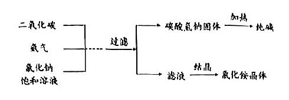
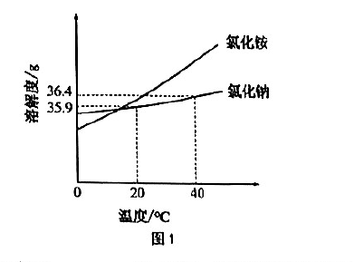

# 化模26-长宁-上 · 2026 长宁一模精讲（上）· 枸杞种植 / 纯碱的制取

> **新版式提示**：本卷按"情境题块"命题，四个题块共 50 分（13+16+11+10）。相对原子质量：H-1、C-12、O-16、Cl-35.5、Ca-40。**卷末附参考答案（第 5~6 页），本讲已逐题与独立推演互证，全部一致**；第 12、13 题为不定项，第 16 题需比较三种结晶方法说理。卷面插图（制取纯碱主要流程、氯化铵与氯化钠溶解度曲线共 2 幅）已按 150dpi 页图原样裁切嵌入题干。下半部分见 [[化模26-长宁-下]]。

## 题块一 · 枸杞种植初探（13 分 · 第 1~8 题）

枸杞最适宜种植的土壤 pH 为 7.5~8.5。为研究某蔬菜大棚是否适宜种植枸杞，将该大棚内干燥的土壤样本与蒸馏水按 2:5 的质量比在烧杯中混合，充分搅拌后静置得到上层清液，记为溶液 X。

**1.** 下列有关溶液 X 的说法正确的是＿＿＿＿＿＿＿＿。
- （A）是一种无色透明的纯净物
- （B）具有均匀、稳定的特征
- （C）溶质只有气体
- （D）一定只含有一种溶质

> [!tip]- 💡 思路导航
> 溶液 X 是土壤浸出液——先定性"它是纯净物还是混合物"，再用溶液"均一、稳定"两大特征筛选项；溶质种类回到"土壤里有什么"。

> [!success]- ✅ 详解 · 评分点 · 易错 · 关联
> **详解**：选 **B**。土壤浸出液含多种可溶与不溶杂质，是混合物（A 错）；溶液特征即均一、稳定（B 对）；土壤浸出液溶质是多种矿物质（C、D 错）。
>
> **易错**：把"无色透明"当溶液的必备特征——溶液不一定无色（如硫酸铜溶液）。
>
> **关联**：[[05-化学/知识点/专题7-溶液]]（溶液特征）、[[化-06-溶液与溶解度]]。

**2.** 一般用 pH 表示溶液酸碱性的强弱程度，pH 的范围通常为＿＿＿＿＿＿＿＿。
- （A）0~7
- （B）1~7
- （C）7~14
- （D）0~14

> [!tip]- 💡 思路导航
> 常识送分题：pH 跨越酸、中、碱三段，范围的两端都要取到。

> [!success]- ✅ 详解 · 评分点 · 易错 · 关联
> **详解**：选 **D**。pH 通常范围为 **0~14**。
>
> **关联**：[[05-化学/知识点/专题8-酸碱盐]]（pH）、[[化-24-溶液的酸碱性与pH]]。

**3.** 测定溶液的 pH 时，实验操作正确的是＿＿＿＿＿＿＿＿。
- （A）先润湿 pH 试纸
- （B）用试管夹夹取 pH 试纸
- （C）用玻璃棒蘸取待测液沾在 pH 试纸上
- （D）试纸久置后，将呈现的颜色与标准比色卡对比

> [!tip]- 💡 思路导航
> 三个错误选项各藏一个高频错因：润湿相当于**稀释**待测液；试纸的取用工具要看"夹持对象"对不对；显色后要**立即**比色还是久放再比。

> [!success]- ✅ 详解 · 评分点 · 易错 · 关联
> **详解**：选 **C**。A 润湿试纸相当于稀释待测液，测得 pH 偏向 7；B 应用玻璃棒或胶头滴管取液，试管夹不是夹试纸的；D 应**变色后立即**与标准比色卡对比，久置会失真。
>
> **易错**：正确动作是"玻璃棒蘸取＋立即比色"；润湿测酸性溶液偏大、测碱性溶液偏小，测中性不变——"润湿一定错"要会解释。
>
> **关联**：[[化-02-实验操作与提纯]]（pH 测定）、[[05-化学/知识点/专题8-酸碱盐]]。

**4.** 室温下测得溶液 X 的 pH=5，该溶液呈＿＿＿＿＿＿＿＿。
- （A）酸性
- （B）中性
- （C）碱性
- （D）无法判断

> [!tip]- 💡 思路导航
> 以 7 为界：小于 7、等于 7、大于 7 各对应什么性，一步判定。

> [!success]- ✅ 详解 · 评分点 · 易错 · 关联
> **详解**：选 **A**。pH=5＜7，呈酸性。
>
> **关联**：[[05-化学/知识点/专题8-酸碱盐]]（酸碱性与 pH）。

**5.** 氢氧化钙是土壤改良剂中的一种。下列有关氢氧化钙的说法正确的是＿＿＿＿＿＿＿＿。
- （A）属于盐
- （B）是一种液体
- （C）溶于水后得到的石灰水呈碱性
- （D）遇水放出大量的热

> [!tip]- 💡 思路导航
> 先按组成给 Ca(OH)₂ 归类（金属离子＋OH⁻ 是哪一类），再核常温状态；"遇水放大量热"的那个"石灰"是谁——生石灰与熟石灰一字之差。

> [!success]- ✅ 详解 · 评分点 · 易错 · 关联
> **详解**：选 **C**。Ca(OH)₂ 由 Ca、O、H 组成且含 OH⁻，属**碱**（A 错）；常温下是白色**固体**粉末（B 错）；其水溶液石灰水显碱性（C 对）；溶于水时放热**不明显**，"遇水放出大量热"的是生石灰 CaO（D 错）。
>
> **易错**：D 是"生石灰放热"的迁移陷阱：CaO＋H₂O→Ca(OH)₂ 放热，而 Ca(OH)₂ 溶于水温度变化不明显。
>
> **关联**：[[05-化学/知识点/专题8-酸碱盐]]（碱的通性）、[[化-26-碱的性质与中和反应]]。

**6.** 利用中和反应的原理可以调节土壤的酸碱性。下列有关中和反应说法正确的是＿＿＿＿＿＿＿＿。
- （A）过程中吸收热量
- （B）中和反应一定生成盐和水
- （C）生成盐和水的反应一定是中和反应
- （D）中和反应的发生必须借助酸碱指示剂进行判断

> [!tip]- 💡 思路导航
> 抓"定义的正向与反向"：酸＋碱→盐＋水是中和；但"生成盐和水"能不能倒推"是中和"？找一个同为"盐＋水"产物的非中和反应当反例（如酸性氧化物与碱）。

> [!success]- ✅ 详解 · 评分点 · 易错 · 关联
> **详解**：选 **B**。中和反应**放热**（A 错）；酸＋碱→盐＋水是中和反应的定义（B 对）；生成盐和水的反应不一定是中和，如 $CO_2+2NaOH=Na_2CO_3+H_2O$（C 错）；是否发生中和反应可用 pH 计、传感器等判断，指示剂并非必需（D 错）。
>
> **易错**：C 的反例要记牢——CO₂ 与 NaOH 的反应产物是盐和水但不是中和反应。
>
> **关联**：[[05-化学/知识点/专题8-酸碱盐]]（中和反应概念）、[[化-26-碱的性质与中和反应]]。

**7.** 若溶液 X 中含有 0.73 g HCl，要使其恰好完全反应，需加入氢氧化钙多少克？（根据化学方程式列式计算）

> [!tip]- 💡 思路导航
> 按"写→设→比→算→答"走：先配平 Ca(OH)₂ 与盐酸的反应，再用两个纯物质的相对分子质量总和列比例式——左端 74 对 73。

> [!success]- ✅ 详解 · 评分点 · 易错 · 关联
> **详解**：解：设需氢氧化钙的质量为 x。
> $$Ca(OH)_2+2HCl=CaCl_2+2H_2O\qquad 74:73=x:0.73\,\text{g}$$
> （M(Ca(OH)₂)=40+2×(16+1)=74；2M(HCl)=2×36.5=73）解得 x＝**0.74 g**。答：需加入氢氧化钙 0.74 g。
>
> **评分点**：比例式左端 74:73 是"纯物质质量比"，0.73 g 直接代入即可；"设""答"齐全。
>
> **易错**：若题给的是溶液质量则须先乘质量分数——本题 0.73 g 已是纯 HCl 质量，不要再乘。
>
> **关联**：[[化-13-化学计算进阶]]（方程式计算规范）、[[化-26-碱的性质与中和反应]]。

**8.** 室温下，向 pH=5 的溶液 X 中加入足量的水，能否使其 pH 达到枸杞的适宜种植范围？并说明理由。

> [!tip]- 💡 思路导航
> 稀释只能让酸性"变淡"，不能"变姓"——想清楚 pH 会往哪个数靠、能不能跨过去，再对照 7.5~8.5 的要求下结论；说理题光答"不能"没有分。

> [!success]- ✅ 详解 · 评分点 · 易错 · 关联
> **详解**：三段式：**判断**——不能。**依据**——加水稀释只能使酸性溶液的 pH **无限接近 7** 而始终小于 7。**回扣**——枸杞适宜范围 7.5~8.5 呈**碱性**，稀释无法使溶液跨越 7 变为碱性，故不能达到；实际应改用适量熟石灰等改良剂。
>
> **评分点**：只答"不能"不给满分，必须写"无限接近 7、无法变为碱性"的依据。
>
> **关联**：[[05-化学/知识点/专题7-溶液]]（稀释）、[[化-24-溶液的酸碱性与pH]]、[[05-化学/专题/说理题方法]]。

## 题块二 · 纯碱的制取（16 分 · 第 9~16 题）

碳酸钠俗称纯碱。下图是一种制取纯碱的主要流程：

【制备气体】

**9.** 实验室制取氨气的一种反应原理为 $NH_3\cdot H_2O\xrightarrow{\Delta}NH_3\uparrow+H_2O$，该反应的基本反应类型为＿＿＿＿＿＿＿＿。

> [!tip]- 💡 思路导航
> 数一数反应物与生成物的"种数"：一变多、多变一、单质换单质、交换成分——四大基本类型对号入座。

> [!success]- ✅ 详解 · 评分点 · 易错 · 关联
> **详解**：**分解反应**（一变多：一种物质生成两种新物质）。
>
> **关联**：[[05-化学/知识点/专题6-化学变化及其表示]]（基本反应类型）。

**10.** 实验室常用大理石（主要成分 CaCO₃）与稀盐酸反应制取二氧化碳，反应的化学方程式为＿＿＿＿＿＿＿＿；收集二氧化碳时只能选用向上排空气法，理由是＿＿＿＿＿＿＿＿。

> [!tip]- 💡 思路导航
> 方程式三处易丢分：配平、气体符号、条件；"只能向上排空气"要答全两条——密度关系决定排哪头，溶解性/与水反应决定能不能排水。

> [!success]- ✅ 详解 · 评分点 · 易错 · 关联
> **详解**：$CaCO_3+2HCl=CaCl_2+H_2O+CO_2\uparrow$（验算：Ca 1=1，C 1=1，O 3+0=2+1+2 ✓）；理由：**二氧化碳密度比空气大**（可向上排空气），且**能溶于水并与水反应**（不能用排水法），密度大也排除向下排空气法。
>
> **易错**："只能向上排气"须写全两条：密度比空气大＋能溶于水（并与水反应），漏一条扣分。
>
> **关联**：[[05-化学/知识点/专题3-空气氧气与二氧化碳]]（CO₂ 制取与收集）、[[化-08-二氧化碳制取]]。

【配制氯化钠饱和溶液】

**11.** 氯化铵和氯化钠的溶解度曲线如图 1 所示。氯化钠的溶解度随温度的升高而＿＿＿＿＿＿＿＿；20℃ 时氯化钠的溶解度为＿＿＿＿＿＿＿＿ g。

> [!tip]- 💡 思路导航
> 读曲线两件事：走势（陡还是缓）与定点（20℃ 处两条曲线各自的纵坐标）。

> [!success]- ✅ 详解 · 评分点 · 易错 · 关联
> **详解**：**缓慢增大**（曲线平缓上扬）；**35.9** g。
>
> **易错**：NaCl 曲线平缓≠"不随温度变化"，表述要写"缓慢增大（受温度影响较小）"。
>
> **关联**：[[05-化学/知识点/专题7-溶液]]（溶解度曲线）、[[化-22-溶解度与曲线]]。

**12.**（不定项）向 36 g 氯化钠中加入 100 g 水，充分溶解后可得到＿＿＿＿＿＿＿＿的氯化钠饱和溶液。
- （A）10℃
- （B）20℃
- （C）40℃
- （D）60℃

> [!tip]- 💡 思路导航
> 判断"能否全溶得饱和"只看一个数：**该温度下的溶解度与 36 g 比大小**——小于 36 g 则有固体剩余（恰好饱和），大于 36 g 则全溶但不饱和。别把"全部溶解"与"饱和"混为一谈。

> [!success]- ✅ 详解 · 评分点 · 易错 · 关联
> **详解**：选 **AB**。20℃ 溶解度 35.9 g＜36 g，10℃ 时更小，两温度下 36 g NaCl **不能全部溶解**，剩余固体使溶液饱和；40℃、60℃ 时溶解度＞36 g，36 g 全溶且不饱和，不符"饱和"要求。
>
> **易错**：40℃、60℃ 全溶但**不饱和**，不入选——本题问的是"得到饱和溶液"的温度。
>
> **关联**：[[化-21-饱和溶液与转化]]、[[05-化学/知识点/专题7-溶液]]。

**13.**（不定项）20℃ 时，欲将一杯氯化钠的不饱和溶液转化为饱和溶液，可采用的方法有＿＿＿＿＿＿＿＿。
- （A）升高温度
- （B）蒸发水
- （C）加氯化钠
- （D）加水

> [!tip]- 💡 思路导航
> 不饱和→饱和的三条通用路（加质、减溶剂、变温）里，"变温"这条对曲线平缓的物质几乎无效——先判断 NaCl 溶解度随升温怎么变。

> [!success]- ✅ 详解 · 评分点 · 易错 · 关联
> **详解**：选 **BC**。NaCl 溶解度随温度升高略增，升温只会更不饱和（A 错）；蒸发溶剂、增加溶质均可使不饱和变饱和（B、C 对）；加水更不饱和（D 错）。
>
> **易错**：A"升高温度"对 NaCl 几乎无效（溶解度略增、更不饱和），是曲线平缓型物质的专属陷阱。
>
> **关联**：[[化-21-饱和溶液与转化]]。

**14.** 将纯碱溶液与氢氧化钙溶液反应可获得纳米级碳酸钙，写出该反应的化学方程式＿＿＿＿＿＿＿＿。

> [!tip]- 💡 思路导航
> 复分解反应"交换成分"：Na 与 Ca 换位，碳酸根与氢氧根换位；配平后别忘了沉淀符号。

> [!success]- ✅ 详解 · 评分点 · 易错 · 关联
> **详解**：$Na_2CO_3+Ca(OH)_2=CaCO_3\downarrow+2NaOH$（验算：Na 2=2，C 1=1，O 3+1=3+1 ✓；沉淀符号"↓"是得分点）。
>
> **关联**：[[05-化学/知识点/专题8-酸碱盐]]（复分解反应）、[[化-11-化合价与方程式书写]]。

**15.** 从滤液中得到的氯化铵常用作化肥，该化肥属于＿＿＿＿＿＿＿＿。
- （A）钾肥
- （B）氮肥
- （C）磷肥
- （D）复合肥

> [!tip]- 💡 思路导航
> 化肥分类看营养元素（N、P、K）：含哪一种就是哪类肥，含两种以上才是复合肥。

> [!success]- ✅ 详解 · 评分点 · 易错 · 关联
> **详解**：选 **B**。NH₄Cl 只含 N 一种营养元素，属**氮肥**。
>
> **关联**：[[05-化学/知识点/专题8-酸碱盐]]（化肥分类）。

**16.** 滤液中主要含有氯化铵和少量氯化钠，依据图 1 的溶解度曲线确定分离出氯化铵的实验方案，下列最适宜的结晶方法是＿＿＿＿＿＿＿＿。请比较三种结晶方法，说明你选择的理由。
- （A）蒸发结晶
- （B）降温结晶（降温至 0~10℃）
- （C）降温结晶（降温至 30~40℃）

> [!tip]- 💡 思路导航
> 逐一评三种方法：蒸法看"会不会同析"；两种降温看"降温区间内氯化铵的溶解度降幅谁大"——差异大才析出多、分得开。结论下之前三个都要点评到。

> [!success]- ✅ 详解 · 评分点 · 易错 · 关联
> **详解**：三段式：**判断**——选 **B（降温至 0~10℃）**。**依据**——①蒸发结晶：水分减少时氯化铵与氯化钠**同时析出**，无法分离；②降温至 0~10℃：氯化铵溶解度随温度降低**大幅下降**（36.4 g→约 30 g 以下）而大量结晶析出，氯化钠溶解度**变化很小**（35.9 g 附近）仍留在母液中，可实现分离；③降温至 30~40℃：氯化铵溶解度下降不明显，**结晶量少、分离效果差**。**回扣**——"同析不可分、大降可选、微降无效"，差异型结晶题的标准三连评。
>
> **评分点**：必须**三种方法逐一评析**再下结论，只答"选 B"丢大半分数；"降温至 0~10℃"的区间要照抄题干，写成"降温结晶"四字不完整。
>
> **关联**：[[05-化学/知识点/专题7-溶液]]（结晶方法选择）、[[化-22-溶解度与曲线]]、[[05-化学/专题/说理题方法]]。

## ✅ 答案速查（题块一、二）

| 题 | 答案 |
| ---- | ---- |
| 1~6 | B；D；C；A；C；B |
| 7 | 0.74 g（Ca(OH)₂+2HCl=CaCl₂+2H₂O，74:73=x:0.73） |
| 8 | 不能；稀释只能使 pH 无限接近 7，达不到 7.5~8.5 的碱性范围 |
| 9~10 | 分解反应；CaCO₃+2HCl=CaCl₂+H₂O+CO₂↑，密度比空气大且能溶于水 |
| 11~13 | 缓慢增大；35.9；AB；BC |
| 14~15 | Na₂CO₃+Ca(OH)₂=CaCO₃↓+2NaOH；B |
| 16 | B；蒸发同析不可分，0~10℃ 降温铵析钠留可分离，30~40℃ 降幅小结晶少 |

## 🔗 关联

- [[05-化学/知识点/专题7-溶液]]（溶解度曲线、结晶方法）· [[05-化学/知识点/专题8-酸碱盐]]（中和、复分解、化肥）
- [[05-化学/知识点/专题6-化学变化及其表示]]（基本反应类型）· [[05-化学/知识点/专题4-水的性质与组成]]（CO₂ 收集）
- [[化-06-溶液与溶解度]] · [[化-02-实验操作与提纯]]（pH 测定）· [[化-17-说理题专练]]（三段式）
- 后续：[[化模26-长宁-下]] · 同系列：[[化模26-崇明-上]]
