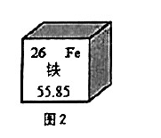
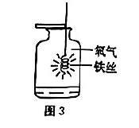
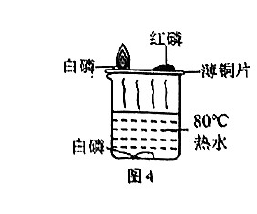

# 化模26-长宁-下 · 2026 长宁一模精讲（下）· 铁的燃烧 / 维生素C的妙用

> **新版式提示**：相对原子质量：H-1、C-12、O-16、Cl-35.5、Ca-40。**卷末附参考答案，本讲已逐题与独立推演互证，全部一致**。第 19（2）、20 题考"宏观—微观"互析，第 22 题为微观说理大题，第 26~27 题为控制变量实验的数据分析——均为 2026 新题式的重点题型。卷面插图（铁元素周期表信息、铁丝在氧气中燃烧、探究可燃物燃烧条件的装置共 3 幅）已按 150dpi 页图原样裁切嵌入题干。上半部分见 [[化模26-长宁-上]]。

## 题块三 · 铁的燃烧（11 分 · 第 17~22 题）

"打铁花"是国家级非物质文化遗产之一。表演者将高温铁水击向高空，铁水迅速转化为细小铁屑，在空气中燃烧。对比之下，铁丝在空气中难以燃烧，铁屑却能在空气中燃烧。

【铁屑的燃烧】

**17.** 图 2 为元素周期表中的铁元素信息示意图，下列说法正确的是＿＿＿＿＿＿＿＿。

- （A）铁元素属于非金属元素
- （B）铁元素的原子序数为 55
- （C）铁元素的相对原子质量为 55.85 g
- （D）铁原子的核外电子数是 26

> [!tip]- 💡 思路导航
> 周期表一格四个信息各司其职：左上原子序数、右上符号、中间元素名称（偏旁定金属/非金属）、下方相对原子质量——相对原子质量的"单位"是必设陷阱。

> [!success]- ✅ 详解 · 评分点 · 易错 · 关联
> **详解**：选 **D**。铁带"钅"旁属**金属**元素（A 错）；原子序数＝**26**（B 错，55.85 是相对原子质量）；相对原子质量 55.85，**单位为 1，不是 g**（C 错）；原子中核外电子数＝质子数＝原子序数＝26（D 对）。
>
> **易错**：C 的"55.85 g"是周期表必设陷阱：**相对原子质量是一个比值，单位为 1**，写作"g"即错。
>
> **关联**：[[05-化学/知识点/专题5-物质的微观构成]]（周期表信息、原子结构）、[[化-12-概念辨析与分类]]。

**18.** 氧气属于＿＿＿＿＿＿＿＿。
- （A）单质
- （B）化合物
- （C）氧化物
- （D）混合物

> [!tip]- 💡 思路导航
> 物质分类从"元素种类数"入手：一种元素组成的纯净物是什么，两种呢？氧化物还要求其中一种是氧。

> [!success]- ✅ 详解 · 评分点 · 易错 · 关联
> **详解**：选 **A**。O₂ 只由氧元素一种元素组成，属**单质**；氧化物须由**两种**元素组成，单质不在其列。
>
> **易错**：把"含氧元素"当成氧化物——氧化物首先必须是化合物。
>
> **关联**：[[化-12-概念辨析与分类]]、[[05-化学/知识点/专题6-化学变化及其表示]]。

**19.** 进行铁丝在氧气中燃烧的实验（如图 3）。

（1）从宏观视角分析：观察到火星四射、铁丝末端熔化、瓶壁发烫，说明反应＿＿＿＿＿＿＿＿。
- （A）吸收热量
- （B）放出热量
- （C）无明显热量变化

（2）从微观视角分析：与铁丝放入空气中相比，铁丝放入氧气中时与氧分子接触的机会＿＿＿＿＿＿＿＿，热量释放与积累更多，使得铁表面的温度＿＿＿＿＿＿＿＿着火点，因此铁丝在空气中不燃烧，在氧气中燃烧。
- （A）更少；达到
- （B）更多；达到
- （C）更少；未达到
- （D）更多；未达到

> [!tip]- 💡 思路导航
> （1）"熔化、发烫"都是温度升高的宏观证据，指向能量的去向；（2）两空有因果链——氧气浓度变了，分子碰撞机会怎么变；燃烧发生了，温度与着火点是什么关系，别与"在空气中不燃烧"的事实打架。

> [!success]- ✅ 详解 · 评分点 · 易错 · 关联
> **详解**：（1）选 **B**。"瓶壁发烫、末端熔化"说明反应**放出大量热**。（2）选 **B**。纯氧中氧分子密集，铁与氧分子**接触机会更多**，反应放出的热量积累使铁表面温度**达到**着火点以上，故能燃烧。
>
> **易错**：（2）两个空有因果链：先"接触机会更多"，后"达到着火点"；选 D（未达到）与"在氧气中燃烧"的事实矛盾。
>
> **关联**：[[05-化学/知识点/专题3-空气氧气与二氧化碳]]（氧气性质、燃烧条件）、[[化-07-燃烧与碳]]。

**20.** 图 4 是探究可燃物燃烧的条件的实验装置（白磷的着火点为 30℃，红磷的着火点为 260℃）。薄铜片上的白磷燃烧而红磷不燃烧，此时薄铜片的温度范围是＿＿＿＿＿＿＿＿；为了使热水中白磷燃烧，可进行的操作是＿＿＿＿＿＿＿＿。

> [!tip]- 💡 思路导航
> 燃烧三条件缺一不可，反着用：白磷燃→温度不低于它的着火点；红磷不燃→温度没到它的着火点。两个条件夹出区间后写成不等式；热水里的白磷三缺一，缺哪样补哪样。

> [!success]- ✅ 详解 · 评分点 · 易错 · 关联
> **详解**：白磷燃烧→温度**不低于其着火点 30℃**；红磷不燃烧→温度**低于其着火点 260℃**。故范围 **30℃≤温度＜260℃**（热水 80℃ 提供热源，实际上限不超过 80℃）。操作三段式：**判断**——向热水中白磷处**通入氧气（或空气）**。**依据**——热水温度 80℃ 已超过白磷着火点，白磷不燃只缺**与氧气接触**。**回扣**——通入的气泡使水下白磷接触氧气，燃烧三条件齐备即燃。
>
> **评分点**：温度范围必须写成不等式形式"30℃≤温度＜260℃"，漏"="（白磷恰在 30℃ 可燃）或漏"＜"（260℃ 时红磷也会燃）都要扣分。
>
> **易错**："通氧气"不能写成"加热"（热水已是 80℃，不缺温度）。
>
> **关联**：[[化-07-燃烧与碳]]（燃烧条件探究）、[[化-16-实验探究与评价]]、[[05-化学/知识点/专题3-空气氧气与二氧化碳]]。

**21.** 有同学根据"燃烧伴有热量变化"的现象，推理得出"伴有热量变化的一定是物质的燃烧"的观点，请举一例论证该观点是错误的。

> [!tip]- 💡 思路导航
> 驳斥一个全称判断只需一个反例：找"放热但不是燃烧"的熟悉反应或物理过程，点名并举证。

> [!success]- ✅ 详解 · 评分点 · 易错 · 关联
> **详解**：三段式：**判断**——该观点错误。**依据**——**氢氧化钠与盐酸的中和反应放出热量，但中和反应不是燃烧**（或浓硫酸溶于水放热、生石灰与水反应放热等，任举一例）。**回扣**——放热是许多变化（物理溶解放热、非燃烧的化学反应放热）的共同特征，不能反推"放热即燃烧"，举例反驳即完成论证。
>
> **易错**：举例要与"放热"这个特征对得上——举"光合作用"等吸热例子无法反驳"伴有热量变化"。
>
> **关联**：[[化-26-碱的性质与中和反应]]（中和放热）、[[05-化学/专题/说理题方法]]（反例论证）。

**22.** 铁丝在空气中难以燃烧，铁屑却可以，请从微观视角对这一宏观现象进行分析说明。

> [!tip]- 💡 思路导航
> 沿"颗粒大小→接触面积→接触机会→反应快慢"与"颗粒大小→热量散失→温度能否维持"两条微观链条走，最后回扣"着火点"收口——只答一条链只得一半分。

> [!success]- ✅ 详解 · 评分点 · 易错 · 关联
> **详解**：三段式：**判断**——差别在**反应速率**与**热量积累**两个微观链条上。**依据**——①铁屑颗粒远小于铁丝，与氧气（氧分子）的**接触面积更大**，单位体积内铁原子与氧分子的**接触机会更多**，反应更易发生、更剧烈；②颗粒细小则**热量不易散失**，局部铁原子温度能迅速升高并**维持在着火点以上**，促进反应持续进行。**回扣**——而铁丝与氧气接触面积小、放热慢且易散失，表面温度难以达到着火点，故在空气中难以燃烧。
>
> **评分点**：只答"接触面积大"只得一半分：**热量积累→维持着火点以上**这半条链是本题的区分点。
>
> **关联**：[[05-化学/知识点/专题5-物质的微观构成]]（微观解释宏观）、[[化-17-说理题专练]]（双链说理）、[[化-07-燃烧与碳]]。

## 题块四 · 维生素C的妙用（10 分 · 第 23~27 题）

实验室制取氧气时，某同学手上因沾到少量高锰酸钾而变色，用维生素 C 的水溶液擦拭后，颜色褪去。

**23.** 同学提出"可能是维生素 C 的水溶液将高锰酸钾稀释了，也可能是维生素 C 的水溶液与高锰酸钾发生了反应"。这属于实验探究过程中的＿＿＿＿＿＿＿＿。
- （A）形成假设
- （B）设计实验
- （C）获得证据
- （D）得出结论

> [!tip]- 💡 思路导航
> 科学探究环节的排序：发现问题→猜想假设→设计实验→获得证据→得出结论。"可能是……也可能是……"这个句式属于哪一环，一看便知。

> [!success]- ✅ 详解 · 评分点 · 易错 · 关联
> **详解**：选 **A**。对现象可能原因的**猜测**属于"形成假设"环节；尚未动手实验，不属设计实验，更未获得证据或结论。
>
> **关联**：[[05-化学/知识点/专题1-2-化学之门与实验探究]]（探究环节）、[[化-16-实验探究与评价]]。

**24.** 列出"资料库"中所有关于维生素 C 物理性质的描述。
（资料库：纯净的维生素 C 通常为无色晶体，易溶于水，能与高锰酸钾、氧气等多种物质反应。）

> [!tip]- 💡 思路导航
> 物理性质＝不需要化学变化就能表现的性质——颜色、状态、溶解性都在列；"能与××反应"要过化学变化才表现，属哪类想清楚再抄。

> [!success]- ✅ 详解 · 评分点 · 易错 · 关联
> **详解**：**无色晶体、易溶于水**。"能与高锰酸钾、氧气等反应"须通过化学变化表现，属化学性质，不列。
>
> **易错**：把"能与氧气反应"混入物理性质是最常见错答；物理性质一栏只写"无色晶体、易溶于水"，多写化学性质不扣分但漏写"晶体"扣分。
>
> **关联**：[[化-12-概念辨析与分类]]（物理性质与化学性质）。

**25.** 实验中使用了一瓶 100 g 0.02% 的高锰酸钾溶液，下列关于该溶液说法正确的是＿＿＿＿＿＿＿＿。
- （A）"0.02%"表示该溶液的体积为 0.02 mL
- （B）"0.02%"表示该温度下高锰酸钾的溶解度为 0.02 g
- （C）溶质的质量为 100 g×0.02%=0.02 g
- （D）该溶液中高锰酸钾与水的质量比为 0.02:100

> [!tip]- 💡 思路导航
> 质量分数的定义分母是**溶液**不是水也不是体积；溶解度还需要"饱和"这个前提——逐项对定义。

> [!success]- ✅ 详解 · 评分点 · 易错 · 关联
> **详解**：选 **C**。0.02% 指**溶质质量与溶液质量之比**：m(溶质)＝100 g×0.02%＝0.02 g（C 对）；A 是体积、B 是溶解度（还须"饱和"前提），均偷换概念；D 中 0.02:100 是"溶质:溶液"，溶质:水应为 0.02:99.98。
>
> **易错**：D 的 0.02:100 分母是溶液，换成"溶质:水"必须改为 0.02:99.98——质量分数定义题的固定考法。
>
> **关联**：[[05-化学/知识点/专题7-溶液]]（溶质质量分数）、[[化-23-溶质质量分数与计算]]。

**26.** 其他同学对该小组设计的实验方案提出如下建议：Ⅰ 为保证实验准确，两种蔬菜汁都应密封保存，理由是＿＿＿＿＿＿＿＿；Ⅱ 应使用同一支胶头滴管进行实验，并且进行三次平行实验、取其平均值，理由是＿＿＿＿＿＿＿＿。改进后实验记录如下：

| 种类 | 滴数 | 平均滴数 |
| ---- | ---- | ---- |
| 小白菜 | 8、8、9 | 8.3 |
| 白萝卜 | 32、33、33 | 32.7 |

> [!tip]- 💡 思路导航
> 两条建议各对一个实验原则：密封防的是"菜汁里那种能与氧气反应的成分被损耗"；同一滴管与平行取平均值防的是"变量不等"与"偶然误差"。

> [!success]- ✅ 详解 · 评分点 · 易错 · 关联
> **详解**：Ⅰ 三段式：**判断**——密封防止维生素 C 被氧化。**依据**——资料库表明维生素 C 能与**氧气**反应；菜汁暴露在空气中会被氧化损耗。**回扣**——密封保存保证两种菜汁中维 C 含量不因氧化而改变，确保对比公平。Ⅱ 同一支滴管保证**每滴菜汁体积相同**（控制变量）；三次平行实验取平均值可**减小实验误差**，提高结果准确性。
>
> **评分点**：Ⅰ 必须点出"维生素 C 能与氧气反应"这一资料依据；Ⅱ 两个理由（等体积、减误差）分开写。
>
> **关联**：[[化-16-实验探究与评价]]（控制变量、平行实验）、[[05-化学/知识点/专题1-2-化学之门与实验探究]]。

**27.** 根据上述实验记录得出的结论是＿＿＿＿＿＿＿＿，依据是＿＿＿＿＿＿＿＿。

> [!tip]- 💡 思路导航
> 结论回答"谁的维 C 含量高"；依据必须回到数据——"等量高锰酸钾恰好褪色时，两者耗汁滴数各是多少、谁少"。"滴数少含量高"的换算逻辑要说破。

> [!success]- ✅ 详解 · 评分点 · 易错 · 关联
> **详解**：结论：**小白菜中维生素 C 的含量高于白萝卜**。依据：等体积、等浓度的高锰酸钾溶液**恰好完全褪色**时，消耗小白菜汁的滴数（**8.3 滴**）远少于白萝卜汁（**32.7 滴**）——褪色所需滴数越少，说明相同体积菜汁中维 C 含量越高。
>
> **评分点**：结论与依据缺一不可，依据中"8.3 滴、32.7 滴"两个数据要写出。
>
> **易错**：只说"滴数少含量高"而无"等量高锰酸钾恰好褪色"的前提，逻辑链不完整。
>
> **关联**：[[化-16-实验探究与评价]]（结论与证据）、[[05-化学/知识点/专题1-2-化学之门与实验探究]]。

## ✅ 答案速查（题块三、四）

| 题 | 答案 |
| ---- | ---- |
| 17~18 | D；A |
| 19 | （1）B　（2）B（更多；达到） |
| 20 | 30℃≤温度＜260℃；向热水中通入氧气（或空气） |
| 21 | 中和反应（或浓硫酸溶于水、生石灰与水反应）放热但不是燃烧 |
| 22 | 铁屑接触面积大、单位体积接触机会多；热量不易散失、局部温度达着火点以上 |
| 23~25 | A；无色晶体、易溶于水；C |
| 26 | 密封防维 C 被氧化；同一滴管保证每滴等体积、平行取均值减小误差 |
| 27 | 小白菜维 C 含量高于白萝卜；恰好褪色耗汁 8.3 滴远少于 32.7 滴 |

## 🔗 关联

- [[05-化学/知识点/专题3-空气氧气与二氧化碳]]（氧气的性质、燃烧条件）· [[05-化学/知识点/专题5-物质的微观构成]]（周期表信息、微观解释）
- [[05-化学/知识点/专题7-溶液]]（溶质质量分数）· [[05-化学/知识点/专题1-2-化学之门与实验探究]]（探究环节、控制变量）
- [[化-07-燃烧与碳]] · [[化-16-实验探究与评价]] · [[化-12-概念辨析与分类]] · [[化-17-说理题专练]]
- 前接：[[化模26-长宁-上]] · 同系列：[[化模26-崇明-下]]
