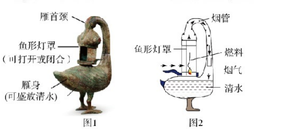
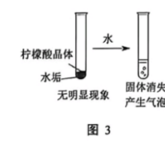

# 化模26-黄浦静金闵青-上 · 2026 黄浦一模精选精讲

> **使用说明**：本讲为"黄浦＋静金闵青"合编的上半部分，从黄浦卷四个题块（雁鱼铜灯 12 分 / 草莓保鲜剂 14 分 / 啤酒的生产 10 分 / 厨房中的清洁剂 14 分）中精选 8 组最代表"2026 新题式"的题目精讲。相对原子质量：H-1、C-12、O-16、Na-23、Cl-35.5、K-39、Cu-64。**卷末附参考答案（第 5~6 页），已与独立推演逐项核对，全部一致**。卷面插图（雁鱼铜灯及其结构、柠檬酸除水垢实验共 2 幅）已按 150dpi 页图原样裁切嵌入题干；卷面数据表（表 1~表 4）已转录为表格。下半部分见 [[化模26-黄浦静金闵青-下]]。

## 2026 两卷新题式速览

| 卷 | 题块设置 | 不定项/多选分布 | 计算题 | 卷首相对原子质量 |
| ---- | ---- | ---- | ---- | ---- |
| 黄浦 | 雁鱼铜灯 / 草莓保鲜剂 / 啤酒的生产 / 厨房中的清洁剂 | 三-9（1）、三-10（2）、四-13 为不定项；其余单选 | 木炭炼铜（8.0 g CuO） | H、C、O、Na、Cl、K、Cu |
| 静金闵青 | 铁红 / 燃料的发展 / CO₂ 转化利用 / 探究空气的足迹 / 食品自热包 | 五-12、四-15（2）、四-16 为不定项 | 电催化制甲醇（8 kg CH₄） | H、C、O、Fe |

> 规律：每卷一个"文物/食品/工业流程"大情境串 4~5 个题块；计算只设 1 题但"设列算答"规范分重；数据表说理题（酵母菌对比、气体溶解度表）是 2026 的拉分位。

# 第一部分 · 黄浦卷

## 组 1 · 雁鱼铜灯：化学用语与铜绿分解

雁鱼铜灯是汉代青铜艺术珍品，青铜是由铜、锡等按一定比例熔合而成。雁鱼铜灯的主要部件如图 1 所示，灯油燃烧时，产生的烟气可通过雁首颈进入雁身（见图 2）。

**1.** 铜属于＿＿＿＿＿＿＿＿（选填"金属"或"非金属"）单质。

> [!tip]- 💡 思路导航
> 单质的类别看元素名称的偏旁："钅"旁与"金"字底的都归哪一类。

> [!success]- ✅ 详解 · 评分点 · 易错 · 关联
> **详解**：**金属**。
>
> **关联**：[[化-12-概念辨析与分类]]（金属与非金属）。

**2.** 以下有一种符号表示"锡"，该元素符号是＿＿＿＿＿＿＿＿。
- （A）SM
- （B）Si
- （C）S
- （D）Sn

> [!tip]- 💡 思路导航
> 元素符号"一大二小"的书写规则先筛掉不规范的，再对号各元素：Si、S 各是谁，剩下的就是锡。

> [!success]- ✅ 详解 · 评分点 · 易错 · 关联
> **详解**：选 **D**。Sn 是锡；Si 是硅、S 是硫，"SM"非元素符号（大小写须规范）。
>
> **易错**：元素符号"一大二小"，Sn 写成 SN、sN 均不得分。
>
> **关联**：[[化-11-化合价与方程式书写]]（元素符号）。

**4.** 出土的雁鱼铜灯表面附着铜绿，铜绿的成分是 Cu₂(OH)₂CO₃，铜绿加热能发生如下反应：□Cu₂(OH)₂CO₃ $\xrightarrow{\Delta}$ □CuO＋□H₂O＋□CO₂↑。
（1）配平该化学方程式；
（2）加热铜绿的反应属于＿＿＿＿＿＿＿＿（填写基本反应类型）。

> [!tip]- 💡 思路导航
> 配平从"只见于一侧"的原子下手（Cu），配完**回头验算氧原子账**；反应类型数反应物与生成物的"种数"。

> [!success]- ✅ 详解 · 评分点 · 易错 · 关联
> **详解**：（1）配平为 **1、2、1、1**：Cu₂(OH)₂CO₃ $\xrightarrow{\Delta}$ 2CuO＋H₂O＋CO₂↑（验算：Cu 2=2，H 2=2，C 1=1，O 2+2+1=2+1+2=5 ✓）。（2）**分解反应**（一变多）。
>
> **易错**：只配铜不验氧是最常见半对答案——配平后氧原子左 5＝右 5 才算完成。
>
> **关联**：[[化-11-化合价与方程式书写]]（配平）、[[05-化学/知识点/专题6-化学变化及其表示]]（基本反应类型）。

## 组 2 · 雁鱼铜灯：烟气吸收、灯罩调节与炼铜计算

**3.** 雁鱼铜灯设计的绝妙之处是将烟气通入清水，避免直接将燃烧后的物质排放到空气中。
（1）写出烟气中的二氧化碳与水反应的化学方程式＿＿＿＿＿＿＿＿；
（2）二氧化碳通入水后，所得溶液呈＿＿＿＿＿＿＿＿（选填"酸性"或"碱性"）。

> [!tip]- 💡 思路导航
> 二氧化碳溶于水发生了什么反应、生成物叫什么——碳酸饮料的"酸味"就是提示。

> [!success]- ✅ 详解 · 评分点 · 易错 · 关联
> **详解**：（1）$CO_2+H_2O=H_2CO_3$；（2）**酸性**（碳酸显酸性）。
>
> **关联**：[[05-化学/知识点/专题3-空气氧气与二氧化碳]]（CO₂ 性质）、[[化-24-溶液的酸碱性与pH]]。

**5.** 请写出雁鱼铜灯中用于调节火焰明亮程度的部件、调节方法及涉及的原理。（参见本组首图中的鱼形灯罩与烟气路径）

> [!tip]- 💡 思路导航
> 燃烧旺不旺看氧气供应——找图里控制"空气进出"的那个部件，把"开大/关小"翻译成"氧气浓度怎么变、燃烧怎么变"的三段式。

> [!success]- ✅ 详解 · 评分点 · 易错 · 关联
> **详解**：三段式：**判断**——部件是**鱼形灯罩**，方法是**调节灯罩的打开程度**。**依据**——灯罩开大，进入灯罩内的空气（氧气）多。**回扣**——通过控制灯罩内**氧气的浓度**调节燃烧剧烈程度，从而实现调节火焰明亮程度。
>
> **评分点**："部件、方法、原理"三要素缺一不可，只答部件名称得三分之一分。
>
> **关联**：[[化-07-燃烧与碳]]（促进燃烧的方法）、[[05-化学/专题/说理题方法]]（三段式）。

**6.** 氧化铜可用于炼铜。实验室将 8.0 g 氧化铜与足量的木炭粉混合，在高温条件下生成铜和二氧化碳，通过该反应理论上能得到多少克铜？（根据化学方程式列式计算）

> [!tip]- 💡 思路导航
> "足量的木炭粉"这句话决定了谁完全反应、按谁的质量列比例式；计算按"写设比算答"五步，比例式两端必须是纯净物质量。

> [!success]- ✅ 详解 · 评分点 · 易错 · 关联
> **详解**：解：设理论上能得到铜的质量为 x。
> $$C+2CuO\xrightarrow{\text{高温}}2Cu+CO_2\uparrow\qquad 160:128=8.0\,\text{g}:x$$
> 解得 x＝8.0×128/160＝**6.4 g**。答：理论上能得到 6.4 g 铜。
>
> **易错**："足量的木炭粉"意味着 CuO 完全反应，按 CuO 160:128 列式；把炭当限制物列式整题皆错；M(CuO)=64+16=80、2CuO=160 与 2Cu=128 对应，比例式两端必须同为"化学计量数内纯净物质量"。
>
> **关联**：[[化-13-化学计算进阶]]（设列算答）、[[05-化学/知识点/专题6-化学变化及其表示]]。

## 组 3 · 草莓保鲜剂：干冰与二氧化氯

**7.** 干冰是固态二氧化碳。
（1）写出实验室制取二氧化碳的化学方程式＿＿＿＿＿＿＿＿；
（2）实验室收集二氧化碳用向上排空气法，该方法是利用了二氧化碳的哪一种物理性质？＿＿＿＿＿＿＿＿；
（3）从微观粒子角度分析，干冰升华后体积变大的原因。

> [!tip]- 💡 思路导航
> （1）（2）制取与收集是老搭档：方程式配平加气体符号；"排空气"的方向由哪条物理性质决定，问的是"哪一种"，答完补全比较对象。（3）升华是物理变化——分子本身变没变，变的是什么。

> [!success]- ✅ 详解 · 评分点 · 易错 · 关联
> **详解**：（1）$CaCO_3+2HCl=CaCl_2+H_2O+CO_2\uparrow$；（2）**密度比空气大**（物理性质）。（3）三段式：**判断**——升华后体积变大是因为分子间隙增大。**依据**——干冰升华，固态变为气态，CO₂ 分子本身不变。**回扣**——**分子间的间隔**显著变大，故体积变大。
>
> **易错**：（2）问的是"哪一种**物理性质**"：只答"密度大"要补全为"密度比空气大"；答"能溶于水"属化学相关性质且不用于排空气法。（3）误答"分子变大、分子数目变多"都是错的。
>
> **关联**：[[05-化学/知识点/专题3-空气氧气与二氧化碳]]（CO₂ 制取、干冰）、[[05-化学/知识点/专题5-物质的微观构成]]（分子间隔）。

**8.** 二氧化氯（ClO₂）能杀菌。ClO₂ 的相对分子质量为＿＿＿＿＿＿＿＿，其中氯元素的化合价为＿＿＿＿＿＿＿＿。

> [!tip]- 💡 思路导航
> 相对分子质量把各原子的相对质量加起来（氧的角标要乘）；化合价用"正负代数和为零"列式，氧的角标 2 记得乘进负价总和。

> [!success]- ✅ 详解 · 评分点 · 易错 · 关联
> **详解**：相对分子质量＝35.5＋16×2＝**67.5**；设氯元素化合价为 x：x＋(−2)×2＝0，x＝**+4**。
>
> **易错**："相对分子质量有单位 g"是伪命题（它是一个比值，单位为 1）；化合价求和漏乘角标 2 是第二高频错。
>
> **关联**：[[化-11-化合价与方程式书写]]（化合价计算）、[[化-14-化合价与推断]]。

## 组 4 · 草莓保鲜剂：山梨酸钾

**9.** 山梨酸钾（C₆H₇O₂K）几乎没有味道，在人体中可解离出山梨酸根离子和钾离子，山梨酸根离子参与代谢产生二氧化碳和水，钾离子最终经肾脏排出人体。
（1）有关山梨酸钾说法正确的是＿＿＿＿＿＿＿＿。（不定项）
- （A）含三种元素
- （B）钾离子的符号是 K
- （C）属于化合物
- （D）碳元素的质量分数最大

（2）从人体代谢的角度来看，山梨酸钾对人体是否是一种安全的保鲜剂？＿＿＿＿＿＿＿＿（选填"是"或"不是"）。

> [!tip]- 💡 思路导航
> （1）四个选项四个考点：数化学式中的元素种类、离子符号的位置与标注、化合物的定义、把四种元素的相对质量都算出来再比大小。（2）看代谢产物与排出路径是否有害。

> [!success]- ✅ 详解 · 评分点 · 易错 · 关联
> **详解**：（1）选 **CD**。A 错：C₆H₇O₂K 含 C、H、O、K **四种**元素；B 错：钾离子的符号是 **K⁺**；C 对：由不同种元素组成的纯净物；D 对：M＝72＋7＋32＋39＝150，w(C)=72/150=48% 居首。（2）三段式：**判断**——是。**依据**——山梨酸根离子在人体内参与代谢，最终生成**二氧化碳和水**；钾离子经**肾脏排出**。**回扣**——代谢路径清楚、产物无害，故对人体是安全的保鲜剂。
>
> **易错**：D 项必须把四种元素的相对质量都算出再比大小，凭"碳在最前"猜 C 最大不可靠。
>
> **关联**：[[化-11-化合价与方程式书写]]（离子符号）、[[化-14-化合价与推断]]（元素质量分数）、[[05-化学/知识点/专题9-10-反应调控与化学社会]]（食品添加剂）。

## 组 5 · 草莓保鲜剂：防腐对比实验

**10.** 氯化钠有防腐作用，原理是通过使生物细胞大量失水来抑制其生长。为探究山梨酸钾和氯化钠的防腐效果，取等量的酵母菌培养液，在相同温度下，分别加入山梨酸钾和氯化钠，观察酵母菌的生长情况，结果见表 1。

| 实验编号 | 加入物质 | 24 小时后酵母菌生长情况 |
| ---- | ---- | ---- |
| a | 0.1 g 山梨酸钾 | 少量繁殖 |
| b | 0.2 g 山梨酸钾 | 几乎无繁殖 |
| c | 0.1 g 氯化钠 | 较多繁殖 |
| d | 0.2 g 氯化钠 | 少量繁殖 |
| e | 无 | 大量繁殖 |

（1）通过比较上述实验，可以得出的结论是＿＿＿＿＿＿＿＿；
（2）可用室温时 5%~10% 的氯化钠溶液腌渍黄瓜，有关说法正确的是＿＿＿＿＿＿＿＿。（不定项）
- （A）室温时，氯化钠的溶解度大于 10 g
- （B）5% 的氯化钠溶液是室温时氯化钠的不饱和溶液
- （C）将 100 g、10% 的氯化钠溶液稀释为 5% 的氯化钠溶液，需加水 100 g
- （D）100 g、5% 的氯化钠溶液中加入 5 g 氯化钠，充分溶解后可得到 10% 的氯化钠溶液

> [!tip]- 💡 思路导航
> （1）结论必须"控制变量成对比较"：同质量才比得出两盐优劣，同种盐才比得出用量的影响。（2）四个选项分别考溶解度常识、饱和判断、稀释计算、加质后的质量分数——D 项把"溶质、溶液两笔账"都算清。

> [!success]- ✅ 详解 · 评分点 · 易错 · 关联
> **详解**：（1）三段式：**判断**——其他条件相同时，**山梨酸钾的防腐效果比氯化钠好**。**依据**——成对比较：加 0.1 g 山梨酸钾的 a 组（少量繁殖）好于同量氯化钠的 c 组（较多繁殖）；0.2 g 时 b 组（几乎无繁殖）同样好于 d 组（少量繁殖）。**回扣**——等质量、同温度、等培养液下单变量对照，结论可信；两盐用量增大防腐都增强。（2）选 **ABC**。A 对：室温 NaCl 溶解度约 36 g＞10 g；B 对：5% 远低于饱和线约 26%；C 对：稀释前后溶质 10 g 不变，10/0.05=200 g 溶液，需加水 100 g；D 错：溶质 5+5=10 g、溶液 100+5=105 g，所得质量分数 10/105≈**9.5%**，不是 10%。
>
> **评分点**：（1）单看 a、b 两组或 c、d 两组都只反映"用量影响"而非"两盐对比"，结论不成立。
>
> **易错**：（2）D 的 9.5% 由"溶质 5+5=10 g、溶液 100+5=105 g"两笔账合成，漏加"原溶液中已有的 5 g 盐"就得上 10% 的错答。
>
> **关联**：[[化-16-实验探究与评价]]（对比实验）、[[05-化学/知识点/专题7-溶液]]（溶解度、稀释）、[[化-23-溶质质量分数与计算]]。

**11.** 草莓保鲜不选用氯化钠，是因为咸味会破坏草莓的清甜，此外最主要的原因是＿＿＿＿＿＿＿＿。

> [!tip]- 💡 思路导航
> 把题干给的防腐原理（细胞失水）套到草莓自己身上——草莓也是活细胞体系。

> [!success]- ✅ 详解 · 评分点 · 易错 · 关联
> **详解**：三段式：**判断**——氯化钠会使草莓细胞失水。**依据**——其防腐原理是使微生物细胞**大量失水**（细胞外液浓度过高渗透失水）。**回扣**——草莓同样是活细胞体系，接触高浓度盐水同样失水，造成草莓**口味（品质）下降**。
>
> **关联**：[[05-化学/知识点/专题9-10-反应调控与化学社会]]（食品保鲜）、[[05-化学/专题/说理题方法]]。

## 组 6 · 啤酒的生产：土壤 pH 与水处理

酿造啤酒的原料之一是大麦，种植大麦需要适宜的土壤条件（土壤 pH 为 6.0~7.5）。

**12.** 啤酒属于＿＿＿＿＿＿＿＿（选填"纯净物"或"混合物"）。

> [!tip]- 💡 思路导航
> 数一数啤酒里能点出名字的成分有几种。

> [!success]- ✅ 详解 · 评分点 · 易错 · 关联
> **详解**：**混合物**（啤酒含水、酒精、CO₂ 等多种物质）。
>
> **关联**：[[化-12-概念辨析与分类]]。

**13.** 有关土壤 pH 说法正确的是＿＿＿＿＿＿＿＿。
- （A）pH 为 7.0 的土壤呈酸性
- （B）pH 为 6.0 的土壤浸出液能使酚酞试液变红
- （C）pH 为 7.5 的土壤浸出液能使石蕊试液变红
- （D）pH 为 7.5 的土壤浸出液中滴入盐酸，pH 减小

> [!tip]- 💡 思路导航
> 三组对应关系别记反：pH 7 的中性；酚酞"遇碱才红"；石蕊"遇酸红、遇碱蓝"；再加酸后 pH 往哪边走。

> [!success]- ✅ 详解 · 评分点 · 易错 · 关联
> **详解**：选 **D**。A 错：pH=7.0 呈**中性**；B 错：pH=6.0 酸性，不能使酚酞变红（酚酞遇碱才红）；C 错：pH=7.5 碱性使石蕊变**蓝**；D 对：盐酸中和碱性物质，pH 减小。
>
> **关联**：[[化-24-溶液的酸碱性与pH]]、[[05-化学/知识点/专题8-酸碱盐]]（酸碱指示剂）。

**14.** 大麦的种植过程中需合理施用化肥。常用的化肥有氯化铵等，氯化铵属于＿＿＿＿＿＿＿＿（选填"磷肥"或"氮肥"）。

> [!tip]- 💡 思路导航
> 看化学式里含哪种营养元素（N、P、K）。

> [!success]- ✅ 详解 · 评分点 · 易错 · 关联
> **详解**：**氮肥**（NH₄Cl 含氮元素）。
>
> **关联**：[[05-化学/知识点/专题8-酸碱盐]]（化肥分类）。

**15.** 室温时，某土壤浸出液的 pH=5.0，为种植大麦，需要调节其 pH。用水可以在一定程度上起到调节的作用，但是有同学认为农业上不宜采用该方法，请写出一条理由。

> [!tip]- 💡 思路导航
> 两条思路任选其一：稀释"够不够"（pH 能不能跨过 7）与稀释"贵不贵"（用水量）。答一条、写完整。

> [!success]- ✅ 详解 · 评分点 · 易错 · 关联
> **详解**：理由（任一条）：**用水稀释只能使酸性土壤的 pH 无限接近 7，无法升到 7 及以上**，而大麦适宜 pH 为 6.0~7.5，调节能力有限；或农业上用水调节 pH 需使用**大量的水**，造成水资源浪费。
>
> **易错**：只答"不行"不说理由不得分。
>
> **关联**：[[化-24-溶液的酸碱性与pH]]（稀释）、[[化-17-说理题专练]]。

**16.** 生产啤酒需要水。水处理过程中加入活性炭去除异味，是利用了活性炭的＿＿＿＿＿＿＿＿性；加入硫酸钙可补充钙离子，硫酸钙的化学式为＿＿＿＿＿＿＿＿。

> [!tip]- 💡 思路导航
> 活性炭的疏松多孔结构决定它的哪条"性质"；写硫酸钙化学式先标出 Ca²⁺ 与硫酸根的价态，交叉约简。

> [!success]- ✅ 详解 · 评分点 · 易错 · 关联
> **详解**：**吸附**性；**CaSO₄**（Ca 为 +2 价、SO₄ 为 −2 价）。
>
> **易错**：硫酸钙别顺手写成 CaSO₃（硫是 +6 价的硫酸根）。
>
> **关联**：[[化-11-化合价与方程式书写]]（化学式书写）、[[05-化学/知识点/专题4-水的性质与组成]]（活性炭净水）。

**17.** 发酵过程中产生了二氧化碳，实验室用于检验二氧化碳的试剂名称是＿＿＿＿＿＿＿＿。

> [!tip]- 💡 思路导航
> "检验"与"收集"用的试剂不同——想让哪种气体"现形"，它有什么特征反应。

> [!success]- ✅ 详解 · 评分点 · 易错 · 关联
> **详解**：**澄清石灰水**（CO₂ 使其变浑浊）。
>
> **关联**：[[05-化学/知识点/专题3-空气氧气与二氧化碳]]（CO₂ 检验）、[[化-08-二氧化碳制取]]。

## 组 7 · 啤酒的生产：气体溶解度数据说理

**18.** 某啤酒厂测定了不同温度及压强下每 100 mL 啤酒中最多溶解的二氧化碳的质量（g），结果见表 2。

| 温度（℃）＼压强（kPa） | 101 | 202 | 303 |
| ---- | ---- | ---- | ---- |
| 5 | 0.95 | 1.56 | 2.18 |
| 15 | 0.69 | 1.09 | 1.49 |
| 25 | 0.43 | 0.83 | 1.23 |

若甲车间控制的生产条件为 0℃、202 kPa，乙车间为 20℃、303 kPa。请分析哪个车间生产的啤酒中溶解的二氧化碳更多并说明理由。

> [!tip]- 💡 思路导航
> 两车间条件都不在表内（0℃、20℃）——先给**查表锚点**（各自最接近的表值），再用气体溶解度随温度、压强的变化方向作**外推**，最后两车间比大小。只比"看到的两个数字"会掉进外推缺失的坑。

> [!success]- ✅ 详解 · 评分点 · 易错 · 关联
> **详解**：三段式：**判断**——**甲车间**溶解的二氧化碳更多。**依据**——查表 2：5℃、202 kPa 时每 100 mL 最多溶解 **1.56 g**；气体的溶解度**随温度降低而增大**，故 0℃（＜5℃）、202 kPa 时甲车间啤酒溶解的 CO₂ **大于 1.56 g**；乙车间 20℃、303 kPa 介于同压表值 15℃（1.49 g）与 25℃（1.23 g）之间，即**小于 1.49 g**。**回扣**——甲的量（＞1.56 g）＞乙的量（＜1.49 g），故甲车间每 100 mL 啤酒中溶解的二氧化碳更多。
>
> **评分点**：说理要写**查表锚点＋外推方向**两步，直接说"低温溶解度大"不给满分。
>
> **易错**：甲车间 0℃ 无表值，必须借"温度降低、溶解度变大"作方向性外推，只比较"1.56 与 1.23 的数字大小"而不交代外推，说理不完整。
>
> **关联**：[[05-化学/知识点/专题7-溶液]]（气体溶解度）、[[化-16-实验探究与评价]]（数据说理）、[[化-22-溶解度与曲线]]。

## 组 8 · 厨房中的清洁剂

厨房中的清洁剂种类繁多。咖啡渣具有多孔的结构，能除去菜板的异味；柠檬酸能与水垢（主要成分为碳酸钙、氢氧化镁）发生反应，可用于水壶的清洁；碳酸氢钠可除去油污。

**19.** 将潮湿的咖啡渣烘干除去水分，属于＿＿＿＿＿＿＿＿（选填"物理变化"或"化学变化"）。

> [!tip]- 💡 思路导航
> 判断两类变化只看一件事：有没有新物质生成。

> [!success]- ✅ 详解 · 评分点 · 易错 · 关联
> **详解**：**物理变化**（只是水分蒸发，无新物质生成）。
>
> **关联**：[[化-01-变化与性质辨析]]。

**20.** 从物质的分类角度分析，柠檬酸和硫酸可以是同一类物质，柠檬酸属于＿＿＿＿＿＿＿＿。
- （A）酸
- （B）碱
- （C）盐
- （D）氧化物

> [!tip]- 💡 思路导航
> 硫酸是哪一类？"同类"就往同一判据上想——电离出的阳离子是不是全部是氢离子。

> [!success]- ✅ 详解 · 评分点 · 易错 · 关联
> **详解**：选 **A**（柠檬酸与硫酸同属酸）。
>
> **关联**：[[化-12-概念辨析与分类]]（酸的定义）、[[05-化学/知识点/专题8-酸碱盐]]。

**21.** 图 3 为用柠檬酸除水垢的实验：试管中水垢与柠檬酸晶体混合时无明显现象，加水后固体消失、产生气泡。请解释加水后水垢消失的原因。

> [!tip]- 💡 思路导航
> 对比"无水时"与"加水后"唯一的差别，从"酸要怎么才起作用"切入——晶体状态下缺的是什么，水提供了什么。

> [!success]- ✅ 详解 · 评分点 · 易错 · 关联
> **详解**：三段式：**判断**——加水后柠檬酸电离出氢离子才能与水垢反应。**依据**——无水时晶体混合**无明显现象**；加水后柠檬酸**在水中离解出氢离子**，氢离子与水垢中的碳酸根、氢氧根等反应。**回扣**——柠檬酸与水垢成分发生反应，生成**可溶于水**的物质并放出气泡，故水垢消失。
>
> **关联**：[[化-25-酸的性质研究]]（酸的电离）、[[05-化学/知识点/专题8-酸碱盐]]、[[05-化学/专题/说理题方法]]。

**22.** 实验室用稀盐酸除水垢，写出其中发生中和反应的化学方程式＿＿＿＿＿＿＿＿。

> [!tip]- 💡 思路导航
> 水垢两种成分里只有一种是碱——中和反应要求"酸＋碱"；另一种成分与酸的反应叫别的名字。

> [!success]- ✅ 详解 · 评分点 · 易错 · 关联
> **详解**：水垢中的氢氧化镁与盐酸发生中和反应：$Mg(OH)_2+2HCl=MgCl_2+2H_2O$（碳酸钙与盐酸的反应不属中和——碳酸钙不是碱）。
>
> **易错**：把 CaCO₃＋HCl 的反应当中和反应交卷——先判"对方是不是碱"。
>
> **关联**：[[化-26-碱的性质与中和反应]]、[[05-化学/知识点/专题8-酸碱盐]]。

**23.** 碳酸氢钠俗称＿＿＿＿＿＿＿＿。
- （A）熟石灰
- （B）纯碱
- （C）小苏打
- （D）烧碱

> [!tip]- 💡 思路导航
> "三苏打"与"两灰两碱"的俗称对号：苏打、小苏打、石灰水、烧碱各是谁。

> [!success]- ✅ 详解 · 评分点 · 易错 · 关联
> **详解**：选 **C**（小苏打）。
>
> **关联**：[[化-27-酸和碱的应用]]、[[05-化学/知识点/专题8-酸碱盐]]（常见俗称）。

**24.** 碳酸氢钠的使用说明标注"存放在阴凉处"，据此推测碳酸氢钠的一条化学性质。

> [!tip]- 💡 思路导航
> 保存条件反推稳定性："怕热"意味着受热会发生什么变化——这属于哪类性质。

> [!success]- ✅ 详解 · 评分点 · 易错 · 关联
> **详解**：**碳酸氢钠受热易分解**（"阴凉处"反推热不稳定，属化学性质）。
>
> **关联**：[[05-化学/知识点/专题8-酸碱盐]]（碳酸盐性质）、[[化-01-变化与性质辨析]]。

**25.** 某次除油污时使用了 8.4 g 碳酸氢钠，其中所含的钠元素为＿＿＿＿＿＿＿＿ g。

> [!tip]- 💡 思路导航
> 元素质量＝物质质量×该元素的质量分数；先把 NaHCO₃ 的相对分子质量算出来。

> [!success]- ✅ 详解 · 评分点 · 易错 · 关联
> **详解**：8.4 g×23/84＝**2.3** g（M(NaHCO₃)=23+1+12+48=84）。
>
> **关联**：[[化-14-化合价与推断]]（元素质量计算）。

**26.** 20℃ 时，10 g 水中最多溶解碳酸氢钠 0.96 g。请根据表 3 判断碳酸氢钠的溶解性属于＿＿＿＿＿＿＿＿。

| 溶解度与溶解性的关系（20℃） | S＜0.01 g | 0.01 g≤S＜1 g | 1 g≤S＜10 g | S≥10 g |
| ---- | ---- | ---- | ---- | ---- |
| 溶解性 | 难溶 | 微溶 | 可溶 | 易溶 |

> [!tip]- 💡 思路导航
> 溶解性的基准是 **100 g 水**——题给的是 10 g 水，先折算再查表归类，别拿 0.96 直接对表。

> [!success]- ✅ 详解 · 评分点 · 易错 · 关联
> **详解**：0.96 g/10 g 水折合 **9.6 g**/100 g 水，落入 1≤S＜10 区间，属**可溶**。
>
> **易错**：拿 0.96 g 直接对表——溶解度的基准是 **100 g 水**，先折算再归类。
>
> **关联**：[[化-22-溶解度与曲线]]（溶解性等级）、[[05-化学/知识点/专题7-溶液]]。

**27.** 物质的变化过程伴随着能量变化，为探究碳酸氢钠与稀盐酸反应时的热量变化，进行如下实验。
实验Ⅰ：室温时，将一定量的碳酸氢钠溶液与稀盐酸混合，测得反应后溶液的温度比反应前低。
（1）由现象可知，该反应是＿＿＿＿＿＿＿＿（选填"放出"或者"吸收"热量的）；
（2）碳酸氢钠溶液与稀盐酸反应生成氯化钠、水和二氧化碳，写出该反应的化学方程式＿＿＿＿＿＿＿＿。
实验Ⅱ：室温时，分别在不同质量的碳酸氢钠粉末中加入等体积、等浓度的稀盐酸，实验数据见表 4。

| 组别 | 碳酸氢钠质量（g） | 反应后溶液温度下降（℃） | 生成 CO₂ 质量（g） |
| ---- | ---- | ---- | ---- |
| a | 1.05 | 1.03 | 0.55 |
| b | 2.1 | 2.03 | 1.1 |
| c | 4.2 | 3.95 | 2.2 |
| d | 8.4 | 9.36 | 2.2 |

（3）比较 c 组和 d 组，两组实验的数据有相同和不同之处，请分析导致生成二氧化碳质量相同以及反应后溶液温度下降不同的原因。

> [!tip]- 💡 思路导航
> （1）温度下降指向哪类热效应；（2）方程式配平加气体符号；（3）用"双钥匙"：c、d 两组什么量相同（决定产气）？d 多出来的固体去哪了（决定温差）？把"反应吸热"与"溶解吸热"分开算账。

> [!success]- ✅ 详解 · 评分点 · 易错 · 关联
> **详解**：（1）**吸收**热量（温度降低）。（2）$NaHCO_3+HCl=NaCl+H_2O+CO_2\uparrow$。（3）三段式：**判断**——产气相同因盐酸耗尽，温差更大因多余固体溶解吸热。**依据**——c、d 组盐酸**等体积等浓度**，含 HCl 质量相同；由表 4，c 组 4.2 g NaHCO₃ 恰好完全反应（4.2×44/84=2.2 g），d 组 8.4 g 过量但产气仍为 2.2 g——**盐酸完全反应，产气量由盐酸决定**。**回扣**——d 组多出的 4.2 g 碳酸氢钠过剩，其**溶于水的过程也吸收热量**，叠加反应吸热，故 d 组溶液温度下降更多（9.36℃＞3.95℃）。
>
> **评分点**："产气定盐酸、温差定余量"两句话缺一不可。
>
> **易错**：实验Ⅰ测的是**反应吸热**，d 组多出的降温来自**固体溶解吸热**——两个吸热来源不能混为一谈。
>
> **关联**：[[化-16-实验探究与评价]]（控制变量数据分析）、[[化-23-溶质质量分数与计算]]、[[05-化学/知识点/专题8-酸碱盐]]（碳酸盐与酸反应）。

## ✅ 答案速查（黄浦卷精选 8 组）

| 组 | 要点 |
| ---- | ---- |
| 1 | 金属；D；1、2、1、1，分解反应 |
| 2 | CO₂+H₂O=H₂CO₃，酸性；鱼形灯罩开合控氧浓控火；6.4 g |
| 3 | CaCO₃+2HCl=CaCl₂+H₂O+CO₂↑；密度比空气大；分子间隙变大；67.5；+4 |
| 4 | CD；是 |
| 5 | 山梨酸钾防腐效果优于氯化钠（成对比较）；ABC；氯化钠使草莓细胞失水 |
| 6 | 混合物；D；氮肥；稀释难达 pH 7 以上或耗水过多；吸附、CaSO₄；澄清石灰水 |
| 7 | 甲车间（甲＞1.56 g，乙＜1.49 g，甲溶解的 CO₂ 更多） |
| 8 | 物理变化；A；氢离子与水垢反应生成可溶物；Mg(OH)₂+2HCl=MgCl₂+2H₂O；C；受热易分解；2.3；可溶；吸收、NaHCO₃+HCl=NaCl+H₂O+CO₂↑、盐酸定产气且余量溶解放热 |

> 本卷未入选的小题（1 雁首、3（1）铜绿成分、12 大麦、19 咖啡渣等概念题）均为常规考点，速查上表即可覆盖；原卷 4 页题目＋2 页参考答案，未入选题与卷面答案一致，无讹误。

## 🔗 关联

- [[05-化学/知识点/专题3-空气氧气与二氧化碳]]（CO₂ 制取、性质、检验）· [[05-化学/知识点/专题7-溶液]]（质量分数、稀释、溶解性归类）
- [[05-化学/知识点/专题8-酸碱盐]]（pH、中和、碳酸盐、化肥）· [[05-化学/知识点/专题9-10-反应调控与化学社会]]（食品保鲜、防腐）
- [[化-13-化学计算进阶]]（设列算答）· [[化-16-实验探究与评价]]（对比实验、数据说理）· [[05-化学/专题/说理题方法]]（三段式母版）
- 下半部分：[[化模26-黄浦静金闵青-下]] · 同系列：[[化模26-松江-下]]
