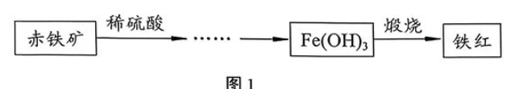
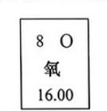
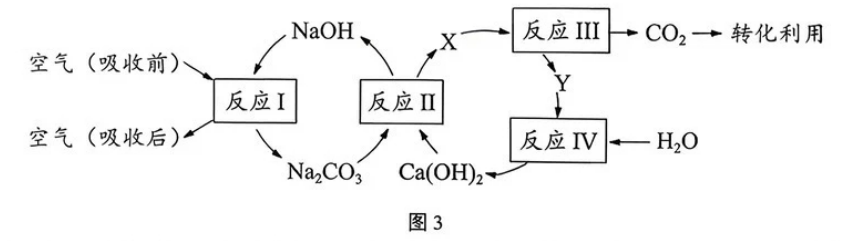
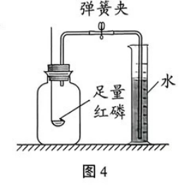
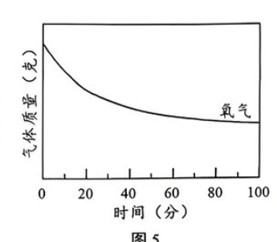
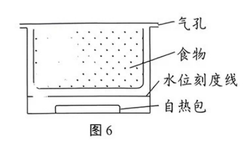

# 化模26-黄浦静金闵青-下 · 2026 静金闵青联考一模精选精讲

> **使用说明**：本讲为"黄浦＋静金闵青"合编的下半部分，从联考卷五个题块（壁画颜料中的铁红 9 分 / 燃料的发展 9 分 / 二氧化碳的转化利用 10 分 / 探究空气的足迹 13 分 / 食品自热包 9 分）中精选 8 组精讲。相对原子质量：H-1、C-12、O-16、Fe-56。**卷末附参考答案（第 5 页），已与独立推演逐项核对**；一处存疑见组 5 题 12 ⚠️ 标注（反应类型答案未列化合反应）。卷面插图（铁红生产流程、氧元素周期表信息、CO₂ 吸收工艺流程、红磷燃烧装置、臭氧转化数据曲线、自热食品结构共 6 幅）已按 150dpi 页图原样裁切嵌入题干。上半部分见 [[化模26-黄浦静金闵青-上]]。

# 第二部分 · 静金闵青联考卷

## 组 1 · 铁红：周期表信息与化合价计算

中国古代壁画是重要的中华文化遗产，常用含铁红（Fe₂O₃）的颜料。在壁画制作及修复中，以赤铁矿（主要成分 Fe₂O₃）为原料生产铁红的过程如图 1 所示。

**1.** 元素周期表中氧元素的相关信息如图 2 所示，据此可知＿＿＿＿＿＿＿＿。

- （A）氧的原子序数为 16
- （B）氧离子的符号为 O
- （C）氧属于非金属元素
- （D）每个氧原子的质量为 8

> [!tip]- 💡 思路导航
> 周期表一格四个数各司其职：左上原子序数、右上元素符号、中间元素名称、下方相对原子质量——判断选项时先确认每个数"是哪个数"，再看"气"字头归哪类元素。

> [!success]- ✅ 详解 · 评分点 · 易错 · 关联
> **详解**：选 **C**。A 错：原子序数为 **8**（16.00 是相对原子质量）；B 错：氧离子符号为 **O²⁻**（带 2 个单位负电荷）；C 对：氧属非金属元素；D 错："8"是原子序数，原子实际质量极小，且相对原子质量为 16.00。
>
> **易错**："8"在格子里是原子序数，16.00 才是相对原子质量——一格四数各司其职。
>
> **关联**：[[05-化学/知识点/专题5-物质的微观构成]]（周期表信息）、[[化-12-概念辨析与分类]]。

**2.** 铁原子的核电荷数为 26，由此可知其核外电子数为＿＿＿＿＿＿＿＿。
- （A）13
- （B）26
- （C）52
- （D）56

> [!tip]- 💡 思路导航
> 原子电中性，三个"26"是一回事：核电荷数＝质子数＝核外电子数。

> [!success]- ✅ 详解 · 评分点 · 易错 · 关联
> **详解**：选 **B**（原子中：核电荷数＝质子数＝核外电子数＝26）。
>
> **关联**：[[05-化学/知识点/专题5-物质的微观构成]]（原子结构）。

**3.** 铁元素化合价不同，其氧化物的颜色不同。铁红（Fe₂O₃）中铁元素的化合价为＿＿＿＿＿＿＿＿。
- （A）−2
- （B）−3
- （C）+2
- （D）+3

> [!tip]- 💡 思路导航
> 化合价口诀"正负代数和为零"：O 是 −2，乘角标 3，解出 Fe 的价态——顺便与 FeSO₄ 里的 +2 区分记忆。

> [!success]- ✅ 详解 · 评分点 · 易错 · 关联
> **详解**：选 **D**。Fe₂O₃ 中 O 为 −2 价，代数和为零 → Fe 为 **+3** 价。
>
> **关联**：[[化-11-化合价与方程式书写]]、[[化-14-化合价与推断]]。

**4.** Fe₂O₃ 中铁元素的质量分数的计算式为＿＿＿＿＿＿＿＿。

> [!tip]- 💡 思路导航
> 质量分数计算式＝铁的相对原子质量×个数 ÷ 相对分子质量——本题只要求"计算式"，把两段都写规范。

> [!success]- ✅ 详解 · 评分点 · 易错 · 关联
> **详解**：$\dfrac{56\times2}{56\times2+16\times3}\times100\%$（＝112/160×100%＝**70%**）。
>
> **关联**：[[化-14-化合价与推断]]（元素质量分数）、[[化-10-微观意义与计算]]。

## 组 2 · 铁红：方程式与提纯

**5.** （1）生产铁红的过程中，Fe₂O₃ 与稀硫酸反应的化学方程式为＿＿＿＿＿＿＿＿。
- （A）Fe₂O₃＋H₂SO₄＝Fe₂(SO₄)₃＋H₂O
- （B）Fe₂O₃＋3H₂SO₄＝Fe₂(SO₄)₃＋3H₂O
- （C）Fe₂O₃＋3H₂SO₄＝2FeSO₄＋3H₂O
- （D）Fe₂O₃＋2H₂SO₄＝2FeSO₄＋2H₂O

（2）煅烧时发生的反应为 2Fe(OH)₃ $\xrightarrow{\text{高温}}$ Fe₂O₃＋3X，X 的化学式为＿＿＿＿＿＿＿＿。

> [!tip]- 💡 思路导航
> （1）先定产物（Fe 是 +3 价，与酸交换成分后价态不变），再配平挑选项；（2）原子账：反应前后各原子数清点，差额归 X。

> [!success]- ✅ 详解 · 评分点 · 易错 · 关联
> **详解**：（1）选 **B**。A 未配平；C、D 生成物写成 FeSO₄——氧化铁中铁是 +3 价、与酸交换成分后仍为 +3，产物应为 **Fe₂(SO₄)₃**。（2）**H₂O**。原子账：反应前 Fe 2、O 6、H 6；Fe₂O₃ 占 Fe 2、O 3，差额 3H₂O 归 3X → X＝H₂O。
>
> **易错**：（1）的 C 选项专打"+3/+2 混淆"：Fe₂O₃ 与酸反应**价态不变**，写 FeSO₄ 即错——交换成分时阳离子不换价。
>
> **关联**：[[化-11-化合价与方程式书写]]（复分解反应）、[[化-04-质量守恒与方程式]]（原子账推化学式）。

**6.** 若将赤铁矿粉碎后加入某种液体，经过滤后即可分离得到 Fe₂O₃ 固体，则该种液体应具备的性质是＿＿＿＿＿＿＿＿。
- （A）能溶解杂质不能溶解 Fe₂O₃
- （B）能溶解 Fe₂O₃ 不能溶解杂质
- （C）与 Fe₂O₃ 反应，不与杂质反应
- （D）与杂质反应，不与 Fe₂O₃ 反应

> [!tip]- 💡 思路导航
> 过滤分离的前提是"一个溶、一个不溶"，而目标物 Fe₂O₃ 要以固体形式留在滤纸上——按这个标准筛选项。

> [!success]- ✅ 详解 · 评分点 · 易错 · 关联
> **详解**：选 **A**。三段式：**判断**——液体溶解杂质、留下 Fe₂O₃。**依据**——过滤分离的前提是其一溶解、其一不溶，且目标物 Fe₂O₃ 要以固体形式留在滤纸上。**回扣**——"能溶解杂质不能溶解 Fe₂O₃"，选 A；B、C、D 都会损失目标物。
>
> **关联**：[[化-02-实验操作与提纯]]（过滤）、[[化-30-物质的检验与提纯]]。

## 组 3 · 燃料的发展：木炭与甲烷液化

"伐薪烧炭"是我国古代获取燃料的一种方法。目前，天然气被广泛用作家用燃料，其主要成分是甲烷（CH₄）。

**7.** 《说文解字》中有"炭，烧木留性，寒月供然（燃）火取暖者，不烟不焰，可贵也"。
（1）将木柴烧制为木炭，木炭作为燃料取暖，体现两者共同的化学性质是＿＿＿＿＿＿＿＿。
- （A）可燃性
- （B）助燃性
- （C）防腐性
- （D）导热性

（2）相较于木柴燃烧，木炭燃烧时没有浓烟，"不烟"的价值是＿＿＿＿＿＿＿＿；

（3）为使木炭充分燃烧，可以采用的一种措施是＿＿＿＿＿＿＿＿。

> [!tip]- 💡 思路导航
> （1）"作燃料取暖"用的就是那条最核心的化学性质；（2）"不烟"落到环保与健康的价值层面，别只复述现象；（3）促进充分燃烧的老两样：接触面积与氧气。

> [!success]- ✅ 详解 · 评分点 · 易错 · 关联
> **详解**：（1）选 **A**（木柴与木炭都能燃烧——共同的化学性质是可燃性）。（2）减少烟尘等污染物排放，**降低对空气的污染**。（3）**将木炭粉碎（增大与空气的接触面积）或鼓入足量空气（提供充足氧气）**等。
>
> **易错**：（2）答成"没有烟"只是复述现象，要落到"污染物减排"的价值层面。
>
> **关联**：[[化-07-燃烧与碳]]（燃烧条件与充分燃烧）、[[05-化学/知识点/专题9-10-反应调控与化学社会]]。

**8.** 天然气可通过管道输送，但某些情况下为便于车船运输，需将其降温至 −161.5℃ 液化。
（1）甲烷液化过程中，发生改变的是＿＿＿＿＿＿＿＿。
- （A）分子种类
- （B）分子数目
- （C）分子间间隔
- （D）分子质量

（2）相对于甲烷，比较说明甲醇作为燃料的一个优点。

> [!tip]- 💡 思路导航
> （1）液化是物理变化——分子本身"三不变"，变的是哪个量；（2）对比两种燃料的"常温状态"，从储存运输的角度找优点。

> [!success]- ✅ 详解 · 评分点 · 易错 · 关联
> **详解**：（1）选 **C**。液化是物理变化，甲烷分子本身不变（种类、数目、质量均不变），改变的是**分子间间隔**。（2）三段式：**判断**——甲醇常温下为液态。**依据**——甲烷是气体，储存运输需高压或深冷（−161.5℃）。**回扣**——甲醇常温常压下是液体，**更易储存和运输**（且能量密度高、便于罐装）。
>
> **关联**：[[05-化学/知识点/专题5-物质的微观构成]]（分子间隔）、[[05-化学/专题/说理题方法]]（比较型说理）。

## 组 4 · 燃料的发展：电催化制甲醇计算

**9.** 我国科学家通过电催化，将甲烷在常温常压下转化为甲醇（CH₄O），该反应的化学方程式是 CH₄＋H₂O₂ $\xrightarrow{\text{电催化}}$ CH₄O＋H₂O。若参加反应的 CH₄ 质量为 8 kg，则生成 CH₄O 的质量为多少千克？（根据化学方程式列式计算）

> [!tip]- 💡 思路导航
> 按五步走：设、方程式（已给，抄规范）、比例式（CH₄ 与 CH₄O 的相对分子质量之比）、求解、答——给的是 CH₄ 的质量，别乘错角标。

> [!success]- ✅ 详解 · 评分点 · 易错 · 关联
> **详解**：解：设生成 CH₄O 的质量为 x。
> $$CH_4+H_2O_2\xrightarrow{\text{电催化}}CH_4O+H_2O\qquad 16:32=8\,\text{kg}:x$$
> （M(CH₄)=16；M(CH₄O)=12+1×4+16=32）解得 x＝8×32/16＝**16 kg**。答：生成 CH₄O 的质量为 16 kg。（验算：C 1=1，H 4+2=4+2，O 2=1+1 ✓）
>
> **易错**：比例式两端同为纯净物质量（16 与 32 都是纯物质），给 8 kg 是 CH₄ 的质量、不要乘错角标。
>
> **关联**：[[化-13-化学计算进阶]]（设列算答）、[[05-化学/知识点/专题6-化学变化及其表示]]。

## 组 5 · CO₂ 的转化利用：吸收流程

科学家研发了一种吸收 CO₂ 的技术，每年能从空气中吸收 CO₂ 约 100 万吨。该工艺流程如图 3。

**10.** 5% 的 NaOH 溶液能有效吸收 CO₂，若配制 50 g 该溶液，需＿＿＿＿＿＿＿＿ g NaOH 固体。

> [!tip]- 💡 思路导航
> 质量分数的定义直接算：溶液质量×质量分数。

> [!success]- ✅ 详解 · 评分点 · 易错 · 关联
> **详解**：50 g×5%＝**2.5** g。
>
> **关联**：[[化-23-溶质质量分数与计算]]。

**11.** 写出反应Ⅰ的化学方程式＿＿＿＿＿＿＿＿。

> [!tip]- 💡 思路导航
> 反应Ⅰ是"NaOH 溶液吸收空气中的 CO₂"——酸性氧化物与碱的反应，配平后验算原子账。

> [!success]- ✅ 详解 · 评分点 · 易错 · 关联
> **详解**：反应Ⅰ：$CO_2+2NaOH=Na_2CO_3+H_2O$（验算：Na 2=2，C 1=1，O 2+1=3+1 ✓）。
>
> **关联**：[[05-化学/知识点/专题3-空气氧气与二氧化碳]]（CO₂ 与碱反应）、[[化-11-化合价与方程式书写]]。

**12.** 该工艺流程中，反应Ⅰ~Ⅳ涉及的基本反应类型有＿＿＿＿＿＿＿＿。（不定项）
- （A）化合反应
- （B）分解反应
- （C）置换反应
- （D）复分解反应

> [!tip]- 💡 思路导航
> 四个反应逐一定性再选——"四查"口诀：一变多分解、多变一化合、单质换单位置换、交换成分复分解；酸性氧化物与碱的反应不属于四大基本类型。

> [!success]- ✅ 详解 · 评分点 · 易错 · 关联
> **详解**：卷面答案 **BD**。逐一定性：反应Ⅱ $Na_2CO_3+Ca(OH)_2=CaCO_3\downarrow+2NaOH$ 属**复分解**（D）；反应Ⅲ X（CaCO₃）高温分解为 CO₂ 与 Y（CaO），属**分解**（B）。⚠️ **存疑标注**：反应Ⅳ（CaO＋H₂O＝Ca(OH)₂，两变一）按定义属**化合反应**（A），卷面答案 BD 未含 A，疑为疏漏；反应Ⅰ（CO₂＋2NaOH）不属于四大基本类型。教学使用前请核对原卷。
>
> **易错**：把反应Ⅳ漏在"化合反应"之外是本卷最大疑点，详见详解 ⚠️；反应Ⅰ不是四大基本类型中的任何一种，别硬塞进"化合"。
>
> **关联**：[[05-化学/知识点/专题6-化学变化及其表示]]（四大基本反应类型）、[[化-12-概念辨析与分类]]。

**13.** 下列 CO₂ 的用途只利用了其物理性质的是＿＿＿＿＿＿＿＿。
- （A）生产化肥
- （B）生产碳酸饮料
- （C）灭火
- （D）冷藏食物

> [!tip]- 💡 思路导航
> 逐项问"用没用到化学反应"：化肥靠反应生成新物质，碳酸饮料靠 CO₂ 与水反应，灭火两条原理里哪条是化学的，冷藏靠的是什么变化。

> [!success]- ✅ 详解 · 评分点 · 易错 · 关联
> **详解**：选 **D**（冷藏食物利用干冰升华吸热降温，物理性质；生产化肥、生产碳酸饮料、灭火都用到 CO₂ 的化学性质）。
>
> **易错**：灭火常被误当"纯物理"——CO₂ 灭火主要利用不燃烧不支持燃烧（化学性质）＋密度比空气大，故不选 C。
>
> **关联**：[[化-12-概念辨析与分类]]（物理性质与化学性质）、[[化-07-燃烧与碳]]。

**14.** 图 3 的流程中，在保持 NaOH 浓度合适的情况下，为了更充分地吸收空气中的 CO₂，写出可以采取的合理措施，并说明理由。

> [!tip]- 💡 思路导航
> 措施类题按"接触面积、反应时间、吸收级数"三路作答，每条措施都要带上"为什么"（增大接触/延长时间/多次接触）。

> [!success]- ✅ 详解 · 评分点 · 易错 · 关联
> **详解**：三路任答（措施＋理由）：**将空气通过多孔装置（如多孔气泡石）通入 NaOH 溶液**——增大空气与 NaOH 溶液的接触面积，使 CO₂ 与 NaOH 更充分接触反应；**减慢空气的通入速率**——延长空气在 NaOH 溶液中的停留时间，让 CO₂ 有更充足的时间反应；**采用多级吸收（空气依次通过多份 NaOH 溶液）**——多次接触，提高 CO₂ 的吸收效率，减少未被吸收的 CO₂ 残留。
>
> **评分点**：措施与理由必须成对出现，只答措施不说理由得一半分。
>
> **关联**：[[化-16-实验探究与评价]]（措施与理由）、[[05-化学/知识点/专题3-空气氧气与二氧化碳]]。

## 组 6 · 探究空气的足迹：拉瓦锡与红磷

18 世纪前，人们普遍认为空气是单一物质。直到拉瓦锡运用了"定量思维"进行实验研究，才得出"空气为混合物"的结论。科学家对空气的持续研究推动了社会进步和发展。

**15.** 拉瓦锡在充满空气的密闭容器内持续加热足量金属汞，充分反应后发现容器内气体体积减少了 1/5，剩余气体不支持燃烧和呼吸，他由此得出"空气为混合物"的结论。
（1）拉瓦锡得出此结论的实验依据是＿＿＿＿＿＿＿＿；
（2）实验室用红磷代替汞进行类似实验，装置如图 4 所示。以下事项中，能提高实验结果准确性的是＿＿＿＿＿＿＿＿。（不定项）

- （A）确保装置气密性良好
- （B）量筒中加入足量的水
- （C）将燃烧匙伸入装置底部
- （D）燃烧结束后迅速打开弹簧夹

> [!tip]- 💡 思路导航
> （1）"定量思维"体现在两个可陈述的事实上：气体少了多少＋剩下的气体什么性质，两条依据都落到；（2）逐项问"这个操作会不会让测量结果失真"——漏气、水量不足、读数时机都是失真点。

> [!success]- ✅ 详解 · 评分点 · 易错 · 关联
> **详解**：（1）三段式：**判断**——依据是"定量"结果。**依据**——容器内气体体积**减少了 1/5**，且**剩余气体不支持燃烧和呼吸**。**回扣**——说明空气由两种（或多种）**性质不同**的气体组成，即混合物（约 1/5 的"活性"部分与约 4/5 的"惰性"部分）。（2）选 **AB**。A 对：漏气直接使结论失真；B 对：水足量才能把进入瓶内的水全部量出（否则水位差测不全）；C 错：燃烧匙应伸入瓶内且**立即塞紧**，"伸入底部"靠近水面易使红磷熄灭、受热不均；D 错：应**冷却至室温后**再打开弹簧夹，"迅速打开"时瓶内气体受热膨胀，倒吸水量偏小。
>
> **易错**：（1）只答"气体少了 1/5"不完整，必须带上"剩余气体不支持燃烧和呼吸"这半条依据；（2）D"迅速打开弹簧夹"是本实验第一高频错误。
>
> **关联**：[[05-化学/知识点/专题3-空气氧气与二氧化碳]]（空气中氧气含量测定）、[[化-16-实验探究与评价]]（误差分析）。

**16.** 19 世纪末，科学家发现：从空气中分离出的氮气与化学反应生成的氮气，两者密度存在极小的差异，经反复实验，终于发现了氩气等稀有气体。稀有气体曾被称为"惰性气体"，但现代科技中已能制备其化合物。上述事实说明＿＿＿＿＿＿＿＿。（不定项）
- （A）科学结论会随着研究深入而不断修正
- （B）稀有气体不能与其他物质发生反应
- （C）实验结果的差异是科学发现的重要契机
- （D）研究空气的组成只需利用化学原理

> [!tip]- 💡 思路导航
> 材料里藏着两组"反转"：密度差异引出新发现、"惰性"被修正——逐项对照材料判断，绝对化表述（"不能""只需"）要警惕。

> [!success]- ✅ 详解 · 评分点 · 易错 · 关联
> **详解**：选 **AC**。A 对："惰性气体"被"能制备其化合物"修正；B 错：与"现代科技中已能制备其化合物"矛盾；C 对：密度极小差异的反复实验引出稀有气体的发现；D 错："只需化学原理"绝对化（密度测定等物理方法同样关键）。
>
> **关联**：[[05-化学/知识点/专题1-2-化学之门与实验探究]]（科学史与科学态度）。

## 组 7 · 探究空气的足迹：臭氧转化与 MOF 集水

**17.** 空气中的臭氧（O₃）可由氧气在一定条件下转化得到。实验室用高锰酸钾制取氧气，并将制得的氧气在密闭容器中转化为臭氧，部分实验数据如图 5 所示。

（1）写出高锰酸钾制取氧气的化学方程式＿＿＿＿＿＿＿＿；
（2）在图 5 中画出容器内气体总质量随时间的变化趋势。

> [!tip]- 💡 思路导航
> （1）配平加"加热"条件与气体符号；（2）作图前先问一句：氧气变臭氧的过程中，容器是密闭的——**总量变不变**？下降的那条线是谁的质量？

> [!success]- ✅ 详解 · 评分点 · 易错 · 关联
> **详解**：（1）$2KMnO_4\xrightarrow{\Delta}K_2MnO_4+MnO_2+O_2\uparrow$。（2）作图要点：容器内气体总质量**保持不变，画一条水平直线**——三段式：**判断**——总质量恒定。**依据**——O₂ 转化为 O₃ 只是同种元素原子的重新组合（3O₂→2O₃），**质量守恒定律**决定气体总质量不变；图 5 中下降的是"氧气（O₂）的质量"而非总质量。**回扣**——氧气质量减少、臭氧质量增加，两者之和恒定，趋势线为水平线。（若审题不清把总质量画成下降，正中命题陷阱。）
>
> **关联**：[[化-04-质量守恒与方程式]]（质量守恒作图）、[[05-化学/知识点/专题3-空气氧气与二氧化碳]]（氧气制取）。

**18.** 2025 年诺贝尔化学奖授予了金属有机框架（MOF）材料的研发者，某些 MOF 材料可用于沙漠的空气集水。
（1）空气集水技术中，MOF 材料能将空气中的水分子"抓住"，该过程类似于＿＿＿＿＿＿＿＿。
- （A）空气液化
- （B）活性炭吸附色素
- （C）海水淡化
- （D）水通电电解

（2）某空气集水项目的宣传语为："我们，能将空气变为水，这是分解空气的伟大创举。"判断这句话是否合理并说明理由。

> [!tip]- 💡 思路导航
> （1）"抓住并富集"对应哪类熟悉的物理过程；（2）拆两处：空气"变为"水是否符合事实（空气中水的存在形式）、"分解空气"是不是真的分解反应。

> [!success]- ✅ 详解 · 评分点 · 易错 · 关联
> **详解**：（1）选 **B**（吸附——把水分子"抓住"富集，与活性炭吸附色素同类）。（2）三段式：**判断**——宣传语不合理。**依据**——空气的主要成分是氮气和氧气，**不含水**（水仅以水蒸气形式少量存在）；MOF 是**吸附**空气中的水蒸气并使其凝聚，没有生成新物质。**回扣**——"分解空气"既不符合事实（未发生分解反应），也不符合该技术"物理吸附集水"的原理。
>
> **关联**：[[化-01-变化与性质辨析]]（物理变化）、[[05-化学/知识点/专题9-10-反应调控与化学社会]]（新材料与社会）。

## 组 8 · 食品自热包

自热食品为我们的生活带来了便利。图 6 为某自热食品的结构示意图，按使用说明注入冷水，可达到迅速升温并持续加热的目的。某自热包的主要成分和使用说明如表 1。

| 主要成分 | 使用说明 |
| ---- | ---- |
| 氧化钙、铝粒、碳酸氢钠 | 加入水至指定刻度线；使用时需远离火源；加热时切勿接近排气孔 |

**19.** 自热包使用时涉及的物质中，属于盐的是＿＿＿＿＿＿＿＿。
- （A）氧化钙
- （B）铝粒
- （C）碳酸氢钠
- （D）水

> [!tip]- 💡 思路导航
> 盐＝金属离子（或铵根）＋酸根离子——把四种物质的组成逐个过一遍再挑。

> [!success]- ✅ 详解 · 评分点 · 易错 · 关联
> **详解**：选 **C**（NaHCO₃ 由金属离子与酸根离子构成，属盐；CaO 是氧化物、铝是单质、水是氧化物）。
>
> **易错**：氧化钙、水都是氧化物，"属盐"的只有碳酸氢钠一个。
>
> **关联**：[[化-12-概念辨析与分类]]（物质分类）、[[化-29-盐与废液成分探究]]。

**20.** 化学变化伴随能量变化，从该角度分析自热包中氧化钙的作用。

> [!tip]- 💡 思路导航
> 先想氧化钙遇水发生什么反应、该反应伴随怎样的能量变化（温度计会怎么走）；再想这份能量变化在自热包的工作过程中扮演什么角色——只答一半会扣分。

> [!success]- ✅ 详解 · 评分点 · 易错 · 关联
> **详解**：三段式：**判断**——氧化钙与水反应放热，是自热包的"点火器"。**依据**——CaO＋H₂O→Ca(OH)₂ 是**放热**反应，放出大量热。**回扣**——放出的热量为自热包提供**初始热量**，引发其他反应（如铝的参与）持续放热，实现迅速升温并持续加热。
>
> **易错**：只答"放热"不给满分，必须点出"提供**初始**热量、引发后续反应**持续**放热"的链条。
>
> **关联**：[[化-26-碱的性质与中和反应]]（生石灰与水）、[[05-化学/知识点/专题9-10-反应调控与化学社会]]（化学能与生活）。

**21.** 乘坐火车、飞机等公共交通工具时，或在密闭空间中，严禁携带并使用此类自热食品。为探究自热包与水接触后的变化情况，现将自热包中的固体与一定量的水混合，收集产生的气体，发现该气体可被点燃并伴随爆鸣声。
（1）将反应后的混合物过滤，室温下测得滤液的 pH＞10，说明该滤液呈＿＿＿＿＿＿＿＿。
- （A）酸性
- （B）碱性
- （C）中性

（2）请从化学的角度阐述该项规定的必要性。

> [!tip]- 💡 思路导航
> （1）pH＞10 往哪个区间落；（2）风险链要拉全：可点燃伴爆鸣声的气体是什么性质、滤液强碱会怎样、加热高温会怎样——多条依据成"风险链"。

> [!success]- ✅ 详解 · 评分点 · 易错 · 关联
> **详解**：（1）选 **B**（pH＞10，强碱性）。（2）三段式：**判断**——禁带禁用有双重化学依据。**依据**——自热包与水反应**产生氢气**，氢气**易燃易爆**，在密闭空间或公共交通工具中，氢气泄漏遇火可能引发爆炸；同时反应生成**碱性溶液**（pH＞10），泄漏可能腐蚀物品或伤害人体，加热产生的高温也可能烫伤或引燃物品。**回扣**——"易燃易爆＋强碱腐蚀＋高温"三条风险链，决定了严禁携带并使用。
>
> **关联**：[[化-07-燃烧与碳]]（氢气可燃性）、[[化-24-溶液的酸碱性与pH]]、[[05-化学/专题/说理题方法]]（多依据说理）。

**22.** 自热包在使用时需按说明加水至指定刻度线，这样加热结束后剩余物为固体。分析说明如果不按要求加水至刻度线附近，可能产生什么影响？

> [!tip]- 💡 思路导航
> 双向分析：水"过少"与"过多"各坏在哪——放热够不够、剩余物是固体还是液体，从两条路各推一个后果。

> [!success]- ✅ 详解 · 评分点 · 易错 · 关联
> **详解**：双向分析：**若加水过少**——自热包中的固体无法充分反应，**放热不足，无法达到预期加热效果**；**若加水过多**——反应结束后剩余物为液体（水未被耗尽），液体膨胀外溢可能导致**自热食品包装泄漏，污染食物或造成烫伤**等。（按要求加水至刻度线，恰使水参与反应后以固体形式"锁定"产物，安全可控。）
>
> **关联**：[[化-16-实验探究与评价]]（操作偏差分析）、[[05-化学/知识点/专题9-10-反应调控与化学社会]]。

## ⚠️ 评分点与易错速览（静金闵青卷）

- 组 2（1）的 C 选项专打"+3/+2 混淆"：Fe₂O₃ 与酸反应**价态不变**，产物是 Fe₂(SO₄)₃，写 FeSO₄ 即错。
- 组 5 题 12 四个反应逐一定性后再选——卷面答案 BD 疑漏"化合反应"（反应Ⅳ），作答时以原卷为准，但**心里要有 A**。
- 组 6（2）D"迅速打开弹簧夹"是本实验第一高频错误：**冷却至室温**是读数前提，提前开夹读数偏小。
- 组 7（2）作图题先问自己"总量变不变"：O₂→O₃ 质量守恒，画下降线即掉入陷阱。
- 组 8 题 20 只答"放热"不给满分，必须点出"提供**初始**热量、引发后续反应**持续**放热"的链条。

## ✅ 答案速查（静金闵青卷精选 8 组）

| 组 | 要点 |
| ---- | ---- |
| 1 | C；B；D（+3）；56×2/(56×2+16×3)×100%（=70%） |
| 2 | B；X=H₂O；A |
| 3 | A；减少烟尘污染；粉碎或鼓足空气；C；甲醇常温液态易储存运输 |
| 4 | 16 kg（16:32=8:x） |
| 5 | 2.5；CO₂+2NaOH=Na₂CO₃+H₂O；BD（⚠️ 反应Ⅳ为化合反应，疑应含 A）；D；多孔装置/减慢速率/多级吸收＋理由 |
| 6 | 体积减 1/5 且剩余气体不支持燃烧呼吸；AB；AC |
| 7 | 2KMnO₄--Δ-->K₂MnO₄+MnO₂+O₂↑；总质量恒定画水平线（O₂→O₃ 质量守恒）；B；不合理：空气中水仅以水蒸气存在，MOF 是吸附非分解 |
| 8 | C；CaO 与水放热提供初始热量引发持续放热；B；三条风险链；过少放热不足、过多余液泄漏污染烫伤 |

## 🔗 关联

- [[05-化学/知识点/专题3-空气氧气与二氧化碳]]（空气史、CO₂ 捕集与转化）· [[05-化学/知识点/专题9-10-反应调控与化学社会]]（化学史、自热包与能源材料）
- [[05-化学/知识点/专题6-化学变化及其表示]]（基本反应类型、质量守恒作图）· [[05-化学/知识点/专题5-物质的微观构成]]（周期表信息、分子间隔）
- [[化-14-化合价与推断]] · [[化-04-质量守恒与方程式]] · [[化-11-化合价与方程式书写]] · [[化-16-实验探究与评价]]（第 15、22 题评价范式）
- [[05-化学/专题/说理题方法]]（三段式母版）· 上半部分：[[化模26-黄浦静金闵青-上]] · 同系列：[[化模26-长宁-下]]
