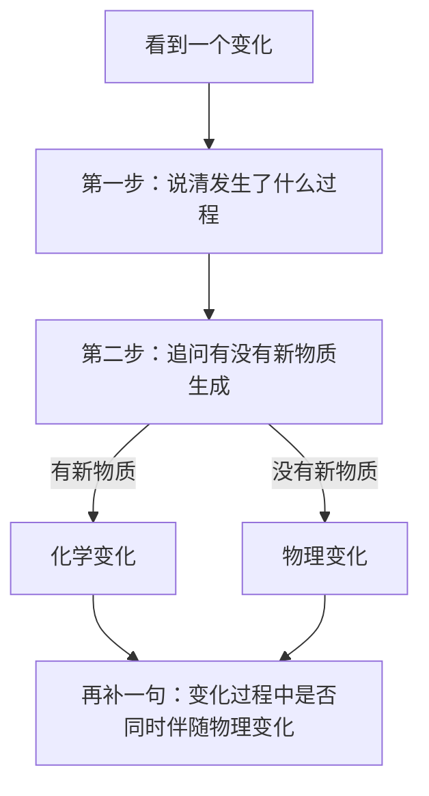
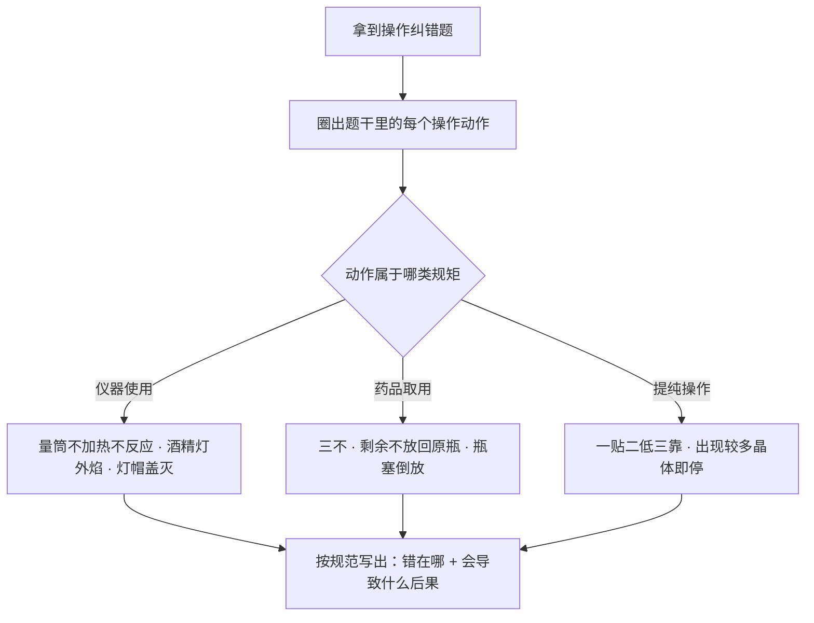
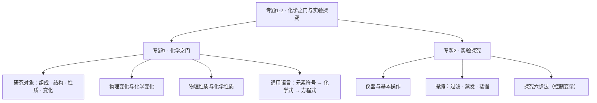

# 专题 1-2 · 化学之门与实验探究（详解版）

> **使用说明**：本文是详解版，从"为什么"讲起供从头自学；考前速查和掌握度跟踪在概要版：[[05-化学/知识点/专题1-2-化学之门与实验探究]]。

## 0️⃣ 这章学什么 & 中考怎么考

一句话：**这一章是化学的大门——先告诉你化学研究什么，再教你在实验室里安全、规范地动手。**

- 专题 1（化学之门）回答"化学是什么"：化学研究物质的**组成、结构、性质、变化**，并且发明了一套全世界通用的语言——元素符号 → 化学式 → 化学方程式，一级搭一级。
- 专题 2（实验探究）回答"化学怎么做"：认识常用仪器，学会取药、加热、读数，学会过滤、蒸发、蒸馏三招提纯，最后学会像科学家一样按六步去探究一个问题。
- 和前后章节的关系：物理变化与化学变化的分法是后面**所有**专题的背景语言；提纯三法在 [[05-化学/知识点/专题4-水的性质与组成]]（净水）里会原样再用一遍；控制变量的探究思想贯穿 [[05-化学/知识点/专题3-空气氧气与二氧化碳]] 的制气实验。

中考怎么考（只写库里有依据的）：

- 化学笔试 50 分（在综合测试 150 分之内），另有 5 月实验操作考 5 分（见 [[05-化学/学科总览]]）。本专题具体占几分：待核对。
- 概要版原话：**基本操作是实验题和 5 月实验操作考的地基。** 操作考的逐条扣分点（倾倒、加热、量筒读数等）整理在 [[05-化学/专题/实验操作考点-化学]]。
- 新中考趋势：减少记忆题、增加情景化和说理题（见 [[05-化学/学科总览]] 与 [[05-化学/专题/说理题方法]]）——"判断变化类型并说理由""这个探究方案哪里不严谨"正是这类题的入门素材。

## 🧭 先修自检（学不下去先回到这里）

> 下面每一项都是本章的地基。做不出就先去补对应知识，硬学只会更挫败。

| # | 你应该会的 | 自查题（先做再看答案） | 答案 | 不会去哪补 |
| - | ---------- | ---------------------- | ---- | ---------- |
| 1 | 分清"过程"和"属性"两个词 | "木炭燃烧"和"木炭能燃烧"是一回事吗？ | 不是。前者是变化（过程），后者是性质（本领） | 本文章节 🌱 概念 2、3 |
| 2 | 默写前 5 号元素符号 | 默写：氢、氦、锂、铍、硼 | H、He、Li、Be、B | [[05-化学/知识点/专题5-物质的微观构成]] |
| 3 | 认识体积单位 | 量筒上的"mL"是什么单位？1 L 等于多少 mL？ | 体积单位（毫升）；1 L = 1000 mL | 本文章节 🧮 规律 2 |
| 4 | 会按步骤复述操作 | 酒精灯用完怎么熄灭？为什么不能吹？ | 用灯帽盖灭；吹气可能把火焰沿灯颈压入灯内引燃酒精 | 本文章节 🌱 概念 4 |

第 4 题的"灯帽盖灭"要先讲一句：盖灭后再把灯帽重新提起、再盖一次，是为了放走灯帽里的酒精蒸气，下次好打开。这些细节在概念 4 里都会逐条讲。

## 🌱 概念从头讲

> 每个概念按"**为什么需要它 → 它是什么 → 符号/化学式/单位 → 容易想错的地方**"四步讲。

### 概念 1：化学研究什么

- **为什么需要**：你在生活里见过铁生锈、食物变质、烟花爆炸——这些都是"物质在变"。化学就是把"物质"当成研究对象，回答四个问题：它由什么**组成**？内部怎么**结构**？有什么**性质**？会发生什么**变化**？
- **定义**：化学研究物质的组成、结构、性质及变化规律。
- **符号/单位**：本章还没有专门符号，但化学的"通用语言"三级台阶要记住：**元素符号（1-20 号必须默写）→ 化学式 → 化学方程式**。后面每一级都建立在前一级上，急不得。
- **容易想错**：❌ "化学就是背方程式" → 方程式只是语言工具，不是研究对象。✅ 先搭好"物质四问"的框架，语言和实验都是为回答这四问服务的。

### 概念 2：物理变化与化学变化

- **为什么需要**：所有实验都建立在"变化"上。分不清两种变化，后面的物质分类、化学方程式全会跟着乱。
- **定义**：
  - **物理变化**：没有生成新物质的变化。例：水结冰、酒精挥发、纸撕碎。
  - **化学变化**：有新物质生成的变化。例：木柴燃烧、铁生锈、食物腐败。
  - 判断的唯一标准：**有没有新物质生成**。
- **符号/单位**：无。
- **容易想错**：
  - ❌ "燃烧、发光放热、变色、生成气体沉淀——看到现象就是化学变化" → 这些只是**可能**伴随的辅助现象，不是判据。灯泡通电发光又放热，但没有生成新物质，是物理变化。✅ 看完现象必须追问一句："**生成新物质了吗？**"
  - ❌ "爆炸都是化学变化" → 可燃物急速燃烧引起的爆炸是化学变化；但轮胎爆胎、气球吹爆没有新物质，是物理变化。概要版易错点"可燃气体 + 空气点燃前必须验纯"，防的正是这类爆炸性混合物。
  - ❌ "发生化学变化时就没有物理变化" → 化学变化过程中**同时**伴随物理变化，比如蜡烛燃烧时石蜡先熔化（熔化是物理变化）。

### 概念 3：物理性质与化学性质

- **为什么需要**：选燃料、防生锈、用材料，都要先知道物质"有什么性质"。"性质决定用途"是说理题里最常用的推理句式。
- **定义**：
  - **物理性质**：不需要发生化学变化就表现出来的性质。例：颜色、状态、气味、密度、熔点、沸点、硬度、溶解性。
  - **化学性质**：必须通过化学变化才表现出来的性质。例：可燃性、助燃性、稳定性、酸碱性。
- **符号/单位**：描述性质常用"能、会、可以、易、难"这些字眼。
- **容易想错**：❌ 把"变化"和"性质"混着用 → 区分口诀：**变化是"过程"，性质是"本领"**。"木炭燃烧"是化学变化；"木炭能燃烧（有可燃性）"是化学性质。看到句子里有"能、会、易"，多半在说性质。

### 概念 4：实验室的"交通规则"——仪器与基本操作

- **为什么需要**：实验室药品可能有毒、易燃、有腐蚀性。规范操作不是找麻烦，是保命 + 保实验成功。5 月操作考就是按这些步骤给分的。
- **它是什么**：一组必须练成肌肉记忆的规矩。逐条讲"为什么"：
  - **可加热仪器**：试管（可直接加热）、烧杯/烧瓶（要垫石棉网）、蒸发皿。烧杯底大，直接加热受热不均会炸裂，垫石棉网是为了让火焰的热摊开。
  - **量筒**：不能加热、不能作反应容器。它的刻度是按某个标准温度标定的，受热会变不准；在里面反应还可能腐蚀刻度。
  - **药品取用"三不"**：不闻（要闻就用扇闻，让少量气味飘过来）、不摸、不尝；剩余药品**不放回原瓶**——你手上或桌面可能已污染了它，放回去会糟蹋整瓶。
  - **液体倾倒**：瓶塞**倒放**在桌上（防止桌面脏东西沾上瓶塞、再盖回瓶里污染药品）；瓶口紧挨试管口（防洒）；标签朝手心（残液流下来不腐蚀标签，标签坏了下次找不到药）。
  - **酒精灯**：用**外焰**加热（外焰与空气接触最充分、温度最高）；禁止嘴吹（要用灯帽盖灭）；禁止两盏灯对燃（倾斜时酒精容易洒出来起火）。
- **容易想错**：❌ "量筒看着也是个玻璃杯，图方便就在里面配液反应" → 见上，量筒只管"量"。✅ 反应用试管、烧杯。

### 概念 5：物质提纯三法——过滤、蒸发、蒸馏

- **为什么需要**：自然界里没有现成的纯净物：粗盐里混着泥沙，河水里什么都有一点。想研究一种物质，第一步常常是把它从混合物里"请出来"。
- **它们是什么**：
  - **过滤**：把**不溶性**固体从液体里分离出来。核心口诀"一贴二低三靠"。
  - **蒸发**：把溶液里的**可溶性**固体结晶出来——加热让水跑掉，盐留下。
  - **蒸馏**：利用沸点不同把水从可溶性杂质里分离出来，得到的蒸馏水净化程度最高（专题 4 净水还会请它出场）。
- **符号/单位**：无。
- **容易想错**：
  - ❌ "过滤能除掉所有杂质" → 过滤只能除**不溶性**杂质。盐溶在水里，颗粒小到能跟着水穿过滤纸。✅ 除可溶性杂质要靠蒸馏等方法。
  - ❌ "蒸发要把水全蒸干再停火" → **出现较多晶体时就停止加热**，靠余热把剩下的水分蒸干。蒸到底才停，晶体容易四处飞溅。

### 概念 6：实验探究六步法

- **为什么需要**：新中考增加情景化、探究类题目，探究题的设问几乎都长在流程的某一环上——"这个设计严谨吗""能不能得出这个结论"。
- **定义**：提出问题 → 猜想假设 → 设计实验（**控制变量**）→ 收集证据 → 得出结论 → 反思评价。
- **符号/单位**：无。
- **容易想错**：❌ "设计实验时多开几个变量一起变，一次全弄清楚" → 两个量同时变，结果变好了你都不知道是谁的功劳。✅ **改变一个量、控制其余量**。写结论时必须回扣"控制变量"，这是概要版点名的易错点。

## 🧮 公式/规律逐个拆解

> 每条规律都必须能回答：它说什么？依据是什么？什么时候用？怎么用？

### 规律 1：判断变化类型的"两步法"

- **它说什么**：第一步，找变化（发生了什么过程）；第二步，问新物质（有没有生成新物质）。两步走完才有结论。
- **依据**：化学变化的定义本身就是"有新物质生成"，所以现象只能作旁证。
- **常见伴随现象靠不靠得住（速查表）**：

| 伴随现象 | 能否单独当判据 | 反例 |
| -------- | -------------- | ---- |
| 燃烧、生锈 | 能（它们本身就是化学变化） | —— |
| 发光、放热 | 不能 | 灯泡通电发光发热，是物理变化 |
| 变色 | 不能 | 氧气加压降温变成淡蓝色液体，只是状态变了 |
| 生成气体 | 不能 | 水烧开冒气泡，跑出来的是水蒸气 |
| 出现固体 | 不能 | 蒸发食盐水析出食盐晶体，还是原来那种物质 |

- **怎么用（最小例子）**：纸烧成灰——有燃烧，且灰和纸完全不是一种东西 → 化学变化。纸撕碎——碎片还是纸 → 物理变化。

### 规律 2：量筒读数——"仰小俯大"

- **它说什么**：读数时**平视**凹液面最低处才准。仰视读数偏小，俯视读数偏大。注意口诀说的是**读数**；如果你是在"量取定量液体"（比如要 8.0 mL），**实际量到的量正好相反**：仰视实际量偏多，俯视实际量偏少。
- **为什么**：视线是斜的，斜着穿过液面时先撞到别的刻度线。俯视时视线从高处往下、撞到比液面低的刻度上，你读出来的数比实际大；仰视相反。自己对着图走一遍视线：

```
        俯视（读数偏大）        平视（正确）           仰视（读数偏小）
          眼                      眼                             眼
           \                       |                            /
            \                      |                           /
         10 ─┼                 10 ─┼                       10 ─┼
          8 ─┼← 视线落在 8      8 ─┼← 液面 = 刻度         8 ─┼← 视线落在 8
          ～ ～                  ～ ～                        ～ ～
       （实际液面在 8 以下） （实际液面正好 8）          （实际液面在 8 以上）
        要量 8.0 mL：量少了      要量 8.0 mL：正好        要量 8.0 mL：量多了

                          （示意图，非严格比例）
```

- **最小例子**：要量取 8.0 mL 水，某同学仰视着读，读数正好 8.0 mL。他实际量到多少？答：仰视读数偏小——实际液面得高于 8.0 mL 刻度线，看起来才是 8.0。所以实际量**多于** 8.0 mL。
- **什么时候用**：凡题目出现"仰视/俯视/平视读数"字样，先默念口诀再动笔。

### 规律 3：过滤"一贴二低三靠"逐条拆

| 口诀 | 具体要求 | 为什么要这样 |
| ---- | -------- | ------------ |
| 一贴 | 滤纸紧贴漏斗内壁，中间不留气泡 | 有气泡会挡路，过滤变慢 |
| 二低 | 滤纸边缘低于漏斗口；液面低于滤纸边缘 | 液面一高，液体会从滤纸和漏斗之间的缝直接漏下去，过滤等于白做 |
| 三靠 | 玻璃棒斜靠三层滤纸那一边；烧杯口紧靠玻璃棒；漏斗下端管口紧靠烧杯内壁 | 液体顺着玻璃棒流下不乱溅；下端贴壁防飞溅、还能让滤液顺壁流得快 |

- **自救句**：过滤后滤液仍浑浊，按概要版排查三个原因——滤纸破损 / 液面高于滤纸边缘 / 仪器不干净。找到原因、纠正之后**再滤一次**，不能硬交卷。

### 规律 4：粗盐提纯里玻璃棒的"三次出场"

粗盐提纯三步：**溶解 → 过滤 → 蒸发**。玻璃棒每一步都在场，但干的活不一样：

| 步骤 | 玻璃棒的作用 | 为什么需要 |
| ---- | ------------ | ---------- |
| 溶解 | 搅拌，加速溶解 | 搅动让固体更快地接触到新鲜的水 |
| 过滤 | 引流 | 让液体顺着棒流进漏斗，不洒在外、不冲破滤纸 |
| 蒸发 | 搅拌，防止局部温度过高造成液滴飞溅 | 让液体受热均匀；概要版说法是"搅拌散热" |

（蒸发皿里的晶体最后还要用玻璃棒转移出来，见 [[05-化学/专题/实验操作考点-化学]]。）

### 规律 5：常用仪器与操作速查表

| 仪器 / 操作 | 关键规矩 | 违反的后果 |
| ----------- | -------- | ---------- |
| 试管 | 可直接加热；液体不超过容积 1/3；管口不对人 | 液体沸腾喷出伤人 |
| 烧杯 / 烧瓶 | 加热必须垫石棉网 | 受热不均炸裂 |
| 量筒 | 只能量体积；不加热、不作反应容器；平视读数 | 刻度失准、读数错误 |
| 酒精灯 | 外焰加热；灯帽盖灭；禁止对燃 | 起火 |
| 倾倒液体 | 瓶塞倒放、口挨口、标签朝手心 | 污染药品、腐蚀标签 |
| 闻气体 | 扇闻 | 直接猛吸可能中毒 |
| 取粉末 | 药匙或纸槽送入试管底部 | 药粉粘在管壁上 |

## 🪜 例题阶梯

> 三级台阶，每一级都要动笔跟着答，不许只看。

### 第 1 级 · 入门（照着模仿）

> **题目**：判断下列变化是物理变化还是化学变化，并说明理由。
> (1) 冰融化成水　(2) 酒精挥发　(3) 木炭燃烧　(4) 铁钉生锈　(5) 灯泡通电发光
>
> **每一步为什么这么做**：每小题都套"两步法"——先描述过程，再问"有没有新物质"。判据只有一个：新物质。
>
> **完整解答**：
> (1) 物理变化。冰和水都是 $H_2O$，只是状态从固态变液态，没有新物质。
> (2) 物理变化。酒精液体变成酒精蒸气，还是酒精，没有新物质。
> (3) 化学变化。木炭燃烧生成二氧化碳等新物质（燃烧本身就是化学变化）。
> (4) 化学变化。铁变成铁锈，铁锈是和铁完全不同的新物质。
> (5) 物理变化。灯丝发光发热，但灯丝还是那根灯丝，没有新物质——这是"发光放热不一定是化学变化"的典型反例。

### 第 2 级 · 标准（中考中档）

> **题目**：三个实验操作问题。
> (1) 要量取 8.0 mL 水，某同学仰视读数正好 8.0 mL，他实际量到的水偏多还是偏少？
> (2) 某同学过滤后滤液仍浑浊，他应该先做什么？
> (3) 蒸发食盐水时，什么时候停止加热？为什么？
>
> **读题→翻译成化学语言**：(1) 考"仰小俯大"及"实际量相反"；(2) 考浑浊三原因；(3) 考蒸发停火时机。
>
> **每一步为什么这么做**：三小题都要"先背规矩、再对号入座"，答案里必须带上"为什么"，不然按说理题标准会扣分。
>
> **完整解答**：
> (1) 偏多。仰视时读数偏小：实际液面高于 8.0 mL 刻度线时，看起来才是 8.0 mL，所以实际量到的水多于 8.0 mL。（口诀"仰小俯大"说的是读数；量取定量的液体时，实际量正好相反。）
> (2) 先查三个可能原因：①滤纸破损；②倾倒时液面高于滤纸边缘；③接滤液的烧杯等仪器不干净。查明并纠正后重新过滤，不能直接用浑浊的滤液。
> (3) 出现较多晶体时停止加热，用余热把剩余水分蒸干。理由：一直加热到蒸干，晶体受热不均会四处飞溅，既损失药品又可能烫人。

### 第 3 级 · 提高（与综合题接轨）

> **题目**：小华想知道酒精灯火焰哪一层温度最高。请帮她把探究的六步补全，并说明设计里哪里体现了控制变量。
>
> **思路从哪来**：卡住时先默写六步流程——提出问题 → 猜想假设 → 设计实验（控制变量）→ 收集证据 → 得出结论 → 反思评价，再往每一步里填内容。
>
> **完整解答**：
> 1. **提出问题**：酒精灯火焰哪一层温度最高？
> 2. **猜想假设**：可能是外焰（外焰与空气接触最充分，烧得最"旺"）。
> 3. **设计实验**：取一根火柴梗，**横着**快速放进火焰中，让它的两端同时碰外焰、中间碰焰心，约 1～2 秒后取出。控制变量体现在：同一根火柴梗（材料相同）、同一时间受热（时间相同），只有"所处火焰层"这一个量在变——结果不同就只能是火焰层不同造成的。
> 4. **收集证据**：取出后发现火柴梗与外焰接触的两端最先变黑（碳化），中间几乎没变色。
> 5. **得出结论**：外焰温度最高。所以加热时应该用外焰。
> 6. **反思评价**：火柴梗不能放太久，否则整根变黑没法比较；要选粗细均匀的火柴梗；操作要注意安全。结论必须回扣控制变量——"在其他条件相同时，处于外焰的部分碳化最快，说明外焰温度最高"。
>
> **和入门题的差别**：入门题是"判断对错"，这一题是"自己搭一个公平的比较"。探究题拿分的关键动作就是第 3 步：把"只变一个量"说清楚。

## 🗺️ 解题流程图

**流程图 1：判断物理变化还是化学变化**



**流程图 2：实验操作纠错题怎么答**



**知识结构图**：



## 🔥 易错点：为什么会错

| ❌ 常见错误想法 | 为什么会这样想 | ✅ 正确理解 / 自救方法 |
| -------------- | -------------- | ---------------------- |
| "发光放热就是化学变化" | 只背了现象清单，没背判据 | 现象只是辅助旁证，唯一判据是**有无新物质**；灯泡发光放热是物理变化 |
| "爆炸都是化学变化" | 新闻里的爆炸多是燃烧 | 轮胎爆胎是物理变化；可燃气体 + 空气点燃前**必须验纯**（防爆炸性混合物） |
| "仰视读数偏大" | 想象不出视线的角度 | 先画视线图：仰视视线自下而上，撞到低刻度 → 读数偏小。口诀"仰小俯大"说的是读数，量取定量时实际量相反 |
| "量筒图方便也能反应" | 看着都是玻璃容器 | 量筒不能加热、不能作反应容器，刻度会失准 |
| "剩下的药品倒回原瓶" | 生活里剩菜放冰箱的习惯 | 剩余药品不放回原瓶（防污染整瓶），放入指定容器 |
| "蒸发要把水蒸干才停" | 觉得"彻底"才保险 | 出现较多晶体即停，余热蒸干，防晶体飞溅 |
| "过滤时用玻璃棒搅一搅更快" | 想套用"搅拌"作用 | 过滤中玻璃棒只引流，不能伸进过滤器搅拌，会捅破滤纸 |
| "探究结论写'我觉得 A 更好'" | 没有逻辑链意识 | 结论必须回扣控制变量：改变一个量、控制其余量（概要版点名的扣分点） |

## ✅ 自测清单（能独立做到才打勾）

- [ ] 1. 能不看书说出化学研究的四个对象（组成、结构、性质、变化）
- [ ] 2. 能用"两步法"独立判断 5 个变化的类型并说明理由
- [ ] 3. 能区分"变化"与"性质"，各举两个例子
- [ ] 4. 能默写"三不"、倾倒三要点、酒精灯三条规矩，并说出每条的原因
- [ ] 5. 能默写"一贴二低三靠"，并说出滤液浑浊的三个原因
- [ ] 6. 能说出玻璃棒在溶解、过滤、蒸发中的三种不同作用
- [ ] 7. 能背出探究六步，并解释"控制变量"是什么意思
- [ ] 8. 能独立做出例题阶梯第 2 级的三小题

## 🔗 关联

- 概要版：[[05-化学/知识点/专题1-2-化学之门与实验探究]]（掌握度在这边更新）
- 前置知识：无——这是化学第一课；1-20 号元素符号默写见 [[05-化学/知识点/专题5-物质的微观构成]]
- 后续/综合应用：[[05-化学/知识点详解/专题3-空气氧气与二氧化碳]]（制气操作直接用本章规矩）· [[05-化学/知识点详解/专题4-水的性质与组成]]（净水就是提纯三法的实战）· [[05-化学/知识点详解/专题5-物质的微观构成]]（元素符号与化学式）
- 专题方法：[[05-化学/专题/实验操作考点-化学]]（5 月操作考逐条清单）· [[05-化学/专题/说理题方法]]
- 同系详解：[[05-化学/知识点详解/专题6-化学变化及其表示]]
