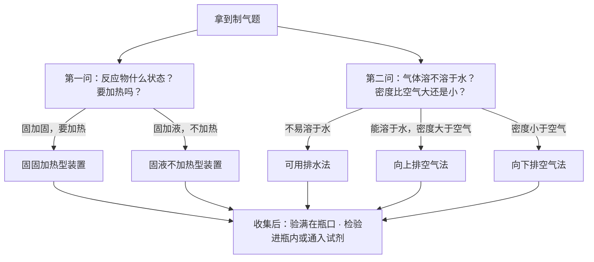
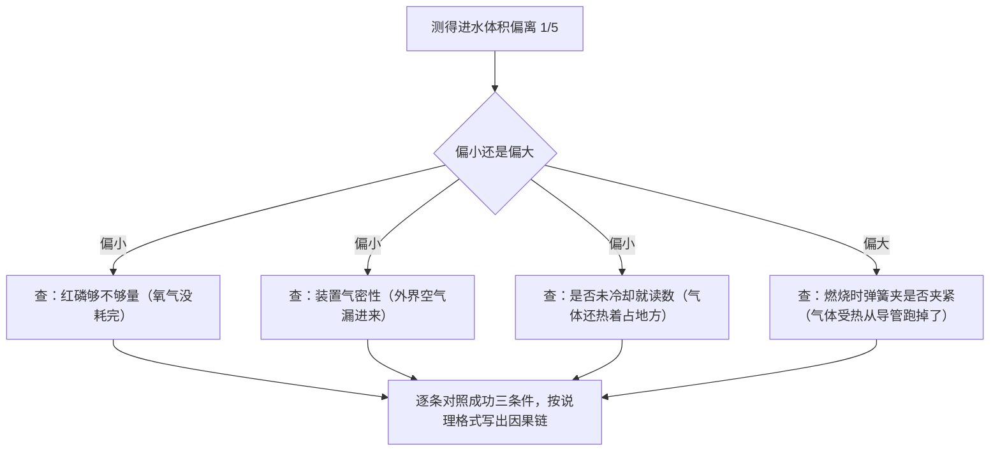
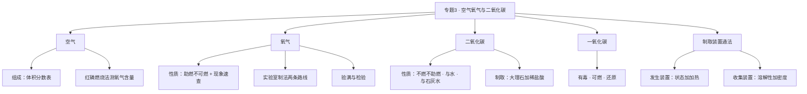

# 专题 3 · 空气、氧气、二氧化碳（详解版）

> **使用说明**：本文是详解版，从"为什么"讲起供从头自学；考前速查和掌握度跟踪在概要版：[[05-化学/知识点/专题3-空气氧气与二氧化碳]]。

## 0️⃣ 这章学什么 & 中考怎么考

一句话：**这一章把三种最常见的气体一次讲透：它们是什么、怎么制、怎么验。**

- 空气是氧气的"老家"：先搞清空气的组成，再学怎么用红磷燃烧把氧气"数"出来。
- 氧气是燃烧的"帮手"：性质（助燃）决定现象（火星四射、蓝紫色火焰），性质也决定制法（两条实验室路线）。
- 二氧化碳是性质决定用途的代言人：不燃烧、不支持燃烧 → 灭火；密度大 → 向上排空气法收集；使石灰水变浑浊 → 检验方法。顺带认识它的"双胞胎哥哥"一氧化碳——有毒但有用。
- 和前后章节的关系：制气操作全靠 [[05-化学/知识点/专题1-2-化学之门与实验探究]] 的基本功夫；方程式配平的理论在 [[05-化学/知识点/专题6-化学变化及其表示]]；燃烧的调控在 [[05-化学/知识点/专题9-10-反应调控与化学社会]]。

中考怎么考（只写库里有依据的）：

- 概要版原话：**三大气体是中考实验题与方程式默写的绝对主力；制取装置选择 + 验满/检验是必考套路。**
- 5 月实验操作考的"必考实验一"就是氧气/二氧化碳的制取（见 [[05-化学/专题/实验操作考点-化学]]）。
- 方程式默写每周滚动任务里，制法类、性质类方程式大半来自本章（见 [[05-化学/闪卡/化学方程式与化合价默写]]）。
- 具体题号分值结构：待核对。

## 🧭 先修自检（学不下去先回到这里）

> 下面每一项都是本章的地基。做不出就先去补对应知识，硬学只会更挫败。

| # | 你应该会的 | 自查题（先做再看答案） | 答案 | 不会去哪补 |
| - | ---------- | ---------------------- | ---- | ---------- |
| 1 | 写常见物质的化学式 | 写出：氧气、四氧化三铁、二氧化碳、碳酸钙、盐酸中的溶质 | $O_2$、$Fe_3O_4$、$CO_2$、$CaCO_3$、$HCl$ | [[05-化学/知识点/专题5-物质的微观构成]] |
| 2 | 会配平 | 配平：$Fe+O_2 \rightarrow Fe_3O_4$ | $3Fe+2O_2\xrightarrow{\text{点燃}}Fe_3O_4$ | [[05-化学/知识点详解/专题6-化学变化及其表示]] |
| 3 | 基本操作 | 酒精灯用什么焰加热？为什么？ | 外焰；外焰与空气接触最充分、温度最高 | [[05-化学/知识点详解/专题1-2-化学之门与实验探究]] |
| 4 | 装置气密性检查 | 怎么检查装置气密性？ | 导管口入水，手握试管，有气泡冒出（松手回吸一段水柱） | [[05-化学/专题/实验操作考点-化学]] |

第 2 题是本章方程式的"发动机"。如果配平还磕磕绊绊，先回 [[05-化学/知识点详解/专题6-化学变化及其表示]] 把最小公倍数法练熟。

## 🌱 概念从头讲

> 每个概念按"**为什么需要它 → 它是什么 → 符号/化学式/单位 → 容易想错的地方**"四步讲。

### 概念 1：空气——一切燃烧的舞台

- **为什么需要**：燃烧、生锈都发生在空气里；工业制氧气的原料就是空气；空气污染是说理题的常客。不认识空气，后面的燃烧、灭火都没法讲。
- **定义**：空气是**混合物**，按**体积分数**由这些气体组成：

| 成分 | 体积分数 |
| ---- | -------- |
| 氮气 $N_2$ | 78% |
| 氧气 $O_2$ | 21% |
| 稀有气体 | 0.94% |
| 二氧化碳 $CO_2$ | 0.03% |

- **符号/单位**：注意"体积分数"三个字——比较的是体积，不是质量。
- **容易想错**：
  - ❌ "二氧化碳是空气污染物" → 空气污染物是 $SO_2$、$NO_2$、$CO$、可吸入颗粒物；$CO_2$ 不算污染物，但它导致温室效应。两件事别混。
  - ❌ "稀有气体就是一种气体" → 它是一类气体的统称。
  - ❌ "78% 就是质量占 78%" → 题目问的是体积分数，别偷换成质量。

### 概念 2：测定空气中氧气含量（红磷燃烧法）

- **为什么需要**：氧气体积占 1/5 不是背出来的，是**测**出来的。这个实验教你"定量实验"的基本思想：把看不见的气体，换成看得见的水来量。
- **原理**：红磷燃烧把瓶里的氧气消耗掉，生成五氧化二磷**固体**。气体少了、瓶内气压变小，烧杯里的水被压进瓶中。**进水的体积 ≈ 被消耗的氧气的体积 ≈ 瓶内原空气的 1/5**。

```
   弹簧夹●───┐
             │ 导管
       ┌─────┴───┐          ┌──────────┐
       │  集气瓶  │          │   烧杯   │
       │ （空气） ├──────────┤ （水）   │
       │ 燃烧匙上 │  导管伸  │  ～～～  │
       │ 放红磷   │  到瓶底  └──────────┘
       └─────────┘
   反应后：瓶内气压变小 → 水沿导管被压进瓶 → 进水体积 ≈ 原空气的 1/5
   （示意图，非严格比例）
```

- **成功三条件及原因**（概要版原话的红磷足量、气密性好、冷却后读数）：
  - 红磷**足量**：才能把瓶里的氧气**耗光**，否则进水偏少。
  - 装置**气密性好**：漏气的话，外界空气会钻进来"顶住"水，进水偏少。
  - **冷却后**再读数：气体热胀冷缩，瓶里还热着时气体膨胀占着地方，进水偏少。
- **符号/化学式**：$4P+5O_2\xrightarrow{\text{点燃}}2P_2O_5$（配平演示见 🧮 规律 3）。
- **容易想错**：
  - ❌ "换成木炭或硫也行，反正也是烧掉氧气" → 不行！木炭燃烧生成 $CO_2$ 气体、硫燃烧生成 $SO_2$ 气体——氧气没了，但**新气体补上了位**，瓶内气压几乎不变，水根本不进来。
  - ❌ "用铁丝也行" → 铁丝在**空气中不燃烧**（只能红热），反应根本发生不了。
  - ❌ "进水是因为水自己想进来" → 是**气压差**把水压进去的，说理时要写出"气压变小"这一环。

### 概念 3：氧气——助燃的"帮手"

- **为什么需要**：氧气支持燃烧（助燃性）决定了燃烧、灭火、供氧等一串用途；现象描述是实验题的必考填空。
- **它是什么（物理性质）**：无色无味气体，密度**略大于**空气，**不易溶于水**。物理性质决定了它既能用排水法收集（不易溶），又能用向上排空气法收集（密度大）。
- **化学性质**：**助燃**——支持燃烧，但**本身不可燃**。它像"帮凶"，自己不烧，专帮别人烧。
- **现象必背（速查表）**：

| 物质 | 在空气中 | 在氧气中 | 方程式 |
| ---- | -------- | -------- | ------ |
| 木炭 | 持续红热 | 剧烈燃烧、发出**白光** | $C+O_2\xrightarrow{\text{点燃}}CO_2$ |
| 硫 | 淡蓝色火焰 | 明亮的**蓝紫色火焰** | $S+O_2\xrightarrow{\text{点燃}}SO_2$ |
| 铁丝 | 不能燃烧（只红热） | 剧烈燃烧、**火星四射**、生成**黑色固体**、放热 | $3Fe+2O_2\xrightarrow{\text{点燃}}Fe_3O_4$ |
| 红磷 | — | 生成大量白烟（$P_2O_5$ 固体小颗粒） | $4P+5O_2\xrightarrow{\text{点燃}}2P_2O_5$ |

- **容易想错**：
  - ❌ "氧气可以燃烧" → 氧气是**助燃**不是**可燃**。能烧的是木炭、硫、铁丝这些，氧气只是帮它们烧。
  - ❌ "现象写成结论" → 现象是眼睛鼻子能感知的：火星四射、蓝紫色火焰、变浑浊；"生成 $Fe_3O_4$"是结论，写进现象里不得分。
  - ❌ "硫的火焰颜色随便写" → 空气里是淡蓝色，氧气里是明亮蓝紫色，写反了就丢分。

### 概念 4：氧气的实验室制取与验满/检验

- **为什么需要**：这是 5 月操作考"必考实验一"的核心；发生装置的选择思想（状态 + 加热与否）是所有制气题的模板。
- **两条路线**：
  - 加热高锰酸钾（固+固加热型）：$2KMnO_4\xrightarrow{\Delta}K_2MnO_4+MnO_2+O_2\uparrow$。试管口放**棉花**，防止高锰酸钾粉末随气流进入导管。
  - 分解过氧化氢（固+液不加热型）：$2H_2O_2\xrightarrow{MnO_2}2H_2O+O_2\uparrow$。二氧化锰 $MnO_2$ 是**催化剂**，写在箭头上方。
- **装置示意**：

```
固+固加热型（高锰酸钾制氧气）        固+液不加热型（过氧化氢+二氧化锰）
     棉花                                   液体从上方加入
  ┌──────────┐                          ┌──────────┐
  │   试管    │←管口略向下倾斜           │  锥形瓶   │←先放固体（先固后液）
  │  KMnO₄   │（防冷凝水倒流炸裂）       │  固+液    │
  └─────┬────┘                          └─────┬────┘
    ════╧════ 酒精灯加热                        │
        │ 导管                                 │ 导管
        ▼                                      ▼
        O₂                                     O₂
（示意图，非严格比例）
```

- **操作要点及原因**（与 [[05-化学/专题/实验操作考点-化学]] 一致）：先检查气密性；固体先放好（先固后液）；管口略向下倾斜（防冷凝水倒流炸裂试管）；结束时**先撤导管后熄灯**（防倒吸）。
- **工业制法**：分离液态空气——利用液氮和液氧**沸点不同**把它们分开，没有新物质生成，是**物理变化**。
- **验满 vs 检验**（一字之差，位置不同）：

| 动作 | 位置 | 操作 | 依据 |
| ---- | ---- | ---- | ---- |
| 验满 | **瓶口** | 带火星木条放在瓶口，复燃 → 已满 | 证明"满了" |
| 检验 | **瓶中** | 带火星木条伸入瓶中，复燃 → 是氧气 | 证明"是什么" |

- **容易想错**：❌ "验满和检验都用木条，随便伸哪儿" → 验满在瓶口、检验进瓶内，位置写错不得分（概要版点名的易错点）。

### 概念 5：二氧化碳——性质决定用途的代言人

- **为什么需要**：$CO_2$ 的每一条性质都对应一个用途：不燃烧不支持燃烧 → 灭火；密度比空气大 → 向上排空气法收集、能覆盖在燃烧物上；与石灰水反应 → 检验方法。这正是说理题"性质决定用途"的标准素材。
- **物理性质**：无色无味，密度**大于**空气，**能溶于水**。注意"能溶于水"四个字——它决定了不能用排水法收集。
- **化学性质**（两条核心反应）：
  - 与水反应生成碳酸：$CO_2+H_2O=H_2CO_3$。碳酸能使紫色石蕊**变红**。
  - 与石灰水反应：$CO_2+Ca(OH)_2=CaCO_3\downarrow+H_2O$。**澄清石灰水变浑浊 = 检验 $CO_2$ 的标准方法**。
- **容易想错**：
  - ❌ "是二氧化碳让石蕊变红的" → 让石蕊变红的是**碳酸**。$CO_2$ 本身不显酸性，是它与水反应生成的 $H_2CO_3$ 在起作用。说理题常拿这个挖坑。
  - ❌ "检验 $CO_2$ 用燃着的木条" → 燃着木条熄灭只能说明"不燃烧不支持燃烧"，氮气也能做到；检验 $CO_2$ 必须用**澄清石灰水**。

### 概念 6：二氧化碳的实验室制取

- **为什么需要**：与氧气制取并列的必考实验；"选料三问"是实验评价题的经典。
- **原料与原理**：大理石或石灰石（主要成分 $CaCO_3$）+ 稀盐酸：
  $$CaCO_3+2HCl=CaCl_2+H_2O+CO_2\uparrow$$
- **两个"为什么不用"**：
  - 不用**稀硫酸**：它与碳酸钙生成 $CaSO_4$，$CaSO_4$ **微溶**，会覆盖在大理石表面，把反应"封"停。
  - 不用**碳酸钠**：它与盐酸反应**太快**，气体来不及收集。
- **收集**：**向上排空气法**。理由有二：$CO_2$ 能溶于水（不能用排水法）；密度大于空气（空气被"顶"出去）。
- **验满**：燃着木条放**瓶口**，熄灭 → 已满。**检验**：通入澄清石灰水，变浑浊 → 是 $CO_2$。
- **容易想错**：❌ "反正都是酸，用稀硫酸更方便" → 见上，微溶物封口反应就停了。答题时要写出"覆盖表面"这个关键词。

### 概念 7：一氧化碳（CO）——有毒但有用

- **为什么需要**：冬天煤炉取暖、燃气安全都绕不开它；它还是工业炼铁的主力还原剂（九年级继续用）。
- **性质三连**：
  - **无色无味、有剧毒**：$CO$ 与血红蛋白结合，让人缺氧中毒。所以煤炉取暖要**保持通风**；炭火盆放在密闭房间很危险。
  - **可燃性**：$CO$ 能燃烧（生成 $CO_2$），所以点燃含 $CO$ 的尾气可以"烧掉"它。
  - **还原性**：$CO$ 能夺走金属氧化物里的氧（如 $3CO+Fe_2O_3\xrightarrow{\text{高温}}2Fe+3CO_2$，工业炼铁；还原氧化铜实验见 [[05-化学/专题/实验操作考点-化学]]）。
- **符号/化学式**：$CO$ 与 $CO_2$ 只差一个氧原子，性质天差地别——这是"分子构成决定性质"的好例子（专题 5 详解）。
- **容易想错**：❌ "无色无味的气体都没毒" → $CO$ 恰恰无色无味，中毒了也不自知，所以叫"隐形杀手"。

## 🧮 公式/规律逐个拆解

> 每条规律都必须能回答：它说什么？依据是什么？什么时候用？怎么用？

### 规律 1：发生装置怎么选——先问两个问题

- **问题一**：反应物是什么状态？**问题二**：需要加热吗？
- **速查表**：

| 装置类型 | 适用条件 | 本章例子 |
| -------- | -------- | -------- |
| 固+固加热型 | 反应物都是固体，且需加热 | 高锰酸钾分解 |
| 固+液不加热型 | 块状/颗粒固体 + 液体，常温反应 | 过氧化氢分解、大理石+稀盐酸 |

- **怎么用**：拿到制气题先圈"用什么药品、要不要加热"两个词，装置类型立刻定下来。

### 规律 2：收集装置怎么选——再问两个问题

- **问题一**：气体溶不溶于水？**问题二**：气体密度比空气大还是小？
- **速查表**：

| 气体 | 溶解性 | 密度 | 可用收集法 |
| ---- | ------ | ---- | ---------- |
| $O_2$ | 不易溶于水 | 略大于空气 | 排水法；向上排空气法 |
| $CO_2$ | 能溶于水 | 大于空气 | 只能向上排空气法 |
| $H_2$ | 难溶于水 | 小于空气 | 排水法；向下排空气法 |

- **怎么用（最小例子）**：制 $CO_2$ 能用排水法吗？答：不能。因为 $CO_2$ 能溶于水，排水过程中一部分气体会溶掉。

### 规律 3：本专题方程式逐个配平演示

配平唯一目标：**两边每种原子个数相等**（依据：质量守恒定律，详见 [[05-化学/知识点详解/专题6-化学变化及其表示]]）。

**演示 1**：磷在氧气中燃烧。骨架：$P+O_2 \rightarrow P_2O_5$。
1. 看氧：左 2 右 5，最小公倍数 10 → $O_2$ 前配 5（$5\times2=10$）、$P_2O_5$ 前配 2（$2\times5=10$）。
2. 看磷：右边 $2\times2=4$ 个 → 左边 P 配 4。
3. 检查：P 左 4 = 右 4；O 左 10 = 右 10。✓

$$4P+5O_2\xrightarrow{\text{点燃}}2P_2O_5$$

**演示 2**：铁丝在氧气中燃烧。骨架：$Fe+O_2 \rightarrow Fe_3O_4$。
1. 看氧：左 2 右 4 → $O_2$ 前配 2。
2. 看铁：右边 3 个 → Fe 配 3。
3. 检查：Fe 左 3 = 右 3；O 左 4 = 右 4。✓

$$3Fe+2O_2\xrightarrow{\text{点燃}}Fe_3O_4$$

**演示 3**：高锰酸钾分解。骨架：$KMnO_4 \xrightarrow{\Delta} K_2MnO_4+MnO_2+O_2\uparrow$。
1. 找"只在一处出现、数目不等"的元素：钾，左 1 右 2 → $KMnO_4$ 配 2。
2. 锰跟着平了：左 2 = 右 1+1。氧：左 8 = 右 4+2+2。✓

$$2KMnO_4\xrightarrow{\Delta}K_2MnO_4+MnO_2+O_2\uparrow$$

**演示 4**：实验室制二氧化碳。骨架：$CaCO_3+HCl \rightarrow CaCl_2+H_2O+CO_2\uparrow$。
1. 看氯：左 1 右 2 → HCl 配 2。
2. 检查氢：左 2 = 右 2（水里 2 个）。氧：左 3 = 右 1+2。钙、碳各 1 = 1。✓

$$CaCO_3+2HCl=CaCl_2+H_2O+CO_2\uparrow$$

**↑↓ 提示**：$O_2\uparrow$、$CO_2\uparrow$ 之所以标 ↑，是因为反应物里没有气体；而 $S+O_2\xrightarrow{\text{点燃}}SO_2$ 里 $SO_2$ **不标** ↑，因为反应物已有气体 $O_2$。完整规则表见 [[05-化学/知识点详解/专题6-化学变化及其表示]]。

### 规律 4：验满与检验速查表（背这张表）

| 气体 | 验满（在瓶口） | 检验（进瓶内 / 通入试剂） |
| ---- | -------------- | -------------------------- |
| $O_2$ | 带火星木条放瓶口，复燃 → 满 | 带火星木条伸入瓶中，复燃 → 是 $O_2$ |
| $CO_2$ | 燃着木条放瓶口，熄灭 → 满 | 通入澄清石灰水，变浑浊 → 是 $CO_2$ |

### 公式 5：方程式计算的最小例子（完整格式见专题 6 详解）

**例**：完全分解 15.8 g 高锰酸钾，能生成多少克氧气？

1. **设**：设生成氧气的质量为 $x$（不带单位）。
2. **写**：$$2KMnO_4\xrightarrow{\Delta}K_2MnO_4+MnO_2+O_2\uparrow$$
3. **找**：$KMnO_4$ 相对分子质量 $=39+55+16\times4=158$，两个是 $2\times158=316$；$O_2$ 是 32。
4. **列**：$\dfrac{316}{32}=\dfrac{15.8\text{ g}}{x}$
5. **解**：$x=\dfrac{32\times15.8}{316}=1.6\text{ g}$
6. **答**：生成氧气 1.6 g。

验算：$316\div32=9.875$，$15.8\div9.875=1.6$。✓

## 🪜 例题阶梯

> 三级台阶，每一级都要动笔跟着答，不许只看。

### 第 1 级 · 入门（照着模仿）

> **题目**：细铁丝在氧气中燃烧。(1) 描述现象；(2) 写出化学方程式并配平；(3) 集气瓶底为什么要预先放少量水或细沙？
>
> **每一步为什么这么做**：(1) 描述现象只写"看得见听得着"的，不写物质名称；(2) 先写化学式再配平，最后注条件；(3) 从"燃烧放热 + 熔融物温度高"出发想后果。
>
> **完整解答**：
> (1) 剧烈燃烧、**火星四射**、生成**黑色固体**、放出大量热。
> (2) 骨架 $Fe+O_2 \rightarrow Fe_3O_4$；氧左 2 右 4 → $O_2$ 配 2；铁右边 3 个 → Fe 配 3。得：
> $$3Fe+2O_2\xrightarrow{\text{点燃}}Fe_3O_4$$
> 检查：Fe 左 3 = 右 3，O 左 4 = 右 4。✓
> (3) 燃烧放出大量的热，生成的黑色熔融物温度极高，若直接溅落到瓶底会使集气瓶炸裂；放少量水或细沙是为了吸收热量、保护瓶底。

### 第 2 级 · 标准（中考中档）

> **题目**：实验室用大理石和稀盐酸制取并收集一瓶二氧化碳。
> (1) 应选哪种类型的发生装置？(2) 用什么方法收集？为什么不用排水法？(3) 怎么验满？(4) 能否改用稀硫酸？说明理由。(5) 加药品时先加什么后加什么？
>
> **读题→翻译成化学语言**：药品是"块状固体 + 液体"、常温反应 → 固液不加热型；气体性质（能溶于水、密度大于空气）→ 收集方法；两个"为什么不用"考药品评价。
>
> **每一步为什么这么做**：制气题按"发生装置 → 收集 → 验满/检验 → 药品评价 → 操作顺序"五步答，一步不漏。
>
> **完整解答**：
> (1) 固+液不加热型。反应物是大理石（固体）和稀盐酸（液体），常温就能反应。
> (2) 向上排空气法。因为 $CO_2$ **能溶于水**，排水法会损失气体；它的密度大于空气，所以用向上排空气法。
> (3) 把燃着的木条放在**瓶口**，若木条熄灭，说明已收集满。（注意：是"放瓶口"验满，不是伸进瓶里。）
> (4) 不能。稀硫酸与碳酸钙反应生成微溶的 $CaSO_4$，它会覆盖在大理石表面，阻止反应继续进行。
> (5) 先检查装置气密性，加药品时**先固后液**：先加大理石，再倒入稀盐酸（加块状固体用镊子滑入，防砸破瓶底）。

### 第 3 级 · 提高（与压轴/综合题接轨）

> **题目**：用红磷燃烧法测定空气中氧气含量。
> (1) 红磷为什么要足量？(2) 为什么要等装置冷却后再读数？(3) 某组测得进水体积明显小于 1/5，写出两个可能原因。(4) 有同学说"换成木炭更方便"，用说理题格式反驳他。
>
> **思路从哪来**：前两问直接从"成功三条件"找答案，要补上"为什么"；第 3 问是把条件反过来用——哪个条件没做到，结果就往哪边偏；第 4 问套 [[05-化学/专题/说理题方法]] 的三段式：判断 → 依据 → 回扣情境。
>
> **完整解答**：
> (1) 只有红磷足量，才能把瓶内氧气**完全耗尽**；若红磷不足，氧气有剩余，进水偏少，测得结果偏小。
> (2) 燃烧放热使瓶内气体膨胀，若未冷却就读数，瓶内气压还没降到最低，进水偏少；冷却后气体收缩回原体积，读数才准确。
> (3) 可能原因（任答两个）：①红磷量不足，氧气没耗完；②装置气密性不好，冷却过程中外界空气漏入瓶内；③未冷却到室温就读数。
> (4) 三段式：**判断**——不能用木炭。**依据**——测定原理是靠"消耗氧气且不产生新气体"使瓶内气压减小；木炭燃烧虽然消耗氧气，但生成了 $CO_2$ 气体。**回扣情境**——瓶内气体体积几乎不变、气压不变，水不能进入瓶内，所以测不出氧气含量，不能用木炭代替红磷。
>
> **和入门题的差别**：入门题背"三条件"就能答；这一题要把每个条件**倒过来推误差方向**，还要按说理三段式组织语言——这正是新中考"情景化、说理题"的考法。

## 🗺️ 解题流程图

**流程图 1：制气题的标准动作**



**流程图 2：红磷实验误差分析思路**



**知识结构图**：



## 🔥 易错点：为什么会错

| ❌ 常见错误想法 | 为什么会这样想 | ✅ 正确理解 / 自救方法 |
| -------------- | -------------- | ---------------------- |
| "氧气可以燃烧" | 看到木条复燃，误以为氧气自己能烧 | 氧气**助燃**（支持燃烧）但**不可燃**；能烧的是硫、铁丝、木炭等 |
| 验满和检验的位置写反 | 都用木条/火焰，只差位置 | 验满 = **瓶口**（证明满了）；检验 = **瓶内**或通入石灰水（证明是什么）。位置写错不得分 |
| 现象写成"生成四氧化三铁" | 背了结论直接往现象里塞 | 现象是感官能感知的：火星四射、蓝紫色火焰、变浑浊；物质名称是结论 |
| $SO_2$ 后面标 ↑ | "是气体就标" | 反应物里已有气体 $O_2$，生成物不再标 ↑ |
| $CO_2$ 用排水法收集 | 见过排水法就套用 | $CO_2$ **能溶于水**，只能向上排空气法 |
| 铁丝燃烧不做防护 | 只背现象不问为什么 | 瓶底放少量水或细沙，防高温熔融物溅落炸裂瓶底 |
| "二氧化碳是空气污染物" | 把温室效应当污染 | 污染物是 $SO_2$、$NO_2$、$CO$、可吸入颗粒物；$CO_2$ 不算污染物但致温室效应 |
| 制 $CO_2$ 忘记先检查气密性 | 只顾加药品 | 顺序：查气密性 → 先固后液 → 收集 → 验满（操作考逐条给分） |

## ✅ 自测清单（能独立做到才打勾）

- [ ] 1. 能背出空气组成的体积分数，并说清"体积分数"不是质量分数
- [ ] 2. 能讲清红磷实验原理（气压差）和成功三条件的"为什么"
- [ ] 3. 能解释为什么木炭、硫、铁丝都不能代替红磷
- [ ] 4. 能默写本章 6 个方程式并独立配平（磷、铁、高锰酸钾、过氧化氢、制二氧化碳、石灰水）
- [ ] 5. 能按"状态 + 加热""溶解性 + 密度"两套问题独立选发生装置和收集装置
- [ ] 6. 能分清验满（瓶口）与检验（瓶内/通入试剂）的操作和依据
- [ ] 7. 能说出制 $CO_2$ 的两个"为什么不用"（稀硫酸、碳酸钠）
- [ ] 8. 能独立做出例题阶梯第 3 级的误差分析与说理

## 🔗 关联

- 概要版：[[05-化学/知识点/专题3-空气氧气与二氧化碳]]（掌握度在这边更新）
- 前置知识：[[05-化学/知识点详解/专题1-2-化学之门与实验探究]]（仪器与基本操作）· [[05-化学/知识点详解/专题6-化学变化及其表示]]（配平方法）
- 后续/综合应用：[[05-化学/知识点/专题9-10-反应调控与化学社会]]（燃烧与灭火、防锈）· [[05-化学/知识点/专题4-水的性质与组成]]（气体的检验在电解水里接着用）
- 实验与默写：[[05-化学/专题/实验操作考点-化学]] · [[05-化学/闪卡/化学方程式与化合价默写]]
- 真题精讲：[[05-化学/专题/真题精讲/化-03-空气与氧气]] · [[05-化学/专题/真题精讲/化-07-燃烧与碳]] · [[05-化学/专题/真题精讲/化-08-二氧化碳制取]] · [[05-化学/专题/真题精讲/化-09-制气与还原实验]]
- 说理题方法：[[05-化学/专题/说理题方法]]
