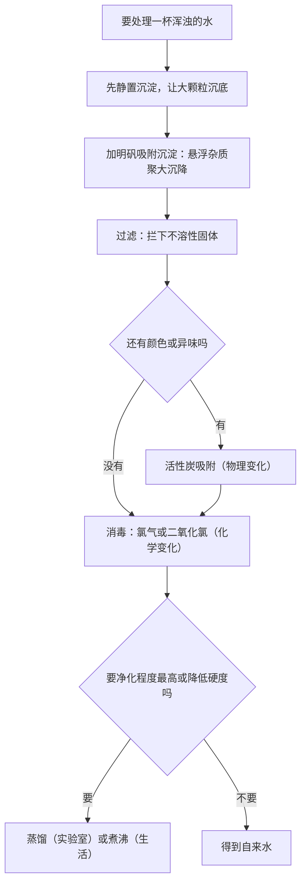
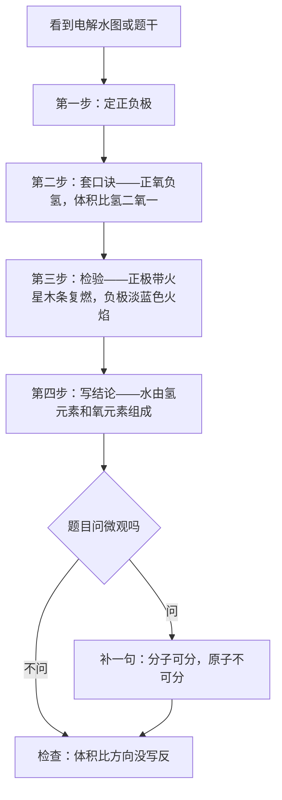
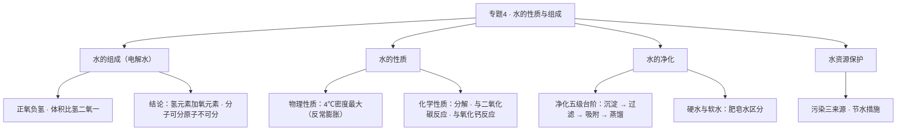

# 专题 4 · 水的性质与组成（详解版）

> **使用说明**：本文是详解版，从"为什么"讲起供从头自学；考前速查和掌握度跟踪在概要版：[[05-化学/知识点/专题4-水的性质与组成]]。

## 0️⃣ 这章学什么 & 中考怎么考

一句话：**这一章用水做主角，回答三个问题：水由什么组成？水有什么性质？脏水怎么变干净？**

- 水的组成靠**电解水**实验回答：把水通电拆开，看拆出什么气体，倒推水的"原料"。
- 水的性质分两半：物理性质里有个反常的地方（4 ℃ 密度最大），化学性质里三个反应（分解、与二氧化碳反应、与氧化钙反应）是方程式默写常客。
- 水的净化把专题 1-2 学的提纯三法全部召回实战，再加"硬水软水"这对新概念。
- 和前后章节的关系：本章检验气体用的是 [[05-化学/知识点/专题3-空气氧气与二氧化碳]] 的办法（带火星木条、淡蓝色火焰）；"水由氢元素和氧元素组成"这句话，正好引出 [[05-化学/知识点/专题5-物质的微观构成]] 的元素概念；水还是 [[05-化学/知识点/专题7-溶液]] 里最常用的溶剂。

中考怎么考（只写库里有依据的）：

- 概要版原话：**电解水实验结论 + 硬水软水 + 净水方法是高频考点。**
- 电解水实验是"实验结论推理"的经典素材：从现象推组成、从组成推微观（分子可分、原子不可分）——正好踩在新中考"情景化、说理题"的点上（见 [[05-化学/学科总览]]、[[05-化学/专题/说理题方法]]）。
- 本专题在一模范围内（八年级全一册属一模范围，见 [[05-化学/学科总览]]）。具体题号分值：待核对。

## 🧭 先修自检（学不下去先回到这里）

> 下面每一项都是本章的地基。做不出就先去补对应知识，硬学只会更挫败。

| # | 你应该会的 | 自查题（先做再看答案） | 答案 | 不会去哪补 |
| - | ---------- | ---------------------- | ---- | ---------- |
| 1 | 氧气的检验 | 怎么证明一瓶气体是氧气？ | 带火星木条伸入瓶中，复燃则是氧气 | [[05-化学/知识点详解/专题3-空气氧气与二氧化碳]] |
| 2 | 氢气燃烧的现象 | 氢气燃烧的火焰是什么颜色？ | 淡蓝色 | [[05-化学/知识点详解/专题3-空气氧气与二氧化碳]] |
| 3 | 提纯方法的分工 | 过滤、蒸馏各除去什么杂质？ | 过滤除不溶性固体；蒸馏除可溶性杂质 | [[05-化学/知识点详解/专题1-2-化学之门与实验探究]] |
| 4 | 会配平 | 配平：$H_2O \rightarrow H_2+O_2$ | $2H_2O\xrightarrow{\text{通电}}2H_2\uparrow+O_2\uparrow$ | [[05-化学/知识点详解/专题6-化学变化及其表示]] |

第 1、2 题直接决定你能不能看懂电解水实验——两极出来的气体就靠它们来"认人"。

## 🌱 概念从头讲

> 每个概念按"**为什么需要它 → 它是什么 → 符号/化学式/单位 → 容易想错的地方**"四步讲。

### 概念 1：电解水实验——把水拆开看看

- **为什么需要**：水看起来是"一种东西"，但它是元素组成的化合物还是不能拆的元素？眼见为实——通电把它拆开，看拆出来的东西是什么。
- **现象与结论**：通电后两极都冒气泡。**口诀：正氧负氢，体积比氢 : 氧 = 2 : 1**。
  - 正极产生**氧气**：用带火星木条检验，复燃 → 是 $O_2$。
  - 负极产生**氢气**：可燃，燃烧有**淡蓝色火焰** → 是 $H_2$。
  - 化学方程式：$2H_2O\xrightarrow{\text{通电}}2H_2\uparrow+O_2\uparrow$（配平过程见 🧮 规律 2）。
- **结论分三层记**（答题时按题问哪层答哪层）：
  1. **宏观层**：水由**氢元素和氧元素**组成。
  2. **微观层**：水分子分解时，分子**可以**分成氢原子和氧原子，原子再重新组合成氢分子和氧分子——**化学变化中分子可分，原子不可分**。
  3. **方法层**：生成物里有氢、氧两种元素，反推反应物水里也含氢、氧两种元素。
- **符号/单位**：体积比是"负极 : 正极 = 2 : 1"，别把方向记反。
- **容易想错**：
  - ❌ "正极出氢气" → 口诀"**正氧负氢**"，正极氧气。记反了整道题连错一串。
  - ❌ "氢二氧一是质量比" → 是**体积比**。质量比氢 : 氧 = 1 : 8（推导见 🧮 规律 1）。

### 概念 2：水的物理性质——有个反常的"4 ℃"

- **为什么需要**：水的反常膨胀解释了"冰为什么浮在水面上""冬天湖底为什么还有鱼"，是经典的解释说理素材。
- **定义**：无色无味液体；**4 ℃ 时密度最大**（1.0 g/cm³）；温度低于 4 ℃ 反而体积变大、密度变小（**反常膨胀**）。所以冰浮在水面上，冬天湖面结冰、湖底仍是 4 ℃ 左右的水，水生生物能过冬。
- **符号/单位**：密度单位 g/cm³。
- **容易想错**：❌ "所有物质都是温度越低密度越大" → 水在 4 ℃ 以下反着来。一般物质热胀冷缩，水在 4 ℃ 到 0 ℃ 之间是"热缩冷胀"。

### 概念 3：水的化学性质——三个反应打天下

- **为什么需要**：这三个反应把水串进了很多别的专题，方程式默写里反复出现。
- **三个反应逐个看**：
  1. **通电分解**：$2H_2O\xrightarrow{\text{通电}}2H_2\uparrow+O_2\uparrow$。条件写"通电"，不是"加热"也不是"点燃"。
  2. **与二氧化碳反应**：$CO_2+H_2O=H_2CO_3$。生成的碳酸使紫色石蕊变红（专题 3 讲过：让石蕊变红的是碳酸，不是二氧化碳本身）。
  3. **与氧化钙反应**：$CaO+H_2O=Ca(OH)_2$，**放出大量热**。生石灰煮鸡蛋、自热米饭发热都是这个道理（用途示例，非库内原文）。
- **容易想错**：❌ "水的化学性质很活泼" → 常温下水挺稳定；它的化学性质主要体现在上面三条上，尤其别把"加热水变成水蒸气"当成化学变化——那是物理变化，分子没变，只是分子间间隔变大了。

### 概念 4：水的净化——五级台阶往上爬

- **为什么需要**：河水、井水都是混合物。不同用途需要不同的"干净程度"，所以要有一套由低到高的净化手段。
- **净化程度由低到高**（概要版顺序）：

```
静置沉淀 → 吸附沉淀（明矾）→ 过滤 → 吸附（活性炭）→ 蒸馏
  大颗粒      悬浮小颗粒        不溶性    色素异味        可溶性杂质
  杂质沉降    聚成大颗粒沉降    固体      也吸走          全除掉（最高）
```

- 各步干什么：
  - **静置沉淀**：等大颗粒自己沉底。
  - **吸附沉淀（明矾）**：明矾溶在水里生成胶状物，把**悬浮杂质**吸附住、聚成大颗粒一起沉下去。它只管"悬浮的"，可溶性杂质它除不了。
  - **过滤**：把不溶性固体拦下来（"一贴二低三靠"照用）。
  - **活性炭吸附**：活性炭疏松多孔，吸走**色素和异味**，是**物理变化**。
  - **蒸馏**：水变成水蒸气再冷凝回来，可溶性杂质留在原地——**净化程度最高**，得到的基本是纯净物。
- **自来水加工**：最后一道消毒用**氯气或二氧化氯**，消毒生成了新物质，是**化学变化**。
- **容易想错**：❌ "加了明矾水就纯净了" → 明矾只负责"悬浮杂质沉降"，溶解在水里的钙、镁等它管不着。要"最干净"得靠蒸馏。

### 概念 5：硬水与软水——肥皂水一试便知

- **为什么需要**：硬水不好用：烧水生水垢、洗衣服费肥皂。能不能喝上软水关系到生活质量和水壶寿命。
- **定义**：含**较多可溶性钙、镁化合物**的水是硬水；不含或含较少的是软水。
- **区分方法**：取样加等量**肥皂水**，振荡——
  - 泡沫多、浮渣少 → **软水**；
  - 浮渣多、泡沫少 → **硬水**。
- **软化方法**：生活中用**煮沸**（家庭烧水）；实验室用**蒸馏**。两者都能让部分可溶性钙镁化合物变成沉淀（水垢）析出。
- **容易想错**：
  - ❌ "煮沸降硬度是物理变化" → 煮沸时生成了新沉淀（水垢主要成分是 $CaCO_3$、$Mg(OH)_2$），有新物质 → **化学变化**。
  - ❌ "活性炭吸附也是化学变化" → 吸附没有新物质生成，是**物理变化**。两个"变化类型"正好一对反例，对比着背。
  - ❌ "冰水混合物是混合物" → 冰和水都是 $H_2O$ 这一种物质，只是状态不同——**纯净物**。名字里带"混合"两个字纯属误导。

### 概念 6：水资源保护——污染三来源与节水

- **为什么需要**：这是选择题和社会情境题的送分点，背下框架即可。
- **内容**：
  - 水体污染三大来源：**工业三废**（废渣、废水、废气）、**农业**（化肥农药的不合理使用）、**生活污水**。
  - 节水措施：**一水多用**（淘米水浇花）、农业**滴灌喷灌**。
- **容易想错**：❌ "节水就是少喝水" → 节水的核心是"提高利用率"（一水多用、滴灌喷灌），不是减少必需用水。

## 🧮 公式/规律逐个拆解

> 每条规律都必须能回答：它说什么？依据是什么？什么时候用？怎么用？

### 规律 1：电解水数据速查 + "氢二氧一"到底是体积比还是质量比

**速查表**：

| 电极 | 气体 | 体积 | 检验方法 |
| ---- | ---- | ---- | -------- |
| 正极 | 氧气 $O_2$ | 1 份 | 带火星木条复燃 |
| 负极 | 氢气 $H_2$ | 2 份 | 可燃，淡蓝色火焰 |

**为什么 2 : 1 是体积比，不是质量比**：从微观数一数。$2H_2O\xrightarrow{\text{通电}}2H_2\uparrow+O_2\uparrow$——每 2 个水分子拆开，重新组合成 **2 个氢分子和 1 个氧分子**。相同条件下，气体的体积由分子个数决定，所以**体积比 = 分子个数比 = 2 : 1**。而质量要用"相对分子质量 × 个数"来算：氢气 $2\times2=4$ 份，氧气 $1\times32=32$ 份，**质量比 = 4 : 32 = 1 : 8**。数字一换位置就完全不同，千万别混。

### 规律 2：本章方程式逐个配平演示

**演示 1**：电解水。骨架：$H_2O \xrightarrow{\text{通电}} H_2+O_2\uparrow$。
1. 看氧：左 1 右 2 → $H_2O$ 前配 2。
2. 看氢：左 $2\times2=4$ → $H_2$ 前配 2。
3. 标注：反应物是液体、生成物是气体 → 两边都标 ↑；条件写"通电"。
4. 检查：H 左 4 = 右 4；O 左 2 = 右 2。✓

$$2H_2O\xrightarrow{\text{通电}}2H_2\uparrow+O_2\uparrow$$

**演示 2**：氧化钙与水。骨架：$CaO+H_2O \rightarrow Ca(OH)_2$。
1. 逐个数：Ca 左 1 = 右 1；O 左 $1+1=2$，右 $(OH)_2$ 里有 2 个；H 左 2 = 右 2。刚好平。
2. 补充信息：反应**放出大量热**，实验题里常让你写"放热"这个现象。

$$CaO+H_2O=Ca(OH)_2$$

**演示 3**：二氧化碳与水。骨架：$CO_2+H_2O \rightarrow H_2CO_3$。
1. 逐个数：C 左 1 = 右 1；H 左 2 = 右 2；O 左 $2+1=3$ = 右 3。刚好平。

$$CO_2+H_2O=H_2CO_3$$

### 规律 3：净化方法对比表（除什么、什么变化）

| 方法 | 除什么 | 变化类型 | 一句话要点 |
| ---- | ------ | -------- | ---------- |
| 静置沉淀 | 大颗粒不溶物 | 物理变化 | 只能等，最慢最低级 |
| 吸附沉淀（明矾） | 悬浮杂质 | 物理变化 | 明矾把悬浮物聚成大颗粒沉降 |
| 过滤 | 不溶性固体 | 物理变化 | 一贴二低三靠 |
| 活性炭吸附 | 色素、异味 | 物理变化 | 疏松多孔，靠"孔"抓住分子 |
| 蒸馏 | 可溶性杂质 | 物理变化 | 净化程度最高，得纯净物 |
| 消毒（氯气/二氧化氯） | 病菌微生物 | **化学变化** | 生成了新物质 |

### 规律 4：硬水软水对比表

| | 硬水 | 软水 |
| ---- | ---- | ---- |
| 定义 | 含较多可溶性钙、镁化合物 | 不含或含较少 |
| 加肥皂水 | 浮渣多、泡沫少 | 泡沫多、浮渣少 |
| 危害 | 水壶生水垢（$CaCO_3$、$Mg(OH)_2$）、洗涤费皂 | —— |
| 软化 | 生活中**煮沸**；实验室**蒸馏** | —— |

### 公式 5：方程式计算的最小例子

**例**：电解 18 g 水，生成氢气和氧气各多少克？（完整"设写找列解答"格式见 [[05-化学/知识点详解/专题6-化学变化及其表示]]）

1. **设**：设生成氢气质量为 $x$，氧气质量为 $y$（不带单位）。
2. **写**：$$2H_2O\xrightarrow{\text{通电}}2H_2\uparrow+O_2\uparrow$$
3. **找**：$2H_2O$ 的相对质量 $=2\times18=36$；$2H_2$ 是 $2\times2=4$；$O_2$ 是 32。
4. **列**：$\dfrac{36}{4}=\dfrac{18\text{ g}}{x}$，$\dfrac{36}{32}=\dfrac{18\text{ g}}{y}$
5. **解**：$x=2\text{ g}$，$y=16\text{ g}$
6. **答**：生成氢气 2 g，氧气 16 g。

验算：质量比 $x:y=2:16=1:8$，正是规律 1 里推的氢氧质量比；$2+16=18$ g，与被电解的水质量相等，账是平的（质量守恒）。✓

## 🪜 例题阶梯

> 三级台阶，每一级都要动笔跟着答，不许只看。

### 第 1 级 · 入门（照着模仿）

> **题目**：电解水实验中：(1) 正极、负极各产生什么气体？体积比是多少？(2) 分别怎么检验？(3) 这个实验得出水的组成结论是什么？
>
> **每一步为什么这么做**：先默写口诀"正氧负氢、氢二氧一"定方向；检验方法从专题 3 的气体性质里"调人"；结论分宏观、微观两层。
>
> **完整解答**：
> (1) 正极产生氧气，负极产生氢气；体积比 $V(H_2):V(O_2)=2:1$（氢二氧一，是**体积比**）。
> (2) 正极气体用带火星木条检验，木条复燃，说明是氧气；负极气体移近火焰能被点燃，燃烧有淡蓝色火焰，说明是氢气。
> (3) 结论：水由氢元素和氧元素组成；从微观上还说明化学变化中分子可分而原子不可分。

### 第 2 级 · 标准（中考中档）

> **题目**：某地要处理河水供生活使用，流程是：河水 → 加明矾搅拌静置 → 过滤 → 活性炭吸附 → 消毒 → 自来水。
> (1) 加明矾起什么作用？(2) 过滤能除去可溶性杂质吗？(3) 活性炭吸附是什么变化？(4) 消毒是什么变化？(5) 想得到净化程度最高的水，还要加什么操作？
>
> **读题→翻译成化学语言**：五级净化台阶逐一对号；每问都要求"作用 + 变化类型"。
>
> **每一步为什么这么做**：净化流程题按流程顺序逐步答，每一步都要点出"除什么"和"物理还是化学变化"。
>
> **完整解答**：
> (1) 明矾溶于水生成胶状物，吸附水中的悬浮杂质，使其沉降（吸附沉淀）。它除不掉可溶性杂质。
> (2) 不能。过滤只能拦截**不溶性**固体；溶解在水里的杂质会随水穿过滤纸。
> (3) 物理变化。活性炭疏松多孔，吸附色素和异味，没有生成新物质。
> (4) 化学变化。用氯气或二氧化氯消毒时生成了新物质。
> (5) 蒸馏。蒸馏把可溶性杂质也留在了原容器里，净化程度最高，得到的水接近纯净物。

### 第 3 级 · 提高（与压轴/综合题接轨）

> **题目**：(1) 电解 18 g 水，生成氢气和氧气各多少克？(2) 有同学说："氢二氧一，说明生成的氢气和氧气质量比是 2 : 1。"用你的计算结果和说理三段式纠正他。
>
> **思路从哪来**：第 (1) 问就是 🧮 公式 5 的照搬；第 (2) 问先算出真实质量比（1 : 8），再指出"2 : 1"真正的含义是**体积比**，最后用"体积由分子个数决定"补上理由。
>
> **完整解答**：
> (1) 设生成氢气质量为 $x$、氧气质量为 $y$。
> $$2H_2O\xrightarrow{\text{通电}}2H_2\uparrow+O_2\uparrow$$
> 相关相对质量：$2H_2O$ 为 $2\times18=36$，$2H_2$ 为 4，$O_2$ 为 32。
> $\dfrac{36}{4}=\dfrac{18\text{ g}}{x}$，得 $x=2$ g；$\dfrac{36}{32}=\dfrac{18\text{ g}}{y}$，得 $y=16$ g。
> 答：生成氢气 2 g，氧气 16 g。
> (2) 三段式：**判断**——他说错了。**依据**——按计算，氢气与氧气的质量比是 $2\text{ g}:16\text{ g}=1:8$，不是 2 : 1；"氢二氧一"指的是**体积比**，相同条件下气体的体积比等于分子个数比，每 2 个水分子分解生成 2 个氢分子和 1 个氧分子，所以体积比是 2 : 1。**回扣情境**——本题中氢气 2 g、氧气 16 g，质量比 1 : 8，恰好与质量守恒（$2+16=18$ g）对上。
>
> **和入门题的差别**：入门题只"认气体"，这一题要**用数字说话驳斥错误说法**——先算、再讲"体积比"的微观含义、最后回扣守恒，一条链不落。

## 🗺️ 解题流程图

**流程图 1：净水方法怎么选**



**流程图 2：电解水题的答题路线**



**知识结构图**：



## 🔥 易错点：为什么会错

| ❌ 常见错误想法 | 为什么会这样想 | ✅ 正确理解 / 自救方法 |
| -------------- | -------------- | ---------------------- |
| "氢二氧一是质量比" | 口诀只给了数字，没给单位 | 是**体积比**；质量比氢 : 氧 = 1 : 8（用 $4:32$ 一算就明） |
| "负极是氧气" | 正负极位置记混 | 口诀第一句"**正氧**负氢"；先定正极再谈另一边 |
| "明矾让水变纯净" | 广告语印象 | 明矾只吸附**悬浮杂质**使其沉降，可溶性杂质它管不着 |
| "活性炭吸附是化学变化" | "吸走了东西"听起来像反应 | 吸附无新物质，是**物理变化** |
| "煮沸降低硬度是物理变化" | 只是"加热了一下" | 煮沸生成了水垢（$CaCO_3$、$Mg(OH)_2$），有新物质，是**化学变化** |
| "冰水混合物是混合物" | 被名字骗了 | 冰和水都是 $H_2O$，一种物质 → **纯净物** |
| "电解水条件写加热" | 见火焰就写点燃、见酒精灯就写 Δ | 电解水的条件是**通电**，写在箭头上 |
| "净化程度排序记反" | 五个方法容易乱 | 记台阶图：静置 → 明矾 → 过滤 → 活性炭 → 蒸馏，**蒸馏最高** |

## ✅ 自测清单（能独立做到才打勾）

- [ ] 1. 能默写电解水方程式（含条件与 ↑）并独立配平
- [ ] 2. 能说出正负极的气体、体积比和各自的检验方法
- [ ] 3. 能讲清"氢二氧一是体积比"并用分子个数说理由
- [ ] 4. 能说出水的三条化学性质并默写三个方程式
- [ ] 5. 能按顺序背出五级净化台阶，并说出每步"除什么、什么变化"
- [ ] 6. 能用肥皂水区分硬水软水，说出煮沸和蒸馏两种软化方法
- [ ] 7. 能说清水垢是什么、冰水混合物为什么是纯净物
- [ ] 8. 能独立做出例题阶梯第 3 级的计算与说理

## 🔗 关联

- 概要版：[[05-化学/知识点/专题4-水的性质与组成]]（掌握度在这边更新）
- 前置知识：[[05-化学/知识点详解/专题3-空气氧气与二氧化碳]]（氧气、氢气的检验）· [[05-化学/知识点详解/专题1-2-化学之门与实验探究]]（过滤、蒸馏的规范操作）
- 后续/综合应用：[[05-化学/知识点详解/专题5-物质的微观构成]]（"水由氢氧元素组成"引出元素概念）· [[05-化学/知识点/专题7-溶液]]（水是最常用溶剂）
- 方程式默写：[[05-化学/闪卡/化学方程式与化合价默写]]
- 真题精讲：[[05-化学/专题/真题精讲/化-05-水与净化]]
- 说理题方法：[[05-化学/专题/说理题方法]]
