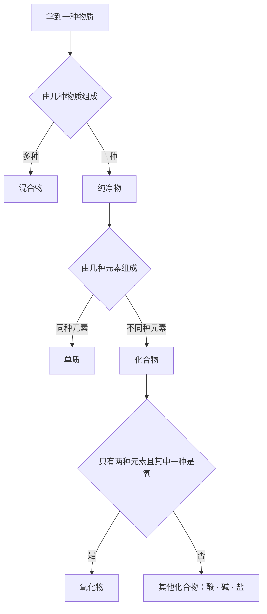
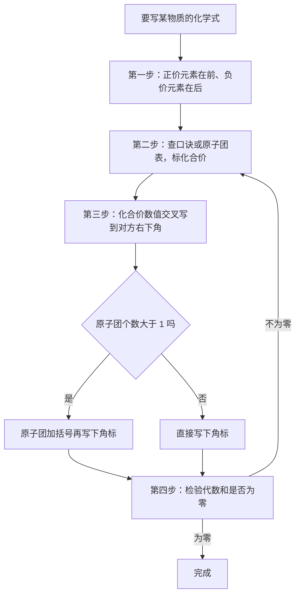
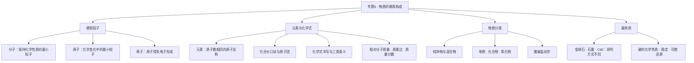

# 专题 5 · 物质的微观构成（详解版）

> **使用说明**：本文是详解版，从"为什么"讲起供从头自学；考前速查和掌握度跟踪在概要版：[[05-化学/知识点/专题5-物质的微观构成]]。

## 0️⃣ 这章学什么 & 中考怎么考

一句话：**这一章是化学的"世界观"——教你钻进物质内部，看它到底由什么粒子搭成，再学会用化合价这把"尺子"写出化学式。**

- 第一条线是**粒子**：分子、原子、离子，三种粒子怎么构成万物。
- 第二条线是**元素**：数以亿计的物质，其实只由一百多种元素搭出来；元素种类由质子数决定。
- 第三条线是**化学式**：用元素符号 + 化合价写出每种物质的"名字"，并算出相对分子质量、元素质量比、元素质量分数——它们是化学计算的"发动机"。
- 第四条线是**物质分类**：混合物、纯净物、单质、化合物、氧化物、酸碱盐，一张分类网把学过的物质全部归位；再加一节"结构多样的碳单质"。
- 和前后章节的关系：化学式是"单词"，[[05-化学/知识点/专题6-化学变化及其表示]] 的化学方程式是"造句"——单词不会写，句子一定错；分类网在 [[05-化学/专题/真题精讲/化-15-分类与Venn进阶]] 里有进阶练法。

中考怎么考（只写库里有依据的）：

- 概要版原话：**化合价口诀和化学式书写必须滚瓜烂熟（方程式默写的前提）。**
- 一轮专项《化合价/物质的分类/微观意义》就是本章的配套练习；Venn 图辨析（氧化物 ⊂ 化合物 ⊂ 纯净物）是一轮专项考点。
- 相对分子质量、元素质量分数是化学计算题的基本功（专题 6 详解的"先修自检"第 2 题就出自本章）。
- 具体题号分值：待核对。

## 🧭 先修自检（学不下去先回到这里）

> 下面每一项都是本章的地基。做不出就先去补对应知识，硬学只会更挫败。

| # | 你应该会的 | 自查题（先做再看答案） | 答案 | 不会去哪补 |
| - | ---------- | ---------------------- | ---- | ---------- |
| 1 | 默写 1-10 号元素符号 | 默写：氢、氦、锂、铍、硼、碳、氮、氧、氟、氖 | H、He、Li、Be、B、C、N、O、F、Ne | 概要版（1-20 号必须默写） |
| 2 | 说出水的组成 | 电解水实验说明水由什么元素组成？ | 氢元素和氧元素 | [[05-化学/知识点详解/专题4-水的性质与组成]] |
| 3 | 纯净物混合物的雏形 | 空气是纯净物还是混合物？氧气呢？ | 空气是混合物（有多种气体）；氧气是纯净物 | 本文章节 🌱 概念 7 |
| 4 | 三位数乘加 | $56\times3+16\times4$ 等于多少？ | $168+64=232$ | 本文章节 🧮 公式 2 |

第 4 题不是开玩笑——本章的计算全是"相对原子质量 × 原子个数再相加"的乘加算式，算式不熟，质量分数一定错。

## 🌱 概念从头讲

> 每个概念按"**为什么需要它 → 它是什么 → 符号/化学式/单位 → 容易想错的地方**"四步讲。

### 概念 1：微观视角总览——物质由什么构成

- **为什么需要**：宏观的"水"、"铁"、"食盐"摸得着，但化学要解释"为什么会变"，必须钻到里面看粒子。
- **它是什么**：构成物质的三种粒子——

```
物质 ──由什么构成？──┬→ 分子（例：水由水分子构成）
                    ├→ 原子（例：铁由铁原子直接构成）
                    └→ 离子（例：食盐由 Na⁺ 和 Cl⁻ 构成）
```

- **符号/化学式**：分子用化学式表示（$H_2O$、$O_2$）；原子用元素符号表示（Fe、C）；离子在符号右上角标电荷（$Na^+$、$Cl^-$）。
- **容易想错**：❌ "所有物质都先组成分子" → 食盐里没有"NaCl 分子"，它由钠离子和氯离子直接构成（概要版点名的易错点）。

### 概念 2：分子——保持化学性质的最小粒子

- **为什么需要**：一滴墨水滴进清水，不用搅整杯都会变黑——这背后一定有粒子在动。分子概念就是用来解释扩散、挥发、热胀冷缩这些宏观现象的。
- **定义**：分子是**保持物质化学性质的最小粒子**。注意"化学"两个字——分子的物理性质（状态、颜色）会随聚集状态变，化学性质才由分子保持。
- **三条性质及解释的现象**：
  - 质量和体积都很小：一滴水里有亿万个水分子。
  - **不断运动**：解释扩散（墨水散开）、挥发（酒精擦了会"跑"）。
  - **有间隔**：解释热胀冷缩、三态变化、气体容易压缩。温度越高间隔越大，气体最松、液体居中、固体最紧。
- **微观示意图**（一滴墨水在水里自己扩散）：

```
第 0 分钟：           第 10 分钟：           很久以后：
┌────────────┐       ┌────────────┐       ┌────────────┐
│ ●          │       │    ●       │       │  ●     ●   │
│ ～～～～～  │  →    │ ●    ～～  │  →    │     ●      │
│ ～～～～～  │       │   ～～●    │       │  ●     ●   │
│ ～～～～～  │       │  ～～～～  │       │    ●    ●  │
└────────────┘       └────────────┘       └────────────┘
（● 表示有色微粒聚集处，示意。没人搅拌，颜色自己均匀了
  → 粒子在不停运动，这叫扩散。示意图，非严格比例）
```

- **容易想错**：❌ "分子大所以它一定比原子重" → 分子和不同原子之间**不能直接比大小**；只能说分子由原子构成，同一种物质的分子自然比构成它的原子大（概要版点名的易错点）。

### 概念 3：原子——化学变化中的最小粒子

- **为什么需要**：电解水时，水分子被"拆"成了更小的东西，但拆到原子就拆不动了——原子在化学变化中不能再分，它是化学反应的"底牌"。
- **定义**：原子是**化学变化中的最小粒子**。
- **内部结构**：

```
        电子（带负电，质量很小，绕核运动）
      ●
       ↘
    ┌──────────┐
    │  原子核  │ ← 质子（带正电）+ 中子（不带电）
    │ 很小但极重│    集中了原子的几乎全部质量
    └──────────┘
（示意图，非严格比例；原子内部很"空"）
```

- **一条必须背熟的等量关系**：**质子数 = 核电荷数 = 核外电子数 = 原子序数**。原子不显电性，正是因为带正电的质子和带负电的电子数量相等、电性相反。
- **相对原子质量**：$\approx$ 质子数 + 中子数（计算见 🧮 公式 1）。
- **容易想错**：❌ "原子核比原子重一点" → 不是重一点，是**几乎全部**质量都在原子核上，电子的质量小到可以忽略。

### 概念 4：离子——原子"充了电"的样子

- **为什么需要**：原子是电中性的，但食盐溶在水里能导电——说明里面本来就有带电的粒子。离子概念补上了这块拼图。
- **定义**：原子**得失电子**后形成的带电粒子。
  - **失去**电子 → 剩下正电荷多 → **阳离子**（带正电），如 $Na^+$；
  - **得到**电子 → 负电荷多 → **阴离子**（带负电），如 $Cl^-$。
- **形成过程拆开看**（以食盐为例）：

```
Na 原子（核外 11 个电子）──失去 1 个电子──→ Na⁺（带 1 个单位正电）
Cl 原子（核外 17 个电子）──得到 1 个电子──→ Cl⁻（带 1 个单位负电）
Na⁺ 和 Cl⁻ ──静电吸引──→ NaCl（食盐）
```

- **符号/化学式**：离子符号右上角标电荷数和正负：$Na^+$、$Cl^-$、$SO_4^{2-}$。
- **容易想错**：❌ "NaCl 由钠原子和氯原子构成" → 食盐由 $Na^+$ 和 $Cl^-$ 构成，**没有"NaCl 分子"**这个说法（概要版点名的易错点）。

### 概念 5：元素——物质的"积木种类"

- **为什么需要**：世界上的物质千千万，但搭它们的"积木种类"只有一百多种。元素就是"积木种类"这个级别的概念。
- **定义**：**质子数（核电荷数）相同**的一类原子的总称。判断两种原子是不是同种元素，**只看质子数**。
- **符号/化学式**：元素符号有两层意思——**宏观**：表示一种元素（如 H 表示氢元素）；**微观**：表示一个原子（如 H 表示一个氢原子）。前面加了数字就只能微观了：2H 表示两个氢原子。
- **必背常识**：地壳中元素含量前四位：**氧、硅、铝、铁**（口诀"养闺女贴"）；铝是地壳中含量最多的**金属**元素。
- **容易想错**：
  - ❌ "水里有 2 个氢元素" → 元素**论"种"不论"个"**。正确说法：水由氢、氧**两种**元素组成；要说"个"，只能说一个水分子里有 2 个氢**原子**。
  - ❌ "质子数相同就是同种原子" → 质子数相同的是**同种元素**，这句话本身对；但要分清"元素（一类原子的总称）"和"原子（一个个的粒子）"的层次。

**元素符号意义速查表**：

| 符号 | 宏观意义 | 微观意义 |
| ---- | -------- | -------- |
| H | 氢元素 | 一个氢原子 |
| 2H | 无（元素论种不论个） | 2 个氢原子 |
| $H_2$ | 氢气这种物质；氢气由氢元素组成 | 一个氢分子 |
| $2H_2$ | 无 | 2 个氢分子 |

### 概念 6：化合价与化学式书写

- **为什么需要**：化学式是物质的"名字"。名字写错（比如把氧化铝写成 AlO），后面的方程式、计算全错。化合价就是写对名字的"尺子"。
- **定义**：化合价表示原子之间互相化合的数目关系，有正有负。
- **必背口诀**（每周默写任务源，见 [[05-化学/闪卡/化学方程式与化合价默写]]）：
  > 一价钾钠氯氢银，二价氧钙钡镁锌，三铝四硅五价磷，二三铁、二四碳，铜汞二价最常见。
- **常见原子团速查**：

| 原子团 | 化合价 |
| ------ | ------ |
| $OH^-$ | −1 |
| $NO_3^-$ | −1 |
| $SO_4^{2-}$ | −2 |
| $CO_3^{2-}$ | −2 |
| $NH_4^+$ | +1 |

- **书写总规则**：**正价前、负价后，代数和为零**（十字交叉法，步骤见 🧮 规律 5）。
- **容易想错**：❌ "把化合价当成电荷写在右上角" → 写化学式时化合价是"草稿"，标在元素符号**上方**；最终化学式里只留下角标数字，不出现正负号。

### 概念 7：物质分类网——给物质"上户口"

- **为什么需要**：题目不会问你"H₂O 是什么"，但会问"下列属于氧化物的是"。分类网就是答题的检索系统。
- **分类树**（文字版；图形版见 🗺️ 流程图 1）：
  - 物质按"几种物质组成"分：**混合物**（如空气、粗盐水）/ **纯净物**（如氧气、水）。
  - 纯净物按"几种元素组成"分：**单质**（同种元素，如 $O_2$、Fe）/ **化合物**（不同种元素，如 $H_2O$、$CO_2$）。
  - 化合物再细分：**氧化物**（只有两种元素、其中一种是氧，如 $H_2O$、$Fe_3O_4$）；**酸**（$H^+$ + 酸根，如 $HCl$、$H_2SO_4$）；**碱**（金属离子 + $OH^-$，如 $NaOH$、$Ca(OH)_2$）；**盐**（金属离子 + 酸根，如 $NaCl$、$CaCO_3$）。
- **Venn 图核心结论**（一轮专项考点）：**氧化物 ⊂ 化合物 ⊂ 纯净物**；"含氧元素的化合物**不都是**氧化物"——比如 $H_2SO_4$ 含 H、S、O **三种**元素，是化合物但不是氧化物（氧化物必须是**两种**元素）。
- **容易想错**：❌ "由同种元素组成的物质一定是纯净物" → 反例：金刚石和石墨**混合**在一起，都由碳元素组成，但这是两种物质——**混合物**（概要版讲碳单质时埋的伏笔）。

### 概念 8：结构多样的碳单质

- **为什么需要**：同样都是碳原子搭的，金刚石硬得能划玻璃、石墨软得能当铅笔芯——这是"结构决定性质"最漂亮的例子，也是说理题常客。
- **三兄弟对比表**：

| 碳单质 | 特点 | 原因 |
| ------ | ---- | ---- |
| 金刚石 | **最硬** | 碳原子搭成坚固的立体网状 |
| 石墨 | **软**、能**导电**、有**润滑性** | 碳原子排成一层层片状，片间易滑动 |
| $C_{60}$ | 60 个碳原子构成的分子 | 像个"足球" |

- **共同点**：都由碳元素组成，所以**化学性质相同**。
- **木炭、活性炭**：疏松多孔，有**吸附性**（物理性质）——专题 4 净水用到的就是它。
- **碳的化学性质三条**：
  1. **常温下稳定**：古代用墨写字画，千年不褪色。
  2. **可燃性**：氧气充足生成 $CO_2$，不充足生成 $CO$。
  3. **还原性**：$C+2CuO\xrightarrow{\text{高温}}2Cu+CO_2\uparrow$，冶金就靠它。
- **容易想错**：❌ "金刚石和石墨化学性质也不同" → 物理性质差异大是因为**碳原子排列方式不同**；化学性质由元素种类决定，都是碳元素，化学性质相同。

## 🧮 公式/规律逐个拆解

> 每个公式都必须能回答四件事：每个符号是什么？单位是什么？什么时候能用？怎么变形？

### 公式 1：相对原子质量 ≈ 质子数 + 中子数

| 符号 | 含义 | 说明 |
| ---- | ---- | ---- |
| 相对原子质量 | 以"一个碳 12 原子质量的 1/12"为标准的比值 | 单位是 1，通常省略不写 |
| 质子数 | 原子核里质子的个数 | 等于原子序数 |
| 中子数 | 原子核里中子的个数 | 题目会给 |

- **成立条件**：这是近似公式（电子质量太小被忽略），初中阶段按"≈"用。
- **最小例子**：氧原子质子数 8、中子数 8 → 相对原子质量 $\approx 8+8=16$。钠原子质子数 11、中子数 12 → $\approx 11+12=23$。✓（这两个数你后面天天要用。）

### 公式 2：相对分子质量 = 各原子的相对原子质量 × 原子个数，再相加

- **怎么算**：先看化学式里**每种元素有几个原子**，乘上它的相对原子质量，最后全部加起来。**最常见错误就是漏乘原子个数**（概要版点名："算错乘数最常见"）。
- **最小例子**（三个，请你动笔跟着算）：
  - $H_2O$：$1\times2+16\times1=18$
  - $CO_2$：$12+16\times2=44$
  - $Fe_3O_4$：$56\times3+16\times4=168+64=232$

### 公式 3：元素质量比 = （相对原子质量 × 原子个数）之比

- **怎么算**：要算谁和谁的质量比，就分别算出"该元素的总相对质量"，再约分。
- **最小例子**：
  - $H_2O$ 中氢、氧质量比 $=(1\times2):(16\times1)=2:16=\mathbf{1:8}$（专题 4 说的"质量比 1:8"就是它）。
  - $CO_2$ 中碳、氧质量比 $=(12\times1):(16\times2)=12:32=\mathbf{3:8}$。

### 公式 4：元素质量分数 = 该元素总相对质量 ÷ 相对分子质量 × 100%

$$\text{元素质量分数}=\frac{\text{相对原子质量}\times\text{原子个数}}{\text{相对分子质量}}\times100\%$$

- **最小例子**：$H_2O$ 中氢元素的质量分数 $=\dfrac{1\times2}{18}\times100\%\approx11.1\%$。
- **常见应用**：36 g 水里含氢元素多少克？$36\times\dfrac{2}{18}=4$ g。（先写分数再乘，比"36 × 11.1%"更精确。）

### 规律 5：十字交叉法写化学式（四步）

1. **排序**：写出组成元素，**正价在前、负价在后**。
2. **标价**：在元素符号上方标化合价（查口诀和原子团表）。
3. **交叉**：把化合价的**数值**（不带正负号）交叉写到对方元素符号的右下角。
4. **检验**：算代数和是否为零；原子团个数大于 1 时要**加括号**。

**演示 1**：氧化铝。Al 是 +3（"三铝"），O 是 −2（"二价氧"）。

```
排序标价：  +3   −2
            Al   O
交叉：      Al₂O₃
检验：      (+3)×2 + (−2)×3 = 6 − 6 = 0 ✓
```

**演示 2**：氢氧化钙（带原子团）。Ca 是 +2（"二价……钙"），OH 是 −1。

```
排序标价：  +2     −1
            Ca     OH
交叉：      Ca(OH)₂   ← 原子团 OH 有 2 个，必须加括号
检验：      (+2) + (−1)×2 = 0 ✓
```

**演示 3**：硫酸铝（两个原子团，难度进阶）。Al 是 +3，$SO_4$ 是 −2。

```
排序标价：  +3      −2
            Al      SO₄
交叉：      Al₂(SO₄)₃
检验：      (+3)×2 + (−2)×3 = 6 − 6 = 0 ✓
```

## 🪜 例题阶梯

> 三级台阶，每一级都要动笔跟着答，不许只看。

### 第 1 级 · 入门（照着模仿）

> **题目**：用化合价写出下列物质的化学式，并用代数和检验：氧化铝、氯化镁、水。
>
> **每一步为什么这么做**：每一步都套"排序 → 标价 → 交叉 → 检验"四步；化合价全部从口诀里查，不靠猜。
>
> **完整解答**：
> - 氧化铝：Al +3、O −2 → 交叉得 $Al_2O_3$。检验：$(+3)\times2+(-2)\times3=0$ ✓
> - 氯化镁：Mg +2（"二价氧钙钡镁锌"）、Cl −1（"一价钾钠氯氢银"）→ 交叉得 $MgCl_2$。检验：$(+2)+(-1)\times2=0$ ✓
> - 水：H +1、O −2 → 交叉得 $H_2O$。检验：$(+1)\times2+(-2)=0$ ✓
>
> 注意顺序：正价元素在前，负价元素在后——所以是"氧化铝"里 Al 写在 O 前面。

### 第 2 级 · 标准（中考中档）

> **题目**：下图三只瓶中各装有一些分子（每个小球代表一个原子，相同小球代表同种原子）。判断各瓶内物质的类别。
>
> ```
> 图例：● = 氢原子   ○ = 氧原子
>
>    甲瓶               乙瓶               丙瓶
> ┌─────────┐       ┌─────────┐       ┌─────────┐
> │ ●●  ●●  │       │ ●○  ●○  │       │ ●●  ○○  │
> │ ●●  ●●  │       │ ●○  ●○  │       │ ●●  ○○  │
> └─────────┘       └─────────┘       └─────────┘
> ```
>
> **读题→翻译成化学语言**：微观图判断题的钥匙只有两把——①瓶里有**几种分子**（决定混合物/纯净物）；②纯净物的分子由**几种原子**构成（决定单质/化合物）。
>
> **每一步为什么这么做**：先数分子种类，再看原子构成，最后对号入座；同时把化学式也写出来，说明你真看懂了。
>
> **完整解答**：
> - **甲瓶**：只有一种分子（$H_2$，每个分子由 2 个氢原子构成）→ 纯净物；由同种元素组成 → **单质**。
> - **乙瓶**：只有一种分子（$H_2O$，每个分子由 2 个氢原子和 1 个氧原子构成）→ 纯净物；由不同种元素组成 → **化合物**（且是氧化物：两种元素、其中一种是氧）。
> - **丙瓶**：有两种分子（$H_2$ 和 $O_2$）→ **混合物**。虽然每个分子都是"同种元素"构成的，但瓶里不止一种物质，所以不能叫单质。
>
> 易错提醒：丙瓶很多人判成"单质"，错在只看分子内部、忘了先数瓶里有几种分子——**第一步永远是数分子种类**。

### 第 3 级 · 提高（与压轴/综合题接轨）

> **题目**：(1) 四氧化三铁（$Fe_3O_4$）是铁丝在氧气中燃烧的产物。计算它的相对分子质量、铁元素与氧元素的质量比、铁元素的质量分数。(2) 多少克四氧化三铁中含铁 16.8 g？(3) 用说理三段式回答：金刚石和石墨物理性质差异很大，为什么化学性质却相同？
>
> **思路从哪来**：第 (1)(2) 问是 🧮 公式 2、3、4 的组合拳，按顺序算就行；第 (3) 问卡住时先回忆 [[05-化学/专题/说理题方法]] 的三段式：判断 → 依据（用规范术语）→ 回扣情境。
>
> **完整解答**：
> (1) 相对分子质量：$56\times3+16\times4=168+64=232$。
> 铁与氧质量比：$(56\times3):(16\times4)=168:64=21:8$。
> 铁元素质量分数：$\dfrac{168}{232}\times100\%\approx72.4\%$。
> (2) 设需要四氧化三铁的质量为 $x$。$x\times\dfrac{168}{232}=16.8\text{ g}$，得 $x=16.8\times\dfrac{232}{168}=23.2\text{ g}$。
> 验算：$23.2\times\dfrac{168}{232}=23.2\times0.7241\ldots$，换成分数看更稳：$\dfrac{23.2}{232}=0.1$，$168\times0.1=16.8$ g ✓。
> (3) 三段式：**判断**——金刚石和石墨物理性质差异很大，是因为碳原子的排列方式不同；**依据**——物质的结构决定性质，二者的碳原子排列不同（金刚石是立体网状，石墨是层状），所以物理性质差异大；但它们都由碳元素组成，元素的种类相同决定化学性质相同；**回扣情境**——所以金刚石最硬、石墨软且能导电，但它们都由碳元素组成，化学性质相同（例如都能在氧气中充分燃烧生成 $CO_2$）。
>
> **和入门题的差别**：入门题是"一个公式算一件事"，这一题要**连用三个公式 + 换算成实际质量 + 组织说理语言**——这正是计算综合题和说理题拼在一起的样子。

## 🗺️ 解题流程图

**流程图 1：物质分类判断树**



**流程图 2：化学式书写流程**



**知识结构图**：



## 🔥 易错点：为什么会错

| ❌ 常见错误想法 | 为什么会这样想 | ✅ 正确理解 / 自救方法 |
| -------------- | -------------- | ---------------------- |
| "分子一定比原子大" | 觉得分子由原子构成，"整体大于部分" | 不同种分子和原子**不能直接比**；只能说分子由原子构成（概要版原话） |
| "两个氢元素" | 把元素当成一个个的粒子 | 元素**论"种"不论"个"**；说"个"时对象必须是原子或分子 |
| 相对分子质量漏乘原子个数 | 加得太顺手 | 每个"相对原子质量 × 个数"先乘好再加；算完回头数一遍原子 |
| "NaCl 由钠原子和氯原子构成" | 以为万物先组成分子 | 食盐由 $Na^+$ 和 $Cl^-$ 构成，**没有 NaCl 分子** |
| "含氧元素的化合物就是氧化物" | 见到 O 就归类 | 氧化物必须**只有两种**元素且一种是氧；$H_2SO_4$ 含三种元素，不是氧化物 |
| "同种元素组成的物质一定是纯净物" | 把"元素相同"当成"物质相同" | 金刚石和石墨混合仍由碳元素组成，但那是**混合物** |
| 化合价写在化学式右上角 | 和离子符号搞混 | 离子符号右上角标电荷（$Na^+$）；化学式只有角标数字（$H_2O$），不写价 |
| "金刚石和石墨化学性质不同" | 被物理性质差异带偏 | 排列方式不同 → 物理性质不同；元素相同 → 化学性质相同 |

## ✅ 自测清单（能独立做到才打勾）

- [ ] 1. 能默写 1-20 号元素符号
- [ ] 2. 能说出分子、原子、离子的定义，指出每个定义里"最小"限定的范围
- [ ] 3. 能背出"质子数 = 核电荷数 = 核外电子数 = 原子序数"和"相对原子质量 ≈ 质子数 + 中子数"
- [ ] 4. 能默写化合价口诀和 5 个常见原子团的化合价
- [ ] 5. 能用十字交叉法独立写出氧化铝、氯化镁、氢氧化钙、硫酸铝并验算代数和
- [ ] 6. 能算 $H_2O$、$CO_2$、$Fe_3O_4$ 的相对分子质量、指定元素质量比和质量分数
- [ ] 7. 能用判断树把物质归到混合物/纯净物/单质/化合物/氧化物，并说出氧化物 ⊂ 化合物 ⊂ 纯净物
- [ ] 8. 能用三段式说清金刚石与石墨"物性异、化性同"的原因
- [ ] 9. 能独立做出例题阶梯第 2 级的微观图辨析和第 3 级的计算

## 🔗 关联

- 概要版：[[05-化学/知识点/专题5-物质的微观构成]]（掌握度在这边更新）
- 前置知识：[[05-化学/知识点详解/专题4-水的性质与组成]]（水的组成引出元素）· [[05-化学/知识点/专题1-2-化学之门与实验探究]]（元素符号 1-20 号）
- 后续/综合应用：[[05-化学/知识点详解/专题6-化学变化及其表示]]（化学式 → 方程式）· [[05-化学/知识点详解/专题8-酸碱盐]]（酸碱盐分类在这里展开）
- 每周默写任务源：[[05-化学/闪卡/化学方程式与化合价默写]]
- 真题精讲：[[05-化学/专题/真题精讲/化-10-微观意义与计算]] · [[05-化学/专题/真题精讲/化-11-化合价与方程式书写]] · [[05-化学/专题/真题精讲/化-12-概念辨析与分类]] · [[05-化学/专题/真题精讲/化-14-化合价与推断]] · [[05-化学/专题/真题精讲/化-15-分类与Venn进阶]]
- 说理题方法：[[05-化学/专题/说理题方法]]
