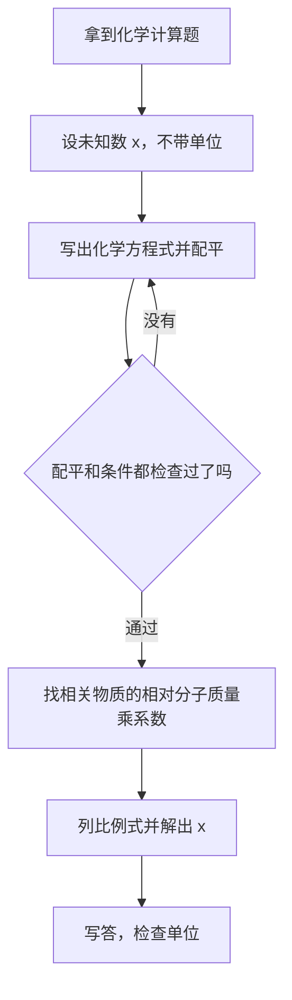
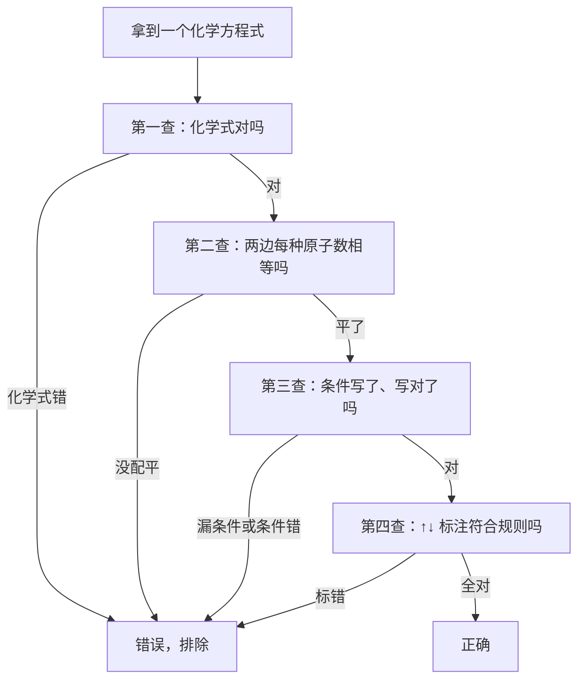
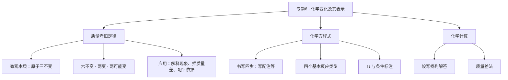

# 专题 6 · 化学变化及其表示（详解版）

> **使用说明**：本文是详解版，从"为什么"讲起供从头自学；考前速查和掌握度跟踪在概要版：[[05-化学/知识点/专题6-化学变化及其表示]]。

## 0️⃣ 这章学什么 & 中考怎么考

一句话：**这一章解决"化学反应怎么记、怎么算"的问题。**

- 做完一个实验，你会有两个疑问：反应前后的质量是什么关系？怎么把看到的反应用几行符号准确地记下来？
- 回答第一个疑问的是**质量守恒定律**，回答第二个疑问的是**化学方程式**。两样合在一起，就是化学的"记账系统"。
- 和前后章节的关系：[[05-化学/知识点/专题5-物质的微观构成]] 教你"单词"（元素、化学式、相对分子质量），本章教你"造句"（方程式）和"算账"（守恒计算）；后面 [[05-化学/知识点详解/专题7-溶液]] 和 [[05-化学/知识点详解/专题8-酸碱盐]] 的计算和方程式默写，全部踩在这章地基上。

中考怎么考（只写库里有依据的）：

- 化学笔试 50 分（综合测试 150 分之内，另有实验操作 5 分）；具体题块分值结构库内标了**待核对**，不要背分值。
- 概要版原话："化学计算（第 1 大题常客）全部从这页长出来。"——守恒和方程式是化学计算题的根。
- 常见题型（见 [[05-化学/专题/真题精讲/化-04-质量守恒与方程式]] 的归纳）：①守恒解释题；②微观图示题；③方程式正误选择题；④根据化学方程式计算。
- 老师明确的新中考趋势：减少记忆题、增加情景化和说理题——"为什么质量守恒"本身就是经典说理素材（方法见 [[05-化学/专题/说理题方法]]）。

## 🧭 先修自检（学不下去先回到这里）

> 下面每一项都是本章的地基。做不出就先去补对应知识，硬学只会更挫败。

| # | 你应该会的 | 自查题（先做再看答案） | 答案 | 不会去哪补 |
| - | ---------- | ---------------------- | ---- | ---------- |
| 1 | 用化合价写化学式 | 写出：氧化铁、硫酸、氢氧化钙、二氧化碳 | $Fe_2O_3$、$H_2SO_4$、$Ca(OH)_2$、$CO_2$ | [[05-化学/知识点/专题5-物质的微观构成]] |
| 2 | 算相对分子质量 | 算出 $H_2O$、$CO_2$、$Fe_3O_4$（H=1，C=12，O=16，Fe=56） | 18；44；232 | [[05-化学/知识点/专题5-物质的微观构成]] |
| 3 | 分清物理变化与化学变化 | 水结冰、木炭燃烧、酒精挥发、铁生锈——哪些是化学变化？ | 木炭燃烧、铁生锈 | [[05-化学/知识点/专题1-2-化学之门与实验探究]] |
| 4 | 记住氧气的燃烧现象 | 铁丝在氧气中燃烧的现象？ | 剧烈燃烧、火星四射、生成黑色固体、放热 | [[05-化学/知识点/专题3-空气氧气与二氧化碳]] |

把第 2 题的算式亲手写一遍：

- $H_2O$：$1\times2+16=18$
- $CO_2$：$12+16\times2=44$
- $Fe_3O_4$：$56\times3+16\times4=168+64=232$

第 2 题是本章计算的"发动机"。如果这三条算式你写得磕磕绊绊，先回专题 5 练熟，再往下读。

## 🌱 概念从头讲

> 每个概念按"**为什么需要它 → 它是什么 → 符号/化学式/单位 → 容易想错的地方**"四步讲。

### 概念 1：质量守恒定律

- **为什么需要**：做实验时你会先称反应物的质量，反应后再称生成物的质量。大量实验证明：两边相等。这不是巧合，是一条定律。有了它，我们才敢说"化学反应是一笔平的账"，才能在只知道一部分质量时，把另一部分质量算出来。
- **定义**：参加化学反应的各物质的质量总和，等于反应后生成的各物质的质量总和。
- **适用范围**：**化学变化**。物理变化（水结冰、酒精挥发、食盐溶解）不归它管。用守恒去解释物理变化属于概念性错误（真题精讲里明确：阅卷按 0 分处理）。
- **微观本质**：化学变化的实质是"分子分成原子，原子重新组合成新分子"。这个过程中**原子的种类、数目、质量都不变**——原子没多、没少、没变形，总质量当然不变。
- **容易想错**：
  - ❌ "蜡烛燃烧后只剩一点灰，质量变少了，是不是不守恒？" → 生成的水蒸气和二氧化碳跑进空气里了，你没有称到它们。把参加反应的氧气也记进账里，账就是平的。✅ 做守恒解释题，先把"跑掉的气体"找回来。
  - ❌ "10 g 水加热变成 10 g 水蒸气，符合质量守恒定律。" → 这是物理变化，守恒定律根本不管它。
  - ❌ "20 g 食盐溶于 80 g 水得到 100 g 食盐水，符合守恒。" → 溶解也是物理变化，不叫守恒。

### 概念 2：化学方程式

- **为什么需要**：用文字记反应太啰嗦："磷和氧气点燃后生成五氧化二磷，每 124 份质量的磷恰好和 160 份质量的氧气反应……"。化学家发明了一行式子把这些信息全部装进去，这就是化学方程式——全世界通用的"化学句子"。
- **它是什么**：用化学式表示化学反应的式子，同时告诉你三件事：**谁和谁反应、生成谁（物质层）；几个微粒换几个微粒（微粒层）；多少质量换多少质量（质量层）**。
- **书写两原则**：①以客观事实为依据（化学式不能瞎写）；②遵守质量守恒定律（必须配平）。
- **书写四步（写、配、注、等）**：
  1. **写**：左边写反应物化学式，右边写生成物化学式，中间连一条短线。
  2. **配**：配平——在化学式前面加数字（化学计量数），让两边每种原子的个数相等。依据就是质量守恒定律。
  3. **注**：注明反应条件（点燃、$\Delta$、高温、催化剂），标好 ↑↓。
  4. **等**：检查无误后，把短线改成等号。
- **读法示范**（以 $4P+5O_2\xrightarrow{\text{点燃}}2P_2O_5$ 为例）：
  - 物质层读法：磷和氧气在点燃条件下反应，生成五氧化二磷。
  - 微粒层读法：每 4 个磷原子跟 5 个氧分子反应，生成 2 个五氧化二磷分子。
  - 质量层读法：每 124 份质量的磷跟 160 份质量的氧气完全反应，生成 284 份质量的五氧化二磷。（$4\times31=124$，$5\times32=160$，$2\times142=284$，$124+160=284$——看，账是平的，这就是守恒。）
- **容易想错**：条件"点燃"和"加热 $\Delta$"是两回事——燃烧类反应写"点燃"；给酒精灯加热的反应写"$\Delta$"；碳酸钙分解、碳还原氧化铜这类需要很高温度的写"高温"；过氧化氢分解写催化剂 $MnO_2$ 写在箭头上方。写错位置或漏写都算错。

### 概念 3：四个基本反应类型

- **为什么需要**：反应千千万，但形式就这四种。给反应"分型"之后，看到一个反应的形式，就能预判它能不能发生、生成什么。
- **是什么**：按下表的形式分类。

| 类型 | 形式 | 记忆钩子 | 例子（库内方程式） |
| ---- | ---- | ---- | ---- |
| 化合 | $A+B\rightarrow AB$ | 多变一 | $C+O_2\xrightarrow{\text{点燃}}CO_2$ |
| 分解 | $AB\rightarrow A+B$ | 一变多 | $2H_2O\xrightarrow{\text{通电}}2H_2\uparrow+O_2\uparrow$ |
| 置换 | $A+BC\rightarrow AC+B$ | 单质换单质 | $Fe+CuSO_4=FeSO_4+Cu$ |
| 复分解 | $AB+CD\rightarrow AD+CB$ | 两化合物互换成分 | $HCl+NaOH=NaCl+H_2O$ |

- **容易想错**：$CO+CuO\xrightarrow{\Delta}Cu+CO_2$ **不属于置换反应**——置换要求"单质 + 化合物 → 化合物 + 单质"，而 CO 是化合物，反应物里没有单质。概要版特别标注了这个例子，选择题高频。
- 另一个易混点：复分解反应中各元素的化合价**都不变**；置换反应中一定有单质参加和生成，化合价**一定变**（如 $Fe+CuSO_4=FeSO_4+Cu$ 中 Fe 从 0 到 +2，Cu 从 +2 到 0）。

## 🧮 公式/规律逐个拆解

> 每条规律都必须能回答：它说什么？依据是什么？什么时候用？怎么用？

### 规律 1：质量守恒的"六不变、两变、两可能变"

| 类别 | 具体内容 | 一句话记法 |
| ---- | ---- | ---- |
| 一定不变（六不变） | 原子的种类、原子的数目、原子的质量 | 原子三不变 |
| 一定不变 | 元素的种类、元素的质量 | 元素跟着原子不变 |
| 一定不变 | 各物质的总质量 | 账是平的 |
| 一定变（两变） | 物质的种类、分子的种类 | 没有新物质就不叫化学变化 |
| 可能变（两可能变） | 分子的数目、元素的化合价 | 见下面两个例子 |

"可能变"举例说明：

- 分子数目：$2H_2+O_2\xrightarrow{\text{点燃}}2H_2O$，反应前 3 个分子、反应后 2 个分子，**变**了；而 $C+O_2\xrightarrow{\text{点燃}}CO_2$，反应前 2 个分子、反应后 2 个分子，**没变**。所以分子数目是"可能变"。
- 化合价：中和反应 $HCl+NaOH=NaCl+H_2O$ 中所有元素化合价都没变；而 $Fe+CuSO_4=FeSO_4+Cu$ 中 Fe 由 0 变 +2、Cu 由 +2 变 0。所以化合价也是"可能变"。

### 规律 2：配平——最小公倍数法（两个完整演示）

配平的唯一目标：**让两边每种原子的个数相等**。方法不止一种，最小公倍数法最稳。

**演示 1**：磷在氧气中燃烧。

1. 先写骨架：$P+O_2 \rightarrow P_2O_5$（化学式绝对不能改，只能改前面的系数）。
2. 看氧原子：左边 $O_2$ 一次来 2 个，右边 $P_2O_5$ 一次来 5 个。2 和 5 的最小公倍数是 10。所以 $O_2$ 前配 5（$5\times2=10$），$P_2O_5$ 前配 2（$2\times5=10$）。
3. 看磷原子：右边 $2P_2O_5$ 共有 4 个磷原子，所以左边 P 前配 4。
4. 检查：P 左 4 = 右 4；O 左 $5\times2=10$ = 右 $2\times5=10$。✓

$$4P+5O_2\xrightarrow{\text{点燃}}2P_2O_5$$

**演示 2**：高锰酸钾受热分解。

1. 骨架：$KMnO_4 \xrightarrow{\Delta} K_2MnO_4+MnO_2+O_2\uparrow$。
2. 先从只有一处出现、个数不等的元素入手：钾，左边 1 个、右边 $K_2MnO_4$ 里有 2 个 → 左边 $KMnO_4$ 前配 2。
3. 这一步下去，锰也平了（左 2 = 右 1+1）；氧：左 $2\times4=8$，右 $4+2+2=8$（$O_2$ 前自然就是 1，省略不写）。✓

$$2KMnO_4\xrightarrow{\Delta}K_2MnO_4+MnO_2+O_2\uparrow$$

### 规律 3：↑↓ 标注规则（速查表）

| 情形 | 标不标 | 例子 |
| ---- | ---- | ---- |
| 生成物是气体，且反应物中没有气体 | 标 ↑ | $2H_2O\xrightarrow{\text{通电}}2H_2\uparrow+O_2\uparrow$ |
| 反应物中已有气体 | 不标 ↑ | $S+O_2\xrightarrow{\text{点燃}}SO_2$（反应物有 $O_2$） |
| 溶液中反应生成不溶于水的固体 | 标 ↓ | $CO_2+Ca(OH)_2=CaCO_3\downarrow+H_2O$ |
| 干态反应（不在溶液里），反应物中有气体 | 不标 ↑ | CO 还原氧化铜（反应物有 CO 气体） |
| 铁与稀硫酸（反应物无气体，生成 $H_2$） | 标 ↑ | $Fe+H_2SO_4=FeSO_4+H_2\uparrow$ |

### 规律 4：条件速查（漏条件是默写扣分大户）

| 条件 | 什么时候用 | 库内典型例子 |
| ---- | ---- | ---- |
| 点燃 | 燃烧类反应 | $3Fe+2O_2\xrightarrow{\text{点燃}}Fe_3O_4$ |
| $\Delta$（加热） | 酒精灯加热的反应 | $2KMnO_4\xrightarrow{\Delta}K_2MnO_4+MnO_2+O_2\uparrow$ |
| 高温 | 需要很高温度的反应 | $CaCO_3\xrightarrow{\text{高温}}CaO+CO_2\uparrow$ |
| 催化剂 | 需要催化剂的反应 | $2H_2O_2\xrightarrow{MnO_2}2H_2O+O_2\uparrow$ |
| 通电 | 电解反应 | $2H_2O\xrightarrow{\text{通电}}2H_2\uparrow+O_2\uparrow$ |

### 公式 5：化学计算三步法（上海中考格式）

**口诀：设、写、找、列、解、答。**

1. **设**：设未知量为 $x$。注意：设质量时不带单位（写"设生成氢气的质量为 x"，不写"设 x 克"）。
2. **写**：写出正确的化学方程式并配平。**配平错了后面全错**，这一步错了整题归零。
3. **找**：在方程式下方写出"相关物质的相对分子质量 × 化学计量数"和已知量、未知量。
4. **列**：列比例式（上下单位要一致：上面是质量比，下面也得是质量）。
5. **解**：解出 $x$。
6. **答**：写"答：……"，简明写出结论。

- **成立条件**：用的必须是配平正确的方程式；参加反应的物质恰好完全反应（题目通常说"完全反应"或"足量"）。
- **最小例子**：电解 18 g 水，能生成多少克氢气？
  - 设：设生成氢气的质量为 $x$。
  - 写：$$2H_2O\xrightarrow{\text{通电}}2H_2\uparrow+O_2\uparrow$$
  - 找：$2H_2O$ 的相对质量 $=2\times18=36$；$2H_2$ 的相对质量 $=2\times2=4$。
  - 列：$\dfrac{36}{4}=\dfrac{18\text{ g}}{x}$
  - 解：$x=\dfrac{4\times18}{36}=2\text{ g}$
  - 答：能生成氢气 2 g。
  - 顺手验一下（好习惯）：水里氢元素的质量分数 $=\dfrac{1\times2}{18}\times100\%\approx11.1\%$，18 g 水里含氢 $18\times11.1\%\approx2$ g，对上了。✓

### 公式 6：质量差法（守恒定律的"省事用法"）

- **它说什么**：反应前后，某个"账本"（比如固体的总质量）的变化量，和方程式里的某个量成正比。变化量往往数字小、好算。
- **什么时候用**：题目问"固体质量减少了多少""沉淀多了多少""气体跑了多少"这类差值问题。
- **最小例子**：用氢气还原 8 g 氧化铜，完全反应后固体质量减少多少？
  - 写：$$H_2+CuO\xrightarrow{\Delta}Cu+H_2O$$
  - 想账本：固体从 CuO（相对质量 80）变成 Cu（相对质量 64），每 80 份 CuO 反应完，固体就少了 16 份（正好是跑掉的 1 个氧原子的质量）。
  - 列：$\dfrac{80}{16}=\dfrac{8\text{ g}}{\Delta m}$，得 $\Delta m=1.6$ g。
  - 验算：8 g CuO 里氧元素质量 $=8\times\dfrac{16}{80}=1.6$ g，剩下的铜 $=8-1.6=6.4$ g；按方程式算 $80:64=8:6.4$，一致。✓

## 🪜 例题阶梯

> 三级台阶，每一级都要动笔跟着算，不许只看。

### 第 1 级 · 入门（照着模仿）

> **题目**：写出铝在氧气中燃烧的化学方程式。
>
> **每一步为什么这么做**：
> 1. 先写化学式：铝是金属单质，直接写元素符号 Al；氧气是双原子分子 $O_2$；氧化铝先按化合价写——铝 +3 价、氧 -2 价，十字交叉得 $Al_2O_3$。（这一步依据：化学式书写规则，化学式错了后面全错。）
> 2. 骨架：$Al+O_2 \rightarrow Al_2O_3$。
> 3. 配平（最小公倍数法）：氧原子左 2 右 3，最小公倍数 6 → $O_2$ 前配 3、$Al_2O_3$ 前配 2；再看铝：右边 $2\times2=4$ 个 → 左边 Al 前配 4。（这一步依据：质量守恒定律。）
> 4. 注条件：燃烧写"点燃"。$Al_2O_3$ 是固体，不在溶液里，不标 ↓；没有别的气体生成，不涉及 ↑。（依据：↑↓ 标注规则。）
> 5. 检查后把短线改等号。
>
> **完整解答**：
> $$4Al+3O_2\xrightarrow{\text{点燃}}2Al_2O_3$$
> 验算：Al 左 4 = 右 4；O 左 $3\times2=6$ = 右 $2\times3=6$。✓

### 第 2 级 · 标准（中考中档）

> **题目**：12.8 g 铜在氧气中加热，完全反应。求生成氧化铜多少克？消耗氧气多少克？
>
> **读题→翻译成化学语言**："12.8 g 铜""完全反应"= 铜全部参加反应；求生成物和另一种反应物的质量 = 标准的方程式计算题。
>
> **每一步为什么这么做**：
> 1. 设：设生成 CuO 的质量为 $x$。（规范：设未知数不带单位。）
> 2. 写方程式并配平：$2Cu+O_2\xrightarrow{\Delta}2CuO$。检查：Cu 左 2 = 右 2；O 左 2 = 右 2。✓（方程式错则整题错，所以先检查配平。）
> 3. 找：相关物质是 Cu 和 CuO。$2Cu$ 的相对质量 $=2\times64=128$；$2CuO$ 的相对质量 $=2\times(64+16)=160$。
> 4. 列比例式：$\dfrac{128}{160}=\dfrac{12.8\text{ g}}{x}$（用"相对质量比 = 实际质量比"，这是方程式计算的核心。）
> 5. 解：$x=\dfrac{160\times12.8}{128}=16$ g。
> 6. 氧气：既可以用方程式（$\dfrac{128}{32}=\dfrac{12.8\text{ g}}{y}$，$y=3.2$ g），也可以用守恒定律——生成物总质量 = 参加反应的反应物总质量，$16-12.8=3.2$ g。两种算法结果一样，互相验证。✓
>
> **完整解答**：设生成氧化铜的质量为 $x$。
> $$2Cu+O_2\xrightarrow{\Delta}2CuO$$
> $$128\qquad\quad160$$
> $$12.8\text{ g}\qquad x$$
> $\dfrac{128}{160}=\dfrac{12.8\text{ g}}{x}$，$x=16$ g；消耗氧气 $=16-12.8=3.2$ g。
> 答：生成氧化铜 16 g，消耗氧气 3.2 g。

### 第 3 级 · 提高（与压轴/综合题接轨）

> **题目**：
> (1) 酒精（$C_2H_6O$）在空气中充分燃烧生成 $CO_2$ 和 $H_2O$。为什么它燃烧**不可能**生成 $SO_2$？缺氧时又可能生成什么？
> (2) 二氧化碳和氢气在催化剂条件下能合成甲烷：$CO_2+4H_2\xrightarrow{\text{催化剂}}CH_4+2X$，求 X 的化学式。
>
> **思路从哪来**：两小题用的是同一个武器——**化学反应前后，元素的种类不变、原子的个数不变**（六不变）。卡住时先想"反应物里有什么元素/原子"。
>
> **完整解答**：
> (1) 反应物是酒精（$C_2H_6O$）和氧气（$O_2$），只含 C、H、O 三种元素，**没有硫元素**。由元素种类不变，生成物中不可能出现含硫的 $SO_2$。缺氧时不完全燃烧可能生成 CO（碳不完全氧化的产物），所以 CO 是可能生成的。
> (2) 数原子账：
> - 反应前：C 1 个，O 2 个，H 8 个（$4H_2$）。
> - 反应后已知部分（$CH_4$）：C 1 个，H 4 个。
> - 差额：O 2 个、H 4 个，归入 $2X$ → 每个 X 含 O 1 个、H 2 个 → $X=H_2O$。
> - 代回验证：$CO_2+4H_2\xrightarrow{\text{催化剂}}CH_4+2H_2O$，H 左 8 = 右 $4+4$，O 左 2 = 右 2。✓
>
> **和入门题的差别**：入门题是"照规则写"，这一题是把守恒定律**倒过来用**——从生成物反推反应物（或反过来）。真题精讲里这类题叫"守恒推化学式"，是二模、压轴的常客（见 [[05-化学/专题/真题精讲/化-13-化学计算进阶]]）。

## 🗺️ 解题流程图

**流程图 1：化学计算题的标准动作**

**流程图 2：判断方程式对不对（正误选择题专用）**

**知识结构图**：

## 🔥 易错点：为什么会错

| ❌ 常见错误想法 | 为什么会这样想 | ✅ 正确理解 / 自救方法 |
| -------------- | -------------- | ---------------------- |
| "10 g 水变成 10 g 水蒸气，质量不变，符合守恒" | 只看到"质量没变"，没看清变化类型 | 守恒定律只管**化学变化**；先判断变化类型，再谈守恒 |
| 把没参加反应的物质算进"反应前总质量" | 漏抠了定义里"**参加**"两个字 | 概念原文是"参加化学反应的各物质"——催化剂、过量的剩余反应物都不计入 |
| 漏写反应条件，或"点燃"写成"加热" | 默写时图快 | 每次默写按"化学式→配平→条件→↑↓"四步收尾（老师每周默写任务就是练这个） |
| 生成物是气体就标 ↑，反应物有气体也标 | 没记住规则的前提 | 规则前提：**反应物中没有气体**时，气态生成物才标 ↑ |
| 计算时相对分子质量忘乘系数，如把 $2H_2O$ 当 18 用 | 找完相对分子质量就急着列比例 | 在方程式下方先写好"2×18=36"这类乘好系数的数，再列比例式 |
| 看到质量变了就说"不守恒"（蜡烛变轻） | 忘了气体跑掉了 | 把跑掉的气体、沉淀都找回来一起记入账本，账永远平 |
| CO 还原 CuO 判成置换反应 | 只看"有单质生成" | 置换要求**反应物**是"单质+化合物"；CO 是化合物，不属置换 |

## ✅ 自测清单（能独立做到才打勾）

- [ ] 1. 能背出质量守恒定律的定义，并说出微观本质"原子三不变"
- [ ] 2. 能默写化学方程式书写两原则和"写、配、注、等"四步
- [ ] 3. 能用最小公倍数法独立配平 $4P+5O_2\rightarrow P_2O_5$ 和高锰酸钾分解
- [ ] 4. 能一口气说出"六不变、两变、两可能变"，并举出"可能变"的正反例子
- [ ] 5. 能独立做出例题阶梯第 2 级（铜燃烧计算），且用守恒验算氧气质量
- [ ] 6. 能用原子守恒从生成物反推 X 的化学式（第 3 级题型）
- [ ] 7. 能判断 5 个方程式的正误并指出错在哪一步（化学式/配平/条件/↑↓）

## 🔗 关联

- 概要版：[[05-化学/知识点/专题6-化学变化及其表示]]（掌握度在这边更新）
- 前置知识：[[05-化学/知识点/专题5-物质的微观构成]]（化学式、化合价、相对分子质量）
- 后续/综合应用：[[05-化学/知识点详解/专题7-溶液]] · [[05-化学/知识点详解/专题8-酸碱盐]]（酸碱盐方程式默写是每周任务重点）
- 真题精讲：[[05-化学/专题/真题精讲/化-04-质量守恒与方程式]] · [[05-化学/专题/真题精讲/化-10-微观意义与计算]] · [[05-化学/专题/真题精讲/化-13-化学计算进阶]]
- 每周默写任务源：[[05-化学/闪卡/化学方程式与化合价默写]]
- 说理题方法：[[05-化学/专题/说理题方法]]
