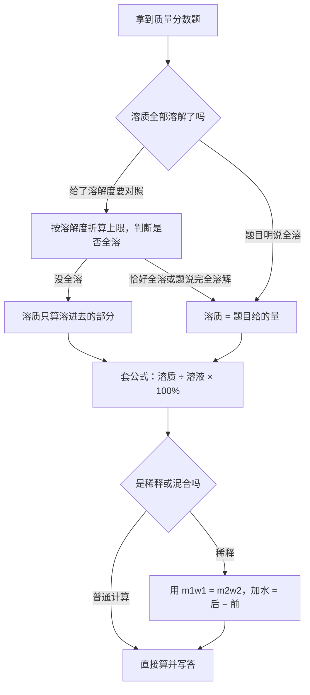
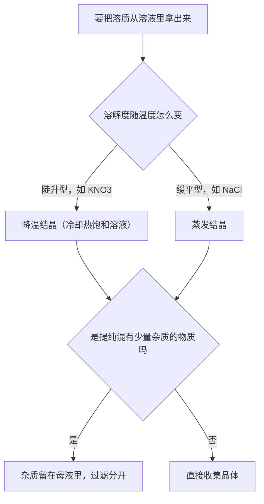
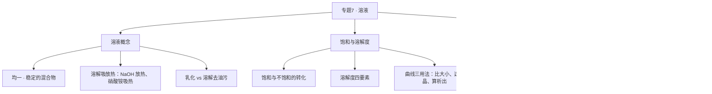

# 专题 7 · 溶液（详解版）

> **使用说明**：本文是详解版，从"为什么"讲起供从头自学；考前速查和掌握度跟踪在概要版：[[05-化学/知识点/专题7-溶液]]。

## 0️⃣ 这章学什么 & 中考怎么考

一句话：**这一章回答"一种东西化进水里，到底化了多少、怎么算"的问题。**

- 生活里的糖水、盐水、碘酒都是溶液。化学里更离不开它：专题 8 的酸碱盐反应几乎全在溶液里进行，所以溶液是"舞台"，先搭好舞台才能唱戏。
- 这章有三块内容：①溶液是什么（概念）；②溶解的"天花板"在哪（饱和与溶解度）；③"化了多少"怎么算（溶质质量分数）。
- 和前后章节的关系：前面 [[05-化学/知识点详解/专题6-化学变化及其表示]] 教的计算习惯在这里继续用；后面 [[05-化学/知识点详解/专题8-酸碱盐]] 的反应、除杂都默认你懂"可溶/不溶""溶液"这些词。

中考怎么考（只写库里有依据的）：

- 本专题是**一模范围**（老师明确"一模范围含专题 7"），学校已超前教完。
- 概要版原话："溶解度曲线 + 溶质质量分数计算 = 化学计算题的另一大源。"
- 常见题型（见 [[05-化学/专题/真题精讲/化-06-溶液与溶解度]] 的归纳）：①溶解度曲线判读（常以数据表或曲线呈现）；②饱和与不饱和转化；③溶质质量分数计算；④结合情境的说理（如卤水防堵）。

## 🧭 先修自检（学不下去先回到这里）

> 下面每一项都是本章的地基。做不出就先去补对应知识，硬学只会更挫败。

| # | 你应该会的 | 自查题（先做再看答案） | 答案 | 不会去哪补 |
| - | ---------- | ---------------------- | ---- | ---------- |
| 1 | 相对分子质量 | 算 $NaCl$（Na=23，Cl=35.5）、$KNO_3$（K=39，N=14） | 58.5；101 | [[05-化学/知识点/专题5-物质的微观构成]] |
| 2 | 百分数运算 | 25 是 125 的百分之几？ | $25\div125\times100\%=20\%$ | 小学数学 |
| 3 | 混合物与纯净物 | 糖水是纯净物还是混合物？ | 混合物（糖+水两种物质） | [[05-化学/知识点/专题5-物质的微观构成]] |
| 4 | 看坐标图 | 你知道横轴、纵轴各代表什么，怎么读某一点吗？ | 横轴自变量、纵轴因变量，先找横坐标再向上找交点 | 数学一次函数 |

第 4 项是溶解度曲线题的基本功：曲线题不过是把"一个量随另一个量变化"画成图——和数学里的函数图象是同一件事。

## 🌱 概念从头讲

> 每个概念按"**为什么需要它 → 它是什么 → 符号/化学式/单位 → 容易想错的地方**"四步讲。

### 概念 1：溶液

- **为什么需要**：把一勺糖扔进水里搅一搅，糖"消失"了，但喝起来是甜的——糖没有不见，它以肉眼看不见的小微粒均匀分散到了水里。这种"均匀混在一起"的状态太常用了（生理盐水、注射液、化学反应都在溶液里做），化学必须给它一个严格的名字。
- **定义**：一种（或几种）物质分散到另一种物质里，形成**均一的、稳定的混合物**，叫溶液。
- **组成**：溶液 = 溶质 + 溶剂。被溶解的物质叫溶质，起溶解作用的物质叫溶剂（最常见的是水）。质量关系永远成立：**溶液质量 = 溶质质量 + 溶剂质量**。
- **两个关键词**：
  - **均一**：溶液各处的组成、浓度完全一样——杯底和杯口一样甜。
  - **稳定**：放多久不分层、不沉降（对比：泥水静置会沉降，所以不是溶液）。
- **容易想错**：
  - ❌ "溶液一定是无色透明的。" → 错。$CuSO_4$ 溶液是**蓝色**的，$FeSO_4$ 溶液是**浅绿色**的。透明无色只是多数溶液的样子。
  - ❌ "溶质只能是固体。" → 错。汽水里的 $CO_2$ 是气体溶质；酒精消毒液里酒精是液体溶质。
  - ❌ "糖水静置几天，糖沉到底下。" → 不会。溶液是稳定的，这正是它与浊液的区别。

### 概念 2：溶解时的吸热与放热

- **为什么需要**：考试爱考"杯壁发烫/发凉"的现象解释题；做实验时也真会碰到——不提前知道，会被吓一跳。
- **是什么**：物质溶解在水里，其实同时发生两个过程：溶质的微粒**扩散**开（要吸热），微粒和水分子**结合**（会放热）。最终的冷热感觉，取决于这两个过程谁占上风。
- **典型例子（必背三个）**：

| 物质 | 溶于水的感觉 | 原因 |
| ---- | ---- | ---- |
| NaOH（氢氧化钠） | 明显放热，溶液温度升高 | 水合放热 > 扩散吸热 |
| $NH_4NO_3$（硝酸铵） | 吸热，溶液温度降低 | 扩散吸热 > 水合放热 |
| NaCl（食盐） | 温度基本不变 | 两个过程差不多打平 |

- **容易想错**：❌ "NaOH 溶于水放热，是因为它和水发生了化学反应。" → 溶解是物理过程，放热来自溶解过程本身，不要写成"反应放热"。

### 概念 3：乳化与溶解（两种去油污的原理）

- **为什么需要**：同样是"洗掉油污"，洗洁精和汽油的原理**完全不同**，这是经典选择题。
- **是什么**：
  - **乳化**：洗涤剂（洗洁精）使油以细小的液滴均匀分散在水中，形成乳浊液，随水冲走。油没有被"化"进水里，只是被打散了。
  - **溶解**：汽油把油"化"进自己体内，形成溶液。油真的溶了。
- **容易想错**：❌ "洗洁精去油污是溶解油污。" → 是**乳化**。汽油去油污才是溶解。

### 概念 4：饱和溶液与不饱和溶液

- **为什么需要**：一杯水能化糖是有上限的，超过上限再多加糖就沉在杯底。这个"上限"状态就是饱和，它是后面溶解度概念的起点。
- **定义**：在**一定温度下**、在**一定量溶剂**里，不能再溶解某种溶质的溶液，叫这种溶质的饱和溶液；还能继续溶解的，叫不饱和溶液。
- **转化方法（大多数固体溶质）**：

| 方向 | 方法 |
| ---- | ---- |
| 饱和 → 不饱和 | 加溶剂（加水）、升高温度 |
| 不饱和 → 饱和 | 加溶质、蒸发溶剂、降低温度 |

- **容易想错**：
  - ❌ 把转化方法背成"万能公式"。 → 上表对"大多数固体"成立；**氢氧化钙 $Ca(OH)_2$ 是反的**——它的溶解度随温度升高而减小，所以升温反而可能变饱和。
  - ❌ "饱和溶液一定是浓溶液。" → 错。"饱和"说的是"不能再溶"，"浓"说的是"溶得多"，是两个标准。同一种溶质在同一温度下，饱和溶液一定比不饱和的浓；**不同溶质之间不能比**（如饱和石灰水其实很稀）。
  - ❌ "一杯很浓的糖水，一定是饱和的。" → 不一定，可能还能再化糖。

### 概念 5：溶解度

- **为什么需要**："还能不能再化"太笼统，化学要定量：到底多少克才算"不能再化"？所以用"溶解度"这个数来钉死上限。
- **定义（固体溶解度，四要素缺一不可）**：在**一定温度**下，某固体物质在 **100 g 溶剂**（通常是水）里达到**饱和状态**时所溶解的**质量（单位 g）**。
  - 四要素：①温度；②100 g 溶剂；③饱和状态；④单位是克。说溶解度不提温度，等于没说。
- **影响因素**：内因是溶质、溶剂本身的性质；外因主要是**温度**。大多数固体的溶解度随温度升高**增大**（如 $KNO_3$ 陡增）；少数变化不大（如 NaCl）；$Ca(OH)_2$ 反常，随温度升高**减小**。
- **溶解度曲线的三个用法**：
  1. **比较大小**：同一温度下，谁的位置高谁的溶解度大。注意必须在**同一温度**比。
  2. **选结晶方法**：陡升型（$KNO_3$）→ **降温结晶**（冷却热饱和溶液）；缓平型（NaCl）→ **蒸发结晶**。口诀：**陡降冷、平蒸浓**。
  3. **混合物提纯**：$KNO_3$ 中混少量 NaCl → 降温结晶；NaCl 中混少量 $KNO_3$ → 蒸发结晶。
- **气体溶解度**：随温度升高**减小**、随压强增大**增大**。生活证据：烧开水前壁上冒小泡（升温气体跑出来）、开汽水瓶盖冒泡（减压气体跑出来）。
- **容易想错**：
  - ❌ "60℃ 时硝酸钾的溶解度比氯化钠大，所以任何温度下都大。" → 必须同温度比较。20℃ 时 NaCl（36.0 g）反而大于 $KNO_3$（31.6 g）。
  - ❌ 说溶解度忘了单位或温度 → 四要素扣掉一个，答案就不完整。

## 🧮 公式/规律逐个拆解

### 公式 1：溶质质量分数

$$\text{溶质质量分数}=\dfrac{\text{溶质质量}}{\text{溶液质量}}\times100\%$$

| 符号 | 含义 | 单位 |
| ---- | ---- | ---- |
| 溶质质量 | 已溶解的那部分溶质（沉在底下没化的不算） | g |
| 溶液质量 | 溶质质量 + 溶剂质量 | g |
| 结果 | 是个百分数，没有单位 | — |

- **成立条件**：溶质已全部溶解；没有晶体析出。沉在杯底的固体不算溶质！
- **常用变形**：溶质质量 = 溶液质量 × 质量分数；溶剂质量 = 溶液质量 − 溶质质量。
- **饱和溶液的极限公式**：饱和时 $w=\dfrac{S}{100+S}\times100\%$（$S$ 是该温度下的溶解度）。它只随温度变——同温度下，饱和溶液的浓度是定值。
- **最小例子**：20 g NaCl 溶于 80 g 水，全部溶解。
  $$w=\dfrac{20}{20+80}\times100\%=20\%$$
  注意分母是**溶液**质量 100 g，不是水 80 g——这是最容易错的地方。

### 公式 2：稀释问题（核心：稀释前后溶质质量不变）

$$m_1\times w_1=m_2\times w_2$$

| 符号 | 含义 |
| ---- | ---- |
| $m_1$、$w_1$ | 稀释前（浓）溶液的质量、质量分数 |
| $m_2$、$w_2$ | 稀释后（稀）溶液的质量、质量分数 |

- **为什么成立**：加水只添了水，溶质一颗没多没少，所以"浓溶液里的溶质 = 稀溶液里的溶质"。
- **加水量怎么算**：加水量 = 稀释后溶液质量 − 原溶液质量（**不是**溶质质量差）。
- **最小例子**：把 50 g 质量分数 20% 的溶液稀释成 5%，需加水多少克？
  - 溶质质量 $=50\times20\%=10$ g。
  - 稀释后总质量 $=10\div5\%=200$ g。
  - 加水 $=200-50=150$ g。✓

### 规律 3：混合溶液的质量分数

$$w=\dfrac{m_1w_1+m_2w_2}{m_1+m_2}$$

- **最小例子**：100 g 10% 的盐水与 100 g 30% 的盐水混合：$w=\dfrac{100\times10\%+100\times30\%}{100+100}=\dfrac{10+30}{200}=20\%$。✓

### 规律 4：配制一定溶质质量分数的溶液（步骤 + 误差分析）

- **步骤**：计算 → 称量（量取）→ 溶解 → 装瓶贴标签。
- **误差分析的关键**：先想这一步操作让**水少了还是多了**、**溶质少了还是多了**，再看分数会怎么变（溶质少或水多 → 偏小；溶质多或水少 → 偏大）。

| 错误操作 | 实际后果 | 质量分数 |
| ---- | ---- | ---- |
| 用量筒量水时**俯视**读数 | 实际取的水偏少 | 偏大 |
| 用量筒量水时**仰视**读数 | 实际取的水偏多 | 偏小 |
| 砝码生锈（砝码变重了） | 称的 NaCl 实际偏少 | 偏小 |
| 左码右物（且用了游码） | 称的 NaCl 实际偏少 | 偏小 |
| 装瓶前烧杯里有残留水 | 水多了 | 偏小 |

## 🪜 例题阶梯

> 三级台阶，每一级都要动笔跟着算，不许只看。

### 第 1 级 · 入门（照着模仿）

> **题目**：把 25 g 食盐完全溶解在 100 g 水里，求所得食盐水的溶质质量分数。
>
> **每一步为什么这么做**：
> 1. 认清三个量：溶质 = 25 g（食盐），溶剂 = 100 g（水）。
> 2. 溶液质量 = 溶质 + 溶剂 = 25 + 100 = 125 g。（分母必须是溶液，不能只写水——先用"25/100"算出 25% 是错的，那是"每 100 g 水化多少"，不是质量分数。）
> 3. 套公式求百分数。
>
> **完整解答**：
> $$w=\dfrac{25}{25+100}\times100\%=\dfrac{25}{125}\times100\%=20\%$$
> 答：溶质质量分数为 20%。

### 第 2 级 · 标准（中考中档）

> **题目**：20℃ 时 NaCl 的溶解度为 36.0 g。20℃ 时，在 50 g 水中加入 18 g NaCl，充分搅拌。求所得溶液的溶质质量分数。
>
> **读题→翻译成化学语言**：给了溶解度 = 提醒你先判断"18 g 能不能全溶"。判断完再算浓度。
>
> **每一步为什么这么做**：
> 1. 先算上限：溶解度 36.0 g 是"100 g 水"的标准，50 g 水最多溶多少？列比例：$\dfrac{36.0}{100}=\dfrac{x}{50}$，得 $x=18.0$ g。（溶解度是按 100 g 水定义的，水量变了要按比例折算。）
> 2. 判断：18 g ≤ 18.0 g，恰好全部溶解，且溶液恰好饱和。（这一步不能跳——如果加的是 25 g，就只有 18 g 溶进去，剩下 7 g 沉底，溶质只能算 18 g。）
> 3. 算质量分数：溶质 18 g，溶液 $50+18=68$ g。
>
> **完整解答**：设 20℃ 时 50 g 水最多溶解 NaCl 为 $x$。$\dfrac{36.0\text{ g}}{100\text{ g}}=\dfrac{x}{50\text{ g}}$，$x=18.0$ g；18 g ≤ 18.0 g，全部溶解。
> $$w=\dfrac{18}{50+18}\times100\%=\dfrac{18}{68}\times100\%\approx26.5\%$$
> 答：溶质质量分数约为 26.5%（此溶液恰好是 20℃ 的饱和溶液）。
> 顺手验一下：按饱和公式 $w=\dfrac{S}{100+S}=\dfrac{36}{136}\approx26.5\%$，两个算法结果一致。✓

### 第 3 级 · 提高（与压轴/综合题接轨）

> **题目**：$KNO_3$ 和 NaCl 的溶解度（g/100 g 水）如下表：
>
> | 温度 | 10℃ | 20℃ | 60℃ |
> | ---- | ---- | ---- | ---- |
> | $KNO_3$ | 20.9 | 31.6 | 110.0 |
> | NaCl | 35.8 | 36.0 | 37.3 |
>
> (1) 提纯混有少量 NaCl 的 $KNO_3$，选什么结晶方法？为什么？
> (2) 60℃ 的 $KNO_3$ 饱和溶液 210 g，降温到 20℃，能析出多少克晶体？
> (3) 把 60℃ 时两者的**饱和溶液**分别降温到 10℃，此时哪种溶液的溶质质量分数大？
>
> **思路从哪来**：三问分别对应溶解度曲线的三个用法——选结晶法、算析出量、比浓度。卡住时回到曲线：谁陡谁缓、降温后还有多少能留在水里。
>
> **完整解答**：
> (1) 选**降温结晶（冷却热饱和溶液）**。$KNO_3$ 的溶解度随温度陡升（10℃ 20.9 g → 60℃ 110.0 g），降温时会大量析出；NaCl 变化很小（35.8 → 37.3），基本留在溶液里。这样晶体是 $KNO_3$、杂质还在母液里，过滤分开即可。（若是"NaCl 中混少量 $KNO_3$"，就反过来用蒸发结晶。）
> (2) 60℃ 时 $KNO_3$ 溶解度 110.0 g，意思是"100 g 水里最多溶 110 g"，此时饱和溶液正好是 $110+100=210$ g。所以 210 g 饱和溶液里有 $KNO_3$ 110 g、水 100 g。降温到 20℃，100 g 水最多溶 31.6 g，多余的析出：
> $$110-31.6=78.4\text{ g}$$
> 答：析出 $KNO_3$ 晶体 78.4 g。
> (3) 降温后两溶液都析出晶体，都变成 10℃ 的**饱和**溶液，浓度由 10℃ 的溶解度决定：
> $$w(KNO_3)=\dfrac{20.9}{100+20.9}\times100\%\approx17.3\%$$
> $$w(NaCl)=\dfrac{35.8}{100+35.8}\times100\%\approx26.4\%$$
> 所以 10℃ 时 NaCl 溶液的溶质质量分数更大。（注意：60℃ 时是 $KNO_3$ 更浓，降温后反过来了——"高温溶解度大"不等于"低温浓度大"。）
>
> **和入门题的差别**：入门题套一次公式就完；这题每一步都要先"判断状态"（饱和吗？析出吗？），判断完才轮到公式。判断这一步才是溶解度题的灵魂。

## 🗺️ 解题流程图

**流程图 1：质量分数计算题的决策路线**

**流程图 2：结晶方法怎么选**

**知识结构图**：

## 🔥 易错点：为什么会错

| ❌ 常见错误想法 | 为什么会这样想 | ✅ 正确理解 / 自救方法 |
| -------------- | -------------- | ---------------------- |
| 说溶解度时不写温度 | 只背了"100 g 水" | 四要素缺一不可：温度、100 g 溶剂、饱和、单位 g |
| 质量分数的分母只写水 | 把"溶液"和"溶剂"混为一谈 | 分母 = 溶质 + 溶剂；先问自己"这杯东西一共多重" |
| 加水量 = 稀释前后溶质质量差 | 公式记岔了 | 加水只改变水：加水量 = 稀释后溶液质量 − 原溶液质量 |
| 蒸发掉水后还用原来的质量分数算 | 忘了浓度会变 | 析出晶体后若仍饱和，用**该温度的溶解度**重算 $w=\dfrac{S}{100+S}$ |
| $KNO_3$ 提纯选蒸发结晶 | 把两种结晶法背串了 | 口诀"陡降冷、平蒸浓"：陡升型降温结晶，缓平型蒸发结晶 |
| 饱和 = 浓 | 两个词日常口语里不分 | 饱和说的是"不能再溶"；不同溶质不能比（饱和石灰水就挺稀） |
| 化学反应后算溶液质量，忘了减气体沉淀 | 反应把质量"变没"了会慌 | 溶液质量 = 加入的全部 − 沉淀 − 气体 − 不溶杂质；一笔一笔记进账本 |
| $Ca(OH)_2$ 转化按"大多数固体"处理 | 只背了通用规律 | 记住反常分子：$Ca(OH)_2$ 溶解度随温度升高**减小**，转化方向全部反着来 |

## ✅ 自测清单（能独立做到才打勾）

- [ ] 1. 能背出溶液定义的两个关键词（均一、稳定），并举一个有色溶液的例子
- [ ] 2. 能说出 NaOH、$NH_4NO_3$、NaCl 溶于水的冷热表现
- [ ] 3. 能默写饱和⇄不饱和的转化方法，并指出 $Ca(OH)_2$ 反常在哪
- [ ] 4. 能完整说出溶解度四要素，并用"陡降冷、平蒸浓"选结晶方法
- [ ] 5. 能独立做出例题阶梯第 2 级（先判断全溶再算 26.5%）
- [ ] 6. 能独立做出第 3 级的析出晶体计算（210 g → 78.4 g）
- [ ] 7. 能解释"俯视量水偏大"这类至少三个配制误差
- [ ] 8. 能用饱和公式 $w=\dfrac{S}{100+S}$ 快速算饱和溶液浓度

## 🔗 关联

- 概要版：[[05-化学/知识点/专题7-溶液]]（掌握度在这边更新）
- 前置知识：[[05-化学/知识点详解/专题6-化学变化及其表示]]（计算规范）
- 后续/综合应用：[[05-化学/知识点详解/专题8-酸碱盐]]（酸碱盐反应都在溶液这个"舞台"上）
- 真题精讲：[[05-化学/专题/真题精讲/化-06-溶液与溶解度]]（本篇例题的原始出处与更多变式）
- 图像解释类说理：[[05-化学/专题/说理题方法]]
