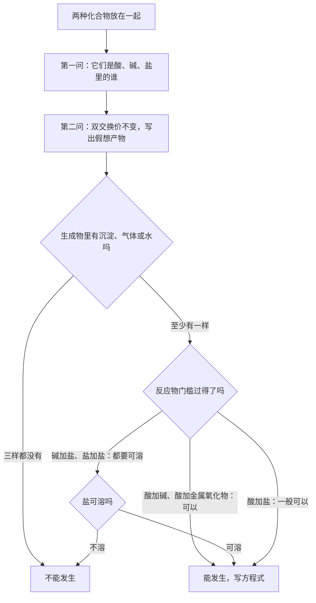
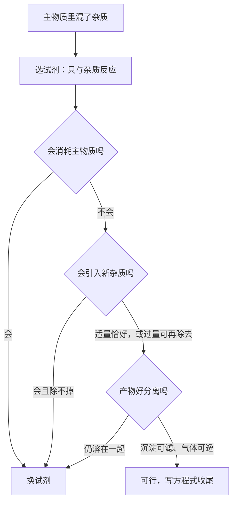
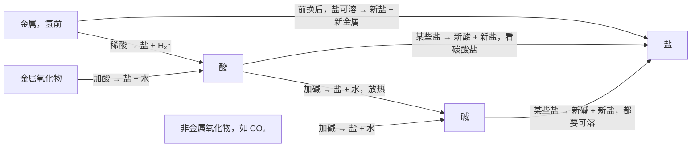
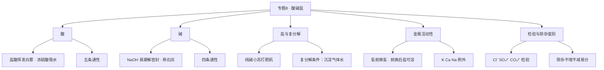

# 专题 8 · 酸、碱、盐（详解版）

> **使用说明**：本文是详解版，从"为什么"讲起供从头自学；考前速查和掌握度跟踪在概要版：[[05-化学/知识点/专题8-酸碱盐]]。

## 0️⃣ 这章学什么 & 中考怎么考

一句话：**这一章是初三化学的"操作系统"——酸、碱、盐互相之间怎么反应，决定了后面大题怎么解。**

- 生活里到处是酸碱盐：胃酸、食醋是酸；肥皂水、石灰水是碱；食盐、纯碱是盐。但考试重点不是"认识它们"，而是**它们碰到一起会发生什么**。
- 这章的核心武器有两件：①**复分解反应条件**（判断两个化合物能不能反应）；②**金属活动性顺序**（判断金属和酸、金属和盐能不能反应）。绝大多数酸碱盐大题，最后都归结为这两件武器的使用。
- 和前后章节的关系：[[05-化学/知识点详解/专题7-溶液]] 提供了"舞台"（可溶/不溶、溶液质量）；本章的反应方程式全部用 [[05-化学/知识点详解/专题6-化学变化及其表示]] 的规范书写。

中考怎么考（只写库里有依据的）：

- 老师点名重点（空中课堂专题 8）；概要版原话："酸碱盐反应网络 + 复分解条件 = 中考大题的'操作系统'"，"一模范围内（88 页前）的核心"。
- 一模范围 = 八年级全一册 + 九年级 88 页以前（页界以老师通知为准，见 [[05-化学/学科总览]]）。
- 常见考法：方程式默写（每周任务）、复分解判断、离子检验、除杂与鉴别、金属活动性应用推断、以及大量以此情境的**说理题**（新中考说理题多在酸碱盐情境里，见 [[05-化学/专题/说理题方法]]）。

## 🧭 先修自检（学不下去先回到这里）

> 下面每一项都是本章的地基。做不出就先去补对应知识，硬学只会更挫败。

| # | 你应该会的 | 自查题（先做再看答案） | 答案 | 不会去哪补 |
| - | ---------- | ---------------------- | ---- | ---------- |
| 1 | 化合价与化学式 | 写出：碳酸钠、硫酸钡、氢氧化铁（铁 +3 价）、硝酸银 | $Na_2CO_3$、$BaSO_4$、$Fe(OH)_3$、$AgNO_3$ | [[05-化学/知识点/专题5-物质的微观构成]] |
| 2 | 配平 | 配平：$Al+HCl\rightarrow AlCl_3+H_2\uparrow$ | $2Al+6HCl=2AlCl_3+3H_2\uparrow$ | [[05-化学/知识点/专题6-化学变化及其表示]] |
| 3 | 金属活动性顺序 | 默写整条顺序 | K Ca Na Mg Al Zn Fe Sn Pb (H) Cu Hg Ag Pt Au | [[05-化学/闪卡/化学方程式与化合价默写]] |
| 4 | 四个基本反应类型 | 复分解反应的形式是什么？ | $AB+CD\rightarrow AD+CB$（两化合物互换成分） | [[05-化学/知识点/专题6-化学变化及其表示]] |
| 5 | 溶液常识 | "可溶"是什么意思？溶液质量怎么算？ | 能溶解形成均一稳定混合物；溶液 = 溶质 + 溶剂 | [[05-化学/知识点/专题7-溶液]] |

第 3 项必须做到 10 秒内脱口而出——金属活动性是本章用得最多的表，考试没时间让你慢慢想。

## 🌱 概念从头讲

> 每个概念按"**为什么需要它 → 它是什么 → 符号/化学式/单位 → 容易想错的地方**"四步讲。

### 概念 1：酸

- **为什么需要**：你早就在"用"酸——食醋含醋酸，胃里有盐酸帮助消化，汽车电瓶里是硫酸。化学要研究它们共同的脾气，就要先给"酸"下定义。
- **定义**：溶于水解离出的阳离子**全部是 $H^+$** 的化合物。（初中记法：酸 = $H^+$ + 酸根，见 [[05-化学/知识点/专题5-物质的微观构成]]。）
- **常见的酸（两个必须熟透）**：

| 名称 | 化学式 | 关键性质 |
| ---- | ---- | ---- |
| 盐酸 | HCl | 无色刺激性气味液体；**浓盐酸有挥发性**——打开瓶口出现白雾（挥出的 HCl 气体与水汽结合成盐酸小液滴） |
| 硫酸 | $H_2SO_4$ | **浓硫酸有吸水性**（可作气体干燥剂）和**脱水性**（把纸张、皮肤里的氢氧元素按水的比例"夺走"，造成腐蚀） |

- **稀释浓硫酸的操作（必背）**：**酸入水、沿器壁慢慢倒、不断搅拌**。为什么？浓硫酸溶于水放出大量热，且浓硫酸密度比水大。把酸倒进水里，热量被大量的水吸收、搅拌散热，安全；反过来把水倒进浓硫酸，水浮在酸面上，放出的热让水立刻沸腾，带着酸液飞溅伤人。
- **酸的通性（5 条，每条配方程式）**：

| 通性 | 例子与方程式 | 现象要点 |
| ---- | ---- | ---- |
| ①使指示剂变色 | 见概念 2 | 酸使紫色石蕊变红 |
| ②与活泼金属反应 | $Fe+H_2SO_4=FeSO_4+H_2\uparrow$ | 有气泡；溶液变浅绿（$Fe^{2+}$） |
| ③与金属氧化物反应 | $CuO+H_2SO_4=CuSO_4+H_2O$ | 黑色固体溶解，溶液变蓝 |
| ④与碱反应（中和） | $HCl+NaOH=NaCl+H_2O$ | 放热 |
| ⑤与某些盐反应 | $CaCO_3+2HCl=CaCl_2+H_2O+CO_2\uparrow$ | 有气泡 |

- **容易想错**：
  - ❌ "盐酸能使石蕊变蓝。" → 石蕊遇**酸红**、遇**碱蓝**，别背反。
  - ❌ "浓盐酸的'白雾'是烟。" → 雾是小液滴（盐酸小液滴），烟是固体小颗粒，描述要准确。
  - ❌ "稀硫酸也能做干燥剂。" → 吸水性是**浓**硫酸的性质，稀硫酸没有。

### 概念 2：酸碱指示剂

- **为什么需要**：酸碱溶液大多无色透明，肉眼分不出谁是谁。需要一种"变色信使"来报告。
- **是什么**：能跟酸或碱的溶液起作用而显示不同颜色的物质。

| 指示剂 | 遇酸溶液 | 遇中性溶液 | 遇碱溶液 |
| ---- | ---- | ---- | ---- |
| 紫色石蕊试液 | 变**红** | 紫色不变 | 变**蓝** |
| 无色酚酞试液 | **不变色**（仍无色） | 不变色 | 变**红** |

- **容易想错**：❌ "酚酞遇酸变红/变无色。" → 酚酞遇酸**不变色**（还是无色），不是"变无色"——它本来就无色，谈不上变。❌ "石蕊是酸碱指示剂，指示剂就是石蕊。" → 指示剂是一类物质，石蕊、酚酞是其中两种。

### 概念 3：碱

- **为什么需要**：中和胃酸要用碱、改良酸性土壤要用碱、检验二氧化碳还要用碱。碱和酸是一对"性格相反"的搭档。
- **定义**：溶于水解离出的阴离子**全部是 $OH^-$** 的化合物。（初中记法：碱 = 金属离子 + $OH^-$。）
- **常见的碱（三个）**：

| 名称 | 化学式 | 俗名 | 关键性质 |
| ---- | ---- | ---- | ---- |
| 氢氧化钠 | NaOH | 烧碱、火碱、苛性钠 | 强腐蚀性；**易潮解**（吸水，可作干燥剂）；必须密封保存——既防潮解又防吸收 $CO_2$ 变质 |
| 氢氧化钙 | $Ca(OH)_2$ | 熟石灰、消石灰 | 其水溶液即**石灰水**，用于检验 $CO_2$；便宜，用于改良酸性土壤 |
| 氨水 | $NH_3\cdot H_2O$ | — | 弱碱，有刺激性气味（化肥碳酸氢铵"有气味"的辨析对象） |

- **NaOH 为什么不能干燥 $CO_2$、$SO_2$**：因为它们会**反应**——$2NaOH+CO_2=Na_2CO_3+H_2O$。干燥剂只能干燥不与它反应的气体。
- **碱的通性（4 条）**：

| 通性 | 例子与方程式 |
| ---- | ---- |
| ①使指示剂变色 | 石蕊变蓝、酚酞变红 |
| ②与非金属氧化物反应 | $2NaOH+CO_2=Na_2CO_3+H_2O$；$CO_2+Ca(OH)_2=CaCO_3\downarrow+H_2O$ |
| ③与酸反应（中和） | $Ca(OH)_2+2HCl=CaCl_2+2H_2O$ |
| ④与某些盐反应 | $CuSO_4+2NaOH=Cu(OH)_2\downarrow+Na_2SO_4$（蓝色沉淀） |

- **容易想错**：❌ "碱溶液都有腐蚀性，不能摸。" → 程度不同，但初中统一按"碱有腐蚀性、要小心"处理；❌ "NaOH 潮解是化学变化。" → 潮解是吸收水分**溶解**的过程，没有新物质生成，是物理变化（但吸收 $CO_2$ 变质是化学变化，两件事别混）。

### 概念 4：中和反应与 pH

- **为什么需要**：酸碱碰在一起会互相"抵消"，这是酸碱化学里最重要的一类反应——治胃酸、改良土壤、处理工厂废水都靠它。
- **定义**：**酸 + 碱 → 盐 + 水**。放热。
- **微观本质**：$H^++OH^-=H_2O$。酸给出 $H^+$，碱给出 $OH^-$，两者一见面就结合成水，剩下的离子凑成盐。这个视角能解释"为什么不同的中和反应本质相同"。
- **两个常用方程式**：
  - $HCl+NaOH=NaCl+H_2O$（本身已平：Na 1=1，Cl 1=1，H 1+1=2，O 1=1 ✓）
  - $Ca(OH)_2+2HCl=CaCl_2+2H_2O$（配平演示：右边 $CaCl_2$ 有 2 个 Cl → 左边 HCl 前配 2；这 2 个 H 加上 $Ca(OH)_2$ 的 2 个 H 共 4 个 → 右边 $H_2O$ 前配 2。检查：Ca 1=1，Cl 2=2，H 4=4，O 2=2 ✓）
- **应用**：胃酸过多服用含 $Al(OH)_3$ 的药物——$Al(OH)_3+3HCl=AlCl_3+3H_2O$；酸性土壤撒熟石灰。
- **pH——给酸碱性强弱打分**：

| pH 范围 | 酸碱性 |
| ---- | ---- |
| pH < 7 | 酸性（越小酸性越强） |
| pH = 7 | 中性 |
| pH > 7 | 碱性（越大碱性越强） |

- **pH 试纸的正确用法**：用玻璃棒蘸取待测液，滴在 pH 试纸上，把显示的颜色与标准比色卡对照。**两条禁令**：不能把试纸直接伸进溶液；**不能先用蒸馏水润湿试纸**——润湿等于把待测液稀释：酸性溶液 pH 会偏**大**、碱性偏**小**、中性不变。要精确读数用 pH 计。
- **容易想错**：❌ "中和反应都无明显现象，所以看不出发生了。" → 无现象不等于没反应；要"看见"中和，可以借助指示剂（如向 NaOH 中滴酚酞变红，再滴盐酸，红色褪去说明碱被消耗）。

### 概念 5：盐

- **为什么需要**：食盐让食物有味道，纯碱蒸馒头，胆矾配农药……"盐"是酸碱反应最常见的产物，必须系统认识。
- **定义**：由金属离子（或铵根离子）和酸根离子构成的化合物。注意：**盐是一类物质的名字，不等于食盐 NaCl**。
- **常见盐（必背五个）**：

| 名称 | 化学式 | 俗名/颜色 | 要点 |
| ---- | ---- | ---- | ---- |
| 氯化钠 | NaCl | 食盐 | 生活必需，用作原料 |
| 碳酸钠 | $Na_2CO_3$ | 纯碱、苏打 | **是盐不是碱**（虽叫"纯碱"，但它由 $Na^+$ 和 $CO_3^{2-}$ 构成） |
| 碳酸氢钠 | $NaHCO_3$ | 小苏打 | 受热易分解，用于发酵粉 |
| 碳酸钙 | $CaCO_3$ | 石灰石、大理石主要成分 | 难溶；与盐酸反应制 $CO_2$ |
| 五水硫酸铜 | $CuSO_4\cdot5H_2O$ | 胆矾 | **蓝色晶体**；其溶液也呈蓝色 |

- **常见沉淀速查（本章成败的关键表）**：

| 沉淀 | 化学式 | 颜色 | 溶于稀硝酸吗 |
| ---- | ---- | ---- | ---- |
| 硫酸钡 | $BaSO_4$ | 白色 | **不溶** |
| 氯化银 | AgCl | 白色 | **不溶** |
| 碳酸钙 | $CaCO_3$ | 白色 | 溶，放出气泡 |
| 碳酸钡 | $BaCO_3$ | 白色 | 溶，放出气泡 |
| 氢氧化铜 | $Cu(OH)_2$ | **蓝色** | 溶 |
| 氢氧化铁 | $Fe(OH)_3$ | **红褐色** | 溶 |
| 氢氧化镁 | $Mg(OH)_2$ | 白色 | 溶 |

- **溶解性口诀（判断复分解的法宝）**：**钾钠铵盐硝酸盐，完全溶解不困难；盐酸盐不溶银亚汞；硫酸盐不溶钡和铅；碳酸盐只溶钾钠铵。**（见 [[05-化学/闪卡/化学方程式与化合价默写]]）
- **容易想错**：❌ "纯碱是碱。" → 名字里有"碱"不一定是碱，看构成：金属离子 + 酸根 → 盐。❌ "硫酸铜是蓝色，所以硫酸盐都蓝。" → 蓝色来自 $Cu^{2+}$，不是 $SO_4^{2-}$。

### 概念 6：复分解反应

- **为什么需要**：酸、碱、盐之间的反应几乎全是这一类。判断"两个化合物碰到一起能不能反应"，就是判断"能不能发生复分解"——这是本章判断题的总开关。
- **定义**：两种化合物互相交换成分，生成另外两种化合物的反应。形式：$AB+CD\rightarrow AD+CB$。口诀：**双交换、价不变**（元素化合价都不变）。
- **发生条件（只看生成物！）**：生成物中有**沉淀、气体或水**，至少占一样。三样都没有，反应不发生。
- **为什么是这个条件**：复分解的实质是溶液里的离子互相结合。只有结合成"跑不掉"的东西（沉淀沉底、气体飞走、水极难电离），离子才会不断减少，反应才推得动。
- **反应物一般也要可溶**（详见下一节规律拆解）。
- **容易想错**：
  - ❌ "反应物里有沉淀/气体，所以不能反应。" → 条件看的是**生成物**，不是反应物。$CaCO_3$（不溶）与稀盐酸照样剧烈反应，因为生成物里有 $CO_2\uparrow$。
  - ❌ "复分解有单质参加。" → 复分解的双方都是化合物；有单质参加/生成的通常是置换或其他类型。

### 概念 7：金属活动性顺序

- **为什么需要**：金属和酸、金属和盐的反应，凭什么判断"行不行"？靠一张排队表——活动性顺序。它是本章第二大武器。
- **是什么**：按金属"活泼程度"从强到弱排队：

$$K\ Ca\ Na\ Mg\ Al\ Zn\ Fe\ Sn\ Pb\ (H)\ Cu\ Hg\ Ag\ Pt\ Au$$

  口诀：钾钙钠镁铝、锌铁锡铅氢、铜汞银铂金。
- **两条应用**（详见下一节）：
  1. **氢前换氢**：排在 H 前面的金属，能置换出稀酸（盐酸、稀硫酸）中的氢，放出 $H_2$；H 后面的（Cu、Ag 等）不能。
  2. **前换后**：排在前面的金属，能把排在后面的金属从它的**盐溶液**里置换出来（盐必须**可溶**）。
- **容易想错**：
  - ❌ "Fe 放进 AgCl 里能置换出 Ag。" → $AgCl$ **不溶**，溶液里没有 $Ag^+$，反应无从发生。"前换后"永远配一句"盐可溶"。
  - ❌ "K、Ca、Na 也能用前换后。" → 它们太活泼，遇到盐溶液**先与水反应**，不能按常规置换盐中的金属，属于例外。
  - ❌ "Cu 能与稀盐酸反应出氢气。" → Cu 排在 H 后，不与稀盐酸、稀硫酸反应。

### 概念 8：离子的检验

- **为什么需要**：拿到一瓶未知溶液，怎么知道里面有没有 $Cl^-$、$SO_4^{2-}$、$CO_3^{2-}$？工业和实验里天天要回答这个问题，考试也必考。
- **是什么**：加入特定试剂，靠**特征现象**（特征颜色的沉淀、气泡等）确认某种离子的存在。

| 要检验的离子 | 加什么 | 现象 | 结论依据 |
| ---- | ---- | ---- | ---- |
| $Cl^-$ | $AgNO_3$ 溶液和稀硝酸 | 不溶于稀硝酸的白色沉淀 | AgCl 白色且不溶于稀硝酸 |
| $SO_4^{2-}$ | $Ba(NO_3)_2$ 溶液和稀硝酸 | 不溶于稀硝酸的白色沉淀 | $BaSO_4$ 白色且不溶于稀硝酸 |
| $CO_3^{2-}$ | 稀盐酸 | 产生气体，气体使澄清石灰水变浑浊 | 碳酸盐遇酸出 $CO_2$ |

- **为什么检验时要加稀硝酸**：排除干扰。碳酸盐遇到 $AgNO_3$ 也会产生白色沉淀（碳酸银），但它能溶于稀硝酸；$AgCl$ 不溶。"不溶于稀硝酸的白色沉淀"这个限定语就是用来排除冒名顶替者的。
- **容易想错**：❌ "产生白色沉淀就是 $Cl^-$。" → 必须说全：加的是 $AgNO_3$ 和稀硝酸，沉淀**不溶于稀硝酸**，才能下结论。检验题的分数全在这句话的完整性上。

### 概念 9：除杂与鉴别（两件不同的事）

- **为什么需要**：实验题里总有一瓶"不纯"的溶液。**除杂**是"把杂质去掉、留下主角"；**鉴别**是"把几瓶东西认出来"。两件事的目的不同，做法评价标准也不同。
- **除杂三原则**：
  1. **不增**：不引入新的杂质；
  2. **不减**：不消耗被提纯的主角；
  3. **易分**：反应产物与主角好分开（沉淀可过滤、气体可逸出）。
- **鉴别三原则**：现象不同、步骤最少、操作最简。
- **容易想错**：❌ 除杂时"过量"的试剂随手一加。 → 过量试剂本身就是新杂质，除非它过量后能被后续操作除去。通常优先选"适量"，或者设计成"过量 + 后续分离"。

## 🧮 公式/规律逐个拆解

### 规律 1：复分解反应判断——三问流程（含配平演示）

拿到"这两个化合物能反应吗"，按三问走：

1. **问类别**：它们分别是酸、碱、盐里的谁？（对照通性表，不同组合的"门槛"不同。）
2. **问产物**：互换成分（双交换、价不变），假装写出产物。
3. **问生成物**：产物里有沉淀、气体或水吗？有至少一样 → 能发生；一样都没有 → 不发生。

**反应物可溶性的门槛**：

| 组合 | 反应物条件 | 例子 |
| ---- | ---- | ---- |
| 酸 + 碱 | 都行（中和一定生成水） | $HCl+NaOH=NaCl+H_2O$ |
| 酸 + 金属氧化物 | 都行（生成盐和水） | $CuO+H_2SO_4=CuSO_4+H_2O$ |
| 酸 + 盐 | 一般可以（盐即使不溶也常能反应，如碳酸盐遇酸出气） | $CaCO_3+2HCl=CaCl_2+H_2O+CO_2\uparrow$ |
| 碱 + 盐 | **两种都要可溶** | $CuSO_4+2NaOH=Cu(OH)_2\downarrow+Na_2SO_4$ |
| 盐 + 盐 | **两种都要可溶** | $BaCl_2+Na_2SO_4=BaSO_4\downarrow+2NaCl$ |

**配平演示 1**：$Na_2CO_3+HCl\rightarrow NaCl+H_2O+CO_2\uparrow$

1. 钠：左 2 个 → 右 NaCl 前配 2；
2. 氯：右 2 个 → 左 HCl 前配 2；
3. 氢：左 2 个 → 右 $H_2O$ 正好 2 个（不配）；碳 1=1；氧：左 3 = 右 $1+2=3$。✓

$$Na_2CO_3+2HCl=2NaCl+H_2O+CO_2\uparrow$$

**配平演示 2**：$FeCl_3+NaOH\rightarrow Fe(OH)_3\downarrow+NaCl$

1. 铁：1=1，先不动；看 $Fe(OH)_3$ 里有 3 个 OH → 左 NaOH 前配 3；
2. 钠：左 3 个 → 右 NaCl 前配 3；氯：左 3 = 右 3。✓

$$FeCl_3+3NaOH=Fe(OH)_3\downarrow+3NaCl$$

### 规律 2：金属活动性两条应用（逐条配例子）

**应用一：氢前金属 + 稀酸 → 盐 + $H_2\uparrow$**

- 例：$Fe+H_2SO_4=FeSO_4+H_2\uparrow$（有气泡，溶液变浅绿色）。
- 反例：Cu 排在 H 后，与稀盐酸、稀硫酸**不反应**，没有气泡。
- 注意两点：①这里的酸指盐酸和稀硫酸；②铁与酸、与盐溶液反应都生成**+2 价的亚铁盐**（溶液浅绿），不是 +3 价。

**应用二：前换后——活泼金属把不活泼金属从它的盐溶液里置换出来**

- 例：$Fe+CuSO_4=FeSO_4+Cu$（湿法炼铜：铁表面析出红色固体，溶液由蓝变浅绿）。
- 两个前提缺一不可：①排在前面的换后面的；②**盐必须可溶**（$AgCl$ 不溶，Fe 置不出 Ag）。
- 例外：K、Ca、Na 太活泼，放入盐溶液**先与水反应**，不按此规律置换。

**组合判断速查表**：

| 组合 | 能否反应 | 依据 |
| ---- | ---- | ---- |
| Fe + 稀盐酸 | 能，出气泡 | Fe 在 H 前 |
| Cu + 稀盐酸 | 不能 | Cu 在 H 后 |
| Fe + $CuSO_4$ 溶液 | 能，铁表面变红 | 前换后，盐可溶 |
| Cu + $FeSO_4$ 溶液 | 不能 | Cu 在 Fe 后（后不能换前） |
| Fe + $AgNO_3$ 溶液 | 能 | Fe 在 Ag 前，盐可溶 |
| Fe + $AgCl$ 固体 | 不能 | $AgCl$ 不溶，溶液里没有 $Ag^+$ |
| Na + $CuSO_4$ 溶液 | 不按置换走 | K Ca Na 例外，先与水反应 |

### 规律 3：除杂三原则的实操（两道最小例子）

**例 1**：NaCl 溶液中混有少量 $Na_2SO_4$，怎么除？

- 选试剂：要只与 $SO_4^{2-}$ 反应、沉淀掉它，又不给溶液添新离子——$BaCl_2$ 溶液正合适：$BaCl_2+Na_2SO_4=BaSO_4\downarrow+2NaCl$。
- 三原则检查：**不增**——加进来的 $Ba^{2+}$ 变成沉淀走了，$Cl^-$ 本来就是 NaCl 的成分；**不减**——NaCl 全程没被消耗；**易分**——$BaSO_4$ 是沉淀，过滤即分。
- 操作：加入**适量** $BaCl_2$ 溶液，过滤。

**例 2**：NaCl 溶液中混有少量 $Na_2CO_3$，怎么除？

- 加**适量稀盐酸**：$Na_2CO_3+2HCl=2NaCl+H_2O+CO_2\uparrow$。气体逸出、生成的水和 NaCl 都是"自己人"。
- 为什么不用稀硫酸？会生成 $Na_2SO_4$ 新杂质，违反"不增"。

**"过量"怎么办**：若某一步只能加过量试剂（比如为了把某杂质**完全**除去），过量部分就是新杂质，必须安排后续步骤除去。答题表述要写清"适量"或"加过量 X，再加适量 Y 除去过量的 X"。

### 规律 4：判断酸碱性用什么（速查）

| 想知道什么 | 用什么 | 现象与结论 |
| ---- | ---- | ---- |
| 是不是酸性 | 紫色石蕊试液 | 变红是酸 |
| 是不是碱性 | 无色酚酞试液 | 变红是碱 |
| 酸碱性强到什么程度 | pH 试纸（粗测）/ pH 计（精测） | pH<7 酸、=7 中、>7 碱 |

## 🪜 例题阶梯

> 三级台阶，每一级都要动笔跟着写，不许只看。

### 第 1 级 · 入门（照着模仿）

> **题目**：下列各组物质能发生反应吗？能发生的写出化学方程式。
> (1) NaOH 溶液与稀盐酸；(2) NaCl 溶液与 $KNO_3$ 溶液混合；(3) $Na_2CO_3$ 溶液与稀盐酸。
>
> **每一步为什么这么做**：每小题都走"三问"：问类别 → 问产物（双交换、价不变）→ 问生成物有没有沉淀/气体/水。
>
> **完整解答**：
> (1) 类别：碱+酸。互换产物：NaCl 和 $H_2O$。生成物里有**水** → 能发生。
> $$HCl+NaOH=NaCl+H_2O$$（Na 1=1，Cl 1=1，H 1+1=2，O 1=1 ✓）
> (2) 类别：盐+盐。假设互换产物：$NaNO_3$ 和 KCl——都可溶，无沉淀、无气体、无水 → **不发生**。
> (3) 类别：盐+酸。互换产物：NaCl 和 $H_2CO_3$；$H_2CO_3$ 不稳定，分解成 $H_2O$ 和 $CO_2\uparrow$。生成物里有气体和水 → 能发生。
> $$Na_2CO_3+2HCl=2NaCl+H_2O+CO_2\uparrow$$（配平见规律 1 演示 1 ✓）

### 第 2 级 · 标准（中考中档）

> **题目**：三瓶失去标签的无色液体：稀盐酸、NaOH 溶液、NaCl 溶液。只用一种试剂把它们鉴别开；再进一步确认"是盐酸"的那瓶里确实含 $Cl^-$。
>
> **读题→翻译成化学语言**：三瓶液体分别呈酸性、碱性、中性——要找一种试剂对三种情况给出**三种不同现象**。
>
> **每一步为什么这么做**：
> 1. 选试剂：紫色石蕊试液。酸性变红、碱性变蓝、中性不变——三种现象，一步分开。（为什么不用酚酞？酚酞遇酸和遇中性都无色，盐酸和 NaCl 分不开，只能分两步，不符合"步骤最少"。）
> 2. 操作：各取少量于试管中，分别滴入几滴紫色石蕊试液，观察颜色。
> 3. 确认 $Cl^-$：另取"变红"那瓶少量，滴加 $AgNO_3$ 溶液和稀硝酸，若产生**不溶于稀硝酸的白色沉淀**，则确认含 $Cl^-$。（为什么加稀硝酸：排除碳酸盐等干扰——碳酸盐遇 $AgNO_3$ 产生的白色沉淀能溶于稀硝酸，AgCl 不溶。）
>
> **完整解答**：
> 第一步：滴入紫色石蕊试液——变红的是稀盐酸，变蓝的是 NaOH 溶液，仍为紫色的是 NaCl 溶液。
> 第二步（确认）：$AgNO_3+HCl=AgCl\downarrow+HNO_3$（Ag 1=1，Cl 1=1，N 1=1，H 1=1 ✓），白色沉淀不溶于稀硝酸，证明该瓶是盐酸。

### 第 3 级 · 提高（与压轴/综合题接轨）

> **题目**：向含有 $AgNO_3$ 和 $Cu(NO_3)_2$ 的混合溶液中加入一定量铁粉，充分反应后过滤。讨论：滤渣、滤液中分别可能含什么物质？
>
> **思路从哪来**：先比活动性：Fe > Cu > Ag，铁粉会把它们**从远到近**依次置换——先置换与 Fe 活动性差距最大的 Ag（$AgNO_3$ 先反应完），再轮到 $Cu(NO_3)_2$。卡住时按"铁粉加了多少"分段想。
>
> **完整解答**：发生的反应（先 1 后 2）：
> $$Fe+2AgNO_3=Fe(NO_3)_2+2Ag$$（Fe 1=1，Ag 2=2，N 2=2，O 6=6 ✓）
> $$Fe+Cu(NO_3)_2=Fe(NO_3)_2+Cu$$（Fe 1=1，Cu 1=1，N 2=2，O 6=6 ✓）
>
> | 铁粉的量 | 滤渣 | 滤液 |
> | ---- | ---- | ---- |
> | 少量，只置换了部分 Ag | Ag | $AgNO_3$、$Cu(NO_3)_2$、$Fe(NO_3)_2$ |
> | 恰好把 Ag 置换完 | Ag | $Cu(NO_3)_2$、$Fe(NO_3)_2$ |
> | Ag 置换完，又置换了部分 Cu | Ag、Cu | $Cu(NO_3)_2$（剩余）、$Fe(NO_3)_2$ |
> | 过量（Cu 也全部置换完） | Ag、Cu、Fe | 只有 $Fe(NO_3)_2$ |
>
> 两条"一定"：滤液中**一定**有 $Fe(NO_3)_2$（只要铁粉参加了反应就有）；滤渣中**一定**有 Ag（铁粉先置换它）。
>
> **和入门题的差别**：入门题只判断"能不能反应"；这题要按加入量**分段讨论反应进行到哪一步**，还要分清"一定有"和"可能有"。这是金属活动性大题的标准考法，也常出现在工艺流程和实验探究里。

## 🗺️ 解题流程图

**流程图 1：复分解反应能不能发生**

**流程图 2：除杂题怎么下手**

**流程图 3：酸碱盐反应网络（画进你自己的图谱里）**

**知识结构图**：

## 🔥 易错点：为什么会错

| ❌ 常见错误想法 | 为什么会这样想 | ✅ 正确理解 / 自救方法 |
| -------------- | -------------- | ---------------------- |
| "$Na_2CO_3$ 名字叫纯碱，所以是碱" | 被俗名带偏 | 看构成：$Na^+$ + 酸根 $CO_3^{2-}$ → 是**盐**；"纯碱"只是俗名 |
| "Fe 放进 $AgCl$ 里能置换出 Ag" | 只背了"前换后"半句 | 全句是"前换后、**盐可溶**"；$AgCl$ 不溶，溶液里没有 $Ag^+$ |
| "反应物里有沉淀，所以不反应" | 把条件安错了地方 | 复分解条件看**生成物**：$CaCO_3$ 不溶，照样与盐酸反应出气 |
| "K、Ca、Na 也能按前换后置换盐中金属" | 背表时漏了例外 | 它们遇盐溶液**先与水反应**，属于例外 |
| pH 试纸先润湿再测 | 以为"洗一洗更干净" | 润湿 = 稀释：酸性偏大、碱性偏小；试纸绝不能润湿，也不能伸进溶液 |
| 除杂试剂"过量"随便写 | 觉得多了更保险 | 过量试剂就是新杂质；写"适量"，或"过量后继续加 X 除去" |
| "酚酞遇酸变无色" | 只记得酚酞会变色 | 酚酞遇酸**不变色**（本来就无色）；遇碱才变红 |
| 用 NaOH 干燥 $CO_2$ | 以为干燥剂百搭 | NaOH 会吸收 $CO_2$：$2NaOH+CO_2=Na_2CO_3+H_2O$，不能干燥酸性气体 |
| 稀释浓硫酸时把水倒进酸里 | 顺序背反 | **酸入水**、沿壁缓慢、不断搅拌；水入酸会沸腾飞溅伤人 |
| 沉淀颜色张冠李戴 | 白色沉淀太多记混 | 抓住三个有色必背：$Cu(OH)_2$ **蓝**、$Fe(OH)_3$ **红褐**、胆矾蓝；再记 $BaSO_4$、AgCl 不溶于稀硝酸 |

## ✅ 自测清单（能独立做到才打勾）

- [ ] 1. 能默写金属活动性顺序，并说出两条应用加一个例外
- [ ] 2. 能背出浓盐酸挥发性、浓硫酸吸水性/脱水性，并写出稀释浓硫酸的正确操作
- [ ] 3. 能默写酸的五条通性、碱的四条通性，各配一个方程式
- [ ] 4. 能用三问流程独立判断复分解反应能否发生（第 1 级例题）
- [ ] 5. 能默写七种常见沉淀及颜色，指出哪两种不溶于稀硝酸
- [ ] 6. 能完整写出 $Cl^-$、$SO_4^{2-}$、$CO_3^{2-}$ 的检验方案（试剂、现象、结论）
- [ ] 7. 能用一种试剂鉴别盐酸、NaOH、NaCl 三瓶液体，并确认 $Cl^-$（第 2 级例题）
- [ ] 8. 能独立完成铁粉加进 $AgNO_3$、$Cu(NO_3)_2$ 混合溶液的分段讨论（第 3 级例题）
- [ ] 9. 能用除杂三原则检查一道除杂方案并写出方程式
- [ ] 10. 能默写溶解性口诀，并用它解释"盐+盐反应要可溶"

## 🔗 关联

- 概要版：[[05-化学/知识点/专题8-酸碱盐]]（掌握度在这边更新）
- 前置知识：[[05-化学/知识点详解/专题7-溶液]]（可溶/不溶、溶液质量）· [[05-化学/知识点详解/专题6-化学变化及其表示]]（方程式规范）
- 后续/综合应用：[[05-化学/知识点详解/专题9-10-反应调控与化学社会]]（防锈、燃料都接着本章的金属与燃烧知识）
- 说理题重灾区：[[05-化学/专题/说理题方法]]（酸碱盐情境说理最多）
- 每周默写任务源：[[05-化学/闪卡/化学方程式与化合价默写]]（酸碱盐方程式是默写重点）
- 实验考：[[05-化学/专题/实验操作考点-化学]]
