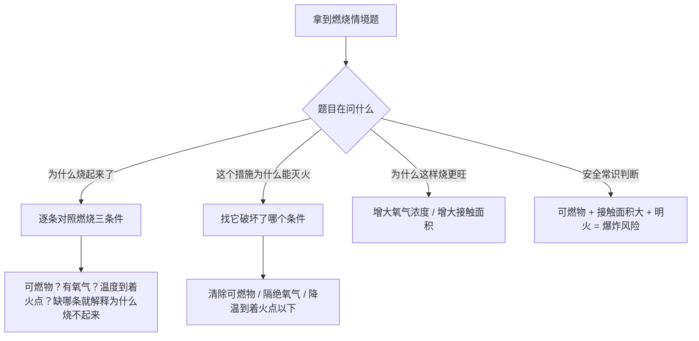
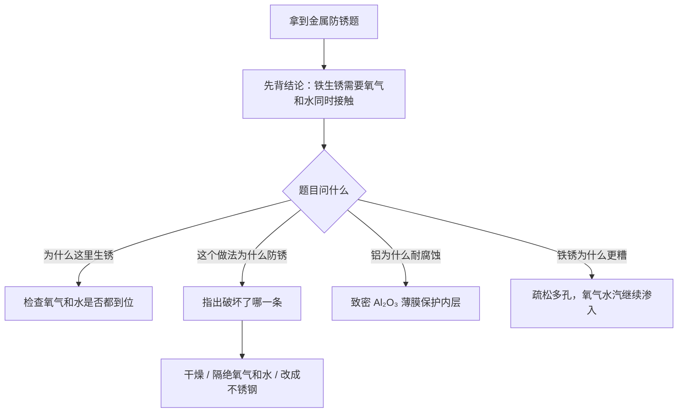
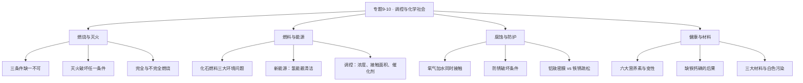

# 专题 9-10 · 化学反应的调控与化学与社会（详解版）

> **使用说明**：本文是详解版，从"为什么"讲起供从头自学；考前速查和掌握度跟踪在概要版：[[05-化学/知识点/专题9-10-反应调控与化学社会]]。

## 0️⃣ 这章学什么 & 中考怎么考

一句话：**这一章回答"化学反应能不能听人的话"以及"化学给生活带来了什么"两个问题。**

- 专题 9 讲"调控"：同样一个燃烧反应，氧气给足就完全燃烧、给不足就产生毒气；铁放在干燥处几十年不锈、放在雨里几个月就烂。**反应条件和环境决定结果**——学会控制条件，化学反应才能为我所用。
- 专题 10 讲"化学与社会"：能源、健康、材料。这一章没有难计算，靠的是**常识的准确度**——每个知识点都要能说清"为什么"，因为它最容易出成情景题和说理题。
- 和前后章节的关系：燃烧与灭火用 [[05-化学/知识点/专题3-空气氧气与二氧化碳]] 的氧气知识；防锈用 [[05-化学/知识点详解/专题8-酸碱盐]] 的金属活动性思想。

中考怎么考（只写库里有依据的）：

- 概要版原话："专题 9（燃烧与燃料、防锈）是情景题热门；专题 10（能源健康材料）是选择填空送分模块。"
- 老师明确的新中考趋势：减少记忆题、增加情景化和说理题——"为什么灭火是降温而不是降低着火点"就是经典说理题（方法见 [[05-化学/专题/说理题方法]]）。
- 旧资料对照（见 [[05-化学/学科总览]]）：旧教材"专题 4（燃烧/燃料）"对应新教材专题 9，做题时按这个归位。

## 🧭 先修自检（学不下去先回到这里）

> 下面每一项都是本章的地基。做不出就先去补对应知识，硬学只会更挫败。

| # | 你应该会的 | 自查题（先做再看答案） | 答案 | 不会去哪补 |
| - | ---------- | ---------------------- | ---- | ---------- |
| 1 | 氧气的性质 | 氧气能燃烧吗？它支持燃烧吗？ | 氧气**不可燃**，但**助燃**（支持燃烧） | [[05-化学/知识点/专题3-空气氧气与二氧化碳]] |
| 2 | CO₂ 与 CO | 谁有毒？谁能灭火？ | CO 有毒；CO₂ 不燃烧不支持燃烧、可灭火 | [[05-化学/知识点/专题3-空气氧气与二氧化碳]] |
| 3 | 配平 | 配平：$CH_4+O_2\rightarrow CO_2+H_2O$ | $CH_4+2O_2\xrightarrow{\text{点燃}}CO_2+2H_2O$ | [[05-化学/知识点/专题6-化学变化及其表示]] |
| 4 | 质量守恒 | 16 g 甲烷完全燃烧，生成物和反应物质量总和的关系？ | 参加反应的质量总和相等（本章会用它算账） | [[05-化学/知识点/专题6-化学变化及其表示]] |
| 5 | 金属活动性 | Fe 排在 H 前还是 H 后？这意味着什么？ | H 前；能与稀酸反应放出氢气 | [[05-化学/知识点/专题8-酸碱盐]] |

## 🌱 概念从头讲

> 每个概念按"**为什么需要它 → 它是什么 → 符号/化学式/单位 → 容易想错的地方**"四步讲。

### 概念 1：燃烧与燃烧三条件

- **为什么需要**：人类文明的起点就是学会用火。要让火听话，先要知道火是怎么烧起来的。
- **定义**：可燃物与氧气发生的一种发光、放热的剧烈的氧化反应。
- **燃烧三条件（缺一不可）**：
  1. 物质本身是**可燃物**；
  2. 可燃物与**氧气（助燃剂）接触**；
  3. 温度达到可燃物的**着火点**。
- **"缺一不可"怎么验证**：想象三个对照——石头（不可燃物）烧不起来；埋进沙里的煤（隔氧）烧不起来；一根火柴扔进冰水（温度不够）也烧不起来。三条件是"与"的关系，断一条就烧不成。
- **容易想错**：
  - ❌ "氧气越多火越旺，所以氧气是可燃物。" → 氧气是**助燃剂**，它自己不可燃。
  - ❌ "着火点低的物质更容易着火，所以着火点可以调低。" → 着火点是物质的**固有属性**，一般情况下不能被改变（这条是经典说理题，下面细讲）。

### 概念 2：灭火原理

- **为什么需要**：既然燃烧三条件缺一不可，那破坏**任何一条**，火就灭了——这就是全部灭火方法的逻辑起点。
- **灭火三原理（与三条件一一对应）**：
  1. 清除可燃物（或把可燃物与火源隔离）；
  2. 隔绝氧气（或空气）；
  3. 降温到**着火点以下**。
- **生活对照**：油锅起火盖锅盖（隔绝氧气）；森林大火开隔离带（清除可燃物）；用水浇火（水蒸发吸热，降温到着火点以下）。
- **容易想错**：
  - ❌ "水灭火是因为降低了可燃物的着火点。" → 着火点降不了！水是**吸热降温**，把温度压到着火点**以下**。这是中考最爱设的陷阱，答题时"降到着火点以下"六个字一个都不能少。
  - ❌ "只要隔绝氧气就一定能灭火。" → 大多数情况成立，但要看对象；答题选"破坏了哪个条件"时，要选与措施真正对应的那条。

### 概念 3：完全燃烧与不完全燃烧

- **为什么需要**：同样烧炭，氧气充足生成 $CO_2$（无毒），氧气不足生成 CO（**有毒**）。冬天的煤气中毒事故就出在这里——这不是小事，是必须懂的生存知识。
- **是什么**：
  - **完全燃烧**：氧气充足，碳氢化合物全部变成 $CO_2$ 和 $H_2O$，放热多。
  - **不完全燃烧**：氧气不足，生成 CO（甚至析出炭黑），放热少、浪费燃料，CO 还会与血红蛋白结合使人中毒。
  - 方程式对比：$C+O_2\xrightarrow{\text{点燃}}CO_2$ 与 $2C+O_2\xrightarrow{\text{点燃}}2CO$。
- **容易想错**：❌ "CO 有刺激性气味，能闻出来。" → CO **无色无味**，中毒了也没感觉，所以必须靠通风预防，不能靠鼻子。

### 概念 4：促进燃烧的方法（调控思想的核心）

- **为什么需要**：烧锅炉、烧燃气灶，都希望燃料烧得又快又完全——这就叫"调控反应"。
- **方法（两条）**：
  1. **增大氧气的浓度**（如鼓风）；
  2. **增大可燃物与氧气的接触面积**（如把煤块磨成煤粉）。
- **调控思想**：温度、反应物浓度、催化剂、接触面积，都是可以动手控制的"旋钮"——专题 3 里过氧化氢分解用 $MnO_2$ 催化、本章鼓风助燃，本质都是"调旋钮"。
- **容易想错**：❌ "促进燃烧可以降低着火点。" → 又是它！着火点不变，变的是**氧气浓度**和**接触面积**。

### 概念 5：易燃易爆安全常识

- **为什么需要**：面粉厂、加油站贴"严禁烟火"不是走形式——粉尘和油气弥散在空气里，接触面积巨大，一点火星就可能爆炸。
- **是什么（三条常识）**：
  1. 加油站、面粉厂、煤矿严禁烟火（油气、粉尘遇明火会爆炸）；
  2. 油锅起火盖锅盖、燃气泄漏关阀门开窗（别开电器开关，防止电火花）；
  3. 认识常见安全标志（禁火、禁烟、爆炸品等）。
- **容易想错**：❌ "面粉又不是油，怎么会爆炸？" → 爆炸看的是**可燃物与氧气接触面积**：整袋面粉烧不起来，粉尘弥散在空气里就危险。

### 概念 6：化石燃料与环境影响

- **为什么需要**：现在的能源大头还是化石燃料，但它们烧出来的东西正在改变环境——这是考试和现实共同的焦点。
- **是什么**：

| 化石燃料 | 要点 |
| ---- | ---- |
| 煤 | "工业的粮食"；含硫，燃烧产生 $SO_2$ |
| 石油 | "工业的血液"；分馏后利用（物理变化） |
| 天然气 | 主要成分甲烷 $CH_4$，较清洁的化石燃料 |

- **燃烧产物与三大环境问题**：

| 环境问题 | 主要成因气体 |
| ---- | ---- |
| 酸雨 | $SO_2$、$NO_2$ |
| 温室效应 | $CO_2$（增多加剧） |
| 雾霾 | 可吸入颗粒物 |

- **容易想错**：❌ "天然气是清洁能源，烧了不产生 $CO_2$。" → 天然气仍是化石燃料，$CH_4$ 燃烧照样产 $CO_2$，只是污染物相对少。注意库内一个易混点：$CO_2$ **不属于空气污染物**（见 [[05-化学/知识点/专题3-空气氧气与二氧化碳]]），但过多会导致温室效应——"不算污染物"和"有环境问题"两件事并存。

### 概念 7：新能源

- **为什么需要**：化石燃料不可再生，总有烧完的一天；环境压力也逼着人类换能源。
- **是什么**：太阳能（电池用**硅**）、风能、地热能、潮汐能、氢能、锂电池等。
- **氢能为什么被称为最清洁的燃料**：燃烧产物**只有水**，零污染：
  $$2H_2+O_2\xrightarrow{\text{点燃}}2H_2O$$
- **为什么还没有普及**：制、储、运都有难题——制取（电解水）耗能、储运（易燃易爆）困难、成本高。考试答"未普及"的原因就往这三条上靠。
- **容易想错**：❌ "氢能是最清洁的燃料，所以现在已广泛使用。" → "最清洁"和"已普及"是两回事，普及受成本与技术限制。

### 概念 8：金属的腐蚀与防护

- **为什么需要**：全世界每年因生锈报废的钢铁触目惊心。防锈是"调控反应条件"思想最典型的应用——把反应条件破坏掉，反应就不发生。
- **铁生锈的条件（缺一不可）**：铁与**氧气**和**水****同时**接触。
  - 对照实验证据：只接触干燥空气（无水）→ 不锈；只接触煮沸除去氧气的蒸馏水（用油封隔绝空气）→ 不锈；两者都接触 → 生锈。
- **铁锈**：主要成分 $Fe_2O_3\cdot xH_2O$，**疏松多孔**——氧气和水汽能穿过它继续锈里面的铁，所以铁锈不但不保护铁，还会加速锈蚀。
- **对比：铝为什么耐腐蚀**：铝表面与氧气反应生成**致密**的氧化铝薄膜：
  $$4Al+3O_2=2Al_2O_3$$
  这层膜把里外隔开，保护内层金属。"致密保护、疏松加速"这一组对比是高频考点。
- **防锈思路（破坏生锈条件）**：保持干燥；隔绝氧气和水——涂油、刷漆、镀保护层；改变金属结构——制成不锈钢。
- **容易想错**：❌ "铁生锈是因为接触了水。" → 必须**氧气和水同时**接触，缺一不可。❌ "铝容易'生锈'所以不耐用。" → 恰恰相反，致密氧化膜让铝很耐腐蚀。

### 概念 9：六大营养素

- **为什么需要**：吃进去的饭就是化学。考试常拿食物标签、食谱出情景题。
- **是什么（六大营养素）**：

| 营养素 | 要点 |
| ---- | ---- |
| 蛋白质 | 构成细胞的基本物质；**变性**：受热（煮鸡蛋凝固）、重金属盐都会使蛋白质变性 |
| 糖类 | 供能主力（米饭、馒头里的淀粉） |
| 油脂 | 备用能源物质 |
| 维生素 | 调节代谢、预防疾病；主要来自**蔬菜水果** |
| 无机盐 | 如食盐、含钙铁锌的成分 |
| 水 | 生命活动的基础 |

- **化学元素与人体健康（三条必背）**：缺**铁** → 贫血；缺**钙** → 骨质疏松；缺**碘** → 甲状腺肿大。
- **容易想错**：❌ "重金属盐中毒后多喝水就行。" → 重金属盐使人体蛋白质变性。牛奶、豆浆富含蛋白质，误服后喝它们可以让"外来蛋白质"先与重金属结合，减轻对人体的伤害——这也是"蛋白质变性"知识的直接应用。

### 概念 10：材料分类与白色污染

- **为什么需要**：生活用品的材料五花八门，考试让你分类、让你挑环保做法。
- **是什么（三大类）**：

| 材料类别 | 例子 |
| ---- | ---- |
| 无机非金属材料 | 陶瓷、玻璃 |
| 金属材料 | 纯金属、合金（不锈钢） |
| 有机合成材料 | 塑料、合成纤维、合成橡胶（**三大合成材料**） |

- **白色污染**：废弃塑料带来的污染。治理思路：少用一次性塑料、回收利用、用**可降解塑料**替代。
- **容易想错**：❌ "合成纤维是天然材料。" → "合成"二字说明它是人工合成的有机高分子材料；棉花、羊毛才是天然纤维。
- **小实验常识**：鉴别棉线与羊毛线用**灼烧闻气味**——羊毛（蛋白质）燃烧有**烧焦羽毛味**，棉线燃烧有烧纸的气味。

## 🧮 公式/规律逐个拆解

### 规律 1：燃烧三条件 ⇄ 灭火三原理对照表

| 燃烧条件（缺一不可） | 灭火原理（破坏任一） | 生活实例 |
| ---- | ---- | ---- |
| 有可燃物 | 清除可燃物 / 与火源隔离 | 森林大火开隔离带；关燃气阀门 |
| 与氧气接触 | 隔绝氧气 | 油锅盖锅盖；灯帽盖灭酒精灯 |
| 温度达到着火点 | 降温到着火点以下 | 用水浇火；吹灭蜡烛 |

- **用法**：灭火题先问"这个措施动了三个条件里的哪一个"，答"它破坏了 XX 条件"，一步到位。
- **最小例子**：酒精灯用灯帽盖灭——隔绝氧气（空气），破坏"与氧气接触"条件。

### 规律 2：铁生锈条件 ⇄ 防锈方法对照表

| 生锈条件（同时需要） | 破坏它的防锈做法 |
| ---- | ---- |
| 与氧气接触 | 镀保护层、刷漆、涂油（同时挡氧气和水） |
| 与水接触 | 保持干燥、擦干存放 |
| （两者同时接触） | 制成不锈钢（改变内部结构，本质是让"生锈反应"难发生） |

- **最小例子**：菜刀用完擦干挂起来——破坏"与水接触"条件，同时室内干燥也减少了氧气凝结水膜的机会。

### 规律 3：完全燃烧与不完全燃烧的"守恒账"

- **怎么算**：写出方程式，按相对分子质量乘系数，用守恒定律对账（方法来自 [[05-化学/知识点详解/专题6-化学变化及其表示]]）。
- **最小例子**：16 g 甲烷完全燃烧，需要多少克氧气？生成多少克二氧化碳和水？
  - 写：$$CH_4+2O_2\xrightarrow{\text{点燃}}CO_2+2H_2O$$
  - 找：$CH_4=16$；$2O_2=2\times32=64$；$CO_2=44$；$2H_2O=2\times18=36$。
  - 由方程式比例（16 : 64 : 44 : 36），16 g 甲烷恰好对应：需要 $O_2$ 64 g，生成 $CO_2$ 44 g、水 36 g。
  - 对账：$16+64=80$，$44+36=80$，两边相等。✓
- **同样的碳走不完全燃烧**：$2C+O_2\xrightarrow{\text{点燃}}2CO$，12 g 碳只需 16 g 氧气、生成 28 g CO。对比完全燃烧（12 g 碳需 32 g 氧气生成 44 g $CO_2$）——氧气不足时放热少、还有毒气，这就是"为什么要通风"的化学解释。

### 规律 4：本章说理题的三段式模板

结合 [[05-化学/专题/说理题方法]] 的万能三段式（判断 → 依据 → 回扣情境），本章两大高频说理：

- **"降温灭火是不是降低着火点"**：
  1. 判断：不是。
  2. 依据：着火点是物质的固有属性，一般不能改变；灭火原理是使温度降到着火点**以下**。
  3. 回扣：所以水灭火是水蒸发吸热降温，而不是降低可燃物的着火点。
- **"铁栏杆刷漆为什么防锈"**：
  1. 判断：刷漆能防锈。
  2. 依据：铁生锈需要氧气和水**同时**接触。
  3. 回扣：漆膜把铁栏杆与氧气、水隔开，破坏了生锈条件，所以防锈。

## 🪜 例题阶梯

> 三级台阶，每一级都要动笔跟着想，不许只看。

### 第 1 级 · 入门（照着模仿）

> **题目**：下列灭火措施各破坏了燃烧的哪个条件？①油锅起火盖上锅盖；②森林大火砍出隔离带；③消防员用水枪灭火；④熄灭酒精灯用灯帽盖灭。
>
> **每一步为什么这么做**：每项措施先问"它动了三个条件（可燃物 / 氧气 / 温度）中的哪一个"，再对号入座。
>
> **完整解答**：
> ①盖锅盖——油和火被盖隔开，**隔绝氧气**；
> ②隔离带——把可燃的树木清走，**清除可燃物**（火没有"食物"自然熄灭）；
> ③水枪——水蒸发大量吸热，**降温到可燃物着火点以下**；
> ④灯帽——**隔绝氧气**。
> 注意第③题的标准表述是"降温到着火点以下"，绝不能写"降低着火点"。

### 第 2 级 · 标准（中考中档）

> **题目**：有人说："用嘴一吹就灭蜡烛，是因为气流把蜡烛的着火点降低了。"这种说法对吗？请说明理由。
>
> **读题→翻译成化学语言**：判断 + 说理题，套三段式：判断 → 引用原理 → 回扣情境。
>
> **每一步为什么这么做**：
> 1. 先给判断（说理题第一句必须直接回答）。
> 2. 引原理：燃烧三条件里，着火点是物质的固有属性；灭火对应的是"降温到着火点以下"这条原理。
> 3. 回扣情境：吹气到底改变了什么——气流带走热量。
>
> **完整解答**：不对。着火点是蜡烛（石蜡）的固有属性，一般不能被改变；吹气时气流带走火焰周围的**热量**，使蜡烛芯的温度**降低到着火点以下**，燃烧无法继续，所以蜡烛熄灭。这是通过"降温"灭火，而不是"降低着火点"。

### 第 3 级 · 提高（与压轴/综合题接轨）

> **题目**：冬天，小明在密闭房间里用炭火取暖，门窗紧闭。
> (1) 从化学角度分析这样做的两条危险。
> (2) 12 g 炭（C）完全燃烧与不完全燃烧，消耗的氧气各是多少克？这组数据说明了什么？
> (3) 妈妈织毛衣用的羊毛线和棉线外观相似，如何鉴别？
>
> **思路从哪来**：密闭 + 炭火 → 想氧气会不会耗尽 → 想不完全燃烧的产物 CO 的性质；计算题直接套"设写找列解答"；鉴别题回到底物成分（蛋白质 vs 纤维素）。
>
> **完整解答**：
> (1) 危险一：密闭房间氧气有限，炭火不完全燃烧生成**一氧化碳**，CO 无色无味，与血红蛋白结合造成煤气中毒。方程式：$2C+O_2\xrightarrow{\text{点燃}}2CO$。危险二：炭燃烧消耗氧气，密闭房间氧气越来越稀薄。所以取暖必须保持通风。
> (2) 完全燃烧：$C+O_2\xrightarrow{\text{点燃}}CO_2$，质量比 12 : 32，12 g 碳消耗 $O_2$ 32 g。不完全燃烧：$2C+O_2\xrightarrow{\text{点燃}}2CO$，质量比 24 : 32，12 g 碳消耗 $O_2$ 16 g。说明：氧气不足时，同样的碳消耗氧气更少、放热也更少（燃料没烧透），并且生成有毒的 CO——这就是"保证通风（氧气充足）"的理由。
> (3) 取两根线分别灼烧，闻气味：有**烧焦羽毛味**的是羊毛线（羊毛是蛋白质），只有烧纸气味的是棉线。依据是蛋白质灼烧有烧焦羽毛味这一特征性质。
>
> **和入门题的差别**：入门题是"给措施找条件"的一对一匹配；这一题要求把条件、产物、毒性、计算、鉴别**串在同一个情境里**，自己发现隐患在哪里——这正是新中考情景化命题的路数。

## 🗺️ 解题流程图

**流程图 1：燃烧与灭火题怎么做**

**流程图 2：防锈与腐蚀题怎么做**

**知识结构图**：

## 🔥 易错点：为什么会错

| ❌ 常见错误想法 | 为什么会这样想 | ✅ 正确理解 / 自救方法 |
| -------------- | -------------- | ---------------------- |
| "水灭火是降低了着火点" | 把"温度"和"着火点"混为一谈 | 着火点是物质固有属性，降不了；灭火是**降温到着火点以下** |
| "铁生锈是因为碰了水" | 生活直观印象 | 氧气和水**同时**接触才生锈；只干燥空气或只无氧水都不锈 |
| "CO 有臭味，闻到才知道中毒" | 把 CO 和煤气臭味剂混淆 | CO 无色无味；预防靠通风和检测，不靠鼻子 |
| "天然气清洁，烧了没有 $CO_2$" | 把"较清洁"听成"零排放" | 天然气仍是化石燃料，燃烧产物照样有 $CO_2$（温室效应） |
| "氢能最清洁，所以已普及" | 只背了前半句 | 制、储、运难题与成本让它尚未普及，两半句要一起答 |
| "铝比铁容易坏" | 铝"掉皮"的直观印象 | 铝表面**致密**氧化膜保护内层；铁锈**疏松**反而加速锈蚀 |
| "促进燃烧的方法是降低着火点" | 与灭火的降温原理记串 | 促进燃烧：增大氧气浓度、增大接触面积；着火点始终不变 |
| "羊毛线和棉线看颜色就能区分" | 想当然 | 标准鉴别法：**灼烧闻气味**，烧焦羽毛味 = 羊毛（蛋白质） |
| "重金属盐中毒喝白水解百毒" | 只记得"中毒要处理" | 原理是蛋白质变性：喝富含蛋白质的牛奶豆浆来结合重金属 |
| "塑料都是白色污染的元凶，一律禁用" | 标签化理解 | 白色污染指**废弃塑料**的危害；治理靠回收、少用、可降解塑料替代 |

## ✅ 自测清单（能独立做到才打勾）

- [ ] 1. 能背出燃烧三条件，并解释为什么"缺一不可"
- [ ] 2. 能把任一灭火措施对应到三条灭火原理，且不说"降低着火点"
- [ ] 3. 能写出完全燃烧与不完全燃烧的方程式对比（$CO_2$ 与 CO 两条路线）
- [ ] 4. 能说出促进燃烧的两条方法，并解释面粉厂严禁烟火的原因
- [ ] 5. 能独立完成 16 g 甲烷燃烧的守恒计算并对账（64 g 氧气、44 g $CO_2$、36 g 水）
- [ ] 6. 能说出铁生锈的对照实验思路和防锈三招
- [ ] 7. 能解释"铝耐腐蚀"与"铁锈加速锈蚀"的差别
- [ ] 8. 能背出六大营养素、蛋白质变性的两个条件、缺铁钙碘的三种后果
- [ ] 9. 能说出三大合成材料，并给出白色污染的两条治理思路
- [ ] 10. 能用三段式完成"吹蜡烛是否降低着火点"的说理（第 2 级例题）

## 🔗 关联

- 概要版：[[05-化学/知识点/专题9-10-反应调控与化学社会]]（掌握度在这边更新）
- 前置知识：[[05-化学/知识点/专题3-空气氧气与二氧化碳]]（氧气、CO₂、CO 的性质）· [[05-化学/知识点详解/专题8-酸碱盐]]（金属活动性、防锈的化学背景）· [[05-化学/知识点详解/专题6-化学变化及其表示]]（计算规范）
- 说理题训练：[[05-化学/专题/说理题方法]]（本章说理题密度最高）
- 真题精讲：[[05-化学/专题/真题精讲/化-07-燃烧与碳]] · [[05-化学/专题/真题精讲/化-09-制气与还原实验]]
- 每周默写任务源：[[05-化学/闪卡/化学方程式与化合价默写]]
