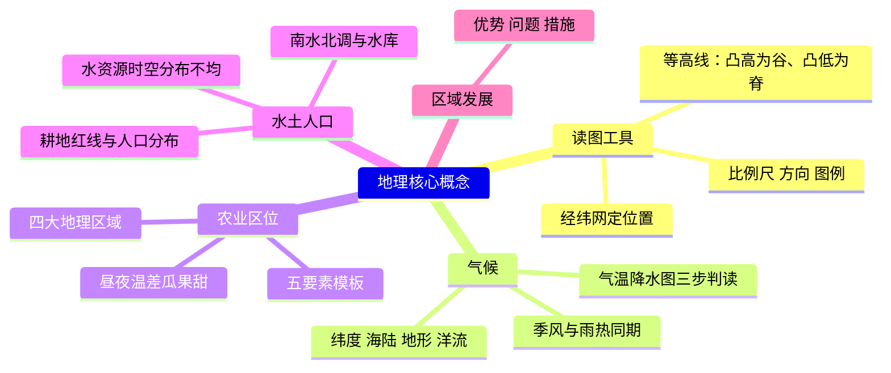
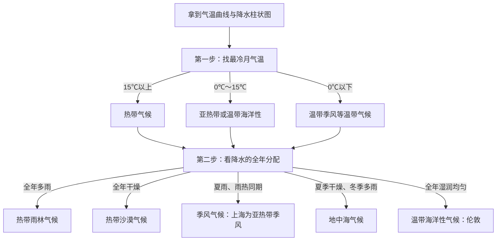

# 地理核心概念速览（详解版）

> **使用说明**：本文是详解版，从“为什么”讲起供从头自学；考前速查和掌握度跟踪在概要版：[[06-生物跨学科/知识点/地理核心概念速览]]。

## 0️⃣ 跨学科案例分析里这块怎么考

- 跨学科案例分析 15 分的材料里，**地图、气候图、区域背景**几乎必出现——读懂它们靠的全是地理概念。
- 地理概念在答案里的两种用法：
  1. **直接回答**：“泾河自西北流向东南”（读图）、“上海属于亚热带季风气候”（气候）；
  2. **当推理的第一环**：先说清“这里的环境条件”，再接生物原理（瓜果甜＝地理条件 → 生物过程）。
- 高频出场（依据库内概要版的星标）：
  - **气候 ★最高频**：影响因素、气温降水图判读、季风；
  - **农业区位 ★案例最爱**：“某地为什么适合种 X”；
  - 读图工具（经纬网、等高线、图例）：黄浦一模第 42 题“自西北朝东南”就是它（[[06-生物跨学科/专题/跨模26-黄浦]]）。
- 特别提醒：地理答案**几乎都要落到图或材料上**——读图三件套（图名、图例、方向）是每次动笔前的固定动作。

## 🧭 先修自检（学不下去先回到这里）

> 下面每一项都是本文的地基。做不出就先补上，硬往下学只会更挫败。

| # | 你应该会的 | 自查题（先做再看答案） | 答案 | 不会去哪补 |
| - | ---------- | ---------------------- | ---- | ---------- |
| 1 | 会认“上北下南，左西右东” | 一张没标方向的地图，右边缘是哪个方向？ | 右＝东 | 本文概念 1 |
| 2 | 知道“海拔”的意思 | “这座山海拔 2300 米”是什么意思？ | 山顶比海平面高出 2300 米 | 本文概念 3 |
| 3 | 会看柱状图 | 一张降水柱状图，怎么找降水最多的月份？ | 找最高的那根柱子，对应横轴上的月份 | 本文概念 5 |
| 4 | 大致知道上海的位置 | 上海在我国东部还是西部？靠海吗？ | 东部沿海，长江入海口附近 | 本文概念 6 |

## 🌱 概念逐个讲透

> 每个概念按“**为什么需要 → 是什么（大白话＋例子） → 关键词 → 易想错 → 题目里怎么用**”讲。读的时候拿支笔，把“关键词”抄一遍。

### 概念 1 · 经纬网：给地球表面编座位号

- **为什么需要**：跨学科案例常考“位置、方位”——描述某地在哪、某河往哪流，全靠经纬网打底。
- **是什么**：在地球仪上画两组假想的线：**经线**竖着、连接南北两极；**纬线**横着、一圈一圈。两组合起来，地表每一点都有了唯一的“座位号”。
  生活例子：电影院找座位——“第几排”像纬线（横着排），“第几座”像经线（竖着编）。
- **关键约定**：
  - **赤道**＝0° 纬线，南北纬的分界；
  - **本初子午线**＝0° 经线（经过英国伦敦格林尼治天文台旧址），东西经的分界；
  - 纬度数值向北增大＝北纬，向南增大＝南纬；经度向东增大＝东经，向西增大＝西经。
- **纬度定热量带**：低纬（0°~30°）热、中纬（30°~60°）温和、高纬（60°~90°）冷；五带＝热带、北温带、南温带、北寒带、南寒带（热带与温带的分界是回归线，温带与寒带的分界是极圈）。
- **关键词**：纬线分南北位置、经线分东西位置；纬度定热量。
- **易想错**：
  - ❌“经线定南北位置” → 经线是南北方向的**线**，但它用来区分**东西**位置；纬线才用来区分**南北**位置。一句话：纬线横圈分南北，经线竖跑分东西。
  - ❌“五带乱背一气” → 按纬度切：中间热（有太阳直射）、两极冷（有极昼极夜现象）、中间与两极之间是温带。
- **题目里怎么用**：判断两地谁更北、谁更东；配合高程定河流流向（黄浦 42 题：先看高程图例知道“西北高、东南低”，再答“自西北朝东南”）。

### 概念 2 · 读图三件套：比例尺、方向、图例

- **为什么需要**：跨学科案例的图信息量大，按固定顺序读才不会漏。
- **是什么**：
  - **比例尺**＝图上距离与实地距离之比。分母越大，比例尺越小，表示的范围越大、内容越粗（中国地图和小区地图就是两个极端）；
  - **方向**：一般地图“上北下南、左西右东”；有指向标按指向标定；有经纬网按经纬线定；
  - **图例**＝符号的说明书。**拿到图先读图名、再读图例**——黄浦 42 题的高程图例“颜色深＝海拔高”就写在图例里，看不懂它整道题就翻车。
- **关键词**：图名 → 图例 → 数据，固定顺序。
- **易想错**：
  - ❌“先看图中央最显眼的图形” → 容易被细节带偏。✅固定顺序：图名 → 图例 → 坐标轴或高程 → 数据极值。
  - ❌“比例尺大的图表示的范围大” → 正相反：比例尺大＝放得更大＝看到的范围小、内容更细。
- **题目里怎么用**：读图题的“固定开场动作”；检查答案时回看图例，确认颜色、符号的含义没弄反。

### 概念 3 · 海拔与等高线：把立体地形画在平面上

- **是什么**：
  - **海拔**＝某地高出海平面的垂直距离；**相对高度**＝两点的海拔差；
  - **等高线**＝把海拔相同的点连成的线。看线规则：**密＝陡，疏＝缓**（同一张图上，线挤在一起说明爬升快）。
  生活例子：爬山路线图上，等高线挤成一团的路段，就是最费腿的陡坡。
- **山脊与山谷**：
  - **山脊**＝等高线**凸向低处**——像手背上指根之间的“梁”，是分水的地方；
  - **山谷**＝等高线**凸向高处**——两侧高、中间低，**可能发育河流**（水往低处汇）。
- **关键词**：密陡疏缓；凸高为谷（有河）、凸低为脊。
- **易想错**：
  - ❌“等高线凸向高处的是山脊” → 记反了。✅口诀：“凸高是谷，凸低是脊”。
  - ❌“河流从海拔低处流向高处” → ✅水往低处流；先从高程图例读出哪边高，流向自然就出来了。
- **题目里怎么用**：黄浦 42 题——图 1 高程“西北深（高）、东南浅（低）”→ 泾河自西北向东南流；判断“某采样区在山区还是平原”→ 看等高线疏密和高程数值。

### 概念 4 · 影响气候的主要因素

- **先分清两个词**：**天气**是短时间的阴晴风雨（今天下雨）；**气候**是一个地方**多年**天气的平均状况（上海夏季高温多雨）。跨学科题里的“气候类型”“雨热同期”说的都是气候。
- **四大因素（每个配一句“它怎么起作用”）**：
  1. **纬度位置**（根本因素）：纬度低 → 太阳晒得更直 → 热；纬度高 → 晒得斜 → 冷。
  2. **海陆位置**：沿海＝水汽近、温差小（海洋像一个大暖水瓶）；深居内陆＝水汽进不来、温差大（又干又“极端”）。
  3. **地形**：海拔每升高 100 米，气温约降低 0.6℃（所以避暑要上山）；**迎风坡**气流被抬升、成云致雨，降水多；**背风坡**降水少。
  4. **洋流**：暖流经过→增温增湿；寒流经过→降温减湿（初中阶段知道“有影响”即可）。
- **关键词**：纬度（根本因素）、海陆、地形（0.6℃／迎风坡）、洋流。
- **易想错**：
  - ❌“海拔越高越暖和，因为离太阳近” → ✅恰恰相反：海拔每升 100 米降温约 0.6℃。
  - ❌“迎风坡背风坡分不清” → 看风从哪边来：风来的那面坡被吹着爬升、下雨多，是迎风坡。
  - ❌“纬度只影响气温” → 纬度也影响降水格局（初中简化理解：赤道附近降水多、两极少雨）。
- **题目里怎么用**：“为什么 A 地比 B 地冷”→ 比纬度、比海拔；“为什么山这一侧森林茂密、那一侧荒芜”→ 迎风坡与背风坡；“为什么内陆瓜果昼夜温差大”→ 海陆位置。

### 概念 5 · 气温曲线与降水柱状图：一张图认出一个气候

- **为什么需要**：跨学科案例最常见的图之一；会判读，才能说清“这里的自然环境条件”。
- **三步判读法**：
  1. **看最冷月气温**定温度带：15℃ 以上 → 热带；0℃~15℃ → 亚热带（或温带海洋性）；0℃ 以下 → 温带季风等温带气候。
  2. **看降水的全年分配**定雨型：全年多雨／全年少雨／夏季多雨／冬季多雨／全年湿润。
  3. **组合**起来定类型（对照下方速查表）。
- **常见气候速查表**：

| 气候类型 | 气温特征 | 降水特征 | 代表地区 | 一句话记忆 |
| ---- | ---- | ---- | ---- | ---- |
| 热带雨林气候 | 全年高温 | 全年多雨 | 亚马孙平原、刚果盆地 | 又热又湿，“蒸桑拿” |
| 热带沙漠气候 | 全年炎热 | 全年干燥 | 撒哈拉沙漠 | 又热又干，“烤炉” |
| 亚热带季风气候 | 夏季高温、冬季温和 | 夏季多雨、冬季较少 | **上海**、我国东南部 | 雨热同期，湿热夏天 |
| 地中海气候 | 夏季炎热、冬季温和 | **夏季干燥、冬季多雨** | 地中海沿岸 | “夏干冬雨”，反季节 |
| 温带季风气候 | 夏季高温、冬季寒冷（最冷月 0℃ 以下） | 夏季多雨、冬季干燥 | **北京**、我国北方 | 四季分明，雨热同期 |
| 温带海洋性气候 | 全年温和 | 全年湿润均匀 | **伦敦**、西欧 | 全年温吞湿润 |

- **易想错**：
  - ❌“夏天热就是热带” → 还要看最冷月：亚热带冬季温和（0℃ 以上），热带全年 15℃ 以上。
  - ❌“所有气候都雨热同期” → 地中海气候**反着来**（夏季炎热却干燥），这是它最容易认错的点。
- **题目里怎么用**：给气温降水图问“属于什么气候、对农业有什么影响”→ 三步法定类型，再接“雨热同期，利于农作物生长”。

### 概念 6 · 季风气候：夏天风从海上带雨来

- **是什么**：**季风**＝随季节大方向改变的风。我国东部：夏季风从**海洋吹向陆地**（东南风），带来大量水汽 → **降水集中在夏季**；冬季风从陆地吹向海洋 → 干冷少雨。
- **为什么重要（两句话答遍所有季风题）**：
  - **雨热同期**：高温期恰是多雨期 → **利于农作物生长**（喜湿热的水稻正好）；
  - **夏季风不稳定**：有的年份强、有的弱 → **旱涝灾害**多发（雨带赖着不走＝涝，迟迟不来＝旱）。
- **关键词**：夏季风＝东南风、从海洋来；雨热同期；夏季风不稳定→旱涝。
- **易想错**：
  - ❌“季风就是海边的风” → 海风是昼夜尺度的小循环；季风是随季节改变的大尺度风，不是一回事。
  - ❌“上海是温带季风” → ✅上海属**亚热带季风气候**；北京才是温带季风。
- **题目里怎么用**：“我国东部为什么水旱灾害频繁”→ 夏季风不稳定；“长江中下游为什么能种水稻”→ 亚热带季风、雨热同期、水源充足。

### 概念 7 · 农业区位：“某地为什么适合种 X”的万能模板

- **为什么需要**：跨学科案例最爱出的题型（概要版标“★案例最爱”）——“延安苹果”“阿克苏棉花”这类情境，都要按模板逐条找理由。
- **分析模板（五条，逐条对号入座）**：

| 要素 | 要看什么 | 常见答法示例 |
| ---- | ---- | ---- |
| 气候 | 热量（温度带）＋降水（雨热同期？） | 亚热带季风、雨热同期，利于水稻生长 |
| 地形 | 平原／丘陵／山地 | 平原地形平坦、土层深厚，便于耕作；丘陵可修梯田 |
| 水源 | 河流、灌溉条件 | 靠近河流，灌溉水源充足 |
| 土壤 | 肥瘦、酸碱 | 黑土肥沃；红壤呈酸性，茶树喜酸 |
| 人文 | 市场、交通、劳动力、技术、政策 | 靠近大城市、市场需求大；保鲜技术让远距离销售成为可能 |

- **四大地理区域速查表**（答“因地制宜”时按区取材）：

| 区域 | 农业特征 | 关键原因 |
| ---- | ---- | ---- |
| 北方地区 | 旱地、小麦 | 降水较少、冬季寒冷 |
| 南方地区 | 水田、水稻 | 亚热带季风、雨热同期、河网密布 |
| 西北地区 | 畜牧业＋灌溉农业；瓜果特别甜 | 深居内陆降水少；**昼夜温差大、光照强** |
| 青藏地区 | 高寒农牧业、河谷农业 | 海拔高、气温低，农作物种在海拔较低的河谷里 |

- **易想错**：
  - ❌“只要气候好就能种” → 还要过地形、水源、土壤几关；答题**逐条**对照模板，只答一条往往不完整。
  - ❌“西北缺水，所以瓜果品质差” → 正相反：干旱少云＋昼夜温差大，反而造就高品质瓜果。
- **题目里怎么用**：题干问“分析该地种植 X 的有利条件”→ 按五要素逐条“条件＋对 X 的好处”，条条有依据。

### 概念 8 · 昼夜温差大 → 瓜果甜（生物＋地理联名考点）

- **完整推理链（背熟，这是“跨学科桥接”的样板）**：
  - 地理半句：该地深居内陆、晴天多 → **光照充足、昼夜温差大**；
  - 生物半句：白天温度高、光照强 → **光合作用强**，制造的糖多；夜间温度低 → **呼吸作用弱**，消耗的糖少；
  - 结论：一天下来糖分**净积累**多 → 瓜果特别甜。
- **易想错**：
  - ❌“白天热所以甜” → 白天只是“挣得多”，还必须“花得少”（夜间低温抑制呼吸），两头都占才甜。
  - ❌只答地理半句或只答生物半句 → 跨学科综合题要**两句连起来**（写法详见 [[06-生物跨学科/知识点详解/跨学科案例题型方法]]）。
- **题目里怎么用**：新疆瓜果、西北优质农产品情境的标配答案；同样思路可用于解释高山地区农产品品质好（昼夜温差大，写到这一层即可）。

### 概念 9 · 水资源、土地与人口

- **中国水资源的两个“不均”与两个对策**：
  - 空间不均：**南多北少、东多西少** → 对策：**跨流域调水**（南水北调）；
  - 时间不均：**夏秋多、冬春少** → 对策：**兴修水库**（丰水期存起来、枯水期放出来）。
- **土地资源**：耕地、林地比重小，后备资源不足 → **珍惜和合理利用每一寸土地**，守住 18 亿亩耕地红线。
- **人口**：分布**东多西少**（胡焕庸线：黑河—腾冲一线，线之东南人口稠密）；人口增长要与**资源环境承载力**相协调。
- **易想错**：
  - ❌“南水北调解决的是时间不均” → ✅调水管**空间**不均；**时间**不均靠水库。
  - ❌“西北缺水，就大量开采地下水” → ✅可持续思路是发展节水农业、合理用水；过度开采会引发生态问题。
- **题目里怎么用**：“为什么国家反复强调节约用水、保护耕地”；“某区域人口与资源的矛盾”类情境，从“分布不均＋资源环境承载力”切入。

### 概念 10 · 区域发展案例套路

- **套路总表**（“某区域发展某产业”类题目通用）：

| 问题类型 | 答题方向 | 常用素材 |
| ---- | ---- | ---- |
| 优势 | 资源／气候／交通／劳动力／政策 | 资源丰富、雨热同期、临江靠海、劳动力充足、政策支持 |
| 问题 | 生态脆弱＋污染 | 水土流失、土地荒漠化、水污染 |
| 措施 | 可持续发展 | 保护与开发并重、科技投入、延长产业链、治理污染 |

- **易想错**：
  - ❌“优势答得越多越好” → 要**与材料挂钩**：材料没提的资源、政策别硬编，答案要能从材料找到出处。
  - ❌“措施只说做什么” → 每条带上**半句为什么**（“做什么＋为什么能解决”），写法详见 [[06-生物跨学科/知识点详解/跨学科案例题型方法]]。
- **题目里怎么用**：黄土高原情境——问题＝水土流失（泥沙入河、河流含沙量大，黄浦 43 题“泾渭分明”的背景正是它）；措施＝退耕还林还草、植树种草等（结合材料挑两条，别贪多）。

## 🗺️ 概念关系图

先看整体结构（哪个概念挂在哪条主线上）：

再看气候判读的决策流程（把三步法变成固定动作）：

## 🔥 易混淆概念对照表

**表 1 · 天气 vs 气候**

| 对比项 | 天气 | 气候 |
| ---- | ---- | ---- |
| 时间尺度 | 短时间（今天、明天） | 多年平均状况 |
| 特点 | 时刻在变 | 相对稳定 |
| 例子 | 现在下大雨 | 上海夏季高温多雨 |
| 题目里的陷阱 | 题目问“气候”却答“今天下雨”＝答非所问 | |

**表 2 · 经线 vs 纬线**

| 对比项 | 经线 | 纬线 |
| ---- | ---- | ---- |
| 形状 | 连接南北两极的半圆 | 一圈一圈的圆 |
| 指示方向 | 南北方向 | 东西方向 |
| 用来区分 | **东西**位置 | **南北**位置 |
| 起点线 | 0° 经线＝本初子午线 | 0° 纬线＝赤道 |
| 题目里的陷阱 | “经线定东西”说的是位置；线本身是南北走向 | |

**表 3 · 山脊 vs 山谷**

| 对比项 | 山脊 | 山谷 |
| ---- | ---- | ---- |
| 等高线凸向 | 凸向**低**处 | 凸向**高**处 |
| 地形形态 | 中间高、两侧低的“梁” | 两侧高、中间低的“槽” |
| 与河流的关系 | 分水，一般无河 | 集水，**可能发育河流** |
| 口诀 | 凸低为脊 | 凸高为谷 |

**表 4 · 迎风坡 vs 背风坡**

| 对比项 | 迎风坡 | 背风坡 |
| ---- | ---- | ---- |
| 与风的关系 | 面向气流来向 | 背对气流来向 |
| 降水 | 多（气流抬升、成云致雨） | 少 |
| 题目里的陷阱 | 同一座山两侧降水不同；先看风从哪边来，再判断哪面坡是迎风坡 | |

**表 5 · 南水北调 vs 水库（对策配对别搞反）**

| 对比项 | 跨流域调水（南水北调） | 兴修水库 |
| ---- | ---- | ---- |
| 解决哪类不均 | 空间不均（南多北少） | 时间不均（夏秋多、冬春少） |
| 原理 | 把水多的地方的水调往水少的地方 | 丰水期蓄水、枯水期放水 |
| 题目里的陷阱 | 问“时间不均怎么办”答调水＝张冠李戴 | |

**表 6 · 四大地理区域速查**（见概念 7 中的表，配套口诀：北方旱地麦、南方水田稻、西北牧灌甜、青藏河谷寒）

## ✅ 自测清单（能独立做到才打勾）

- [ ] 1. 能说出经线、纬线分别用来区分什么位置
- [ ] 2. 拿到任何图能按“图名 → 图例 → 数据”顺序读
- [ ] 3. 能用“凸高为谷、凸低为脊”判断山脊山谷，并说出山谷可能发育河流
- [ ] 4. 能背出影响气候的四要素，并各配一句作用机制（含“海拔每升 100 米降约 0.6℃”）
- [ ] 5. 能用三步法判读气温降水图，认出六种常见气候
- [ ] 6. 能说出季风气候的“利”（雨热同期）与“弊”（旱涝）各一句
- [ ] 7. 能按五要素模板完整分析“某地为什么适合种 X”
- [ ] 8. 能完整推理“昼夜温差大 → 瓜果甜”（地理半句＋生物半句）
- [ ] 9. 能区分南水北调（空间不均）与水库（时间不均）
- [ ] 10. 能按“优势／问题／措施”套路组织区域发展类答案

## 🔗 关联

- 概要版（考前速查＋掌握度跟踪）：[[06-生物跨学科/知识点/地理核心概念速览]]
- 生物侧搭档（光合呼吸、生态系统）：[[06-生物跨学科/知识点详解/生命科学核心概念速览]]
- 概念怎么装进答案：[[06-生物跨学科/知识点详解/跨学科案例题型方法]]
- 真题里看地理概念出场：[[06-生物跨学科/专题/跨模26-黄浦]]
- 学科总览：[[06-生物跨学科/学科总览-跨学科案例分析]]
