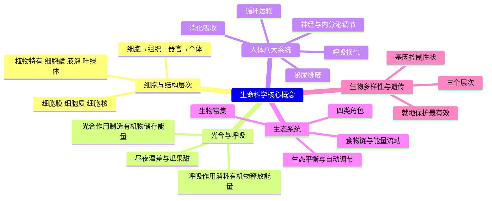
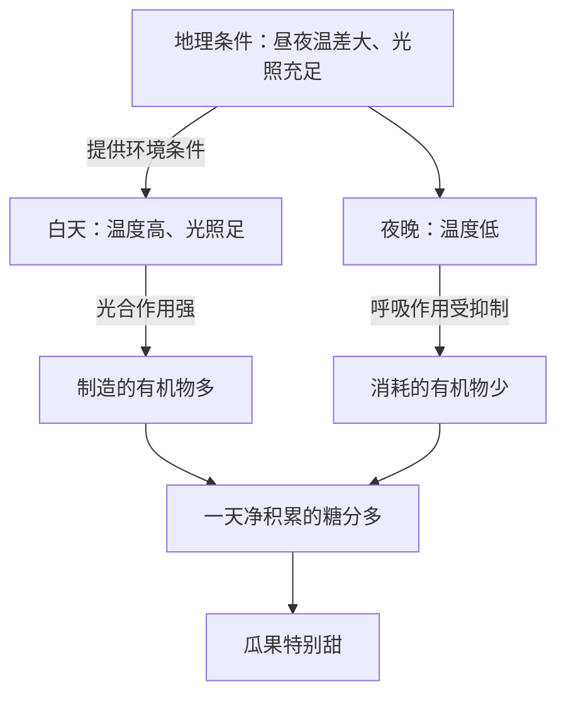

# 生命科学核心概念速览（详解版）

> **使用说明**：本文是详解版，从“为什么”讲起供从头自学；考前速查和掌握度跟踪在概要版：[[06-生物跨学科/知识点/生命科学核心概念速览]]。

## 0️⃣ 跨学科案例分析里这块怎么考

- 上海中考综合测试卷里有**跨学科案例分析 15 分**：给一段真实情境材料（图、表、数据），配若干小题，用初中**地理＋生命科学**知识作答（详见 [[06-生物跨学科/学科总览-跨学科案例分析]]）。
- 生命科学概念在这 15 分里的角色：小题问“为什么”“请说明原理”“请提出建议”时，答案里的**原理那一半**几乎都出自本文列出的概念。
- 三类高频出场方式（依据库内学科总览与概要版）：
  1. 农产品与产地情境（品质为什么好）→ **光合作用、呼吸作用**；
  2. 生态情境（湿地、农田、河流考察）→ **生态系统、食物链、自动调节、生物多样性保护**；
  3. 健康与运动情境 → **消化、循环、呼吸等人体系统**。
- 真题长什么样：[[06-生物跨学科/专题/跨模26-黄浦]]（2026 届黄浦一模·渭河流域生态考察）里，第 45 题用到“鱼类呼吸消耗水中溶解氧”，第 46 题用到“就地保护”——都是本文要讲的概念。
- 特别提醒：这里**不考默写定义**，考“你会不会用概念解释一个真实问题”。所以每个概念重点看最后一栏“题目里怎么用”。

## 🧭 先修自检（学不下去先回到这里）

> 下面每一项都是本文的地基。做不出就先补上，硬往下学只会更挫败。

| # | 你应该会的 | 自查题（先做再看答案） | 答案 | 不会去哪补 |
| - | ---------- | ---------------------- | ---- | ---------- |
| 1 | 分得清生物和非生物 | 开着的鲜花、一块石头、正在发芽的豆子，哪些是生物？凭什么判断？ | 鲜花和豆芽是生物：由细胞构成、需要营养、能呼吸、能生长繁殖；石头不是 | 本文概念 1 |
| 2 | 知道植物“吃”什么长大 | 动物要吃食物，植物长大的“原料”从哪来？ | 自己制造：光合作用以二氧化碳和水为原料 | 本文概念 2 |
| 3 | 能写一条最简单的食物链 | 写一条食物链，并说明箭头方向 | 草 → 兔 → 鹰；箭头指向吃的一方（能量流动方向） | 本文概念 7 |
| 4 | 说得出心脏、肺、肾、脑各管什么 | 各用一句话 | 心脏泵血运输、肺换气、肾形成尿液、脑指挥调节全身 | 本文概念 5 |

## 🌱 概念逐个讲透

> 每个概念按“**为什么需要 → 是什么（大白话＋例子） → 关键词 → 易想错 → 题目里怎么用**”讲。读的时候拿支笔，把每条的“关键词”抄一遍。

### 概念 1 · 细胞与生物体的结构层次

- **为什么需要**：所有生命现象最终都发生在细胞里。跨学科题出现“显微结构图”“某结构有什么功能”“这是植物还是动物细胞”，考的都是它。
- **是什么**：细胞是生物体**结构和功能的基本单位**——像一座城市里最小的作坊：很小，但该有的车间一样不少。
  生活例子：手上蹭破一层皮，过几天长好，就是底下细胞在分裂、补充。
- **关键结构（用“房子”记）**：
  - **细胞膜**＝门卫：控制物质进出，让有用的进来、没用的出去。
  - **细胞质**＝车间场地：各种生命活动在这里进行。
  - **细胞核**＝指挥部：**遗传物质主要在这里**，管着生长、发育和遗传。
  - **细胞壁**（植物特有）＝承重外墙：支撑、保护，所以植物的茎叶摸起来“挺括”。
  - **液泡**（植物特有）＝仓库：里面是细胞液，西瓜的甜、柠檬的酸都存在这里。
  - **叶绿体**（植物特有）＝太阳能车间：光合作用就在这里进行。
- **结构层次**：细胞 → 组织 → 器官 → （系统）→ 个体；**植物没有“系统”这一层**。
  - 组织＝形态相似、功能相同的细胞群（心肌是一种组织）；
  - 器官＝多种组织按一定次序结合、共同完成某项功能（心脏、胃是器官）。
- **关键词**：基本单位；植物特有三件套（细胞壁、液泡、叶绿体）；植物无系统。
- **易想错**：
  - ❌“动物细胞也有细胞壁” → 摸摸自己能弯的胳膊就知道没有硬墙。✅细胞壁是植物细胞特有的。
  - ❌“植物的每个细胞都有叶绿体” → 根埋在土里不见光，**根细胞没有叶绿体**。✅叶绿体主要在见光的绿色部分。
  - ❌“心脏是一种组织” → ✅心脏是**器官**（多种组织构成），心肌才是组织。
- **题目里怎么用**：显微图判断动植物细胞→找“三件套”，有＝植物；问“西瓜的甜味来自哪个结构”→液泡；问“植物与动物的结构层次差在哪”→植物没有系统。

### 概念 2 · 光合作用：植物的“自产自足”

- **为什么需要**：它是跨学科最高频的生物原理之一——大棚增产、昼夜温差与瓜果甜、氧气的来源，全从它出发。
- **是什么**：植物以**光**作能源，把**二氧化碳和水**这两种“便宜原料”加工成**有机物**（把能量存进去），同时放出**氧气**。
  生活例子：一棵小树苗长成大树，多出来的“木料”主要不是从土里吸上来的，而是光合作用把空气里的二氧化碳变成的有机物——土壤被“抽走”的主要是水和无机盐。
- **表达式（会认会写）**：二氧化碳 ＋ 水 —（光能、叶绿体）→ 有机物（储存能量）＋ 氧气
- **关键词**：原料＝二氧化碳、水；条件＝光、叶绿体；产物＝有机物、氧气；意义＝物质与能量的源头、维持碳氧平衡。
- **易想错**：
  - ❌“晚上植物也放氧气” → 没有光，光合作用不能进行；晚上植物只进行呼吸作用（吸收氧气、放出二氧化碳）。
  - ❌“植物靠‘吃’有机肥长大” → ✅植物**自己制造**有机物；根从土壤里吸收的是**水和无机盐**。
  - ❌“光合作用只对植物有用” → ✅人和动物吃的食物、呼吸的氧气，源头都是光合作用（它是物质与能量的源头）。
- **题目里怎么用**：
  - 温室增产两板斧：**提高二氧化碳浓度**（增加原料）、**延长光照或增强光照**（增加能源）；
  - 合理密植、间作套种 → 让每片叶子都充分接受光照。

### 概念 3 · 呼吸作用：所有活细胞的“烧燃料”

- **为什么需要**：果蔬保鲜、农田松土、运动耗能、黄浦真题里“鱼类消耗溶解氧”——都要靠它解释。
- **是什么**：所有**活细胞**把**有机物和氧气**“烧”掉，**释放能量**供生命活动使用，同时产生二氧化碳和水。
  生活例子：跑完 800 米大喘气——肌肉细胞拼命进行呼吸作用，急需氧气；成堆的水果放久了会发热，就是呼吸作用释放的能量。
- **表达式**：有机物 ＋ 氧气 → 二氧化碳 ＋ 水 ＋ 能量
- **关键词**：所有活细胞；**昼夜不停**；消耗有机物；释放能量。
- **易想错**：
  - ❌“呼吸作用＝呼吸（喘气）” → 喘气只是把氧气送进身体；**呼吸作用发生在每个细胞里**，是“烧”有机物放能量。
  - ❌“植物白天只光合、晚上才呼吸” → ✅呼吸作用昼夜不停；白天光合和呼吸**同时进行**（白天光合通常强于呼吸）。
  - ❌“低温保鲜是让呼吸停止” → ✅是**抑制、减弱**呼吸，减少有机物消耗，不是停止。
- **题目里怎么用**：
  - 果蔬保鲜＝**抑制呼吸**：低温、低氧环境，减少有机物消耗；
  - 农田松土（雨涝后排水松土）＝**促进根部呼吸**；
  - [[06-生物跨学科/专题/跨模26-黄浦]] 第 45 题：鱼类通过呼吸作用**消耗水中溶解氧**。

### 概念 4 · 光合与呼吸：一对“反着来”的过程

- 为什么放在一起记：它们方向相反——光合“存能量”，呼吸“放能量”；光合只在有光时进行，呼吸昼夜不停。（对照表见下方 🔥 易混淆区）
- 跨学科名场面“昼夜温差大 → 瓜果甜”，就是两条公式“打架”的结果：
  - 白天温度高、光照足 → 光合作用强，**制造**的有机物（糖）多；
  - 夜间温度低 → 呼吸作用弱，**消耗**的有机物少；
  - 一天下来净积累的糖多 → 瓜果甜。新疆瓜果甜＝光照强＋昼夜温差大（地理那一半见 [[06-生物跨学科/知识点详解/地理核心概念速览]]）。

### 概念 5 · 人体的八大系统（跨学科常挑几个考）

先给速查表（“情境关键词”是题干里常见的信号词）：

| 系统 | 核心概念 | 情境关键词 |
| ---- | ---- | ---- |
| 消化 | 淀粉→麦芽糖→葡萄糖；小肠是吸收主场所（长＋绒毛增大面积） | 营养均衡、慢病膳食、馒头越嚼越甜 |
| 循环 | 心脏四腔；体循环／肺循环；动脉送血离心、静脉回心 | 运动心率、血压、供血 |
| 呼吸 | 肺泡气体交换：氧气入血、二氧化碳排出；呼吸运动 | 有氧运动、空气质量、雾霾 |
| 泌尿 | 肾单位：滤过形成原尿＋重吸收形成尿液 | 水盐平衡、健康饮水 |
| 神经 | 反射弧五环节；条件反射与非条件反射 | 反应速度、用脑卫生 |
| 内分泌 | 激素随血液运输：胰岛素调血糖、生长激素管生长、甲状腺激素管发育代谢 | 糖尿病、生长发育、缺碘 |
| 运动 | 骨骼肌牵动骨绕关节活动；运动需要能量 | 体育锻炼、运动损伤 |
| 生殖免疫 | 特异性／非特异性免疫；疫苗原理 | 传染病预防、接种疫苗 |

最常考的几块展开讲：

- **消化**：为什么小肠是吸收主场所？因为它“长”（小肠很长，面积大）＋内表面有皱襞和**绒毛**（进一步增大吸收面积）。淀粉在口腔被唾液初步消化成麦芽糖（所以馒头越嚼越甜），最终在小肠里变成葡萄糖才被吸收进血液。
- **循环**：心脏像两套并列的水泵——左心室把血泵向全身（体循环），右心室把血泵向肺（肺循环）。动脉＝把血**送出**心脏的血管，静脉＝把血**送回**心脏的血管；注意“动脉静脉”和“动脉血静脉血”是两码事（见对照表 6）。
- **呼吸**：呼吸运动＝胸廓有节律地扩大和缩小。吸气时，肋间肌和膈肌收缩→胸廓扩大→肺随之扩张→外界气体进入。肺泡外面包着毛细血管：氧气穿过肺泡壁进入血液，二氧化碳反向出来——这就是肺泡内的气体交换。
- **神经**：反射弧像一条流水线：感受器（接收刺激）→ 传入神经 → 神经中枢（处理）→ 传出神经 → 效应器（做出反应）。**顺序不能乱**，做题先理清“哪头接收、哪头反应”。
- **内分泌**：激素没有导管、直接进入血液，量少但作用大。胰岛素（降血糖，糖尿病相关）、生长激素（管生长发育）、甲状腺激素（管发育和代谢，缺碘会引起甲状腺肿大）。注意名称：人体写“生长激素”，植物的叫“生长素”，答题别混用。

### 概念 6 · 生态系统的组成：四类角色一台戏

- **为什么需要**：湿地、农田、河流考察等生态情境的分析骨架。黄浦一模整个案例就是“渭河生态系统健康评估”。
- **是什么**：一定区域内，**生物与环境**组成的统一整体。
  生活例子：一口池塘＝池水、阳光、石头（非生物部分）＋水草、鱼虾、螺、水底细菌（生物部分），缺了哪一块都不成生态系统。
- **角色分工**：
  - **生产者**（绿色植物、藻类）：自己制造有机物——生态系统物质和能量的“总源头”；
  - **消费者**（动物）：直接或间接以植物为食（牛吃草是直接，吃虫的鸟是间接）；
  - **分解者**（细菌、真菌）：把动植物遗体、排泄物分解成无机物归还环境——“清洁工兼回收站”；
  - **非生物部分**：阳光、水、空气、温度等。
- **关键词**：生产者／消费者／分解者／非生物部分；生物与环境统一。
- **易想错**：
  - ❌“生态系统就是一群生物” → 必须包含**非生物环境**，生物与环境是一个整体。
  - ❌“分解者也是消费者” → 分解者靠分解遗体和排泄物生活，不是捕食。
- **题目里怎么用**：给出情境里的生物清单，让你分类填表；问“如果没有分解者会怎样”→ 动植物遗体堆积、物质循环中断。

### 概念 7 · 食物链与食物网

- **为什么需要**：分析“某种生物减少后其他生物怎么变”“有害物质在哪里积累”，都得先会写食物链。
- **是什么**：生产者与消费者之间**吃与被吃**的链条，像“谁喂饱了谁”的传递带；多条食物链交织成食物网。
  例子：草 → 兔 → 鹰。
- **书写规矩（四条，考场直接照做）**：
  1. **从生产者开始**（第一个一定是植物或藻类）；
  2. 箭头指向**捕食者**（被吃的 → 吃的）；
  3. **只写**生产者和消费者；
  4. 不写分解者、不写阳光水等非生物成分。
- **关键词**：捕食关系；箭头方向＝物质和能量流动的方向。
- **易想错**：
  - ❌写成“鹰 → 兔 → 草” → 把箭头理解成“谁厉害”。✅箭头表示能量流动：草的能量流向兔，兔的能量流向鹰。
  - ❌把“阳光”“细菌”写进食物链 → 违反规矩 3、4，直接算错。
- **题目里怎么用**：给生物名录排序写链；推理“兔突然减少，短期内鹰和草怎么变”（沿链推理：鹰缺食物减少、草因被吃少而增多——注意题干“短期内”这类限定词）。

### 概念 8 · 能量流动与物质循环

- **是什么**：物质（碳、水等）沿食物链**循环利用**；能量沿食物链**单向流动、逐级递减**——每传一级，大部分能量在呼吸散热等过程中损耗掉。
  生活例子：一块地上的草能喂几十只兔，几十只兔才养得起一只狐狸——越往高处的营养级，能养活的数量越少。
- **关键词**：单向流动；逐级递减；营养级越多，能量损耗越多。
- **易想错**：
  - ❌“能量也能循环” → ✅能量最终以热能等形式散失，**回不来**；能反复循环的是物质。
  - ❌“食物链越长系统越好” → ✅营养级越多、损耗越多，顶级捕食者获得的能量越少，所以食物链一般不会很长。
- **题目里怎么用**：解释“为什么老虎这类营养级高的动物数量总是很少”；解释生态农业“多级利用能量”的好处。

### 概念 9 · 生态平衡与自动调节能力

- **是什么**：生态系统中各种生物的**数量和所占比例相对稳定**，因为系统有**自动调节能力**——但这个能力**有限**，超过限度平衡就会被破坏。
  生活例子：草原上兔多了 → 草被吃得少、狐狸捕兔更容易 → 兔的数量又降下来。像一杆会自我回正的秤。
- **关键词**：相对稳定；自动调节能力**有限**；**营养结构越复杂，调节能力越强**。
- **易想错**：
  - ❌“生态系统怎么破坏都能自己恢复” → ✅调节能力有限；严重污染、滥砍滥伐超出限度就恢复不了。
  - ❌“生物种类少更稳定” → ✅相反：种类多、营养结构复杂（如森林）的调节能力强；农田结构简单，一旦少了天敌，虫害容易爆发。
- **题目里怎么用**：外来物种入侵为什么可怕（本地没有天敌牵制，疯长挤占其他生物的生存空间，破坏平衡）；湿地为什么能“蓄洪、净化水质”（生态系统的调节功能）；保护为什么强调“恢复栖息地”而不是“多放几只动物”。

### 概念 10 · 生物富集：有害物质的“电梯上行”

- **是什么**：难分解、难排出的有害物质（重金属、某些农药残留）沿食物链**逐级积累**，营养级越高，体内浓度越大。
  生活例子：河水里浓度很低的汞 → 被水草吸收 → 小鱼吃水草 → 大鱼吃了很多小鱼 → 大鱼体内汞浓度最高 → 人吃大鱼最危险。
- **关键词**：沿食物链**富集**；营养级越高浓度越大。
- **易想错**：
  - ❌“分解者会把有毒物质分解掉” → 重金属等**难分解**，生物也难排出，于是越积越多。
  - ❌“数量多的生物富集得多” → ✅富集看**营养级**，不看数量；营养级高的生物数量反而少。
- **题目里怎么用**：解释农药残留为什么最终危害顶级捕食者（包括人）；解释治理水污染为什么强调“从源头治理”，而不只盯着某一种鱼。

### 概念 11 · 生物多样性与保护

- **是什么**：三个层次——**物种**多样性（种类多）、**基因（遗传）**多样性（同种生物个体间的差异）、**生态系统**多样性（森林、湿地、草原……）。
- **保护措施**：
  - **就地保护**（建立自然保护区）——**最有效**的措施；
  - **迁地保护**（动物园、植物园、水族馆）——就地保护不了时的补救；
  - 法律法规＋宣传教育。
- **易想错**：
  - ❌“生物多样性＝生物种类多” → 还有基因和生态系统两个层次；一个物种内部的个体差异（基因多样性）同样重要。
  - ❌“把动物都迁进动物园保护最好” → ✅**就地保护最有效**：整个栖息地连同环境一起保住。
- **题目里怎么用**：[[06-生物跨学科/专题/跨模26-黄浦]] 第 46 题——材料里“国家级水产种质资源保护区”就是**就地保护**的信号词，答题时直接点明。

### 概念 12 · 遗传与变异（简要，考到不慌）

- **是什么**：
  - DNA 上有遗传效应的片段叫**基因**，基因控制**性状**（可观察的特征）；遗传物质主要在**细胞核**里。
  - **相对性状**：同种生物同一性状的不同表现（豌豆的高茎与矮茎、人的双眼皮与单眼皮）。
  - **显性与隐性**：显性基因（A）盖住隐性基因（a）；Aa × Aa → 后代性状分离比 3:1（显性：隐性）。
  - **变异**：可遗传（遗传物质发生了改变）／不可遗传（仅由环境引起，如晒黑——基因没变，不会传给后代）。
- **易想错**：
  - ❌“表现显性性状的个体一定不含隐性基因” → ✅AA 和 Aa 都表现显性，只有 aa 表现隐性。
  - ❌“环境造成的差异也能遗传” → 晒黑、练出的肌肉都不会遗传。
- **题目里怎么用**：解释亲子之间的相似与差异；育种情境（选育优良品种＝利用可遗传变异）；“近亲不能结婚”背后的道理是隐性致病基因相遇的概率升高。

## 🗺️ 概念关系图

先看整体结构（哪个概念挂在哪条主线上）：

再看“昼夜温差 → 瓜果甜”这条跨学科名场面的推理链（流程图示范）：

## 🔥 易混淆概念对照表

**表 1 · 光合作用 vs 呼吸作用**（本文第一对坑，务必分清）

| 对比项 | 光合作用 | 呼吸作用 |
| ---- | ---- | ---- |
| 场所 | 叶绿体 | 所有活细胞 |
| 条件 | 需要光 | 有光无光都进行、昼夜不停 |
| 原料 | 二氧化碳＋水 | 有机物＋氧气 |
| 产物 | 有机物＋氧气 | 二氧化碳＋水＋能量 |
| 能量变化 | 储存能量 | 释放能量 |
| 一句话区分 | 制造食物存能量 | 消耗食物放能量 |
| 题目里的陷阱 | “夜晚植物释放氧气”是错的 | “植物白天不呼吸”是错的；保鲜题答“抑制呼吸”，不是“停止呼吸” |

**表 2 · 动物细胞 vs 植物细胞**

| 对比项 | 动物细胞 | 植物细胞 |
| ---- | ---- | ---- |
| 共有结构 | 细胞膜、细胞质、细胞核 | 同左 |
| 特有结构 | 无 | 细胞壁、液泡、叶绿体 |
| 一句话区分 | 没有硬墙的“软房子” | 有承重墙、仓库和太阳能车间 |
| 题目里的陷阱 | 根细胞没有叶绿体，但仍是植物细胞 | 判断图：看到细胞壁或液泡＝植物细胞 |

**表 3 · 生态系统里的三类生物角色**

| 角色 | 是谁 | 干什么 | 一句话记忆 |
| ---- | ---- | ---- | ---- |
| 生产者 | 绿色植物、藻类 | 自己制造有机物 | 粮食工厂 |
| 消费者 | 动物 | 直接或间接以植物为食 | 吃现成的 |
| 分解者 | 细菌、真菌 | 把遗体排泄物分解成无机物 | 清洁工兼回收站 |

注意：分解者**不写进食物链**；非生物部分（阳光、水、空气、温度）也是生态系统的组成部分。

**表 4 · 食物链书写正误对照**

| 错误写法 | 错在哪 | 正确写法 |
| ---- | ---- | ---- |
| 鹰 → 兔 → 草 | 箭头反了：应从被吃者指向吃者 | 草 → 兔 → 鹰 |
| 阳光 → 草 → 兔 → 鹰 | 食物链不含非生物成分 | 草 → 兔 → 鹰 |
| 草 → 兔 → 细菌 | 不写分解者 | 草 → 兔 → 鹰 |
| 兔 → 草 | 没从生产者开始 | 草 → 兔 |

**表 5 · 条件反射 vs 非条件反射**

| 对比项 | 非条件反射 | 条件反射 |
| ---- | ---- | ---- |
| 生来就有？ | 天生就会 | 后天学习形成 |
| 中枢 | 大脑皮层以下的中枢（如脊髓） | 需要大脑皮层参与 |
| 例子 | 缩手反射、眨眼、婴儿吮吸 | 望梅止渴、听到铃声进教室 |
| 题目里的陷阱 | 涉及语言、经验的反应（谈虎色变）是条件反射，别当成非条件反射 | |

**表 6 · 动脉 vs 静脉**

| 对比项 | 动脉 | 静脉 |
| ---- | ---- | ---- |
| 运血方向 | 把血从心脏**送出** | 把血**送回**心脏 |
| 管壁特点 | 厚、弹性大 | 薄、弹性小 |
| 题目里的陷阱 | 动脉不等于动脉血：肺动脉里流的是含氧少的静脉血；肺静脉里流的反而是含氧丰富的动脉血 | |

**表 7 · 特异性免疫 vs 非特异性免疫**

| 对比项 | 非特异性免疫 | 特异性免疫 |
| ---- | ---- | ---- |
| 天生还是后天 | 天生就有 | 后天获得 |
| 针对性 | 对多种病原体都有防御作用 | 只针对某一特定病原体 |
| 例子 | 皮肤黏膜的屏障作用、吞噬细胞 | 患过麻疹后不再得、接种疫苗产生的抗体 |
| 题目里的陷阱 | 疫苗的原理属于特异性免疫：先“演习”出抗体，下次同种病原体一来就被消灭 | |

**表 8 · 可遗传变异 vs 不可遗传变异**

| 对比项 | 可遗传变异 | 不可遗传变异 |
| ---- | ---- | ---- |
| 原因 | 遗传物质发生了改变 | 仅由环境引起 |
| 能否传给后代 | 能 | 不能 |
| 例子 | 高茎豌豆的后代出现矮茎 | 缺肥长得矮的庄稼（种子种到好田里照样长高） |
| 题目里的陷阱 | 育种选的是可遗传变异；晒黑、健身练出的体型都不可遗传 | |

## ✅ 自测清单（能独立做到才打勾）

- [ ] 1. 不看书说出细胞三个共有结构＋植物三个特有结构及各自功能
- [ ] 2. 会默写光合作用、呼吸作用两条表达式，并指出原料、产物、条件和能量变化
- [ ] 3. 能用光合＋呼吸两条原理，完整解释“昼夜温差大 → 瓜果甜”
- [ ] 4. 能说出生态系统四类角色，并把情境里的生物正确分类
- [ ] 5. 能按四条规矩默写一条规范食物链，并指出三种典型错写
- [ ] 6. 能解释“营养级越高数量越少”与“有害物质在营养级越高处浓度越大”
- [ ] 7. 能说出生物多样性的三个层次和最有效的保护措施
- [ ] 8. 能按顺序写出反射弧五环节，并各举一个条件反射、非条件反射的例子
- [ ] 9. 拿到一道跨学科小题，能说出该用本文哪个概念来答（对照概要版的“情境关键词”栏）

## 🔗 关联

- 概要版（考前速查＋掌握度跟踪）：[[06-生物跨学科/知识点/生命科学核心概念速览]]
- 地理侧搭档（昼夜温差、气候、农业区位）：[[06-生物跨学科/知识点详解/地理核心概念速览]]
- 概念怎么装进答案：[[06-生物跨学科/知识点详解/跨学科案例题型方法]]
- 真题里看概念如何出场：[[06-生物跨学科/专题/跨模26-黄浦]]
- 学科总览：[[06-生物跨学科/学科总览-跨学科案例分析]]
