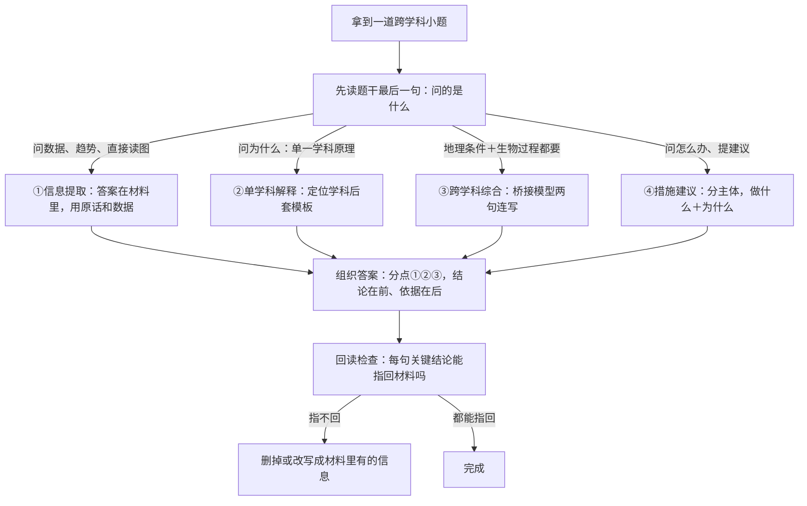
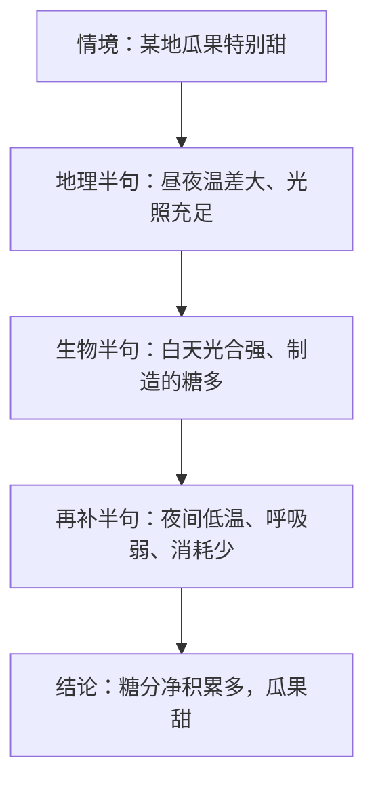

# 跨学科案例题型方法（详解版）

> **使用说明**：本文是详解版，从“为什么”讲起供从头自学；考前速查和掌握度跟踪在概要版：[[06-生物跨学科/知识点/跨学科案例题型方法]]。

## 0️⃣ 跨学科案例分析整体介绍

- **是什么**：上海中考综合测试卷里的一个模块，**满分 15 分**。给一段真实情境材料（图表、地图、数据、实验装置），配若干小题，用初中**地理＋生命科学**两科知识作答。
- **考几个小问**：常见 3~4 个小问（2026 届黄浦一模为第 42~46 共 5 问，各卷略有出入，以试卷为准）。
- **考什么能力**：本质是“**用两个学科的知识解释一个真实问题**”——不是背书，而是读材料、定学科、讲道理（依据：库内学科总览）。
- **常见情境四类**：农产品与产地（“延安苹果”“阿克苏棉花”“大熊猫栖息地”）；生态系统（湿地、农田、河流考察）；人体健康与运动；水与农业。
- 其中“水与农业”类常把两科拧在一起：水资源时空分布不均与对策（地理侧）＋灌溉水源、作物选择（农业区位模板侧），两块内容分别见两本概念详解版。
- **目标与时间**：目标 15 分拿 12+；综合测试共 120 分钟，给它约 **15 分钟**预算（依据：库内题型方法概要版）。
- **为什么值得投入**：库内学科总览把它定位为“低成本高确定性”模块——投入少、套路稳、回报 12+；要背的量比任何一门主科都小，方法对了分数涨得快。
- **一份真题长什么样**（2026 届黄浦一模，满分 15 分、共 5 问，结构供感受难度）：
  - 第 42 题（1 分）：地理读图——据高程定河流流向；
  - 第 43 题（2 分）：地理选择——河流水文现象的原因；
  - 第 44 题（4 分）：生物图解——动物类群特征的 Venn 图匹配；
  - 第 45 题（4 分）：跨学科——从表格提取因素并阐释因果链；
  - 第 46 题（4 分）：跨学科说理——用图、文、数据分析分布成因。
  （详见 [[06-生物跨学科/专题/跨模26-黄浦]]）
- **四类小题**（本文 🪜 节逐类示范）：①信息提取 ②单学科解释 ③跨学科综合 ④措施建议。
- **容易误会的一点**：这 15 分不是“生物卷子”——生命科学的书面考试在八年级已经结束、不计入中考总分，初三的生物复习只为这个跨学科模块服务（依据：库内学科总览）。所以复习重心是“两科知识怎么配合着用”，而不是把生物书重背一遍。

## 🧭 读图表／读材料的最基本技能自检

> 这些是最基础的动作。缺哪项就先补哪项。

| # | 你应该会的 | 自查题（先做再看答案） | 答案 | 不会去哪补 |
| - | ---------- | ---------------------- | ---- | ---------- |
| 1 | 会读图名和图例 | 拿到一张新图，前两个动作是什么？ | 先读图名，再读图例 | 本文流程第一、二步 |
| 2 | 会看坐标轴与极值 | 折线图先看什么、再找什么？ | 先看横纵轴各表示什么，再找最高点、最低点（极值）和拐点 | 本文流程第二步 |
| 3 | 会按行列读表格 | 任选一张真题表格，把“甲区域”那一行的数据按列名逐个念出来 | 按列名逐格念：海拔多少、物种数多少、氧含量高低…… | 本文示范① |
| 4 | 会圈学科关键词 | “该地昼夜温差大，瓜果含糖量高”里，地理词和生物词各是什么？ | 地理：昼夜温差大；生物：含糖量（→糖分积累） | 本文流程第三步 |
| 5 | 知道答案要“有出处” | 什么叫“答案能从材料找到出处”？ | 每句关键结论都能指回材料里某句话或图中某个数据 | 本文答题三原则 |
| 6 | 会找题干里的“任务指令” | “请说明可能的原因，并使用题中图、文、数据等信息写出分析过程”——这句话里有哪两个要求？ | ①说明原因；②分析过程必须使用材料里的图、文、数据 | 本文示范③ |

## 🌱 通用解题流程从头讲

### 第一步：读标题和情境（约 10 秒）

- 问自己一句话：“**这是什么地方、什么问题？**”——农业？生态？健康？水？
- 这一步决定你后面往哪个知识框里装内容。
  例子：黄浦案例开头写“渭河生态系统的健康状况备受关注”→ 生态情境 → 准备生态＋河流的知识（[[06-生物跨学科/专题/跨模26-黄浦]]）。

### 第二步：读图表（每张约 1 分钟，不许跳过）

- 固定顺序：**图名 → 图例 → 坐标轴 → 数据极值点**。
- 记住一条铁律：**材料里每个图表必然被某道小题用到**。读图时顺手用铅笔在旁边写一句“这张图能回答什么”。
  例子（黄浦案例）：表 1 有四列数据（海拔、常见鱼类物种数、特有鱼类物种数、氧含量）→ 第 45、46 题都要靠它。

### 第三步：圈两学科关键词

- **地理词**：气候、降水、地形、海拔、河流、位置、方向、区域；
- **生物词**：光合、呼吸、生态、物种、消化、循环、遗传、保护；
- 圈出来的词就是“答题素材清单”——写答案时要**用上**它们，而不是视而不见。

### 第四步：逐题作答（三原则）

1. **分点书写**：用①②③，一点一行；
2. **每点“结论＋依据”**：先说结论，再说“因为材料里……／图中显示……”；
3. **用术语不用口语**：“雨热同期”不写“夏天热雨水多”；“自动调节能力有限”不写“受不了破坏”。
- 再加一条总原则：**答案要能从材料找到出处**——写完回读一遍，每句关键结论试着指回一句材料或一个数据；指不回来的，多半是编的或跑偏了。

### 常用答题句式模板（照着套就不慌）

| 句式 | 用在哪 | 例子 |
| ---- | ---- | ---- |
| 数据对比句 | 信息提取、说理的开头 | 甲区域海拔 2300 米，乙、丙分别为 1100 米和 400 米 |
| 因果链句 | 解释题的主干 | 海拔越高 → 气压越低 → 氧气在水中的溶解度越低 |
| 条件＋结果句 | 农业区位、气候类解释 | 该地雨热同期，利于农作物生长 |
| 措施＋理由句 | 建议题 | 建立保护区——就地保护能把栖息地连同环境一起保住 |
| 结论收束句 | 综合题的结尾 | 因此……（回扣题目问的东西，别悬在半空） |

### 学科定位口诀

- 问“哪里、为什么是这里、降水地形河流”→ 先走**地理**模板（区位五要素、气候因素）；
- 问“原理、生理、生态、结构”→ 走**生物**概念（光合呼吸、生态系统、人体系统）；
- 问“怎么办、提建议”→ **分主体**给措施（见示范④）；
- 拿不准时看题干有没有“结合图、文、数据等信息”这类字样——有它就**必须引用材料**。
- 现场练一个：“该地适合种茶”→ 土壤偏酸性、气候温和湿润（走地理区位模板）＋茶树喜酸的习性（走生物概念）——两半各归各的学科，缺哪半补哪半。

### 常见材料类型与应对速查

| 材料类型 | 读取重点 | 常见考法 |
| ---- | ---- | ---- |
| 地图／区域图 | 图名、图例、方位、高程颜色 | 定流向、定位置（黄浦 42 题） |
| 表格 | 列名、行与行的对比、极值 | 提取因素、找规律（黄浦 45 题） |
| 气温曲线与降水柱状图 | 最冷月气温、降水的全年分配 | 判气候类型（三步法见 [[06-生物跨学科/知识点详解/地理核心概念速览]]） |
| 曲线图／柱状图 | 横纵轴含义、变化趋势、拐点 | 写“变化趋势＋具体数值区间” |
| Venn 图／结构图 | 交集＝共同特征，独占区＝独有特征 | 类群特征匹配（黄浦 44 题） |
| 实验装置／流程图 | 变量、对照组、结论指向 | 说实验目的、写实验结论 |

## 🪜 每类题型完整示范

四类小题先总览一遍（做题时对号入座）：

| 类型 | 题干特征 | 答案来源 | 组织方式 |
| ---- | ---- | ---- | ---- |
| ①信息提取 | “据表／据图写出、从表中提取” | 材料原话和数据 | 变化趋势＋具体数值 |
| ②单学科解释 | 问“为什么” | 学科模板 | 原理＋对应情境＋结论 |
| ③跨学科综合 | 地理条件＋生物过程都要 | 材料＋两个学科 | 地理半句＋生物半句连写 |
| ④措施建议 | “提出建议／应采取哪些措施” | 通用套路＋材料 | 分主体：做什么＋为什么 |

### 示范① 信息提取题（读图表直接答）

- **题型特征**：题干常带“据表”“据图写出”“从表中提取”。答案就在材料里，**用材料原话和数据回答，别自由发挥**。

**练习情境（自编练习用）**：某小组研究夜间温度对大棚番茄果实含糖量的影响，结果如下：

| 组别 | 白天温度 | 夜间温度 | 果实含糖量 |
| ---- | ---- | ---- | ---- |
| 甲 | 25℃ | 15℃ | 8.6% |
| 乙 | 25℃ | 20℃ | 6.9% |

**小问**：据表写出夜间温度与番茄果实含糖量的关系。

- **读什么**：只看两列——夜间温度、果实含糖量（白天温度两组相同，是背景条件）。
- 小技巧：先从题干确认要提取“哪两个变量”，再回表格只看相关行列——无关数据暂时放一边，省时间也不容易被带偏。
- **怎么提取**：甲组夜间 15℃ → 含糖量 8.6%；乙组夜间 20℃ → 含糖量 6.9%。数据方向：夜间温度越低，含糖量越高。
- **完整答案范文**：
  “在白天温度相同的条件下，夜间温度较低的甲组（15℃）果实含糖量较高（8.6%），夜间温度较高的乙组（20℃）含糖量较低（6.9%）；即夜间温度越低，番茄果实含糖量越高。”
  - 第 1 句＝交代前提（出处：表中“白天温度”两行都是 25℃）；
  - 第 2 句＝两组数据对比（出处：甲、乙两行的具体数值）；
  - 第 3 句＝趋势结论（依据：概要版要求图像题写“变化趋势＋具体数值区间”）。
- **失败示范**：只答“夜间温度影响含糖量”——没有数据、没有方向，等于没提取。

**进阶：真题型“提取＋阐释”**（依据 [[06-生物跨学科/专题/跨模26-黄浦]] 第 45 题）：
- 小问：从表 1 中提取并写出影响“河流中氧的含量”的 2 个因素，并阐释这 2 个因素如何影响氧含量。
- 读什么：表 1 的几列里，能与“氧含量（甲低、乙高、丙高）”对应起来的两列＝**海拔**、**常见鱼类物种数**——因素必须出自表 1，把“水温”当表内因素就答非所问。
- 完整答案范文（依据真题精讲）：
  “因素 1：海拔。甲海拔 2300 米、氧含量低，乙、丙海拔 1100 米／400 米、氧含量高——海拔越高，气压越低，氧气在水中的溶解度越低，河流含氧量越低。（出处：表 1 海拔列与氧含量列）
  因素 2：常见鱼类物种数。鱼类通过呼吸作用消耗水中溶解氧，物种数越多、生物量越大，耗氧越多。（出处：表 1 物种数列与氧含量列）”
- 结构提示：每条解释走“**数据证据 → 因果链 → 对氧含量的影响**”，这就是“结论＋依据＋术语”三原则的组合拳。

### 示范② 单学科解释题（答“为什么”）

- **题型特征**：问某一个现象的原因，答案落在一个学科内部。**先定位学科，再套模板**。

**地理版**（改编自 [[06-生物跨学科/专题/跨模26-黄浦]] 第 43 题）：
- 小问：泾河与渭河交汇处出现“泾渭分明”，可能的原因是什么？
- 定位学科：河流水文 → 地理。
- 思路：抓“分明”＝肉眼可见的颜色界线 → 对应**含沙量差异**。
- **完整答案范文**（真题精讲参考句式）：“泾河流经黄土高原，流水侵蚀带来大量泥沙，与含沙量较低的渭河在交汇处因密度、流速差异难以快速混合，故形成‘泾渭分明’景观。”
  - 前半句＝地理原因（出处：材料背景“渭河流域主体为黄土高原”）；
  - 后半句＝解释现象本身。

**生物版**（自编练习）：
- 小问：为什么大棚夜间适当降低温度能提高番茄含糖量？
- 定位学科：呼吸作用 → 生物。
- **完整答案范文**：“夜间没有光照，植物不能进行光合作用，只进行呼吸作用消耗有机物；夜间适当降温可以抑制（减弱）呼吸作用，减少有机物的消耗，因此糖分积累更多。”
  - 第 1 句＝背景（夜间只进行呼吸作用）；
  - 第 2 句＝降温的作用机制（低温抑制呼吸）；
  - 第 3 句＝回扣“含糖量提高”。
- **失败示范**：答“因为低温让植物冷得长不大”——既没定位到呼吸作用，也没说机制，属于典型的学科定位错误。

### 示范③ 跨学科综合题（最拉分）

- **题型特征**：一句话里既有地理条件又有生物过程。**固定桥接模型**（先背表，再学写法）：

| 情境 | 桥接逻辑 |
| ---- | ---- |
| 瓜果甜／优质农产品 | 地理（昼夜温差大、光照足）→ 生物（光合积累多、呼吸消耗少） |
| 某地适合种 X | 地理（气候雨热同期＋地形土壤水源）→ 生物（X 的习性喜……） |
| 生态系统破坏 | 地理（人类活动改变环境）→ 生物（食物链断裂、自动调节能力有限） |
| 保护措施 | 生物（保护生物多样性／栖息地）＋ 地理（退耕还林／划保护区／治污） |
| 健康与运动 | 生物（循环／呼吸系统原理）→ 提出合理化建议 |

- **写法三步**：先写地理半句（环境条件）→ 再写生物半句（生命活动怎么响应）→ 连成因果链收尾。

**完整示范**（改编自 [[06-生物跨学科/专题/跨模26-黄浦]] 第 46 题）：
- 小问：甲、乙、丙三个采样区域中，当地的特有鱼类主要分布在甲地，请说明可能的原因，并使用题中图、文、数据等信息写出分析过程。
- **读什么**：材料里“甲＝源头特有鱼类国家级水产种质资源保护区”；表 1 里“甲海拔 2300 米、特有鱼 5 种、氧含量低；乙常见鱼 23 种、丙常见鱼 42 种且特有鱼 0 种；丙＝中游城镇近郊区”。
- **怎么组织**：题干明写“使用题中图、文、数据等信息”→ 每条原因都要带具体的材料信息。
- **完整答案范文**（依据真题精讲）：
  ① 水环境适宜：甲位于河流源头、海拔高（表 1：2300 米），水温低、水质清洁，适宜对环境要求苛刻的特有鱼类生存。（出处：材料“源头保护区”＋表 1 海拔列）
  ② 已适应特殊条件：甲处河流含氧量低（表 1），特有鱼类经长期自然选择适应了当地低温、低氧的水环境；乙、丙常见鱼类物种数多（表 1：23 种、42 种），生存竞争强，特有鱼难以分布。（出处：表 1 两列数据对比）
  ③ 人为保护到位：甲为国家级水产种质资源保护区（就地保护），人类活动干扰小、栖息地保存完好；丙位于城镇近郊区、受干扰强，特有鱼类物种数为 0。（出处：材料背景句＋表 1“丙＝0”）
- **答案句式**：每条按“**证据（图、文、表的具体信息）＋原理＋结论**”书写——这就是“答案有出处”的满分形态（依据真题精讲：答出 3 条左右即满结构）。
- 再举一个健康情境的小例（对应桥接模型表第 5 行）：
  小问“为什么长期坚持适量运动能增强体质”——范文：“适量运动能促进血液循环（循环系统）和肺的气体交换（呼吸系统）；运动消耗的能量来自细胞的呼吸作用对有机物的分解；因此坚持运动有利于心肺功能的改善。”——每一分句都能对应一个具体概念，这就是“两句连起来”的味道。

### 示范④ 措施／建议题

- **题型特征**：问“提出合理建议／应采取哪些措施”。**分主体答**，每条＝做什么＋为什么能解决（半句原理）。

| 主体 | 常用方向 | 示例 |
| ---- | ---- | ---- |
| 政府／管理部门 | 政策、法规、保护区、工程 | 建立自然保护区、治污工程、跨流域调水 |
| 个人／公众 | 行为习惯 | 节约用水、垃圾分类、不乱扔废弃物 |
| 科技 | 技术手段 | 节水灌溉、污水处理技术、选育良种 |

**练习情境（自编）**：某城市湿地公园因周边生活污水排入，水质下降、水生生物减少。请提两条建议并说明理由。
- **完整答案范文**：
  ① 政府：铺设污水管网，将周边生活污水集中处理、达标后再排放——从源头切断污染物进入湿地的途径，减轻对水生生物的危害。
  ② 个人：市民不在湿地及上游河段乱扔垃圾、排放污水——减少污染物入水，保护湿地生物的栖息环境，让生态系统的自动调节能力得以维持。
  ③ 科技：推广污水净化、节水灌溉等技术手段——用技术从源头减少污染物排放，为湿地的自净能力减负。
  - 每条前半句＝做什么（主体明确），后半句＝为什么能解决（原理半句：源头控制／栖息环境＋自动调节能力）。
- **失败示范**：答“大家要保护湿地”——没有主体、没有具体做什么、没有理由，一句空话拿不到分。

## 🗺️ 题型决策流程图

拿到一道小题后的判断路径：

用这张图的方法：做题时不许直接跳到答案，先在心里走一遍第一层判断（问的是什么 → 归哪类）；错的题回来看“自己在哪一层走岔了”——是没判断对类型，还是组织答案时漏了出处。把岔路口记下来，就是你的专属失分点。

再看桥接模型的推理链长什么样（以“瓜果甜”为例）：

## 🔥 失分点剖析

| ❌ 失分点 | 为什么会犯 | ✅ 自救方法 |
| ---- | ---- | ---- |
| 学科定位错误 | 没先读“问的是什么”就动笔 | 用决策流程图第一层：先判断题型和学科 |
| 自由发挥、不引材料 | 以为靠背的知识就能答 | 题干有“结合材料／据表”字样时，每条带具体信息（数据、地名、原句） |
| 口语化表达 | 平时说话习惯带进了卷面 | 背术语清单：雨热同期、自动调节能力有限、逐级递减、就地保护…… |
| 一大段不分点 | 想到哪写到哪 | 强制①②③，一点一行 |
| 只答“半句”就停 | 以为点到就完 | 检查因果链走完没有：条件 → 机制 → 结果，三环缺一环就补上 |
| 图表数据没读全 | 跳过图例、只看显眼图形 | 固定顺序：图名 → 图例 → 坐标轴 → 极值 |
| 题干要求没看全 | 只扫了问题主体，漏了附加条件（如“写出分析过程”“每空只有一个正确选项”） | 圈出题干里的任务动词和限定语，作答前再读一遍 |
| 方位、顺序填反 | 凭感觉不查图例 | 先看图例定高程／方向基准，再落笔（黄浦 42 题“自西北、朝东南”两空有顺序） |
| 措施只说做什么 | 不知道还要写理由 | 每条加半句“为什么能解决” |
| 时间失控 | 在一问上死磕 | 15 分钟预算；卡住先做下一问，回头再补 |

另有真题易错摘录（详见 [[06-生物跨学科/专题/跨模26-黄浦]]）：
- 方位两空有顺序（“自西北、朝东南”），填反即丢分——先看高程图例再写方位；
- 因素必须**从表中提取**（黄浦 45 题：表中可供提取的只有海拔和常见鱼类物种数，把“水温”当表内因素就答非所问）；
- 亲缘远近看演化结构等级，别凭感觉（单细胞的原生动物与鱼类差异最大，而不是水生昆虫）。

## ✅ 自测清单（能独立做到才打勾）

- [ ] 1. 能说出跨学科案例的分值、常见小问数量、目标分数和时间预算
- [ ] 2. 拿到材料能按“标题情境 → 图表 → 圈关键词”三步走
- [ ] 3. 能默写四类小题的题型特征和各自打法
- [ ] 4. 能写出“瓜果甜”“某地适合种 X”两个桥接模型并连成因果链
- [ ] 5. 能对一道信息提取题写出“趋势＋数值”的规范答案
- [ ] 6. 能按“证据＋原理＋结论”写一条说理句
- [ ] 7. 能分主体写出两条措施并各带半句理由
- [ ] 8. 能对照失分点表说出自己最常犯的 2 个错误和自救方法
- [ ] 9. 能在 15 分钟预算内完整走完一个案例（读材料＋逐问作答＋回读检查）
- [ ] 10. 做错的题能归因到“四类小题打法”里的哪一步走岔

## 📌 高频情境清单（做题后持续登记）

> 每做完一套题，把遇到的情境登记进来。登记格式固定为三格：**情境名 → 涉及学科 → 核心逻辑**（概要版下方的主清单是记录处，这里负责教你登记）。

- [ ] 示例：新疆瓜果甜 → 地理＋生物 → 昼夜温差大、光照足 → 光合积累多、呼吸消耗少 → 糖分净积累多
- [ ] 示例：渭河特有鱼分布在源头 → 地理＋生物 → 高海拔水温低水质好＋就地保护＋已适应低氧（黄浦一模第 46 题）
- [ ] （继续从各区真题里补充，攒够 10 个情境，15 分里的大半套路就见过了）

## 训练节奏（沿用概要版）

- 每两周 1 套一模卷的跨学科部分 → 错题卡归因（多为“表达不规范”或“学科定位错误”）；
- 寒假集中刷各区真题的跨学科小题，总结高频情境清单（登记在 [[06-生物跨学科/知识点/跨学科案例题型方法]] 下方）；
- 每次刷题后回本文：把新情境对号入座到四类小题和桥接模型里；
- 做题掐表：整个案例 15 分钟，平摊到每个小问约 3~4 分钟，超时先跳过、回头再补。

## 考前一天怎么用本文

- 只看三处：四类小题总览表、桥接模型表、失分点剖析表；
- 把两句“金句”再默一遍：“答案要能从材料找到出处”“每条＝结论＋依据”；
- 其余时间回概要版过情境关键词，别再刷新题。

## 🔗 关联

- 概要版（考前速查＋掌握度跟踪）：[[06-生物跨学科/知识点/跨学科案例题型方法]]
- 概念弹药库：[[06-生物跨学科/知识点详解/生命科学核心概念速览]] · [[06-生物跨学科/知识点详解/地理核心概念速览]]
- 完整真题逐问精讲：[[06-生物跨学科/专题/跨模26-黄浦]]
- 学科总览：[[06-生物跨学科/学科总览-跨学科案例分析]]
