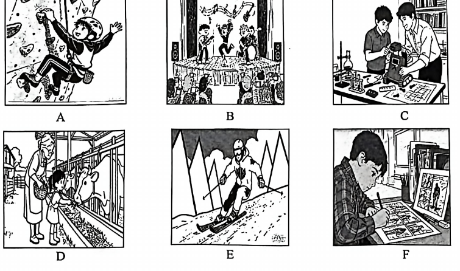

# 2026 一模精讲 · 嘉定英语（上）：听力 + 语法词汇（第 1–43 题）

> 嘉定卷结构：Part 1 听力 25 分（1–20）+ Part 2 语法和词汇 45 分（21–58）+ Part 3 读写 70 分（59–84），共 84 小题 140 分。本篇覆盖第 1–43 题，第 44–84 题见 [[英模26-嘉定-下]]。
>
> ⚠️ **资料说明**：本卷为纯扫描件、无文字层（题干经 150dpi 页图逐页录入校正）。**答案来源为卷面红笔手写批注版**（非官方排版答案），已逐题辨认誊录；听力部分（1–20）批注版未作答、且本区无听力音频，故听力只给卷面与方法，不给答案。

## Part 1 听力（第 1–20 题，共 25 分）

### A. Listen and choose the right picture（听句选图，第 1–5 题，5 分）

六选五，卷面六图为：

- A：男孩戴头盔攀上室内攀岩墙——"攀岩"场景
- B：舞台上一支乐队又跳又奏，台下坐满观众——"登台演出"场景
- C：两名男孩在桌前修理/组装一辆小车模型（工具、零件摊满桌面）——"动手修理/组装"场景
- D：老奶奶和小女孩在农场围栏边喂牛——"农场/喂动物"场景
- E：滑雪者持雪杖从雪山滑下——"滑雪"场景
- F：男孩伏案画连环画（comic strips），旁有显示器——"画漫画"场景（与语法 29 题 comic strips 主题呼应）

> ⚠️ 卷面批注版**未给出 1–5 题答案**，本区亦无听力音频，此处不臆测答案。做题方法：听前先读图、用一句话概括每图核心动词（climb / perform / fix / feed animals / ski / draw comics），听到句子后抓"动词+名词"匹配。

### B. Listen to the dialogue and choose the best answer to the question you hear（对话理解，第 6–10 题，5 分）

**6.**（问饮品）
- A) Tea.
- B) Juice.
- C) Water.
- D) Milk.

**7.**（问人名/人物）
- A) Adam.
- B) Brian.
- C) Dan.
- D) Michael.

**8.**（问地点）
- A) In the hospital.
- B) In the hotel.
- C) At the airport.
- D) At the bus stop.

**9.**（问建议/做法）
- A) Repair it by herself.
- B) Tell Laura about it.
- C) Change it for a new one.
- D) Find someone to repair it.

**10.**（问意愿/观点）
- A) He wants to have a rest in the afternoon.
- B) He would like to go out with the woman.
- C) He will go to see a doctor.
- D) He hopes to go cycling right now.

> ⚠️ 同上，无音频无批注答案。考点预判：6 题抓"喝的东西"；8 题抓场景标志词（appointment / room / flight / bus）；9 题注意 but 后的真正建议；10 题抓人物意愿（would like / hope / want），转折后的意愿才是答案。

### C. Listen to the conversation and tell whether the following statements are true or false（对话判断，第 11–15 题，5 分）

**11.** Kate's lemonade floating stand(浮动摊位) is very popular these days.

**12.** Father painted the floating stand yellow to match the color of their houseboat.

**13.** Kate donated all the money from the stand to help protect the environment.

**14.** Building a few more floating stands was Kate's future plan.

**15.** In the interview, Kate taught kids how to make a plan to protect the environment.

> 对话主旨可从判断句反推：女孩 Kate 在自家船屋（houseboat）旁经营柠檬水浮动摊位，父亲帮忙刷漆，收入捐赠用于环保，未来还想建更多摊位，采访中向孩子们传递环保做法。⚠️ 批注版未给 T/F 答案。方法：判断句与原文的**数字、颜色、目的、将来计划**最常被偷换（如 12 题 yellow、13 题所有收入、14 题未来计划）。

### D. Listen to the passage and complete the following sentences（听短文填空，第 16–20 题，10 分；每空格限填一词）

**16.** The Aibi robot is small enough to go through ＿＿＿＿＿＿＿＿ ＿＿＿＿＿＿＿＿ at home.

**17.** To make the Aibi robot work, you have to ＿＿＿＿＿＿＿＿ ＿＿＿＿＿＿＿＿ with the app on your phone.

**18.** With a ＿＿＿＿＿＿＿＿ ＿＿＿＿＿＿＿＿ on its head, the Aibi robot lets you watch your pets' daily moments clearly.

**19.** The robot has a small and tidy pocket on its back to ＿＿＿＿＿＿＿＿ ＿＿＿＿＿＿＿＿ for several days.

**20.** With the help of the Aibi robot, you can travel ＿＿＿＿＿＿＿＿ ＿＿＿＿＿＿＿＿ instead of worrying about your pets.

> ⚠️ 批注版未给答案。短文为"宠物看护机器人 Aibi"的功能介绍，五句都是功能句型：16 预判"家里的狭窄处"类地点名词；17 预判动词原形短语（与 app 有关）；18 预判头部装置（摄像头/相机类名词）；19 预判"存放食物"类动词短语；20 预判"出远门/外出"类状语。听前按词性预判、听时抓空格前后搭配即可。

## Part 2 语法和词汇（第 21–43 题）

### II. Choose the best answer（语法单项选择，第 21–35 题，各 1 分，共 15 分）

**21.** Kindness plays ______ important role in life by connecting people warmly.
- A) a
- B) an
- C) the
- D) /

> [!tip]- 💡 思路导航
> play ___ important role 是固定搭配；再念 important 的首音——元音还是辅音？由此定冠词。

> [!success]- ✅ 详解 · 评分点 · 易错 · 关联
> **答案 B**。play an important role 固定搭配；important 以元音音素开头 → an。

**22.** My brother and I like playing Ping-Pong. ______ play together on Saturdays.
- A) He
- B) They
- C) We
- D) I

> [!tip]- 💡 思路导航
> My brother and I 指包括说话人在内的两人，作主语要选相应的人称代词主格。

> [!success]- ✅ 详解 · 评分点 · 易错 · 关联
> **答案 C**。My brother and I = 我们俩 → 人称代词主格 We。

**23.** In Chinese culture, horses are important symbols, which stand ______ speed and success.
- A) of
- B) on
- C) in
- D) for

> [!tip]- 💡 思路导航
> horses "象征"速度与成功——固定短语 stand ___，介词逐项代入朗读。

> [!success]- ✅ 详解 · 评分点 · 易错 · 关联
> **答案 D**。stand for"象征/代表"固定短语。

**24.** Lin Dong has three cousins in Beijing, and he also has ______ one in Guangzhou.
- A) another
- B) other
- C) the other
- D) others

> [!tip]- 💡 思路导航
> 已有三个表兄，广州"再有一个"——三者之外泛指"又一个"的代词。

> [!success]- ✅ 详解 · 评分点 · 易错 · 关联
> **答案 A**。三者以上之外再泛指"又一个" → another one。

**25.** The bank clerk spoke as ______ as he could to make the old woman understand him.
- A) slowly
- B) more slowly
- C) most slowly
- D) the most slowly

> [!tip]- 💡 思路导航
> as…as 之间用原级；修饰动词 spoke 要用副词而不是形容词。

> [!success]- ✅ 详解 · 评分点 · 易错 · 关联
> **答案 A**。as…as 之间用原级，修饰动词 spoke 用副词 slowly。

**26.** – May I leave the table now, Dad?  – No, you must finish your dinner first. Then you ______ leave the table.
- A) must
- B) should
- C) need
- D) can

> [!tip]- 💡 思路导航
> "先吃完，然后___离开"——语境问的是"许可"还是"必须/应该"？

> [!success]- ✅ 详解 · 评分点 · 易错 · 关联
> **答案 D**。"先吃完，然后**就可以**离开"——表许可用 can。

**27.** Alex did not feel the light earthquake this morning. He ______ in the park at the time.
- A) jogged
- B) was jogging
- C) has jogged
- D) would jog

> [!tip]- 💡 思路导航
> at the time 指地震发生的那一刻——过去某时正在进行的动作，用什么时态？

> [!success]- ✅ 详解 · 评分点 · 易错 · 关联
> **答案 B**。at the time 指地震发生那一刻"正在慢跑" → 过去进行时。

**28.** Shenzhou 20 crew ______ successfully in good physical condition on Nov.14, 2025.
- A) have landed
- B) had landed
- C) landed
- D) lands

> [!tip]- 💡 思路导航
> on Nov.14, 2025 是具体的过去时间点，据此锁定时态。

> [!success]- ✅ 详解 · 评分点 · 易错 · 关联
> **答案 C**。on Nov.14, 2025 为具体过去时间点 → 一般过去时 landed。

**29.** Mr. Wang encouraged us ______ AI technology to create our own comic strips.
- A) use
- B) to use
- C) using
- D) to using

> [!tip]- 💡 思路导航
> encourage sb ___ do sth 是固定接法，想想后面跟什么形式。

> [!success]- ✅ 详解 · 评分点 · 易错 · 关联
> **答案 B**。encourage sb to do sth 固定接不定式。

**30.** Ella said she didn't mind ______ for some time before she could buy the ticket.
- A) wait
- B) waited
- C) to wait
- D) waiting

> [!tip]- 💡 思路导航
> mind 后面固定接动名词 doing。

> [!success]- ✅ 详解 · 评分点 · 易错 · 关联
> **答案 D**。mind doing sth 固定接动名词。

**31.** We should think of a better plan, ______ the situation will get worse.
- A) and
- B) but
- C) or
- D) so

> [!tip]- 💡 思路导航
> "快想个更好的办法，___情况会更糟"——表"否则"关系的连词。

> [!success]- ✅ 详解 · 评分点 · 易错 · 关联
> **答案 C**。"祈使/建议 + or" = 否则 → or（不然情况会更糟）。

**32.** Lisa keeps improving her work ______ the final result matches the design in her mind.
- A) if
- B) until
- C) when
- D) since

> [!tip]- 💡 思路导航
> "不断改进"与"最终结果相符"之间是时间、条件还是因果？据此选连词。

> [!success]- ✅ 详解 · 评分点 · 易错 · 关联
> **答案 B**。不断改进"直到"最终结果与心中设计相符 → until。

**33.** ______ useful advice you offered us! It helped us a lot.
- A) How
- B) What a
- C) What an
- D) What

> [!tip]- 💡 思路导航
> 感叹句中心词是 advice：不可数、前面无冠词——用 How 还是 What？

> [!success]- ✅ 详解 · 评分点 · 易错 · 关联
> **答案 D**。感叹句核心为不可数名词 advice（advice 前无冠词）→ What + adj + 不可数名词。

**34.** If there is any problem with the smart cleaner, ______ the manager directly, please.
- A) contact
- B) to contact
- C) contacting
- D) contacted

> [!tip]- 💡 思路导航
> 句末有 please，构成祈使句——动词用什么形式？

> [!success]- ✅ 详解 · 评分点 · 易错 · 关联
> **答案 A**。please 构成祈使句 → 动词原形 contact。

**35.** – Could you tell me ______ you spent New Year's Day this year, Peter?  – We had a family get-together and went to an amusement park.
- A) what
- B) when
- C) how
- D) where

> [!tip]- 💡 思路导航
> 先看答语回答的是地点、时间还是方式——聚会加游乐园指向哪种？

> [!success]- ✅ 详解 · 评分点 · 易错 · 关联
> **答案 C**。答语回答的是"度过方式"（聚会+游乐园）→ how。

### III. Complete the following passage with the words in the box. Each can be used only once（选词填空，第 36–43 题，各 1 分，共 8 分；每空限填一词，每词只能填一次）

**首框**：A. checking on  B. wisely  C. dealing with  D. express  E. imagine
主题：青少年理财（money management）

**36.** "Money makes the world go round." So it's certainly hard to ＿＿＿＿＿＿＿＿ life without it.

> [!tip]- 💡 思路导航
> hard to 后接动词原形；"没有钱的生活很难___"——表示"设想"的动词。

> [!success]- ✅ 详解 · 评分点 · 易错 · 关联
> **答案 E) imagine**（"很难想象没有钱的生活"；hard to + 动词原形）

**37.** Kids can learn how to use their money ＿＿＿＿＿＿＿＿.

> [!tip]- 💡 思路导航
> 修饰动词 use 要用副词形式。

> [!success]- ✅ 详解 · 评分点 · 易错 · 关联
> **答案 B) wisely**（修饰动词 use 用副词"明智地"）

**38.** …deposit(储蓄) the money in a savings account and then start ＿＿＿＿＿＿＿＿ its growth from time to time.

> [!tip]- 💡 思路导航
> start 后接 doing；与 app/账户语境呼应，填一个"跟进/查看"类短语。

> [!success]- ✅ 详解 · 评分点 · 易错 · 关联
> **答案 A) checking on**（start doing；"不时查看它的增长"，check on"查看/跟进"）

**39.** Studies show that young people…can get better at ＿＿＿＿＿＿＿＿ money as they grow up.

> [!tip]- 💡 思路导航
> 介词 at 后接动名词；"打理钱"选含介词 with 的短语动词。

> [!success]- ✅ 详解 · 评分点 · 易错 · 关联
> **答案 C) dealing with**（介词 at 后接动名词；deal with money"打理钱"）

**次框**：A. unexpected  B. reduce  C. efforts  D. buys  E. compare

**40.** …manage daily spending or say "no" to unnecessary ＿＿＿＿＿＿＿＿.

> [!tip]- 💡 思路导航
> say "no" to unnecessary ___——需要名词；"不必要的消费"把哪个动词名词化了？

> [!success]- ✅ 详解 · 评分点 · 易错 · 关联
> **答案 D) buys**（buys 此处作名词复数"购买之物"；unnecessary buys"不必要的消费"）

**41.** Building up your savings also makes you feel more secure. You'll have a safety net for ＿＿＿＿＿＿＿＿ costs…

> [!tip]- 💡 思路导航
> 名词 costs 前需要形容词；safety net（安全网）应对的是哪类开销？

> [!success]- ✅ 详解 · 评分点 · 易错 · 关联
> **答案 A) unexpected**（"意外开销"；形容词修饰名词 costs）

**42.** …you're in a store, ＿＿＿＿＿＿＿＿ the price of one packet of biscuits with another…

> [!tip]- 💡 思路导航
> 空后 with another 提示固定搭配；下文 think about the difference 印证动作含义。

> [!success]- ✅ 详解 · 评分点 · 易错 · 关联
> **答案 E) compare**（compare…with…"把……与……比较"，与下文 think about the difference 呼应）

**43.** Earning and saving money takes ＿＿＿＿＿＿＿＿ but if you save money in a clever way, you can earn money as you sleep.

> [!tip]- 💡 思路导航
> takes 后接名词；与 but 后"睡觉也能赚钱"构成转折——"费力"类抽象名词。

> [!success]- ✅ 详解 · 评分点 · 易错 · 关联
> **答案 C) efforts**（take efforts"费力气"；but 后转折强调"聪明存钱"）

> 小结：选词填空先判词性（36 to 后接原形动词、37 副词修饰动词、39 介词后接 -ing、41 名词前用形容词、43 动词 takes 后接名词），再靠**上下文复现与搭配**锁定（38 与 app/账户语境、42 与 with another 搭配）；两框各有一词不用（首框 D. express、次框 B. reduce 未用）。

---
*本篇题干经 150dpi 页图逐页录入校正（嘉定卷为纯扫描件、无文字层）；答案誊自卷面红笔手写批注版并逐题与语法规则互证。听力部分批注版未作答、本区亦无音频，已如实标注。*
