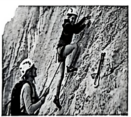
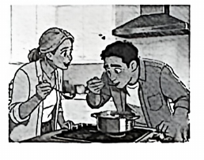
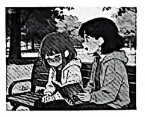

# 2026 一模精讲 · 嘉定英语（下）：词句转换 + 读写（第 44–84 题）

> 本篇覆盖第 44–84 题（词形转换、句型转换、阅读四篇、作文），第 1–43 题见 [[英模26-嘉定-上]]。答案来源与校正方式同上篇：卷面红笔手写批注版 + 150dpi 页图互证。

## IV. Complete the sentences with the given words in their proper forms（词形转换，第 44–51 题，各 1 分，共 8 分）

**44.** Dr. Hu has collected several ______ to show the conclusion is correct. (proof) → **proofs**
（several + 可数名词复数；proof"证据"直接加 s）

**45.** ______ students will take part in the final of the memory competition. (twelfth) → **Twelve**
（twelfth 为序数词，此处要表达"十二名学生参加决赛"→ 变基数词 Twelve；批注即填 Twelve。⚠️ 本题考**序数词↔基数词转换方向**，易惯性照抄 twelfth）

**46.** The Browns have repaired the house ______ and are going to move into it soon. (they) → **themselves**
（主语 The Browns 一家人 → 反身代词 themselves，"亲自/自己"修缮）

**47.** Users have been very ______ about the development of this AI model. (excitement) → **excited**
（be excited about 固定搭配；主语 users 是人 → 用 -ed 形容词"兴奋的"）

**48.** Good team work will ______ us to get the job done on time. (able) → **enable**
（will 后接动词原形；able → enable"使能够"，enable sb to do）

**49.** Jane Goodall's Roots & Shoots has had a huge ______ on global youth environmental action. (effective) → **effect**
（a huge + 名词；have a huge effect on"对……有巨大影响"，effective → effect）

**50.** Jack measured the ______ of the table to calculate how much material would be needed. (long) → **length**
（the + 名词；long → length"长度"，注意 -th 名词后缀拼写）

**51.** ______, my laptop crashed last night, so I had to stay up late to rewrite the report. (unlucky) → **Unluckily**
（句首修饰整句用副词；so 后"熬夜重写"呼应"不幸地"）

## V. Rewrite the following sentences as required（句型转换，第 52–58 题，共 14 分；52–57 每空格限填一词）

**52.** Lucy read a guidebook to choose a place for her vacation.（改为一般疑问句）
→ **Did** Lucy **read** a guidebook to choose a place for her vacation?
（read 的过去式与原形同形 → 借助 did 提问，动词还原为 read）

**53.** The boy apologized to his mother for breaking her favourite bowl.（对划线部分提问）
→ **Why did** the boy apologize to his mother?
（划线 for breaking her favourite bowl 表原因 → why；apologized 为过去式 → did）

**54.** The group members are discussing when they will start doing the experiment.（改为简单句）
→ The group members are discussing **when to** start doing the experiment.
（宾语从句简化为"疑问词 + to do"结构）

**55.** Taylor decided to be a policeman after reading the detective story.（保持句意不变）
→ Taylor **made up** his mind to be a policeman after reading the detective story.
（decide to do = make up one's mind to do；过去式 made）

**56.** The new working visa allows workers to stay in the country for two years.（改为被动语态）
→ With the new working visa, workers **are allowed** to stay in the country for two years.
（一般现在时被动 are + 过去分词 allowed；workers 复数 → are）

**57.** "Will you take part in the talent show this term, Jimmy?" Susan asked.（改为宾语从句）
→ Susan asked Jimmy **whether/if he would** take part in the talent show this term.
（一般疑问句 → whether/if 引导；you→he；will→would 时态后移。⚠️ 批注手写 whether/if 并列——每空限填一词，两者任写其一即可）

**58.** your, learning, brain, develop, a, helps, new skill（连词成句）
→ **Learning a new skill helps your brain develop.**
（动名词短语 Learning a new skill 作主语；helps sth do 接宾语 your brain + 省略 to 的不定式 develop）

## VI. Reading Comprehension（阅读理解，第 59–83 题，共 50 分）

### A. Choose the best answer（阅读选择：ISS 太空问答，第 59–64 题，各 2 分，共 12 分）

文章脉络：少儿科普问答栏目 **JUST ASK**（编辑 Lily Bailey）回答读者关于国际空间站（ISS）的四个问题——Q1 宇航员每天的日常工作（太空行走、修设备、做实验、与地面通信）与休闲（玩游戏、看电影、听音乐、俯瞰地球减压）；Q2 锻炼量（Wakata 在站 188 天每天锻炼至少两小时，Shepard 打"月球高尔夫"，Peake 2016 年太空马拉松创吉尼斯纪录）；Q3 太空对身体的影响（失重让身体变弱、肌肉心脏骨骼退化，对策是多锻炼）；Q4 睡眠（每 24 小时 16 次日出日落难分昼夜，作息严格、戴 blindfolds 遮光）。

**59.** Astronauts do a lot of work on the ISS except ______. → **C) playing games outside**
（Q1 中 playing games 是舱内放松项而非工作，且 outside"舱外玩游戏"无中生有；A/B/D 均为原文所列工作）

**60.** ______ set a Guinness World Record for marathon in space. → **D) Tim Peake**
（Q2 原句：British astronaut Tim Peake even ran a marathon in space in 2016 and set a Guinness World Record）

**61.** The underlined word "this" in the third answer refers to ______. → **C) making the body weak**
（this 复指上句 their bodies get weak if they don't do enough exercise——"身体变弱"）

**62.** To reduce the harm of space activities on the body, astronauts should ______. → **B) do a lot of exercise in space**
（Q3 末句 The answer is exercise and not just a little exercise but a lot!）

**63.** The underlined word "blindfolds" means ______ in the passage. → **A) special tools to block sunlight**
（blindfolds 即"眼罩"；原文 wear special blindfolds to keep from light——遮光工具，B/C/D 与"遮光"无关）

**64.** Lily Bailey answered the four questions to ______. → **B) introduce the life on the ISS**
（四个问题分别覆盖工作、锻炼、身体、睡眠——都是"ISS 上的生活"，未涉及建造历史/国家）

### B. Choose the best words or expressions and complete the passage（完形选择：攀岩少女 Brooke，第 65–70 题，各 2 分，共 12 分）

文章脉络：美国攀岩少女 Brooke Raboutou 12 岁前已握七项世界纪录——手指有力、身体柔韧如孩童 → 出身攀岩世家，母亲 Robyn 曾四夺世界杯，十年前在科罗拉多创办青少年俱乐部并执教女儿 → 母女虽共事不易，却互敬互信；母亲严格也传递勇气 → Brooke 有决心、善自我激励、每天苦练 → 攀岩也是乐趣：站上高岩她感到快乐，登高俯视"人小岩大"反而 fearless——攀岩是挑战与快乐的完美结合。

**65.** …she has really strong fingers and the ______ body of a child, which allows her to bend her body easily… → **A) flexible**
（后文 bend her body easily"轻松弯折身体"正是"柔韧"的释义复现）

**66.** …she can do things ______ climbers have never dreamed of doing. → **B) older**
（孩子般的身体却能做"更年长"攀岩者都不敢想的事，与 body of a child 形成对照）

**67.** She ______ a club for young climbers in Colorado, USA ten years ago and coaches Brooke… → **D) set up**
（set up a club"创办俱乐部"；ten years ago 过去时；made up 编造 / carried out 执行 / grew up 长大均不合）

**68.** ______ it's sometimes difficult for mother and daughter to work so closely, they really respect and trust each other. → **C) Though**
（前"难"后"互敬互信"语义转折 → Though 引导让步状语从句）

**69.** Robyn can be strict, but she also shows the ______ of a professional climber. She passes the spirit of courage on to Brooke. → **B) bravery**
（下句 the spirit of courage"勇气精神"原词呼应 → bravery"勇敢"）

**70.** Brooke loves climbing and when she's on a high rock, she feels happy. ______, for Brooke, climbing is a perfect mix of challenge and joy. → **B) In other words**
（后句是对前句"她爱攀岩且快乐"的换说重述 → In other words"换句话说"）

### C. Read the passage and fill in the blanks with proper words（首字母填空：好奇心，第 71–77 题，各 2 分，共 14 分）

文章脉络：课上听不懂时有的学生放任不管、下次照错 → Katie 却课后追问老师、复习笔记、图书馆查书、看视频直到弄懂，学得好只因"足够好奇" → 好奇的人不断追问，历史上许多伟大发现皆出于此；好奇心培养对知识的真爱、让人更投入学习 → 有学生担心好奇浪费时间，但研究表明：对某话题好奇时记忆事实更快更好，成就感又促使学得更努力 → 好奇心可通过练习培养：多提问、读书看视频、多与懂的人交流、保持开放心态、永不停下追问。

**71.** …the next time they meet similar questions, they still make m______. → **mistakes**
（make mistakes"犯错误"固定搭配；放任不管的学生下次照错）

**72.** Sometimes she r______ her notes, reads related books in the library… → **reviews**
（she 后谓语动词三单；review her notes"复习笔记"，与 reads / watches 并列）

**73.** Many great d______ in history were made by curious people. → **discoveries**
（"许多伟大的发现"；were made 复数谓语 → discoveries 复数）

**74.** When you are curious, you develop a real love for knowledge and will be f______ active in the learning process. → **frequently**
（f 开头副词修饰 active"更频繁地积极参与"；⚠️ 批注手写主答 frequently，旁另有一被划掉的词迹辨认不清，以 frequently 为准）

**75.** When students were curious about one topic, they could remember the facts f______ and better. → **faster**
（and 并列比较级 better → faster"记得更快更好"）

**76.** It's OK if you are not naturally very curious, curiosity can be b______ through practice. → **built**
（be built through practice"通过练习培养起来"；被动语态 be + 过去分词）

**77.** Stay open-minded and never stop w______. That's how you keep your curiosity alive. → **wondering**
（stop doing"停止做某事"→ never stop wondering"永不停下追问"）

### D. Answer the questions（回答问题：Emma 的"改稿汤"，第 78–83 题，共 12 分）

文章脉络：清晨 Emma 看父母调汤——不争吵、你一口我一口试味、一点点加水直到"味道正好" → 放学赶去写作社（Writing Club）活动，Miss Rosa 要求成员与"互评伙伴"（critique partner）互改故事 → Emma 因常拼错单词而紧张，仍夸 Penny 的流浪狗救人的故事 exciting、书写 clean → 会后 Penny 掉出的书 A Dog Named Sunny 开头与她的故事高度相似 → Emma 私下轻声相问，Penny 脸红承认"只想要点子、抄多了" → Emma 想起清晨那锅"一点一点改到正好"的汤，说自己"有个让故事变完美"的主意。

**78.** Emma was a member of the Writing Club, wasn't she?
→ **Yes, she was.**（反意疑问句先答 Yes/No；定位"Emma grabbed her backpack and rushed to the library for the Writing Club meeting"）

**79.** What did Miss Rosa ask the club members to do in the meeting?
→ **She asked them to share their stories with a critique partner.**（定位 Miss Rosa 的话"you will share your stories with a critique partner"）

**80.** What made Emma feel nervous during the club meeting?
→ **She often made spelling mistakes.**（定位"Emma felt nervous because she often made spelling mistakes, even though she had lots of good story ideas"）

**81.** How did Emma describe Penny's story and writing?
→ **She said (that) Penny's story was exciting and her writing was very clean.**（定位"Your story is exciting…And your writing is very clean"；转述时人称与时态后移）

**82.** Why did Penny's face turn red?
→ **Because she admitted that she had copied too much from a book and felt ashamed.**（定位 Penny 的脸红与原话"I only wanted ideas, but I think I copied too much"；批注按"承认抄袭+羞愧"两点给分）

**83.** What is Emma's idea? Fill in the blank with at least 2 sentences.
→ 开放题，要求**至少两句**，参考（批注版示例）：**We can work together. Let's rewrite your story little by little until it becomes better.**（⚠️ 批注手写作 "until it become better"，become 系手写笔误，规范应作 becomes；给分点：句子≥2 + 呼应"合作修改、一点点改好"的汤之喻 + 语法正确）

## VII. Writing（作文，第 84 题，共 20 分）

**题目**：假如你是李华，中国农历新年将至，你的英国笔友 Harry 打算在社区组织"中国文化体验日"（Enjoy Chinese Culture）活动，让英国朋友更了解并喜欢上中国文化。他从四个活动主题中请你推荐一个最有趣的并回复邮件：Traditional Chinese Food / Traditional Chinese Festivals / Chinese Tourist Attractions / Traditional Chinese Skills。邮件需包括：① 选择并推荐的活动主题；② 推荐该主题的理由，并简单介绍；③ 为这个主题设计一个体验日的活动。不少于 60 词。

**审题三步**：① 回复邮件格式（Dear Harry 开头 / Yours, Li Hua 落款）；② 三个内容要点缺一不可——推荐主题、理由+简单介绍、设计一个体验日活动（活动要具体可操作，写清"做什么"）；③ 四个主题只选一个，全文只围绕它展开；新年将至的情境选 Food 或 Festivals 最易扣题。

**参考范文（约 95 词，选 Traditional Chinese Food）**：

> Dear Harry,
>
> Thank you for your email. Since Chinese New Year is coming, I'd like to recommend Traditional Chinese Food as the theme of our Enjoy Chinese Culture Day.
>
> I choose it because food is the most delicious way to experience a culture, and behind almost every Chinese dish there is an interesting story.
>
> For the activity, I suggest a dumpling-making workshop. Everyone can learn to wrap dumplings with different fillings, boil and taste them, and I will explain why dumplings are a must for the New Year's Eve dinner. I'm sure your friends will love it.
>
> Yours,
> Li Hua

**评分要点**：覆盖三个内容要点（推荐+理由介绍+活动设计）｜语法与用词准确｜衔接与流畅｜邮件格式与词数达标。忌照抄阅读语篇（卷面明示不得分）；不得出现真实姓名、校名等个人信息。

---
*本篇题干经 150dpi 页图逐页录入校正（嘉定卷为纯扫描件、无文字层）；答案誊自卷面红笔手写批注版并逐题与语言规则互证；45/57/74/83 等处批注细节已如实标注。*
