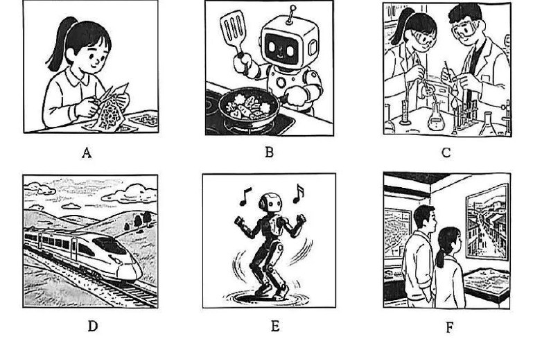

# 2026 一模精讲 · 奉贤英语（上）：听力 + 语法词汇（第 1–43 题）

> 奉贤卷结构：Part 1 听力 25 分（1–20）+ Part 2 语法词汇 45 分（21–58）+ Part 3 读写 70 分（59–84），共 84 小题 140 分，与宝山同构。本篇覆盖第 1–43 题，第 44–84 题见 [[英模26-奉贤-下]]。
>
> ⚠️ **资料说明**：答案来源为**学科网印刷版参考答案**（自带逐题解析，文字层完整）。注意：该答案版内部编号为 1–64（语法 1–15、选词 16–23、词形 24–31、句转 32–38、阅读 39–63、作文 64），**卷面为全市连续编号 21–84，两者相差 +20**，本篇一律按卷面编号。听力部分（1–20）答案版未含、本区无音频，只给卷面与方法，不臆测答案。

## Part 1 听力（第 1–20 题，共 25 分）

### A. Listen and choose the right picture（听句选图，第 1–5 题，5 分）

- A：女孩坐在桌前拆包裹/整理物件——"收快递/手工"场景
- B：机器人端着锅铲炒菜——"机器人下厨"场景
- C：两人戴护目镜做化学实验——"实验课"场景
- D：高铁列车驶过丘陵田野——"乘高铁出行"场景
- E：机器人在跳舞（头顶音符）——"机器人表演"场景
- F：两人在展馆里看画——"看画展"场景

> ⚠️ 无答案无音频。方法：听前给每图标一个动词短语（unpack a parcel / cook / do an experiment / take the train / dance / visit an art show），听句抓"主语+动词"匹配（本卷 A/B/E 三图都是"人与机器人"题材，注意区分动作执行者）。

### B. Listen to the dialogues and choose the best answer（对话理解，第 6–10 题，5 分）

**6.**（问季节/时间）
- A. Spring.
- B. Summer.
- C. Autumn.
- D. Winter.

**7.**（问时刻——注意"提前/推迟 10 分钟"类换算）
- A. 1:50 p.m.
- B. 2:00 p.m.
- C. 2:10 p.m.
- D. 1:00 p.m.

**8.**（问地点）
- A. In a cinema.
- B. In a library.
- C. In a bookstore.
- D. In a classroom.

**9.**（问建议/打算）
- A. Get up early for school.
- B. Stay up late.
- C. Finish his homework first.
- D. Go to bed soon.

**10.**（问谈话主题）
- A. A family trip to Sanya.
- B. Choosing a nice hotel.
- C. Booking a trip for winter holiday.
- D. The price of a family trip.

> ⚠️ 无答案。7 题为"钟表读数"题：答案通常是**对话中推算出的时间**而非直接报出的时间；10 题抓"讨论的中心话题"，A/C 两项都含 trip，区别在"已定的旅行"vs"正在预订"。

### C. Listen to the passage and tell whether the following statements are true or false（短文判断，第 11–15 题，5 分）

主题：秋季徒步（hiking）建议。

**11.** We should prepare a map, comfortable shoes and plenty of water for the hiking trip.

**12.** It's a good idea to bring our earphones and listen to music while hiking.

**13.** We can see bright red, golden and orange leaves when hiking in autumn.

**14.** It's hard to have a taste of nature after the hiking trip.

**15.** The hiking trip encourages us to get close to nature with all our senses.

> ⚠️ 无答案。判断题两处陷阱预判：12 题"徒步戴耳机听音乐"与徒步安全主题相悖，倾向 F；14 题"徒步之后很难品味自然"与主旨相悖，倾向 F（原文大概率说"用五感亲近自然"）。

### D. Listen to the passage and complete the following sentences（听短文填空，第 16–20 题，10 分）

主题：书信 vs 短信（handwritten letters）。

**16.** We can call friends who live ＿＿＿＿＿＿＿＿ ＿＿＿＿＿＿＿＿, send text messages, or talk to each other by WeChat.

**17.** There are many advantages to ＿＿＿＿＿＿＿＿ ＿＿＿＿＿＿＿＿ of communicating.

**18.** Handwritten letters are ＿＿＿＿＿＿＿＿ ＿＿＿＿＿＿＿＿ because we spend time writing them.

**19.** Texts come and go, but letters can be ＿＿＿＿＿＿＿＿ ＿＿＿＿＿＿＿＿.

**20.** Pick up your pen and ＿＿＿＿＿＿＿＿ ＿＿＿＿＿＿＿＿ the art of letter writing!

> ⚠️ 无答案。每空两词：预判 16 far away、17 this way / other ways、19 kept longer 类搭配。此类"环保/传统文化"主题短文的结尾句（20 题）常是祈使句，填动词+名词。

## Part 2 语法和词汇（第 21–43 题）

### II. Choose the best answer（语法单项选择，第 21–35 题，各 1 分，共 15 分）

**21.** A detective's job is to find out ______ guilty through careful observation.

> [!tip]- 💡 思路导航
> find out ___ guilty"找出罪犯"——空后 guilty 是形容词，哪种"冠词+形容词"结构可表一类人？

> [!success]- ✅ 详解 · 评分点 · 易错 · 关联
> **答案 C) the**（the + 形容词表一类人：the guilty"有罪的人"；find out the guilty"找出罪犯"）

**22.** The famous writer will give a speech ______ reading habits to Grade Nine students.

> [!tip]- 💡 思路导航
> a speech ___ reading habits——"关于某一专题的报告"用什么介词？

> [!success]- ✅ 详解 · 评分点 · 易错 · 关联
> **答案 B) on**（a speech on… "关于……的报告"，on 表专题）

**23.** Over ______ people took part in the city charity walk to raise money for children in need.

> [!tip]- 💡 思路导航
> 空前是 over + 具体数——hundred 加不加 s、带不带 of？

> [!success]- ✅ 详解 · 评分点 · 易错 · 关联
> **答案 C) five hundred**（hundred 前有具体数字不加 s、不带 of；A hundreds 缺 of、B hundreds of 前不能用 over+空格结构——Over five hundred = "五百多"）

**24.** —Is this your English-Chinese dictionary? —No, it isn't. ______ is here in my schoolbag.

> [!tip]- 💡 思路导航
> = My dictionary，在句中作主语——两类物主代词选哪种？

> [!success]- ✅ 详解 · 评分点 · 易错 · 关联
> **答案 A) Mine**（= My dictionary，作主语用名词性物主代词）

**25.** —Which sweater do you prefer, the red one or the blue one? —______ is OK. I don't mind the colour as long as it feels comfortable.

> [!tip]- 💡 思路导航
> 两件中"哪件都行"——两者肯定还是两者否定？"不介意颜色"又排除了谁？

> [!success]- ✅ 详解 · 评分点 · 易错 · 关联
> **答案 B) Either**（两件中"哪件都行"→ either；两者不可能 all/none，"不介意颜色"排除了 neither）

**26.** My grandfather has a good ______ of Chinese history and often tells me interesting stories.

> [!tip]- 💡 思路导航
> a good ___ of Chinese history——固定搭配；information/advice 能不能进这个框架？

> [!success]- ✅ 详解 · 评分点 · 易错 · 关联
> **答案 A) knowledge**（a good knowledge of 固定搭配"精通/了解很多"；information/advice 不可数且不与 a good…of 搭配）

**27.** Of all the films released this year, *Zootopia 2* is ______ among teenagers.

> [!tip]- 💡 思路导航
> Of all the films… 给出比较范围——比较级还是最高级？

> [!success]- ✅ 详解 · 评分点 · 易错 · 关联
> **答案 D) the most popular**（Of all… 范围 → 最高级）

**28.** John is keen on space exploration and always checks the ______ news online.

> [!tip]- 💡 思路导航
> the ___ news"最新消息"——late 家族四个词谁合词性与语义？

> [!success]- ✅ 详解 · 评分点 · 易错 · 关联
> **答案 C) latest**（the latest news"最新消息"；late/later/lately 词性与语义均不合）

**29.** The children often visit the old man next door, so he never feels ______.

> [!tip]- 💡 思路导航
> feel 是系动词；"从不感到___"——lonely 与 alone 谁是"心理孤独"？

> [!success]- ✅ 详解 · 评分点 · 易错 · 关联
> **答案 A) lonely**（feel lonely"感到孤独"表心理状态；alone 独自、中性词，与 never 搭配语义反了）

**30.** We ______ to the countryside to pick fruits as soon as the harvest season begins.

> [!tip]- 💡 思路导航
> as soon as 从句用一般现在时 begins——主句时态怎么配（主将从现）？

> [!success]- ✅ 详解 · 评分点 · 易错 · 关联
> **答案 A) will go**（as soon as 时间状语从句用一般现在时 begins，主句用一般将来时 will go——"主将从现"）

**31.** Tom ______ great progress in performing since he joined the drama club.

> [!tip]- 💡 思路导航
> since + 过去时从句——主句用什么时态？make progress 是固定搭配。

> [!success]- ✅ 详解 · 评分点 · 易错 · 关联
> **答案 C) has made**（since + 过去时从句 → 主句现在完成时；make progress 固定搭配）

**32.** Students are encouraged ______ more time outdoors to improve their physical and mental health.

> [!tip]- 💡 思路导航
> be encouraged ___ do sth——被动式里 encourage 的固定接法。

> [!success]- ✅ 详解 · 评分点 · 易错 · 关联
> **答案 B) to spend**（encourage sb to do sth 被动式 be encouraged to do）

**33.** With the online ticket booking app, we ______ wait in long lines to buy train tickets.

> [!tip]- 💡 思路导航
> 有了订票 App，排长队还需要吗？——辨 needn't / can't / shouldn't 的语气差别。

> [!success]- ✅ 详解 · 评分点 · 易错 · 关联
> **答案 D) needn't**（有了订票 App → "不必"排队：needn't；can't 表不能、shouldn't 表不该、had better not 表劝阻，均不合语境）

**34.** ______ the ancient building is more than 500 years old, it still looks beautiful and strong.

> [!tip]- 💡 思路导航
> "五百多年老"与"依然美"是什么逻辑关系？因果、条件还是让步？

> [!success]- ✅ 详解 · 评分点 · 易错 · 关联
> **答案 C) Though**（前后"老但美"让步关系 → Though；Because 因果、Unless 条件均不合）

**35.** —______ wonderful the music festival is! —Yes, all the performers are showing their best skills on stage!

> [!tip]- 💡 思路导航
> 感叹句核心是形容词 wonderful——How + adj + 主谓还是 What 开头？

> [!success]- ✅ 详解 · 评分点 · 易错 · 关联
> **答案 A) How**（感叹句核心是形容词 wonderful → How + adj + 主谓）

### III. Choose the proper words in the box（选词填空，第 36–43 题，各 1 分，共 8 分；每词限用一次，两框各 5 选 4）

**首框**：A) truly  B) on time  C) energy  D) relationships  E) true
主题：情绪意识（emotional awareness）与皮质醇

**36.** Sometimes we feel worried because we can't finish our homework ＿＿＿＿＿＿＿＿.

> [!tip]- 💡 思路导航
> "不能___完成作业"——需要一个"按时"类时间短语作状语。

> [!success]- ✅ 详解 · 评分点 · 易错 · 关联
> **答案 B) on time**（"不能**按时**完成作业"；on time 固定短语作状语）

**37.** …learn how to show them so that people around us can know what we ＿＿＿＿＿＿＿＿ think.

> [!tip]- 💡 思路导航
> 修饰动词 think 要用副词；true 是形容词，不能修饰动词。

> [!success]- ✅ 详解 · 评分点 · 易错 · 关联
> **答案 A) truly**（修饰动词 think 用副词 truly"真正地"；true 是形容词，不能修饰动词）

**38.** Emotional awareness also helps us have good ＿＿＿＿＿＿＿＿ with other people.

> [!tip]- 💡 思路导航
> have good ___ with sb——"与……的良好关系"，名词复数。

> [!success]- ✅ 详解 · 评分点 · 易错 · 关联
> **答案 D) relationships**（have good relationships with sb"与……建立良好关系"）

**39.** This chemical is called cortisol (皮质醇). It can be good for us because it gives us ＿＿＿＿＿＿＿＿.

> [!tip]- 💡 思路导航
> gives us + 名词；适度皮质醇让人有什么？

> [!success]- ✅ 详解 · 评分点 · 易错 · 关联
> **答案 C) energy**（gives us + 名词"给我们能量"；适度皮质醇让人有活力，过多则难入睡）

**次框**：A) sharing  B) make up  C) tidy  D) extra  E) work out
主题：共情（empathy）

**40.** When you see your friends, you might be able to ＿＿＿＿＿＿＿＿ what they are feeling by their faces.

> [!tip]- 💡 思路导航
> to 后接动词原形；凭表情"弄清楚"别人的情绪——共情的第一步。

> [!success]- ✅ 详解 · 评分点 · 易错 · 关联
> **答案 E) work out**（work out"弄清楚/推断出"情绪；to 后接动词原形）

**41.** …if your friend is sad that he didn't get onto the football team and you are sad with him, you are ＿＿＿＿＿＿＿＿ his sadness—this is called empathy (共情).

> [!tip]- 💡 思路导航
> be ___ his sadness——现在进行时；empathy 的定义句，"分担"对方情绪。

> [!success]- ✅ 详解 · 评分点 · 易错 · 关联
> **答案 A) sharing**（be sharing his sadness"分担他的悲伤"，现在进行时；empathy 的定义句）

**42.** Have you ever seen that your dad is annoyed when he has to ＿＿＿＿＿＿＿＿ your things?

> [!tip]- 💡 思路导航
> has to 后接动词原形；爸爸为什么烦？——"整理"你的东西。

> [!success]- ✅ 详解 · 评分点 · 易错 · 关联
> **答案 C) tidy**（tidy your things"整理你的东西"；has to 后接动词原形）

**43.** …understand that he's doing ＿＿＿＿＿＿＿＿ work and why he might feel annoyed…

> [!tip]- 💡 思路导航
> doing ___ work——形容词修饰名词；"额外的活"让爸爸烦。

> [!success]- ✅ 详解 · 评分点 · 易错 · 关联
> **答案 D) extra**（doing extra work"做额外的活"；extra 修饰名词 work）

> 小结：本卷选词两框均为"名词/动词/副词混排"，先用空格前后词性锁候选（37 副词、38/39 名词、40/42 动词原形），再用主题词复现（41 的答案 sharing 就藏在"you are sad with him"的共情描述里）。

---
*本篇题干经 150dpi 页图逐页录入；答案誊自学科网印刷版参考答案（内部编号 +20 对齐卷面）并逐题与语言规则互证；听力无答案无音频，已如实标注。*
