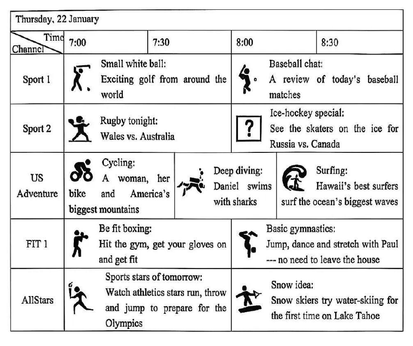
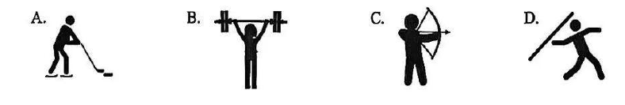
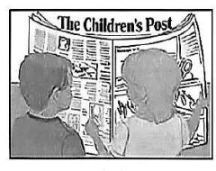
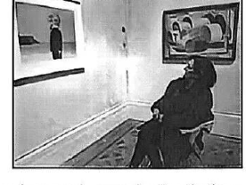

# 2026 一模精讲 · 奉贤英语（下）：词句转换 + 读写（第 44–84 题）

> 本篇覆盖第 44–84 题，第 1–43 题见 [[英模26-奉贤-上]]。答案来源与编号换算（答案版 +20 = 卷面）同上篇。
> ℹ️ 本篇阅读语篇采用**概括式**处理（每篇 2–3 句梗概 + 逐题解析），题干要点完整、解析不逐句照录原文。

## IV. Complete the sentences with the given words in their proper forms（词形转换，第 44–51 题，各 1 分，共 8 分）

**44.** This is the ______ time our city has held the International Marathon. (five) → **fifth**
（"第五次"用序数词；This is the + 序数词 + time 结构）

**45.** The government has built two more water treatment ______ to improve the water quality. (factory) → **factories**
（two more + 复数；辅音字母 + y 结尾变 y 为 i 加 es）

**46.** Andy was ______ to know that his science project won the first prize. (surprise) → **surprised**
（人作主语表"感到惊讶的"用 -ed 形式；be surprised to do）

**47.** The nurse in the rescue team treated the injured boy with great ______ and care. (patient) → **patience**
（with great + 名词"以极大的耐心"；patient 形容词 → 名词 patience）

**48.** It's ______ to talk loudly in public places, but many people always seem to forget that. (polite) → **impolite**
（"在公共场合大声说话"是**不礼貌的**——否定前缀 im-，本卷词形题的陷阱题）

**49.** People can communicate ______ with foreigners with the help of translation apps. (easy) → **easily**
（修饰动词 communicate 用副词）

**50.** We ______ "Low-Carbon Life" activity every month to protect the environment. (organization) → **organize**
（句子缺谓语动词；every month 一般现在时，主语 We 后用动词原形）

**51.** The young ______ often invites children to join his art activities, helping them develop an interest in painting. (art) → **artist**
（The young + 表示"人"的名词，invites 第三人称单数；artist"画家/艺术家"）

## V. Complete the following sentences as required（句型转换，第 52–58 题，52–57 每空限填一词，共 14 分）

**52.** Jason has written three short stories during his train trip across the country.（改为一般疑问句）
→ **Has** Jason **written** three short stories during his train trip across the country?
（现在完成时：has 提前，过去分词 written 不变）

**53.** The scientist analyzes the data **by using the newly developed AI software**.（对划线部分提问）
→ **How** **does** the scientist analyze the data?
（划线为方式状语 → how；analyzes 三单 → 助动词 does + analyze 还原）

**54.** My mum always waits for sales **in order to** get the best deal.（保持句意基本不变）
→ My mum always waits for sales **so** **that** she can get the best deal.
（in order to + 动词 = so that + 从句；注意 so that 后需补主语 she can）

**55.** Mary felt quite nervous when she tried skateboarding for the first time.（改为反意疑问句）
→ Mary felt quite nervous when she tried skateboarding for the first time, **didn't** **she**?
（felt 实义动词过去式 → didn't；前肯后否）

**56.** Our school will teach students sports safety rules to raise their awareness.（改为被动语态）
→ Students will **be** **taught** sports safety rules to raise their awareness.
（一般将来时被动：will be + 过去分词 taught）

**57.** "Do you know the way to the lecture hall?" Professor Brown asked Ben.（改为间接引语）
→ Professor Brown asked Ben **if/whether** he **knew** the way to the lecture hall.
（一般疑问句 → if/whether；you→he、时态后移 know→knew）

**58.** online courses, convenient, for students, it is, to learn from（连词成句）
→ **It is convenient for students to learn from online courses.**
（It is + adj + for sb + to do sth 固定句型）

## VI. Reading Comprehension（阅读理解，第 59–83 题，共 50 分）

### A. Choose the best answer（电视体育节目指南，第 59–64 题，各 2 分，共 12 分）

应用文：**周四（1 月 22 日）五个体育频道的电视节目表**（Sport 1 / Sport 2 / US Adventure / FIT 1 / AllStars × 7:00–8:30 时段）。看表技巧：先定**频道**行，再定**时段**列，交叉点即答案。

**59.** Wales and Australia are going to compete with each other in ______. → **C) rugby**
（Sport 2 · 7:00：Rugby tonight: Wales vs. Australia）

**60.** Viewers can watch ______ on US Adventure at 8:30. → **C) surfers challenging the ocean's biggest waves in Hawaii**
（US Adventure · 8:30 = Surfing: Hawaii's best surfers；A 骑行在 7:00、B 潜水在 7:30，时段不对应）

**61.** Viewers can watch athletics stars training for the Olympics on Channel ______. → **D) AllStars**
（AllStars · 7:00：Sports stars of tomorrow… prepare for the Olympics）

**62.** Picture ______ can be put in [?] in the table. → **A) 冰球运动员**
（Sport 2 · 8:00 的 [?] 处是 Ice-hockey special: Russia vs. Canada——四个图标选项中只有 A 是持杆冰球手；⚠️ 此题为**看图四选一**，配图见下）

**63.** Alice wants to get fit and do exercise at home, so she will probably watch ______. → **B) Basic gymnastics**
（FIT 1 · 8:00：Jump, dance and stretch with Paul --- **no need to leave the house** 原词呼应"at home"）

**64.** The passage is probably taken from ______. → **A) a TV guide for sports channels**
（全文是带频道/时段的节目表 → 电视节目指南；B 新闻报道、C 校运会日程、D 赛事评论均不符）

### B. Choose the best answer and complete the passage（完形选择：房间凌乱之争，第 65–70 题，各 2 分，共 12 分）

文章梗概：标题 *Is it OK to have a messy room?*——先讲研究两面性（凌乱致焦虑 vs 混乱或是**创造力**的信号），再给正方（Yes—it's really not a big deal：孩子需要自己的空间、大人可以关上门、收拾费时间）与反方（No—straightening up is a life skill：凌乱致压力、整洁助眠且少丢东西、房间也是家的一部分）两方观点。

**65.** They're still learning how to be ______. → **C) organized**
（孩子还在学"整理"；与上文 a little messy 相对）

**66.** Research has also found that some untidiness may be the sign of a ______ mind. → **A) creative**
（"混乱可能是**有创造力**头脑的信号"——让步转折的关键句）

**67.** By allowing children to keep their room the way they want it, parents are nurturing (培养) their kids' ______. → **D) independence**
（让孩子按自己意愿布置房间 → 培养"独立性"；nurture +抽象名词）

**68.** Cleaning up your room is boring and takes time… ______, it will just get messy again. → **B) Besides**
（正方追加理由："而且，很快又会乱"——递进用 Besides）

**69.** Research shows messy surroundings cause stress and prevent you from ______ tasks. → **C) focusing on**
（prevent sb from doing"妨碍你**专注于**任务"；下文 brain get overwhelmed 呼应）

**70.** Your room might be yours, but it's still part of the family home and that should be ______. → **A) respected**
（房间也是家的一部分，这一点"应被尊重"；与 best of all—no family arguments 呼应）

### C. Fill in the blanks with proper words（首字母填空：印度儿童日报，第 71–77 题，各 2 分，共 14 分）

文章梗概：印度 HR 经理 Nidhi Arora 面试中发现年轻人聪颖却**缺乏时事知识**（很少读报），成人报纸又满是难词；她于 2017 年创办四页儿童日报 *The Children's Post*（涵盖国际/环境/科技/历史+谜语诗歌等），组建七人编辑团队按读者意愿定内容、由她终审保证事实语法无误、语言简单，如今是印度唯一儿童日报，日销 3500+ 份。

**71.** However, they know l______ about current affairs (时事). → **little**
（转折 + 不读报 → 知之"甚少"；know little about 固定搭配）

**72.** In Nidhi's opinion, being aware of what is happening around the w______ is important. → **world**
（around the world"世界各地"）

**73.** The newspapers that adults read are full of d______ words. → **difficult**
（下句 There was no way they could be given to a child 呼应"难词"）

**74.** The paper covers a wide variety of t______, including international affairs, environment, technology and history. → **topics**
（后面列举的都是"主题"；a wide variety of + 复数）

**75.** Nidhi has m______ to put together a team of seven editors, who decide the content of the paper. → **managed**
（has managed to do= 现在完成时"设法做成了"；manage to do 固定搭配）

**76.** F______, the completed copy reaches Nidhi, who does the last edits. → **Finally**
（流程最后一步；句首副词大写）

**77.** "More than 3,500 copies are s______ every day," says Nidhi… → **sold**
（copies 与 sell 是被动关系：are sold"每天售出"；不要误填 sent）

### D. Answer the questions（回答问题：美术馆"正念房间"，第 78–83 题，共 12 分）

文章梗概：曼彻斯特美术馆有一个深绿色小房间（隔壁 Lowry 画展人挤人，这里安静），观众可对区区 3 幅画看足 15 分钟——这是顾问 Louise Thompson 发起的"slow looking（慢看）"实验：平均观众看一幅画不到 30 秒、拍照后更短，而慢看让人放松、开始与陌生人交谈；灵感来自 Pawelski 教授"慢看艺术是为了思考自我"的主张；62 岁观众 Susan 表示慢看让她"看到细节、色彩与笔触，看画方式完全不同"。

**78.** How many paintings are there in the small, dark green room? (1 分)
→ **Three.**（spending up to fifteen minutes looking at just three paintings）

**79.** How do visitors feel after spending fifteen minutes in the mindfulness room? (2 分)
→ **They feel relaxed and start talking to the person next to them.**（their bodies relax + start talking 两点）

**80.** How long does an average visitor spend looking at a painting? (2 分)
→ **Less than 30 seconds.**（原文数字定位；拍照后时间更短是干扰信息）

**81.** According to Professor James O. Pawelski, why should people look at art slowly? (2 分)
→ **Because it gives us a chance to forget our busy lives and think about ourselves.**（引号内原因句直接作答）

**82.** The mindfulness room changed Susan McClements's way of seeing things, didn't it? (2 分)
→ **Yes, it did.**（反意疑问先答 Yes/No；"a completely different way of seeing"）

**83.** Would you like to spend time in the mindfulness room when visiting the museum? Why or why not? (3 分)
→ 开放题，参考（官方答案）：**Yes, I would. Because it can give me a chance to forget my busy life and think about myself. It can also help me understand the paintings better.**
（3 分题：观点 + 两条理由；用 would 表假设）

## VII. Writing（作文，第 84 题，共 20 分）

**题目**：假如你是初三学生李华，班级计划寒假组织一次公益活动（public welfare activity），如探访养老院、社区文明养宠宣传、捐赠旧书籍……给班主任**李老师**写一封邮件阐述活动策划方案：① 活动主题；② 具体内容和安排；③ 活动意义。不少于 60 词。

**审题三步**：邮件格式（Dear Mr. Li / Yours, Li Hua）+ 三个内容要点缺一不可 + 主题要"小而可执行"（捐赠旧书最好写，因为意义好升华）。

**参考范文（印刷版官方范文，照录）**：

> Dear Mr. Li,
>
> I suggest organizing a "Warm Winter Book Donation" activity. We can collect used books from classmates, clean and sort them, then donate the books to children in rural areas. This activity will help recycle resources and bring knowledge to those in need. It also teaches us to care for others. I hope you will consider my idea.
>
> Yours sincerely,
> Li Hua

**评分要点**：三个要点齐全（9 分）｜语法用词准确（5 分）｜衔接流畅（3 分）｜格式词数（3 分）。范文结构值得背：建议句 I suggest organizing… → 三步安排 collect / clean and sort / donate → 意义两句（recycle resources + care for others）→ 收尾请求 consider my idea。

---
*本篇题干经 150dpi 页图逐页录入（阅读语篇为概括式处理）；答案誊自学科网印刷版参考答案并逐题与语言规则互证，无存疑项；作文范文为印刷版官方范文。*
