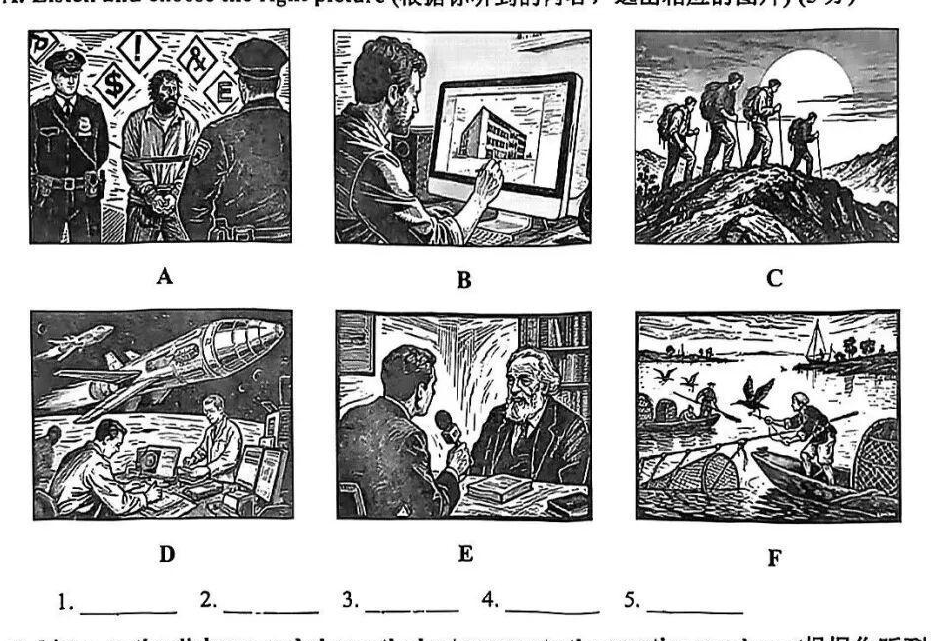

# 2026 一模精讲 · 宝山英语（上）：听力 + 语法词汇（第 1–43 题）

> 宝山卷结构：Part 1 听力 25 分（1–20）+ Part 2 语法词汇 45 分（21–58）+ Part 3 读写 70 分（59–84），共 84 小题 140 分。本篇覆盖第 1–43 题，第 44–84 题见 [[英模26-宝山-下]]。
>
> ⚠️ **资料说明**：本卷为扫描版+原生文字层（两路拼合录入，OCR 错词已对照页图校正）。**答案来源为卷面红笔手写批注版**（非官方排版答案），已逐题辨认誊录；听力部分（1–20）批注版未作答、且本区无听力音频，故听力只给卷面与方法，不给答案。

## Part 1 听力（第 1–20 题，共 25 分）

### A. Listen and choose the right picture（听句选图，第 1–5 题，5 分）

六选五，卷面六图为：

- A：警察押送戴手铐的男子（背景有通缉/金钱符号）——"抢劫/被捕"场景
- B：男子在电脑屏幕上设计一幢建筑——"建筑师/设计师工作"场景
- C：一行登山者徒步登山顶（日落）——"爬山/远足"场景
- D：航天员在空间站内工作（舷窗外有飞机/地球）——"太空/航天"场景
- E：记者持话筒采访一位白发老学者——"采访/名人访谈"场景（与 D 篇短文 Einstein 主题呼应）
- F：渔民在船上撒网捕鱼，水面有鸬鹚/水鸟——"捕鱼/水上劳作"场景

> ⚠️ 卷面批注版**未给出 1–5 题答案**，本区亦无听力音频，此处不臆测答案。做题方法：听前先读图、用一句话概括每图核心动词（arrest / design / climb / work in space / interview / catch fish），听到句子后抓"动词+名词"匹配。

### B. Listen to the dialogue and choose the best answer（对话理解，第 6–10 题，5 分）

6. A) A zoo keeper.  B) A farmer.  C) A shop assistant.  D) A designer.（问职业）
7. A) Maths.  B) History.  C) Chinese.  D) Physics.（问学科）
8. A) Satisfying.  B) Dull.  C) Relaxing.  D) Disappointing.（问观感评价）
9. A) Use the cooking app.  B) Watch a Japanese chef.  C) Buy the sushi-making tools.  D) Read a sushi-making book.（问建议/做法）
10. A) The red dress is a good choice for the party.  B) He likes the red dress very much as well.  C) The woman should choose a different colour.  D) He wants to buy the red dress for the woman.（问观点态度）

> ⚠️ 同上，无音频无批注答案。考点预判：6 题抓"工作场所/服务对象"；8 题抓评价形容词的情感色彩（褒/贬）；10 题注意 but/however 后的转折观点才是答案。

### C. Listen to the passage and tell whether the following statements are true or false（短文判断，第 11–15 题，5 分）

11. Leo argued with his mum because he wanted 30 dollars for some new books but got 10.
12. Leo saw an old and thin man sitting under a tree in the park.
13. Leo spent 40 minutes feeding the old man with food and water.
14. Leo was wondering what to buy for himself so he didn't notice the walkers' strange looks.
15. Finally, Leo realized the thing he really "bought" was kindness and human connections.

> 短文主旨可从判断句反推：少年 Leo 原想花钱买书，在公园遇到老人、给予食物和水，最终悟出"买"到的是善意与联结。⚠️ 批注版未给 T/F 答案。方法：判断句与原文的**数字、时间、原因**最常被偷换（如 11 题 30/10、13 题 40 minutes）。

### D. Listen to the passage and complete the following sentences（听短文填空，第 16–20 题，10 分）

16. When the lesson ended, the teacher told the class there would be a ______.
17. Einstein began his talk with ______ of stars and planets in space.
18. When Einstein said, "Time travel!", the room ______ cheers.
19. Einstein's research gave him the idea to create a machine that could ______ through time.
20. The children were eager to learn more about Einstein's ______.

> ⚠️ 批注版未给答案。可注意到：听力 D 短文（Einstein 谈时间旅行）与 Part 3 C 篇首字母填空（时间旅行）**同题材**——正式考试中可借 C 篇词汇（speed / through time 等）辅助拼写出所听单词。

## Part 2 语法和词汇（第 21–43 题）

### II. Choose the best answer（语法单项选择，第 21–35 题，各 1 分，共 15 分）

**21.** It is ______ common knowledge that the earth is round.
A) a  B) an  C) the  D) /

**答案 D**。common knowledge（常识）为不可泛指的抽象名词短语，零冠词。

**22.** In ______ opinion, travelling alone can be a great way to gain self-confidence.
A) she  B) her  C) hers  D) herself

**答案 B**。in one's opinion 中用形容词性物主代词 her。

**23.** Don't worry. There is nothing wrong ______ your answer to this question.
A) of  B) with  C) for  D) beyond

**答案 B**。固定搭配 there is nothing wrong with…（……没问题）。

**24.** The magic show is often regarded as one of ______ experiences in the summer camp.
A) more surprising  B) more surprised  C) the most surprising  D) the most surprised

**答案 C**。one of the + 最高级 + 复数名词；修饰物（show/experiences）用 -ing 形式。

**25.** There are two coffee shops on this street, but ______ of them stays open late at night.
A) all  B) both  C) none  D) neither

**答案 D**。but 表转折 + 谓语 stays（第三人称单数）→ 两者都不：neither。none 用于三者以上。

**26.** You must conduct the experiment as ______ as possible and never jump to conclusions.
A) carelessly  B) careless  C) carefully  D) careful

**答案 C**。修饰动词 conduct 用副词；后句"never jump to conclusions（别急着下结论）"提示"仔细"。

**27.** The naughty boy finally admitted ______ the vase while flying the model plane at home.
A) break  B) broken  C) breaking  D) to break

**答案 C**。admit doing sth 固定接动名词。

**28.** —Did you notice the bird come in?  —No, I didn't because I ______ my homework.
A) am doing  B) was doing  C) have done  D) had done

**答案 B**。"鸟进来的时候我正在做作业"——过去进行时。

**29.** Once the mess in the rooms ______, we can start moving in the new furniture.
A) are cleaned out  B) is cleaned out  C) clean out  D) cleans out

**答案 B**。mess 单数 → is；从句用被动（mess 被清理）；Once 引导时间状语从句，主句 can 表将来。

**30.** Our class planted a tree in the school last month. Ever since, we ______ turns to water it.
A) have taken  B) take  C) will take  D) took

**答案 A**。Ever since（从那以后一直）→ 现在完成时 have taken turns。

**31.** We managed ______ a table at the popular restaurant by calling early.
A) book  B) booked  C) to book  D) booking

**答案 C**。manage to do sth（设法做成）。

**32.** —Henry, where are we going to have our science project discussion?  —I have no idea. Ask our monitor. He ______ know.
A) may  B) can  C) need  D) had better

**答案 A**。He may know（他可能知道）表推测；can 不表"可能知道"这一委婉推测。

**33.** We don't want to go out for a walk ______ it is raining heavily outside.
A) so  B) or  C) but  D) because

**答案 D**。前果后因 → because。

**34.** David saves money every month ______ he can replace his old car with a new one soon.
A) so that  B) since  C) although  D) when

**答案 A**。so that + 目的状语从句（省点钱为了换车）。

**35.** ______ delighted the team members were when they won first prize in the competition!
A) What  B) What a  C) What an  D) How

**答案 D**。感叹句核心为形容词 delighted（表语）→ How + adj + 主谓。

### III. Complete the following passage with the words or phrase in the box（选词填空，第 36–43 题，各 1 分，共 8 分；每词限用一次，两框各 5 选 4）

**首框**：A) actually  B) difficult  C) soft  D) commonly  E) spread out
主题：丝绸之路（Silk Road）

**36.** journeys across different continents were much more ______ because of poor transportation. → **B) difficult**（交通落后 → 跨洲旅程"困难得多"，much more + 原级形容词）

**37.** It wasn't ______ a single road, but a huge network of connected paths. → **A) actually**（"其实并不是一条路，而是路网"，not actually…but… 语气呼应）

**38.** This network ______ across Asia, linking the East and the West. → **E) spread out**（路网"延伸/铺开"横跨亚洲；spread 的过去分词同形，此处谓语用过去式）

**39.** Nothing else was as ______ or had such a beautiful shine. → **C) soft**（丝绸"柔软"且有光泽；as…as 中用原级）

**次框**：A) rough  B) bridge  C) communication  D) quiet  E) ideas

**40.** The road became a way to exchange ______, too. → **E) ideas**（下句 Technologies, languages and art forms 解释了交流的是"思想"）

**41.** This made the Silk Road a ______ between different cultures and societies. → **B) bridge**（a bridge between… 固定比喻"桥梁"）

**42.** Crossing the Silk Road meant facing dangerous deserts, ______ mountains and unfriendly lands. → **A) rough**（三个并列形容词 dangerous / rough / unfriendly 语义一致；⚠️ 手写迹在此处辨认度低，A rough 与 D quiet 二选一，按语义并列取 rough，备考不受影响）

**43.** At a time with no Internet or immediate ______, the Silk Road was like a world center. → **C) communication**（no Internet or immediate communication"即时通讯"，名词并列）

> 小结：选词填空先判词性（39/42 空前为动词/系动词用形容词，41 冠词 a 后用单数名词，43 形容词 immediate 后用名词），再靠**上下文复现词**（40 空答案 ideas 就藏在下一句）锁定。

---
*本篇题干经"原生文字层 + 150dpi 页图"两路拼合校正；答案誊自卷面红笔批注版并逐题与语法规则互证。听力部分无音频与批注答案，已如实标注。*
