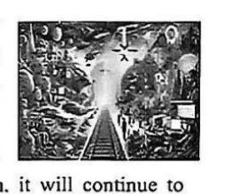
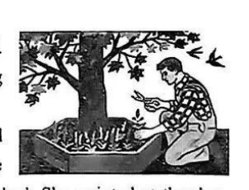
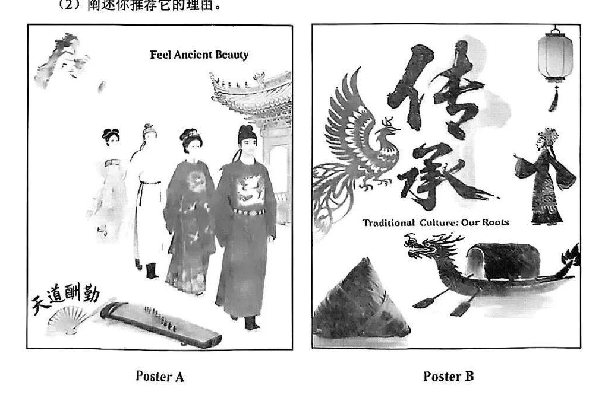

# 2026 一模精讲 · 宝山英语（下）：词句转换 + 读写（第 44–84 题）

> 本篇覆盖第 44–84 题（词形转换、句型转换、阅读四篇、作文），第 1–43 题见 [[英模26-宝山-上]]。答案来源与校正方式同上篇：卷面红笔批注版 + 页图互证。

## IV. Complete the sentences with the given words in their proper forms（词形转换，第 44–51 题，各 1 分，共 8 分）

**44.** The two ＿＿＿＿＿＿＿＿ fought together for freedom and independence. (army)

> [!tip]- 💡 思路导航
> two 后接可数名词复数——army 以"辅音字母+y"结尾，复数形式怎么变？

> [!success]- ✅ 详解 · 评分点 · 易错 · 关联
> **答案 armies**（two + 可数名词复数；army 以"辅音字母+y"结尾 → 变 y 为 i 加 es）

**45.** Our class will hold a small celebration on the ＿＿＿＿＿＿＿＿ day of October this year. (eight)

> [!tip]- 💡 思路导航
> "第八天"要用序数词——eight 变序数词时拼写有个特殊点，想清楚再加 th。

> [!success]- ✅ 详解 · 评分点 · 易错 · 关联
> **答案 eighth**（"第八天"用序数词 eighth，注意只加 th、8 去掉 t 拼写：eight→eighth）

**46.** With the help of apps and textbooks, these students teach ＿＿＿＿＿＿＿＿ French. (they)

> [!tip]- 💡 思路导航
> teach oneself"自学"——主语 these students 对应的反身代词是哪个？

> [!success]- ✅ 详解 · 评分点 · 易错 · 关联
> **答案 themselves**（teach oneself 自学；主语 these students → 反身代词 themselves）

**47.** The old picture brought back a sweet ＿＿＿＿＿＿＿＿ of her childhood with her grandma. (think)

> [!tip]- 💡 思路导航
> a sweet + 名词——think 的名词形式是什么？注意"回忆"在这里单复皆可。

> [!success]- ✅ 详解 · 评分点 · 易错 · 关联
> **答案 thought(s)**（a sweet + 名词；think → thought"想法/回忆"）
>
> **易错**：⚠️ 手写迹单复数辨认欠清，语义上单复均可，推荐填 thoughts（与后文 childhood 多年回忆呼应）或单数 thought，官方批注以 a sweet thought 亦通。

**48.** The events were ＿＿＿＿＿＿＿＿ recorded in a section of the local museum's files. (faithful)

> [!tip]- 💡 思路导航
> 修饰动词 recorded 的应该是形容词还是副词？

> [!success]- ✅ 详解 · 评分点 · 易错 · 关联
> **答案 faithfully**（修饰动词 recorded 用副词）

**49.** This factory uses advanced robots to ＿＿＿＿＿＿＿＿ the production lines. (operation)

> [!tip]- 💡 思路导航
> to 后接动词原形——operation 对应的动词是哪个？

> [!success]- ✅ 详解 · 评分点 · 易错 · 关联
> **答案 operate**（to + 动词原形；operation → operate"操作/运行"）

**50.** The boy looked ＿＿＿＿＿＿＿＿ when he was asked about the missing cookies. (guilt)

> [!tip]- 💡 思路导航
> look 后接形容词作表语——guilt 的形容词形式怎么拼？

> [!success]- ✅ 详解 · 评分点 · 易错 · 关联
> **答案 guilty**（look + 形容词作表语；guilt 名词 → guilty 形容词"内疚的"）

**51.** At that time, the event seemed ＿＿＿＿＿＿＿＿, but it changed history. (importantly)

> [!tip]- 💡 思路导航
> seem 后接形容词；but 转折"改变了历史"提示当时的评价是负面——想想否定前缀。

> [!success]- ✅ 详解 · 评分点 · 易错 · 关联
> **答案 unimportant**（seem + 形容词；but 转折"改变了历史"→ 当时"看似不重要"）
>
> **易错**：⚠️ 本题考**否定前缀**，是 8 题里最易错的一题：不能照抄 important。

## V. Rewrite the following sentences as required（句型转换，第 52–58 题，共 14 分；52–57 每空限填一词）

**52.** Jill had dinner with her family at a Korean restaurant.（改为否定句）

> [!tip]- 💡 思路导航
> had 是实义动词 have 的过去式——否定句要借助哪个助动词？

> [!success]- ✅ 详解 · 评分点 · 易错 · 关联
> **答案**：Jill **didn't have** dinner with her family at a Korean restaurant.（had 为实义动词 have 的过去式 → 借助 did 构成否定，had 还原为 have）

**53.** The farmer works on the farm for **over five hours**.（对划线部分提问）

> [!tip]- 💡 思路导航
> 划线的是一段时间——提问时间长度用哪个疑问词组？

> [!success]- ✅ 详解 · 评分点 · 易错 · 关联
> **答案**：**How long** does the farmer work on the farm?（划线为时间段 → how long）

**54.** There is little valuable information in this book.（改为反意疑问句）

> [!tip]- 💡 思路导航
> little 在这里是肯定还是否定含义？反意疑问句"前否后肯"。

> [!success]- ✅ 详解 · 评分点 · 易错 · 关联
> **答案**：There is little valuable information in this book, **is there**?（little 表否定 → 前否后肯）

**55.** The architect drew some pictures to explain the ideas for the new park.（改为被动语态）

> [!tip]- 💡 思路导航
> 一般过去时的被动语态——was/were + 什么形式？some pictures 变主语。

> [!success]- ✅ 详解 · 评分点 · 易错 · 关联
> **答案**：Some pictures **were drawn** to explain the ideas for the new park.（一般过去时被动 was/were + 过去分词；some 变主语后照抄）

**56.** "Are you interested in the writing contest?" Amy asked me.（改为间接引语）

> [!tip]- 💡 思路导航
> 一般疑问句变间接引语——引导词、人称、时态三处都要动。

> [!success]- ✅ 详解 · 评分点 · 易错 · 关联
> **答案**：Amy asked me **if/whether I was** interested in the writing contest.（一般疑问句 → if/whether 引导；人称 you→I；时态后移 are→was）

**57.** Listen to the teacher carefully, or you won't understand the lesson.（保持句意基本不变）

> [!tip]- 💡 思路导航
> "祈使句 + or" 相当于"如果不……就不……"——想想表"除非"的连词。

> [!success]- ✅ 详解 · 评分点 · 易错 · 关联
> **答案**：**Unless** you **listen** to the teacher carefully, you won't understand the lesson.（"祈使句 + or" = unless 条件否定：如果不……就不……）

**58.** useful training tips, the coach, the players, for giving them, praised（连词成句）

> [!tip]- 💡 思路导航
> praise sb for sth 固定句型——谁感谢谁？注意批注卷主语单复数有两可之处。

> [!success]- ✅ 详解 · 评分点 · 易错 · 关联
> **答案**：**The player(s) praised the coach for giving them useful training tips.**（praise sb for sth 句型）
>
> **易错**：⚠️ 主语单复数批注卷写 The player，语义上 players（队员们）更顺，两种均被批注认可——考试以"句子通顺、搭配正确"判分。

## VI. Reading Comprehension（阅读理解，第 59–83 题，共 50 分）

### A. Choose the best answer（阅读选择：宠物店海报题，第 59–64 题，各 2 分，共 12 分）

文章为**应用文（网页广告页）**：上半是设计模板网站的推广页（模板详情表），下半是一张宠物店海报示例及介绍段落。

**59.** What file types does the poster template support?

> [!tip]- 💡 思路导航
> 定位 Template details 表——File type 一行写了哪些格式？逐项对照选项。

> [!success]- ✅ 详解 · 评分点 · 易错 · 关联
> **答案 C) PPT, PNG and PDF**（定位 Template details 表：File type 一行 PNG, PDF, PPT；A 的 PSD、B/D 的 PBM 均为干扰项）

**60.** Which of the following statements is TRUE?

> [!tip]- 💡 思路导航
> 逐项回原文核对：设计公司名、价格一栏、二维码描述——三处都埋了陷阱。

> [!success]- ✅ 详解 · 评分点 · 易错 · 关联
> **答案 B) The size of the template is Letter (21.59 × 27.94 cm).**（A 错：By **Colourful** Design Company，非 Simple；C 错：Plan 一行为 **Free**；D 错：原文 Easily make QR codes——"容易"而非"不容易"）

**61.** Which is NOT offered by the example pet shop?

> [!tip]- 💡 思路导航
> 把海报列出的服务项目逐一清点，再与正文提到的商品对照。

> [!success]- ✅ 详解 · 评分点 · 易错 · 关联
> **答案 D) Pet walking**（海报列了 Pet cleaning / Pet training / Pet health care，正文提 food, toys, cleaning supplies——没有"遛狗"）

**62.** The underlined word "promote" probably means "______".

> [!tip]- 💡 思路导航
> 猜词看后文——下一句里藏着 promote 的原词复现。

> [!success]- ✅ 详解 · 评分点 · 易错 · 关联
> **答案 A) advertise**（后文 "It can also be used to **advertise** pet events" 原词复现）

**63.** Why does the poster use soft colours?

> [!tip]- 💡 思路导航
> 定位末段：soft colours 营造了怎样的氛围？

> [!success]- ✅ 详解 · 评分点 · 易错 · 关联
> **答案 D) They create a warm and inviting feeling.**（定位末段：The soft colours create a calm and welcoming atmosphere）

**64.** Who is the passage mainly for?

> [!tip]- 💡 思路导航
> 抓开头的营销口吻——"grow your business"是说给谁听的？

> [!success]- ✅ 详解 · 评分点 · 易错 · 关联
> **答案 A) Pet shop owners**（开头 "attract pet lovers and **grow your business**"——读者是想赚钱的店主，不是顾客）

### B. Choose the words to complete the passage（完形选择：英国园艺，第 65–70 题，各 2 分，共 12 分）

**65.** It is quite ______ to see a small garden in almost every family.

> [!tip]- 💡 思路导航
> quite + 形容词；"家家都有小花园"说明这件事很……

> [!success]- ✅ 详解 · 评分点 · 易错 · 关联
> **答案 B) common**（"家家有花园"→ 很"普遍"；quite common to do 固定搭配）

**66.** They often share useful ______ and nice designs with interested gardeners.

> [!tip]- 💡 思路导航
> share…with… 后接与 nice designs 并列的名词——答读者问时分享的是"经验"还是实物？

> [!success]- ✅ 详解 · 评分点 · 易错 · 关联
> **答案 A) skills**（share useful skills and nice designs"技巧和设计"；texts/tools/pictures 与答读者问的语境不合）

**67.** there are competitions of different ______ across the country, from small community ones to big world events.

> [!tip]- 💡 思路导航
> 后文 from small…to big… 就是对空格的解释——比赛之间差的是"规模"。

> [!success]- ✅ 详解 · 评分点 · 易错 · 关联
> **答案 B) sizes**（后文 from small…to big… 解释了"规模不同"）

**68.** The British like to ______ gardening stories with their traditional culture.

> [!tip]- 💡 思路导航
> ____…with… 固定搭配——空格处填动词原形，语义是"把故事与文化联系起来"。

> [!success]- ✅ 详解 · 评分点 · 易错 · 关联
> **答案 C) connect**（connect…with…"把园艺故事与传统文化联系起来"）

**69.** taking good care of the land is an important ______ for everyone.

> [!tip]- 💡 思路导航
> an important + 单数名词；"照顾好土地"对每个人来说意味着一份什么？

> [!success]- ✅ 详解 · 评分点 · 易错 · 关联
> **答案 B) responsibility**（"照顾好土地是每个人的责任"；an important + 单数名词）

**70.** It talked about Britain's long gardening history and ______ much public attention.

> [!tip]- 💡 思路导航
> ____ attention 固定搭配；and 并列的 talked 提示时态要保持一致。

> [!success]- ✅ 详解 · 评分点 · 易错 · 关联
> **答案 B) paid**（pay attention 固定搭配，and 并列过去式 talked / paid）

### C. Read the passage and fill in the blanks with proper words（首字母填空：时间旅行，第 71–77 题，各 2 分，共 14 分）

**71.** The idea of time travel has interested people for generations, and it a＿＿＿＿＿＿＿ in many science fiction stories.

> [!tip]- 💡 思路导航
> it 后是谓语动词，主语三单要加 s；语义是"出现在许多科幻故事里"。

> [!success]- ✅ 详解 · 评分点 · 易错 · 关联
> **答案 appears**（it 后谓语动词，三单 +s；"出现在许多科幻故事里"）

**72.** In the world of science fiction, time travel is an e＿＿＿＿＿＿＿ idea.

> [!tip]- 💡 思路导航
> an 后接元音开头的形容词——科幻里的时间旅行给人什么感觉？

> [!success]- ✅ 详解 · 评分点 · 易错 · 关联
> **答案 exciting**（an + 元音开头形容词；科幻里的时间旅行是"令人兴奋的"）

**73.** These stories let us dream about exploring different times, c＿＿＿＿＿＿＿ with historical figures.

> [!tip]- 💡 思路导航
> 与前文 exploring 并列要用 -ing 形式；后面的 with historical figures 提示"与历史人物交流"的动词。

> [!success]- ✅ 详解 · 评分点 · 易错 · 关联
> **答案 communicating**（与前文 exploring 并列的 -ing 形式；communicate with"与历史人物交流"）

**74.** According to his research, time can slow down or s＿＿＿＿＿＿＿ up depending on how fast you are moving.

> [!tip]- 💡 思路导航
> 与 slow down 相对的"加速"固定搭配——can 后接动词原形。

> [!success]- ✅ 详解 · 评分点 · 易错 · 关联
> **答案 speed**（slow down or speed up"变慢或加速"固定反义搭配）

**75.** This kind of tunnel can j＿＿＿＿＿＿＿ faraway places in space together.

> [!tip]- 💡 思路导航
> ____…together 表示"把遥远的地方连到一起"；情态动词 can 后接原形。

> [!success]- ✅ 详解 · 评分点 · 易错 · 关联
> **答案 join**（join…together"把遥远的地方连到一起"；can 后接原形）

**76.** what would happen if a time traveller went back to the past and p＿＿＿＿＿＿＿ his grandfather from meeting his grandmother?

> [!tip]- 💡 思路导航
> ___ sb from doing"阻止某人做某事"；and 并列 went，时态要用过去式。

> [!success]- ✅ 详解 · 评分点 · 易错 · 关联
> **答案 prevented**（prevent sb from doing"阻止"；and 并列 went / prevented 过去式）

**77.** Whether time travel ever becomes a reality or remains in our imagination, it will continue to greatly e＿＿＿＿＿＿＿ us to think about the secrets of time and space.

> [!tip]- 💡 思路导航
> ___ sb to do"激励某人做某事"——后面的 to think 结构锁定了这个动词。

> [!success]- ✅ 详解 · 评分点 · 易错 · 关联
> **答案 encourage**（encourage sb to do"激励我们思考"；e 开头 + to think 结构锁定）

### D. Answer the questions（回答问题：Cole 的街角花园，第 78–83 题，共 12 分）

文章脉络：Cole 自小爱帮母亲打理花园 → 当了 30 年售货员 → 2016 年母亲搬来同住，见街道垃圾成堆 → 母子俩把旧花园的玫瑰移栽进 6 个树坑 → 花开得好、垃圾消失、邻里变成朋友 → 次年市政府喷除草剂花全枯 → 邻居 Mary 送籽重启，街坊纷纷捐花木，15 个树坑复绿 → Cole 由此事发起 "City Garden Project"，把 20 个停车场角落变成野花坛。

**78.** Why did Cole's mum suggest planting roses?

> [!tip]- 💡 思路导航
> 因果定位在第二段——妈妈提议种玫瑰的直接原因是什么？

> [!success]- ✅ 详解 · 评分点 · 易错 · 关联
> **答案**：**Because she was shocked by so much litter on the street.**（因果定位在第二段；参考答案手写批注：She was shocked by so much litter on the street.）

**79.** Did the flowers Cole had planted die after the city used the grass killer?

> [!tip]- 💡 思路导航
> 一般疑问句先答 Yes/No；原文写"几天后植物全部变枯黄"。

> [!success]- ✅ 详解 · 评分点 · 易错 · 关联
> **答案**：**Yes.**（Days later, all the plants turned brown——一般疑问句先答 Yes/No）

**80.** What experience led Cole to start his "City Garden Project"?

> [!tip]- 💡 思路导航
> 概括第四~六段：三个要点——在树坑种花、邻里参与、花死后一起重种。

> [!success]- ✅ 详解 · 评分点 · 易错 · 关联
> **答案**：**The experience of planting flowers in the tree pits with neighbours — even after the plants died and they restarted together.**（概括第四~六段；要点：planting flowers in tree pits + with neighbours' help + 死而复种）

**81.** What does "No big heroes are needed to change the world." mean in the story?

> [!tip]- 💡 思路导航
> 句意理解题：把"不需要大英雄"换一种说法——普通人做小事也能怎样？

> [!success]- ✅ 详解 · 评分点 · 易错 · 关联
> **答案**：**Small actions from ordinary people can make a big difference to the world.**（句意理解题：不必等英雄，普通人小事也能改变世界）

**82.** How did Cole's mum influence his "City Garden Project"? (2 points)

> [!tip]- 💡 思路导航
> 2 分题必须答出两点：一个是"起因"，一个是"持续影响"。

> [!success]- ✅ 详解 · 评分点 · 易错 · 关联
> **答案**：**① She first suggested planting roses to improve the street. ② Her idea started the whole process of creating gardens.**（2 分题必须答出两点：起因建议 + 持续影响；批注版即按两条给分）

**83.** If you were Cole, what would be your ways to protect the plants from the city's grass killer?

> [!tip]- 💡 思路导航
> 开放题：给分点是措施合理 + 语法正确；假设语气别忘了用 would。

> [!success]- ✅ 详解 · 评分点 · 易错 · 关联
> **答案**：开放题，参考（批注版示例）：**I would talk to the city government in advance to tell them the location of the plants, and put up signs near the plants to remind the city workers not to spray the grass killer.**（给分点：措施合理 + 语法正确；用 would 表假设）

## VII. Writing（作文，第 84 题，共 20 分）

**题目**：学校文化社团为推广中国传统文化举办海报设计征集，两份设计进入决赛。选择其中一份，给负责老师 Mr. Chen 写一封邮件：① 描述该海报的核心设计元素；② 阐述推荐理由。不少于 60 词。
- Poster A「Feel Ancient Beauty」：水墨古装人物（仕女/文士）、亭台、古琴、折扇，题字"天道酬勤"
- Poster B「传承 Traditional Culture: Our Roots」：书法大字"传承"、凤凰、龙舟、粽子、灯笼、京剧人偶

**审题三步**：邮件格式（Dear Mr. Chen 开头 / Yours, Li Hua 落款）+ 两个内容要点缺一不可 + 选定一张后**只描述那张**的元素（两张都写算跑题）。推荐理由可从"元素丰富 / 主题鲜明 / 吸引同学"展开。

**参考范文（约 100 词，选 Poster B）**：

> [!example]- ✍️ 参考范文（点击展开）
> > Dear Mr. Chen,
> >
> > I'd like to recommend Poster B, "Traditional Culture: Our Roots". In the centre stands the bold Chinese character "Chuan Cheng", which means inheritance, with a phoenix flying beside it. Below, a dragon boat, zongzi and a lantern remind us of the Dragon Boat Festival, and a Peking-opera figure stands on the right. Together they present our traditional culture vividly.
> >
> > I recommend it because it connects festival customs with classic cultural symbols, showing that tradition is our roots. Besides, its striking layout will surely catch students' attention.
> >
> > Yours,
> > Li Hua

**评分要点**：覆盖两个要点（8 分）｜语法与用词准确（6 分）｜衔接与流畅（3 分）｜格式与词数（3 分）。忌照抄阅读语篇（卷面明示不得分）。

---
*本篇题干经"原生文字层 + 150dpi 页图"两路拼合校正；答案誊自卷面红笔批注版并逐题与语言规则互证；47/58 两处手写迹存在单复数歧义，已如实标注。*
