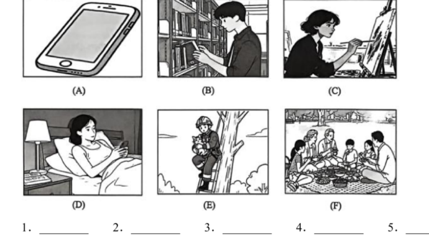

# 2026 一模精讲 · 崇明英语（上）：听力 + 语法词汇（第 1–43 题）

> 崇明卷结构：Part 1 听力 25 分（1–20）+ Part 2 语法词汇 45 分 + Part 3 读写 70 分（含作文 20 分），共 84 小题 140 分。本篇覆盖第 1–43 题，第 44–84 题见 [[英模26-崇明-下]]。
>
> ⚠️ **与宝山等卷的结构差异——两套题号**：崇明卷 Part 2/Part 3 的**卷面印刷题号从 1 重新编号**（语法选择 1–15、选词填空 16–23、词形转换 24–31、句型转换 32–38、阅读 A 39–44 / B 45–50 / C 51–57 / D 58–63、作文 64），但同一 PDF 里的**印刷参考答案按全市通行的连续编号 21–84** 给出（卷面 V 大题括号说明也残留"52-57 题"字样，即模板编号）。对应关系：卷面 1–15＝21–35、16–23＝36–43、24–31＝44–51、32–38＝52–58、39–44＝59–64、45–50＝65–70、51–57＝71–77、58–63＝78–83、64＝84。本系列两篇按**印刷答案的连续编号**讲解，便于对照答案。
>
> ⚠️ **资料说明**：本卷为**试卷＋印刷参考答案合一 PDF**（纯扫描、无文字层，题干自 150dpi 页图逐题录入校正）。答案直接誊自印刷答案页（PDF 第 11–12 页，非手写批注）。**印刷答案不含听力部分**（答案自 Part 2 起），且本区无听力音频，故听力（1–20）只给卷面与方法，不给答案。

## Part 1 听力（第 1–20 题，共 25 分）

### A. Listen and choose the right picture（听句选图，第 1–5 题，5 分）

六选五，卷面六图为：

- A：一部大屏智能手机特写——"手机/电子产品"场景
- B：男生在图书馆书架间低头看手机——"图书馆/阅读"场景
- C：女生在画架前写生作画——"画画/美术爱好"场景
- D：女孩靠在床头看手机（床头柜上亮着台灯）——"熬夜玩手机/卧床休息"场景
- E：消防员沿梯爬上树救小猫——"救援/助人"场景
- F：一家人在公园草地上野餐——"野餐/家庭出游"场景

> ⚠️ 印刷答案**未含 1–5 题答案**，本区亦无听力音频，此处不臆测答案。做题方法：听前先读图、用一句话概括每图核心动词短语（use a smartphone / read among the shelves / paint / play phone in bed / rescue a cat / have a picnic），听到句子后抓"动词+名词"匹配。

### B. Listen to the dialogue and choose the best answer to the question you hear（对话理解，第 6–10 题，5 分）

**6.**（问地点）
- A) In a museum.
- B) In a restaurant.
- C) In a hospital.
- D) In a hotel.

**7.**（问时间）
- A) In 5 minutes.
- B) In 10 minutes.
- C) In 15 minutes.
- D) In 20 minutes.

**8.**（问评价）
- A) Tiring.
- B) Disappointing.
- C) Meaningful.
- D) Boring.

**9.**（问感受/观点）
- A) He had no time to relax.
- B) He was tired but happy.
- C) He was worried about the project.
- D) He thought the project was difficult.

**10.**（问打算/活动）
- A) To take part in a winter camp.
- B) To visit a famous college.
- C) To learn swimming.
- D) To travel around the city.

> ⚠️ 同上，无答案无音频。考点预判：6 题抓场景词（menu/exhibit/patient/check in）；7 题听清"in + 时间段"的数字；8 题抓评价形容词的褒贬色彩；9 题注意 but 后的真实感受；10 题抓计划动词短语。

### C. Listen to the passage and tell whether the following statements are true or false（短文判断，第 11–15 题，5 分）

**11.** The girl started her own baking business at the age of 14 in the US.

**12.** The girl spent two days making 150 small cakes for a wedding.

**13.** People can buy the girl's cakes only through her website.

**14.** The girl likes making cakes most because she can earn more money easily.

**15.** The girl was shy to communicate with the customers before.

> 短文主旨可从判断句反推：美国女孩少女时代自创烘焙生意（为婚礼做 150 个小蛋糕等），经网站等渠道售卖、与顾客交流，从害羞变得从容，热爱烘焙本身。⚠️ 印刷答案未含 T/F 答案。方法：判断句与原文的**数字、时间、范围词、原因**最常被偷换（如 11 题 14 岁、12 题 two days/150、13 题 only、14 题赚钱 vs 热爱）。

### D. Listen to the passage and complete the following sentences（听短文填空，第 16–20 题，10 分；每空限填一词，每题两空）

**16.** The subjects of Math, Chinese and English are divided into ＿＿＿＿＿＿＿＿ ＿＿＿＿＿＿＿＿.

**17.** Different students will have ＿＿＿＿＿＿＿＿ ＿＿＿＿＿＿＿＿ in the same class.

**18.** Students learn better and encourage ＿＿＿＿＿＿＿＿ ＿＿＿＿＿＿＿＿ to study harder in these classes.

**19.** The system will disturb a student's ＿＿＿＿＿＿＿＿ ＿＿＿＿＿＿＿＿ a little bit.

**20.** Most students enjoy the moving around and they can also ＿＿＿＿＿＿＿＿ ＿＿＿＿＿＿＿＿ there.

> ⚠️ 印刷答案未含答案。从题干可反推话题：某类分层/走班教学制度（科目分层、同班不同进度、走动上课）。方法：先判每空词性（16 动词被动后接名词复数、19 名词所有格后接名词短语、20 情态动词后接动词原形），听时以"意群"为单位记两个词，注意单复数与拼写。

## Part 2 语法和词汇（第 21–43 题）

### II. Choose the best answer（语法单项选择，第 21–35 题【卷面印 1–15】，各 1 分，共 15 分）

**21.** In my hometown, transport used to be very slow and difficult in ______ past.
- A) a
- B) an
- C) the
- D) /

> [!tip]- 💡 思路导航
> "在过去"是固定短语——判断 past 前要不要冠词、用哪个。

> [!success]- ✅ 详解 · 评分点 · 易错 · 关联
> **答案 C**。in the past 固定短语，past 前必有定冠词 the。

**22.** Listen to other groups' presentations and make comments on ______ travel plans.
- A) they
- B) their
- C) them
- D) themselves

> [!tip]- 💡 思路导航
> 修饰名词 travel plans——形容词性还是名词性物主代词？

> [!success]- ✅ 详解 · 评分点 · 易错 · 关联
> **答案 B**。修饰名词 travel plans 用形容词性物主代词 their。

**23.** I'm now working as a volunteer and helping look ______ the cute pandas.
- A) forward to
- B) at
- C) up
- D) after

> [!tip]- 💡 思路导航
> "照顾熊猫"——look ___ 短语动词逐项代入；look forward to 后须接 doing，不合这里。

> [!success]- ✅ 详解 · 评分点 · 易错 · 关联
> **答案 D**。look after 照顾（做志愿者照顾熊猫）；look forward to 后须接 doing，不合语法。

**24.** They say it's ______ to make films inside a studio than outside.
- A) easy
- B) easier
- C) easiest
- D) the easiest

> [!tip]- 💡 思路导航
> than 标志两者比较——用比较级还是最高级？

> [!success]- ✅ 详解 · 评分点 · 易错 · 关联
> **答案 B**。than 标志两者比较 → 比较级 easier。

**25.** Online learning is convenient, ______ we still need face-to-face communication.
- A) or
- B) and
- C) but
- D) so

> [!tip]- 💡 思路导航
> "方便"与"仍需面对面"语义相反——表转折的连词。

> [!success]- ✅ 详解 · 评分点 · 易错 · 关联
> **答案 C**。"方便"与"仍需面对面"语义转折 → but。

**26.** Living conditions were bad there. ______ homes had a bathroom with a toilet or bath.
- A) Few
- B) A few
- C) Little
- D) A little

> [!tip]- 💡 思路导航
> homes 是可数复数，先排除 C/D；前句"条件差"提示否定含义——"几乎没有"。

> [!success]- ✅ 详解 · 评分点 · 易错 · 关联
> **答案 A**。homes 可数复数 → 排除 C/D；前句"条件差"表否定 → Few（几乎没有）。

**27.** My younger brother keeps ______ me silly questions when I'm doing my homework.
- A) ask
- B) to ask
- C) asks
- D) asking

> [!tip]- 💡 思路导航
> keep 后固定接动名词 doing。

> [!success]- ✅ 详解 · 评分点 · 易错 · 关联
> **答案 D**。keep doing sth 固定接动名词。

**28.** Teenagers visited people in need and encouraged them never ______ hope.
- A) to give up
- B) giving up
- C) gave up
- D) give up

> [!tip]- 💡 思路导航
> encourage sb (never) ___ do sth——不定式作宾补。

> [!success]- ✅ 详解 · 评分点 · 易错 · 关联
> **答案 A**。encourage sb (never) to do sth，不定式作宾补。

**29.** The classroom is empty. The students ______ be in the playground for the P.E. class.
- A) can
- B) must
- C) should
- D) may

> [!tip]- 💡 思路导航
> 教室空无一人——表肯定推测的情态动词 + be。

> [!success]- ✅ 详解 · 评分点 · 易错 · 关联
> **答案 B**。教室空无一人 → 肯定推测用 must be（在操场上体育课）。

**30.** The little girl looks ______ with her hair tied up every day.
- A) lovely
- B) happily
- C) sweetly
- D) quietly

> [!tip]- 💡 思路导航
> look 是系动词，接形容词作表语；其余三个选项都是副词。

> [!success]- ✅ 详解 · 评分点 · 易错 · 关联
> **答案 A**。look 为系动词 → 接形容词 lovely 作表语；其余三项均为副词。

**31.** When I entered the classroom, my classmates ______ an English exam.
- A) have
- B) are having
- C) were having
- D) will have

> [!tip]- 💡 思路导航
> entered 是过去时间点，"当时正在进行"——过去进行时。

> [!success]- ✅ 详解 · 评分点 · 易错 · 关联
> **答案 C**。entered 为过去时间点，"当时正在进行" → 过去进行时 were having。

**32.** My cousin Tony ______ in that school for over fifteen years.
- A) has taught
- B) had taught
- C) taught
- D) teaches

> [!tip]- 💡 思路导航
> for over fifteen years 延续至今——现在完成时。

> [!success]- ✅ 详解 · 评分点 · 易错 · 关联
> **答案 A**。for over fifteen years 延续至今 → 现在完成时 has taught。

**33.** —Excuse me, could you tell me ______ I can get to the library?
—Sure. Go straight and turn left at the end of the road. You'll see the library there.
- A) when
- B) how
- C) why
- D) what

> [!tip]- 💡 思路导航
> 答语"Go straight and turn left"是在指路——宾语从句里问的是方式还是原因？

> [!success]- ✅ 详解 · 评分点 · 易错 · 关联
> **答案 C（印刷答案如此）**。
>
> **易错**：⚠️ 待核对：印刷答案页印为 C(why)，但答语"Go straight and turn left…"是**指路**，问的显然是**方式/路线**，按语言规则应为 **B(how)**——疑问词在宾语从句中作状语（get there 的方式）。备考按 how 掌握，印刷答案疑有排印之误。

**34.** Robots will become friends with us ______ we use them wisely.
- A) until
- B) although
- C) so that
- D) if

> [!tip]- 💡 思路导航
> "明智地使用"是"成为朋友"的前提——表条件的连词。

> [!success]- ✅ 详解 · 评分点 · 易错 · 关联
> **答案 D**。"明智地使用"是"成为朋友"的条件 → if 引导条件状语从句。

**35.** ______ wonderful it will be to collect and use solar energy everywhere!
- A) What
- B) What a
- C) What an
- D) How

> [!tip]- 💡 思路导航
> 感叹句核心是形容词 wonderful——How + adj + 主谓。

> [!success]- ✅ 详解 · 评分点 · 易错 · 关联
> **答案 D**。感叹句核心为形容词 wonderful → How + adj + 主谓（will it be）。

### III. Complete the following passage with the proper words or phrases in the box（选词填空，第 36–43 题【卷面印 16–23】，各 1 分，共 8 分；每词限用一次，两框各 5 选 4）

**首框**：A) properly  B) design  C) prepare for  D) clever  E) lazy
主题：北京中小学开设人工智能（AI）课程

**36.**（卷面 16）Younger students learn what AI is and how to use it ＿＿＿＿＿＿＿＿.

> [!tip]- 💡 思路导航
> 修饰动词 use 用副词——"正确、恰当地"使用 AI。

> [!success]- ✅ 详解 · 评分点 · 易错 · 关联
> **答案 A) properly**（修饰动词 use 用副词；"正确/恰当地使用 AI"）

**37.**（卷面 17）"AI helped me ＿＿＿＿＿＿＿＿ the pictures and write the code," the student said.

> [!tip]- 💡 思路导航
> help sb (to) do 接原形；与 write the code 并列、下文 pictures 提示的动作是"设计"。

> [!success]- ✅ 详解 · 评分点 · 易错 · 关联
> **答案 B) design**（help sb (to) do 接原形；与 write the code 并列的"设计"动作；下文 pictures 提示）

**38.**（卷面 18）Some people worry that AI might make students ＿＿＿＿＿＿＿＿.

> [!tip]- 💡 思路导航
> make sb + 形容词；下文 but 转折"学 AI 让人思考更清晰"，反推此处是负面评价。

> [!success]- ✅ 详解 · 评分点 · 易错 · 关联
> **答案 E) lazy**（make sb + 形容词；下文 but 转折"学习 AI 实际让人思考更清晰"反推此处为负面词"懒惰"）

**39.**（卷面 19）The course helps students understand this new technology and ＿＿＿＿＿＿＿＿ the future.

> [!tip]- 💡 思路导航
> and 并列两个动词短语；"为未来___"固定搭配。

> [!success]- ✅ 详解 · 评分点 · 易错 · 关联
> **答案 C) prepare for**（and 并列两个动词短语；prepare for the future"为未来做准备"）

（D) clever 未用）

**次框**：A) invited  B) common  C) rules  D) require  E) conclusions
主题："预制菜"（pre-made dishes）争议

**40.**（卷面 20）After Xibei denied this and ＿＿＿＿＿＿＿＿ people to visit their kitchens, they found frozen vegetables that could last for two years.

> [!tip]- 💡 思路导航
> and 并列 denied / ___——同为过去式；先否认再用动作邀请大家参观后厨。

> [!success]- ✅ 详解 · 评分点 · 易错 · 关联
> **答案 A) invited**（and 并列 denied / invited 过去式；invite sb to do"邀请人们参观后厨"）

**41.**（卷面 21）But doctors say if the dishes follow food safety ＿＿＿＿＿＿＿＿, they can still provide good nutrition.

> [!tip]- 💡 思路导航
> follow food safety ___——名词；下文 no rules requiring them 原词复现。

> [!success]- ✅ 详解 · 评分点 · 易错 · 关联
> **答案 C) rules**（follow food safety rules"遵守食品安全法规"；下文 no rules requiring them 原词复现）

**42.**（卷面 22）As life gets busier, pre-made dishes are becoming more ＿＿＿＿＿＿＿＿.

> [!tip]- 💡 思路导航
> become more + 原级形容词；"生活越忙，预制菜越___"。

> [!success]- ✅ 详解 · 评分点 · 易错 · 关联
> **答案 B) common**（"生活越忙→预制菜越来越常见"；become more + 原级形容词）

**43.**（卷面 23）They will ＿＿＿＿＿＿＿＿ restaurants to be honest about using pre-made dishes, helping customers make better choices.

> [!tip]- 💡 思路导航
> will 后接动词原形；require sb to do"要求餐馆如实告知"。

> [!success]- ✅ 详解 · 评分点 · 易错 · 关联
> **答案 D) require**（will 后接动词原形；require sb to do"要求餐馆如实告知"）

（E) conclusions 未用）

> 小结：本卷选词填空先判词性（36 修饰动词用副词、37/43 助动词后用动词原形、38 make sb 后用形容词、41 动词后接名词宾语），再靠**上下文复现**（38 由下文 but 转折反推、41 由下文 rules 原词锁定）。

---
*本篇题干自 150dpi 页图逐题录入（本卷无文字层，OCR 错词已对照页图校正）；答案誊自同 PDF 印刷参考答案页并逐题与语言规则互证；听力部分无印刷答案且本区无音频，已如实标注；33 题印刷答案与语言规则冲突，已加 ⚠️ 说明。*
