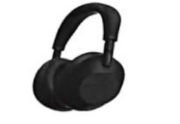
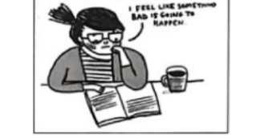

# 2026 一模精讲 · 崇明英语（下）：词句转换 + 读写（第 44–84 题）

> 本篇覆盖第 44–84 题（词形转换、句型转换、阅读四篇、作文），第 1–43 题见 [[英模26-崇明-上]]。答案来源同上篇：同一 PDF 的印刷参考答案页（无手写批注，直接誊录）。**题号说明**：本篇按印刷答案的连续编号 44–84 讲解，卷面印刷题号从 1 重编（对应 24–31／32–38／39–44／45–50／51–57／58–63／64），详见上篇头部对照表。

## IV. Complete the sentences with the given words in their suitable forms（词形转换，第 44–51 题【卷面印 24–31】，各 1 分，共 8 分；每空限填一词）

**44.** My grandfather will celebrate his ＿＿＿＿＿＿＿＿ birthday next month. (ninety)

> [!tip]- 💡 思路导航
> "第 90 个生日"用序数词——ninety 变 y 为 i 加 eth，不是直接加 th。

> [!success]- ✅ 详解 · 评分点 · 易错 · 关联
> **答案 ninetieth**（"第 90 个生日"用序数词；ninety 变 y 为 i 加 eth：ninety→ninetieth，注意不是 ninety-th）

**45.** Lin Dong should learn to solve problems by ＿＿＿＿＿＿＿＿ instead of asking others. (he)

> [!tip]- 💡 思路导航
> by oneself"独自（靠）自己"——主语 Lin Dong 单数男性对应哪个反身代词？

> [!success]- ✅ 详解 · 评分点 · 易错 · 关联
> **答案 himself**（by oneself 独自（靠）自己；主语 Lin Dong 单数男性 → 反身代词 himself）

**46.** The movie was so ＿＿＿＿＿＿＿＿ that all the children laughed a lot. (fun)

> [!tip]- 💡 思路导航
> so + 形容词 + that 句型——fun 的形容词形式，与 laughed a lot 语义呼应。

> [!success]- ✅ 详解 · 评分点 · 易错 · 关联
> **答案 funny**（so + 形容词 + that 句型；fun → funny"滑稽好笑的"，与 laughed a lot 语义呼应）

**47.** Modern technology helps us ＿＿＿＿＿＿＿＿ our dreams in many amazing ways. (reality)

> [!tip]- 💡 思路导航
> help sb (to) do 接动词原形——reality 变动词"实现（梦想）"是什么？

> [!success]- ✅ 详解 · 评分点 · 易错 · 关联
> **答案 realize**（help sb (to) do 接动词原形；realize one's dreams 实现梦想，名词 reality → 动词 realize）

**48.** Three boys were ＿＿＿＿＿＿＿＿ because they got no parts to play last week. (happy)

> [!tip]- 💡 思路导航
> were 后接形容词作表语；"没分到角色"语义与 happy 相反——想想否定前缀。

> [!success]- ✅ 详解 · 评分点 · 易错 · 关联
> **答案 unhappy**（were 后接形容词作表语；"没分到角色"与 happy 语义相反 → 加否定前缀 un-）
>
> **易错**：⚠️ 本题考**否定前缀**，8 题中最易错：不能照抄 happy。

**49.** My sister's goldfish ＿＿＿＿＿＿＿＿ yesterday and she was very sad. (death)

> [!tip]- 💡 思路导航
> 句子缺谓语动词；yesterday 提示过去式——death 的动词形式，注意 die 的拼写变化。

> [!success]- ✅ 详解 · 评分点 · 易错 · 关联
> **答案 died**（句子缺谓语动词；yesterday → 过去式；death 名词 → 动词 die，注意 die 的 -ing/过去式拼写：dying/died）

**50.** Maggie asked me to cut the rope to a ＿＿＿＿＿＿＿＿ of two meters. (long)

> [!tip]- 💡 思路导航
> 不定冠词 a 后接名词——long 的名词形式，a ____ of two meters"两米长"。

> [!success]- ✅ 详解 · 评分点 · 易错 · 关联
> **答案 length**（不定冠词 a 后接名词；a length of two meters"两米长"；long → length 名词"长度"）

**51.** The students have ＿＿＿＿＿＿＿＿ finished their group project with the teacher's help. (recent)

> [!tip]- 💡 思路导航
> have 与过去分词 finished 之间用副词修饰——recent 的副词形式。

> [!success]- ✅ 详解 · 评分点 · 易错 · 关联
> **答案 recently**（have 与过去分词 finished 之间用副词修饰；recent → recently）

## V. Rewrite the following sentences as required（句型转换，第 52–58 题【卷面印 32–38】，共 14 分；52–57 每空限填一词，58 连词成句）

**52.** The students have a class meeting every Friday afternoon.（改为一般疑问句）

> [!tip]- 💡 思路导航
> have 为实义动词——一般疑问句借助 do，动词用什么形式？

> [!success]- ✅ 详解 · 评分点 · 易错 · 关联
> **答案**：**Do** the students **have** a class meeting every Friday afternoon?（have 为实义动词 → 借助 do 构成一般疑问句，动词用原形）

**53.** My cousin goes to the school library **twice a week**.（对划线部分提问）

> [!tip]- 💡 思路导航
> 划线是频率——用哪个疑问词组？主语换成 your cousin，三单要借哪个助动词？

> [!success]- ✅ 详解 · 评分点 · 易错 · 关联
> **答案**：**How often** does your cousin go to the school library?（划线为频率 → how often；卷面改写句已把主语换成 your cousin，注意三单 goes → does…go）

**54.** Amy has no idea where she will go to spend her winter holidays.（改为简单句）

> [!tip]- 💡 思路导航
> 主从句主语一致——宾语从句可压成"疑问词 + to do"简单句。

> [!success]- ✅ 详解 · 评分点 · 易错 · 关联
> **答案**：Amy has no idea **where to** go to spend her winter holidays.（宾语从句 → 疑问词 + to do，把从句压成"疑问词 + 不定式"简单句结构）

**55.** "I have finished reading all these science magazines," Linda told me.（改为间接引语）

> [!tip]- 💡 思路导航
> 间接引语三处同步变化：人称、时态后移、指示代词 these→？

> [!success]- ✅ 详解 · 评分点 · 易错 · 关联
> **答案**：Linda told me that **she had** finished reading all those science magazines.（人称 I→she；时态后移 have finished→had finished；these→those，三处同步变化）

**56.** People use solar energy to power cars in many countries.（改为被动语态）

> [!tip]- 💡 思路导航
> 一般现在时被动 be + 过去分词；solar energy 不可数，be 动词用哪个？

> [!success]- ✅ 详解 · 评分点 · 易错 · 关联
> **答案**：Solar energy **is used** to power cars in many countries.（一般现在时被动 is/are + 过去分词；solar energy 不可数 → is；be used to do"被用来……"）

**57.** The children enjoyed themselves while playing games on the playground.（保持句意不变）

> [!tip]- 💡 思路导航
> enjoy oneself 的固定同义替换是"玩得开心"哪个短语？

> [!success]- ✅ 详解 · 评分点 · 易错 · 关联
> **答案**：The children had a **good time** while playing games on the playground.（enjoy oneself ＝ have a good time 固定同义替换）

**58.** he, on a shopping app, foreign friend Lisa, buy some food, his, is helping（连词成句）

> [!tip]- 💡 思路导航
> help sb (to) do sth 句型——谁是 helping 的宾语？方式状语放句尾。

> [!success]- ✅ 详解 · 评分点 · 易错 · 关联
> **答案**：**He is helping his foreign friend Lisa buy some food on a shopping app.**（help sb (to) do sth 句型；his foreign friend Lisa 作 helping 的宾语；on a shopping app 作方式状语放句尾）

## VI. Reading Comprehension（阅读理解，第 59–83 题，共 50 分）

### A. Choose the best answer（阅读选择：索尼降噪耳机测评，第 59–64 题【卷面印 39–44】，各 2 分，共 12 分）

文章为**产品测评（说明文）**：索尼发布热门降噪耳机 WH-1000XM6 的升级款，作者试用后从便携性（新增可折叠设计、头带更宽更舒适）、续航（开降噪 30 小时／关 40 小时，充电 3 分钟听 3 小时、可边充边听）、降噪（麦克风增至 12 个、机上表现尤佳）、音质（低音深沉、高音清晰，"handle"各类音频）四方面展开，结论是比多数耳机更好，虽更贵但物有所值。

**59.** Why can people carry the new headphones easily?

> [!tip]- 💡 思路导航
> 定位第二段——便携的原因是新增的什么设计？可放入小收纳盒。

> [!success]- ✅ 详解 · 评分点 · 易错 · 关联
> **答案 A) they can fold**（定位第二段：these headphones can fold… fit into a smaller case, making them perfect for travel；非"更轻"C）

**60.** How long can you use the headphones if you turn on noise cancellation?

> [!tip]- 💡 思路导航
> 数字题先看条件——开降噪与关降噪各是几小时，别对错行。

> [!success]- ✅ 详解 · 评分点 · 易错 · 关联
> **答案 C) 30 hours.**（定位第三段：up to 30 hours with noise cancellation **on**, or 40 hours with it **off**——数字题先看条件）

**61.** Which of the following is TRUE according to the passage?

> [!tip]- 💡 思路导航
> 逐项核对：能否边充边听、麦克风总数是几个、续航评价是哪一档？

> [!success]- ✅ 详解 · 评分点 · 易错 · 关联
> **答案 C) The headphones are especially suitable for air travel.**（定位第四段 work especially well on airplanes；A 错：可边充电边听；B 错：麦克风共 12 个而非 8 个；D 错：续航只是 good but not amazing）

**62.** The underlined word "handle" in paragraph 5 probably means ______.

> [!tip]- 💡 思路导航
> 猜词看搭配对象——从人声到鼓点的各类音频要被"处理"；"握住"是熟词僻义干扰。

> [!success]- ✅ 详解 · 评分点 · 易错 · 关联
> **答案 D) deal with**（handle different types of audio content＝"处理"从人声到鼓点的各类音频；A"握住"是熟词僻义干扰）

**63.** The new headphones are worth buying NOT because they ______.

> [!tip]- 💡 思路导航
> NOT 逆向设问——末段明示它们比基础款更贵还是更便宜？

> [!success]- ✅ 详解 · 评分点 · 易错 · 关联
> **答案 D) are much cheaper**（末段明示 They cost **more** money than basic headphones——更贵而非更便宜；注意题干 NOT 逆向设问）

**64.** The writer's main purpose is to ______.

> [!tip]- 💡 思路导航
> 全文从四方面展开新品特点——写作目的属于"介绍"类还是比较/原理/教程类？

> [!success]- ✅ 详解 · 评分点 · 易错 · 关联
> **答案 B) introduce the features of new headphones**（全文为新品特点测评；未比较不同公司、未讲降噪原理、也未教使用步骤）

### B. Choose the words to complete the passage（完形选择：负面情绪的用处，第 65–70 题【卷面印 45–50】，各 2 分，共 12 分）

文章脉络：人总想只要快乐，但专家指出愤怒、悲伤等"不愉快"情绪其实也有益（题图插画：总觉得"要出坏事"的焦虑）→ 德州农工大学情绪科学实验室主任 Heather Lench：负面情绪像"瑞士军刀"，特定情境下帮到我们 → 悲伤：失去目标后"什么都不做"有助恢复，且悲伤时思考更多、记忆与判断力提升 → 愤怒：让人准备行动、聚焦问题、反应更快 → 焦虑：更快识别风险、提升考场表现，眼睛睁大能更好察觉危险 → 无聊：情境激不起其他情绪时出现，促使人在生活中做出或大或小的改变。

**65.** Emotions that are often unpleasant to feel, like anger and sadness, can actually be ______ too.

> [!tip]- 💡 思路导航
> 首段 Think again! 转折——不愉快的情绪"其实也有用"；下文各段都是例证。

> [!success]- ✅ 详解 · 评分点 · 易错 · 关联
> **答案 A) helpful**（首段 Think again! 转折：不愉快的情绪"其实也有用"；下文各段都是 helpful 的例证）

**66.** At the Emotion Science Lab…, emotions are studied to see how they ______ people.

> [!tip]- 💡 思路导航
> 实验室研究情绪对人的作用——"影响"用哪个动词？serve/protect/satisfy 合适吗？

> [!success]- ✅ 详解 · 评分点 · 易错 · 关联
> **答案 D) influence**（实验室研究情绪"如何影响"人；serve/protect/satisfy 与下文列举的负面情绪作用不合）

**67.** When people are sad, they spend more time thinking, and things like memory and judgment ______.

> [!tip]- 💡 思路导航
> 悲伤促深思——记忆、判断力是"变好"还是消失/失灵？

> [!success]- ✅ 详解 · 评分点 · 易错 · 关联
> **答案 B) improve**（悲伤促深思 → 记忆、判断力"变好/提升"；disappear/fail 与文意相反）

**68.** You may have felt angry when your computer stops working, or when you have been treated ______.

> [!tip]- 💡 思路导航
> 与电脑坏掉并列的愤怒诱因——"被亏待"用什么副词？

> [!success]- ✅ 详解 · 评分点 · 易错 · 关联
> **答案 C) badly**（be treated badly"被亏待"——电脑坏掉、被人亏待是愤怒的典型诱因）

**69.** It can even make our eyes widen, giving us a better ______ of danger.

> [!tip]- 💡 思路导航
> 眼睛睁大 → 对危险"看得更清"——a better ____ of danger 搭配哪个名词？

> [!success]- ✅ 详解 · 评分点 · 易错 · 关联
> **答案 C) view**（眼睛睁大 → 对危险"看得更清"，a better view of danger；hobby/job/mood 不与 of danger 搭配成义）

**70.** Researchers think boredom may encourage us to make a ______ in our lives, whether big or small.

> [!tip]- 💡 思路导航
> make a ____ 固定搭配；whether big or small 正好修饰它——"无聊促人求变"。

> [!success]- ✅ 详解 · 评分点 · 易错 · 关联
> **答案 D) change**（make a change 固定搭配；whether big or small 修饰 change，"无聊促人求变"收束全文）

### C. Read the passage and fill in the blanks with proper words（首字母填空：吃昆虫，第 71–77 题【卷面印 51–57】，各 2 分，共 14 分）

文章脉络：苹果里的虫子让人扔掉食物，但全球约八成国家吃昆虫很常见 → 联合国鼓励吃昆虫的两大原因：人口增长（2050 年超 90 亿）需要更多食物 + 传统畜牧破坏环境（昆虫省水省地）→ 日本吃虫历史悠久（"二战"后困难时期），东京多家餐厅复兴此风（蟋蟀拉面、蚕蛹串、昆虫馅饺子）→ 店主 Yuta Shinohara 学生时代读到联合国报告，相信这是面向未来的好方案：昆虫好吃、健康、营养丰富 → 虽有人觉得不寻常，但昆虫或成未来饮食的重要部分。

**71.** Most people would find it a terrible experience and probably t＿＿＿＿＿＿＿ the food away immediately.

> [!tip]- 💡 思路导航
> ____ the food away"扔掉食物"；would 后接动词原形。

> [!success]- ✅ 详解 · 评分点 · 易错 · 关联
> **答案 throw**（throw the food away 扔掉食物；would 后接动词原形）

**72.** The United Nations is encouraging more people to consider insects as food. There are two main r＿＿＿＿＿＿＿ for this.

> [!tip]- 💡 思路导航
> 下文 First… Second… 呼应"两个原因"——two main + 可数名词复数。

> [!success]- ✅ 详解 · 评分点 · 易错 · 关联
> **答案 reasons**（下文 First… Second… 呼应"两个原因"；two main + 可数名词复数）

**73.** The world's population is growing very fast… We will need to find new ways to p＿＿＿＿＿＿＿ enough food for everyone.

> [!tip]- 💡 思路导航
> ____ enough food for everyone"提供足够食物"——to 后接动词原形。

> [!success]- ✅ 详解 · 评分点 · 易错 · 关联
> **答案 provide**（provide enough food for everyone 为所有人提供足够食物；to 后接动词原形）

**74.** Today, a number of restaurants in Tokyo are trying to bring this habit b＿＿＿＿＿＿＿.

> [!tip]- 💡 思路导航
> bring ____"使复兴／带回"——呼应上句"吃虫历史悠久、如今不常见"。

> [!success]- ✅ 详解 · 评分点 · 易错 · 关联
> **答案 back**（bring back"使复兴／带回"；呼应上句"吃虫历史悠久、如今不常见"）

**75.** He believed it was a good s＿＿＿＿＿＿＿ for the future.

> [!tip]- 💡 思路导航
> a good ____ for the future"面向未来的好方案"——冠词 a 后接单数名词。

> [!success]- ✅ 详解 · 评分点 · 易错 · 关联
> **答案 solution**（a good solution for the future 面向未来的好"解决方案"；冠词 a 后接单数名词）

**76.** He says that insects are not only tasty but also very h＿＿＿＿＿＿＿ and rich in nutrients.

> [!tip]- 💡 思路导航
> not only…but also 并列表语——好吃、健康、营养丰富三者并列。

> [!success]- ✅ 详解 · 评分点 · 易错 · 关联
> **答案 healthy**（not only…but also 并列表语：好吃、健康、营养丰富三者并列）

**77.** Although it might seem u＿＿＿＿＿＿＿ to some, it could become an important part of our diet in the future.

> [!tip]- 💡 思路导航
> although 让步——虽有人觉得"不寻常"，un- 否定前缀 + usual。

> [!success]- ✅ 详解 · 评分点 · 易错 · 关联
> **答案 unusual**（although 让步：虽有人觉得"不寻常"，但未来可能成为常态；un- 否定前缀 + usual）

### D. Answer the questions（回答问题：Samantha 的备考季，第 78–83 题【卷面印 58–63】，共 12 分）

文章脉络：期末临近，Samantha 制定学习计划、每天放学后到图书馆**窗边安静角落**自习，Rachel、Daniel、Mia 先后加入组成互助学习小组 → 考前夜紧张难眠，把笔记最后过一遍、聚焦要点与名句 → 考试当天怀着**兴奋与紧张交织**走进考场，沉着逐题作答，努力获得回报 → 考后四人到最爱的咖啡馆午餐庆祝 → 傍晚走回宿舍时满怀成就感：直面了挑战、努力换来自信与出色发挥、并知道这些努力正为光明未来铺路。

**78.** Where did Samantha usually study for her final exams in the library?

> [!tip]- 💡 思路导航
> where 问地点——定位第一段"窗边安静角落"。

> [!success]- ✅ 详解 · 评分点 · 易错 · 关联
> **答案**：**In a quiet corner near the windows.**（定位第一段 She found a quiet corner near the windows；where 问地点，直接答介词短语即可）

**79.** Who were the members of Samantha's study group?

> [!tip]- 💡 思路导航
> 第一段末列了三个人——别忘了加上 Samantha 本人。

> [!success]- ✅ 详解 · 评分点 · 易错 · 关联
> **答案**：**Rachel, Daniel, Mia and Samantha.**（第一段末"Rachel, Daniel, and Mia often joined her"，加上 Samantha 本人共四人；印刷答案即四人并列，勿漏本人）

**80.** What did Samantha do the night before the exam?

> [!tip]- 💡 思路导航
> "考前夜"是时间定位词——她把笔记怎样过了最后一遍？聚焦什么？

> [!success]- ✅ 详解 · 评分点 · 易错 · 关联
> **答案**：**She reviewed her notes one last time, focusing on key points and memorable quotes.**（定位第二段；"考前夜"是时间定位词）

**81.** How did Samantha feel when she walked into the exam room?

> [!tip]- 💡 思路导航
> how 问感受——兴奋与哪一种情绪"交织"？

> [!success]- ✅ 详解 · 评分点 · 易错 · 关联
> **答案**：**She felt a mixture of excitement and anxiety.**（定位第三段 walked to the exam room with a mixture of excitement and anxiety；how 问感受，直接答情绪短语）

**82.** What did Samantha and her friends do to celebrate after the exam?

> [!tip]- 💡 思路导航
> 定位第四段 treat oneself to…——"请自己吃"了什么？

> [!success]- ✅ 详解 · 评分点 · 易错 · 关联
> **答案**：**They treated themselves to lunch at their favorite cafe.**（定位第四段 treat oneself to…"请自己吃……庆祝"）

**83.** Why did Samantha feel a sense of accomplishment? (Please list **Three** points)

> [!tip]- 💡 思路导航
> 题干明示列三点——从末段"面对挑战／努力→自信与发挥／为未来铺路"三层归纳。

> [!success]- ✅ 详解 · 评分点 · 易错 · 关联
> **答案**：**① She faced the challenge of final exams directly. ② Her hard work helped her feel confident and perform well in the exam. ③ She knew her hard work was paving the way for a bright future.**（题干明示列**三点**、印刷答案给全三点——少答一点即扣分；可从末段"面对挑战／努力→自信与发挥→为未来铺路"三层归纳）

## VII. Writing（作文，第 84 题【卷面印 64】，共 20 分）

**题目**（卷面无海报配图，纯文字情境题）：你的好友 Tom 最近沉迷于晚上用手机看视频、打游戏，经常熬夜，导致白天上课总感到困倦、无法集中注意力，学习成绩明显下滑，你对此很担心。请你以李明的身份给 Tom 写一封信：① 表达你对 Tom 的关心和担忧；② 至少提出两条改进的建议；③ 简要说明建议的理由或可能带来的好处。**不少于 110 词**（标点不占格）。
注意：短文中不得出现任何校名、人名及其他相关信息，否则不予评分；照抄阅读语篇不得分。

**审题三步**：书信格式（Dear Tom 开头／落款 Li Ming）+ 三个内容要点缺一不可（表达关心担忧 → ≥2 条建议 → 每条建议附理由或好处）+ 词数 ≥110（崇明卷词数要求高于多数区的 60 词，需适当扩展而非罗列）。建议可从"限时用手机／早睡、睡前改做阅读运动等替代活动、手机不进卧室"展开，理由沿"睡眠充足 → 上课专注 → 成绩回升"因果链写。

**参考范文一**（誊自印刷答案，约 90 词）：

> [!example]- ✍️ 参考范文一（点击展开）
> > Dear Tom,
> >
> > I'm really worried about you. Staying up late using your phone has made you sleepy in class and caused your grades to drop.
> >
> > Here are my suggestions: First, set a strict time limit of one hour for phone use each night. This will help you get enough sleep and stay focused during the day. Second, try reading or exercising instead. These activities are healthier ways to relax and can improve both your body and mind.
> >
> > Please think about my advice. I'm always here to help.
> >
> > Best regards,
> > Li Ming

**参考范文二**（誊自印刷答案，约 120 词）：

> [!example]- ✍️ 参考范文二（点击展开）
> > Dear Tom,
> >
> > I'm writing to you because I'm worried about your recent habit of staying up late watching videos and playing games on your phone. I've noticed that you often feel sleepy in class and your grades are dropping. This is not good for your health or your studies.
> >
> > Here are two suggestions for you:
> >
> > First, try to turn off your phone before 10 p.m. This will help you sleep better and feel more energetic the next day.
> >
> > Second, plan some daytime activities like sports or reading instead of using your phone at night. This will not only improve your focus but also make you happier.
> >
> > I hope you can make a change soon. Let's talk more if you need help!
> >
> > Yours sincerely,
> > Li Ming

（两篇范文结构相同：担忧点题 → First/Second 两条建议各配一句理由 → 收尾表态；范文二多一段"危害分析"，词数更足，适合冲高分参考。）

**评分要点**：覆盖三个要点：担忧 + 两条建议 + 理由/好处｜语法与用词准确｜衔接与流畅｜格式与词数（书信格式、≥110 词）。忌照抄阅读语篇、出现真实校名人名（卷面明示不给分）。

---
*本篇题干自 150dpi 页图逐题录入（本卷无文字层，OCR 错词已对照页图校正）；答案全部誊自同 PDF 印刷参考答案页（第 11–12 页）并逐题与语言规则互证；两套题号的对应关系及 33 题存疑说明见 [[英模26-崇明-上]]。*
