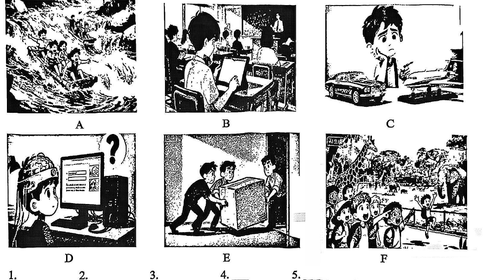

# 2026 一模精讲 · 徐汇英语（上）：听力 + 语法词汇（第 1–48 题）

> 徐汇卷结构：Part 1 听力 25 分（1–25）+ Part 2 语法词汇 23 分（26–48）+ Part 3 读写 72 分（49–88）+ 作文 20 分（89），共 89 小题 140 分。与宝山卷的差异：徐汇听力 D 部分为两则广告填空共 10 空（16–25），全卷 89 题。本篇覆盖第 1–48 题，第 49–89 题见 [[英模26-徐汇-下]]。
>
> ⚠️ **资料说明**：本卷为纯扫描版、无文字层，题干按 150dpi 页图逐题录入。**答案来源为卷面红笔手写批注版**（非官方排版答案），已逐题辨认誊录。听力部分（1–25）批注版未作答，本区虽有听力音频原件，但批注不含听力答案，故听力只给卷面与方法，不给答案。

## Part 1 听力（第 1–25 题，共 25 分）

### A. Listen and choose the right picture（听句选图，第 1–5 题，5 分）

六选五，卷面六图为：

- A：几人乘皮划艇在湍急河流中漂流——"漂流/水上运动"场景
- B：学生在教室里用平板电脑上课学习——"课堂/电子学习"场景
- C：男孩托腮在玩具小汽车与飞机模型之间犹豫——"选礼物/纠结"场景
- D：女孩在电脑前上网查询资料，头顶一个大问号——"上网搜索/求解"场景
- E：三人合力搬运冰箱等大件家具——"搬家/帮忙搬运"场景
- F：一群孩子在动物园围栏外看长颈鹿、大象——"游园/看动物"场景

> ⚠️ 卷面批注版**未给出 1–5 题答案**（本区音频亦无配套答案誊录），此处不臆测。做题方法：听前先给每图定一个核心动词短语（go rafting / use a tablet in class / choose a gift / search online / move the furniture / visit the zoo），听到句子后抓"动词+名词"匹配。

### B. Listen to the dialogue and choose the best answer to the question you hear（对话理解，第 6–10 题，5 分）

**6.**（问时间）
- A. 3:00.
- B. 3:30.
- C. 4:00.
- D. 4:30.

**7.**（问频率）
- A. Once a month.
- B. Once a week.
- C. Every day.
- D. Never.

**8.**（问活动）
- A. Do housework.
- B. Do homework.
- C. Do exercise.
- D. Sing songs.

**9.**（问电话号码）
- A. 355277.
- B. 35277.
- C. 353771.
- D. 352177.

**10.**（问观点感受）
- A. She felt confident because she could solve the problem on her own.
- B. She found the math problem very difficult and felt frustrated.
- C. She felt bored and had no interest in the math homework.
- D. She felt excited to have such a challenging problem.

> ⚠️ 同上，批注版未给答案。⚠️ 卷面第 9 题 B 选项印作"35277"（5 位），疑漏印一位数字，其余选项均为 6 位，特此注明。考点预判：6 题注意 o'clock / half past 的换算；7 题抓频率副词；9 题数字连读易混 3/5（three/five），边听边记；10 题抓情感形容词（confident / frustrated / bored / excited），but 后的转折才是真实态度。

### C. Listen to the passage and tell whether the following statements are true or false（短文判断，第 11–15 题，5 分）

**11.** One spring morning, I suddenly noticed that my voice had changed.

**12.** Everyone in my family was surprised by the change happening to me.

**13.** At school, my friend patiently explained the reason for the voice change to me.

**14.** Now I know that both boys and girls experience voice changes during *puberty*（青春期）.

**15.** I'm no longer worried and have started to look forward to growing up.

> 短文主旨可从判断句反推：少年"我"某天突然发现自己的声音变了 → 家人/朋友的反应 → 朋友解释变声原因 → 认识到青春期男女生都会变声 → 不再焦虑、期待长大。⚠️ 批注版未给 T/F 答案。方法：判断句中的**主语范围（everyone/both boys and girls）与程度词**最常与原文有出入，如 12 题的 Everyone、14 题的 both…and…。

### D. Listen to two advertisements and complete the notes（听两则广告填记录，第 16–25 题，10 分，每空限填一词）

| 广告 | 记录要点 |
| ---- | ---- |
| **Smart Bicycle** | Material: lightweight material；Color: black, **16** ＿＿＿＿＿＿＿＿, red；Features: a built-in GPS to guide way / a phone holder to stay connected / a **17** ＿＿＿＿＿＿＿＿ **18** ＿＿＿＿＿＿＿＿ for night rides；Possible user: **19** ＿＿＿＿＿＿＿＿, commuters, cycling lovers；Price: $ **20** ＿＿＿＿＿＿＿＿ |
| **Smart Ring** | Material: **21** ＿＿＿＿＿＿＿＿ material；Color: **22** ＿＿＿＿＿＿＿＿, gold, rose gold；Features: track steps / monitor heart rate / **23** ＿＿＿＿＿＿＿＿ **24** ＿＿＿＿＿＿＿＿ **25** ＿＿＿＿＿＿＿＿；Possible user: fitness lovers, anyone who wants to stay active and healthy；Price: $99 |

> ⚠️ 批注版未给答案。方法：广告类听力按"材质→颜色→功能→人群→价格"五要素预判词性——16/22 填颜色词，17–18/23–25 连续空为功能短语（名词或动宾），20 为数字价格。两则广告结构相同，第二篇（Smart Ring）已印出 Features 两条，第三条 23–25 需听写补全。

## Part 2 语法和词汇（第 26–48 题）

### II. Choose the best answer（语法单项选择，第 26–40 题，各 1 分，共 15 分）

**26.** Studies show that ______ memory tends to get worse as people get older.
- A. a
- B. an
- C. the
- D. /

> [!tip]- 💡 思路导航
> memory 此处是泛指的不可数抽象名词——要不要冠词？

> [!success]- ✅ 详解 · 评分点 · 易错 · 关联
> **答案 D**。memory 此处为泛指的不可数抽象名词，零冠词。

**27.** ______ the time being, let's not make any big decisions until we have more information.
- A. At
- B. For
- C. From
- D. On

> [!tip]- 💡 思路导航
> for the time being（暂时）固定介词搭配。

> [!success]- ✅ 详解 · 评分点 · 易错 · 关联
> **答案 B**。for the time being（眼下/暂时）固定介词搭配。

**28.** As a cosplayer, Jenny often dresses ______ up as different popular cartoon characters.
- A. she
- B. her
- C. herself
- D. hers

> [!tip]- 💡 思路导航
> dress oneself up as…（把自己装扮成……）——反身代词。

> [!success]- ✅ 详解 · 评分点 · 易错 · 关联
> **答案 C**。dress oneself up as…（把自己装扮成……）用反身代词。

**29.** To be accurate, a good translator should remain ______ to the author's original meaning.
- A. faith
- B. faiths
- C. faithful
- D. faithfully

> [!tip]- 💡 思路导航
> remain 是系动词，接形容词作表语；remain ___ to… 固定搭配。

> [!success]- ✅ 详解 · 评分点 · 易错 · 关联
> **答案 C**。remain 系动词 + 形容词作表语；remain faithful to…（忠实于……）。

**30.** If traditional craftsmen get better support, they ______ more beautiful works of art.
- A. will create
- B. have created
- C. are creating
- D. created

> [!tip]- 💡 思路导航
> if 条件句"主将从现"：从句是一般现在时，主句用什么？

> [!success]- ✅ 详解 · 评分点 · 易错 · 关联
> **答案 A**。if 条件句主将从现：从句 get 一般现在时，主句用 will create。

**31.** ______ the chef was cooking in the kitchen, the waiters were setting the tables.
- A. Since
- B. When
- C. While
- D. As soon as

> [!tip]- 💡 思路导航
> 两个过去进行时的动作同时进行——用哪个引导时间状语从句？

> [!success]- ✅ 详解 · 评分点 · 易错 · 关联
> **答案 C**。两个过去进行时动作同时进行 → While 引导。

**32.** The most beautiful exhibit in this exhibition was provided ______ an unknown citizen.
- A. with
- B. by
- C. for
- D. to

> [!tip]- 💡 思路导航
> 被动语态的施动者由哪个介词引出？

> [!success]- ✅ 详解 · 评分点 · 易错 · 关联
> **答案 B**。被动语态的施动者由 by 引出：was provided by sb。

**33.** The farmer grows his crops without ______ any chemicals. They are completely organic and safe to eat.
- A. use
- B. to use
- C. using
- D. used

> [!tip]- 💡 思路导航
> without 是介词——后面接动名词。

> [!success]- ✅ 详解 · 评分点 · 易错 · 关联
> **答案 C**。介词 without 后接动名词 using。

**34.** —I'm afraid you ______ apologize for what you said earlier if you want to stay in this club.  —I'm really sorry, and I'll make it right.
- A. must
- B. can
- C. may
- D. would

> [!tip]- 💡 思路导航
> "不道歉就别想留下"——语气最强的情态动词。

> [!success]- ✅ 详解 · 评分点 · 易错 · 关联
> **答案 A**。"不道歉就别想留下"→ 语气最强的 must（必须）。

**35.** Up to now, the staff ______ to catch the monkey that escaped from the zoo yet.
- A. didn't manage
- B. won't manage
- C. haven't managed
- D. don't manage

> [!tip]- 💡 思路导航
> Up to now（到现在为止）+ yet——现在完成时的否定式。

> [!success]- ✅ 详解 · 评分点 · 易错 · 关联
> **答案 C**。Up to now（到现在为止）+ yet → 现在完成时否定 haven't managed。

**36.** ______ of the teams played well in this football match. The audience was very disappointed.
- A. Neither
- B. Either
- C. None
- D. Both

> [!tip]- 💡 思路导航
> 两队都没踢好、观众失望——两者"都不"的代词；none 用于三者以上。

> [!success]- ✅ 详解 · 评分点 · 易错 · 关联
> **答案 A**。两队都没踢好 → Neither（两者都不）；后句"观众很失望"印证。

**37.** The drive across Yunnan Province was ______ road trip I have ever taken, with breathtaking views at every turn.
- A. dramatic
- B. more dramatic
- C. most dramatic
- D. the most dramatic

> [!tip]- 💡 思路导航
> I have ever taken（迄今为止）给出比较范围——最高级前加什么？

> [!success]- ✅ 详解 · 评分点 · 易错 · 关联
> **答案 D**。I have ever taken（迄今为止）范围比较 → 最高级，前加 the。

**38.** In many families, parents expect their first-born child ______ the younger siblings.
- A. look after
- B. to look after
- C. looking after
- D. looked after

> [!tip]- 💡 思路导航
> expect sb ___ do sth 固定结构。

> [!success]- ✅ 详解 · 评分点 · 易错 · 关联
> **答案 B**。expect sb to do sth 固定结构，用不定式。

**39.** The Mars rover mission discovered something ______: evidence of ancient water on the Red Planet.
- A. interest
- B. interested
- C. interesting
- D. interestingly

> [!tip]- 💡 思路导航
> 修饰不定代词 something 的形容词要后置；物作主语用 -ing 形式。

> [!success]- ✅ 详解 · 评分点 · 易错 · 关联
> **答案 C**。修饰不定代词 something 的形容词后置；物作主语用 -ing 形式。

**40.** This video teaches people ______ to protect themselves during an earthquake.
- A. what
- B. how
- C. who
- D. that

> [!tip]- 💡 思路导航
> "如何自救"——teach sb ___ to do sth 的疑问词。

> [!success]- ✅ 详解 · 评分点 · 易错 · 关联
> **答案 B**。"如何自救"→ teach sb how to do sth（疑问词 + 不定式）。

### III. Complete the following passage with the words or phrases in the box（选词填空，第 41–48 题，各 1 分，共 8 分；每词限用一次，两框各 5 选 4）

**首框**：A. smell  B. command  C. go through  D. disasters  E. in common
主题：警犬自述（一只德国牧羊犬介绍警犬家族与自己的生活）

**41.** We're all different, but we have one thing ＿＿＿＿＿＿＿＿: we're smart, strong, and ready to help the police.

> [!tip]- 💡 思路导航
> have one thing ___——"有一个共同点"，冒号引出具体内容。

> [!success]- ✅ 详解 · 评分点 · 易错 · 关联
> **答案 E. in common**（have one thing in common"有一个共同点"，后冒号引出具体内容）

**42.** Bloodhounds, like my friend Max, have the best noses. They can follow a ＿＿＿＿＿＿＿＿ for miles!

> [!tip]- 💡 思路导航
> 空前有 a——单数名词；寻血猎犬鼻子最灵，循着什么追踪数英里？

> [!success]- ✅ 详解 · 评分点 · 易错 · 关联
> **答案 A. smell**（寻血猎犬鼻子最灵 → 循着"气味"追踪数英里；a + 单数名词）

**43.** Becoming a police dog wasn't easy. I had to ＿＿＿＿＿＿＿＿ a tough 13-week training course.

> [!tip]- 💡 思路导航
> had to 后接动词原形——"经历/完成"13 周训练课程。

> [!success]- ✅ 详解 · 评分点 · 易错 · 关联
> **答案 C. go through**（go through a course"完成/经历训练课程"；had to 后接动词原形）

**44.** I also learned to find missing people, detect drugs or explosives, and even search for survivors after ＿＿＿＿＿＿＿＿.

> [!tip]- 💡 思路导航
> after 是介词——接复数名词；与 drugs/explosives 并列的"灾害"。

> [!success]- ✅ 详解 · 评分点 · 易错 · 关联
> **答案 D. disasters**（灾后搜救幸存者；after 介词后接复数名词，与 drugs/explosives 的列举语境一致）

**次框**：A. relax  B. tasks  C. remove  D. evidence  E. broken

**45.** My job is very exciting! My main ＿＿＿＿＿＿＿＿ are to chase criminals, protect my handler…

> [!tip]- 💡 思路导航
> 空后 are 是复数谓语——主语位置需要复数名词"职责"。

> [!success]- ✅ 详解 · 评分点 · 易错 · 关联
> **答案 B. tasks**（后文 are 复数谓语 + 不定式列举"职责"内容 → tasks）

**46.** …sometimes go into dangerous places like dark forests or ＿＿＿＿＿＿＿＿ buildings.

> [!tip]- 💡 思路导航
> 修饰 buildings 的形容词；与 dark forests 并列的险境。

> [!success]- ✅ 详解 · 评分点 · 易错 · 关联
> **答案 E. broken**（修饰 buildings 的形容词；dark forests or broken buildings"黑暗森林或坍塌建筑"，并列险境）

**47.** Sometimes, I also help find important ＿＿＿＿＿＿＿＿ at crime scenes, like a piece of clothing or a dropped phone.

> [!tip]- 💡 思路导航
> important + 名词；crime scenes 加衣物、手机例证——"证据"。

> [!success]- ✅ 详解 · 评分点 · 易错 · 关联
> **答案 D. evidence**（crime scenes + clothing/phone 例证 → "证据"；important + 名词）

**48.** After years of hard work, I finally get to ＿＿＿＿＿＿＿＿ and enjoy life as a pet.

> [!tip]- 💡 思路导航
> get to do sth——与 enjoy life 并列的"放松"动作。

> [!success]- ✅ 详解 · 评分点 · 易错 · 关联
> **答案 A. relax**（get to do sth；与 enjoy life 并列的"放松"，首字母框内唯一贴切动词）

> 小结：本篇选词先判词性（42/46 冠词与名词前的形容词位置、44/47 介词与形容词后的名词、43/48 情态与 get to 后的动词原形、41 固定短语），再靠**上下文例证复现**（42 的 noses、47 的 a piece of clothing or a dropped phone）锁定答案。剩余干扰项 B command、C remove 在两框中分别落选。

---
*本篇题干按 150dpi 页图逐题录入（徐汇卷为纯扫描版无文字层）；答案誊自卷面红笔手写批注版并逐题与语法规则互证。听力部分（1–25）批注版未作答、本区音频无配套答案，已如实标注。*
