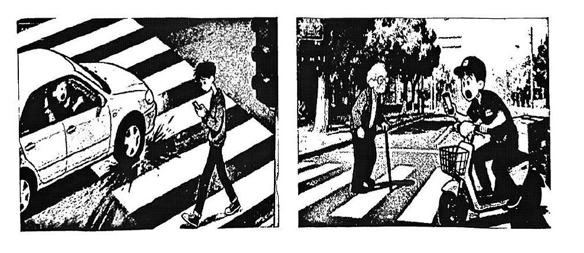

# 2026 一模精讲 · 徐汇英语（下）：词句转换 + 读写（第 49–89 题）

> 本篇覆盖第 49–89 题（词形转换、句型转换、阅读四篇、作文），第 1–48 题见 [[英模26-徐汇-上]]。答案来源与校正方式同上篇：卷面红笔手写批注版 + 页图互证；徐汇卷为纯扫描版，题干按 150dpi 页图录入。

## IV. Complete the sentences with the given words in their proper forms（词形转换，第 49–56 题，各 1 分，共 8 分）

**49.** Remember to take the pills I gave you on time, ＿＿＿＿＿＿＿＿ at a time. (second)

> [!tip]- 💡 思路导航
> "一次两粒"——at a time 前该用序数词还是基数词？

> [!success]- ✅ 详解 · 评分点 · 易错 · 关联
> **答案 two**（"一次两粒"at a time 前用基数词；second（序数词）→ two（基数词），语义由"第二"转为数量）
>
> **易错**：⚠️ 本题考词性互换中最易被忽略的一类：序数词↔基数词。

**50.** The police promised to catch the ＿＿＿＿＿＿＿＿ and rescue the actor. (kidnap)

> [!tip]- 💡 思路导航
> catch the + 表人名词——"绑架者"英文怎么说？注意人数不止一个。

> [!success]- ✅ 详解 · 评分点 · 易错 · 关联
> **答案 kidnappers**（catch the + 表人名词"绑匪"；kidnap → kidnapper，绑架者不止一人用复数，与谓语 promised 对应的宾语惯用复数）

**51.** Some famous ＿＿＿＿＿＿＿＿ in history have left a lasting impact on future generations. (speech)

> [!tip]- 💡 思路导航
> Some famous + 可数名词复数，谓语 have 也是佐证——speech 以 ch 结尾，复数怎么加？

> [!success]- ✅ 详解 · 评分点 · 易错 · 关联
> **答案 speeches**（Some famous + 可数名词复数，谓语 have 佐证；speech 以 ch 结尾 → +es）

**52.** Using a password manager is a much ＿＿＿＿＿＿＿＿ way to protect your online accounts. (safe)

> [!tip]- 💡 思路导航
> much 修饰比较级——"更安全的"怎么说？

> [!success]- ✅ 详解 · 评分点 · 易错 · 关联
> **答案 safer**（much 修饰比较级；"用密码管理器是更安全的做法"含比较意味）

**53.** At the import expo, you can see ＿＿＿＿＿＿＿＿ new products from different countries. (vary)

> [!tip]- 💡 思路导航
> 修饰名词 products 用形容词——vary 的形容词形式是什么？

> [!success]- ✅ 详解 · 评分点 · 易错 · 关联
> **答案 various**（修饰名词 products 用形容词 various"各种各样的"；vary 动词 → various 形容词）

**54.** The football team's victory brought great ＿＿＿＿＿＿＿＿ to the entire city. (exciting)

> [!tip]- 💡 思路导航
> great + 名词作 bring 的宾语——exciting 的名词形式是什么？

> [!success]- ✅ 详解 · 评分点 · 易错 · 关联
> **答案 excitement**（great + 名词作 bring 的宾语；exciting → excitement"兴奋/激动"）

**55.** ＿＿＿＿＿＿＿＿ on your passion and it will guide you towards what truly matters in life. (independent)

> [!tip]- 💡 思路导航
> "祈使句 + and + 将来句"——句首要用动词原形；去掉 independent 的否定前缀是什么动词？

> [!success]- ✅ 详解 · 评分点 · 易错 · 关联
> **答案 Depend**（"祈使句 + and + 将来句"结构 → 句首用动词原形；independent → depend，depend on"依靠"，句首大写）

**56.** Professor Wang ＿＿＿＿＿＿＿＿ thanked everyone who helped with the project. (personal)

> [!tip]- 💡 思路导航
> 修饰动词 thanked 用副词——personal 的副词形式？

> [!success]- ✅ 详解 · 评分点 · 易错 · 关联
> **答案 personally**（修饰动词 thanked 用副词 personally"亲自"）

## V. Rewrite the following sentences as required（句型转换，第 57–63 题，共 14 分；57–62 每空限填一词）

**57.** The government transformed the abandoned parking lot into a beautiful park.（改为被动语态）

> [!tip]- 💡 思路导航
> 一般过去时的被动：was/were + 过去分词；施动者 by the government 可以保留。

> [!success]- ✅ 详解 · 评分点 · 易错 · 关联
> **答案**：The abandoned parking lot **was transformed** into a beautiful park by the government.（一般过去时被动 was/were + 过去分词；by the government 保留施动者）

**58.** That good detective never jumps to conclusions.（改为反意疑问句）

> [!tip]- 💡 思路导航
> never 表否定 → 前否后肯；jumps 是三单，反意部分该用哪个助动词、代词用哪个？

> [!success]- ✅ 详解 · 评分点 · 易错 · 关联
> **答案**：That good detective never jumps to conclusions, **does he**?（never 表否定 → 前否后肯；jumps 三单 → does）

**59.** Eric is always the earliest to arrive at school in his class.（保持句意基本不变）

> [!tip]- 💡 思路导航
> 最高级与比较级互转的经典句型：earlier than any other…

> [!success]- ✅ 详解 · 评分点 · 易错 · 关联
> **答案**：Eric always arrives at school **earlier than** any other student in his class.（最高级 earliest ↔ 比较级 earlier than any other… 互转经典句型）

**60.** The insurance company paid Tom <u>500 dollars</u> for the flight delay.（对划线部分提问）

> [!tip]- 💡 思路导航
> 划线是钱数——疑问词组用哪个？后面接一般疑问语序。

> [!success]- ✅ 详解 · 评分点 · 易错 · 关联
> **答案**：**How much** did the insurance company pay Tom for the flight delay?（划线为钱数 → how much）

**61.** Students may lose critical thinking skills unless teachers balance AI use with traditional teaching methods.（保持基本句意不变）

> [!tip]- 💡 思路导航
> unless = if…not——互转时从句谓语的肯定/否定形式要跟着调整。

> [!success]- ✅ 详解 · 评分点 · 易错 · 关联
> **答案**：**If** teachers **don't** balance AI use with traditional teaching methods, students may lose critical thinking skills.（unless = if…not，条件否定互转）

**62.** I'm curious to know. Does remote work become common now?（合并两句成一句）

> [!tip]- 💡 思路导航
> 一般疑问句变宾语从句：if/whether 引导 + 陈述语序；主句现在时，从句时态怎么处理？

> [!success]- ✅ 详解 · 评分点 · 易错 · 关联
> **答案**：I'm curious to know **if/whether** remote work **becomes** common now.（一般疑问句变宾语从句：if/whether 引导 + 陈述语序；主句现在时，从句时态保留一般现在时 becomes）

**63.** an amazing experience, it is, so close, what, whales, to see（连词成句）

> [!tip]- 💡 思路导航
> What + an + adj + n + 主谓 + 不定式——an amazing experience 决定感叹词后面带不带冠词；句末标点别忘。

> [!success]- ✅ 详解 · 评分点 · 易错 · 关联
> **答案**：**What an amazing experience it is to see whales so close!**（What + an + adj + n + 主谓 + 不定式；an amazing experience 决定 What an；句末感叹号）

## VI. Reading Comprehension（阅读理解，第 64–88 题，共 50 分）

### A. Choose the best answer（阅读选择：戏剧社试镜海报，第 64–69 题，各 2 分，共 12 分）

文章为**应用文（海报）**：学校戏剧社为英语节话剧《Protecting the Innocent》招募演员试镜——列出三个角色（Detective Ken / The Businessman / Two Office Ladies）、三条要求（英语口语好、能表达情感并演绎场景、有表演经验加分但非必需）、报名方式（自我介绍 + 可选短对话，发邮件 dramafun@13577.com 或交到戏剧社教室，3 月 15 日前）与试镜信息（3 月 18 日 3:00–5:00 PM，School Theatre），结尾以"Break a leg!"祝好运。

**64.** The poster above is inviting students to ______.
- A) join the drama club
- B) watch a performance
- C) join a character tryout
- D) vote for the best actor/actress

> [!tip]- 💡 思路导航
> 海报主体是"招募角色试镜"还是"看演出"？抓住 audition 一词的作用。

> [!success]- ✅ 详解 · 评分点 · 易错 · 关联
> **答案 C**（按海报主体为招募"角色试镜"（auditions…looking for talented students to bring characters to life），语义上 C 最合理，A 的"加入社团"是标题引子而非海报目的）
>
> **易错**：⚠️ 本题批注为括号外一个大圈笔迹，无法辨认选项字母，待人工核对原始答案。

**65.** What is the name of the play for the audition?

> [!tip]- 💡 思路导航
> 定位海报第二行：audition for our upcoming play——剧名写在引号里。

> [!success]- ✅ 详解 · 评分点 · 易错 · 关联
> **答案 A) Protecting the Innocent**（定位海报第二行：audition for our upcoming play "Protecting the Innocent"；B 为角色名，D 为演出场合）

**66.** If you want to audition, you can submit your materials before ______ by ______.
- A) 3:00 PM, e-mail
- B) March 18th, calling the theatre
- C) March 15th, e-mail
- D) 5:00 PM, visiting the drama club room

> [!tip]- 💡 思路导航
> Submission Details 分别写了截止日期与提交方式——3:00/5:00 PM 和 18th 各是什么日子，别混淆。

> [!success]- ✅ 详解 · 评分点 · 易错 · 关联
> **答案 C) March 15th, e-mail**（定位 Submission Details：must be submitted by March 15th + email your materials；3:00/5:00 PM 是试镜当天时间，18th 是试镜日，均非提交截止）

**67.** Which of the following is unnecessary in the submitted materials?

> [!tip]- 💡 思路导航
> How to Apply 只要求哪些材料？哪一项是 optional？没提到的就是不必要项。

> [!success]- ✅ 详解 · 评分点 · 易错 · 关联
> **答案 B) Your daily plan**（How to Apply 只要求 self-introduction + reason，optional 加 prepared dialogue；"日常计划"未提及）

**68.** What does the phrase "Break a leg!" at the end of the poster mean?

> [!tip]- 💡 思路导航
> 演出/试镜语境的习语——字面义"摔断腿"是干扰。

> [!success]- ✅ 详解 · 评分点 · 易错 · 关联
> **答案 D) Good luck!**（演出/试镜语境的习语"祝好运"，字面义"摔断腿"为干扰）

**69.** Which of the following students is most likely to be selected as an actor/actress?
- A) Leo: good at English, bad tempered, has won awards in drama competitions.
- B) Jane: average English-speaking skills, friendly and very interested in drama.
- C) Eason: fluent in English, no acting experience, but very passionate and willing to put in time to practice.
- D) Sarah: speaks French very well, good looking, has participated in class plays.

> [!tip]- 💡 思路导航
> 海报明示"表演经验加分但非必需"，而英语口语是硬要求——拿这两条逐个核对四位学生。

> [!success]- ✅ 详解 · 评分点 · 易错 · 关联
> **答案 C) Eason**（海报明示"表演经验加分但非必需"，而英语口语是硬要求：Eason 英语流利 + 热情肯练 → 最可能入选；A 脾气坏、B 英语一般、D 是法语不是英语）

### B. Choose the words or expressions and complete the passage（完形选择：连环漫画的过去与未来，第 70–75 题，各 2 分，共 12 分）

文章脉络：连环漫画（comic strips）历史悠久且前景光明 → 起点：一个多世纪前报纸上的短小滑稽故事，固定角色常陷入傻事，受欢迎帮助卖报 → 演变：不再只搞笑，开始讲严肃故事、探索深层主题，风格与角色不断创新 → 低谷：读报人减少，报纸削减漫画版面，画家谋生变难 → 新生：画家转战网络发布数字漫画，全球读者一点即看 → 未来：交互式漫画、AI 创作，可能性无穷。

**70.** …comic strips have a rich history and a bright future. Let's dive into their story and see how they have ______ over time!

> [!tip]- 💡 思路导航
> have 后接过去分词——"随时间如何发展"用哪个动词？

> [!success]- ✅ 详解 · 评分点 · 易错 · 关联
> **答案 A) developed**（"看看它们随时间如何发展"；have developed 现在完成时，呼应 rich history）

**71.** Early comic strips often had regular ______ who often got into silly situations.

> [!tip]- 💡 思路导航
> 先行词 who 指人 + 定语从句"常陷入傻事"——空格说的是漫画里的固定什么？

> [!success]- ✅ 详解 · 评分点 · 易错 · 关联
> **答案 C) characters**（先行词 who 指人 + 定语从句"常陷入傻事" → 漫画里的固定"角色"）

**72.** They weren't just funny anymore. Some told ______ stories or explored deep themes.

> [!tip]- 💡 思路导航
> 前句"不再只是搞笑"——与 deep themes 并列的该是哪一类故事？

> [!success]- ✅ 详解 · 评分点 · 易错 · 关联
> **答案 B) serious**（前句"不再只是搞笑"→ 与 deep themes 并列的"严肃故事"）

**73.** Many newspapers have reduced the ______ for comics or stopped printing them at all.

> [!tip]- 💡 思路导航
> 报纸不再登那么多漫画——削减的是什么（篇幅上的哪个词）？

> [!success]- ✅ 详解 · 评分点 · 易错 · 关联
> **答案 C) space**（报纸削减漫画的"版面"；reduce the space for…）

**74.** …they've found a new home. Many artists create digital comic strips and share them ______.

> [!tip]- 💡 思路导航
> digital + 下文"一点即看"——漫画发布在哪里？

> [!success]- ✅ 详解 · 评分点 · 易错 · 关联
> **答案 A) on the internet**（digital + 下文 with just a click → 发布"在网络上"）

**75.** With new technology, we might see more interactive comic strips… The ______ are endless!

> [!tip]- 💡 思路导航
> 谓语 are 是复数，语义要能被 endless 修饰——这一段在展望未来还有什么可以期待。

> [!success]- ✅ 详解 · 评分点 · 易错 · 关联
> **答案 D) possibilities**（"可能性是无穷的"；are 复数谓语 + endless 语义搭配）

### C. Read the passage and fill in the blanks with proper words（首字母填空：Mia 与防诈骗网站 Digital Guardian，第 76–82 题，各 2 分，共 14 分）

文章脉络：17 岁的 Mia 发现祖母差点中了网络骗局（冒充表哥的邮件急要 1500 美元），及时阻止 → 调查后震惊于多少老年人成为目标，便用编程技能创办网站 Digital Guardian，帮老年人检查可疑邮件、识别并举报骗局 → 建站不易（自学 Python 与 HTML），上线时紧张却满怀希望 → 首场老年中心工作坊成转折点，讲解骗术与防范，老人认真听讲提问 → 消息迅速传开，受邀在社区活动乃至地区科技会议演讲，提出"数字桥梁"愿景 → 未来想添加在线客服、互动课程等功能；名言：技术像电一样可作善器 → 结尾点题：一个人也能带来大改变。

**76.** Thankfully, Mia s＿＿＿＿＿＿＿ her grandmother from sending the money.

> [!tip]- 💡 思路导航
> Thankfully 提示结局是好的——哪个动词表示"使祖母免于汇款"？注意批注有两个词并存。

> [!success]- ✅ 详解 · 评分点 · 易错 · 关联
> **答案 saved**（save/stop sb (from) doing sth 均符合"阻止某人做某事"；推荐取 saved——语义为"救下祖母、使其免于汇款"，与 Thankfully 及后文 protect…from 呼应。备考按 save sb from doing 掌握）
>
> **易错**：⚠️ 批注在此处写有两个词"saved / stopped"并存，两者均符合该搭配语义。

**77.** The site helps seniors find and report scams by checking strange emails and m＿＿＿＿＿＿＿.

> [!tip]- 💡 思路导航
> and 并列复数名词——与 emails 同类的"信息"用哪个词？

> [!success]- ✅ 详解 · 评分点 · 易错 · 关联
> **答案 messages**（checking…emails and messages"检查可疑邮件和信息"；and 并列复数名词）

**78.** When Digital Guardian was ready to use, a＿＿＿＿＿＿＿ she felt a little bit nervous, she was still full of hope.

> [!tip]- 💡 思路导航
> "虽然有点紧张但仍满怀希望"——让步状语从句，a 开头 + 逗号结构。

> [!success]- ✅ 详解 · 评分点 · 易错 · 关联
> **答案 although**（"虽然有点紧张但仍满怀希望"，让步状语从句；a 开头 + 逗号结构）

**79.** Mia explained how scams worked and how to a＿＿＿＿＿＿＿ them.

> [!tip]- 💡 思路导航
> how to + 动词原形；讲解骗术之后，还要教老人怎么"避开"骗局。

> [!success]- ✅ 详解 · 评分点 · 易错 · 关联
> **答案 avoid**（how to + 动词原形；"识别骗术"对应"如何避开"骗局）

**80.** Word about Digital Guardian spread q＿＿＿＿＿＿＿.

> [!tip]- 💡 思路导航
> 修饰动词 spread 用副词；下文"越来越多的人知道、受邀演讲"印证了传播之快。

> [!success]- ✅ 详解 · 评分点 · 易错 · 关联
> **答案 quickly**（修饰动词 spread 用副词；下文"越来越多的人知道、受邀演讲"印证传播之快）

**81.** She wants to a＿＿＿＿＿＿＿ features like live chat support and interactive lessons to make it easier for the elderly to use.

> [!tip]- 💡 思路导航
> want to do；like 后举例解释这个动作——对网站功能做什么？

> [!success]- ✅ 详解 · 评分点 · 易错 · 关联
> **答案 add**（want to do；add features"添加功能"，后文举例解释）

**82.** "Technology can be frightening," she says, "but it can also be a useful t＿＿＿＿＿＿＿ for good just like electricity."

> [!tip]- 💡 思路导航
> a useful + 单数名词——"像电一样是造福的……"，比喻沿用。

> [!success]- ✅ 详解 · 评分点 · 易错 · 关联
> **答案 tool**（a useful + 单数名词；"像电一样是造福的 useful tool"，比喻沿用）

### D. Answer the questions（回答问题：AI 会伤害学生的独立思考力吗，第 83–88 题，共 12 分）

文章脉络：一项研究（54 名成人分两组写文章：AI 组脑活动更低、几乎记不住自己写了什么）引发讨论 → **Jessie（正方：有害）**：用 AI 写文章就不学组织思路，产出"没有灵魂"（soulless）的文章，如同抄同学作业——分数虽好却不真懂；大脑需要练习与努力才能成长，过度依赖会"变懒" → **William（反方：无害）**：用得对就有益——帮头脑风暴、解释难概念（如同用计算器做数学）；省下查资料的时间去做分析反而提升批判性思维；关键是别把 AI 当思考的替代品 → 结尾开放提问：答案可能取决于……

**83.** What can we learn from the result of the recent study? (No more than 10 words.)

> [!tip]- 💡 思路导航
> 定位首段实验结果——AI 使用者的大脑活动与记忆表现各如何？10 词以内概括。

> [!success]- ✅ 详解 · 评分点 · 易错 · 关联
> **答案**：**We can learn that AI users had lower brain activity and remembered little.**（批注照录；定位首段 the results showed…，within 10 words：AI users had lower brain activity and remembered little）

**84.** Do Jessie and William share the same opinion on the issue? (1 分)

> [!tip]- 💡 思路导航
> 一般疑问句先答 No/Yes——两人一篇正方一篇反方。

> [!success]- ✅ 详解 · 评分点 · 易错 · 关联
> **答案**：**No, they don't.**（一般疑问句先答 No；两人一篇正方一篇反方）

**85.** What are "soulless" essays like according to Jessie?

> [!tip]- 💡 思路导航
> 定位 Jessie 段：soulless essays 的两个特征——短语怎样 + 缺什么？

> [!success]- ✅ 详解 · 评分点 · 易错 · 关联
> **答案**：**They have similar phrases and no creativity.**（定位 Jessie 段：essays with similar phrases and no creativity）

**86.** According to William, how can AI benefit students? Provide at least two examples from his opinion.

> [!tip]- 💡 思路导航
> 从 William 段两个层次各取一例：帮什么、省下时间去做什么。

> [!success]- ✅ 详解 · 评分点 · 易错 · 关联
> **答案**：**First, AI can help students brainstorm ideas or explain difficult concepts. Second, AI can save time for students to analyze information.**（批注照录；2 个例子分别取自 William 段第 1、2 层）

**87.** Based on both opinions, what is probably the real factor（因素）that decides how AI affects students' thinking skills? Complete the last sentence.

> [!tip]- 💡 思路导航
> 综合两方观点：AI 本身无好坏——真正的决定因素在"学生怎么用"。补全最后一句。

> [!success]- ✅ 详解 · 评分点 · 易错 · 关联
> **答案**：The answer might depend on **how students use AI.**（综合两方观点：AI 本身无好坏，"关键不是用 AI 替代思考"——取决于"学生如何使用"）

**88.** Please explain why copying answers from a friend's homework might lead to a good grade but not help you truly understand the material. Write at least two reasons. (3 分)

> [!tip]- 💡 思路导航
> 3 分题须答满两条理由：一条关于"不经历思考过程"，一条关于"缺少自主练习"。

> [!success]- ✅ 详解 · 评分点 · 易错 · 关联
> **答案**：**First, copying answers doesn't require you to understand the knowledge or thinking process. Second, you can't practice solving problems by yourself, so you won't master the material deeply.**（批注照录，原迹首句作 doesn't require to understand，规范表达补 you；3 分题须答满两条理由：不经历思考过程 + 缺少自主练习）

## VII. Writing（作文，第 89 题，共 20 分）

**题目**：你将在学校英语节上发表英语演讲，主题"手机与道路安全"（mobile phones and road safety），所给图片仅供参考，为同学写一篇演讲稿，不少于 60 词。文中不得出现姓名、校名等信息。
- 左图：行人过马路低头看手机，险些被驶近的汽车撞上
- 右图：男孩骑电动车戴着耳机看手机，差点撞到斑马线上拄拐的老人

**审题三步**：① 体裁为**演讲稿**——开头称呼（Good afternoon, everyone! / Dear fellow students）、结尾致谢（Thank you!），正文有呼吁语气；② 内容要点：**现象（走路/骑车看手机）→ 危害（分心引发事故，可扣两幅图各写一笔）→ 倡议（放下手机、专注路况）**；③ 人称以 we/you 为主，时态一般现在时，倡议用祈使句或 should/had better。

**参考范文（约 105 词；⚠️ 批注版未提供范文，以下为按评分标准编写）**：

> [!example]- ✍️ 参考范文（点击展开）
> > Good afternoon, everyone!
> >
> > Today I'd like to talk about mobile phones and road safety. As we can see around us, some people check their phones while crossing the street, and some students even ride e-bikes with earphones on. These habits are really dangerous. When our eyes are on the screen, drivers may fail to notice us in time, and we may also fail to see the cars, bikes or people around us. A moment's carelessness can lead to a serious accident.
> >
> > Therefore, please put your phone away when walking or cycling on the road. Let's stay focused and keep ourselves safe. After all, no message is more important than life.
> >
> > Thank you!

**评分要点**：演讲稿格式与称呼结尾（3 分）｜现象、危害、倡议三个要点齐全（8 分）｜语法与用词准确、衔接流畅（6 分）｜词数 ≥60、无个人信息（3 分）。图片内容只需化用，不必逐图描述。

---
*本篇题干按 150dpi 页图逐题录入（徐汇卷为纯扫描版无文字层）；答案誊自卷面红笔手写批注版并逐题与语言规则互证；64 题批注迹无法辨认选项字母、76 题批注 saved/stopped 两可、88 题批注首句用法瑕疵已就地注明，作文批注版无范文。*
