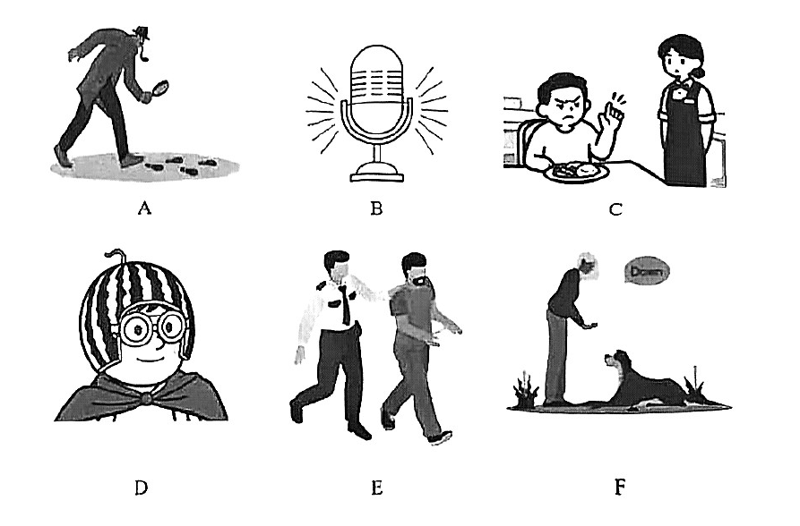

# 2026 一模精讲 · 普陀英语（上）：听力 + 语法词汇（第 1–43 题）

> 普陀卷结构：Part 1 听力 25 分（1–20）+ Part 2 语法词汇 23 分（21–43）+ Part 3 读写 92 分（44–84），共 7 大题 84 小题 140 分，90 分钟。本篇覆盖第 1–43 题，第 44–84 题见 [[英模26-普陀-下]]。
>
> ⚠️ **资料说明**：本卷为纯扫描版（无文字层，题干逐页照图录入，已校正辨认错词）。**答案来源为卷面蓝笔手写批注版**（非官方排版答案），语法词汇部分（21–43）已逐题辨认誊录；**听力部分（1–20）批注版未作答**（本区虽有听力音频原件，但答案版未给听力答案），故听力只给卷面与方法，不给答案。

## Part 1 Listening（第一部分 听力，第 1–20 题，共 25 分）

### A. Listen and choose the right picture（听句选图，第 1–5 题，5 分）

六选五，卷面六图为：

- A：戴帽穿大衣的"侦探"俯身用放大镜观察地上一串脚印——"侦查/脚印"场景
- B：一支立式麦克风（带音波线）——"唱歌/演讲/广播"场景
- C：餐桌旁男孩对盘中食物摆手皱眉，身旁站着穿围裙的服务员——"点餐/拒食"场景
- D：头戴西瓜皮"头盔"、戴风镜、披披风的小孩——"滑稽装扮"场景
- E：警察押送戴手铐的男子——"被捕/押送"场景
- F：主人俯身对趴着的狗下令（气泡写着 "Down!"）——"训狗/宠物指令"场景

> ⚠️ 批注版**未给出 1–5 题答案**（答案版此页无任何批注，音频未随本批次处理），此处不臆测答案。做题方法：听前先读图，每图用一句话概括核心动词（examine footprints / speak into a microphone / refuse the food / dress up / get arrested / give the dog a command），听到句子后抓"动词+名词"匹配。

### B. Listen to the dialogue and choose the best answer to the question you hear（对话理解，第 6–10 题，5 分）

6. A. On March 2nd.  B. On March 3rd.  C. On March 4th.  D. On March 8th.（问日期）
7. A. Losing the football match.  B. Complaints from his teammates.  C. Not trying his best.  D. Hurting his leg in the game.（问烦恼所在）
8. A. In a museum.  B. Near a river.  C. In a zoo.  D. In a pet shop.（问地点）
9. A. The app is called "Trojan horse".  B. The app uses a horse as its symbol.  C. The app is a game about Trojan war.  D. The app may be a trick.（问对 app 的判断）
10. A. The special dish in the restaurant.  B. The new rule of the restaurant.  C. The exact location of the restaurant.  D. The Italian design of the restaurant.（问谈论对象）

> ⚠️ 同上，批注版未作答。考点预判：6 题听前速记各选项日期、抓"序数词+月份"；7 题抓"发生了什么坏事"；9 题注意"特洛伊木马"在计算机语境中是"陷阱/骗局"的隐喻，警惕 D 的警示语义；10 题抓对话中心名词。

### C. Listen to the passage and tell whether the following statements are true or false（短文判断，第 11–15 题，5 分）

11. Maggie made a jar of black paint fall over and destroyed my painting.
12. I was so angry because Maggie didn't apologize and said it was just an accident.
13. In a PE class, some boys told me Maggie was afraid of spiders, so I got a plan.
14. I planned to scare Maggie with spiders, but they all fell into my own schoolbag.
15. I felt so bad about myself because my plan didn't work in the end.

> 短文主旨可从判断句反推："我"的画被 Maggie 打翻的黑颜料毁掉 → 她未道歉，"我"很生气 → 体育课上听说 Maggie 怕蜘蛛，便计划用蜘蛛吓她 → 蜘蛛却全掉进"我"自己书包（自食其果）→ 计划失败，"我"深感惭愧。⚠️ 批注版未给 T/F 答案。方法：判断句与原文的**数字、原因、先后顺序**最常被偷换（如 12 题道歉与否、14 题蜘蛛掉进的是谁的书包）。

### D. Listen to the dialogue and complete the following sentences（听对话填空，第 16–20 题，每空格限填一词，10 分）

16. Super-agers are usually over eighty years old, but they have ______ ______.
17. Most super-agers think ______ ______ with family and friends are important.
18. If stress chemicals stay high for a long time, it can ______ ______ to your brain.
19. You need to ______ ______ your brain by doing some new and difficult things.
20. ______ ______ and get good sleep, and your brain will remember things better.

> 对话主题：Super-agers（八十多岁仍思维敏锐的"超级老人"）及其用脑习惯。⚠️ 批注版未给答案。两空连填先判词性：16 空前 have → 名词短语；18 空后 to your brain → 动词短语（do damage/harm 之类）；19 空 your brain 前 → 动词原形；20 句首大写 → 祈使动词短语。听时把两空当一个短语整体记。

## Part 2 Grammar and Vocabulary（第二部分 语法和词汇，第 21–43 题）

### II. Choose the best answer（语法单项选择，第 21–35 题，各 1 分，共 15 分）

**21.** She made ______ mistake in the math test. She added the numbers wrong.
A. a  B. an  C. the  D. /

**答案 A**。make a mistake 固定搭配；辅音开头的 mistake 用 a。

**22.** I don't drive, so I depend ______ buses and the underground to get around the city.
A. of  B. on  C. for  D. at

**答案 B**。depend on…（依靠……）固定搭配。

**23.** My grandpa knows ______ about how AI works. It's just like magic to him.
A. something  B. anything  C. everything  D. nothing

**答案 D**。后句"对他来说就像魔法"→ 对 AI 原理"一无所知"。

**24.** Miss Wang won't accept late homework ______ you have a good reason, like being sick.
A. unless  B. because  C. if  D. when

**答案 A**。"不收晚交作业，**除非**有正当理由"→ unless 条件否定。

**25.** Don't let your dog run right after a big meal, ______ it can get a stomachache.
A. so  B. and  C. or  D. but

**答案 C**。"祈使句 + or"表"否则"→ 饭后立刻跑会胃痛。

**26.** The plan to spend the weekend on the beach with family sounds ______.
A. perfectly  B. sweetly  C. lovely  D. wonderfully

**答案 C**。sound 系动词 + 形容词；A/B/D 均为副词，只有 lovely 是形容词。

**27.** Susan tried on several dresses, but ______ of them seemed to satisfy her.
A. both  B. all  C. neither  D. none

**答案 D**。but 表转折 + several（三者以上）→ none；neither 限两者。

**28.** My sister ______ three online courses on environmental protection since 2010.
A. completes  B. completed  C. will complete  D. has completed

**答案 D**。since 2010 → 现在完成时。

**29.** Preparing your own food is ______ than ordering takeouts every day.
A. healthy  B. healthier  C. healthiest  D. the healthiest

**答案 B**。than → 比较级。

**30.** You ______ take down everything the teacher says. Just get the main points.
A. mustn't  B. needn't  C. couldn't  D. won't

**答案 B**。后句"只记要点"→ "不必"全记：needn't；mustn't 是"禁止"，语气过重。

**31.** The exchange student never expected ______ such a warm welcome from his new classmates.
A. receive  B. receiving  C. to receive  D. received

**答案 C**。expect to do sth 固定接不定式。

**32.** —What's so funny, Jack?  —I ______ some interesting videos about animals. Come and join me.
A. am watching  B. watched  C. will watch  D. watch

**答案 A**。"过来一起看"→ 此刻正在看 → 现在进行时。

**33.** ______ excellent performance it is! Great job, girls. I'm proud of you.
A. What  B. What a  C. What an  D. How

**答案 C**。感叹句核心是名词 performance（单数可数）→ What + an + 元音开头的 excellent。

**34.** The suspect finally admitted ______ to the police after days of questioning.
A. lie  B. lying  C. to lie  D. lied

**答案 B**。admit doing sth 固定接动名词。

**35.** —______ do you go mountain biking with your cousin Leo?  —Twice a month.
A. How many times  B. How fast  C. How long  D. How often

**答案 D**。答语 Twice a month 表频度 → How often。

### III. Complete the following passage with the words or phrase in the box（选词填空，第 36–43 题，各 1 分，共 8 分；每词限用一次，两框各 5 选 4）

**首框**：A. incorrect  B. get rid of  C. reward  D. frightening  E. reply
主题：古希腊斯芬克斯之谜（The Sphinx and the riddle of Thebes）

**36.** The Sphinx was a/an ______ animal with a woman's head, a lion's body, and a bird's wings. → **D. frightening**（狮身人面带翅膀的怪物 → "吓人的"；a/an 后接形容词）

**37.** If they gave a/an ______ answer, she killed them. → **A. incorrect**（答错谜语被杀 → "错误的"答案）

**38.** …he knew the only way to ______ the Sphinx was to solve the riddle. → **B. get rid of**（解开谜语是"除掉"斯芬克斯的唯一办法）

**39.** He promised to ______ the person who solved the riddle by making him the new king of Thebes. → **C. reward**（"赏赐"解谜者——立为新王即是奖赏）

**次框**：A. survive  B. fit  C. attack  D. free  E. support

**40.** The monster prepared to ______ Oedipus if he gave a wrong answer. → **C. attack**（答错就"攻击"——与上文 killed them 呼应）

**41.** He considered many animals, but none ______ the riddle. → **B. fit**（想到许多动物，但都"符合不了"谜面；none 后接动词原形）

**42.** An old person needs a walking stick for ______ — that's three legs. → **E. support**（拐杖用于"支撑"，即谜底中的"第三条腿"）

**43.** The people of Thebes were thankful to Oedipus because he was able to ______ them from the Sphinx. → **D. free**（free sb from… "把……从……中解救出来"）

> 小结：选词填空先判词性（36/37 空前 a/an 后接形容词，38/40/43 to 后接动词原形，42 for 后接名词），再靠**上下文复现**锁词义（40 呼应上段 killed them，42 呼应 that's three legs）。次框 survive 干扰项与谜语情节无关，靠语义排除。

---
*本篇题干自 150dpi 页图逐页录入（本卷为纯扫描版，无文字层）；答案誊自卷面蓝笔手写批注版并逐题与语法规则互证。听力部分批注版未作答，已如实标注。*
