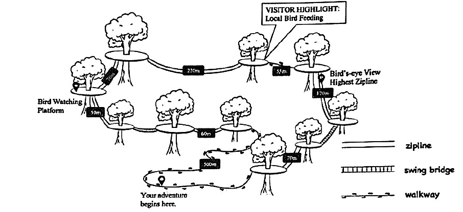
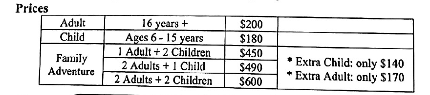
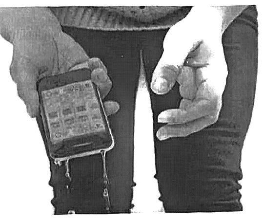
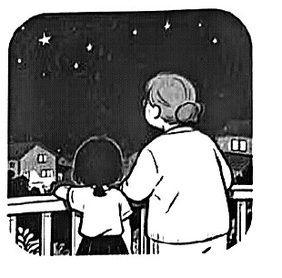

# 2026 一模精讲 · 普陀英语（下）：词句转换 + 读写（第 44–84 题）

> 本篇覆盖第 44–84 题（词形转换、句型转换、阅读四篇、作文），第 1–43 题见 [[英模26-普陀-上]]。答案来源与校正方式同上篇：卷面蓝笔手写批注版逐题辨认 + 页图互证。

## IV. Complete the sentences with the given words in their proper forms（词形转换，第 44–51 题，各 1 分，共 8 分）

**44.** Modern technology has rescued countless ＿＿＿＿＿＿＿＿ in the medical field. (life)

> [!tip]- 💡 思路导航
> countless + 可数名词复数——life 的复数是不规则变化。

> [!success]- ✅ 详解 · 评分点 · 易错 · 关联
> **答案 lives**（countless + 可数名词复数；life 的复数为不规则变化 lives）

**45.** This is my ＿＿＿＿＿＿＿＿ try to make the curry chicken taste right. (five)

> [!tip]- 💡 思路导航
> "第……次尝试"用序数词——five 变序数词的拼写有特殊点，去 ve 加 th。

> [!success]- ✅ 详解 · 评分点 · 易错 · 关联
> **答案 fifth**（"第……次尝试"用序数词 fifth；five→fifth 属特殊拼写，去 ve 加 th，勿写成 fiveth）

**46.** Students can learn more effectively by discovering the answers for ＿＿＿＿＿＿＿＿. (they)

> [!tip]- 💡 思路导航
> 介词 for 后指主语 students 自己——用哪个反身代词？

> [!success]- ✅ 详解 · 评分点 · 易错 · 关联
> **答案 themselves**（介词 for 后指主语 students 自己 → 反身代词 themselves，"自主探究答案"）

**47.** I've been so ＿＿＿＿＿＿＿＿ lately. Once I even walked into an exam without a pen. (forget)

> [!tip]- 💡 思路导航
> been 后接形容词作表语——下文"考试忘带笔"提示 forget 变成哪个形容词？

> [!success]- ✅ 详解 · 评分点 · 易错 · 关联
> **答案 forgetful**（been 后接形容词作表语；forget → forgetful"健忘的"，下文"考试忘带笔"佐证）

**48.** It is unnecessary to ＿＿＿＿＿＿＿＿ your ability to anyone. Just focus on your own progress. (proof)

> [!tip]- 💡 思路导航
> to + 动词原形——proof 的动词形式是什么？

> [!success]- ✅ 详解 · 评分点 · 易错 · 关联
> **答案 prove**（to + 动词原形；proof 名词 → prove 动词"证明"）

**49.** His advice was ＿＿＿＿＿＿＿＿ because he didn't understand my real problem. (use)

> [!tip]- 💡 思路导航
> was 后接形容词表语；because 从句提示建议"没用"——想想否定后缀。

> [!success]- ✅ 详解 · 评分点 · 易错 · 关联
> **答案 useless**（was 后接形容词表语；because 从句"不了解我的真实问题"→ 建议"无用"，考否定后缀 -less）

**50.** Taking a different route to school can add ＿＿＿＿＿＿＿＿ to your day. (various)

> [!tip]- 💡 思路导航
> add + 名词——various 的名词形式，add ____ to… 固定搭配。

> [!success]- ✅ 详解 · 评分点 · 易错 · 关联
> **答案 variety**（add + 名词；various 形容词 → variety 名词"多样性/变化"，add variety to… 固定搭配）

**51.** Last night's heavy rain ＿＿＿＿＿＿＿＿ affected this morning's traffic. (serious)

> [!tip]- 💡 思路导航
> 修饰动词 affected 用副词——serious 的副词形式。

> [!success]- ✅ 详解 · 评分点 · 易错 · 关联
> **答案 seriously**（修饰动词 affected 用副词 seriously）

## V. Rewrite the following sentences as required（句型转换，第 52–58 题，共 14 分；52–57 每空限填一词）

**52.** Lucy brought me her mother's home-made cheese cake yesterday.（改为一般疑问句）

> [!tip]- 💡 思路导航
> brought 是实义动词过去式——借 did 提问并还原；人称 me 也要随主语视角改。

> [!success]- ✅ 详解 · 评分点 · 易错 · 关联
> **答案**：**Did** Lucy **bring** you her mother's home-made cheese cake yesterday?（brought 实义动词过去式 → 借 did 提问并还原为 bring；人称 me 随主语视角改为 you，卷面已印出）

**53.** Steve doesn't know how he can create a comic strip step by step.（改为简单句）

> [!tip]- 💡 思路导航
> "疑问词 + 主语 + can + 动词"可压成"疑问词 + 不定式"。

> [!success]- ✅ 详解 · 评分点 · 易错 · 关联
> **答案**：Steve doesn't know how **to create** a comic strip step by step.（"疑问词 + 主语 + can + 动词"→ 疑问词 + 不定式，简单句化）

**54.** The newly-developed AI robot will be released to the public **in a week**.（对划线部分提问）

> [!tip]- 💡 思路导航
> 划线 in a week 表"多久以后"，与将来时连用——how soon 还是 how long？

> [!success]- ✅ 详解 · 评分点 · 易错 · 关联
> **答案**：**How soon** will the newly-developed AI robot be released to the public?（划线 in a week 表"多久以后"，与将来时连用 → how soon）

**55.** Local farmers pick Longjing tea before the Qingming Festival every year.（改为被动语态）

> [!tip]- 💡 思路导航
> 一般现在时被动 be + 过去分词；主语换成 tea，单数用哪个 be？

> [!success]- ✅ 详解 · 评分点 · 易错 · 关联
> **答案**：Longjing tea **is picked** by local farmers before the Qingming Festival every year.（一般现在时被动 am/is/are + 过去分词；主语 tea 单数 → is picked）

**56.** I managed to fix my bike after watching several online videos.（保持句意基本相同）

> [!tip]- 💡 思路导航
> manage to do 的同义短语是 succeed ____ doing——in 后接什么形式？

> [!success]- ✅ 详解 · 评分点 · 易错 · 关联
> **答案**：I **succeeded in** fixing my bike after watching several online videos.（manage to do = succeed in doing，注意 in 后接动名词）

**57.** Mr. Li's chosen the best science project for this year.（改为反意疑问句）

> [!tip]- 💡 思路导航
> Mr. Li's 是 has 的缩写还是所有格/is？判断清楚再选反意助动词。

> [!success]- ✅ 详解 · 评分点 · 易错 · 关联
> **答案**：Mr. Li's chosen the best science project for this year, **hasn't he**?（Mr. Li's = Mr. Li has（现在完成时）→ 前肯后否 hasn't he；勿误判's 为所有格或 is）

**58.** to have an online meeting, is, enough, fast, the WiFi, for me（连词成句）

> [!tip]- 💡 思路导航
> adj + enough + for sb + to do 句型——enough 修饰形容词时的位置别放错。

> [!success]- ✅ 详解 · 评分点 · 易错 · 关联
> **答案**：**The WiFi is fast enough for me to have an online meeting.**（adj + enough + for sb + to do 句型；enough 修饰形容词时后置）

## VI. Reading Comprehension（阅读理解，第 59–83 题，共 50 分）

### A. Choose the best answer（阅读选择：新西兰树冠之旅宣传页，第 59–64 题，各 2 分，共 12 分）

文章脉络（广告/应用文）：新西兰罗托鲁瓦（Rotorua）树冠之旅宣传页——滑索体验（时速 80 km/h、18 米高树间平台、吊桥与步道）→ 游览地图（各段长度）→ 森林修复背景（最后的原始森林之一，修复后百鸟回归）→ 小团服务与导游 → 价格表（成人 $200 / 儿童 $180 / 家庭套票）→ 导游 Layson 的话：修滑索时发现森林遭鼠患、设陷阱成本高，游客每游一次即直接捐款护林——"滑索之乐只是开始"。

**59.** The longest zipline in the canopy tour is ______.
- A) 70 metres
- B) 170 metres
- C) 220 metres
- D) 500 metres

> [!tip]- 💡 思路导航
> 定位地图——最长实线滑索段旁标注的数字是多少？底部那个更长的数字标在哪类线上？

> [!success]- ✅ 详解 · 评分点 · 易错 · 关联
> **答案 C) 220 metres**（定位地图：最长的实线滑索段为 Bird's-eye View Highest Zipline 旁标注的 220 m；底部 530 m 标在虚线 walkway 步道上，属干扰信息）

**60.** During the canopy tour in Rotorua, you will enjoy all the following EXCEPT ______.
- A) swinging freely with monkeys from tree to tree in small groups
- B) having adventures with humorous and professional guides
- C) flying on ziplines and crossing bridges and walkways
- D) learning about the team's great efforts to help the forest

> [!tip]- 💡 思路导航
> EXCEPT 题——首句"想象自己是猴子在树间荡来荡去"是比喻还是真事？

> [!success]- ✅ 详解 · 评分点 · 易错 · 关联
> **答案 A**（首句"想象自己是猴子在树间荡来荡去"是比喻，并非真的与猴子一起荡；B/C/D 均在文中明说）

**61.** The underlined phrase "remains untouched" means ______.
- A) stays perfectly clean and free of dirt
- B) keeps its natural and wild state
- C) allows nobody to enter or get close
- D) avoids damages from natural disasters

> [!tip]- 💡 思路导航
> 猜词看下句——"森林如今生机勃勃、极其 wild 且被保护"说明它保持了什么状态？

> [!success]- ✅ 详解 · 评分点 · 易错 · 关联
> **答案 B**（下句 "the forest is now alive with local birds… incredibly wild, beautiful, and carefully protected"——保持自然野生状态）

**62.** The Li family wants to take the canopy tour together. How much should they pay at least?
- A) $740.
- B) $770.
- C) $780.
- D) $800.

> [!tip]- 💡 思路导航
> 卷面插图是一家五口（2 大人 + 3 个孩子）——对照价格表算最省组合。

> [!success]- ✅ 详解 · 评分点 · 易错 · 关联
> **答案 A) $740**（卷面插图一家五口：48/46 岁两人 + 17/13/7 岁三人 → 2 Adults + 2 Children $600 + Extra Child $140 = $740；at least 提示选最省组合）

**63.** Why does the passage include the words of the guide, Layson?
- A) To give visitors clear instructions on how to behave during the tour.
- B) To show how guides love and enjoy their job in the forest.
- C) To make customers less worried about the coming adventure.
- D) To explain how customers help protect the ancient forest.

> [!tip]- 💡 思路导航
> Layson 的话核心是"你每游一次，就直接为护林项目捐款"——这段话在解释什么？

> [!success]- ✅ 详解 · 评分点 · 易错 · 关联
> **答案 D**（Layson 的话核心是"你每游一次，就直接为护林项目捐款"——解释顾客如何保护森林）

**64.** What does the title "Rotorua canopy tour: ziplines are just the beginning" mean?
- A) The tour has the rides on ziplines as its least exciting adventure.
- B) The tour begins with ziplines and ends with swing bridges and walkways.
- C) The tour offers fun of ziplining and chances to get close to nature.
- D) The tour will be more exciting with more ziplines built in the near future.

> [!tip]- 💡 思路导航
> "滑索只是开始"——除滑索之乐外，标题还暗示了哪些体验？

> [!success]- ✅ 详解 · 评分点 · 易错 · 关联
> **答案 C**（"滑索只是开始"= 除滑索之乐外，更有亲近自然、了解森林、参与保护等多重体验；A 的 least exciting、B 的字面顺序、D 的"将建更多"均无据）

### B. Choose the best answer and complete the passage（完形选择：螃蟹心态，第 65–70 题，各 2 分，共 12 分）

文章脉络：介绍"crab mentality（螃蟹心态）"——一种以自我为中心、见不得别人好的思维方式（"我得不到，你也别想得到"）→ 源自螃蟹同处一桶时互相往下拽的天性，甚至等同伴快爬出桶口才拖下来 → 现实中这类人的建议"看似有用"，实为拖住你（创业太冒险、比赛评委刻薄）→ 对策：先学会觉察自己身上的螃蟹心态，再养成"为别人的成功喝彩"的习惯——你也会因此更快乐。

**65.** Have you heard of the term "crab mentality"? It ______ a self-centred and narrow-minded way of thinking.
- A) explains
- B) describes
- C) develops
- D) challenges

> [!tip]- 💡 思路导航
> 这个词"描述"了一种思维方式——后句 It means… 就是在释义。

> [!success]- ✅ 详解 · 评分点 · 易错 · 关联
> **答案 B) describes**（这个词"描述"了一种思维方式；后句 It means… 即在释义）

**66.** …if you say someone has "crab mentality", you are saying something very negative about their ______.
- A) personality
- B) ability
- C) situation
- D) background

> [!tip]- 💡 思路导航
> "见不得别人好"是对人品性格的负面评价——还是对能力/处境/背景的评价？

> [!success]- ✅ 详解 · 评分点 · 易错 · 关联
> **答案 A) personality**（"见不得别人好"是对其"人品/性格"的负面评价，非能力/处境/背景）

**67.** If one crab tries to get out, the others will pull it back in. ______, they sometimes wait until it has almost escaped before pulling it down.
- A) For example
- B) As a result
- C) In other words
- D) Even worse

> [!tip]- 💡 思路导航
> 不仅拉回来，更糟的是等它快成功才拽下——递进关系选哪个衔接语？

> [!success]- ✅ 详解 · 评分点 · 易错 · 关联
> **答案 D) Even worse**（递进关系：不仅拉回来，更糟的是等它快成功才拽下）

**68.** Their advice always seems ______, but it is actually designed to hold you back.
- A) encouraging
- B) helpful
- C) professional
- D) interesting

> [!tip]- 💡 思路导航
> seems ____, but actually…——"看似有用，实则拖后腿"；后文例子都是"为你好"口吻的建议。

> [!success]- ✅ 详解 · 评分点 · 易错 · 关联
> **答案 B) helpful**（seems helpful, but actually…——"看似有用，实则拖后腿"；后文例子均为"为你好"口吻的建议）

**69.** The first step is to learn to ______ it in yourself. Once you are aware of your problem, you can actively find ways to overcome it.
- A) keep
- B) avoid
- C) recognize
- D) practise

> [!tip]- 💡 思路导航
> 下句 Once you are aware of… 复现"觉察"语义——先"识别"才能克服。

> [!success]- ✅ 详解 · 评分点 · 易错 · 关联
> **答案 C) recognize**（下句 Once you are aware of… 复现"觉察"语义；先"识别"才能克服）

**70.** Next, make it a ______ to show happiness for someone's success.
- A) habit
- B) difference
- C) wish
- D) talent

> [!tip]- 💡 思路导航
> make it a ____ to do"养成……的习惯"——与后文 always say… 呼应。

> [!success]- ✅ 详解 · 评分点 · 易错 · 关联
> **答案 A) habit**（make it a habit to do"养成……的习惯"；与后文 always say… 呼应）

### C. Read the passage and fill in the blanks with proper words（首字母填空：手机进水急救，第 71–77 题，各 2 分，共 14 分）

文章脉络（说明文）：手机落水怎么办——立即捞出（时间越久越难修）→ 马上关机防水损电路 → 纸巾擦干外表后轻轻甩水 → 忌用吹风机（热风更伤机），改用生米干燥法静置 48 小时 → 开机前先备份重要信息，无效再送修。

**71.** First, quick action is the k＿＿＿＿＿＿＿ . You must get the phone out of the water as soon as possible.

> [!tip]- 💡 思路导航
> "迅速行动是关键"——the ____ (to doing) 固定表达。

> [!success]- ✅ 详解 · 评分点 · 易错 · 关联
> **答案 key**（"迅速行动是关键"；the key (to doing) 固定表达）

**72.** The longer it's in the water, the more likely it becomes too damaged to repair. So, don't stand there doing nothing. Just act fast. There's no time for you to h＿＿＿＿＿＿＿ .

> [!tip]- 💡 思路导航
> no time to ____ 呼应 act fast——"没时间犹豫"了。

> [!success]- ✅ 详解 · 评分点 · 易错 · 关联
> **答案 hesitate**（"没时间犹豫"了；no time to hesitate 呼应 act fast）

**73.** …you really want to find out if it is still working, but turning it on at this point is the w＿＿＿＿＿＿＿ thing you can do.

> [!tip]- 💡 思路导航
> 湿机开机最伤电路——the + 最高级 + thing 的结构。

> [!success]- ✅ 详解 · 评分点 · 易错 · 关联
> **答案 worst**（湿机开机最伤电路 → "最糟糕"的做法；the + 最高级 + thing）

**74.** Now, wipe off any water from the outside of the phone, using some paper towels. Then g＿＿＿＿＿＿＿ shake the phone, so that any water inside has a chance to come out.

> [!tip]- 💡 思路导航
> 修饰 shake 用副词——下句"甩太猛会把水推得更深"反证要怎样甩？

> [!success]- ✅ 详解 · 评分点 · 易错 · 关联
> **答案 gently**（修饰 shake 用副词；下句"甩太猛会把水推得更深"反证要"轻"）

**75.** Don't use a hairdryer to try and dry it quickly – might seem like a good idea, but too much h＿＿＿＿＿＿＿ will do even more damage to the phone.

> [!tip]- 💡 思路导航
> 吹风机的问题在"热"——too much + 不可数名词。

> [!success]- ✅ 详解 · 评分点 · 易错 · 关联
> **答案 heat**（吹风机的问题在"热"——too much heat"过多热量"）

**76.** Close the box so that the air can't get in, and leave it for about 48 hours. Be p＿＿＿＿＿＿＿ ! While your phone's drying out, don't keep opening the box to see what's happening.

> [!tip]- 💡 思路导航
> Be ____! ——后句"别反复开箱查看"佐证这个形容词。

> [!success]- ✅ 详解 · 评分点 · 易错 · 关联
> **答案 patient**（Be patient! "耐心点"；后句"别反复开箱查看"佐证）

**77.** After 48 hours, you can take your phone out and try turning it on. You might be lucky and find it is working perfectly! But, be careful!! S＿＿＿＿＿＿＿ a copy of all the important information like photos and messages on your phone immediately because it could stop working at any time.

> [!tip]- 💡 思路导航
> 祈使句开头大写——"备份"一份所有重要信息，用哪个动词？

> [!success]- ✅ 详解 · 评分点 · 易错 · 关联
> **答案 Save**（祈使句开头大写；save a copy of…"备份"，because 从句"随时可能再坏"解释备份的必要）

### D. Answer the questions（回答问题：Judy 与奶奶的"流星"，第 78–83 题，共 12 分）

文章脉络（记叙文）：周二晚，Judy 在十楼公寓阳台满怀期待想看流星（奶奶常说"流星带来好运"）→ 奶奶说当晚灯光太多看不到，哼着歌哄她睡下 → 次晨奶奶端上星形黄油饼干："你的流星来当早餐啦" → 上学路上电梯困停，黑暗中奶奶找到她冰冷的手、哼起小曲（那歌声仿佛有 magic power）→ 邻居救出大家，Judy 不想上学，奶奶说"困住的电梯决定不了你的一天"，牵她唱着歌走向学校 → 晚饭后 Judy 独自到阳台等流星，夜空突然亮起——竟是烟花！奶奶站在门口，手里拿着空烟花盒："今晚的流星你喜欢吗？" → Judy 顿悟：也许自己不是传统意义上的"幸运"，但拥有奶奶的爱，就是真真正正的幸运。

**78.** Where did Judy wait to see a shooting star on Tuesday night?

> [!tip]- 💡 思路导航
> where 问地点——定位首句的介词短语。

> [!success]- ✅ 详解 · 评分点 · 易错 · 关联
> **答案**：**On the balcony of her tenth-floor apartment.**（定位首句 On the balcony of my tenth-floor apartment；手写批注同）

**79.** According to Grandma, why couldn't Judy see a shooting star that night?

> [!tip]- 💡 思路导航
> 注意"按奶奶的说法"作答——不是实际原因。

> [!success]- ✅ 详解 · 评分点 · 易错 · 关联
> **答案**：**Because there were too many lights that night.**（定位奶奶的话 "There are too many lights tonight, Judy"；注意按奶奶的说法答，而非实际原因）

**80.** How did Judy feel when she saw Grandma's star-shaped buttermilk biscuits?

> [!tip]- 💡 思路导航
> 两空作答——看到"流星变成早餐"的心情是哪两种？

> [!success]- ✅ 详解 · 评分点 · 易错 · 关联
> **答案**：She felt **surprised** and **happy**.（两空按批注誊录；看到"流星变成早餐"的惊喜与开心，任意合语义的形容词对亦可得分）

**81.** What does the underlined phrase "magic power" refer to?

> [!tip]- 💡 思路导航
> 指奶奶的歌声——在电梯被困的惊险时刻给了 Judy 什么？

> [!success]- ✅ 详解 · 评分点 · 易错 · 关联
> **答案**：**It refers to the power to calm Judy down and make her feel safe in a scary situation.**（手写批注：指奶奶的歌声在电梯被困的惊险时刻安抚 Judy、给她安全感的力量）

**82.** What was Grandma doing when Judy was on the balcony alone?

> [!tip]- 💡 思路导航
> 定位结尾——奶奶手里拿着空烟花盒，说明她刚才在做什么？

> [!success]- ✅ 详解 · 评分点 · 易错 · 关联
> **答案**：**She was setting off fireworks.**（定位结尾：奶奶手拿空烟花盒，"流星"实为奶奶放的烟花）

**83.** How do you understand the underlined sentence?

> [!tip]- 💡 思路导航
> 句意理解题——"真幸运"不在看见流星，而在拥有奶奶的什么？

> [!success]- ✅ 详解 · 评分点 · 易错 · 关联
> **答案**：**Judy realizes that true luck is not about seeing a shooting star, but about having Grandma's love and care.**
> （手写批注放大辨认："…true luck is not about seeing a shooting star, but about having Grandma's l?ve and care."——末两词手写形近 live，按 love and care 固定搭配取 love；句意理解题答出"真幸运不在看见流星，而在拥有奶奶的爱与关怀"即可给分）

## VII. Writing（作文，第 84 题，共 20 分）

**题目**：假如你是初三学生李明，计划报名参加一个为期一周的贵州支教冬令营，教授山区儿童基础英语。但妈妈因担心这会影响初三学业，与你发生激烈争执。请以李明的身份给妈妈写一封信，争取她的理解与支持。信件需包含：① 表达你的歉意；② 简要介绍冬令营并阐述你想参加的理由；③ 你平衡学业和冬令营的计划。不少于 60 词（标点符号不占格）；文中不得出现真实姓名、校名等信息。

**审题三步**：书信格式（Dear Mum 开头 / Yours, Li Ming 落款）+ 三个内容要点缺一不可（歉意→介绍与理由→平衡计划）+ 语气把握：先道歉安抚，再摆理由，最后给可行计划让妈妈放心。理由可从"帮助他人 / 锻炼英语 / 学会独立"展开；计划要具体可信（行前完成作业、营中每晚复习、回来及时补上）。

**参考范文（约 120 词，自撰；答案版未附范文）**：

> [!example]- ✍️ 参考范文（点击展开）
> > Dear Mum,
> >
> > I'm really sorry for arguing with you about the winter camp. I know you worry that it may affect my studies in Grade Nine.
> >
> > The camp is a one-week volunteer program in Guizhou, where we will teach children in mountain areas basic English. I want to join it because I can help others and improve my own English at the same time. It will also make me more independent.
> >
> > As for my studies, I have made a plan. I will finish most of my homework before the camp and review my lessons every evening there. After I return, I will catch up at once.
> >
> > Please trust me, Mum. I won't let you down.
> >
> > Yours,
> > Li Ming

**评分要点**：覆盖三个要点（歉意 / 介绍+理由 / 平衡计划）｜书信格式完整｜语法与用词准确｜衔接连贯、语气得体｜词数不少于 60。忌照抄阅读语篇（卷面明示不给分）。

---
*本篇题干自 150dpi 页图逐页录入（本卷为纯扫描版，无文字层）；答案誊自卷面蓝笔手写批注版并逐题与语言规则互证；83 题手写末词 love/live 形近已按搭配注明，无其余存疑。*
