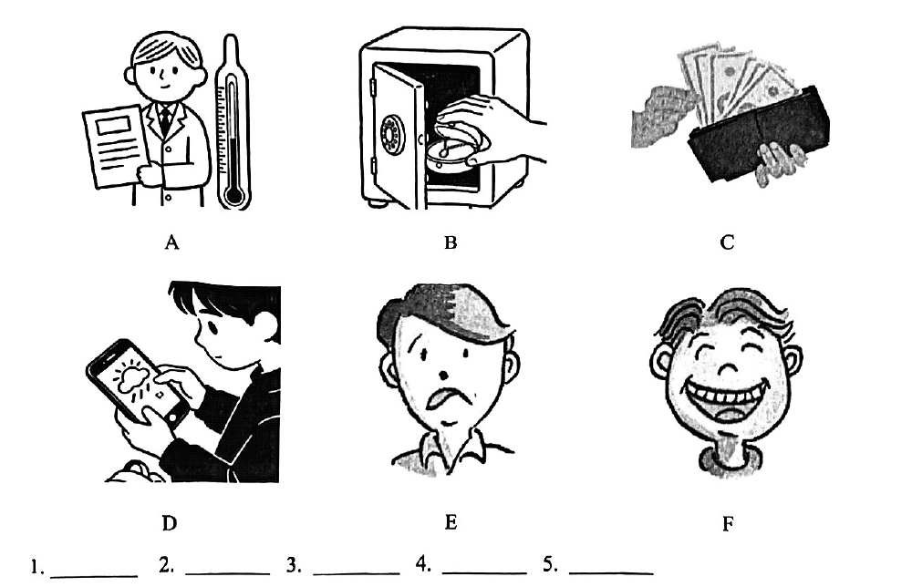

# 2026 一模精讲 · 杨浦英语（上）：听力 + 语法词汇（第 1–43 题）

> 杨浦卷结构：Part 1 Listening（听力）25 分（1–20）+ Part 2 Vocabulary and Grammar（词汇和语法）45 分（21–58）+ Part 3 Reading and Writing（读写）70 分（59–84），共 7 大题 84 小题 140 分。本篇覆盖第 1–43 题，第 44–84 题见 [[英模26-杨浦-下]]。
>
> ⚠️ **资料说明**：本卷为纯扫描版（无文字层，题干按 150dpi 页图辨认录入）。答案分两路来源：**听力 1–20 照录自随卷发布的两张"听力答案"图**（印刷体红字，A/B/C/D 四部分齐全——16 区中少有的听力答案来源，本区另有官方听力音频）；**语法与词汇 21–43 誊自卷面红笔手写批注版**，逐题辨认并与语法规则互证。作文批注版未附范文。

## Part 1 听力（第 1–20 题，共 25 分）

### A. Listen and choose the right picture（听句选图，第 1–5 题，5 分）

六选五，卷面六图为：

- A：男子手持报纸稿，旁立一支大温度计——"天气预报/播报"场景
- B：一只手往打开的保险箱里放圆盒——"存放贵重物品"场景
- C：一只手从黑色钱包里抽出扇形钞票——"取钱/付款"场景
- D：男子低头看手机，屏幕显示云朵图标——"查手机/天气 App"场景
- E：愁眉苦脸的男子头像——"难过/担忧"表情
- F：咧嘴大笑的头像——"开心"表情

**答案（照录听力答案图）**：1–5 **B F A C D**（1 保险箱、2 笑脸、3 温度计播报、4 钱包钞票、5 手机）

> 方法：听前用一词概括每图核心（a safe / a wallet / a phone / weather report / sad / happy），听到句子后抓"动词+名词"锁定图块，表情图抓情感词。

### B. Listen to the dialogue and choose the best answer to the question you hear（对话理解，第 6–10 题，5 分）

6. A) 钻戒（图）　B) 耳坠（图）　C) 手镯（图）　D) 项链（图）
7. A) At a store.  B) At a cinema.  C) At a hotel.  D) At a police office.
8. A) She missed the bus.  B) The bus didn't come on time.  C) The bus broke down.  D) She forgot to check the time.
9. A) Tired.  B) Worried.  C) Nervous.  D) Confused.
10. A) The man is very poor.  B) The sunglasses are expensive.  C) The price is unfair.  D) The boy should pay at once.

**答案（照录听力答案图）**：6–10 **D D B A C**（6 选"项链"，7 选"At a police office"）

> 考点预判：6 题听前分辨四件首饰（ring / earrings / bracelet / necklace）；7 题抓地点标志词；8 题注意"车没准时来"（B）与"没赶上/抛锚/忘看时间"的区别；10 题抓对价格的评判形容词。

### C. Listen to the passage and tell whether the following statements are true or false（短文判断，第 11–15 题，5 分）

11. Sarah, a talented violinist, had a terrible car accident on a winter evening.
12. Sarah forgot everything but could remember her husband, Mark.
13. Sarah's husband visited her every day and played her concert videos.
14. After months of practice, Sarah could finally remember her music.
15. With her love for music and her husband's support, Sarah got back her lost memories.

**答案（照录听力答案图）**：11–15 **T F T F F**

> 短文主旨可从判断句反推：小提琴手 Sarah 遭遇车祸失忆，丈夫 Mark 每天探望、给她播放音乐会录像，用爱与音乐帮她走出创伤。12/14/15 三句为 F，说明"她记得丈夫""练习数月后记起乐曲""最终找回全部失去的记忆"等说法与原文有出入——判断题最爱偷换的正是这类**范围词与结局细节**。

### D. Listen to the dialogue and complete the following sentences（听对话填空，第 16–20 题，10 分，每空限填一词）

16. The boy in the story is born with special powers and people are ______ ______ him. → **afraid of**
17. The background designs were inspired by old Chinese ______ ______. → **ink paintings**
18. Sometimes ______ ______ of animation took several days to finish. → **one second**
19. The hardest part for the director was ______ ______. → **making decisions**
20. Animation can help people think about courage, choice and ______ ______. → **being themselves**

> 对话围绕一部国产动画电影展开：天生特殊能力的男孩遭人惧怕、水墨画风格背景、"一秒动画做好几天"的制作细节、导演最难的是做决定、动画引导观众思考勇气与选择。
> ⚠️ 待核对：16 题答案图原文写 "are afraid of"（3 词），但卷面空格前已印 are、仅留两空，按题干实填 **afraid of**；17–20 与卷面两空逐一吻合。

## Part 2 语法和词汇（第 21–43 题）

### II. Choose the best answer（语法单项选择，第 21–35 题，各 1 分，共 15 分）

**21.** This comic tells a story about ______ escape from a strange world.
A) a  B) an  C) the  D) /

**答案 B**。escape /ɪˈskeɪp/ 以元音音素开头 → an escape（泛指"一次逃脱"）。

**22.** His parents were allowed to visit ______ in prison once a month.
A) he  B) him  C) his  D) himself

**答案 B**。visit 为及物动词，"探望他"用宾格 him。

**23.** Since the new rules were introduced, many complaints ______.
A) is made  B) was made  C) have been made  D) will be made

**答案 C**。Since + 过去时间从句 → 主句现在完成时；complaints 与 make 为被动关系且复数 → have been made。

**24.** The story is mainly told ______ pictures, so young readers can understand it clearly.
A) in  B) at  C) on  D) by

**答案 A**。in + 材料/方式："用图画讲故事" tell a story in pictures。

**25.** I've read one comic strip. I'll read ______ one before class.
A) other  B) the other  C) another  D) others

**答案 C**。泛指"再一本、又一单行本"用 another（不限定范围内另一个）。

**26.** *Zootopia 2* set the record for ______ global opening weekend of any animated movie ever.
A) large  B) larger  C) largest  D) the largest

**答案 D**。"有史以来……之最" → the + 最高级；of any animated movie ever 提示比较范围。

**27.** The speaker sounded ______ when explaining the result.
A) please  B) pleased  C) pleasure  D) pleasantly

**答案 B**。sound 为系动词 + 形容词作表语；说明人"感到满意"用 -ed 形容词 pleased。

**28.** The boy bumped into a young man when he ______ around the corner.
A) walked  B) was walking  C) is walking  D) walks

**答案 B**。"撞上"发生在"正走过拐角"的过程中 → 过去进行时 was walking。

**29.** – ______ will the police arrive after the call?  – In about ten minutes.
A) How long  B) Why  C) How soon  D) When

**答案 C**。答语 "In + 时间段" 表"多久之后" → how soon；how long 问时长。

**30.** The school expects students ______ well during exams.
A) behave  B) behaved  C) behaving  D) to behave

**答案 D**。expect sb to do sth 固定结构。

**31.** A group of students are busy ______ the posters for the school play.
A) design  B) designed  C) to design  D) designing

**答案 D**。be busy (in) doing sth 固定接动名词。

**32.** He can memorize more than 15,000 telephone numbers. ______ amazing memory he has!
A) What an  B) What a  C) What  D) How

**答案 A**。感叹句中心词是可数单数名词 memory，amazing 以元音音素开头 → What an + adj. + n.。

**33.** I tried hard to remember the password, but I could think of ______.
A) something  B) anything  C) nothing  D) everything

**答案 C**。but 表转折："怎么也想不起来" → think of nothing。

**34.** The shop will stay closed ______ someone fixes the door before noon.
A) although  B) so that  C) because  D) unless

**答案 D**。"一直关着，除非有人中午前修好门" → unless 条件状语从句。

**35.** There were no marks on the wall. The thief ______ have entered through the door.
A) must  B) need  C) can  D) should

**答案 A**。墙上没有痕迹 → 推测"一定是从门进来的"，must have done 表对过去的肯定推测。
> ⚠️ 待核对：此题手写迹形态介于 A 与 D 之间（带峰顶、近 A 的写法），按语义（无翻窗痕迹 → must have entered）锁定 A) must。

### III. Complete the following passage with the words or phrases in the box（选词填空，第 36–43 题，各 1 分，共 8 分；每词限用一次，两框各 5 选 4）

**首框 (A)**：A. interested  B. interesting  C. repeats  D. as well as  E. goes wrong
主题：四个提升记忆力的小游戏

**36.** Each person has to say all the other items ______ their own new one. → **D) as well as**（"除了自己的新物品，还要复述其他人所有的物品"，as well as 并列）

**37.** To keep things ______, decide on a topic for the objects. → **B) interesting**（keep + 宾语 + 形容词，"保持有趣"；-ing 修饰物）

**38.** The next person ______ the sentence and adds to it. → **C) repeats**（"下一个人复述句子再往里加内容"；主语三单 +s）

**39.** The chain continues until everyone has had a turn or something ______. → **E) goes wrong**（"直到人人轮过或有人出错"；something 后谓语三单）

**次框 (B)**：A. placed  B. goal  C. method  D. detailed  E. exactly
主题：Memory Map 与 Matching Pairs 两款游戏

**40.** Show students a ______ map (such as a labeled neighborhood or state with cities marked). → **D) detailed**（"一张标注详细的地图"，形容词修饰名词）

**41.** The ______ is to fill in as much information as possible. → **B) goal**（"目标是尽量多填出信息"；The goal is to do）

**42.** Cards are ______ face down on the table. → **A) placed**（"牌被面朝下放置"，主谓被动 → 过去分词）

**43.** Players must find two matching cards (same type, same number, or ______ the same card). → **E) exactly**（"或完全相同的一张"，副词修饰 the same）

> 小结：本篇选词填空先判词性——37/40 空需形容词（keep things… / a…map），42 空主谓被动用过去分词，43 空修饰 the same 用副词；再靠上下文搭配锁定（36 的 items 并列、41 的 is to do、39 的 until 条件）。

---
*本篇题干按 150dpi 页图辨认录入（本卷无文字层）；听力 1–20 答案照录自随卷发布的"听力答案"图（印刷体），21–43 答案誊自卷面红笔手写批注版并逐题与语法规则互证；35 题手写迹存疑、16 题答案图与卷面空格有一词出入，均已如实标注。*
