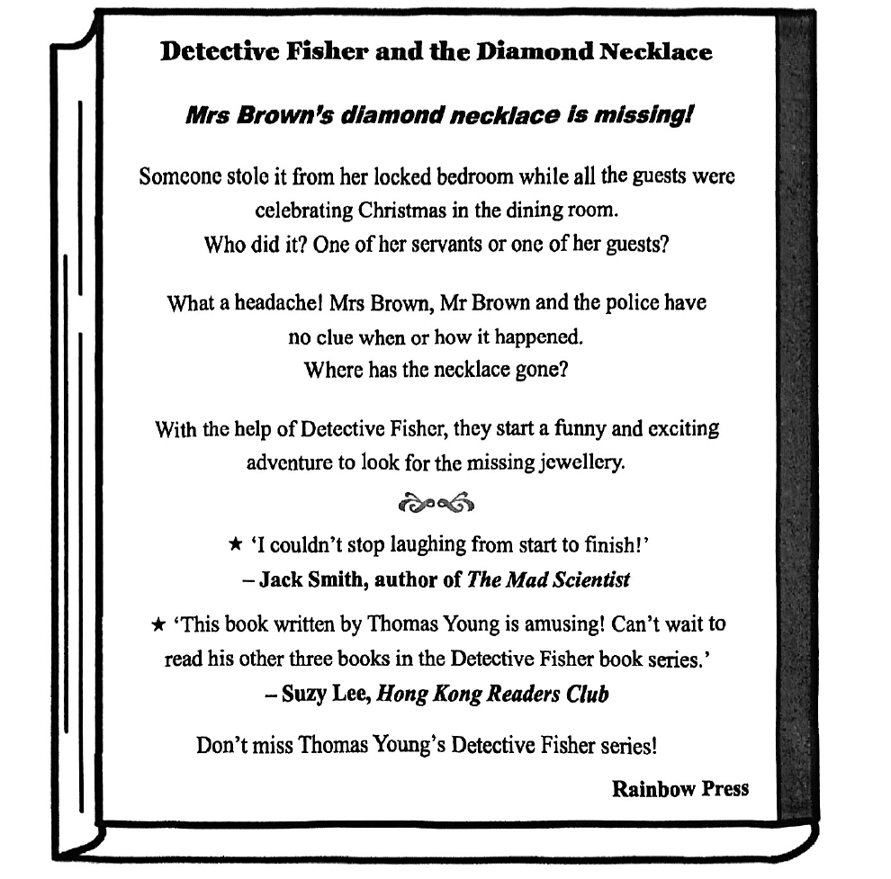
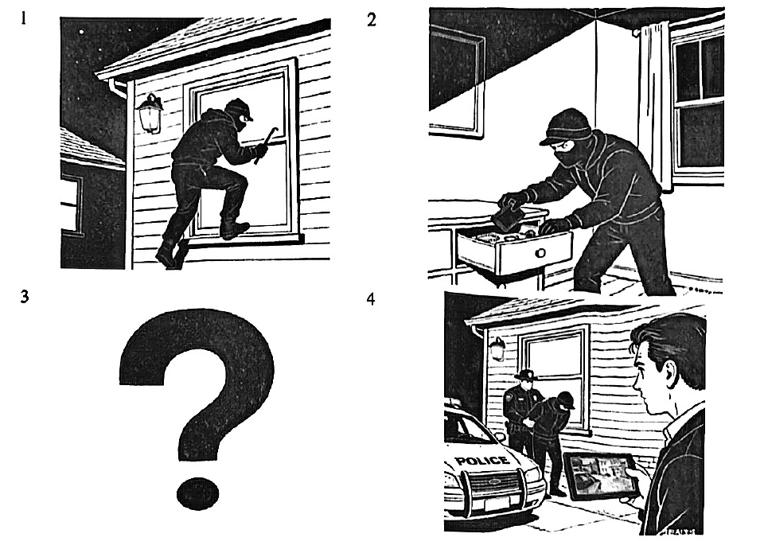

# 2026 一模精讲 · 杨浦英语（下）：词句转换 + 读写（第 44–84 题）

> 本篇覆盖第 44–84 题（词形转换、句型转换、阅读四篇、作文），第 1–43 题见 [[英模26-杨浦-上]]。答案来源与校正方式同上篇：44–83 誊自卷面红笔手写批注版并逐题与语言规则互证；84 作文批注版未附范文，参考范文由编者按评分要点补写。

## IV. Complete the sentences with the given words in their proper forms（词形转换，第 44–51 题，各 1 分，共 8 分）

**44.** We were ＿＿＿＿＿＿＿＿ that our cat came home safely after being missing for two days. (luck)

> [!tip]- 💡 思路导航
> be 动词后作表语用形容词——luck 的形容词形式。

> [!success]- ✅ 详解 · 评分点 · 易错 · 关联
> **答案 lucky**（be 动词后作表语用形容词；luck → lucky）

**45.** My dog is well-trained, but ＿＿＿＿＿＿＿＿ is still learning basic commands. (she)

> [!tip]- 💡 思路导航
> "她的（狗）"单独作主语——该用形容词性还是名词性物主代词？

> [!success]- ✅ 详解 · 评分点 · 易错 · 关联
> **答案 hers**（"她的（狗）"单独作主语 → 名词性物主代词 hers）

**46.** If you see something strange, ＿＿＿＿＿＿＿＿ at once and call the police. (action)

> [!tip]- 💡 思路导航
> 祈使句缺谓语动词——action 变动词，与 call 并列。

> [!success]- ✅ 详解 · 评分点 · 易错 · 关联
> **答案 act**（祈使句缺谓语动词；action → act，与 call 并列）

**47.** The ＿＿＿＿＿＿＿＿ articles in the school newspaper are all about memory. (fifth)

> [!tip]- 💡 思路导航
> 后接复数名词 articles 且没有"第几"的语境——该用序数词还是基数词？

> [!success]- ✅ 详解 · 评分点 · 易错 · 关联
> **答案 five**（后接复数名词 articles 且无"第几"语境 → 基数词 five；fifth → five）

**48.** The detective took the case ＿＿＿＿＿＿＿＿ and began investigating immediately. (serious)

> [!tip]- 💡 思路导航
> 修饰动词短语 took the case"认真对待"——用形容词还是副词？

> [!success]- ✅ 详解 · 评分点 · 易错 · 关联
> **答案 seriously**（修饰动词短语 took the case "认真对待" 用副词）

**49.** Many people consider the internet to be one of the ＿＿＿＿＿＿＿＿ of modern technology. (wonder)

> [!tip]- 💡 思路导航
> one of the + 复数名词——wonder 的复数形式。

> [!success]- ✅ 详解 · 评分点 · 易错 · 关联
> **答案 wonders**（one of the + 复数名词"……之一"）

**50.** The door and the windows were locked. It was ＿＿＿＿＿＿＿＿ for the thief to escape. (possible)

> [!tip]- 💡 思路导航
> 门窗全锁——小偷逃走是"可能"还是"不可能"？想想否定前缀。

> [!success]- ✅ 详解 · 评分点 · 易错 · 关联
> **答案 impossible**（门窗全锁 → 小偷"不可能"逃走；possible 加否定前缀 im-）
>
> **易错**：本题考否定前缀，8 题中最易错。

**51.** Old photos bring back memories of ＿＿＿＿＿＿＿＿ and happiness. (free)

> [!tip]- 💡 思路导航
> 介词 of 后与名词 happiness 并列——free 的名词形式。

> [!success]- ✅ 详解 · 评分点 · 易错 · 关联
> **答案 freedom**（介词 of 后与名词 happiness 并列；free → freedom 名词）

## V. Rewrite the following sentences as required（句型转换，第 52–58 题，共 14 分；52–57 每空限填一词）

**52.** The 29th Olympic Games were held in Beijing in 2008.（改为一般疑问句）

> [!tip]- 💡 思路导航
> were 提至句首构成一般疑问句；被动语态里的 held 动不动？

> [!success]- ✅ 详解 · 评分点 · 易错 · 关联
> **答案**：**Were** the 29th Olympic Games **held** in Beijing in 2008?（were 提至句首；被动语态 held 不变）

**53.** We left some frames without borders <u>for variety</u>.（对划线部分提问）

> [!tip]- 💡 思路导航
> 划线 for variety 表目的缘由——用哪个疑问词？left 是过去式，要借哪个助动词？

> [!success]- ✅ 详解 · 评分点 · 易错 · 关联
> **答案**：**Why did** you leave some frames without borders?（划线 for variety 表目的缘由 → why，借 did，left 还原）

**54.** He hasn't decided when he will start the project.（保持句意基本不变）

> [!tip]- 💡 思路导航
> 宾语从句主语与主句一致——可压成"疑问词 + 不定式"。

> [!success]- ✅ 详解 · 评分点 · 易错 · 关联
> **答案**：He hasn't decided **when to** start the project.（宾语从句主语与主句一致 → 疑问词 + 不定式）

**55.** "Is this your bag?" the policeman asked me.（改为间接引语）

> [!tip]- 💡 思路导航
> 一般疑问句变间接引语：引导词、this→that、your→my、时态后移，四处都要动。

> [!success]- ✅ 详解 · 评分点 · 易错 · 关联
> **答案**：The policeman asked me **if/whether** that was **my** bag.（一般疑问句 → if/whether 引导；this→that、your→my，is→was 时态后移）
>
> **易错**：⚠️ 批注版在限填一词的空内把 if 与 whether 并写（if/whether 皆可）；考试时填一个即可。

**56.** The animator gave some advice to the young comic artists.（改为被动语态）

> [!tip]- 💡 思路导航
> advice 不可数——被动句的 be 动词用哪个？一般过去时被动。

> [!success]- ✅ 详解 · 评分点 · 易错 · 关联
> **答案**：Some advice **was given** to the young comic artists.（advice 不可数 → was；一般过去时被动 was given）

**57.** Add clear pictures, and readers will understand the story easily.（保持句意基本不变）

> [!tip]- 💡 思路导航
> "祈使句 + and" = if 引导的条件肯定句。

> [!success]- ✅ 详解 · 评分点 · 易错 · 关联
> **答案**：**If** you **add** clear pictures, readers will understand the story easily.（"祈使句 + and" = if 条件肯定句）

**58.** the test, have forgotten, on, I, which day, is（连词成句）

> [!tip]- 💡 思路导航
> 宾语从句用陈述语序——介词 on 放在从句的哪个位置？

> [!success]- ✅ 详解 · 评分点 · 易错 · 关联
> **答案**：**I have forgotten which day the test is on.**（宾语从句 which day the test is on 用陈述语序；介词 on 留在从句末尾，"test is on" 指考试进行/举行）

## VI. Reading Comprehension（阅读理解，第 59–83 题，共 50 分）

### A. Choose the best answer（阅读选择：书籍封底海报题，第 59–64 题，各 2 分，共 12 分）

文章为**应用文（图书封底）**：Thomas Young 所著侦探小说 *Detective Fisher and the Diamond Necklace* 的封底——布朗太太的钻石项链在圣诞宴席间于反锁的卧室失窃，Fisher 侦探带众人展开一场滑稽又刺激的寻宝冒险；下方附两条书评与出版社推荐语。

**59.** Who is the author of the book?

> [!tip]- 💡 思路导航
> 定位书评二——作者名写在哪个短语里？别把另一本书的作者或出版社当成答案。

> [!success]- ✅ 详解 · 评分点 · 易错 · 关联
> **答案 D) Thomas Young**（定位书评二 "This book written by Thomas Young is amusing"；Jack Smith 是另一本书 The Mad Scientist 的作者，Rainbow Press 是出版社）

**60.** Where was the necklace stolen from?

> [!tip]- 💡 思路导航
> 定位首段——项链是从哪个房间失窃的？宴席所在的房间只是庆祝地点。

> [!success]- ✅ 详解 · 评分点 · 易错 · 关联
> **答案 B) A bedroom**（定位首段 "stole it from her locked bedroom"；dining room 只是宾客庆祝的地点）

**61.** How do the police feel at first?

> [!tip]- 💡 思路导航
> 定位"What a headache! …have no clue"——毫无头绪的心情是哪两种？

> [!success]- ✅ 详解 · 评分点 · 易错 · 关联
> **答案 A) Worried and confused**（定位 "What a headache! …have no clue when or how it happened"——毫无头绪即担忧又困惑）

**62.** How many books are there in the Detective Fisher book series so far?

> [!tip]- 💡 思路导航
> 书评二"读过他的另外三本"——再加上手中这本共几本？

> [!success]- ✅ 详解 · 评分点 · 易错 · 关联
> **答案 C) Four**（书评二 "read his other three books" + 本身 1 本 = 4 本）

**63.** Who might be the thief?

> [!tip]- 💡 思路导航
> 封底把嫌疑人锁定在仆人与宾客之间——逐个排除失主夫妇和侦探本人。

> [!success]- ✅ 详解 · 评分点 · 易错 · 关联
> **答案 D) A servant**（封底把嫌疑人锁定在 "One of her servants or one of her guests?"——选项中只有 A servant 在此嫌疑名单内；Mr/Mrs Brown 是失主夫妇，Mr Fisher 是侦探本人）

**64.** What is not included in the back cover?

> [!tip]- 💡 思路导航
> 封底有书评、悬念设问、人物与场景介绍——书商绝不会剧透什么？

> [!success]- ✅ 详解 · 评分点 · 易错 · 关联
> **答案 C) An exciting finish of the story**（封底有书评（A）、悬念设问（B）、人物与场景介绍（D）；故事结局绝不会写在封底）

### B. Choose the words to complete the passage（完形选择：Memrise 学语言 App，第 65–70 题，各 2 分，共 12 分）

文章脉络：作者下月赴中非旅行，要用 App 学当地语言林加拉语（Lingala）——起初担心没时间，后发现 Memrise 可嵌入日常碎片时间；App 把新词比作"温室里的种子"，练习即"浇水"、记牢即移入"花园"并积分升级，忘了登录就发消息提醒；两大学习原理：图片联想（mems）与间隔重复。

**65.** ______, I was worried because I am busy and don't have much free time.

> [!tip]- 💡 思路导航
> 与下文 Then I found… 呼应的时间线——句首衔接语选哪个？

> [!success]- ✅ 详解 · 评分点 · 易错 · 关联
> **答案 B) At first**（"起初我担心……"，与下文 Then I found… 时间线呼应）

**66.** To be honest, when I get a ______ moment at home, I usually check messages…

> [!tip]- 💡 思路导航
> a ____ moment"碎片空闲时间"——busy 与语境矛盾，rare 不表"空闲"。

> [!success]- ✅ 详解 · 评分点 · 易错 · 关联
> **答案 B) spare**（a spare moment"碎片空闲时间"；busy 与语境矛盾，rare 不表"空闲"）

**67.** It gives you new words to learn. These are "______" in your "greenhouse".

> [!tip]- 💡 思路导航
> 下文"浇水，它们就会生长"——温室里被浇灌的是"种子"。

> [!success]- ✅ 详解 · 评分点 · 易错 · 关联
> **答案 C) seeds**（下文 "water your plants" and they grow 解释了新词是被浇灌的"种子"）

**68.** …the app sends messages or emails to ______ me to "water my plants".

> [!tip]- 💡 思路导航
> ____ sb to do"提醒某人做某事"——order/force 语气过强。

> [!success]- ✅ 详解 · 评分点 · 易错 · 关联
> **答案 C) remind**（remind sb to do"提醒我做某事"；order/force 语气过强，guide 不接 to do 此义）

**69.** I memorised motele, the Lingala word for "engine", by ______ an old engine in a motel room.

> [!tip]- 💡 思路导航
> mems 是图片联想——by + 动名词，靠"画"出发动机来记词。

> [!success]- ✅ 详解 · 评分点 · 易错 · 关联
> **答案 A) drawing**（mems 是图片 → 靠"画"出发动机来记词；by + 动名词）

**70.** This won't make me ______, but I hope I will do more than just smile and look confused…

> [!tip]- 💡 思路导航
> but 后"不止微笑和困惑"——几百个词还谈不上语言的什么程度？

> [!success]- ✅ 详解 · 评分点 · 易错 · 关联
> **答案 A) fluent**（"几百个词还不至于让我流利"，but 后"不止微笑和困惑"正反呼应流利度）

### C. Read the passage and fill in the blanks with proper words（首字母填空：LABUBU 玩偶走红，第 71–77 题，各 2 分，共 14 分）

文章脉络：全球疯抢的 LABUBU——大眼长耳宽笑却长着尖牙的"怪萌"玩偶 → 香港艺术家 Kasing Lung 2015 年在绘本中创造、数年后与玩具公司合作实体化 → 盲盒玩法开出"惊喜" → 2024 年 BLACKPINK 的 LISA 晒图带火 → 如今成为个人风格的彰显。

**71.** …her sharp teeth make her special and d＿＿＿＿＿＿＿ from other toys.

> [!tip]- 💡 思路导航
> be ____ from 固定搭配——尖牙使她"不同于"其他玩具。

> [!success]- ✅ 详解 · 评分点 · 易错 · 关联
> **答案 different**（be different from 固定搭配；尖牙使她"不同于"其他玩具）

**72.** LABUBU was c＿＿＿＿＿＿＿ by Kasing Lung, an artist from Hong Kong.

> [!tip]- 💡 思路导航
> was ____ by 被动语态——"由艺术家创作"。

> [!success]- ✅ 详解 · 评分点 · 易错 · 关联
> **答案 created**（was created by 被动语态"由……创作"；by 后接创作者）

**73.** One interesting thing about LABUBU is the way people b＿＿＿＿＿＿＿ it.

> [!tip]- 💡 思路导航
> 下文盲盒购买场景锁定这个动词——人们怎么"获得"它？

> [!success]- ✅ 详解 · 评分点 · 易错 · 关联
> **答案 buy**（下文盲盒购买场景锁定"购买方式"；the way people buy it）

**74.** …opening the box feels like a s＿＿＿＿＿＿＿.

> [!tip]- 💡 思路导航
> "开出才知道"的盲盒——a 后接单数名词"惊喜"。

> [!success]- ✅ 详解 · 评分点 · 易错 · 关联
> **答案 surprise**（"开出才知道"的盲盒 = a surprise 惊喜；a 后接单数名词）

**75.** …famous people started sharing photos o＿＿＿＿＿＿＿.

> [!tip]- 💡 思路导航
> share photos ____"网上晒图"——下文 LISA 发图为证。

> [!success]- ✅ 详解 · 评分点 · 易错 · 关联
> **答案 online**（share photos online"网上晒图"；下文 LISA 发图为证）

**76.** Many people h＿＿＿＿＿＿＿ it on their bags, put it on their desks…

> [!tip]- 💡 思路导航
> 与 put / use 并列的动词——"挂在包上"。

> [!success]- ✅ 详解 · 评分点 · 易错 · 关联
> **答案 hang**（hang it on their bags"挂在包上"，与 put / use 并列动词）

**77.** …it is a way to show their p＿＿＿＿＿＿＿ style.

> [!tip]- 💡 思路导航
> their…style 之间需形容词——"个人风格"。

> [!success]- ✅ 详解 · 评分点 · 易错 · 关联
> **答案 personal**（personal style"个人风格"；their…style 间需形容词）

### D. Answer the questions（回答问题：Amy 的"整理术"求助帖，第 78–83 题，共 12 分）

文章脉络：学生 Amy 在论坛发帖，自嘲不擅长整理、羡慕从不迟交作业的同学，并分享自己开始写"学习小日记"的做法，征求大家的整理妙招；Hana（睡前 5 分钟把书本文件归位、清理无用杂物）、Gloria（学完即复习、周中少量多次，不拖到考前）、Lou（房间大记事板分科记录作业与截止日期，最爱"划掉已完成"）先后回帖，Amy 一一回应致谢。

**78.** Was Lou the first to reply to the post?

> [!tip]- 💡 思路导航
> 一般疑问句先答 Yes/No——比较 Hana 与 Lou 回帖的时间先后。

> [!success]- ✅ 详解 · 评分点 · 易错 · 关联
> **答案**：**No.**（Hana 在 1 小时前已回帖，Lou 25 分钟前才回——一般疑问句先答 Yes/No）

**79.** What does Hana do at the end of each day?

> [!tip]- 💡 思路导航
> 定位 Hana 首帖——spend…doing 后面接了三个并列动作。

> [!success]- ✅ 详解 · 评分点 · 易错 · 关联
> **答案**：**She spends about five minutes tidying up her school things, putting books and papers into the right folders and throwing away unnecessary things.**（定位 Hana 首帖；spend…doing 三个并列动作）

**80.** According to Gloria, when should students review their notes?

> [!tip]- 💡 思路导航
> Gloria 的复习节奏分两处：每课后 + 周中什么时候？

> [!success]- ✅ 详解 · 评分点 · 易错 · 关联
> **答案**：**After each lesson and during the week.**（Gloria：每课后看一遍笔记 + 周中做少量复习）

**81.** How does Lou feel when he crosses things off after finishing his homework?

> [!tip]- 💡 思路导航
> "划掉已完成事项"的心情——批注给出三种表述任一皆可。

> [!success]- ✅ 详解 · 评分点 · 易错 · 关联
> **答案**：**He feels good/happy/satisfied.**（批注给出三种表述任一皆可）

**82.** What does Amy mean by saying she is "not organised"?

> [!tip]- 💡 思路导航
> 呼应首帖两句——"迟交作业"与"安排任务"各说明什么？

> [!success]- ✅ 详解 · 评分点 · 易错 · 关联
> **答案**：**She often forgets to hand in homework on time and can't arrange her tasks well.**（呼应首帖 admired students who hand in their homework on time 与 not very good at getting myself organised）

**83.** What is one new tip you can offer Amy? Write a reply to her in no more than 30 words.

> [!tip]- 💡 思路导航
> 开放题（≤30 词）：给分点看建议是否具体可操作、语法正确、不超词数。

> [!success]- ✅ 详解 · 评分点 · 易错 · 关联
> **答案**：开放题（≤30 词），批注版示例：**Hi Amy! You can use color pens to mark important deadlines in your study diary. It helps you notice them easily.**（给分点：建议具体可操作 + 语法正确 + 不超词数）

## VII. Writing（作文，第 84 题，共 20 分）

**题目**：根据四幅图写一个故事，不少于 60 词。图 1：深夜，蒙面小偷持撬棍爬上窗台撬窗；图 2：入室翻抽屉偷窃财物；图 3：**空缺**，需根据上下文合理想象，使故事情节与最后一幅图相衔接；图 4：警车到场，警察在屋外擒获小偷，房主手持平板电脑向警察展示画面。
（注意：短文中不得出现真实姓名、校名等个人信息，否则不予评分；照抄阅读语篇不得分。）

**审题三步**：① 文体 = 看图记叙文，时态以一般过去时为主，人称视角（房主或小偷）前后统一；② 核心缺口 = 图 3，必须补出"警察为什么会来"的合理环节（如：智能摄像头向房主的平板发送警报 → 查看实时画面确认 → 立即报警），做到承上图 2（贼正行窃）、接下图 4（警察抓人、房主出示平板录像）；③ 结尾落在图 4 抓捕现场，点一句"科技守护家园"即升华。

**参考范文（约 105 词，批注版未附范文，编者按评分要点补写）**：

> [!example]- ✍️ 参考范文（点击展开）
> > Late at night, a masked thief climbed up to a window and forced it open with a crowbar. He sneaked into the house and was busily stealing money and jewellery from the drawers.
> >
> > Suddenly, the owner's tablet beeped — the smart home camera had sent him an alarm. He opened the video and saw the thief moving inside. Without hesitation, he called the police and described what was happening.
> >
> > Minutes later, two police officers arrived and caught the thief just outside the window. The owner showed them the video on his tablet, and the thief had nothing to say. Thanks to the smart camera, the family got everything back safely.

**评分要点**：情节完整、图 3 想象合理且与图 4 衔接（8 分）｜时态、语法与用词准确（6 分）｜衔接与流畅（3 分）｜词数与书写规范（3 分）。忌照抄阅读语篇、忌出现真实姓名校名。

---
*本篇题干按 150dpi 页图辨认录入（本卷无文字层）；44–83 答案誊自卷面红笔手写批注版并逐题与语言规则互证；55 题批注一空并写 if/whether、84 批注未附范文（范文为编者补写），均已如实标注。*
