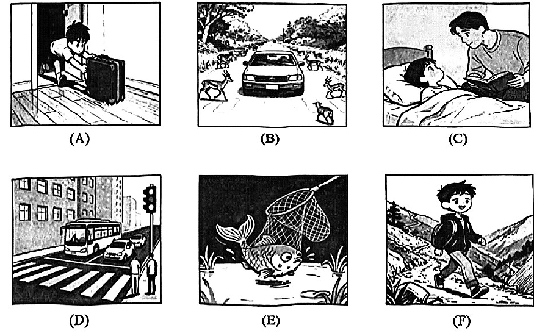

# 2026 一模精讲 · 松江英语（上）：听力 + 语法词汇（第 1–43 题）

> 松江卷结构：Part 1 听力 25 分（1–20）+ Part 2 语法词汇 45 分（21–58）+ Part 3 读写 70 分（59–84），共 84 小题 140 分。本篇覆盖第 1–43 题，第 44–84 题见 [[英模26-松江-下]]。
>
> ⚠️ **资料说明**：本卷为纯扫描版（无文字层，题干自 150dpi 页图逐题录入并校正）。**答案来源为卷面红笔手写批注版**（非官方排版答案），已逐题辨认誊录；听力部分（1–20）批注版未作答，本区虽有听力音频原件但无配套答案文本，故听力只给卷面与方法，不给答案。

## Part 1 听力（第 1–20 题，共 25 分）

### A. Listen and choose the right picture（听句选图，第 1–5 题，5 分）

六选五，卷面六图为：

- A：男子蹲在打开的行李箱旁整理衣物——"收拾行李/装箱"场景
- B：汽车行驶在乡间路上，路两侧草丛中有多只鹿跳出——"驾车遇动物横穿"场景
- C：爸爸坐在床边，给盖被躺着的孩子读书——"亲子阅读/讲故事"场景
- D：公交车驶过城市路口的斑马线，旁有红绿灯与行人——"乘公交/过马路"场景
- E：一条大鱼被渔网提出水面、水花四溅——"捕鱼"场景
- F：男孩背着背包在山路上徒步——"远足/爬山"场景

> ⚠️ 卷面批注版**未给出 1–5 题答案**，本区听力音频虽有原件但无配套答案，此处不臆测。做题方法：听前先读图、用一句话概括每图核心动作（pack luggage / drive past deer / read a story / take a bus / catch a fish / hike），听到句子后抓"动词+名词"匹配。

### B. Listen to the dialogue and choose the best answer to the question you hear（对话理解，第 6–10 题，5 分）

6. A) By bike.  B) By bus.  C) On foot.  D) By car.（问出行方式）
7. A) Go to a department store.  B) Do homework.  C) Help Grandpa shop online.  D) Help Grandpa with housework.（问计划/做法）
8. A) To live near his office.  B) To find a new job.  C) To breathe the fresh air.  D) To live a busy life.（问目的）
9. A) In a library.  B) In a restaurant.  C) In a clothes shop.  D) In a meeting room.（问地点）
10. A) The notebook is nowhere to be found.  B) He doesn't know where Jane's mother is.  C) He will probably help Jane look for her notebook.  D) The mother probably knows where the notebook is.（问推断）

> ⚠️ 同上，无批注答案。考点预判：6 题抓交通工具原词与替换（on foot = walk）；8 题抓表目的的 to do / because 句；10 题注意 but 之后的让步或主动提议（Will/Could I help…）才是推断依据。

### C. Listen to the dialogue and tell whether the following statements are true or false（听对话判断，第 11–15 题，5 分）

11. Miller and Bob were childhood friends.
12. Miller met Bob in the coffee shop twenty years ago.
13. Miller recognized Bob as the thief through the gold watch.
14. Miller managed to help the police arrest Bob.
15. Miller felt sorry because he didn't catch Bob earlier.

> 主旨可从判断句反推：Miller 在咖啡店偶遇多年未见的旧识 Bob，凭金表认出他就是当年的窃贼，最终协助警方将其抓捕，并为未能早些揭穿而感慨。⚠️ 批注版未给 T/F 答案。方法：判断句最常在**时间（twelve/twenty）、地点、手段（gold watch）**上偷换原文，逐词比对再判 T/F。

### D. Listen to the passage and complete the following sentences（听短文填空，第 16–20 题，10 分）

16. John bought comfortable sports clothes and nice ______ ______ for the city marathon race.
17. John wanted to ______ ______ halfway through the race.
18. To John's surprise, a barefoot(赤脚的) man running ahead of him still ______ ______.
19. Encouraged by the man, John went all out and got ______ ______.
20. John realized the key to success is to ______ ______ and find joy in the process.

> ⚠️ 批注版未给答案。本卷 D 篇**每句连填两空、每空格限填一词**（答案均为两词短语），短文讲 John 参加城市马拉松、被一位赤脚跑者激励坚持到底的故事。方法：先判空格词性（16 题 nice ___ ___ 为名词短语、17 题 to ___ ___ 为动词短语），听时抓固定搭配（如 give up / keep running / a prize / never give up）。

## Part 2 语法和词汇（第 21–43 题）

### II. Choose the best answer（语法单项选择，第 21–35 题，各 1 分，共 15 分）

**21.** Jane does exercise every morning before going to ______ work.
A) the  B) a  C) an  D) /

**答案 D**。go to work 固定搭配，零冠词。

**22.** With limited equipment, the scientists tried ______ best to complete the experiment.
A) them  B) their  C) theirs  D) themselves

**答案 B**。try one's best to do 固定搭配，用形容词性物主代词 their。

**23.** Tourists can enjoy different night views on ______ side of the Huangpu River.
A) either  B) neither  C) both  D) all

**答案 A**。side 为单数 → either side（任一边）；both 须接复数 sides。

**24.** We ______ perform a fire safety check every month according to the safety rules.
A) can  B) must  C) may  D) ought

**答案 B**。"根据安全规则每月必须"→ must；ought 后须接 to，此处无 to。

**25.** *Uranus*(天王星) is the second ______ planet from the Sun in our solar system.
A) far  B) farther  C) farthest  D) the farthest

**答案 C**。"the second + 最高级"（第二远的）；句首已有 the，D 项重复冠词。

**26.** Save money every month, ______ you'll be able to afford a ticket to the concert.
A) or  B) and  C) but  D) so

**答案 B**。"祈使句 + and + 将来句"= 那么就能……；or 表"否则"语义不通。

**27.** My parents still booked the flight tickets for our winter holiday ______ the prices were high.
A) if  B) until  C) because  D) although

**答案 D**。still（仍然）与"票价高"构成让步 → although。

**28.** The old man felt ______ after his wife died last year.
A) sadly  B) lonely  C) angrily  D) faithfully

**答案 B**。felt 为系动词，接形容词 lonely（孤独的）作表语；其余为副词。

**29.** The heavy rain made most of the mountain climbers ______ halfway.
A) stop  B) to stop  C) stopping  D) stopped

**答案 A**。make sb do sth，省 to 不定式作宾补。

**30.** Mr Li ______ to the South Pole if he finds experienced explorers to go with him.
A) travels  B) travelled  C) will travel  D) has travelled

**答案 C**。if 条件状语从句用一般现在时（finds），主句用一般将来时 will travel（主将从现）。

**31.** ______ dramatic progress China has achieved in high-tech industries over the past ten years!
A) How  B) How a  C) What  D) What a

**答案 C**。感叹核心是名词短语 dramatic progress（不可数）→ What + adj + 不可数名词。

**32.** — ______ has Labubu been popular among teenagers?
— Since a famous idol started carrying it.
A) How far  B) How long  C) How soon  D) How often

**答案 B**。答语 Since…（一段时间起点）→ 问持续多久用 how long。

**33.** AI-powered robots ______ in many Chinese hotels to serve customers back in 2021.
A) are used  B) were used  C) have been used  D) had been used

**答案 B**。back in 2021 为一般过去时标志 → 过去时被动 were used。

**34.** Mr Ma was so busy ______ our homework that he forgot to have his lunch.
A) check  B) checked  C) to check  D) checking

**答案 D**。be busy doing sth 固定搭配。

**35.** Your manager has never lost his temper, ______ he?
A) has  B) hasn't  C) did  D) didn't

**答案 A**。never 表否定 → 前否后肯；助动词沿用 has。

### III. Complete the following passage with the words or phrases in the box（选词填空，第 36–43 题，各 1 分，共 8 分；每空格限填一词，每词只能填一次，两框各 5 选 4）

**首框**：A) strong  B) link  C) extremely  D) equal  E) widely
主题：黑猫是厄运还是好运？（Are Black Cats Seen as Bad Luck or Good Luck?）

**36.** Many stories and old sayings help spread these ideas ______. → **E) widely**（副词修饰 spread；下文 widespread customs 原词复现）

**37.** It seems that the ______ between bad luck and black cats dates all the way back to the 13th century. → **B) link**（the link between…and…"两者间的联系"，名词搭配）

**38.** the belief was so ______ that the black cats were rounded up and killed during *the Black Death pandemic*(黑死病) around 1348 CE. → **A) strong**（so + 形容词 + that 结构；"信念如此根深蒂固"）

**39.** In many European countries where cats are still seen as bad luck, it's ______ unlucky if a black cat crosses your path from right to left. → **C) extremely**（副词修饰形容词 unlucky）

**次框**：A) straight  B) single  C) remains  D) considers  E) aboard

**40.** It seems that the influence of ancient Egyptians and their love for cats ______ in some European cultures. → **C) remains**（主语 the influence 为三单 → remains"留存"作谓语）

**41.** Some fishermen keep such cats ______, while women keep black cats at home for a double share of luck. → **E) aboard**（渔民"在船上"养猫，与下句 at home 对比）

**42.** Japanese culture also ______ black cats as symbols of good luck. → **D) considers**（consider…as…；Japanese culture 三单）

**43.** This is especially important for ______ women, as owning a black cat is believed to attract fine *suitors*(追求者). → **B) single**（single women 单身女性，与 attract suitors 语义呼应）

> 小结：两框各有一个余词未用（首框 D) equal、次框 A) straight）。选词填空先判词性（36/39 空用副词、37 冠词后用名词、38 so 后用形容词、40-42 空作谓语用三单动词），再靠上下文复现词（36 答案藏在末段 widespread）锁定。

---
*本篇题干经 150dpi 页图逐题录入并校正（本卷无文字层）；答案誊自卷面红笔批注版并逐题与语法规则互证。听力部分批注版未作答、亦无配套答案文本，已如实标注。*
