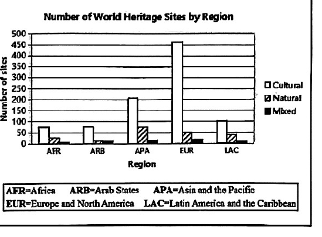
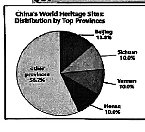
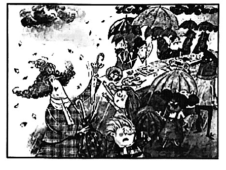

# 2026 一模精讲 · 松江英语（下）：词句转换 + 读写（第 44–84 题）

> 本篇覆盖第 44–84 题（词形转换、句型转换、阅读四篇、作文），第 1–43 题见 [[英模26-松江-上]]。答案来源与校正方式同上篇：卷面红笔手写批注版 + 页图互证。

## IV. Complete the sentences with the given words in their proper forms（词形转换，第 44–51 题，各 1 分，共 8 分；每空格限填一词）

**44.** Damon received a special gift on his ______ birthday. (five) → **fifth**
（"第五个生日"用序数词；five → fifth，去 ve 加 th）

**45.** Lucy introduced ______ before the welcome party. (she) → **herself**
（introduce oneself 自我介绍；主语 Lucy → 反身代词 herself）

**46.** The peace-keeping ______ from different countries work together in dangerous areas. (army) → **armies**
（谓语 work 为复数 → 主语用复数；army 以"辅音字母+y"结尾 → 变 y 为 i 加 es）

**47.** Please make sure the door is ______ locked before you go to bed. (secure) → **securely**
（修饰动词 locked 的过去分词用副词）

**48.** The National Museum offers ______ tickets to students every Monday. (freedom) → **free**
（free tickets 免费票；名词 freedom → 形容词作定语）

**49.** Can you ______ living on the Mars one day? (imagination) → **imagine**
（can 后接动词原形；imagine doing sth 固定接动名词）

**50.** It's important to eat a ______ of fruits and vegetables. (vary) → **variety**
（a variety of"各种各样的"固定搭配；a 后接单数名词）

**51.** As students spend more time in front of screens, their eyesight becomes ______. (bad) → **worse**
（看屏幕时间变多 → 视力"更差"，become + 比较级；bad → worse 不规则变化）

## V. Rewrite the following sentences as required（句型转换，第 52–58 题，共 14 分；每空格限填一词）

**52.** Tell John the truth when you see him.（改为否定句）
→ **Don't tell** John the truth when you see him.
（祈使句否定 = Don't + 动词原形）

**53.** The construction company will build a new bridge next year.（改为被动语态）
→ A new bridge will **be built** by the construction company next year.
（一般将来时被动 will be + 过去分词）

**54.** We can't start the meeting unless our class teacher is here.（保持句意基本不变）
→ We can't start the meeting **if** our class teacher **isn't** here.
（unless = if…not：班主任不在就不开会）

**55.** My sister asked me, "Can you water my plants while I'm away?"（改为间接引语）
→ My sister asked me **if/whether I could** water her plants while she was away.
（一般疑问句 → if/whether 引导；can 后移为 could）

**56.** David doesn't realize the danger of sharing personal information online.（保持句意基本不变）
→ David is **unaware of** the danger of sharing personal information online.
（be unaware of = not realize"没有意识到"；neg- 否定前缀是本题考点）

**57.** My puppy weighed about 1.5 kilograms when he was born.（对划线部分提问）
→ **How much** did your puppy weigh when he was born?
（划线为重量 → how much）

**58.** their vocabulary, helps, enlarge, teenagers, daily reading（连词成句）
→ **Daily reading helps teenagers enlarge their vocabulary.**
（helps sb do sth 句型；主语 daily reading 单三 → helps）

## VI. Reading Comprehension（阅读理解，第 59–83 题，共 50 分）

### A. Choose the best answer（阅读选择：世界遗产地科普页，第 59–64 题，各 2 分，共 12 分）

文章脉络：科普页《Treasures of the World》——Q1 释什么是世界遗产地（UNESCO 遴选，分文化/自然/混合三类，附各地区数量柱状图）；Q2 列三处"惊奇"遗产地（开罗金字塔、冰岛 Vatnajökull 十座火山、巴西 Costa Verde 的 Paraty 与 Ilha Grande）；Q3（63 空为该节标题）讲中国 60 处全球第一、省份分布与长城。

**59.** According to UNESCO, World Heritage Sites are divided into ______ types. → **A) 3**
（定位 Q1：Cultural Sites / Natural Sites / Mixed Sites 三类）

**60.** Which of the following sites is a mixed site? → **C) Paraty and Ilha Grande.**
（历史小镇+雨林美洲虎 = 文化与自然"combination"；金字塔纯文化、Vatnajökull 纯自然）

**61.** The ______ region has the most natural sites in the world. → **B) Asia and the Pacific**
（读柱状图：斜纹 Natural 条 APA（亚太）最高，约 75 处，高于 EUR/LAC）

**62.** The underlined word "**distribution**" most probably means ______. → **D) the way that something exists in different places**
（下文 covers most provinces…in top areas 解释"分布"）

**63.** Which of the following sentences is the best to be filled in the blank 63? → **C) How many World Heritage Sites does China have?**
（Q3 节首句 With 60 World Heritage Sites 直接回答"数量"）

**64.** What's the purpose of the article? → **A) To introduce World Heritage Sites.**
（三个板块均为科普介绍，全篇无保护倡议或旅游号召）

### B. Choose the best words and complete the passage（完形选择：简·奥斯汀诞辰 250 周年，第 65–70 题，各 2 分，共 12 分）

文章脉络：奥斯汀逝世两个多世纪仍吸引全球读者——回望她笔下女性的独立与对婚姻观念的质疑（如 Elizabeth Bennet）→ 其主题至今共鸣、读 Austen 超越语言学习本身 → 2025 年全球逾 2000 场纪念活动 → 她的遗产是连接古今、常伴左右的"指引"。

**65.** Austen wrote at a time when women were expected to ______ marriage. → **B) focus on**
（当时女性被期待"专注于"婚嫁；下文 she cleverly questioned the social rules 反衬）

**66.** Her main female characters, ______ Elizabeth Bennet, showed great independence and inner strength. → **C) such as**
（例举主要女性角色；instead of/except for 逻辑不通）

**67.** For students, reading Austen goes ______ language learning. → **D) beyond**
（下文"是理解人性与社会关系的一课"解释"超越"语言学习；goes beyond 固定搭配）

**68.** Austen's works have had a ______ influence. → **C) lasting**
（下文 2000+ 场纪念活动延续至今 → "持久的"影响）

**69.** Austen's works stay popular because they speak to common ______: humans always try to find out who they are… → **A) truths**
（冒号后的人类共性是"共通真理"的具体展开）

**70.** A ______ That Is Always There（小标题） → **B) Guide**
（末段 timeless bridge / life companions 呼应"常伴的指引"，而非希望/道路/标志）

### C. Read the passage and fill in the blanks with proper words（首字母填空：雨伞女士，第 71–77 题，各 2 分，共 14 分）

文章脉络：Tippet 小姐总带一把巨型长伞——除遮阳挡雨，还能当拐杖、够高处风筝、捎带待邮寄/待修物品 → 某日赶集突降大雨，市长欲取消集市 → 她从大伞中接连抽出雨伞分给众人，集市照常开张 → 原来她并未未卜先知，只是"有备无患"，从此被叫作 the Umbrella Lady。

**71.** "B______ protecting you from the rain as well as the sun, an umbrella is also a useful tool…" → **Besides**
（介词"除……之外（还）"，衔接前后两种功能）

**72.** It can reach h______ than any arm to hook a kite stuck in branches of a tree. → **higher**
（than 比较级标志；够得比任何手臂"更高"）

**73.** People were s______ homemade ice cream, hand-stitched quilts, and cotton candy. → **selling**
（过去进行时 were + doing；集市摊位"售卖"场景）

**74.** At noon, the sun suddenly d______. A dark, gray cloud hung over the town. → **disappeared**
（乌云压城 → 太阳"消失"；谓语动词过去式）

**75.** "We'll have to c______ the market for today," said the mayor. → **close**
（大雨毁货 → 只得"关闭"集市；have to + 原形）

**76.** She kept pulling out one umbrella after another until e______ had one. → **everyone**
（一把接一把直到"人人"有伞）

**77.** "I didn't," she said… "But it's always best to be p______!" → **prepared**
（be prepared"有准备"；呼应全文主旨有备无患）

### D. Answer the questions（回答问题：中国古代植树，第 78–83 题，共 12 分）

文章脉络：古人无固定植树日但植树文化绵延数千年 → 清明前后晴雨相宜、树苗成活率高，渐成习俗 → 桑树、果树最实用（蚕食桑叶吐丝成绸贸易东西；三国李衡留千头柑橘予后代，称之为"木奴"）→ 树木亦人格象征（竹中空正直喻好心性、松冬雪常青，诗人以坚毅之人作比）→ 今日植树节延续这一传统。

**78.** Did ancient Chinese people celebrate the Tree-Planting Day?
→ **No, they didn't.**（一般疑问句先答 No；定位首段 the ancients didn't have a fixed day to plant trees）

**79.** When did ancient Chinese people plant trees?
→ **Around the Qingming Festival in spring.**（定位第二段 around the Qingming Festival）

**80.** Why did ancient Chinese people plant mulberry trees?
→ **Because silkworms took mulberry leaves as their food and silk was produced from the cocoons of the silkworms.**（因果定位第三段：蚕食桑叶、茧可缫丝——批注答案原文誊录）

**81.** What does the phrase "**wooden servants**" in the third paragraph refer to?
→ **More than a thousand citrus trees left by Li Heng from the Three Kingdoms Period.**（calling them "wooden servants" 的 them 指代千头柑橘树——批注答案誊录）

**82.** What can be filled in the blank in the fourth paragraph?
→ **People with strong will and perseverance.**（开放题：松树冬雪常青 → 诗人将其比作意志坚强、坚韧不拔的人；批注答案 people with strong will and perseverance，手写迹末词拼写略草，按语义誊为 perseverance）

**83.** How do you understand the title of the article?
→ **It means ancient tree-planting combined practical needs with cultural ideals.**（标题"现实与理想的完美结合"：清明植树之利是"现实"，树木的品格象征是"理想"——批注答案誊录）

## VII. Writing（作文，第 84 题，共 20 分）

**题目**：一月下旬玫瑰花园社区活动中心有两场活动（见下表）。假设你是初三学生张华，请给朋友李明写封邮件，邀请他一起参加其中一个活动，并说明理由。不少于 60 词，标点符号不占格。

| 活动 | 时间 | 对象(participant) | 议程(agenda) |
| ---- | ---- | ---- | ---- |
| 作家讲座 (Lecture) | 1 月 23 日周五 19:00—21:00 | 学生、家长 | 19:00–20:30 讲座"写作的秘诀"；20:30–21:00 提问交流 |
| 作家见面会 (Meet-and-Greet) | 1 月 24 日周六 13:00—15:30 | 学生 | 13:00–14:30 新书分享；14:30–15:00 有奖问答；15:00–15:30 签名合影 |

（注意：文中不得出现真实姓名、校名等个人信息，否则不予评分；照抄阅读语篇不得分。）

> ⚠️ 批注版未给出作文范文，以下审题与范文为编者按评分标准自撰（非卷面答案）。

**审题三步**：① 文体为邀请邮件——Dear Li Ming 开头、Yours, Zhang Hua 落款；② 内容两要点缺一不可：选定**其中一个**活动并写清其时间与议程要点 + 说明邀请理由（选 Lecture 可写"想提升写作、家长可同去"；选 Meet-and-Greet 可写"喜欢面对面交流/想得签名"）；③ 时态：活动安排用一般现在时或将来时，理由用 because / what attracts me most is… 等句式。

**参考范文（约 105 词，选 Meet-and-Greet）**：

> Dear Li Ming,
>
> The Rose Garden Community Centre will hold two events in late January, and I'd like to invite you to one of them — the writers' meet-and-greet on Saturday, January 24. It runs from 1:00 to 3:30 p.m. and is open to students. The writer will first share his new book, and then there will be a quiz with prizes. The event ends with photo-taking and autographs, so we can get his signature together.
>
> I know you dream of becoming a writer. Meeting a real writer and asking questions face to face may help you a lot. Shall we go together?
>
> Yours,
> Zhang Hua

**评分要点**：覆盖要点（选定活动 + 时间议程 + 理由，8 分）｜语法与用词准确（6 分）｜衔接与流畅（3 分）｜格式与词数（3 分）。忌照抄阅读语篇（卷面明示不得分）。

---
*本篇题干经 150dpi 页图逐题录入并校正（本卷无文字层）；答案誊自卷面红笔批注版并逐题与语言规则互证；作文批注版未给范文，范文为编者自撰并已注明。*
