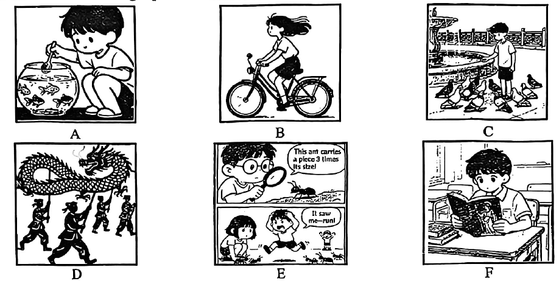

# 2026 一模精讲 · 浦东新区英语（上）：听力 + 语法词汇（第 1–43 题）

> 浦东卷结构：Part 1 听力 25 分（1–20）+ Part 2 语法词汇 45 分（21–58）+ Part 3 读写 70 分（59–84），共 84 小题 140 分。本篇覆盖第 1–43 题，第 44–84 题见 [[英模26-浦东新区-下]]。
>
> ⚠️ **资料说明**：本卷为纯扫描件、无文字层（题干自 150dpi 页图逐题录入）。**答案来源为卷面蓝笔手写批注版**（非官方排版答案），已逐题辨认誊录；听力部分（1–20）批注版未作答——本区虽有听力 mp3 原件但答案版不含听力答案，故听力只给卷面与方法，不给答案。

## Part 1 听力（第 1–20 题，共 25 分）

### A. Listen and choose the right picture（听句选图，第 1–5 题，5 分）

六选五，卷面六图为：

- A：男孩蹲在鱼缸前用捞网照料金鱼——"养鱼/喂鱼"场景
- B：女孩骑自行车出行（头发随风飘起）——"骑车"场景
- C：男孩在喷泉广场喂一群鸽子——"喂鸽子/公园"场景
- D：四人举杆舞龙——"舞龙/传统民俗"场景
- E：两格漫画：男孩用放大镜观察蚂蚁（"这只蚂蚁能搬起三倍于自身大小的东西！"），下格同伴惊叫"它看见我了——快跑！"四散躲开——"观察昆虫/蚂蚁"场景
- F：男孩坐在书桌前专心看一本图画书——"阅读"场景

> ⚠️ 卷面批注版**未给出 1–5 题答案**，本区音频亦无文字答案，此处不臆测。做题方法：听前先给六图各配一句核心动词短语（feed the fish / ride a bike / feed the pigeons / perform a dragon dance / watch ants / read a picture book），听到句子后抓"动词+名词"匹配。

### B. Listen to the dialogues and choose the best answer to each question you hear（对话理解，第 6–10 题，5 分）

**6.**（问食物/口味）
- A) Chocolate.
- B) Banana.
- C) Strawberry.
- D) Lemon.

**7.**（问钟点）
- A) At 6:10 p.m.
- B) At 8:30 p.m.
- C) At 8:20 p.m.
- D) At 8:10 p.m.

**8.**（问做法/方式）
- A) He worked with his parents.
- B) He used a new AI tool.
- C) He asked his teacher for help.
- D) He drew pictures on his own.

**9.**（问人物关系）
- A) Hairdresser and customer.
- B) Teacher and student.
- C) Doctor and patient.
- D) Shop assistant and customer.

**10.**（问事实/观点）
- A) The project can be handed in next Monday.
- B) The boy will not hand in the project on time.
- C) Mr. Lee is unhappy about the school concert.
- D) The students must finish the project by Friday.

> ⚠️ 同上，无答案可誊。考点预判：7 题四个钟点音近易混，注意 minute 的 -teen/-ty 区分；9 题抓"服务场所+称呼"线索；10 题选项围绕"交项目的时间"与 Mr. Lee 的态度展开，注意转折词后的真实信息。

### C. Listen to the dialogue and tell whether the following statements are true or false（短文判断，第 11–15 题，5 分）

**11.** Mark always passed on teachers' messages last term.

**12.** Lisa thinks Mark's work has improved since last term.

**13.** Neither Mark nor Anna wants to be the secretary of the school newspaper.

**14.** Lisa thinks Anna's personality is the main reason for her to get the job.

**15.** The dialogue mainly talks about choosing the new secretary for the newspaper.

> 短文主旨可从判断句反推：对话围绕**校报招新秘书**展开——Mark 上学期转达老师消息、工作有进步，Lisa 在 Mark 与 Anna 之间比较（意愿、性格），最终定人选。⚠️ 批注版未给 T/F 答案。方法：always / improved / neither…nor / main reason / mainly 这类**频度、比较、范围词**是 T/F 题最常见的偷换点，听时逐一核对。

### D. Listen to the passage and complete the following sentences（听短文填空，第 16–20 题，10 分；每空格限填一词）

**16.** In 1939, a large robot led people to ＿＿＿＿＿＿＿＿ ＿＿＿＿＿＿＿＿ a world full of smart devices.

**17.** Robots can do ＿＿＿＿＿＿＿＿ ＿＿＿＿＿＿＿＿ very well in factories.

**18.** People can check damaged buildings' ＿＿＿＿＿＿＿＿ ＿＿＿＿＿＿＿＿ with the help of robots.

**19.** Maybe the most exciting robots are now active ＿＿＿＿＿＿＿＿ ＿＿＿＿＿＿＿＿.

**20.** Robots on Mars can send ＿＿＿＿＿＿＿＿ ＿＿＿＿＿＿＿＿ back to the Earth with cameras and tools.

> ⚠️ 批注版未给答案。短文主题为**机器人**：从 1939 年的大机器人引入 → 工厂应用 → 检查受损建筑 → 最令人兴奋的新机器人 → 火星机器人向地球回传信息。每句两个单空共 10 空；听前判断词性（16 to 后多半为动词原形+名词，19 active 后为名词短语），听时先记发音再拼准单词。

## Part 2 语法和词汇（第 21–43 题）

### II. Choose the best answer（语法单项选择，第 21–35 题，各 1 分，共 15 分）

**21.** My brother wrote ______ blog post about his ice fishing trip last week.
- A) /
- B) a
- C) an
- D) the

> [!tip]- 💡 思路导航
> blog post 是单数可数名词首次泛指；bl- 是辅音音素开头。

> [!success]- ✅ 详解 · 评分点 · 易错 · 关联
> **答案 B**。blog post 单数可数名词首次泛指 → a（bl- 为辅音音素开头）。

**22.** Damin hangs a light at the front of ______ raft to work in the darkness.
- A) he
- B) him
- C) his
- D) himself

> [!tip]- 💡 思路导航
> 名词 raft 前用形容词性物主代词。

> [!success]- ✅ 详解 · 评分点 · 易错 · 关联
> **答案 C**。名词 raft 前用形容词性物主代词 his（"他自己的筏子"）。

**23.** The result depends mainly ______ how well all members work as a team.
- A) on
- B) with
- C) for
- D) from

> [!tip]- 💡 思路导航
> depend ___ 固定搭配；mainly 只是插入副词，不改变搭配。

> [!success]- ✅ 详解 · 评分点 · 易错 · 关联
> **答案 A**。depend on 固定搭配，mainly 只是插入副词，不改变搭配。

**24.** My pet dog looks big but ______ — it never barks at my neighbours.
- A) softly
- B) gently
- C) friendly
- D) heavily

> [!tip]- 💡 思路导航
> look 后仍接形容词作表语；-ly 结尾但属形容词的是哪个？

> [!success]- ✅ 详解 · 评分点 · 易错 · 关联
> **答案 C**。look but 后仍接形容词作表语；-ly 结尾的形容词 friendly（友善的），"从不冲邻居叫"提示性格友善。

**25.** Make sure ______ is left behind in the hotel room before you check out.
- A) anything
- B) everything
- C) nothing
- D) something

> [!tip]- 💡 思路导航
> "退房前确保什么都没落下"——make sure ___ is left behind，否定含义的代词。

> [!success]- ✅ 详解 · 评分点 · 易错 · 关联
> **答案 C**。"退房前确保**什么都没落下**" → make sure nothing is left behind。

**26.** The average temperature this summer is ______ in our city these years.
- A) high
- B) higher
- C) highest
- D) the highest

> [!tip]- 💡 思路导航
> in our city these years 给出比较范围——最高级前加什么？

> [!success]- ✅ 详解 · 评分点 · 易错 · 关联
> **答案 D**。in our city these years 给出比较范围 → 最高级前必须加 the。

**27.** Can you imagine ______ a strange planet some day in the future?
- A) visit
- B) visiting
- C) visited
- D) to visit

> [!tip]- 💡 思路导航
> imagine 后固定接动名词 doing。

> [!success]- ✅ 详解 · 评分点 · 易错 · 关联
> **答案 B**。imagine doing sth 固定接动名词。

**28.** The school requires the seventh graders ______ a safety training course.
- A) complete
- B) to complete
- C) completing
- D) completed

> [!tip]- 💡 思路导航
> require sb ___ do sth 固定结构。

> [!success]- ✅ 详解 · 评分点 · 易错 · 关联
> **答案 B**。require sb to do sth 固定结构。

**29.** Please line up over there and the tour ______ in five minutes.
- A) begin
- B) begins
- C) began
- D) will begin

> [!tip]- 💡 思路导航
> in five minutes 表将来时间；"祈使句 + and"后是并列分句，不用祈使动词。

> [!success]- ✅ 详解 · 评分点 · 易错 · 关联
> **答案 D**。in five minutes 将来时间 → will begin；"祈使句 + and" 后为并列分句，不用祈使动词。

**30.** By the time my parents came back home, I ______ dinner on my own.
- A) cooked
- B) was cooking
- C) would cook
- D) had cooked

> [!tip]- 💡 思路导航
> By the time + 过去时从句，主句动作发生在"回来"之前——过去的过去。

> [!success]- ✅ 详解 · 评分点 · 易错 · 关联
> **答案 D**。By the time + 过去时从句，主句动作发生在"回来"之前 → 过去完成时 had cooked。

**31.** The sign means visitors ______ touch the ancient display items in the museum.
- A) needn't
- B) mustn't
- C) wouldn't
- D) couldn't

> [!tip]- 💡 思路导航
> 博物馆禁止触碰展品的标志——表"禁止"的情态动词；needn't 是"不必"。

> [!success]- ✅ 详解 · 评分点 · 易错 · 关联
> **答案 B**。博物馆禁止触碰展品的标志 → mustn't（禁止），needn't 是"不必"。

**32.** — Excuse me, ______ is the nearest underground station?  — It's just around the corner, about a five-minute walk.
- A) how far
- B) how soon
- C) how long
- D) how much

> [!tip]- 💡 思路导航
> 答语"步行五分钟的路程"问的是距离。

> [!success]- ✅ 详解 · 评分点 · 易错 · 关联
> **答案 A**。答语"步行五分钟的路程"问距离 → how far。

**33.** It rained heavily outside, ______ the Wangs had to put off the outdoor picnic.
- A) for
- B) or
- C) so
- D) but

> [!tip]- 💡 思路导航
> 前因（大雨）后果（推迟野餐）——表结果的连词。

> [!success]- ✅ 详解 · 评分点 · 易错 · 关联
> **答案 C**。前因（大雨）后果（推迟野餐）→ so。

**34.** ______ John has something unknown, he often does some research after class.
- A) Until
- B) Before
- C) Although
- D) When

> [!tip]- 💡 思路导航
> "当 John 遇到不懂的东西时"——引导时间状语从句的连词。

> [!success]- ✅ 详解 · 评分点 · 易错 · 关联
> **答案 D**。"当 John 遇到不懂的东西时，课后常做研究" → When 引导时间状语从句。

**35.** ______ helpful suggestions the professor gave on using AI to organize notes well!
- A) What
- B) How
- C) What a
- D) What an

> [!tip]- 💡 思路导航
> 感叹句核心是复数名词 suggestions——What（不用冠词）。

> [!success]- ✅ 详解 · 评分点 · 易错 · 关联
> **答案 A**。感叹句核心是复数名词 suggestions → What + adj + 复数名词（不用冠词）。

### III. Complete the following passage with the words or phrase in the box（选词填空，第 36–43 题，各 1 分，共 8 分；每词限用一次，两框各 5 选 4）

**首框**：A. materials  B. messages  C. invented  D. placed  E. connect
主题：让一人通过另一人的手"感知物体"的新技术（可帮失去手/手臂的人重获触觉）

**36.** …experience touch again and could change the way humans ＿＿＿＿＿＿＿＿ in the future.

> [!tip]- 💡 思路导航
> the way humans ___——way 后从句缺动词原形。

> [!success]- ✅ 详解 · 评分点 · 易错 · 关联
> **答案 E. connect**（the way humans connect"人类联系/互动的方式"，way 后从句缺动词原形）

**37.** To solve the problem, scientists ＿＿＿＿＿＿＿＿ a small device in his brain and linked it to a computer with an AI system.

> [!tip]- 💡 思路导航
> 与 linked 并列的过去式谓语——先"发明"装置再连到电脑。

> [!success]- ✅ 详解 · 评分点 · 易错 · 关联
> **答案 C. invented**（与 linked 并列的过去式谓语：先"发明"装置再连到电脑）

**38.** …a healthy volunteer …used her hand to pick up balls made of different ＿＿＿＿＿＿＿＿.

> [!tip]- 💡 思路导航
> balls made of different ___——"不同材料做成的球"。

> [!success]- ✅ 详解 · 评分点 · 易错 · 关联
> **答案 A. materials**（balls made of different materials"不同材料做成的球"）

**39.** Sensors on her hand sent signals to the computer and the system then sent ＿＿＿＿＿＿＿＿ to Thomas' brain…

> [!tip]- 💡 思路导航
> send ___ to the brain——与上句 sent signals 呼应的名词。

> [!success]- ✅ 详解 · 评分点 · 易错 · 关联
> **答案 B. messages**（send messages to the brain"把信息传到大脑"，与 sent signals 呼应）

**次框**：A. exciting  B. correctly  C. carefully  D. physical  E. quietly

**40.** He could ＿＿＿＿＿＿＿＿ tell the difference between objects most of the time.

> [!tip]- 💡 思路导航
> 副词修饰 tell the difference——"准确"辨别。

> [!success]- ✅ 详解 · 评分点 · 易错 · 关联
> **答案 B. correctly**（副词修饰 tell the difference"准确辨别"）

**41.** People with ＿＿＿＿＿＿＿＿ disabilities might work together, helping each other…

> [!tip]- 💡 思路导航
> physical ___ 固定搭配——"肢体残疾"。

> [!success]- ✅ 详解 · 评分点 · 易错 · 关联
> **答案 D. physical**（physical disabilities"肢体残疾"固定搭配）

**42.** This question must be ＿＿＿＿＿＿＿＿ considered before the technology is widely used.

> [!tip]- 💡 思路导航
> 被动句中副词修饰 considered——"被仔细考虑"。

> [!success]- ✅ 详解 · 评分点 · 易错 · 关联
> **答案 C. carefully**（被动句中副词修饰 considered"被仔细考虑"）

**43.** Although the research is still in an early stage, it shows ＿＿＿＿＿＿＿＿ possibilities.

> [!tip]- 💡 思路导航
> 修饰名词 possibilities 用 -ing 形容词。

> [!success]- ✅ 详解 · 评分点 · 易错 · 关联
> **答案 A. exciting**（修饰名词 possibilities 用 -ing 形容词）

> 小结：选词填空先判词性（36 缺动词原形、37 缺过去式、40/42 缺副词、41/43 缺形容词、38/39 缺名词），再用**上下文复现**锁定（39 的答案与上句 sent signals 同指、41 与 helping each other 呼应）。本篇两框各余 D. placed / E. quietly 未用。

---
*本篇题干自 150dpi 页图逐题录入（本卷无文字层）；答案誊自卷面蓝笔手写批注版并逐题与语法规则互证。听力部分批注版未作答、本区音频无文字答案，已如实标注。*
