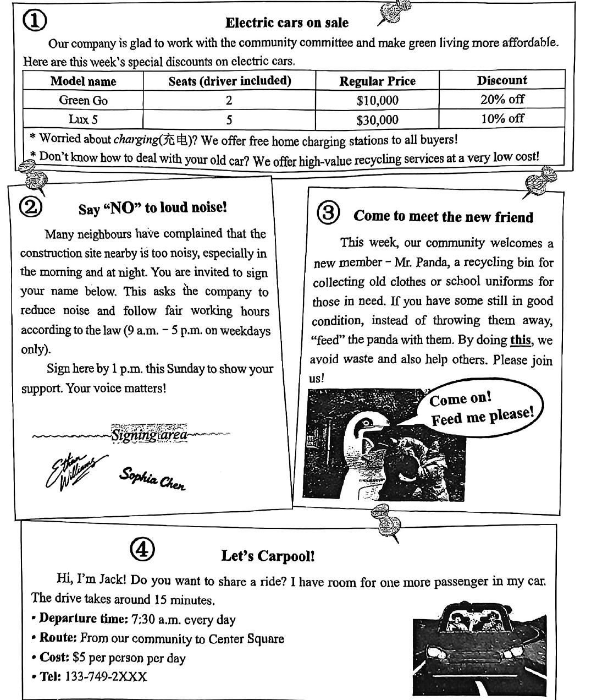
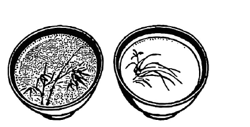
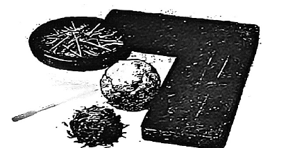
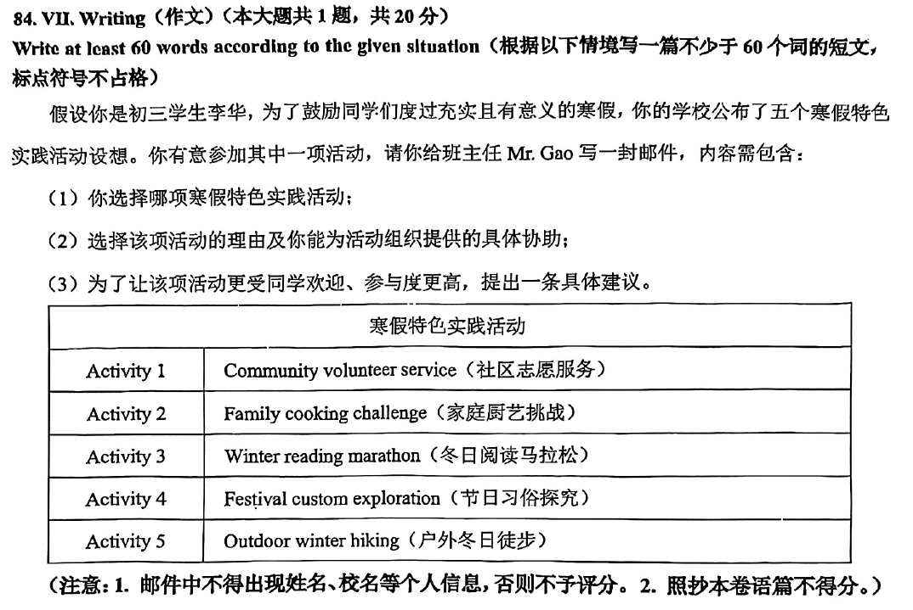

# 2026 一模精讲 · 浦东新区英语（下）：词句转换 + 读写（第 44–84 题）

> 本篇覆盖第 44–84 题（词形转换、句型转换、阅读四篇、作文），第 1–43 题见 [[英模26-浦东新区-上]]。答案来源与校正方式同上篇：卷面蓝笔手写批注版 + 页图互证。

## IV. Complete the sentences with the given words in their proper forms（词形转换，第 44–51 题，各 1 分，共 8 分）

**44.** It's a duty for ______ to stop pollution for a better Earth. (citizen) → **citizens**
（for + 名词复数，"公民们"人人有责；泛指用复数）

**45.** This was her ______ time to visit the Great Wall, but she still found it amazing. (four) → **fourth**
（"第四次"用序数词 fourth；her 后接序数词修饰 time）

**46.** To my surprise, the young couple designed their new house by ______. (they) → **themselves**
（by oneself"独自/靠自己"；主语 the young couple 两人 → themselves）

**47.** He ______ goes to the gym recently because he's too busy with work. (rare) → **rarely**
（修饰实义动词 goes 用副词；"太忙" → 频度"很少"）

**48.** Please ______ three books from the list for your winter reading. (choice) → **choose**
（祈使句缺动词原形；choice 名词 → 动词 choose，注意 oo 拼写）

**49.** The man injured his brain and couldn't remember anything for a ______ time. (length) → 手写批注 **long** ⚠️ 待核对：按词形转换规则 length → **lengthy**（a lengthy time"很长一段时间"），a long time 并未使用括号提示词；批注疑有误，备考按 lengthy 准备，以官方答案为准
（a + 形容词 + time；length 的形容词形式为 lengthy）

**50.** The ancient Silk Road was a great ______, like a bridge between East and West. (succeed) → **success**
（a great + 单数名词；succeed 动词 → success 名词"成功的事"）

**51.** Don't be ______ with your friends, or you may lose their trust. (honest) → **dishonest**
（or 后"失去信任"提示否定：不诚实；否定前缀 dis-，8 题中最易错）

## V. Rewrite the following sentences as required（句型转换，第 52–58 题，共 14 分；52–57 每空格限填一词，各 2 分）

**52.** They've already seen some cute giant pandas with their own eyes.（改为一般疑问句）
→ **Have** they seen **any** cute giant pandas with their own eyes **yet**?
（already → yet；some → any；Have 提前）

**53.** Let's refuse to turn a blind eye to rude behavior at school.（改为反意疑问句）
→ Let's refuse to turn a blind eye to rude behavior at school, **shall we**?
（Let's… 反意疑问固定用 shall we）

**54.** The company created a fast and simple system to send the reports.（改为被动语态）
→ A fast and simple system **was created** by the company to send the reports.
（一般过去时被动 was/were + 过去分词；system 单数 → was）

**55.** You are not allowed to borrow books unless you show your student card.（保持句意基本不变）
→ You are not allowed to borrow books **if** you **don't** show your student card.
（unless = if…not；not allowed 已含否定，从句补 don't）

**56.** Martin gave up eating fast food last year so as to keep fit.（对划线部分 so as to keep fit 提问）
→ **Why did** Martin give up eating fast food last year?
（划线为目的状语 → why；gave 过去式 → 借 did）

**57.** "Where will we go for the winter camp?" My friend asked me.（改为间接引语）
→ My friend asked me **where** we **would** go for the winter camp.
（特殊疑问句变间接引语：疑问词保留；主句过去时 → will 后移为 would）

**58.** set good examples, young people, for, Chinese astronauts, across the nation（连词成句）
→ **Chinese astronauts set good examples for young people across the nation.**
（主语 + set good examples for sb"为某人树立好榜样" + 地点状语）

## VI. Reading Comprehension（阅读理解，第 59–83 题，共 50 分）

### A. Choose the best answer（阅读选择：社区公告栏四则启事，第 59–64 题，各 2 分，共 12 分）

文章为**应用文（社区公告栏）**：① 电动车促销（Green Go 两座 $10,000 八折 / Lux 5 五座 $30,000 九折，送充电桩与旧车回收）；② 施工噪音请愿（法条限 9 a.m.–5 p.m. 工作日，周日下午 1 点前签名）；③ 熊猫造型旧衣回收箱 Mr. Panda；④ Jack 的拼车信息（每天 7:30 出发，社区→Center Square，$5/人/天，车上还有一个空位）。

**59.** Who is most likely interested in Message ①? → **C) Car buyers**
（①是卖车促销广告，目标读者是想买车的人）

**60.** If a couple with two children wants to buy an electric car, how much will they pay? → 手写批注 **A) $8,000** ⚠️ 待核对：一家四口超过 Green Go 的 2 座，只能买 Lux 5（5 座），九折后 = $27,000，按卷面信息推算应为 **C) $27,000**；手写 A $8,000（Green Go 八折）坐不下一家四口，疑批注有误，以官方答案为准
（座位数 + 折扣计算题：先数人头再选车型，最后乘折扣）

**61.** According to the law, the construction company can work ______. → **B) at 10 a.m. on Wednesday**
（法条：9 a.m.–5 p.m. 仅工作日；A 8 a.m. 过早、C 晚 9 p.m. 超时、D 周日非工作日）

**62.** The underlined word "this" in Message ③ refers to ______. → **D) putting usable old clothes into the recycling bin**
（上句 instead of throwing them away, "feed" the panda with them——把还可用的旧衣投入回收箱，指代就在前一句）

**63.** Among the neighbours below, who is Jack most likely to share a ride with? → **C)**
（Jack 车上只有**一个**空位：A 是双胞胎两人坐不下；B 护士 7 点上班时间对不上；D 想要免费搭车且没提上班时间；C 银行职员一人、目的地 Center Square、8 点前到——7:30 出发 15 分钟车程正好）

**64.** Where are these four messages probably from? → **A) A community noticeboard**
（四则启事都是社区事务：促销、请愿、回收、拼车，均在同一社区内发布）

### B. Choose the best answer and complete the passage（完形选择：Art in a cup 点茶，第 65–70 题，各 2 分，共 12 分）

文章脉络：咖啡拉花如今常见 → 其实茶盏里的点茶（Dian Cha）**早得多**，源于中国 → 唐宋兴起、后传到日本等东亚各地 → 点茶工序（温水调茶膏、竹筅快打、水茶交融出泡沫、盏面作画，全程约十分钟）→ 关键在"快"与"力"（击打 180–200 下）→ 点茶是"片刻的艺术、恒久的讯息"，其精神代代相传。

**65.** …a picture slowly appears on the smooth brown ______. → **B) surface**
（咖啡液面 surface；page 书页 / screen 屏幕 / cover 封面均不合语境）

**66.** But did you know that making art in tea cups began much ______? → **D) earlier**
（人们以为盏中作画是咖啡拉花的"新潮"玩法，实则中国点茶"早得多"——下句 centuries ago 呼应）

**67.** Later, this practice ______ to other parts of East Asia including Japan. → **C) spread**
（spread to"传播到"；后文 Japan 呼应"外传"）

**68.** ______, the water and tea mixed together, creating a fine foam on the top. → **A) Step by step**
（描述打茶过程的先后步骤 → Step by step"逐步地"）

**69.** The key is ______ and strength. → **C) speed**
（下句"击打 180–200 下、必须打得快"解释了"速度 + 力量"两个关键）

**70.** Dian Cha: A moment's art, a ______ message. → **B) lasting**
（a moment's 与 lasting 形成"片刻/恒久"对比；末段 spirit lives on 呼应）

### C. Fill in the blanks with proper words（首字母填空：兽医针灸，第 71–77 题，各 2 分，共 14 分）

文章脉络：周五下午，兽医陈医生给病床上的狗狗豆豆针灸（轻绑固定→银针入皮肤→弱电流流通，豆豆后腿轻踢）→ 记者采访：针灸古代用于治马、如今在犬类中已常见；可治脑损伤/皮肤病/伤痛，配合草药更温和但疗程更长；中医优势明显，也需主人耐心；对"西医单独不够用"的家庭是新希望（2024 年报告：23% 的狗已步入"老年"）。

**71.** His body is gently t______ so that he can't move. → **tied**
（被动语态 be + 过去分词；"被轻轻绑住"才能固定不动）

**72.** The following is a(an) i______ with him. → **interview**
（下文 R=Reporter, C=Chen 的问答体 →"一次采访"；an + 元音开头名词）

**73.** Today, it is c______ among dogs, as their acupoints are similar to humans'. → **common**
（be common among…"在犬类中已很常见"；穴位相似是原因）

**74.** It may be slower than western medicine, but it can be gentler and will c______ less harm. → **cause**
（cause less harm"带来更少伤害"；will 后接动词原形）

**75.** It seems traditional Chinese medicine has many great a______. → **advantages**
（many + 复数名词；下句 But every coin has two sides 证上是"优点"）

**76.** However, this also makes the w______ process longer and needs more patience. → **whole**
（the whole process"整个疗程"；与 longer / more patience 呼应）

**77.** …acupuncture offers new hope when western medicine a______ isn't enough. → **alone**
（medicine alone"单独靠西医"；a 开头副词作后置修饰）

### D. Answer the questions（回答问题：眼罩上画鲨鱼的日记，第 78–83 题，共 12 分）

文章脉络（三则日记）：周一雨——第一天戴眼罩（眼睛受伤），怕操场上的男孩指指点点，公交车上看雨，同学围问但"忧伤担忧仍涌上心头"；周二多云——班会老师举白纸黑点："别只盯着黑点，为何不把它画成好东西？"课后"我"在眼罩上画鲨鱼，同学围观称赞，重拾自信；周三晴——开玩笑说鲨鱼会保护我，大家笑，还有同学请"我"画动物，"cool"暖心；领悟：眼罩提醒自己聚焦生活好的一面、把困难变成有意义的东西。

**78.** Did the author wear his eye patch for fun?
→ **No, he didn't.**（一般疑问句先答 Yes/No；戴眼罩是因为眼睛受伤帮它恢复）

**79.** What did the author's classmates do when they saw him at first?
→ **They asked him what happened to his eye.**（定位第一则：they came to ask me what happened to my eye）

**80.** Where did the author draw a shark after class?
→ **On his eye patch.**（定位第二则：I took out a pencil and drew a shark on my patch）

**81.** On which day did the author make a joke to his classmates?
→ **On Wednesday, 3 September.**（第三则日记 I joked to my classmates…；看日期列作答）

**82.** Based on the three diaries, how did the author's feelings change?
→ **He felt sad and worried at first, then became a little lighter and regained confidence, finally felt happy and positive.**（情绪线贯穿三则：sad/worried → lighter/confident → happy and positive；批注版即按此三段给分）

**83.** What does this special patch remind the author? Fill in the blank.
→ 批注版示例：**We should focus on the good things in life and turn difficulties into something meaningful.**
（开放题：呼应老师"白纸与黑点"的道理——关注好的一面，把困难点化为有意义的东西）

## VII. Writing（作文，第 84 题，共 20 分）

**题目**：假设你是初三学生李华。为鼓励同学们度过充实且有意义的寒假，学校公布五个寒假特色实践活动设想，你有意参加其中一项。给班主任 Mr. Gao 写一封邮件，内容包含：① 你选择哪项寒假特色实践活动；② 选择该项活动的理由及你能为活动组织提供的具体协助；③ 为让该活动更受同学欢迎、参与度更高，提出一条具体建议。不少于 60 词（标点符号不占格）。
- Activity 1 社区志愿服务｜Activity 2 家庭厨艺挑战｜Activity 3 冬日阅读马拉松｜Activity 4 节日习俗探究｜Activity 5 户外冬日徒步

**审题三步**：邮件格式（Dear Mr. Gao 开头 / Yours, Li Hua 落款）+ 三个内容要点缺一不可（选哪项 → 理由 + 具体协助 → 一条建议）+ 协助与建议必须**具体可操作**（能做什么、怎么做），泛泛而谈"我会努力"不给分。不得出现真实姓名校名，不得照抄本卷语篇。

**参考范文（约 115 词，选 Activity 3）**：

> Dear Mr. Gao,
>
> I'd like to join Activity 3, the winter reading marathon. Reading is my favourite hobby, and the marathon will push me to finish several good books during the holiday instead of wasting time on my phone. It can also help the whole class build a reading habit together.
>
> As for help, I can make a book list for different tastes, design reading cards to record our progress, and set up a group to share short reviews every day. To make it more popular, I suggest we hold a book-sharing afternoon after the marathon, where everyone recommends a favourite book with a self-drawn poster.
>
> Yours,
> Li Hua

**评分要点**：① 覆盖三个内容要点（选择 + 理由与具体协助 + 一条建议）；② 语法与用词准确；③ 衔接连贯、行文流畅；④ 邮件格式正确、词数不少于 60。协助和建议是本题的区分点：写清"我能做什么 + 活动会因此怎样"才能进高档。

---
*本篇题干自 150dpi 页图逐题录入（本卷无文字层）；答案誊自卷面蓝笔手写批注版并逐题与语言规则互证；49（long/lengthy）与 60（A/C）两处手写批注与卷面信息推算存在冲突，已如实标注；作文无批注范文，范文为本篇自拟。*
