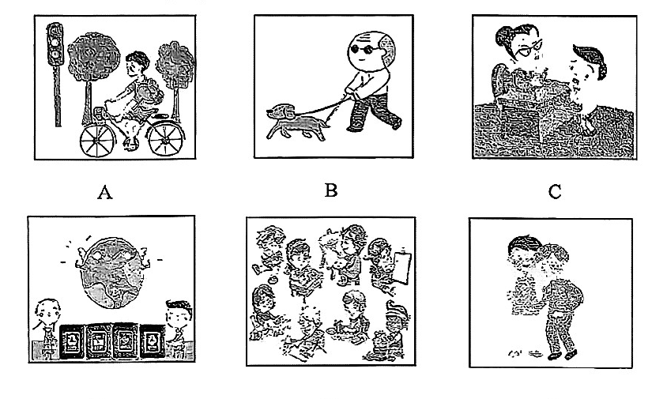

# 2026 一模精讲 · 虹口英语（上）：听力 + 语法词汇（第 1–43 题）

> 虹口卷结构：Part 1 听力 25 分（1–20）+ Part 2 语法词汇 45 分（21–58）+ Part 3 读写 70 分（59–84），共 7 大题 84 小题 140 分。本篇覆盖第 1–43 题，第 44–84 题见 [[英模26-虹口-下]]。
>
> ⚠️ **资料说明**：本卷为纯扫描版（无文字层，题干经 150dpi 页图逐页录入校正）。**答案来源为卷面蓝笔手写批注版**（非官方排版答案），已逐题放大辨认誊录；听力部分（1–20）批注版未作答、且本区无听力音频，故听力只给卷面与方法，不给答案。
>
> 与宝山卷的结构差异：① 听力 C 为**对话**判断（宝山为短文判断），同样用 T/F 表示；② 听力 D 每小题含**两个空格**、每空限填一词（共 10 空各 1 分，宝山为每题一空）；③ 阅读 D 篇分值分布为"81 题 1 分、83 题 3 分"（见下篇）。

## Part 1 听力（第 1–20 题，共 25 分）

### A. Listen and choose the right picture（听句选图，第 1–5 题，5 分）

六选五，卷面六图为：

- A：男孩在红绿灯路口骑自行车（穿行于树下）——"骑车出行"场景
- B：戴墨镜的老人牵狗散步——"遛狗"场景
- C：戴眼镜的女士与男孩在桌边，男孩正在吃/喝——"用餐"场景
- D：发光的地球下方立着一排书，两侧各站一个孩子——"读书/书本与世界"场景
- E：一群人在户外聚集忙碌（有人搬运物品、有人举着展板）——"集体活动/志愿服务"场景
- F：一人向另一人递上花束——"送花/赠礼"场景

> ⚠️ 卷面批注版**未给出 1–5 题答案**，本区亦无听力音频，此处不臆测答案。做题方法：听前先读图、用一句话概括每图核心动词（ride / walk the dog / eat / read / volunteer / give flowers），听到句子后抓"动词+名词"匹配。

### B. Listen to the dialogues and choose the best answer to each question you hear（对话理解，第 6–10 题，5 分）

**6.**（问物品）
- A) A scarf.
- B) A dictionary.
- C) A novel.
- D) A pencil-box.

**7.**（问时间）
- A) At 3:30 p.m.
- B) At 4:00 p.m.
- C) At 4:30 p.m.
- D) At 5:00 p.m.

**8.**（问人物关系）
- A) Shop assistant and customer.
- B) Doctor and patient.
- C) Flight attendant and passenger.
- D) Teacher and student.

**9.**（问话题）
- A) Homework.
- B) School life.
- C) Weekend activities.
- D) Shanghai Natural History Museum.

**10.**（问细节/观点）
- A) The man will pick up the woman at the front gate.
- B) The man will pick up the woman at the back gate.
- C) The man wouldn't like to pick up the woman.
- D) The man will make the traffic worse.

> ⚠️ 同上，无音频无批注答案。考点预判：7 题注意时间加减与 catch（赶上）类干扰；8 题抓服务场景关键词（order / prescription / flight / homework）；10 题注意 but/however 后的转折处才是答案。

### C. Listen to the dialogue and tell whether the following statements are true or false（对话判断，第 11–15 题，5 分；符合用"T"，不符合用"F"）

**11.** Jack plans to study environmental science in college.

**12.** Lily thinks textbook knowledge is as important as practical experience for science subjects.

**13.** Jack and Lily will take part in a tree-planting activity next Saturday.

**14.** Jack's parents encourage him to follow his interest in science.

**15.** The dialogue is mainly about the balance between study and practice.

> 对话主旨可从判断句反推：Jack 与 Lily 谈专业选择（环境科学）、书本知识与实践经验的关系、下周六的植树活动及父母态度。⚠️ 批注版未给 T/F 答案。方法：判断句与原文的**数字、时间、人物态度**最常被偷换（如 13 题 next Saturday、14 题谁的父母支持谁）。

### D. Listen to the passage and complete the following sentences（听短文填空，第 16–20 题，10 分；每空格限填一词，每小题两空）

**16.** A new report shows that machines will do ＿＿＿＿＿＿＿＿ ＿＿＿＿＿＿＿＿ than humans by 2026.

**17.** In the next five years, machines will take up about ＿＿＿＿＿＿＿＿ ＿＿＿＿＿＿＿＿ jobs.

**18.** People don't need to be ＿＿＿＿＿＿＿＿ ＿＿＿＿＿＿＿＿ the situation because new jobs will be created.

**19.** ＿＿＿＿＿＿＿＿ ＿＿＿＿＿＿＿＿, many countries are focusing on areas like environmental protection, AI development and elderly care.

**20.** The report also ＿＿＿＿＿＿＿＿ ＿＿＿＿＿＿＿＿ that people need to learn new skills to deal with the change of the society.

> ⚠️ 批注版未给答案。可注意到：听力 D 短文（机器取代人力工作的报告）与 Part 3 A 篇阅读（AI 的五大应用领域）**同题材**——正式考试中可借 A 篇词汇（tasks / skills / customer service 等）辅助拼写出所听单词；19 题句首两空按"首字母大写+逗号"预判为过渡语（如 In addition / For example 类）。

## Part 2 语法和词汇（第 21–43 题）

### II. Choose the best answer（语法单项选择，第 21–35 题，各 1 分，共 15 分）

**21.** —Have you read ______ book "The Three-Body Problem"?  —Yes, it's ______ interesting science fiction novel.
- A) a; the
- B) the; an
- C) an; a
- D) the; the

> [!tip]- 💡 思路导航
> 两空：特指书名那本书；interesting 以元音音素开头——分别用什么冠词？

> [!success]- ✅ 详解 · 评分点 · 易错 · 关联
> **答案 B**。特指书名那本书用 the；interesting 元音开头 → an。

**22.** The young woman moved ______ the crowd to look for her close friend.
- A) on
- B) across
- C) through
- D) over

> [!tip]- 💡 思路导航
> through 表示从人群内部穿过；across 是表面横穿。

> [!success]- ✅ 详解 · 评分点 · 易错 · 关联
> **答案 C**。through 表示从人群**内部**穿过；across 表面横穿。

**23.** It's ______ to send an e-mail than a regular mail during working hours.
- A) quicker
- B) much quickly
- C) more quickly
- D) quick

> [!tip]- 💡 思路导航
> than 提示比较级；It's + 形容词作表语，副词不能作表语。

> [!success]- ✅ 详解 · 评分点 · 易错 · 关联
> **答案 A**。than 提示比较级；It's + 形容词作表语，quickly 是副词不能作表语。

**24.** It's a pity that there isn't much ______ in the house, just a bed and a small table.
- A) children
- B) furniture
- C) sheep
- D) people

> [!tip]- 💡 思路导航
> much + 不可数名词；a bed and a small table 提示"家具"。

> [!success]- ✅ 详解 · 评分点 · 易错 · 关联
> **答案 B**。much + 不可数名词；a bed and a small table 提示"家具"。

**25.** We can keep Chinese traditions ______ by celebrating festivals and learning traditional skills.
- A) alive
- B) live
- C) lively
- D) living

> [!tip]- 💡 思路导航
> keep + 宾语 + 形容词（宾补），"使传统保持鲜活"；lively 意为"活泼的"不合。

> [!success]- ✅ 详解 · 评分点 · 易错 · 关联
> **答案 A**。keep + 宾语 + 形容词（宾补）"使传统保持鲜活"；alive 作宾补，lively 意为"活泼的"。

**26.** Last year, I saw the wild lions and elephants in Africa with ______ own eyes.
- A) I
- B) me
- C) mine
- D) my

> [!tip]- 💡 思路导航
> with one's own eyes（亲眼）——形容词性物主代词。

> [!success]- ✅ 详解 · 评分点 · 易错 · 关联
> **答案 D**。with one's own eyes（亲眼）中用形容词性物主代词 my。

**27.** People can take a walk on the footpaths on ______ side of the river after dinner.
- A) both
- B) neither
- C) either
- D) all

> [!tip]- 💡 思路导航
> side 是单数——either side（任一边＝两岸都）；both/all 后接复数。

> [!success]- ✅ 详解 · 评分点 · 易错 · 关联
> **答案 C**。side 为单数 → either side（任一边 = 两岸都）；both/all 后接复数。

**28.** There're enough apples and bananas at home. You ______ buy any fruit.
- A) needn't
- B) don't need
- C) need
- D) need to

> [!tip]- 💡 思路导航
> needn't + 动词原形"不必"；don't need 后须接 to do，any 也提示否定。

> [!success]- ✅ 详解 · 评分点 · 易错 · 关联
> **答案 A**。needn't + 动词原形"不必"；don't need 后须接 to do，any 也提示否定。

**29.** Jason made only ______ mistakes, so he got good results in the final exams.
- A) a little
- B) little
- C) a few
- D) few

> [!tip]- 💡 思路导航
> mistakes 是可数复数；only ___ 与后句"成绩好"逻辑一致，"几乎没有"不合。

> [!success]- ✅ 详解 · 评分点 · 易错 · 关联
> **答案 C**。mistakes 可数复数 → a few / few 二选一；only a few"只犯了几个"与后句"成绩好"逻辑一致（few 意为"几乎没有"，与 only 连用不成立）。

**30.** Have you finished ______ your English composition on how to keep healthy?
- A) write
- B) writing
- C) to write
- D) to writing

> [!tip]- 💡 思路导航
> finish 后固定接动名词 doing。

> [!success]- ✅ 详解 · 评分点 · 易错 · 关联
> **答案 B**。finish doing sth 固定接动名词。

**31.** Mr Thomas, a famous doctor, ______ in Hangzhou since ten years ago.
- A) works
- B) was working
- C) worked
- D) has worked

> [!tip]- 💡 思路导航
> since ten years ago（从十年前到现在）——现在完成时。

> [!success]- ✅ 详解 · 评分点 · 易错 · 关联
> **答案 D**。since ten years ago（从十年前到现在）→ 现在完成时。

**32.** Doctor Zhang, leader of the medical team of experts, ______ by CCTV last week.
- A) interviewed
- B) was interviewed
- C) were interviewed
- D) is interviewed

> [!tip]- 💡 思路导航
> last week 表过去；主语与 interview 是被动关系且为单数。

> [!success]- ✅ 详解 · 评分点 · 易错 · 关联
> **答案 B**。last week → 过去时；主语与 interview 是被动关系（被采访），单数主语 → was interviewed。

**33.** ______ useful suggestion the teacher gave me on how to solve this problem!
- A) What a
- B) How a
- C) How
- D) What

> [!tip]- 💡 思路导航
> suggestion 是可数名词单数——What a；不可数或复数才用 What。

> [!success]- ✅ 详解 · 评分点 · 易错 · 关联
> **答案 A**。suggestion 可数名词单数 → What a + adj + n；若不可数或复数才用 What。

**34.** Mr Jones prefers to stay at the hospital ______ he can care for his mother.
- A) before
- B) as soon as
- C) even if
- D) so that

> [!tip]- 💡 思路导航
> 留在医院是为了照顾母亲——表目的状语从句的连词。

> [!success]- ✅ 详解 · 评分点 · 易错 · 关联
> **答案 D**。so that + 目的状语从句（留在医院为了照顾母亲）。

**35.** —______ is it from our school to National Exhibition and Convention Center?  —About half an hour's bus ride.
- A) How often
- B) How long
- C) How far
- D) How soon

> [!tip]- 💡 思路导航
> 答句回答的是"路程远近"（半小时车程）——问距离的疑问词组。

> [!success]- ✅ 详解 · 评分点 · 易错 · 关联
> **答案 C**。答句回答的是"路程远近"（半小时车程）→ How far；How long 问时长。

### III. Choose the proper words or phrase to complete the following passages. Each can be used only once（选词填空，第 36–43 题，各 1 分，共 8 分；每空格限填一词，每词只能填一次，两框各 5 选 4）

**首框**：A) salary  B) process  C) secret  D) produced  E) actually
主题：丝绸的来历（Silk cloth）

**36.** At first, only the Chinese knew how to make silk, and they kept their ＿＿＿＿＿＿＿＿ for a very long time.

> [!tip]- 💡 思路导航
> keep one's ___ "保守秘密"；下句设问"丝从何来"正是被保密的内容。

> [!success]- ✅ 详解 · 评分点 · 易错 · 关联
> **答案 C) secret**（keep one's secret"保守秘密"；下句设问"丝从何来"正是被保密的内容）

**37.** The "thread" (线) used to make silk cloth is ＿＿＿＿＿＿＿＿ made by worms!

> [!tip]- 💡 思路导航
> not/actually 强调事实出人意料——语气副词。

> [!success]- ✅ 详解 · 评分点 · 易错 · 关联
> **答案 E) actually**（"其实是由蚕吐出的丝制成"——惊叹语气，not/actually 强调事实出人意料）

**38.** Like other natural fibres used for making cloth, silk is ＿＿＿＿＿＿＿＿ on farms.

> [!tip]- 💡 思路导航
> be ___ on farms——被动语态"被生产"。

> [!success]- ✅ 详解 · 评分点 · 易错 · 关联
> **答案 D) produced**（be produced on farms 被动语态"被生产"；与 like other natural fibres 类比呼应）

**39.** The silk farmers can then harvest the fibres and begin to ＿＿＿＿＿＿＿＿ them for use.

> [!tip]- 💡 思路导航
> begin to + 动词原形；与 harvest 构成工序链的"加工"。

> [!success]- ✅ 详解 · 评分点 · 易错 · 关联
> **答案 B) process**（begin to + 动词原形；process 作动词"加工"，与 harvest 收割构成工序链）

**次框**：A) increase  B) connected to  C) research  D) responsible for  E) community

**40.** According to ＿＿＿＿＿＿＿＿, people's overall happiness is influenced by their genes, health, and environment, to name a few.

> [!tip]- 💡 思路导航
> according to ___——名词；后文 scientists believe 呼应科研语境。

> [!success]- ✅ 详解 · 评分点 · 易错 · 关联
> **答案 C) research**（according to research"根据研究"；后文 scientists believe 呼应科研语境）

**41.** More importantly, scientists believe happiness is heavily ＿＿＿＿＿＿＿＿ the choices that people make in their everyday lives.

> [!tip]- 💡 思路导航
> be ___ the choices——"与……密切相关"的过去分词短语。

> [!success]- ✅ 详解 · 评分点 · 易错 · 关联
> **答案 B) connected to**（be connected to"与……密切相关"；is heavily + 过去分词被动/系表结构）

**42.** They have found that people are paying less attention to their relationships with others in the ＿＿＿＿＿＿＿＿. Instead, they are focusing on their work.

> [!tip]- 💡 思路导航
> in the ___——名词；与 Instead 后的 work 对照。

> [!success]- ✅ 详解 · 评分点 · 易错 · 关联
> **答案 E) community**（in the community"社区里的人际关系"，与 Instead 后的 work 对照）

**43.** Now, politicians, economists, and academics are looking at how they can ＿＿＿＿＿＿＿＿ happiness in their countries.

> [!tip]- 💡 思路导航
> can 后接动词原形；"提升国民幸福感"与全文 create happiness 呼应。

> [!success]- ✅ 详解 · 评分点 · 易错 · 关联
> **答案 A) increase**（can 后接动词原形；"提升国民幸福感"与全文 create happiness 呼应）

> 小结：选词填空先判词性（39/43 空前为 to/can 用动词原形，38 被动用过去分词，40 介词短语 according to 后用名词），再靠**上下文复现词**锁定（40 空答案 research 与后句 scientists 呼应，42 空 community 与 relationships with others 呼应）。首框 A) salary、次框 D) responsible for 为干扰项未用。

---
*本篇题干经 150dpi 页图逐页录入校正（虹口卷无文字层）；答案誊自卷面蓝笔手写批注版并逐题与语法规则互证。听力部分无音频与批注答案，已如实标注。*
