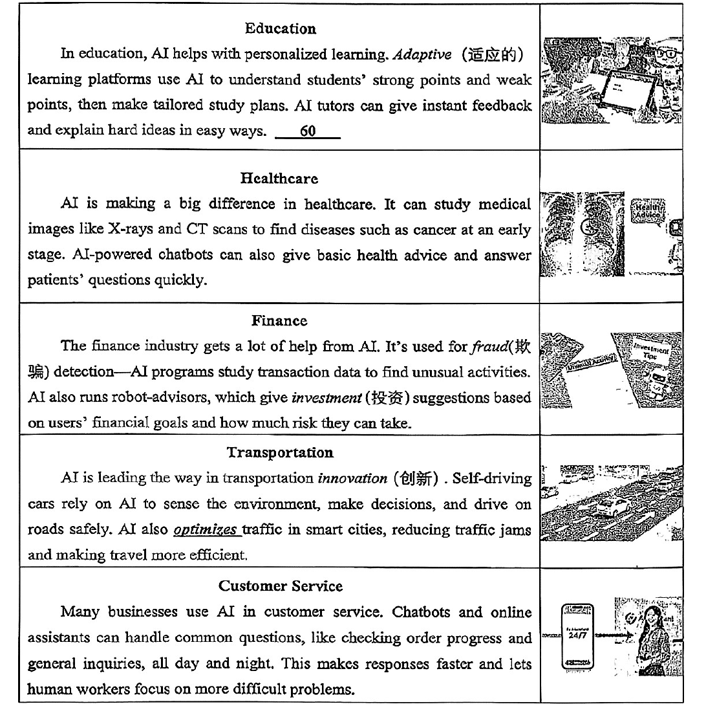
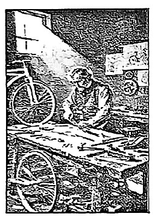
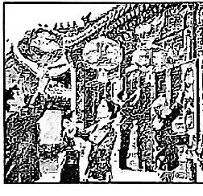

# 2026 一模精讲 · 虹口英语（下）：词句转换 + 读写（第 44–84 题）

> 本篇覆盖第 44–84 题（词形转换、句型转换、阅读四篇、作文），第 1–43 题见 [[英模26-虹口-上]]。答案来源与校正方式同上篇：卷面蓝笔手写批注版 + 页图互证（虹口卷无文字层）。
>
> 与宝山卷的结构差异：阅读 D 篇卷面明示"共 12 分，**81 题 1 分，83 题 3 分**"（宝山为 82 题 2 分），其余各题 2 分；作文为**邀请邮件**（宝山为海报推荐邮件）。

## IV. Complete the sentences with the given words in their proper forms（词形转换，第 44–51 题，各 1 分，共 8 分；每空格限填一词）

**44.** These natural ______ have warned us that everyone should protect the environment. (disaster) → **disasters**
（These natural + 可数名词复数；多种灾害用复数）

**45.** The ______ China International Import Expo was held successfully in Shanghai. (eight) → **eighth**
（"第八届"用序数词 eighth；批注迹作大写 Eighth，因居于展会专名中，两种写法均正确）

**46.** This Chinese medicine proved to be highly ______ in curing the cold. (effectively) → **effective**
（prove to be + 形容词作表语；highly 修饰形容词，所给副词 effectively 须还原为形容词）

**47.** In the end they had to draw lots to ______ who would take part in the competition. (decision) → **decide**
（to + 动词原形；decision 名词 → decide 动词"决定"）

**48.** When we visit some websites, hidden software may collect our ______ information. (person) → **personal**
（名词 information 前用形容词"个人的"作定语）

**49.** Digital life is convenient but we should be aware of its ______. (advantage) → **disadvantages**
（its + 名词；but 转折提示"不利之处"→ 加否定前缀 dis-；泛指弊端用复数。本题**否定前缀 + 复数**双重考点，是 8 题里最易错的一题）

**50.** As the saying goes, ______ in the mind is better than money in the hand. (wise) → **wisdom**
（谚语主语位置用名词"智慧"；wise → wisdom 拼写特殊变化）

**51.** John ______ told his father all about the thing that happened at school yesterday. (probable) → **probably**
（修饰动词 told 用副词；probable → probably，注意去 e 加 -ly）

## V. Rewrite the following sentences as required（句型转换，第 52–58 题，共 14 分；52–57 每空限填一词）

**52.** Lily did her homework carefully in the study just now.（改为否定句）
→ Lily **didn't do** her homework carefully in the study just now.
（did 为实义动词 do 的过去式 → 借助 did 构成否定，did 还原为 do）

**53.** At the age of five, my little cousin weighed **25 kilograms**.（对划线部分提问）
→ **How much** did your little cousin weigh at the age of five?
（划线为重量 → how much；注意人称 my → your）

**54.** Daniel and his friends have never been to the Palace Museum.（改为反意疑问句）
→ Daniel and his friends have never been to the Palace Museum, **have they**?
（never 表否定 → 前否后肯；助动词 have 照抄）

**55.** "Could you please make a plan to help me stay fit?" Anna asked me.（改为宾语从句）
→ Anna asked me **whether/if I** could make a plan to help her stay fit.
（一般疑问句 → if/whether 引导；人称 me → I 作从句主语、me → her；时态后移 could 保留）

**56.** The guide was so patient that he waited till the slow hikers caught up.（保持句意基本不变）
→ The guide was **patient enough** to wait till the slow hikers caught up.
（so + adj + that 从句 = adj + enough to do）

**57.** All the students signed a thank-you note.（改为被动语态）
→ A thank-you note **was signed** by all the students.
（一般过去时被动 was/were + 过去分词；a thank-you note 作主语 → was）

**58.** the plants, with great care, is, in the community garden, Jack's job, to look after（连词成句）
→ **Jack's job is to look after the plants with great care in the community garden.**
（Jack's job 作主语 + is + to look after 不定式作表语；with great care 与 in the community garden 两个状语语序可对调，卷面批注即作此序）

## VI. Reading Comprehension（阅读理解，第 59–83 题，共 50 分）

### A. Choose the best answer（阅读选择：AI 应用领域表格题，第 59–64 题，各 2 分，共 12 分）

文章为**说明文（表格体）**：先给 AI 下定义（机器尤其是计算机系统完成通常需要人类智能的任务的能力），再用五行表格介绍 AI 的五大应用领域——教育（个性化学习、AI 导师）、医疗（读 X 光/CT 片早筛疾病、健康问答机器人）、金融（欺诈检测、机器人投资顾问）、交通（自动驾驶、优化城市路况）、客服（全天候机器人应答，让人工专注疑难问题）。

**59.** What does the underlined word "It" in the first paragraph refer to? → **B) Artificial Intelligence.**
（It 承接首句主语 AI（Artificial Intelligence）；B 与 C 的区别：下文 "to do tasks that usually need human intelligence" 说的正是 AI 的能力）

**60.** The underlined part in the Education section can be best completed by "______". → **D) This makes learning more suitable for each student.**
（空格前讲"了解学生强弱项、量身定制学习计划"，D 项"让学习更适合每个学生"承接上文；A/B/C 均与该段褒扬语境矛盾）

**61.** According to the passage, what can AI do to help in healthcare? → **C) Analyze X-rays to detect early diseases.**
（定位 Healthcare 行：study medical images like X-rays and CT scans to find diseases such as cancer at an early stage）

**62.** What does AI use to detect unusual activities in finance? → **D) Transaction data.**
（定位 Finance 行：AI programs study transaction data to find unusual activities——B 的 investment suggestions 是另一功能，答非所问）

**63.** What does the underlined word "optimizes" mean in the Transportation section? → **A) Improves.**
（后文 reducing traffic jams and making travel more efficient 解释了"优化 = 改善"；B/C/D 均与"减少拥堵"矛盾）

**64.** What is the main purpose of this passage? → **B) To introduce AI's applications in different fields.**
（表格五个领域即全文结构；A"教人正确使用"、C"证明 AI 更聪明"、D"劝人避免使用"均无依据）

### B. Choose the words to complete the passage（完形选择：善良 Kindness，第 65–70 题，各 2 分，共 12 分）

文章脉络：善良是无须翻译的世界语言（开篇点题）→ 日常小善举例（帮老人拎物、给失望的朋友发鼓励信息、耐心倾听、原谅错误）→ 善良惠及施受双方、无须财富只需意愿 → 小善能激起"正能量"涟漪并相互传染 → 结尾升华：善良不只是选择，而是一种生活方式。

**65.** It's the small, thoughtful acts that brighten someone's day—a smile to a stranger, a helping hand to someone ______. → **B) in need**
（someone in need"需要帮助的人"固定搭配；at work/on holiday/by himself 均不与 helping hand 构成语义链）

**66.** Maybe you helped an elderly person carry groceries, or sent a(n) ______ message to a friend feeling disappointed. → **C) encouraging**
（给"感到失望的朋友"发的应是"鼓舞人心的"信息；an + 元音开头；boring/confusing/surprising 与安慰语境矛盾）

**67.** Perhaps you chose to listen patiently to someone sharing their troubles, or forgave a mistake without ______. → **D) explanation**
（⚠️ 待核对：习惯搭配中 without hesitation（毫不犹豫地原谅）更常见，卷面手写批注清晰作 D) explanation"未多作解释便原谅"，语义亦可通；备考以卷面批注为准，建议向老师求证官方答案）

**68.** It doesn't require wealth or extra effort—just a willingness to ______ others. → **B) care for**
（willingness to do；care for others"关心他人"；agree with"同意某人观点"不合语境）

**69.** Kindness is spreading: when you show care, others are more likely to follow the same. ______, a single act of kindness can grow into something much larger. → **D) In this way**
（承接上句"善意会传染"——"这样一来"，一件小善事能长成更大的善果；After all/On average/What's more 均不构成因果承接）

**70.** In the end, kindness is not ______ a choice—it's a way of living that enriches every part of our journey. → **A) simply**
（not simply...it's... "不只是……更是……"递进结构；rarely/properly/directly 与破折号后的升华不搭）

### C. Read the passage and fill in the blanks with proper words（首字母填空：自行车发展史，第 71–77 题，各 2 分，共 14 分）

文章脉络：1817 年德国人 Karl von Drais 发明无脚踏双轮车（双脚蹬地前行，为歉收后缺马代步）→ 1860 年代法国发明家加前轮脚踏，车身笨重、骑行颠簸得名"boneshakers"（震骨车）→ 1870 年代大前轮小后轮设计更快但危险，易向前摔倒 → 1880 年代 John Kemp Starley 推出"安全自行车"（等大车轮 + 链条 + 低座）→ 充气轮胎使骑行更平稳 → 至今自行车普及全球、简单高效又环保。

**71.** The first bicycle was i______ by Karl von Drais, a German. → **invented**
（was + 过去分词被动语态；"被……发明"，by 短语锁定被动）

**72.** It had no pedals (脚踏板). Riders p______ it forward with their feet on the ground. → **pushed**
（叙事用过去式；"骑车人用脚蹬地把它往前推"）

**73.** so people called them "boneshakers" a______ the rides were really bumpy (颠簸的). → **as**
（as 引导原因状语从句"因为骑起来实在太颠"；首字母 a + 完整从句）

**74.** Riders often fell forward, especially when hitting a rock or stopping s______. → **suddenly**
（or 并列 hitting / stopping；修饰动词用副词"突然停下"）

**75.** This made i______ much easier and safer to ride. → **it**
（made it + adj + to ride 结构中 it 作形式宾语）

**76.** Over time, bikes got l______ and better. → **lighter**
（got + 比较级；与 better 由 and 并列，"更轻、更好"）

**77.** Karl von Drais and other inventors' hard work and c______ thinking have given us this wonderful vehicle. → **creative**
（名词 thinking 前用形容词；hard work and creative thinking 并列，"创造性思维"）

### D. Answer the questions（回答问题：How Modern Life Changes Culture，第 78–83 题，共 12 分，81 题 1 分，83 题 3 分）

文章脉络：文化不是固定的，现代生活是文化变迁的主因（科技、社媒、全球化）→ 线上平台让年轻人足不出户看外国电影、听国际音乐、追海外时尚，文化节庆活动也可在线体验 → 社媒（TikTok 等）使文化时尚快速传播，但也可能让传统习俗与本土文化被遗忘、年轻人不加理解地接受外来习惯 → 现代影响并非总是负面：培养开放心态与对多样性的尊重，还可把传统与现代结合创造新的庆祝方式（如学校把本土节日与全球在线时尚结合）→ 结尾：过去与现在可以共存，文化不断演变，人人都参与塑造它。

**78.** What's the main reason for cultural change mentioned in the passage?
→ **Modern life. / Technology, social media and globalization.**（首段定位：modern life is one of the main reasons / technology, social media, and globalization are changing the way we live...；批注示例两种答法均可）

**79.** How can young people experience other cultures without leaving their homes?
→ **Through online platforms and cultural festivals or international events online.**（定位首段末句 cultural festivals and international events are now more available thanks to online platforms, allowing people to experience other cultures without leaving their homes）

**80.** What is one negative effect of social media on culture according to the passage?
→ **Traditional customs and local cultures may be forgotten.**（定位第三段：it also means that traditional customs and local cultures may be forgotten if people focus only on global fashion；题目问 one negative effect，答一条即可）

**81.** Modern influences are not always negative, are they?
→ **No, they aren't.**（反意疑问句按事实回答：现代影响并非总是负面 → 用 No；1 分题，注意 No 后必须接否定式 they aren't，不能只写 No）

**82.** Why do some schools combine traditional and modern ideas to celebrate culture?
→ **To make celebrations more attractive and educational, and to help students develop open minds and respect for diversity.**（定位第四段：making celebrations more attractive and educational + develop more open minds and respect for diversity；两个要点都答到更稳）

**83.** What can you do to better participate in shaping culture in the modern world?
→ 开放题（3 分），参考（批注版示例）：**I can learn about different cultures through media, participate in local cultural activities, and blend traditional and modern elements in creative ways.**（给分点：措施具体合理、紧扣"参与塑造文化"、语法正确；建议写 2–3 条措施，用 can/I will 表达）

## VII. Writing（作文，第 84 题，共 20 分）

**题目**：假设你是李华，你的外国朋友 Peter 对中国的书法（calligraphy）很感兴趣。你们学校即将举办一场"书法展"，请你写一封邮件邀请他参加。邮件须包括：① 邀请他参加活动的原因；② 活动的时间和地点；③ 活动的内容（至少两项）。不少于 60 词，标点不占格。
（注意：1. 照抄阅读语篇不得分。2. 邮件不得出现真实姓名、校名等信息，否则不予评分。）

> ⚠️ 卷面批注版**未给作文范文**，以下审题与范文为本篇自拟参考。

**审题三步**：① 文体为**邀请邮件**（Dear Peter 开头 / Yours, Li Hua 落款），语气友好热情；② 三个内容要点缺一不可——邀请原因（Peter 一直痴迷书法/这是近距离接触中国文化的难得机会）、时间地点（自拟合理即可，如本周六下午、学校艺术厅）、活动内容**至少两项**（欣赏师生作品、听书法讲座、看名家现场挥毫、亲手用毛笔尝试并带走作品等）；③ 结尾加"期待回复/盼你到来"更完整。忌照抄阅读语篇。

**参考范文（约 98 词）**：

> Dear Peter,
>
> I know you have been interested in Chinese calligraphy for a long time, so I'm writing to invite you to a calligraphy exhibition in our school. It will be held in the school art hall from 2:00 to 5:00 p.m. this Saturday.
>
> At the exhibition, you can enjoy excellent works by students and teachers, and a famous calligrapher will tell the stories behind Chinese characters. Better still, you can try writing with a brush yourself and take your work home as a souvenir. I'm sure the exhibition will help you understand Chinese culture better.
>
> Looking forward to your reply.
>
> Yours,
> Li Hua

**评分要点**：覆盖三个要点（8 分）｜语法与用词准确（6 分）｜衔接与流畅（3 分）｜格式与词数（3 分）。忌照抄阅读语篇（卷面明示不得分），邮件内不得出现真实姓名、校名。

---
*本篇题干经 150dpi 页图逐页录入校正（虹口卷无文字层）；答案誊自卷面蓝笔手写批注版并逐题与语言规则互证；67 题批注与习惯搭配存在张力，已加 ⚠️ 说明；作文无批注范文，范文为自拟参考。*
