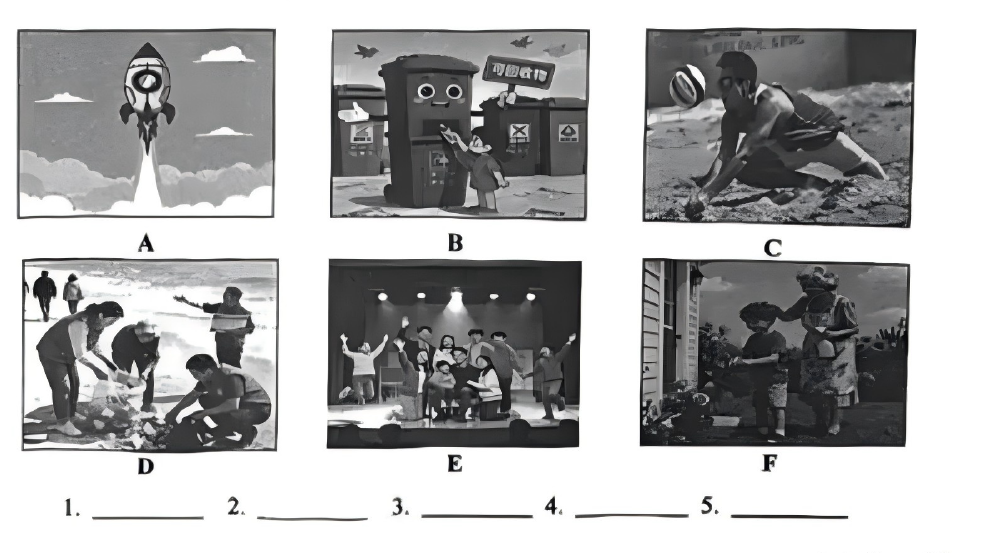

# 2026 一模精讲 · 金山英语（上）：听力 + 语法词汇（第 1–43 题）

> 金山卷结构与宝山一致：Part 1 听力 25 分（1–20）+ Part 2 语法词汇 45 分（21–58）+ Part 3 读写 70 分（59–84），卷面自述"7 大题，共 84 小题"，题号连续编排。本篇覆盖第 1–43 题，第 44–84 题见 [[英模26-金山-下]]。
>
> ⚠️ **资料说明**：本卷为纯扫描版（无文字层，题干自 150dpi 页图逐题录入，OCR 错词已对照页图校正）。**答案来源为卷面印刷参考答案**（试卷+答案合一 PDF 第 10–11 页），已逐题誊录；印刷答案**不含听力部分（1–20）**，且本区无听力音频，故听力只给卷面与方法，不给答案。
>
> 与宝山卷的三处差异：①听力 D 节为**听对话**完成句子（宝山为听短文），每题**两个空、每空一词**，主题为 AI；②听力 B 节问句类型为交通方式/时间/去向/身体状况/人物关系；③阅读 A 篇为图表题（三匹中国名马），无海报。

## Part 1 听力（第 1–20 题，共 25 分）

### A. Listen and choose the right picture（听句选图，第 1–5 题，5 分）

六选五，卷面六图为：

- A：卡通火箭穿出云层升空（尾焰喷射）——"火箭发射/航天"场景
- B：卡通笑脸分类垃圾箱，小朋友正把纸箱投进"可回收物"桶（旁有分类垃圾桶与飞鸟）——"垃圾分类"场景
- C：沙滩排球，男子跃起救球（排球悬在空中）——"沙滩运动/排球"场景
- D：志愿者在河滩/郊野弯腰捡拾垃圾（多人弯腰拾物，远处行人驻足）——"志愿环保"场景
- E：聚光灯下的舞台，一群演员举手谢幕欢庆（台下有观众剪影）——"舞台演出/文艺表演"场景
- F：屋前老人与小孩一起给盆栽浇水打理（祖孙园艺）——"浇花/家庭园艺"场景

> ⚠️ 印刷答案**未给出 1–20 题听力答案**，本区亦无听力音频，此处不臆测答案。做题方法：听前先读图、用一句话概括每图核心动词（launch a rocket / sort garbage / play beach volleyball / pick up litter / perform on stage / water plants），听到句子后抓"动词+名词"匹配。

### B. Listen to the dialogue and choose the best answer to the question you hear（对话理解，第 6–10 题，5 分）

6. A) On foot.  B) In a bus.  C) By taxi.  D) By underground.（问交通方式）
7. A) 8:00 a.m.  B) 10:00 a.m.  C) 4:00 p.m.  D) 5:00 p.m.（问时间）
8. A) To a park.  B) To a library.  C) To a shopping mall.  D) To an exhibition centre.（问去向）
9. A) He didn't sleep well.  B) He has a stomachache.  C) He has caught a cold.  D) He is too tired from exercise.（问身体状况/原因）
10. A) Teacher and student.  B) Policeman and suspect.  C) Father and daughter.  D) Shop assistant and customer.（问人物关系）

> ⚠️ 同上，无音频无答案。考点预判：6 题抓"交通工具"原词（on foot / by taxi…）；7 题注意时间表达中的 a.m./p.m. 与加减换算；8 题抓"目的地"动词（go to / head for）；9 题抓病症与原因的因果关系；10 题靠说话人的称呼、语气与场合（警察讯问/店员推销等）判断关系。

### C. Listen to the passage and tell whether the following statements are true or false（短文判断，第 11–15 题，5 分）

11. Last week, Wang Yiming and his sister argued about what movie to watch.
12. Wang Yiming sometimes wishes he could be the only child forever.
13. Playing board games together is their most favorite family activity.
14. Yiming and his sister help each other with their English and math homework.
15. Yiming feels that having a sister makes his daily life much simpler.

> 短文主旨可从判断句反推：二孩家庭里 Wang Yiming 与姐姐的日常——争论看什么电影、偶尔羡慕独生子女、一起玩桌游、互相辅导英语数学作业、感叹有姐姐的生活。⚠️ 印刷答案未给 T/F。方法：判断句与原文的**频率词、比较级、绝对词**最常被偷换（如 12 题 sometimes、13 题 most favorite、15 题 much simpler），听时圈出这类词逐一核对。

### D. Listen to the dialogue and complete the following sentences（听对话完成句子，第 16–20 题，10 分；每空填一词）

16. Besides working long hours, AI can also learn and ______ ______.
17. AI can help doctors find ______ ______ in hospitals.
18. AI can do boring tasks, letting people focus on ______ ______ work.
19. In school, special ______ ______ can be given to students.
20. In traffic, AI helps to make ______ ______ and can reduce traffic jams.

> ⚠️ 印刷答案未给答案，本区无音频。与宝山不同：本节是**对话**而非短文，且每题**两空、每空一词**。主题为 AI 的五大应用场景（工作学习/医疗/日常事务/教育/交通），听前先判断空格词性（17 空前 find 提示名词短语、18 空后 work 提示形容词或名词作定语、20 make 后接名词短语），注意单词拼写与单复数。

## Part 2 语法和词汇（第 21–43 题）

### II. Choose the best answer（语法单项选择，第 21–35 题，各 1 分，共 15 分）

**21.** We should have ______ pity on people in trouble and try to help them bravely.
A) /  B) a  C) an  D) the

**答案 A**。have pity on sb（怜悯某人）固定短语，零冠词。

**22.** We can find real happiness ______ helping others and sharing kindness around.
A) at  B) for  C) in  D) on

**答案 C**。find happiness in doing sth（在做某事中获得快乐），in + 动名词。

**23.** —Is this your sister's smartwatch?  —No, it's ______. She bought it for my birthday.
A) my  B) mine  C) me  D) I

**答案 B**。后句"她是我买给我的生日礼物"→ 表是"我的"，空后无名词用名词性物主代词 mine。

**24.** The new high-speed railway makes ______ possible to travel between cities quickly.
A) it  B) this  C) that  D) one

**答案 A**。make it possible to do 中 it 作形式宾语，真正宾语是 to travel…。

**25.** The app provides ______ information about protecting wild animals.
A) many  B) a few  C) a large number of  D) a great deal of

**答案 D**。information 不可数 → 只能接 a great deal of；A/B/C 均修饰可数名词复数。

**26.** The documentary about deep-sea exploration is ______ than I expected.
A) educational  B) more educational  C) most educational  D) the most educational

**答案 B**。than 标志比较级；educational 多音节 → more educational。

**27.** —______ does your robot cleaner work?  —Twice a week. It keeps the floor spotless.
A) How long  B) How often  C) How soon  D) How far

**答案 B**。答语 Twice a week 表频率 → How often（How long 问时长、How soon 问还要多久、How far 问距离）。

**28.** ______ Li Ming keeps practicing playing the guitar, he will probably win the competition.
A) Although  B) Because  C) If  D) Unless

**答案 C**。"坚持练习→很可能赢"是条件 → If 引导条件状语从句；Unless（如果不）语义相反。

**29.** After helping others, I always feel ______ and useful.
A) happy  B) happily  C) gently  D) heavy

**答案 A**。feel 系动词 + 形容词作表语，与 useful 并列；语义"开心且有价值"。

**30.** The firefighters helped all the people leave the building ______.
A) save  B) safe  C) safely  D) safety

**答案 C**。修饰动词 leave 用副词 safely（安全地撤离）。

**31.** You ______ walk on the grass in the park. It's against the rules.
A) mustn't  B) wouldn't  C) needn't  D) don't have to

**答案 A**。"违反规定" → 禁止：mustn't；needn't/don't have to 表"不必"，语气不符。

**32.** Students are required ______ their hands before speaking in the discussion.
A) raise  B) raised  C) raising  D) to raise

**答案 D**。be required to do sth 固定搭配（被要求做某事）。

**33.** Last week an engineer successfully ______ my grandfather's old camera.
A) repair  B) repaired  C) is repairing  D) has repaired

**答案 B**。Last week → 一般过去时 repaired。

**34.** The new recycling system ______ in our neighborhood since September.
A) is used  B) was used  C) has been used  D) will be used

**答案 C**。since September → 现在完成时；system 与 use 是被动关系 → has been used。

**35.** ______ exciting e-sports competition it was!
A) How  B) What  C) What a  D) What an

**答案 D**。感叹句核心是"adj + 单数可数名词"→ What + an + exciting（元音开头）+ competition。

### III. Complete the following passage with the words or phrases in the box（选词填空，第 36–43 题，各 1 分，共 8 分；每词限用一次，两框各 5 选 4）

**首框**：A) support  B) process  C) own  D) native  E) create
主题：16 岁少年 Jared 与父亲（大学 AI 教授）用机器人套件造出能抓取物品的乐高仿生手，历时两年

**36.** My goal was to ______ an educational design which shows professional mechanisms in a simple way. → **E) create**（to + 动词原形；"创造一个教学设计"，create 与 design 呼应）

**37.** Building a robot hand with your ______ hands is a great way to learn about robotics. → **C) own**（with your own hands"亲自动手"固定搭配）

**38.** The project took him two years to complete, and he faced many challenges during the ______. → **B) process**（during the process"在此过程中"；the + 名词）

**39.** However, his father's continuous ______ helped him overcome all the difficulties. → **A) support**（continuous + 名词；"父亲的持续支持帮他克服困难"，However 转折呼应）

**次框**：A. value  B. responsible  C. present  D. historical  E. culture
主题：在德国长大，"安静"不是缺点——好听众被视为可靠，德国人重视秩序、协作与谦逊

**40.** In school, good listeners who don't try to be the center of attention are usually considered very ______. → **B) responsible**（considered + adj；"不抢风头的好听众被认为很可靠"，very 后接原级形容词）

**41.** Once, my history teacher asked me to ______ my project. → **C) present**（ask sb to do；present my project"展示项目"，对应下文"站在全班面前讲话"）

**42.** It wasn't fear — it was the pressure of being watched. This comes from ______ and habit. → **E) culture**（comes from + 名词并列；"这源于文化与习惯"，下句 In Germany 点明文化背景）

**43.** In Germany, we ______ order, teamwork and modesty(谦虚). → **A) value**（此处作动词"重视"，后接三个并列宾语；A/E 词性两用是本框陷阱，42 已用 E，此空用动词 value）

> 小结：金山选词填空与宝山同构，先判词性（36/41/43 需动词、40 需形容词、38/39/42 需名词），再靠**上下文复现词**锁定；43 题 value 名动两用、39 题名词所有格后接名词是易错点。

---
*本篇题干自 150dpi 页图逐题录入（金山卷无文字层，OCR 错词已对照页图校正）；答案誊自卷面印刷参考答案并逐题与语法规则互证。听力部分（1–20）印刷答案未提供、本区无音频，已如实标注。*
