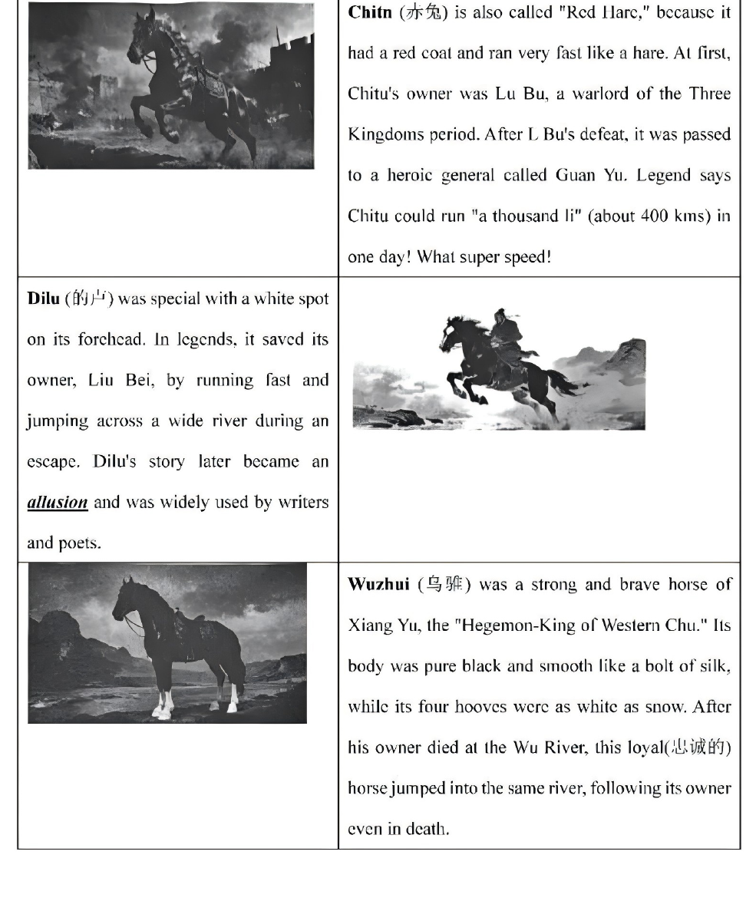
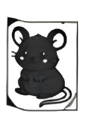
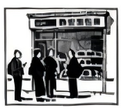
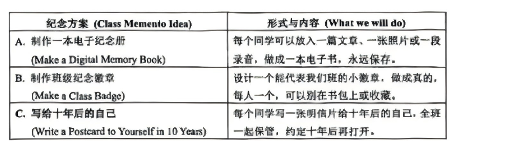

# 2026 一模精讲 · 金山英语（下）：词句转换 + 读写（第 44–84 题）

> 本篇覆盖第 44–84 题（词形转换、句型转换、阅读四篇、作文），第 1–43 题见 [[英模26-金山-上]]。答案来源与校正方式同上篇：卷面印刷参考答案（合一 PDF 第 10–11 页）+ 页图互证。与宝山卷两处结构差异：①D 篇回答问题中第 82 题为**文中填空**（补全第三段句子，不超 8 词）；②作文为三方案选一、班级微信群发言。

## IV. Complete the sentences with the given words in their proper forms（词形转换，第 44–51 题，各 1 分，共 8 分）

**44.** The old town tells lively ______ about Shanghai's past and its unique culture. (story) → **stories**
（tell stories 讲故事；泛指用可数名词复数，story 以"辅音字母+y"结尾 → 变 y 为 i 加 es）

**45.** Though I felt ______, I chose to smile and start a new day. (happy) → **unhappy**
（Though 转折："却选择微笑开始新一天" → 当时"不开心"；happy 加否定前缀 un-，本题考**构词法**，最易错在照抄 happy）

**46.** We should take ______ responsibilities and work for a better future. (seriously) → **serious**
（修饰名词 responsibilities 用形容词；take serious responsibilities"承担重任"）

**47.** Our school club offers ______ activities, such as singing, gardening, and robotics. (variety) → **various**
（修饰名词 activities 用形容词；variety → various"各种各样的"，下文 such as 举例呼应"多种多样"）

**48.** The firefighter helped ______ the rescue equipment, saving many lives today. (operation) → **operate**
（help + (to) do；operation → operate"操作"，空后 the rescue equipment 提示缺动词）

**49.** Her ______ in the competition made her parents very proud. (succeed) → **success**
（Her + 名词；succeed → success"成功"，make her proud 呼应。⚠️ 印刷答案作"succes"，疑漏尾字母 s，正确拼写为 success）

**50.** ______, we have all worked harder to better ourselves in many ways. (recent) → **Recently**
（句首时间状语用副词；recent → Recently，注意句首大写）

**51.** The ______ of 5G technology will change our daily life greatly. (develop) → **development**
（The + 名词 + of；develop → development"发展"）

## V. Rewrite the following sentences as required（句型转换，第 52–58 题，共 14 分；52–57 每空限填一词）

**52.** The famous director will hold a meeting about the new film project.（改为否定句）
→ The famous director **won't hold** a meeting about the new film project.
（will 构成否定直接加 not → won't，谓语动词 hold 保持原形）

**53.** It took the firefighters <u>about ten minutes</u> to rescue the kitten from the tree.（对划线部分提问）
→ **How long** did it take the firefighters to rescue the kitten from the tree?
（划线为时间段 → how long；It took sb… 时间句型提问套 How long did it take…）

**54.** We should drink plenty of water every day to stay healthy.（改为被动语态）
→ Plenty of water should **be drunk** every day to stay healthy.
（情态动词被动：should + be + 过去分词；drink → drunk）

**55.** I wonder how I can take my cooking skills to the next level.（改为简单句）
→ I wonder **how to** take my cooking skills to the next level.
（宾语从句主语与主句一致时 → "疑问词 + 不定式"缩略为简单句）

**56.** The plot of the adventure story was very exciting. We couldn't stop reading it.（合并为一句）
→ The plot of the adventure story was **so** exciting **that** we couldn't stop reading it.
（so + adj + that 从句"如此……以至于"；两空各一词）

**57.** "Where did you hide the important document?" the detective asked the suspect.（改为间接引语）
→ The detective asked the suspect where **he had** hidden the important document.
（特殊疑问句 → where 引导陈述语序；人称 you→he（指嫌疑人）；时态后移 did…hide→had hidden）

**58.** is, to learn, very important, for us, it, self-protection skills（连词成句）
→ **It is very important for us to learn self-protection skills.**
（It is + adj + for sb + to do sth 句型；it 作形式主语，真正主语是 to learn self-protection skills）

## VI. Reading Comprehension（阅读理解，第 59–83 题，共 50 分）

### A. Choose the best answer（阅读选择：三匹中国名马图表题，第 59–64 题，各 2 分，共 12 分）

文章为**图表说明文**：表格介绍中国历史三匹名马——**赤兔**（"Red Hare"，红毛迅捷如兔，先属吕布、吕布败亡后归关羽，传说日行"千里"约 400 公里）；**的卢**（额生白斑，跃宽河救刘备脱险，其事成为典故 allusion 被文人广泛引用）；**乌骓**（西楚霸王项羽坐骑，通体乌黑如绸、四蹄雪白，主人死于乌江后跳江殉主）。

**59.** Who was the first owner of the horse named Chitu according to the passage? → **C) Lu Bu.**
（定位 Chitu 段：At first, Chitu's owner was Lu Bu；Guan Yu 是"第二任主人"）

**60.** What was the special physical feature of Dilu? → **D) A white spot on its forehead.**
（定位 Dilu 段首句：special with a white spot on its forehead）

**61.** What did Wuzhui do after its owner's death? → **A) It jumped into a river.**
（定位 Wuzhui 段末：jumped into the same river, following its owner even in death）

**62.** The word "allusion" (in the passage about Dilu) most probably means ______ → **C) a reference to a well-known story**
（"Dilu's story later became an allusion and was widely used by writers and poets"——被文人诗人广泛引用的正是"知名故事"，即典故）

**63.** The author writes "What super speed!" at the end of the first paragraph to ______ → **B) express excitement and admiration**
（感叹句功能题：What super speed! 抒发惊叹赞美，非提问/陈述事实/比较）

**64.** Which of the following best describes the common quality of these three horses? → **D) They were all famous for their loyalty.** ⚠️
（⚠️ 待核对：印刷答案给 D"以忠诚闻名"，但按卷面文字 **C) They all had unusual coat colors** 依据更足——赤兔"red coat"、的卢"white spot on its forehead"、乌骓"pure black…hooves as white as snow"三处毛色特殊均明写；"忠诚"仅乌骓段点明（loyal），赤兔段只写速度、的卢段写救主。此题为印刷答案与原文依据的冲突点，讲评时建议向学生交代两种思路，以卷面答案 D 记分。）

### B. Choose the words or expressions and complete the passage（完形选择：天宫"太空小鼠"来信，第 65–70 题，各 2 分，共 12 分）

文章脉络：以小鼠第一人称写信——"我们"四只小鼠随神舟二十一号入驻天宫空间站（中国空间站首批哺乳动物住户，六名航天员照料）→ 从 300 只小鼠中选出，经 60 多天严苛训练：站高速旋转杆 115 秒不坠落、旋转腔出来天旋地转后立即走平衡杆 → 在轨约一周，返回后科学家研究身体变化，帮助人类理解太空生活的影响。

**65.** Last night, we ______ the Shenzhou-21 spacecraft with three of them. → **C) entered**
（"昨夜登上神舟二十一号飞船"；left/followed 语义相反，repaired 与语境无关）

**66.** We were chosen from 300 ______ after more than 60 days of tough training. → **A) mice**
（"我们"是 mice，从 300 只小鼠中选出；主语呼应上文 We were not born "space mice."）

**67.** I held on tightly with my front paws and kept moving my back legs to avoid ______. → **D) falling off**
（avoid + 动名词；前文"用前爪抓紧、后腿不停蹬" → 防止"摔落"falling off）

**68.** Every time I came out, I felt dizzy and the world seemed to spin. ______, I had to walk on a narrow balance beam without falling, and I succeeded. → **B) Immediately**
（"一出来就晕、紧接着立刻走平衡杆"——测试连续高难；Instead/Luckily/Nowadays 均不接"had to"的紧接语气）

**69.** Now that I'm here in Tiangong, I want to make every moment ______. → **C) meaningful**
（make + 宾语 + adj；好不容易入选 → "让每一刻都有意义"，boring/strange 与语境相反）

**70.** Their research will help everyone better understand the ______ of life in space. → **B) effects**
（the effects of life in space"太空生活的影响"；前文 study the changes in our bodies 提示"影响"）

### C. Read the passage and fill in the blanks with proper words（首字母填空：静安面包房谢幕，第 71–77 题，各 2 分，共 14 分）

文章脉络：上海静安面包房 1985 年创立、曾把法棍面包带入上海，40 年的黄油香气是这座城市的"你好"；今年十月传出歇业消息——租金高是原因之一，更要害的是没跟上时代（别家不断推新，它守着老产品）→ 关门前门口排长队，老奶奶买五袋饼干让孙子"最后一尝" → 由"眼泪救不了品牌"引出思考：老品牌活下去不能只靠怀念，更要创新求变。

**71.** Suddenly, a sweet smell g______ you. → **greets**
（主语 a sweet smell 三单 → greets；"香气迎面而来"，与后文 Bakery's "hello" 呼应）

**72.** For many families, buying fresh bread there was a favorite daily h______. → **habit**
（a favorite daily + 名词；"每天去买新鲜面包是固定的生活习惯"）

**73.** While other bakeries keep creating new and trendy products to a______ young people, Jingan Bakery still held onto its old offerings. → **attract**
（to + 动词原形；"吸引年轻顾客"，与"守旧"对比）

**74.** To many people in Shanghai, the bakery is like an old friend. Losing it feels like losing a piece ______ in front of its few of memory. → **again**
（⚠️ 待核对：卷面此句排版有误、行文欠通（"losing a piece 74 in front of its few of memory"），按印刷答案取 **again**，语义理解为"再一次失去一段记忆"；备考掌握 again 的副词用法即可，不必纠结该句原文）

**75.** "My grandson has loved their cookies since he was little," she said s______. → **sadly**
（修饰动词 said 用副词；惜别语境 → "悲伤地"）

**76.** But can love and memory keep an old brand a______? → **alive**
（keep + 宾语 + adj"使……继续存在"；keep…alive 固定搭配，答案页亦标注 keep...alive）

**77.** To survive, old brands must be b______ enough to change with the times. → **brave**
（be + adj + enough to do；"有勇气随时代求变"，与上句 remembering/renewing 呼应。注意不填 bold——卷面给的首字母是 b，答案页为 brave）

### D. Answer the questions（回答问题：巴黎卖报人 Ali Akbar，第 78–83 题，共 12 分）

文章脉络：73 岁的 Ali Akbar 在巴黎圣日耳曼街区卖报数十年，抱着《世界报》穿行左岸、自创朗朗上口的标题招揽顾客（"我这是为了创造好心情，愿人们活得快乐"）→ 1973 年赴法当报贩，专走大学区、与学生聊天学会法语，成了街区离不开的人 → 巴黎报贩曾约 40 人，他凭活力与乐观脱颖而出，获法国政府高级国民荣誉 → 数字时代他仍每天下午卖约 30 份报纸，提醒人们"读报配咖啡"的简单快乐。

**78.** What job does Ali Akbar do in Paris?
→ **He sells newspapers. / He is a newspaper hawker.**（定位首段 has been selling newspapers here for decades）

**79.** Does Ali Akbar use the newspaper's original headlines to sell?
→ **No, he doesn't.**（一般疑问句先答 Yes/No；他用的是自创标题 creating his own catchy headlines）

**80.** According to Ali Akbar, what was his main purpose for creating his own headlines?
→ **To create a good mood. / Because he wants people to live happily.**（定位首段直接引语 "I do it to create a good mood…I want people to live happily."）

**81.** How did Ali Akbar learn French after arriving in France?
→ **By chatting with students.**（定位第二段 learning French by chatting with students；How 问方式 → By + doing）

**82.** Fill in the blanks in less than 8 words in Paragraph 3.（文中第三段空格：Akbar believes this honor ______）
→ **belongs to everyone**（参考答案并列类似表达：is for all hard workers / shows kindness matters）
（⚠️ 本题题型与宝山不同：金山在 D 篇第三段挖空，要求补全"他认为这份荣誉……"半句，不超 8 词、语法与语义通顺即可；主语 this honor 三单 → belongs）

**83.** Like Ali Akbar who creates a "good mood", what is one way you can bring a little joy to others in your daily life?
→ 开放题（Any reasonable answer is acceptable.），印刷答案示例：**I can give my seat to elderly people on the bus. / I can smile and say hello to my neighbors.**
（给分点：措施具体合理 + 语法正确；用 can 表能力与提议）

## VII. Writing（作文，第 84 题，共 20 分）

**题目**：毕业在即，班级计划制作一份独特的毕业纪念品，班委会提出三个方案、正在班级微信群征集意见。假设你是李华，在群里发表你的意见，内容须包含所选方案与理由，不少于 60 词（标点不占格）：
- 方案 A 制作一本电子纪念册（Make a Digital Memory Book）：每人放一篇文章、一张照片或一段录音，做成电子书，永远保存；
- 方案 B 制作班级纪念徽章（Make a Class Badge）：设计能代表班级的小徽章做成实物，每人一个，可别在书包上或收藏；
- 方案 C 写给十年后的自己（Write a Postcard to Yourself in 10 Years）：每人写一张明信片，全班保管，约定十年后再打开。

**审题三步**：①情境是**班级微信群发言**（称呼用 Dear classmates，观点直给）；②必须**选定一个方案**并给出≥2 条理由，最好再补一条改进建议（三要素：选择—理由—建议）；③结尾落款（如 Let's… 共勉句 + Yours, Li Hua）。注意卷面两条红线：不得出现真实姓名校名（不予评分）、照抄阅读语篇不得分。

**参考范文（卷面印刷答案原文，两篇均选方案 A）**：

> 参考范文一：
>
> Dear classmates,
>
> I prefer Option A, making a digital memory book. Firstly, it allows each of us to contribute diverse content like articles and photos, preserving our memories forever. Secondly, as an e-book, it can be easily shared and accessed anytime, anywhere.
>
> To make it better, I suggest adding a short video clip from each student. This would make our memory book more vivid and touching.
>
> Let's create a wonderful memento together!

> 参考范文二：
>
> Dear classmates,
>
> I support Plan A: making a digital memory book. Firstly, it is easy to keep and share online, so we can revisit our memories anytime. Secondly, it allows us to include not only photos but also voice messages, making it more personal and lively.
>
> My suggestion is to add an interactive section where we can leave encouraging comments on each other's pages. This will make our digital book even more meaningful and connected.
>
> Let's create a timeless treasure together!
>
> Yours,
> Li Hua

**写作提示**：范文均选 A，考试选 B/C 亦可，只要理由自洽——选 B 抓"人人有份、看得见摸得着、徽章即班级标识"；选 C 抓"仪式感、给未来的自己留言、十年之约"。

**评分要点**：选定方案+理由+建议三要素齐全（8 分）｜语法与用词准确（6 分）｜衔接与流畅（3 分）｜格式与词数（3 分）。忌照抄阅读语篇（卷面明示不得分）、忌出现真实姓名校名（卷面明示不予评分）。

---
*本篇题干自 150dpi 页图逐题录入（金山卷无文字层，OCR 错词已对照页图校正）；答案誊自卷面印刷参考答案并逐题与语言规则互证；49 题答案拼写（succes）、64 题阅读答案（D 与原文依据冲突）、74 题句子排版欠通三处存疑，已如实标注。*
