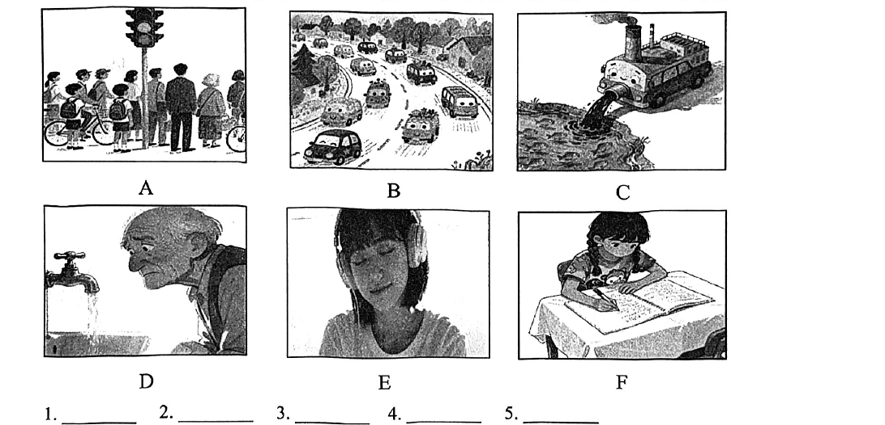

# 2026 一模精讲 · 长宁英语（上）：听力 + 语法词汇（第 1–43 题）

> 长宁卷结构：Part 1 听力 25 分（1–20）+ Part 2 语法和词汇 45 分（21–58）+ Part 3 读写 70 分（59–84），共 84 小题 140 分——**与宝山卷结构、题量、分界完全一致**，本篇覆盖第 1–43 题，第 44–84 题见 [[英模26-长宁-下]]。与范本的卷面差异仅有三处：① 听力 D 节为"听**对话**填空"（宝山为听短文填空）；② 听力 B 节指令印作 "…to each question **your** hear"（your 系 you 之误排，照录）；③ 语法 25 题印作 "than **the the** Apple Watch S11"（the 重复误排，照录）。
>
> ⚠️ **资料说明**：本卷为纯扫描件（无文字层，题干经 150dpi 页图逐页录入）。**答案来源为印刷版《2026 年中考长宁区一模英语 参考答案》（2 页，非手写批注）**，自 Part 2 起逐题直接誊录并与语言规则互证；印刷答案**不含听力答案**，本区亦无听力音频，故听力（1–20）只给卷面与方法，不给答案。

## Part 1 听力（第 1–20 题，共 25 分）

### A. Listen and choose the right picture（听句选图，第 1–5 题，5 分）

六选五，卷面六图为：

- A：十字路口交通灯下等候的人群与推自行车的学生——"等红灯/过马路"场景
- B：弯曲公路上行驶的许多小汽车——"车流/驾车出行"场景
- C：冒烟的老式车辆把深色废弃物倾泻入水——"倾倒垃圾/水污染"场景
- D：老人俯身看滴水的水龙头——"漏水/节约用水"场景
- E：女孩戴耳机闭目听音乐——"听音乐"场景
- F：女孩伏案写字、翻开的书在桌上——"做作业/学习"场景

> ⚠️ 印刷答案版未含听力答案，本区亦无听力音频，此处不臆测答案。做题方法：听前先读图、用一句话概括每图核心动作（wait at the lights / drive in heavy traffic / dump waste / a dripping tap / listen to music / do homework），听到句子后抓"动词+名词"匹配。

### B. Listen to the dialogue and choose the best answer to each question your hear（对话理解，第 6–10 题，5 分）

**6.**（问饮品）
- A) Tea.
- B) Coffee.
- C) Water.
- D) Juice.

**7.**（问时间）
- A) At 6:30.
- B) At 7:00.
- C) At 7:30.
- D) At 8:00.

**8.**（问地点）
- A) At school.
- B) In the office.
- C) At home.
- D) In the meeting room.

**9.**（问身份关系）
- A) Customer and shop assistant.
- B) Librarian and student.
- C) Passenger and bus driver.
- D) Mother and son.

**10.**（问观点/将做的事）
- A) He moved to Sydney when he was young.
- B) He will show the woman around Sydney.
- C) He can provide little useful information.
- D) He will ask someone else to help the woman.

> ⚠️ 同上，无音频无答案。考点预判：7 题抓时间数字并区分"约/整点"；10 题注意转折后才是真实态度（C 选项 provide little useful information 为否定含义，勿漏听 little）。

### C. Listen to the passage and tell whether the following statements are true or false（短文判断，第 11–15 题，5 分）

**11.** The mother was very polite to a stranger but was unkind to her daughter at home.

**12.** When the mother turned around in the kitchen, her daughter was knocked down.

**13.** The daughter stayed close to her mother in order to give her mother a surprise.

**14.** The daughter felt very angry with her mother and walked away at once.

**15.** At the end of the story, the daughter accepted her mother's apology.

> 短文主旨可从判断句反推：母亲对外人礼貌、在家却对女儿不耐烦，厨房转身时误撞了悄悄跟在身后想给她惊喜的女儿，女儿生气跑开，最终母亲道歉、女儿接受。⚠️ 印刷答案未含听力答案。方法：判断句与原文的**原因、地点、动作对象**最常被偷换（如 12 题 knocked down 的地点、13 题表目的 in order to）。

### D. Listen to the dialogue and complete the following sentences（听对话填空，第 16–20 题，10 分）

**16.** Lily asked her teacher some questions about Lake Baikal for her ＿＿＿＿＿＿＿＿ ＿＿＿＿＿＿＿＿.

**17.** Lake Baikal is located in Siberia, which is in the ＿＿＿＿＿＿＿＿ ＿＿＿＿＿＿＿＿ of Russia.

**18.** At Lake Baikal's deepest point, it is ＿＿＿＿＿＿＿＿ ＿＿＿＿＿＿＿＿ deep.

**19.** From January to May, it's ＿＿＿＿＿＿＿＿ ＿＿＿＿＿＿＿＿ for people to drive cars on the thick ice.

**20.** In summer, visitors ＿＿＿＿＿＿＿＿ ＿＿＿＿＿＿＿＿ to Olkhon Island to enjoy its beautiful scenery.

> 对话主题为**贝加尔湖（Lake Baikal）**：位置（西伯利亚）、深度、1–5 月冰面可驾车、夏季游 Olkhon 岛。⚠️ 印刷答案未含听力答案。注意本节与宝山不同：宝山 D 节听短文，长宁 D 节听**对话**，每空两词。方法：预判空格词性（17 方位名词、19 形容词/副词短语、20 动词），听到数字与单位（18）立即速记拼写。

## Part 2 语法和词汇（第 21–43 题）

### II. Choose the best answer（语法单项选择，第 21–35 题，各 1 分，共 15 分）

**21.** John began to ride his bike to school alone when he was ______ 11-year-old boy.
- A) /
- B) a
- C) an
- D) the

> [!tip]- 💡 思路导航
> 11 读作 eleven，以元音音素开头。

> [!success]- ✅ 详解 · 评分点 · 易错 · 关联
> **答案 C**。11 读作 eleven，元音音素开头 → an 11-year-old boy。

**22.** Raise your hand if you know the answer ______ the following questions.
- A) with
- B) to
- C) of
- D) at

> [!tip]- 💡 思路导航
> the answer ___ the questions——"……的答案"用 to。

> [!success]- ✅ 详解 · 评分点 · 易错 · 关联
> **答案 B**。the answer to the questions 固定搭配（"……的答案"用 to）。

**23.** The mother bought two dolls for her daughter. One has golden hair, and ______ has curly black hair.
- A) other
- B) another
- C) the other
- D) the others

> [!tip]- 💡 思路导航
> 两者范围：one…the other；the others 指剩余的全部，接单数谓语 has 不符。

> [!success]- ✅ 详解 · 评分点 · 易错 · 关联
> **答案 C**。两者范围：one…the other（另一个）；the others 指剩余的全部，接单数谓语 has 不符。

**24.** Sarah is a shy girl. She has ______ friends at school and often stays alone.
- A) few
- B) little
- C) a few
- D) a little

> [!tip]- 💡 思路导航
> friends 是可数复数，先排除 little/a little；后句"常独自一人"提示否定含义。

> [!success]- ✅ 详解 · 评分点 · 易错 · 关联
> **答案 A**。friends 可数复数 → 排除 little/a little；后句"常独自一人"表否定 → few。

**25.** The I-phone 17 is much ______ than the the Apple Watch S11.（"the the" 系卷面误排，照录）
- A) expensive
- B) more expensive
- C) most expensive
- D) the most expensive

> [!tip]- 💡 思路导航
> than——比较级；much 修饰比较级表"……得多"。

> [!success]- ✅ 详解 · 评分点 · 易错 · 关联
> **答案 B**。than → 比较级；much 修饰比较级表"……得多"。

**26.** The glass is broken. Please be careful with it, ______ it'll cut your hand.
- A) and
- B) but
- C) so
- D) or

> [!tip]- 💡 思路导航
> "小心，否则会割伤手"——表"否则"的连词。

> [!success]- ✅ 详解 · 评分点 · 易错 · 关联
> **答案 D**。"小心，否则会割伤手" → or 表"否则"。

**27.** I ______ take a taxi to work, but this morning I took one because it was snowy.
- A) seldom
- B) sometimes
- C) usually
- D) always

> [!tip]- 💡 思路导航
> but 转折 + 今早"特意"打车——平时频率很低的副词。

> [!success]- ✅ 详解 · 评分点 · 易错 · 关联
> **答案 A**。but 转折 + 今早"特意"打车因下雪 → 平时"很少"seldom 打车。

**28.** —Excuse me, ______ is the nearest underground station from here?
—It's about 5 minutes' walk. Go along the street, and you'll see it on your right.
- A) how far
- B) how long
- C) how fast
- D) how often

> [!tip]- 💡 思路导航
> 答语 5 minutes' walk 表距离；how long 问时间段。

> [!success]- ✅ 详解 · 评分点 · 易错 · 关联
> **答案 A**。答语 5 minutes' walk 表**距离** → how far；how long 问时间段/长度。

**29.** The school's new library system enables readers ______ books conveniently online.
- A) borrow
- B) to borrow
- C) borrowed
- D) borrowing

> [!tip]- 💡 思路导航
> enable sb ___ do sth 固定接不定式。

> [!success]- ✅ 详解 · 评分点 · 易错 · 关联
> **答案 B**。enable sb to do sth 固定接不定式。

**30.** You ______ worry much about your son. He is already able to look after himself.
- A) won't
- B) mustn't
- C) can't
- D) needn't

> [!tip]- 💡 思路导航
> "他能照顾自己→没必要担心"；mustn't 表禁止、语气过重。

> [!success]- ✅ 详解 · 评分点 · 易错 · 关联
> **答案 D**。"他能照顾自己 → 没必要担心"用 needn't；mustn't 表禁止、语义过重。

**31.** The suspect denied ______ the vase, but the cameras clearly showed his actions.
- A) to steal
- B) stole
- C) stealing
- D) steal

> [!tip]- 💡 思路导航
> deny 后固定接动名词。

> [!success]- ✅ 详解 · 评分点 · 易错 · 关联
> **答案 C**。deny doing sth 固定接动名词。

**32.** So far, the number of Chinese internet users ______ to 1.1 billion.
- A) increases
- B) increased
- C) will increase
- D) has increased

> [!tip]- 💡 思路导航
> So far（到目前为止）——现在完成时；the number 作主语视作单数。

> [!success]- ✅ 详解 · 评分点 · 易错 · 关联
> **答案 D**。So far（到目前为止）→ 现在完成时；the number 作主语视作单数。

**33.** A new app ______ next month to help people learn traditional Chinese calligraphy.
- A) was developed
- B) is developed
- C) will be developed
- D) has been developed

> [!tip]- 💡 思路导航
> next month 表将来；app 与 develop 是被动关系。

> [!success]- ✅ 详解 · 评分点 · 易错 · 关联
> **答案 C**。next month → 一般将来时；app 与 develop 为被动关系 → will be developed。

**34.** ______ all the members work together, we won't be able to finish the task on time.
- A) If
- B) Unless
- C) Because
- D) Although

> [!tip]- 💡 思路导航
> "除非全员合作，否则无法按时完成"——Unless = if not。

> [!success]- ✅ 详解 · 评分点 · 易错 · 关联
> **答案 B**。"除非全员合作，否则无法按时完成" → Unless（= if not）引导否定条件。

**35.** ______ useful advice you've shared with us! Thanks a lot.
- A) What
- B) What a
- C) What an
- D) How

> [!tip]- 💡 思路导航
> 感叹核心为名词短语 useful advice，advice 不可数——What。

> [!success]- ✅ 详解 · 评分点 · 易错 · 关联
> **答案 A**。感叹核心为名词短语 useful advice，advice 不可数 → What + adj + 不可数名词。

### III. Choose the proper words in the box to complete the following passage（选词填空，第 36–43 题，各 1 分，共 8 分；每词限用一次，两框各 5 选 4）

**首框**：A) exercise  B) dramatic  C) damage  D) younger  E) surprise
主题：Super-agers（记忆力超群的"超级老人"）

**36.** They are 80 years old or older, but they have amazing memories. Their ability to remember things is like those 20 to 30 years ＿＿＿＿＿＿＿＿.

> [!tip]- 💡 思路导航
> 数词 + years 后置比较——"像年轻二三十岁的人"。

> [!success]- ✅ 详解 · 评分点 · 易错 · 关联
> **答案 D) younger**（记忆力"像年轻二三十岁的人"；数词 + years younger 后置比较）

**37.** They don't all eat the same food or do the same ＿＿＿＿＿＿＿＿.

> [!tip]- 💡 思路导航
> do the same ___——与 eat the same food 并列；下文 But 转折引出他们唯一的共性。

> [!success]- ✅ 详解 · 评分点 · 易错 · 关联
> **答案 A) exercise**（do the same exercise"做同样的锻炼"，与 eat the same food 并列；下文 But 转折引出他们唯一的共性）

**38.** This discovery isn't a big ＿＿＿＿＿＿＿＿ for brain scientists.

> [!tip]- 💡 思路导航
> a big + 单数名词；"社交护脑"本在科学家意料之中——并不意外。

> [!success]- ✅ 详解 · 评分点 · 易错 · 关联
> **答案 E) surprise**（"社交护脑"本在科学家意料之中 → 并不"意外"；a big + 单数名词）

**39.** If stress hormones stay high for a long time, they can cause swelling (肿胀) in the brain. This can ＿＿＿＿＿＿＿＿ brains and cause memory loss.

> [!tip]- 💡 思路导航
> can 后接动词原形；脑肿胀会"损伤"大脑并致失忆；B 项是形容词不能作谓语。

> [!success]- ✅ 详解 · 评分点 · 易错 · 关联
> **答案 C) damage**（脑肿胀会"损伤"大脑并致失忆；can 后接动词原形；B) dramatic 为形容词不可作谓语）

**次框**：A) essential  B) positive  C) completely  D) mainly  E) work out

**40.** Scientists who study healthy 100-year-olds say they are also outgoing and have a/an ＿＿＿＿＿＿＿＿ attitude about life.

> [!tip]- 💡 思路导航
> have a ___ attitude about life——与 outgoing 并列刻画长寿老人的性格。

> [!success]- ✅ 详解 · 评分点 · 易错 · 关联
> **答案 B) positive**（have a positive attitude about life"积极的生活态度"，与 outgoing 并列刻画长寿老人性格）

**41.** Do people socialize more because they have good memories? Or does socializing give people better memories? Scientists are still trying to ＿＿＿＿＿＿＿＿ the answer.

> [!tip]- 💡 思路导航
> try to ___ the answer——"设法找出答案"；to 后接动词原形。

> [!success]- ✅ 详解 · 评分点 · 易错 · 关联
> **答案 E) work out**（try to work out the answer"设法找出答案"；to 后接动词原形）

**42.** Scientists believe that genetics (遗传学) and biology are the ＿＿＿＿＿＿＿＿ reasons for becoming a super-ager.

> [!tip]- 💡 思路导航
> the + 形容词 + reasons；D 项是副词不能修饰名词。

> [!success]- ✅ 详解 · 评分点 · 易错 · 关联
> **答案 A) essential**（"遗传学与生物学是成为超级老人的根本原因"；the + 形容词 + reasons；D) mainly 为副词不能修饰名词）

**43.** The amazing memory ability seems to come ＿＿＿＿＿＿＿＿ from the genes you are born with.

> [!tip]- 💡 思路导航
> 修饰动词短语 come from 用副词——"主要来自"。

> [!success]- ✅ 详解 · 评分点 · 易错 · 关联
> **答案 D) mainly**（修饰动词短语 come from 用副词，"主要来自与生俱来的基因"）

> 小结：本篇讲"超级老人"研究——他们记忆力如年轻人、各有生活方式，共性是社交活跃；社交护脑（孤独 → 应激激素 → 脑肿胀受损），但记忆力的根本仍在遗传。选词填空先判词性（38 冠词 a 后单数名词、39/41 动词原形、42 形容词、43 副词），再靠语义搭配锁定。

---
*本篇题干经 150dpi 页图逐页录入（本区为纯扫描件、无文字层）；答案直接誊自印刷版《2026 年中考长宁区一模英语 参考答案》并逐题与语言规则互证。听力部分（1–20）印刷答案未含、本区无音频，已如实标注。*
