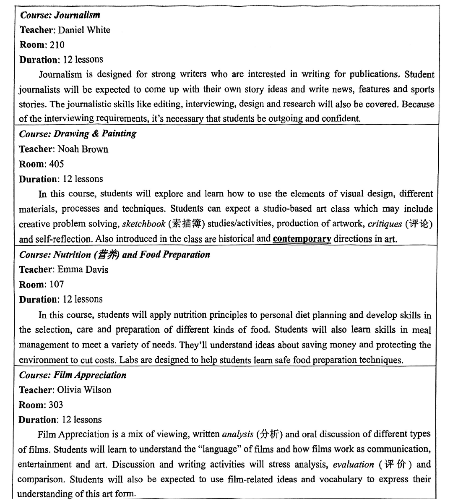

# 2026 一模精讲 · 长宁英语（下）：词句转换 + 读写（第 44–84 题）

> 本篇覆盖第 44–84 题（词形转换、句型转换、阅读四篇、作文），第 1–43 题见 [[英模26-长宁-上]]。答案来源与校正方式同上篇：**印刷版《2026 年中考长宁区一模英语 参考答案》（2 页）直接誊录** + 150dpi 页图互证；与宝山卷的差异见上篇引言（听力 D 听对话、作文为栏目投稿短文等）。

## IV. Complete the sentences with the given words in their proper forms（词形转换，第 44–51 题，各 1 分，共 8 分）

**44.** The two ＿＿＿＿＿＿＿＿ stopped fighting and agreed to a peace deal. (army)

> [!tip]- 💡 思路导航
> two + 可数名词复数——army 以"辅音字母+y"结尾，复数怎么变？

> [!success]- ✅ 详解 · 评分点 · 易错 · 关联
> **答案 armies**（two + 可数名词复数；army 以"辅音字母+y"结尾 → 变 y 为 i 加 es）

**45.** To everyone's excitement, Jim was the ＿＿＿＿＿＿＿＿ to cross the finish line. (one)

> [!tip]- 💡 思路导航
> "第一个冲过终点线"用序数词——the + 序数词 + to do 作后置定语。

> [!success]- ✅ 详解 · 评分点 · 易错 · 关联
> **答案 first**（"第一个冲过终点线"用序数词；the + first + to do 不定式作后置定语）

**46.** The museum has ＿＿＿＿＿＿＿＿ old things that show the history of our city. (variety)

> [!tip]- 💡 思路导航
> 修饰名词短语 old things 用形容词——variety 变成哪个词？

> [!success]- ✅ 详解 · 评分点 · 易错 · 关联
> **答案 various**（修饰名词短语 old things 用形容词 various"各种各样的"）

**47.** The guest professor delivered an inspiring ＿＿＿＿＿＿＿＿ about youth and creativity. (speak)

> [!tip]- 💡 思路导航
> an inspiring + 单数名词——speak 变"演讲"，注意 -ee- 拼写。

> [!success]- ✅ 详解 · 评分点 · 易错 · 关联
> **答案 speech**（an inspiring + 单数名词；speak → speech"演讲"，注意 -ee- 拼写）

**48.** The ＿＿＿＿＿＿＿＿ of the hiking route in the national park is perfect for a walk. (long)

> [!tip]- 💡 思路导航
> The + 名词 + of 结构作主语——long 的名词形式；谓语 is 单数与之呼应。

> [!success]- ✅ 详解 · 评分点 · 易错 · 关联
> **答案 length**（The + 名词 + of 结构作主语；long → length"长度"；谓语 is 单数与之呼应）

**49.** Sadly, some drivers are still ＿＿＿＿＿＿＿＿ of the danger of using phones while driving. (aware)

> [!tip]- 💡 思路导航
> Sadly + still 提示语义否定——"未意识到"要用哪个前缀？

> [!success]- ✅ 详解 · 评分点 · 易错 · 关联
> **答案 unaware**（Sadly + still 提示否定 → be unaware of"未意识到"）
>
> **易错**：考**否定前缀 un-**，是 8 题中最易照抄原词的一题。

**50.** Many brave soldiers choose to ＿＿＿＿＿＿＿＿ for honor rather than live in shame. (death)

> [!tip]- 💡 思路导航
> to + 动词原形，与 rather than live 并列——death 的动词形式。

> [!success]- ✅ 详解 · 评分点 · 易错 · 关联
> **答案 die**（to + 动词原形，与 rather than live 并列；death → die"牺牲"）

**51.** Our teacher asked us to take the exam ＿＿＿＿＿＿＿＿ and avoid careless mistakes. (serious)

> [!tip]- 💡 思路导航
> 修饰动词 take 用副词——"认真对待"的固定搭配 take…____ 怎么补全？

> [!success]- ✅ 详解 · 评分点 · 易错 · 关联
> **答案 seriously**（修饰动词 take 用副词；take…seriously"认真对待"）

## V. Rewrite the following sentences as required（句型转换，第 52–58 题，共 14 分；52–57 每空限填一词）

**52.** We have already got everything ready for the New Year's celebration.（改为否定句）

> [!tip]- 💡 思路导航
> already 的完成时改否定 → haven't…yet——注意缩写算一词。

> [!success]- ✅ 详解 · 评分点 · 易错 · 关联
> **答案**：We **haven't** got everything ready for New Year's celebration **yet**.（already 的完成时改否定 → haven't … yet，缩写算一词）

**53.** Ken will leave for a village in two months and work there as a volunteer.（对划线部分提问 in two months）

> [!tip]- 💡 思路导航
> in + 时间段表"多久以后"——用哪个疑问词组？

> [!success]- ✅ 详解 · 评分点 · 易错 · 关联
> **答案**：**How soon** will Ken leave for a village and work there as a volunteer?（in + 时间段表"多久以后" → how soon）

**54.** The famous writer wrote the book especially for children.（改为被动语态）

> [!tip]- 💡 思路导航
> 一般过去时被动 was/were + 过去分词——主语换成 The book，单数用哪个 be？

> [!success]- ✅ 详解 · 评分点 · 易错 · 关联
> **答案**：The book **was written** by the famous writer especially for children.（一般过去时被动 was/were + 过去分词；主语 The book 单数 → was）

**55.** This new type of laptop is made up of many key parts.（保持句意基本不变）

> [!tip]- 💡 思路导航
> be made up of 的同义短语是 consist of——主语 type 单数，注意不用被动。

> [!success]- ✅ 详解 · 评分点 · 易错 · 关联
> **答案**：This new type of laptop **consists of** many key parts.（be made up of = consist of；主语 type 单数 → consists，注意不用被动）

**56.** The old man was so weak that he couldn't climb the stairs without help.（保持句意基本不变）

> [!tip]- 💡 思路导航
> so + adj + that…not = not + adj(反义) + enough to do——weak 的反义词是什么？

> [!success]- ✅ 详解 · 评分点 · 易错 · 关联
> **答案**：The old man wasn't **strong enough** to climb the stairs without help.（so + adj + that…not = not + adj(反义) + enough to do；weak 的反义 strong）

**57.** "What do you think of my new haircut?" Ms Green asked her husband.（改为间接引语）

> [!tip]- 💡 思路导航
> 特殊疑问句变宾语从句：陈述语序；you→he、my→her；时态后移。

> [!success]- ✅ 详解 · 评分点 · 易错 · 关联
> **答案**：Ms Green asked her husband what **he thought** of her new haircut.（特殊疑问句变宾语从句：陈述语序；you→he（her husband）、my→her；时态后移 think→thought）

**58.** the plants, is, in the community garden, John's job, to look after（连词成句）

> [!tip]- 💡 思路导航
> 主系表结构——John's job 作主语 + is + 什么作表语？

> [!success]- ✅ 详解 · 评分点 · 易错 · 关联
> **答案**：**John's job is to look after the plants in the community garden.**（主系表结构：John's job 主语 + is + to look after… 不定式作表语；look after the plants 动宾搭配）

## VI. Reading Comprehension（阅读理解，第 59–83 题，共 50 分）

### A. Choose the best answer（阅读选择：四门选修课，第 59–64 题，各 2 分，共 12 分）

文章为**应用文（选课介绍表）**：3 月起周三上午最后一节课改为选修课，学生按兴趣四选一——Journalism（新闻，Daniel White，房 210）、Drawing & Painting（绘画，Noah Brown，房 405）、Nutrition and Food Preparation（营养与烹饪，Emma Davis，房 107）、Film Appreciation（电影欣赏，Olivia Wilson，房 303），均为 12 课时，各框正文说明课程内容与要求。

**59.** Journalism is a course for students ______.

> [!tip]- 💡 思路导航
> 定位 Journalism 段——"自己想故事选题"；outgoing and confident 是入学要求而非目的。

> [!success]- ✅ 详解 · 评分点 · 易错 · 关联
> **答案 B) to create stories of their own**（定位 Journalism 段 come up with their own story ideas——"自己想故事选题"；A 写作不为娱乐、C 非求职培训、D outgoing and confident 是入学要求而非目的）

**60.** Which of the following is least likely to be the focus of Drawing & Painting?

> [!tip]- 💡 思路导航
> 绘画课讲了 sketchbook、materials、techniques、critiques——全段有没有提"数字工具做产品设计"？

> [!success]- ✅ 详解 · 评分点 · 易错 · 关联
> **答案 D) Gaining skills in using digital tools for product design.**（绘画课含 sketchbook、materials、techniques、artwork、critiques——全段未提"数字工具做产品设计"）

**61.** The underlined word "contemporary" probably means "______".

> [!tip]- 💡 思路导航
> historical and contemporary 并列——与"历史的"相对的是哪个词？

> [!success]- ✅ 详解 · 评分点 · 易错 · 关联
> **答案 A) modern**（historical and contemporary directions 并列，与"历史的"相对 → "当代的/现代的"）

**62.** If a student prefers discussing, analyzing and comparing in class, he will go to ______ class.

> [!tip]- 💡 思路导航
> 找"oral discussion…analysis, evaluation and comparison"在哪门课——授课教师是谁？

> [!success]- ✅ 详解 · 评分点 · 易错 · 关联
> **答案 D) Olivia Wilson's**（Film Appreciation：oral discussion…stress analysis, evaluation and comparison；授课教师 Olivia Wilson）

**63.** Which course helps students to understand the ideas of environment protection?

> [!tip]- 💡 思路导航
> 定位"省钱与保护环境"出现在哪门课的正文里。

> [!success]- ✅ 详解 · 评分点 · 易错 · 关联
> **答案 C) Nutrition and Food Preparation.**（定位 Nutrition 段 saving money and protecting the environment to cut costs）

**64.** You can find the material probably in the school ______.

> [!tip]- 💡 思路导航
> 面向学生的选课介绍——最可能登在校报还是问卷调查/艺术品/商业广告？

> [!success]- ✅ 详解 · 评分点 · 易错 · 关联
> **答案 A) newspaper**（面向学生的选课介绍，最可能登在校报；survey 问卷调查、art work 艺术品、advertisement 商业广告均不合语境）

### B. Choose the best answer and complete the passage（完形选择：景区"限时拍照"新规，第 65–70 题，各 2 分，共 12 分）

**65.** However, wanting "the perfect picture" can lead to overcrowding, ___65___ people often stay in one place for too long.

> [!tip]- 💡 思路导航
> "想拍完美照片导致拥挤"与"人们久占一处"是因果关系——选哪个连词？

> [!success]- ✅ 详解 · 评分点 · 易错 · 关联
> **答案 B) as**（as 表原因："因为"人们久占一处 → 拥挤）

**66.** ___66___ rules have been introduced in other tourist spots in China.

> [!tip]- 💡 思路导航
> 上段篁岭推出限时拍照——其他景区也引入"类似的"规则。

> [!success]- ✅ 详解 · 评分点 · 易错 · 关联
> **答案 C) Similar**（上段江西婺源篁岭推出限时拍照 → 其他景区也引入"类似的"规则）

**67.** If some people stay in the best photo spot for too long, it is ___67___ to others.

> [!tip]- 💡 思路导航
> 前句说景点应人人共享——久占最佳机位对他人公平吗？

> [!success]- ✅ 详解 · 评分点 · 易错 · 关联
> **答案 D) unfair**（前句景点应人人共享 → 久占最佳机位对他人"不公平"）

**68.** Some tourists feel…more stressful. For children and older people…the rule can even be difficult to obey. These ___68___ show the need for flexibility.

> [!tip]- 💡 思路导航
> 游客的压力、老人孩子的困难——这些"担忧"说明规则需要什么？

> [!success]- ✅ 详解 · 评分点 · 易错 · 关联
> **答案 A) worries**（游客的压力、老人孩子的困难 → 这些"担忧"显示规则需要灵活性；conclusions/excuses/references 与"显示需要灵活性"逻辑不合）

**69.** The goal is clear: to ___69___ service and give visitors a better travel experience.

> [!tip]- 💡 思路导航
> ____ service"改进服务"——与 better travel experience 呼应。

> [!success]- ✅ 详解 · 评分点 · 易错 · 关联
> **答案 B) improve**（improve service"改进服务"，与 better travel experience 呼应）

**70.** Only with fairness and order can people ___70___ enjoy the beauty of travel.

> [!tip]- 💡 思路导航
> 倒装句 Only with…can people…——副词修饰 enjoy，"真正享受"。

> [!success]- ✅ 详解 · 评分点 · 易错 · 关联
> **答案 C) truly**（副词修饰 enjoy："只有公平有序，人们才能**真正**享受旅行之美"；倒装句 Only with…can people…）

> 文章脉络：社交媒体时代游客为拍"完美照片"久占机位致拥挤 → 篁岭推"限时拍照"（排队时每人约 1 分钟）→ 各地景区跟进，限时更公平 → 但游客有压力、老幼难遵守，引发担忧 → 改进方案：多设拍照点、拍照向导、特殊人群延时 → 结论：这是迈向更好管理与更健康旅行文化的一步。

### C. Read the passage and fill in the blanks with proper words（首字母填空：首尔地铁打电话记，第 71–77 题，各 2 分，共 14 分）

**71.** And I knew that I shouldn't talk to people on the subway. Actually, that was not a p＿＿＿＿＿＿＿ to me because my Korean was really poor and I wouldn't speak to anyone on the subway.

> [!tip]- 💡 思路导航
> not a ____"不成问题"——韩语很差反而无需与人攀谈。

> [!success]- ✅ 详解 · 评分点 · 易错 · 关联
> **答案 problem**（not a problem"不成问题"——韩语差反而无需攀谈）

**72.** …if you are familiar with the subway in Seoul, you know that there are s＿＿＿＿＿＿＿ everywhere showing no talking on cell phones.

> [!tip]- 💡 思路导航
> "到处贴着禁止通话的标识"——可数名词要用复数。

> [!success]- ✅ 详解 · 评分点 · 易错 · 关联
> **答案 signs**（"到处贴着禁止通话的标识"；可数名词用复数）

**73.** I thought that the 'no cell phones' rule in Korea was like the 'no food' rule on the New York City subway. It's a rule, but no one f＿＿＿＿＿＿＿ it.

> [!tip]- 💡 思路导航
> "没人遵守规则"——主语 no one 是三单；follow the rule 固定搭配。

> [!success]- ✅ 详解 · 评分点 · 易错 · 关联
> **答案 follows**（"没人遵守规则"；主语 no one 三单 → follows，follow the rule 固定搭配）

**74.** While I was talking, other passengers looked at me sideways (侧着)…But one elderly woman looked s＿＿＿＿＿＿＿ at me and shook her head.

> [!tip]- 💡 思路导航
> look ____ at"直直地盯着"——与 sideways 侧目形成对比。

> [!success]- ✅ 详解 · 评分点 · 易错 · 关联
> **答案 straight**（look straight at"直直地盯着我"；与 sideways 侧目形成对比）

**75.** Korean people use their phones. Why can't I do the same? I asked m＿＿＿＿＿＿＿.

> [!tip]- 💡 思路导航
> ask ____"自问"——主语 I 对应哪个反身代词？

> [!success]- ✅ 详解 · 评分点 · 易错 · 关联
> **答案 myself**（ask myself"自问"；主语 I → 反身代词 myself）

**76.** The others are all text messaging or playing games on their phones. Sometimes they c＿＿＿＿＿＿＿ their voicemail.

> [!tip]- 💡 思路导航
> "查看语音留言"——主语 they 是复数，动词用原形。

> [!success]- ✅ 详解 · 评分点 · 易错 · 关联
> **答案 check**（"查看语音留言"；主语 they 复数 → 动词原形 check）

**77.** I felt e＿＿＿＿＿＿＿ after hearing it. I still had a lot to learn.

> [!tip]- 💡 思路导航
> feel ____"感到尴尬"——-ed 形容词修饰人的感受。

> [!success]- ✅ 详解 · 评分点 · 易错 · 关联
> **答案 embarrassed**（feel embarrassed"感到尴尬"；-ed 形容词修饰人的感受）

> 文章脉络：作者旅居首尔第二年自认深谙韩国礼仪——地铁不与人交谈，但这对韩语很差的他"不是问题" → 某天在地铁打电话约晚饭，无视禁令标识，以为这规则"没人遵守" → 乘客侧目、一位老妇人直视摇头 → 他困惑自问 → 朋友点破：本地人只发短信、玩游戏、查语音留言，从不整段通话 → 作者顿感尴尬：懂再多习惯，骨子里仍是美国人。

### D. Answer the questions（回答问题：Michael 寻找亚特兰蒂斯，第 78–83 题，共 12 分）

文章脉络（小标题结构）：沉入海底的古城亚特兰蒂斯传说，许多人寻找未果，德国人 Michael 自认找到了 → 【How did we first learn about Atlantis?】希腊哲学家柏拉图在著作中详载：岛上古城、约早于其时代 9000 年，因地震与洪水突然消失，并留下 51 条位置线索 → 【Was Atlantis under the sea?】Michael 新解：古城不在海底，而是毁于海啸、仅被水短暂淹没 → 【（81）空白小标题】Michael 用电脑程序录入柏拉图的全部线索（含距雅典的距离），在世界地图上检索匹配地点 → 【Where did Michael think Atlantis had been?】程序指向非洲摩洛哥海岸的 Souss-Massa 平原，Michael 亲往发现许多与描述吻合之处 → 专家不认同：柏拉图写的或是 1600 BC 火山喷发毁掉的邻岛，或是虚构故事；Michael 仍笃信并用时间精力证明其存在。

**78.** Many people have managed to find Atlantis, haven't they?

> [!tip]- 💡 思路导航
> 反意疑问句按事实回答——许多人"尝试但失败"。

> [!success]- ✅ 详解 · 评分点 · 易错 · 关联
> **答案**：**No, they haven't.**（定位首段 Many people have tried but **failed** to find it——事实为否定 → 用 No 回答）

**79.** Why did Atlantis disappear according to Plato?

> [!tip]- 💡 思路导航
> 定位第一小节——按柏拉图的说法，古城因什么突然消失？

> [!success]- ✅ 详解 · 评分点 · 易错 · 关联
> **答案**：**Because of earthquakes and floods.**（定位第一小节 disappeared suddenly because of earthquakes and floods；注意题干限定 according to Plato）

**80.** What was Michael's idea about Atlantis?

> [!tip]- 💡 思路导航
> 定位 Was Atlantis under the sea? 节——毁于什么、被水淹了多久？

> [!success]- ✅ 详解 · 评分点 · 易错 · 关联
> **答案**：**He thought Atlantis had been destroyed by a tsunami and had been covered by water only for a short time.**（定位 Was Atlantis under the sea? 节：destroyed by a tsunami wave…only for a short time）

**81.** What question is probably asked in this blank?

> [!tip]- 💡 思路导航
> 推断小标题——该节讲"用电脑程序比对柏拉图线索、锁定可能位置"，用 How 提问。

> [!success]- ✅ 详解 · 评分点 · 易错 · 关联
> **答案**：**How did Michael find the possible location of Atlantis?**（推断小标题题：该节讲"用电脑程序比对柏拉图线索锁定可能位置"，印刷答案给出的即此 How 引导的示例问句，言之有理即可）

**82.** Why didn't many experts believe Plato?

> [!tip]- 💡 思路导航
> 定位末段——写的或是毁于火山的邻岛、或是虚构故事，两点任答其一。

> [!success]- ✅ 详解 · 评分点 · 易错 · 关联
> **答案**：**Because some scholars think Plato might have been writing about another island or making up the story.**（定位末段：写的是毁于火山喷发的邻岛 or 虚构故事，两点任答其一即可，言之有理即可）

**83.** Do you think Michael's research method is scientific? Tell your reason(s).

> [!tip]- 💡 思路导航
> 开放题——先亮观点 Yes/No，再给基于文章的理由。

> [!success]- ✅ 详解 · 评分点 · 易错 · 关联
> **答案**：开放题，参考（印刷答案示例）：**Yes, because he used a computer program to analyze Plato's clues systematically.**
> （给分点：先亮观点 Yes/No + 给出基于文章的理由；答 No 亦可，如凭 51 条线索推位仍可能失真，语法正确、言之有理即可）

## VII. Writing（作文，第 84 题，共 20 分）

**题目**：校报"学生交流栏目"征稿，话题"学生是否有必要用电子设备完成作业（Is it necessary for students to use electronic devices for homework?）"。假设你是李华，写一篇短文投稿，内容须包含**你的观点、理由（至少 2 个）及相应建议**。不少于 60 词，标点符号不占格；文中不得出现姓名、校名等个人信息，否则不予评分。

**审题三步**：① 文体为话题短文投稿（非书信，无需称呼落款，可如范文以话题为标题）；② 三个内容要点缺一不可：观点（有必要/没必要/辩证）+ 理由至少 2 个 + 相应建议；③ 建议要与理由**呼应**（如"提效护眼"→"控制屏幕时间"），形成"观点—理由—建议"闭环。

**参考范文（印刷版官方范文，约 120 词）**：

> [!example]- ✍️ 参考范文（点击展开）
> > Is it necessary for students to use electronic devices for homework?
> >
> > In my opinion, using electronic devices for homework is both helpful and necessary. Firstly, digital tools allow us to access a wide range of learning resources online, which makes research more efficient. Secondly, submitting homework electronically saves paper and is environmentally friendly.
> >
> > However, we should also be careful not to overuse them. I suggest that teachers assign a mix of digital and traditional paper-based tasks. Students should also learn to manage screen time wisely to protect their eyesight. In this way, we can benefit from technology without becoming too dependent on it.

**评分要点**：覆盖三个要点（观点/理由≥2/建议，8 分）｜语法与用词准确（6 分）｜衔接与流畅（3 分）｜格式与词数（3 分）。忌出现真实姓名、校名（卷面明示不予评分），忌只写观点不给建议。

---
*本篇题干经 150dpi 页图逐页录入（本区为纯扫描件、无文字层）；答案直接誊自印刷版《2026 年中考长宁区一模英语 参考答案》并逐题与语言规则互证；阅读 A 篇表格与听力六图取自无批注卷面页裁片。*
