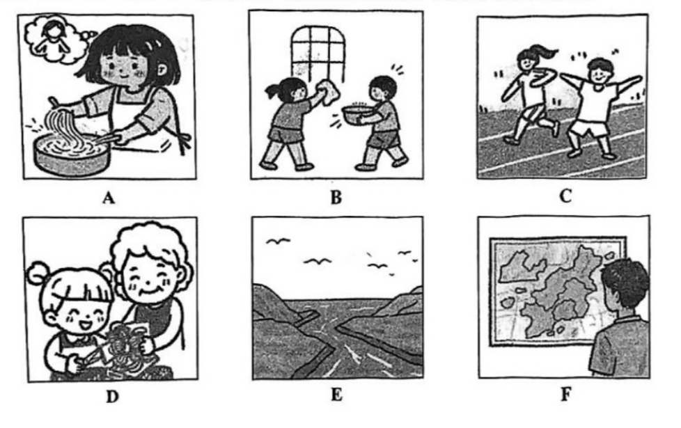

# 2026 一模精讲 · 闵行英语（上）：听力 + 语法词汇（第 1–43 题）

> 闵行卷结构：Part 1 听力 25 分（1–20）+ Part 2 语法词汇 45 分（21–58）+ Part 3 读写 70 分（59–84），共 7 大题 84 小题 140 分（卷面首注"本卷有 7 大题，共 84 小题"）。本篇覆盖第 1–43 题，第 44–84 题见 [[英模26-闵行-下]]。
>
> **与宝山范本卷的结构差异**：大题框架相同（上/下篇切分点同为 43/44），但内容题材不同——听力 C 篇为"中学生玩电子游戏调查"、D 篇为"有声读物的起源"（宝山为 Leo 买善 / Einstein 时间旅行）；阅读 A 篇为"桂林米粉"图文海报，其中 61 题为**四图选一**的看图题（宝山无此题型）；选词填空主题为"煤气灯效应（gaslighting）"。
>
> ⚠️ **资料说明**：本卷为纯扫描版（无文字层，题干逐题照 150dpi 页图录入，已校对）。**答案来源为卷面蓝笔手写批注版**（非官方排版答案），已逐题辨认誊录；听力部分（1–20）批注版未作答、且本区无听力音频，故听力只给卷面与方法，不给答案。

## Part 1 听力（第 1–20 题，共 25 分）

### A. Listen and choose the right picture（听句选图，第 1–5 题，5 分）

六选五，卷面六图为：

- A：女孩系着围裙在锅里煮面条，脑泡里想着睡觉的娃娃——"下厨煮面"场景
- B：女孩擦窗、男孩端着水盆走过来——"做家务/大扫除"场景
- C：男孩女孩在跑道上奔跑锻炼——"跑步/运动"场景
- D：小女孩和奶奶（妈妈）一起包饺子——"和家人包饺子"场景
- E：高山峡谷间的河流风光，天上有飞鸟——"河流/自然景观"场景
- F：男孩端详墙上挂的中国地图——"看地图/地理"场景

> ⚠️ 卷面批注版**未给出 1–5 题答案**，本区亦无听力音频，此处不臆测答案。做题方法：听前先读图、用一句话概括每图核心动词（cook noodles / do housework / run / make dumplings / river scenery / read a map），听到句子后抓"动词+名词"匹配。

### B. Listen to the dialogue and choose the best answer to each question you hear（对话理解，第 6–10 题，5 分）

6. A) At 10:00 a.m.  B) At 10:20 a.m.  C) At 11:00 a.m.  D) At 11:20 a.m.（问时间）
7. A) She memorizes lots of words.  B) She regularly reviews notes.  C) She does many English exercises.  D) She takes extra lessons.（问学习方法）
8. A) She lost her mobile phone.  B) Her child was missing.  C) She was late for work.  D) She got lost in the street.（问遇到的麻烦）
9. A) In a bookshop.  B) In a police station.  C) In a library.  D) In a forest park.（问地点）
10. A) She will accept the man's help.  B) She can carry the suitcase by herself.  C) She has a problem with her suitcase.  D) She is not feeling well at the moment.（问观点/状况）

> ⚠️ 同上，无音频无批注答案。考点预判：6 题抓时间数字及"提前/推迟"表述；7 题抓"怎么做"的行为动词；8 题抓困境核心名词（phone/child/work/street）；9 题抓场所标志词（borrow / report / quiet / trees）；10 题注意 but 后的转折才是真实态度（能否自己搬行李箱）。

### C. Listen to the passage and tell whether the following statements are true or false（短文判断，第 11–15 题，5 分）

11. The Social Services Club did a survey on video game use among students.
12. Boys spent 8 more hours a week playing video games than girls.
13. Students said they liked playing action-adventure games best.
14. Thirty percent students preferred to stay alone playing video games.
15. The passage gives some tips on how to balance study and video gaming.

> 短文主旨可从判断句反推：学校社团就"中学生玩电子游戏"做调查——男女每周游戏时长差、最受欢迎的游戏类型、独玩比例数据，最后给出平衡学习与游戏的建议。⚠️ 批注版未给 T/F 答案。方法：判断句与原文的**数字、时间、原因**最常被偷换（如 12 题 8 hours、14 题 thirty percent）。

### D. Listen to the passage and complete the following sentences（听短文填空，第 16–20 题，10 分）

16. People called *Audiobooks* (有声读物), developed in the 1870s. ______ ______ at first.
17. In 1931, a special project was begun to help ______ ______ read books by listening.
18. Many famous works were put in the project to make more people ______ ______ books.
19. LPs could hold up to 45 minutes of recordings, allowing audiobooks to ______.
20. Every reader from young kids just ______ ______ fairies to adults may enjoy audiobooks.

> ⚠️ 批注版未给答案。短文主题：有声读物（Audiobooks）的起源与发展——1870 年代诞生 → 1931 年为特殊人群启动朗读项目 → 密纹唱片（LP）45 分钟容量让成书可听 → 如今从孩子到成人人人可享受。注意 16 空在句首、17/18/20 各填两词、19 只填一词；年份数字（1870s / 1931 / 45 minutes）是定位锚点。

## Part 2 语法和词汇（第 21–43 题）

### II. Choose the best answer（语法单项选择，第 21–35 题，各 1 分，共 15 分；每题只有一个正确选项）

**21.** The sports app is ______ useful tool for us to follow our daily exercise results.
A) a  B) an  C) the  D) /

**答案 A**。useful 以辅音音素 /j/ 开头（不是元音音素）→ a useful tool。

**22.** All of the guests showed up at the party, and the host welcomed ______ warmly.
A) they  B) them  C) their  D) theirs

**答案 B**。动词 welcomed 后接宾格 them 作宾语。

**23.** Sam has a big dream of being a dancer. ______ can stop him from standing on the stage.
A) Something  B) Anything  C) Everything  D) Nothing

**答案 D**。语义"没有什么能阻止他站上舞台"；否定代词 Nothing 与 has a big dream 呼应。

**24.** You can find much fine ______ in the modern house in the downtown area.
A) painting  B) decoration  C) furniture  D) photograph

**答案 C**。much 修饰不可数名词，photograph 可数排除；房子里能找到的"许多精美家具"→ furniture 最贴切（painting 指绘画、decoration 泛指装饰，与 much fine 搭配均不如 furniture 顺）。

**25.** Mr. Wang is a kind-hearted boss. He seldom gets angry ______ his workers.
A) with  B) from  C) for  D) about

**答案 A**。get angry with sb 固定搭配"生某人的气"。

**26.** Our country held the grand military parade (大阅兵) ______ September 2025 in Beijing.
A) on  B) in  C) at  D) of

**答案 B**。月份+年份前用 in；具体到某日才用 on。

**27.** ______ extremely long and uncomfortably hot summer we had last year!
A) How  B) What  C) What a  D) What an

**答案 D**。感叹句核心是名词 summer（单数可数）→ What + an（extremely 以元音音素开头）+ adj + 名词。

**28.** When speaking to the baby girl, her father always looked ______ into her eyes.
A) friendly  B) likely  C) gently  D) lonely

**答案 C**。修饰动词 looked 用副词 gently；friendly / likely / lonely 虽以 -ly 结尾但都是形容词。

**29.** We expect the newly-built underground to bring us an even ______ life in transport.
A) convenient  B) more convenient  C) the more convenient  D) the most convenient

**答案 B**。even 修饰比较级；an 后接比较级不加 the。

**30.** Grace denied ______ the tap running in the bathroom, but the floor was all wet.
A) leave  B) to leave  C) leaving  D) left

**答案 C**。deny doing sth 固定接动名词（后句地板全湿提示"否认没关水龙头"）。

**31.** Finally, Jack managed ______ his broken bike by watching online instructional videos.
A) repair  B) to repair  C) repairing  D) repaired

**答案 B**。manage to do sth（设法做成）。

**32.** We've already booked the train tickets. You ______ worry about getting seats any more.
A) needn't  B) can't  C) may not  D) mustn't

**答案 A**。"票已订好"→ 没必要担心：needn't（can't 不能、mustn't 禁止，语义不合）。

**33.** Unluckily, Mr. Johnson's plane ______ before he arrived at the airport this morning.
A) took off  B) has taken off  C) will take off  D) had taken off

**答案 D**。"到达之前飞机已起飞"——过去的过去 → 过去完成时 had taken off（before 是时间锚点）。

**34.** A few people believe that most of the teaching work ______ by AI in the near future.
A) is done  B) was done  C) will be done  D) is being done

**答案 C**。in the near future → 一般将来时；teaching work 与 do 为被动关系 → will be done。

**35.** Mum won't use that smart kitchen ______ it can be controlled by her voice easily.
A) unless  B) so that  C) because  D) when

**答案 A**。"不肯用……除非它能被语音轻松控制"→ unless 条件状语从句。

### III. Choose the proper words in the box to complete the following passage（选词填空，第 36–43 题，各 1 分，共 8 分；每空格限填一词，每词只能填一次，两框各 5 选 4）

**首框**：A. memory  B. actually  C. at first  D. form  E. in return
主题：煤气灯效应（gaslighting，源自 1938 年话剧 *Gas Light* 与 1944 年同名电影）

**36.** He makes her believe that what she thinks is real, but it ______ isn't. → **B) actually**（"但其实并不是真的"；actually 修饰 isn't，语气转折）

**37.** This can lead the victim (受害者) to believe that they have a poor ______. → **A) memory**（a poor memory"记性差"，与下句"想法来自不可靠来源"同属让受害者自我怀疑）

**38.** Gaslighting is thought to be a ______ of psychological (心理的) abuse. → **D) form**（a form of"一种形式/类型"固定搭配）

**39.** Some gaslighters seem very kind ______. → **C) at first**（与下句 Then the gaslighter may begin to lie… 构成"起初……然后……"时间对照）

**次框**：A. recognize  B. helpful  C. own  D. against  E. apologize

**40.** They may ask the gaslighter what happened in the past, doubting their ______ thoughts. → **C) own**（doubting their own thoughts"怀疑自己的想法"；own 作形容词强调"自己的"）

**41.** As a matter of fact, it can be difficult for victims to ______ gaslighting. → **A) recognize**（to + 动词原形；"受害者很难识别煤气灯操纵"）

**42.** Telling someone about the situation is also ______ if that person can keep it a secret. → **B) helpful**（is + 形容词作表语；"告诉可保密的人也有帮助"）

**43.** They may often ______ and, at the same time, try to protect the gaslighter. → **E) apologize**（may + 动词原形；"常替对方道歉却同时袒护施害者"，是受害行为 signals 之一）

> 小结：选词填空先判词性（36 修饰动词用副词、37 冠词 a 后用名词、38 a…of 中间用名词、40 名词前用形容词、41/43 情态或 to 后用动词原形），再靠**上下文逻辑词**（39 的 Then、43 的 at the same time）锁定。unused 的 E) in return 与 D) against 是陪考词。

---
*本篇题干录自 150dpi 页图（闵行卷无文字层）；答案誊自卷面蓝笔手写批注版并逐题与语法规则互证。听力部分（1–20）无音频与批注答案，已如实标注。*
